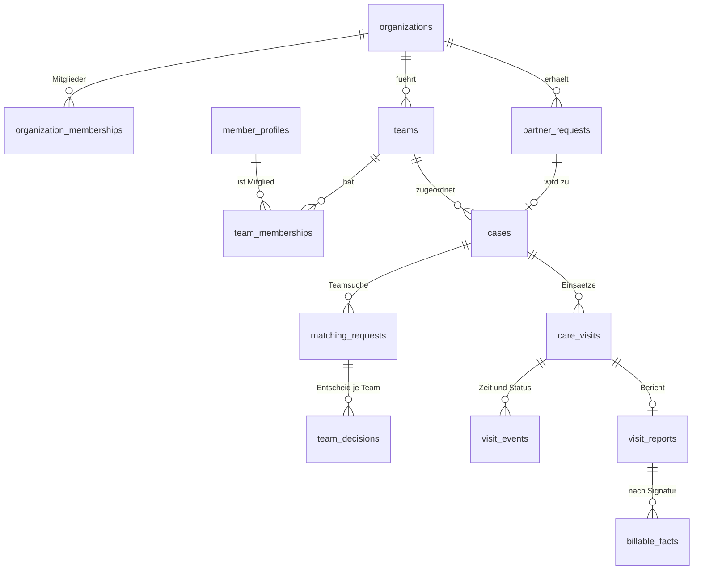
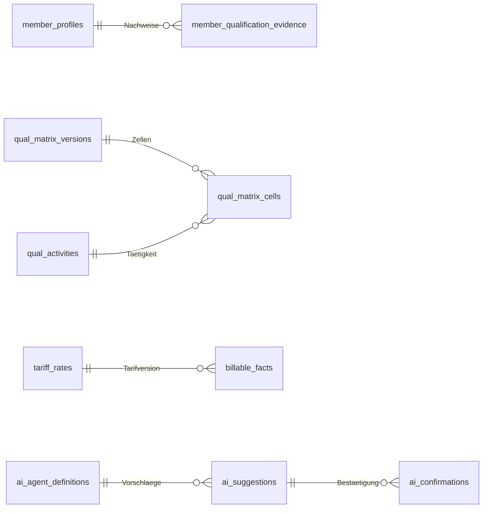
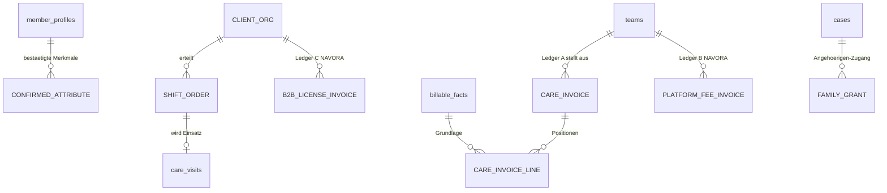

# NAVORA Architecture Handbook V2.0

**Status: ENTWURF zur Freigabe durch den Founder.** Bis zur Freigabe gilt [`ARCHITECTURE.md`](../../ARCHITECTURE.md) als Architekturquelle. Ab der Freigabe ist dieses Handbook die technische Verfassung, und `ARCHITECTURE.md` verweist hierher.

| Feld | Wert |
|---|---|
| Version | 2.0-Entwurf, 2026-11-13 |
| Auftrag | Founder-Anweisung vom 2026-11-13 (FE-074 in `FOUNDER_DECISIONS.md`) |
| Verfasst von | Product Owner (`po`), als Entwurf |
| Zuständig für den Inhalt | Engineering (`eng`) entscheidet das WIE (README). Dieser Entwurf hält den Ist-Stand fest und schlägt Zielbilder vor; jede neue Struktur (Tabelle, Route, Dienst) entsteht erst über ein ADR in `docs/engineering/DECISIONS.md`. |
| Review | `eng` (Abgleich mit dem Code, alle Kapitel), `csa` (Kapitel 1 und 2), `lca` (Kapitel 4, 5.3, 6), `cra` (Kapitel 3.1, 3.3, 3.5) |
| Produktseite | [`ARCHITECTURE_REVIEW_AND_IMPLEMENTATION_BLUEPRINT_V3.md`](../product/ARCHITECTURE_REVIEW_AND_IMPLEMENTATION_BLUEPRINT_V3.md) (WAS und WARUM) |

**Statuskennzeichen:** **IMPLEMENTED** (im Code auf `recovery/main`), **PARTIAL**, **PLANNED**, **OPEN** (Entscheid fehlt), **UNKNOWN** (nicht belegt). Der Ist-Stand ist aus dem Code auf `7d886b6` (2026-11-13) gelesen; der PO hat keine Tests ausgeführt. Tabellen- und Routennamen, die mit «Arbeitsname» markiert sind, sind Vorschläge, keine Festlegung.

---

## Inhalt

1. Architekturprinzipien
2. System- und Komponentenarchitektur
3. Die fünf Backend-Engines
4. Datenmodell, RLS und Mandantentrennung
5. Sicherheit, Datenschutz, KI-Grenzen
6. Testing, CI/CD und Staging
7. Abweichungen zwischen Anweisung, Dokumentation und Code
8. Pflege dieses Handbooks

---

## 1. Architekturprinzipien

1. **Postgres ist die Wahrheit.** Fachregeln, die Sicherheit oder Geld betreffen, laufen in der Datenbank (Funktionen, Constraints, RLS), nicht in React-Komponenten.
2. **Deterministisch vor KI.** Harte Regeln entscheiden, wer zulässig ist. KI ordnet und erklärt nur innerhalb dieser Menge.
3. **Mensch entscheidet, Mensch unterschreibt.** Kein Bericht ohne Signatur, keine Rechnung ohne signierten Bericht, keine Zuteilung ohne Teamentscheid.
4. **Jede Mutation ist ein Command:** Identität, Mitgliedschaft, Zuständigkeit, erlaubter Ausgangszustand, Idempotenz prüfen; dann atomar ändern und auditieren.
5. **Nichts geht still verloren.** Ein offener Bedarf, ein ungedeckter Einsatz oder ein ausgefallenes Signal erzeugt eine sichtbare, zugewiesene Ausnahme.
6. **Datenminimierung.** Jede Sicht zeigt nur, was ihre Rolle für ihre Aufgabe braucht.
7. **Drei Geldströme, drei Ledger.** Pflegeerlös, Plattformgebühr und B2B-Umsatz teilen weder Tabelle noch Fremdschlüssel.
8. **Alles ist getestet.** Jedes geänderte Verhalten hat positive und negative Tests; Sicherheitsregeln haben pgTAP-Tests.

---

## 2. System- und Komponentenarchitektur

### 2.1 Stack (IMPLEMENTED, aus `package.json` und Lockfile)

| Baustein | Version |
|---|---|
| Next.js (App Router) | 16.4.1 |
| React / React DOM | 19.2.8 |
| TypeScript | 5.9.3 |
| Tailwind CSS (`@tailwindcss/postcss`) | 4.3.3 |
| `@supabase/supabase-js` / `@supabase/ssr` | 2.118.0 / 0.12.7 |
| zod | 4.6.7 |
| Vitest | 4.1.12 |
| Playwright (`@playwright/test`) | 1.64.1 |
| Node.js | ≥ 22 |

KI- oder Spracherkennungs-SDKs: **keine** (Stand 2026-11-13). Web-Push ist ohne Bibliothek implementiert (RFC 8291, VAPID; `src/features/push/webpush.ts`).

### 2.2 Supabase-Bausteine

| Baustein | Status | Beleg |
|---|---|---|
| PostgreSQL mit den Schemas `public` und `private` | IMPLEMENTED | 125 Migrationen, `20261021000001_baseline_reconstructed.sql` bis `20261021000127_b1_1_1_region_list.sql` |
| Row Level Security | IMPLEMENTED | 85 `enable row level security`, 87 Policies; Kapitel 4.3 |
| Auth (SSR-Cookies über `@supabase/ssr`) | IMPLEMENTED | `src/lib/auth/*` |
| pg_cron | PARTIAL: Jobs werden nur angelegt, wenn die Erweiterung vorhanden ist; sonst laufen dieselben Arbeiten beim Laden oder Abfragen von Seiten | `navora-plan2-daily` (0025), `navora-cover1-events` alle 10 Minuten (0029), `navora-sig1-signals` jede Minute (0060) |
| pg_net und Vault | PARTIAL | `private.push_dispatch_kick` ruft `/api/push/dispatch` auf, wenn URL und Geheimnis im Vault liegen (0064) |
| Realtime | **nicht genutzt** | kein Channel im Code. Für BK-5 («das Heim sieht ‹gedeckt› innert Sekunden») PLANNED: Realtime oder Polling, ADR durch `eng` |
| Edge Functions | **nicht genutzt** | kein `supabase/functions` |
| PostGIS | **nicht im rekonstruierten Schema** | die Baseline lässt PostGIS-Spalten und die alte Distanzfunktion bewusst weg |

### 2.3 Schichten

```text
Portale (Next.js App Router, React Server Components, Tailwind)
   │  Server Actions / Route Handler  (nur serverseitig, zod-validiert)
   ▼
Application: Commands, Queries   (src/features/*, src/lib/*)
   │  supabase-js mit dem Token der angemeldeten Person (RLS greift)
   ▼
PostgreSQL: RLS-Policies · security-definer-Funktionen im Schema private
            (search_path = '') · Trigger · Audit · pg_cron
   ▲
   │  nur über den KI-Orchestrator (PLANNED): Minimierung → Modell/Regel →
   │  Schema-Validierung → Vorschlagsprotokoll (AIG1) → menschliche Bestätigung
KI-Dienste (heute keine angebunden; reale Daten erst nach D-41)
```

Regeln (IMPLEMENTED als Praxis, ADR-Reihe in `docs/engineering/DECISIONS.md`): Keine Fachregel in einer React-Komponente. Kein `service_role`-Schlüssel im Browser. Security-definer-Funktionen haben `search_path = ''` und sind `public` entzogen (B0-7, pgTAP-Katalogtest).

### 2.4 Portale und Routen

| Portal (Blueprint V3 Kap. 4) | Zielroute | Heute im Code | Status |
|---|---|---|---|
| P1 Auftraggeber | `/order` | `/intake` (Erfassung durch Personal, Rollen admin und operations) | PLANNED |
| P2 Team | `/team` | `/team`, `/team/tagesplan`, `/team/vorschlaege`, `/team/rueckblick/[stopId]` | PARTIAL |
| P3 Pflegekraft mobil | `/field` | `/field`, `/work` | PARTIAL (kein Offline, kein Diktat) |
| P4 B2B-Heimsuite | `/b2b-institution` | — | PLANNED |
| P5 Angehörige | `/family` | — | PLANNED |
| P6 Betreiber und Coach | `/platform` | `/operations` (Ausnahmezentrum einer Organisation), `/admin`, `/analytics` | PLANNED |

Weitere Routen heute: `/operations/assistenten`, `/operations/assistenten/tagesvorschlag`, `/operations/assistenten/rueckblick/[stopId]`, `/visits/[visitId]`, `/login`, `/settings` (Push-Opt-in), `/teams` und `/visits` (erste MVP-Seiten, nicht mehr im Menü), `/partners` (Demo mit erfundenen Daten, nur mit `NEXT_PUBLIC_FEATURE_DEMO_PAGES=true`), `api/push/dispatch`. Das Menü steht in `src/lib/auth/nav.ts`; `/` leitet Pflegekräfte nach `/field`, alle anderen nach `/operations`.

**Vorschlag zur Umstellung (PLANNED, ADR durch `eng`):** neue Portale als eigene Routengruppen mit eigener Layout-Datei und eigener Rollenprüfung im Layout; bestehende Routen werden nicht umbenannt, bevor ihr Nachfolger getestet ist. Eine App-Shell für alle Portale (UX S1, Issue #510).

---

## 3. Die fünf Backend-Engines

Die Engines sind eine fachliche Gliederung, keine getrennten Dienste. Engine 1 und 5 laufen in Postgres. Engine 2 bis 4 haben einen deterministischen Kern in Postgres und einen KI-Teil, der nur über den Orchestrator läuft.

### 3.1 Engine 1: On-Platform Matching-Engine (Postgres/SQL)

**Aufgabe:** bestimmen, welche Teams einen Auftrag überhaupt erhalten dürfen. Deterministisch, ohne KI, in der Datenbank. Erfüllt D-35 Regel A, weil keine Daten die Plattform verlassen.

**Ist (IMPLEMENTED):** `private.request_offered_to_team` (letzte Fassung 0034) bietet einen Auftrag einem Team nur an, wenn alle Bedingungen gelten:

- Anfrage offen, Fall ohne Team, gleiche Organisation, Team aktiv;
- Region des Teams gleich Region der Teamsuche (`t.region = m.region`, einfacher Gleichheitsvergleich; die Werte werden beim Schreiben über den Trigger `region_from_list` mit `private.region_norm` auf die Regionsliste normalisiert, 0127);
- falls die Spalte `m.required_qualification` 'registered_nurse' verlangt (gesetzt von `private.required_qualification`, 0017: Bedarfsabklärung nicht abgeschlossen oder ärztliche Anordnung vorhanden): das Team hat eine diplomierte Pflegefachperson;
- das Vorrecht des früheren Teams bei einer wiederkehrenden Klientin (RET1).

Das erste Team, das annimmt, erhält den Fall atomar (Zeilensperre, 0011). Kein Ranking, kein Score; `fit_score` und `distance_km` sind veraltete Spalten.

**Ziel (PLANNED, Block BK-a, BK-2):**

| Filter | Eingabe | Regelklasse |
|---|---|---|
| PLZ-Distanz innerhalb des Auftragsradius | PLZ des Einsatzorts aus der BS/BL-Liste; Teamstandort | Einsatz- und Zeitfakt; Quelle der Distanzen **OPEN** (synthetische Tabelle oder öffentliche Geodaten; Nutzungsbedingungen `lca`) |
| Qualifikationsstufe für die Tätigkeits-Tags | `qual_activities`, `qual_matrix_versions`, `qual_matrix_cells` | **klinischer Inhalt:** Matrix v0.1/v0.2 PROPOSED, nur Simulation; Clinical Owner vor realen Daten (D-27) |
| Verfügbarkeit im Zeitfenster | Einsätze, Abwesenheiten | Einsatz- und Zeitfakt |
| Pflicht-Merkmal als bestätigtes Merkmal | bestätigtes Erfahrungsmerkmal einer Person (Arbeitsname) | von einer Person erfasst und bestätigt; `lca`: Merkmal als Personaldatum |
| Delegation | `qual_delegations`, `qual_delegation_revocations` | klinischer Inhalt, PROPOSED |

Jedes ausgeschlossene Team trägt seinen Grund. Dieselbe Prüfung läuft bei der Übernahme erneut (BK-5). Begriff «KLV 7»: Die Matrix leitet Tätigkeitsgrenzen unter anderem aus KLV Art. 7 ab (`QUALIFICATION_MATRIX.md` §1.2, Schicht L1); die rechtliche Lesung ist `lca` (L-1), die fachliche Freigabe der Clinical Owner. Die Engine setzt keine eigene KLV-Auslegung um.

**Tests (Pflicht):** pgTAP für jeden Filter mit einem Team, das genau diesen Filter verletzt, und dem Nachweis, dass es nie ein Angebot erhält (BK-2n). Die Prüfung erfolgt auf den Angebotszeilen, nicht in der Oberfläche.

### 3.2 Engine 2: KI-Orchestrierungs- und Routing-Service

**Aufgabe:** unter den zulässigen Teams aus Engine 1 eine Reihenfolge bilden (Erfahrung, Kontinuität mit diesem Auftraggeber, Sprache, Distanz) und in Worten begründen.

**Ist:** Kein Ranking, kein KI-Aufruf. Das Gerüst für KI-Governance ist IMPLEMENTED (0097 ff.): Agentenregister mit Arten `rule` und `ai`, unveränderliche Tabellen `ai_suggestions` und `ai_confirmations`, Stoppschwelle, Ausnahme `agent_stopped`. `set_agent_state` verweigert das Einschalten jedes Agenten der Art `ai` und jedes Agenten der Stufe G oder H.

**Ziel (PLANNED, BK-3, BK-4):**

1. **Eingabe:** nur die Liste der zulässigen Teams aus Engine 1 und ihre bestätigten Fakten. Die Engine kann kein Team hinzufügen und keinen Filter aufheben.
2. **Rangfolge zuerst als Regel:** Eine gewichtete, erklärbare Regel (Art `rule`, Stufe L) ist die erste Ausbaustufe. Ein KI-Modell kommt erst, wenn die Regel nachweislich nicht genügt.
3. **Begründung:** ein Satz aus den verwendeten Fakten, zum Beispiel «Spätschicht 16:30–21:30, Demenzabteilung, 4052 Basel, 2,1 km · passt: AGS, Demenzerfahrung bestätigt (Sara M.), frei». **Kein Prozentscore** in der Oberfläche.
4. **Protokoll:** jede Rangfolge und jede Begründung als Vorschlag in `ai_suggestions`.

**Datenregel:** Ein Profil- oder Tag-Abgleich über ein externes KI-Modell würde Personaldaten an einen KI-Dienst geben. Das ist in Phase A nur mit synthetischen Daten erlaubt und für reale Daten verboten, bis D-41 entschieden ist (D-35 Regel A, FE-024). Ein eigenes Modell nur auf synthetischen Daten (FE-051 Muster 4) bleibt möglich.

### 3.3 Engine 3: KI-Voice-to-Report-Pipeline

**Aufgabe:** aus einem Diktat oder einer Notiz der Pflegekraft einen strukturierten Berichtsentwurf machen, den sie prüft und signiert.

**Ist:** Bericht, Rückgabe und Signatur sind IMPLEMENTED (`visit_reports`, `visit_report_returns`, `visit_observations`; F6, F6R, F7). Ein Diktat, eine Route `/api/ai/transcribe` oder eine Spracherkennung gibt es nicht.

**Ziel (PLANNED, BK-8, Block B6):**

```text
Audio (Browser, /field) ──► Speech-to-Text ──► Text
Text ──► Strukturierung (Muster 3: regel- und vorlagenbasiert als Kern)
     ──► Entwurf mit Quellenbezug je Satz ──► ai_suggestions
     ──► Prüfung und Bearbeitung durch die Pflegekraft
     ──► «Freigeben & Signieren» (nur die Pflegekraft der Schicht)
     ──► verbindlicher Bericht ──► erst jetzt billable_fact
```

- **Route:** `/api/ai/transcribe` ist ein Arbeitsname; Server Action oder Route Handler entscheidet `eng` im ADR.
- **Speech-to-Text:** Anbieter und Region **OPEN** (D-35 Stufe 1, D-41). In Phase A nur synthetische Audiodaten oder ein Dienst, der keine Daten die Plattform verlassen lässt; welcher Weg technisch möglich ist, ist **UNKNOWN** und ein ADR-Thema.
- **«Strukturierter KLV-Pflegebericht»:** Die Zuordnung von Leistungen zu KLV-Kategorien A/B/C ist ein offener klinischer Entscheid (D-15). Bis dahin erzeugt die Pipeline einen strukturierten Bericht nach der bestehenden Berichtsvorlage, ohne eigene KLV-Zuordnung.
- **Unveränderlich:** Kein Satz ohne Quelle (Stoppregel). Ein Entwurf ist nie ein Bericht. Ein unsignierter Entwurf erzeugt keine abrechenbare Tatsache (BK-8n). D-34 (Owner 2026-10-27, A plus C): ein KI-Dokumentationsentwurf nur als separat qualifiziertes Modul mit eigener Zweckbestimmung und eigenem Konformitätsweg; der Kern bleibt ausserhalb des Medizinprodukt-Bereichs; Regulierungsberatung offen.

### 3.4 Engine 4: Finanzen- und Billing-Engine

**Aufgabe:** aus signierten Leistungen Rechnungsentwürfe vorbereiten, prüfen, unklare Fälle anhalten; drei Geldströme getrennt führen.

**Ist (IMPLEMENTED, synthetisch):** `tariff_rates` (Zahler Versicherer, Patient, Restfinanzierung; KLV-Kategorie A/B/C), `billing_rules` (unter anderem Mindestminuten), `billable_facts` (unveränderlich, entsteht aus einem finalen Bericht ohne offenen Qualitätshalt; mit `payer_chain`, `order_basis`, `tariff_versions`), Umsatzvorschau (`billing_preview`). Keine Rechnungstabelle (0022: «No invoice, no e-billing (D-12)»), keine Provision, kein Tiers payant.

**Ziel (PLANNED):**

| Weg | Inhalt | Wann |
|---|---|---|
| Dienstleistungsrechnung an eine Einrichtung | ein Rechnungsentwurf des Teams an das Heim aus `billable_facts`; Zeit aus der Erfassung; Preis aus dem Auftrag | BK-d (Phase A, synthetisch) |
| Privatrechnung | Rechnung an eine Privatperson | nach BK |
| KVG/KLV, Tiers payant oder Tiers garant | Rechnung an den Versicherer bzw. die versicherte Person | **OPEN**, nicht vor D-22, D-18, D-44 und Zulassung |
| Plattformgebühr (Ledger B) | monatliche Gebühr je Team, nach VZE gewichtet (FE-055 (3)) | nach D-14 |
| B2B-Lizenz (Ledger C) | Lizenz je Modul und Einrichtung | nach FD-29 |

**«Automatisch» heisst vorbereitet, nicht entschieden.** Die Engine erstellt Entwürfe und Prüfergebnisse automatisch. Den Entwurf gibt eine Person frei; automatische Abrechnungsentscheide sind verboten (`ARCHITECTURE.md`, KI-Säule). Validierungen (PLANNED, BK-9n, B8): Abweichung zwischen erfasster Zeit und Auftragszeit stoppt die Rechnung sichtbar; eine zweite Rechnung für dieselbe Schicht wird abgewiesen; keine NAVORA-Position auf einer Pflegerechnung.

**Datenmodell der Trennung (Arbeitsnamen, ADR durch `eng`):** `care_invoices` und `care_invoice_lines` (Ledger A, gehört dem Team), `platform_fee_invoices` (Ledger B), `b2b_license_invoices` (Ledger C). Kein Fremdschlüssel zwischen A und B/C. pgTAP beweist: ein Team liest nur Ledger A der eigenen Teams und die eigene Gebühr; eine Pflegerechnung kann keine NAVORA-Position enthalten.

### 3.5 Engine 5: Sicherheits- und Signal-Manager

**Aufgabe:** dafür sorgen, dass ungedeckte Schichten, verpasste Einsätze und Sicherheitssignale eine zuständige Person erreichen und nachweislich eskalieren. Deterministisch (AI-10).

**Ist (IMPLEMENTED):**

- `exception_rules` mit Prioritäten. P1 unter anderem `no_show_open`, `signal_untaken`, `visit_uncovered_hospital`. P2 unter anderem `visit_uncovered`, `offer_overdue`, `candidates_exhausted`, `case_reopened_no_team` (SAFE-D11), `agent_stopped`. P3 unter anderem `case_not_ready`, `deadline_missing`, `report_not_final`. Je Regel `escalate_to_p1_after_hours`.
- `exception_events`, Ausnahmezentrum `src/app/(protected)/operations/exception-center.tsx`.
- Sicherheitssignale: `safety_signals`, `signal_deliveries`, `signal_takes`, Empfänger über `private.signal_recipients`; Auswertung jede Minute über pg_cron, sonst beim Abfragen.
- Push an Geräte über `/api/push/dispatch`.

**Ziel (PLANNED, BK-6):** Ein Schichtauftrag ohne Team zeigt dem Auftraggeber «noch nicht gedeckt» mit der Zeit bis Schichtbeginn und ab Schichtbeginn «nicht gedeckt». Eskalationsstufen und Fristen für einen ungedeckten Heim-Einsatz sind klinischer Inhalt und brauchen die Freigabe des Clinical Owners vor realen Daten. Zuerst informiert wird das zuständige Team oder der Auftraggeber; der Betrieb erst, wenn niemand zuständig ist.

---

## 4. Datenmodell, RLS und Mandantentrennung

### 4.1 Domänen und Tabellen (IMPLEMENTED, Auswahl)

| Domäne | Tabellen |
|---|---|
| Organisation | `organizations`, `organization_memberships` (Rolle `admin`, `coach`, `operations`, `nurse`), `regions`, `region_legacy_values` |
| Teams | `teams`, `team_memberships` (mit `qualification`), `team_candidates`, `team_admission_*` |
| Personal | `member_profiles`, `member_invitations`, `member_absences`, `member_qualification_evidence`, `working_time`, `working_time_facts` |
| Anfrage und Fall | `partner_requests`, `referral_links`, `cases`, `case_lifecycle_events`, `case_tasks`, `care_plan_items` |
| Matching | `matching_requests`, `match_candidates`, `team_decisions`, `response_deadlines` |
| Einsatz | `care_visits`, `visit_events`, `visit_time_corrections`, `visit_activities`, `cover_events`, `day_plan_lines` |
| Bericht | `visit_reports`, `visit_report_returns`, `visit_observations`, `care_notes`, `assessment_records` |
| Qualifikation | `qual_activities`, `qual_matrix_versions`, `qual_matrix_cells`, `qual_delegations`, `qual_delegation_revocations` |
| Qualität, Signale | `quality_events`, `quality_holds`, `safety_signals`, `signal_deliveries`, `exception_rules`, `exception_events` |
| Abrechnung | `tariff_rates`, `billing_rules`, `billable_facts` |
| KI-Governance | `ai_agent_definitions`, `ai_agent_settings`, `ai_suggestions`, `ai_confirmations`, `ai_agent_stops` |
| Audit | `audit_events`, `audit_read_log`, `change_log` (Änderungen durch Trigger gesperrt) |

### 4.2 Entity-Relationship-Diagramm

Grossbuchstaben: geplante Entität (Arbeitsname). Kleinbuchstaben: bestehende Tabelle.

**(a) Kern heute (IMPLEMENTED): Organisation, Team, Anfrage, Fall, Einsatz**



**(b) Regeln, KI-Governance, Abrechnungsfakten (IMPLEMENTED)**



**(c) Erweiterung (PLANNED, Arbeitsnamen, ADR durch `eng`)**



**Offene Modellfrage (BK, Frage 2 an `eng`):** Trägt ein Schichtauftrag die bestehenden Tabellen (`partner_requests`, `cases`, `matching_requests`) oder einen neuen Auftragstyp? Ein Schichtauftrag in einem Heim hat keine betreute Einzelperson als Fall. ADR zuerst.

**Auftraggeber als Organisation (PLANNED):** Heute ist ein Heim nur ein Quellen-Label bei der Erfassung («Pflegeheim», «Spital»). Für P1 und P4 braucht es eine Auftraggeber-Organisation mit eigenen Mitgliedern und eigener Rolle, getrennt von der Organisation des Teams.

### 4.3 Row Level Security und Mandantentrennung

**Ist (IMPLEMENTED):**

- Die unsicheren Live-Policies («`true` für alle») werden in `0002_legacy_anon_policies.sql` nur für lokal und CI nachgebaut und in `0003_tenancy_rls.sql` entfernt.
- Hilfsfunktionen, alle `security definer` mit `search_path = ''`: `private.is_org_member`, `private.has_org_role`, `private.is_team_member` (Mitgliedschaft und Zugang nicht beendet), `private.is_coordinator` (admin, coach, operations), `private.is_intake_role` (admin, operations), `private.is_org_admin`.
- Muster: `cases.scoped_read using (is_org_member(organization_id) and (is_coordinator(organization_id) or is_team_member(assigned_team_id)))`; gleich für `care_visits`, `care_notes`, `quality_events`.
- `partner_requests`, `matching_requests`, `match_candidates`: nur Koordinatoren.
- **Ein Team sieht keine Daten eines anderen Teams** über diese Policies; eine Pflegekraft sieht nur ihre Teams.
- **Koordinatoren sehen die ganze Organisation.** Das ist eine Spannung zum Zielbild (kein zentraler Dispositionsplatz) und zur offenen Berechtigungsmatrix D-3.

**Ziel (PLANNED):**

| Regel | Test |
|---|---|
| Kein Team liest Fälle, Einsätze, Berichte oder Rechnungen eines anderen Teams | pgTAP je Tabelle, mit zwei Teams derselben und verschiedener Organisationen |
| Ein Auftraggeber liest nur eigene Aufträge, deren Deckungsstatus, den Namen des übernehmenden Teams und die eigenen Rechnungen | pgTAP und e2e (BK-1n) |
| Ein Auftraggeber liest keine Aufträge eines anderen Auftraggebers | pgTAP |
| Angehörige lesen nur freigegebene Updates der Person, für die ein gültiger, nicht widerrufener Zugang besteht; nie die klinische Akte | pgTAP (FAM1) |
| Coach/Mediator: kein allgemeiner Lesezugriff auf Gesundheitsdaten | pgTAP |
| Betrieb (P6): Zählungen und Aggregate, keine Inhalte | pgTAP |
| Keine Tabelle ohne RLS, kein `anon`-Grant, jede security-definer-Funktion mit `search_path = ''` | bestehender Katalogtest (B0-7) über alle Migrationen |

Die genauen Leserechte je Rolle sind **OPEN** (D-3) und werden nicht vorweggenommen.

---

## 5. Sicherheit, Datenschutz, KI-Grenzen

### 5.1 Daten

- **Phase A nur synthetische Daten** (FE-021, FE-062). Testumgebungen werden trotzdem produktionsnah geschützt (FE-020).
- Kein `service_role`-Schlüssel ausserhalb des Servers; Einsatz für Einladungen ist D-26.
- Audit-Tabellen sind gegen Änderung gesperrt (Trigger `private.forbid_audit_change`, `private.forbid_audit_read_log_change`). Aufbewahrungsfristen: D-4, OPEN.

### 5.2 KI

- **D-35 Regel A (in Kraft):** keine Klienten- oder Personaldaten an einen KI-Dienst. Agenten laufen nur auf synthetischen Daten; was ohne KI geht, wird als Regel gebaut.
- Alle KI-Aufrufe nur über den Orchestrator (PLANNED); keine Modellaufrufe aus Seiten oder Clients; jeder Vorschlag im Protokoll.
- Verboten: automatische Abrechnungsentscheide, automatische klinische Empfehlungen an Klienten oder Angehörige, KI-Priorisierung von P1-Signalen, Allzweck-Copiloten auf Produktivdaten.

### 5.3 Hosting und Betrieb

| Thema | Stand | Status |
|---|---|---|
| Datenbank Produktion | `navora-prod`, Supabase Free, Zürich `eu-central-2`; Upgrade auf einen Plan mit PITR vor realen Daten (FE-063) | Entscheid in Kraft; Projekt laut FE-063 noch nicht angelegt |
| App-Host | Infomaniak Jelastic Cloud, Rechenzentren in der Schweiz (FE-064); AVV-Prüfung `lca` vor realen Daten | Entscheid in Kraft; AVV OPEN |
| Staging | `navora-staging` (Zürich); Migrationen nur aus CI nach vier grünen Jobs, nie der Seed (STG1, PR #1087) | PR offen, Job `staging` scheitert am fehlenden Repository-Geheimnis `STAGING_DB_URL` (Owner-Handlung) |
| Repository-Schutz | Ruleset mit Pflicht-Checks, kein Force-Push, Secret Scanning (B0-6, FE-045) | **nicht erfüllt** (Owner) |

---

## 6. Testing, CI/CD und Staging

### 6.1 Testpyramide

| Stufe | Werkzeug | Umfang heute | Regel |
|---|---|---|---|
| 1 Unit | Vitest (`tests/unit`) | 114 Testdateien | jede Fachfunktion in TypeScript |
| 2 Datenbank | pgTAP (`supabase/tests/database`) | 132 Testdateien | jede RLS-Regel, jede security-definer-Funktion, jede harte Fachregel; Wettläufe mit zwei echten Sitzungen |
| 3 End-to-End | Playwright (`tests/e2e`) | 36 Spezifikationen; Screenshots aller Routen je Rolle bei 390×844 und 1440×900 mit der axe-Regel `color-contrast` (`tests/screenshots/capture.spec.ts`; keine vollständige axe-Prüfung) | jeder Akzeptanzablauf eines Blocks |
| 4 Wiederholung | `ci-repeat` | `db` und `e2e` 10 Mal auf einem Commit | Abnahme nur bei 10/10 |

**Lücke:** Beide Playwright-Konfigurationen haben ein einziges Projekt (Chromium, Desktop Chrome). Mobile Abläufe laufen heute über die Fenstergrösse in den Tests und die Screenshot-Spezifikation. Ein eigenes mobiles Projekt ist PLANNED (Vorschlag, `eng` entscheidet).

**Lasttests:** Es gibt keine Last- oder Skalierungstests. `ci-repeat` prüft Wiederholbarkeit, nicht Last. Ein Lasttest vor Phase B ist PLANNED (B11); Zielwerte OPEN.

### 6.2 CI-Workflows (IMPLEMENTED, `.github/workflows`)

| Workflow | Auslöser | Inhalt |
|---|---|---|
| `ci.yml` | Pull Requests; Push auf `main` und `recovery/main` | Jobs `app` (lint, typecheck, unit, audit, build), `db` (Migrationen, Seed, pgTAP), `e2e` (Auth, geschützte Routen, Playwright), `ui-screenshots` |
| `ci-repeat.yml` | Push auf `repeat/**` (10 Versuche) oder `repeat/2/**` (2 Versuche) | `db` und `e2e` aus `ci.yml`, erzeugt durch `scripts/ci-repeat.mjs` |
| `agents-coordination.yml` | stündlich; Push auf `main`/`recovery/main` bei Änderung der Agentendateien; manuell | Koordinations-Issues aus den Agentendateien |
| `db-types-sync.yml`, `lockfile-sync.yml` | — | Typen und Lockfile synchron halten |

**Merge-Regeln (FE-054, README Regel 12):** Merge nur mit grünem `ci` auf dem aktuellen PR-Kopf; danach muss `ci` auf dem Merge-Commit grün sein, sonst sofort ein Revert-PR. Kein Test wird übersprungen, abgeschaltet oder abgeschwächt, um grün zu werden. Migrationen laufen auf leerer und bestehender Datenbank in derselben Reihenfolge (B0-8, Prüfskript in CI).

### 6.3 Staging-Pipeline (PLANNED)

```text
PR grün (4/4) ──► Merge auf recovery/main ──► ci auf Merge-Commit grün
   ──► Job staging: Migrationen auf navora-staging (nie der Seed)
   ──► Smoke-Test gegen Staging
   ──► ci-repeat 10/10 auf dem benannten Commit ──► Abnahme
```

### 6.4 Backup und Wiederherstellung

**Ist:** PARTIAL. Eine einmalige Sicherung der Policies und Grants vor der Eindämmung (`docs/ops/live/2026-10-21_backup_and_rollback.sql`), Wiederherstellungsprotokoll in `docs/recovery/`. Kein Backup- oder Restore-Skript in `scripts/`. Supabase Free hat keine Backups (FE-063).

**Ziel (PLANNED, B11, Gate PB-11):**

1. Plan mit PITR vor realen Daten.
2. Ein dokumentierter Wiederherstellungstest: Sicherung von Staging → Wiederherstellung in eine leere Datenbank → pgTAP und Smoke-Test grün → Protokoll mit Commit, Dauer und erreichtem RPO/RTO.
3. Wiederholung vor jedem Gate-Entscheid für Phase B.

---

## 7. Abweichungen zwischen Anweisung, Dokumentation und Code

Nach CLAUDE.md: dokumentieren, Ursache nennen, nichts automatisch ändern, sichere Lösung vorschlagen.

| # | Abweichung | Ursache | Vorschlag |
|---|---|---|---|
| A-1 | Anweisung nennt Realtime als Stack-Bestandteil; der Code nutzt Realtime nicht | bisher kein Bedarf | ADR bei BK-5 (Realtime oder Polling) |
| A-2 | Anweisung nennt `/order`, `/b2b-institution`, `/family`, `/platform`; keine davon existiert | Portale noch nicht gebaut | Kapitel 2.4; Aufbau blockweise |
| A-3 | Engine 1 «PLZ-Distanz»: heute exakter Regionsvergleich, keine Distanz; PostGIS nicht im rekonstruierten Schema | Baseline hat PostGIS bewusst weggelassen | BK-a mit PLZ-Distanztabelle (Quelle `lca`), ADR zu PostGIS ja oder nein |
| A-4 | Engine 2 und 3 als KI-Dienste; D-35 Regel A verbietet reale Daten an KI | Founder-Regel FE-024 | Phase A nur synthetisch; reale Daten nach D-41 |
| A-5 | Engine 4 «Krankenkassen-Tiers-Payant» | D-22, D-18, D-44 offen | als OPEN geführt, nicht gebaut |
| A-6 | Engine 4 «automatische Rechnungsstellung» gegen das Verbot automatischer Abrechnungsentscheide | zwei Formulierungen | Lesart: automatisch vorbereitet, menschlich freigegeben; Bestätigung Founder |
| A-7 | `ARCHITECTURE.md` führt `/matching` unter «IMPLEMENTED früher»; die Route ist entfernt | Demo entfernt (IPA1-4) | mit Freigabe dieses Handbooks erledigt |
| A-8 | `ARCHITECTURE.md` führt PostGIS und `cases.location` als «IMPLEMENTED in damaliger Datenbank» | gilt für die alte Live-Datenbank, nicht für das rekonstruierte Schema | mit Freigabe dieses Handbooks erledigt |
| A-9 | Testpyramide «Playwright mobile/desktop»: nur ein Desktop-Projekt | Bildschirmgrösse über Tests gesetzt | mobiles Projekt als Vorschlag an `eng` |
| A-10 | Koordinatoren lesen die ganze Organisation; Zielbild ohne zentrale Disposition | historisch gewachsen, D-3 offen | Berechtigungsmatrix D-3; keine Änderung vor dem Entscheid |
| A-11 | `docs/engineering/RECOVERY_RUNBOOK.md` gibt es nur als Projektdokument, nicht im Repository | Ablage | `eng` übernimmt es ins Repository oder verweist |

---

## 8. Pflege dieses Handbooks

- Ab der Freigabe pflegt `eng` dieses Handbook; jede neue Struktur bekommt ein ADR in `docs/engineering/DECISIONS.md` und eine Zeile in der Versionstabelle.
- Der PO meldet Produktänderungen über den Blueprint V3 und Briefs, nicht über direkte Änderungen an Kapitel 2 bis 6.
- Ist-Stand-Aussagen werden bei jeder Blockabnahme gegen den Code geprüft.

### Versionstabelle

| Datum (Europe/Zurich) | Version | Was | Warum | Kapitel |
|---|---|---|---|---|
| 2026-11-13 | 2.0-Entwurf | Neufassung: Stack, Supabase-Bausteine, fünf Engines mit Ist und Ziel, ERD, RLS-Ziele, Testpyramide, CI, Staging, Backup, Abweichungsliste | Founder-Anweisung FE-074 | alle |

Keine personenbezogenen oder Gesundheitsdaten in diesem Dokument. Alle Namen in Beispielen sind synthetisch.
