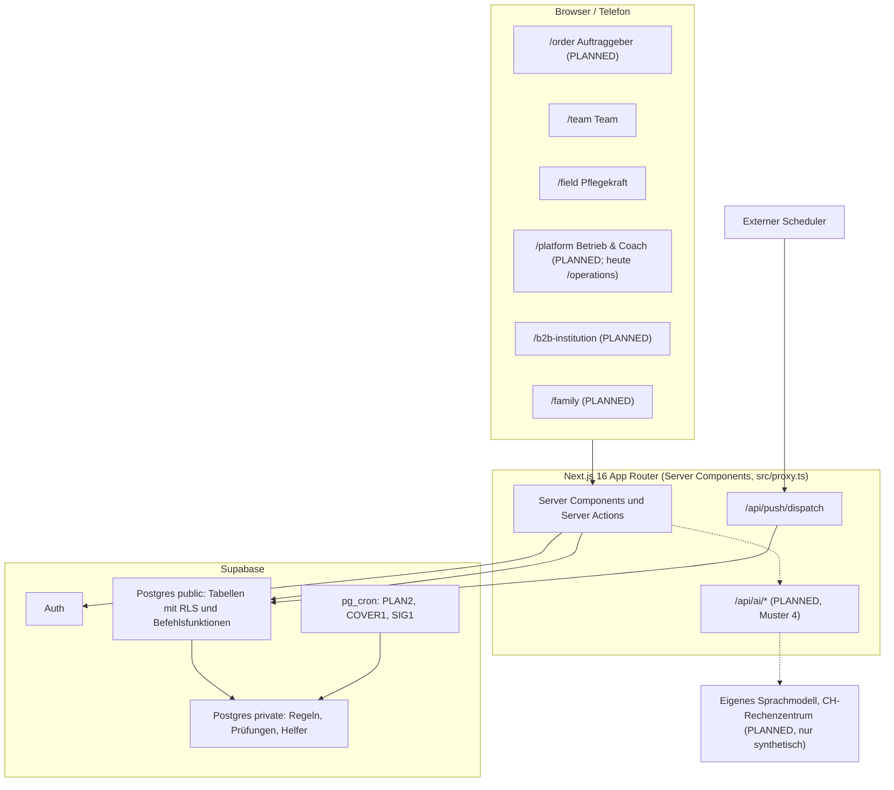
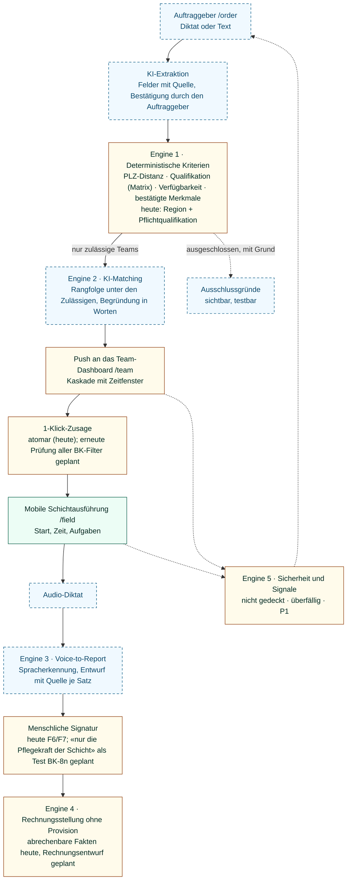
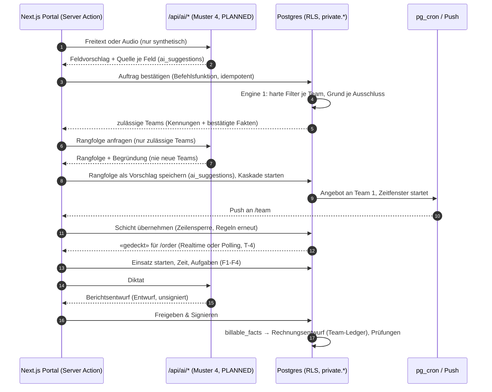
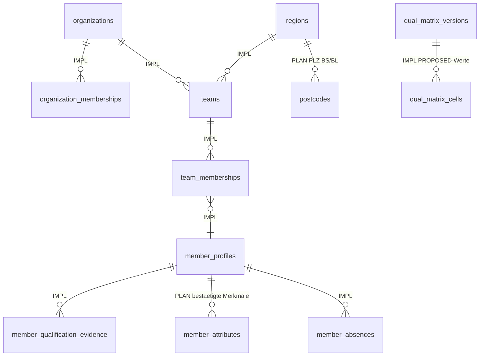
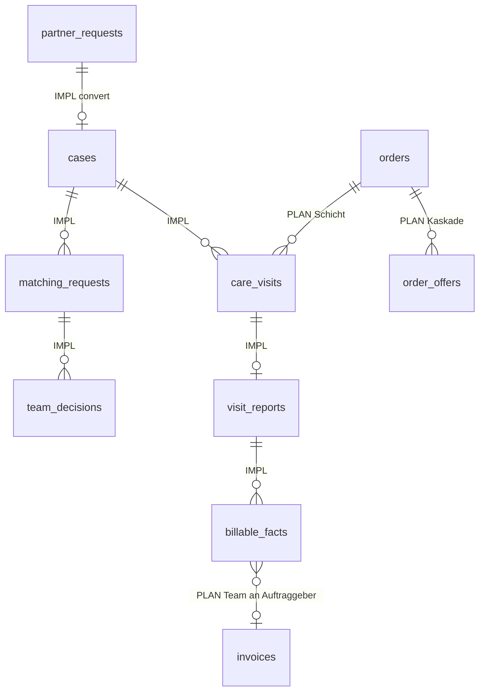
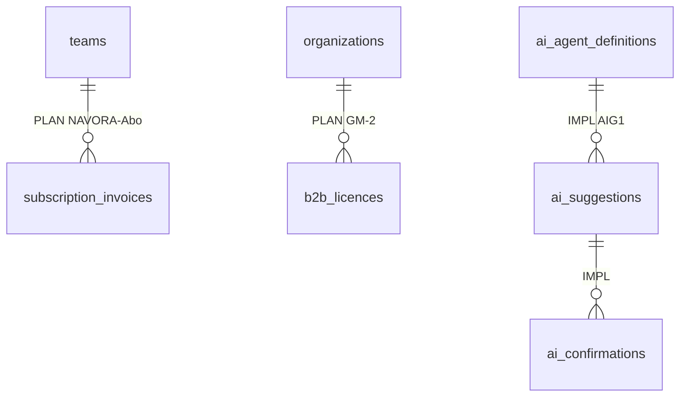
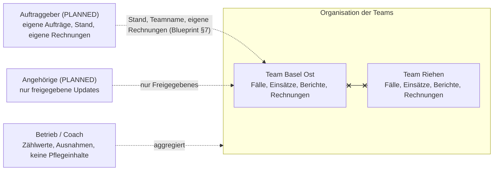
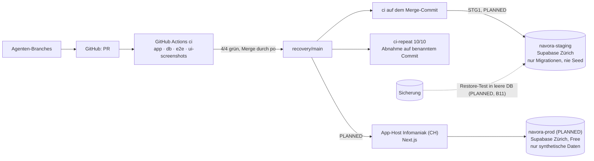

# NAVORA Architecture Handbook V2.1

**Die technische Verfassung: wie NAVORA gebaut wird**

| | |
|---|---|
| **Version** | 2.1 (Entwurf zur Founder-Freigabe und Unterschrift durch Engineering), 2026-11-13 |
| **Verantwortlich** | Engineering (`eng`) entscheidet das WIE. Diesen Entwurf hat der PO aus einem Code-Inventar von `recovery/main` (2026-11-13) geschrieben. `eng` bestätigt oder korrigiert jede Aussage per ADR. |
| **Auftrag** | Founder-Anweisungen FE-075 (Neufassung) und FE-076 (End-to-End-Fluss, Machbarkeit und Unterschrift durch `eng`) |
| **Geltung** | Bis zur Freigabe gilt `ARCHITECTURE.md` (Wurzel) weiter. Nach der Freigabe ersetzt dieses Handbuch `ARCHITECTURE.md`, und Abweichungen (§10) werden dort vermerkt. **Der Repository-Code hat immer Vorrang** (CLAUDE.md). |
| **Schwesterdokument** | [Blueprint V3.1](../product/ARCHITECTURE_REVIEW_AND_IMPLEMENTATION_BLUEPRINT_V3.md): WAS, WARUM, WANN |

**Kennzeichnung:**

- **IMPLEMENTED:** mit Fundstelle im Code (Migrationen in `supabase/migrations/20261021000NNN_*.sql`, kurz `M/NNN`).
- **PLANNED:** beschlossen, nicht gebaut.
- **OPEN:** Entscheidung ausstehend.
- **UNKNOWN:** nicht geprüft.

---

## 1. Architekturgrundsätze (verbindlich)

1. **Deterministisch vor KI.** Sicherheit, Qualifikation, Verfügbarkeit, Abrechnung und Fristen entscheidet SQL-Logik in der Datenbank. KI ordnet, erklärt und entwirft nur.
2. **Die Datenbank ist die Sicherheitsgrenze.**
   - Row Level Security (RLS) gilt auf jeder Tabelle in `public`.
   - Schreibzugriffe laufen nur über `SECURITY DEFINER`-Befehlsfunktionen mit `search_path=''`.
   - `authenticated` darf nicht direkt einfügen, ändern oder löschen; das prüft pgTAP.
3. **Hilfsfunktionen im nicht exponierten Schema `private`.** Die REST-API sieht nur `public`.
4. **Alles ist auditierbar:** Befehle schreiben `audit_events`, Lesezugriffe mit Zweck schreiben `audit_read_log`, KI-Vorschläge stehen unveränderlich im Vorschlagsbuch (AIG1).
5. **Migrationen nur anhängend.** Es gibt keine Änderung an einer gemergten Migration (ADR-177, CI-Prüfung «Migration order»).
6. **Nur synthetische Daten**, bis die Tore für reale Daten erfüllt sind. Der Repository-Seed wird nie in die Produktion geladen (FE-066).
7. **Keine Klienten- oder Personaldaten an einen KI-Dienst** (D-35 Regel A, FE-024, FE-051).
8. **Keine zentrale Disposition im Code.** Es gibt keinen Befehl, der für ein Team zuteilt (FE-039).
9. **Jede Verhaltensänderung kommt mit Tests** und wird nur bei grüner CI gemergt (Regel 12).

---

## 2. System- und Komponentenarchitektur

### 2.1 Technologie (IMPLEMENTED, `package.json`)

| Ebene | Technologie | Version |
|---|---|---|
| Frontend | Next.js App Router, React | 16.4.1, 19.2 |
| Sprache | TypeScript | 5 |
| Styling | Tailwind CSS v4 (CSS-first, `@import "tailwindcss"` und `@theme` in `src/app/globals.css`; keine `tailwind.config`) | 4 |
| Daten und Auth | Supabase: PostgreSQL, Auth, `@supabase/ssr` | supabase-js 2.118, ssr 0.12 |
| Validierung | zod | 4.6 |
| Laufzeit | Node | 24 (`.nvmrc`), mindestens 22 |
| Unit-Tests | Vitest | 4 |
| DB-Tests | pgTAP (`supabase test db`) | – |
| E2E | Playwright (390 px und 1440 px) | 1.64 |

### 2.2 Supabase-Funktionen

| Funktion | Status | Fundstelle |
|---|---|---|
| PostgreSQL mit RLS | **IMPLEMENTED** | 125 Migrationen, `M/001` bis `M/127` (0102 und 0119 fehlen) |
| Auth | **IMPLEMENTED** | Selbstregistrierung ist abgeschaltet (CI-Schritt) |
| pg_cron | **IMPLEMENTED** (bedingt, wo die Erweiterung vorhanden ist) | `navora-plan2-daily` (`M/025:332`), `navora-cover1-events` (alle 10 Minuten, `M/029:146`), `navora-sig1-signals` (jede Minute, `M/060:349`, `M/064:242`) |
| Realtime | **nicht verwendet** | keine Publication, kein `.channel(` |
| Edge Functions | **nicht verwendet** | kein `supabase/functions` |
| Web Push | **IMPLEMENTED** | `/api/push/dispatch` mit Bearer-Secret, einziger `service_role`-Gebrauch (`src/features/push/dispatch.ts:25`) |

**Vorschlag an `eng` (OPEN, ADR):** Realtime für den Deckungsstand im Auftraggeber-Portal und im Team-Dashboard (BK-5, BK-6). Alternative: Polling.

---

## 3. Frontend

### 3.1 Routen heute (IMPLEMENTED) und Zielportale

| Zielportal | Heutige Routen | Lücke |
|---|---|---|
| `/order` | keine; Auftraggeber werden über `/partners` und `/intake` durch Operations erfasst | Auftraggeber-Rolle, Erfassung, Bestätigung, Stand (BK) |
| `/team` | `/team`, `/team/tagesplan`, `/team/vorschlaege`, `/team/rueckblick/[stopId]`, `/teams` | Angebotskarte mit Begründung, Kaskade (BK) |
| `/field` | `/field`, `/work`, `/visits`, `/visits/[visitId]` | Diktat (B6); offline-first **UNKNOWN** |
| `/b2b-institution` | keine | GM-2-Module, Schichtmodell Heim (NH-A1) |
| `/family` | keine | ganzes Portal |
| `/platform` | `/operations` (Ausnahmen, `assistenten`, `tagesvorschlag`), `/analytics`, `/admin`, `/settings` | Zusammenführung, SaaS-Kennzahlen, Coach-Ansicht |

- `/` leitet nach Rolle weiter: Pflegekräfte nach `/field`, alle anderen nach `/operations`.
- `src/proxy.ts` schützt die Routen; die Navigation steht in `src/lib/auth/nav.ts`.
- **Umbenennungen nur per ADR**, mit Weiterleitungen und angepassten E2E-Tests.

### 3.2 UI-Regeln

- Eine App für Telefon und Desktop (UX2).
- Je Karte eine Hauptaktion (UX1).
- Sicherheitssignale stehen immer oben.
- Jede Route wird mit `ui-screenshots` (390 und 1440, jede Rolle) aufgenommen; axe prüft dabei heute nur die Regel `color-contrast` (`tests/screenshots/capture.spec.ts`).
- Texte schreibt `uxa`; es gibt keine Matrixcodes in Benutzertexten.

---

## 4. Die fünf Backend-Engines

### 4.0 End-to-End: wie ein Auftrag durch das System fliesst (FE-076)

**Gesamtfluss.** Durchgezogene Kästen sind heute im Code vorhanden (IMPLEMENTED), gestrichelte sind geplant (PLANNED). Jede KI-Stufe arbeitet in Phase A nur mit synthetischen Daten (D-35 Regel A).

Legende: grün = IMPLEMENTED, gelb = teilweise, blau gestrichelt = PLANNED.

**Technische Sequenz** (Arbeitsnamen für geplante Funktionen und Tabellen; die Namen legt `eng` per ADR fest, T-1 bis T-7):

**Schnittstellen der Engines**

| Engine | Eingabe | Ausgabe | Läuft in | Status |
|---|---|---|---|---|
| E1 Matching | bestätigter Auftrag, Teams, Qualifikationen, Kalender, PLZ-Tabelle | zulässige Teams; Ausschlussgrund je Team | Postgres (`private.*`) | teilweise IMPLEMENTED |
| E2 Routing | zulässige Teams + bestätigte Fakten | Rangfolge, Begründungssatz, Vorschlag im AIG1-Buch | `/api/ai/*` oder Regel (Art `rule`) | PLANNED |
| E3 Voice-to-Report | Audio, Auftrag, Aufgaben | Entwurf mit Quelle je Satz | `/api/ai/*` (Muster 4) | PLANNED |
| E4 Billing | signierte Berichte, `billable_facts`, Preis des Auftrags | Rechnungsentwurf im Team-Ledger; Abo- und Lizenzrechnungen in den NAVORA-Ledgern | Postgres | Fakten IMPLEMENTED, Rechnung PLANNED |
| E5 Signale | Ereignisse, Fristen, Zustände | Ausnahme mit Priorität, Push, Eskalation | Postgres + pg_cron + Push | IMPLEMENTED (BK-6 PLANNED) |

### Engine 1: On-Platform-Matching (PostgreSQL, deterministisch)

**Heute (IMPLEMENTED):**

1. `convert_partner_request` (`M/010:126`) macht aus einer Anfrage einen Fall.
2. `private.open_matching_if_ready` (`M/017:325`) öffnet bei erfüllter Bereitschaft eine `matching_requests`-Zeile mit Region, Dringlichkeit, Pflichtqualifikation und Antwortfrist.
3. `private.request_offered_to_team` (`M/034:204`) ist die Eignungsregel. Ein Team ist geeignet, wenn:
   - es zur selben Organisation gehört und aktiv ist;
   - `t.region = m.region` gilt;
   - es eine diplomierte Pflegefachperson hat, falls die Anfrage eine Qualifikation verlangt;
   - die Erstzugriff-Regel RET1 erfüllt ist (das bisherige Team zuerst).
4. **Verteilung:** Alle geeigneten Teams sehen das Angebot (`team_offers()`); entschieden wird mit `decide_matching_request` (`M/011:115`).
5. Eskalation über `matching_escalations` (`M/017:518`).

**Ziel (PLANNED, BK):**

| Prüfung | Umsetzung | Hinweis |
|---|---|---|
| PLZ-Distanz | PLZ-Liste BS/BL mit Distanzen (Tabelle), Radius je Auftrag | Datenquelle und Nutzungsbedingungen prüft `lca`; in Phase A ist eine synthetische Tabelle zulässig. PostGIS war bewusst nicht rekonstruiert (`M/001:10`). |
| Qualifikation | `private.qual_check` (`M/120:639`) und die Matrix (`qual_matrix_cells`) **auch im Matching**, nicht nur beim Besuch | Heute greift `qual_check` nur in Simulationsorganisationen (`M/121:45`); die Matrix ist v0.2 **PROPOSED** |
| Verfügbarkeit | ganzer Schicht-Slot, auch über Mitternacht | Abwesenheiten (`member_absences`), bestehende Einsätze |
| Bestätigte Merkmale | Pflicht-Tags (z. B. Demenzerfahrung) als bestätigter Fakt | Merkmal von einer Person erfasst; markiert «für den Berater» (D-34) |
| Kaskade | Angebot zuerst an das beste Team, exklusives Zeitfenster, dann das nächste | ADR: Verhältnis zu «1 Team prüft» (FE-072 (4)); FE-074 gilt für BK |

**Invariante:** Ein Team, das eine harte Prüfung nicht besteht, erhält nie eine Angebotszeile. Der Test prüft die Angebotszeilen, nicht die Benutzeroberfläche.

**Zu «KLV 7»:** KLV Art. 7 listet die Pflegeleistungen. Welche Qualifikationsstufe welche Leistung erbringen darf, steht nicht in der KLV; das ist die Matrix, und sie gibt der Clinical Owner frei (D-27). Die Engine liest die Matrix und erfindet keine Zuordnung.

### Engine 2: KI-Orchestrierung und Routing

| Teil | Status | Regel |
|---|---|---|
| Governance: Agentenregister, unveränderliches Vorschlagsbuch, Bestätigung je Wert, Stopp, Rückblick | **IMPLEMENTED** (AIG1, `M/097`) | `set_agent_state` verweigert `kind = 'ai'` (D-35) |
| Regelbasierte Agenten: Bezugspflege-Test, Tagesvorschlag (PLAN3) | **IMPLEMENTED** (`M/097:359`, `M/109:45`) | `kind = 'rule'` |
| Rangfolge unter den Geeigneten (Erfahrung, Vorkenntnisse, Kontinuität, Distanz) mit Begründung in Worten | **PLANNED** (BK-3, BK-4) | erst regelbasiert, dann Muster 4 mit synthetischen Daten; kann ordnen, nie hinzufügen; kein Prozent-Score |
| Erfassung: Felder aus Sprache oder Freitext des Auftraggebers | **PLANNED** (BK-1a) | nichts still raten; der Auftraggeber bestätigt jedes Feld; für reale Daten erst nach D-41 |

Jeder KI-Agent hat einen Vertrag, den `aia` prüft:

- Eingabeumfang;
- Ausgabe und Feldklasse («erkannt» oder «Entwurf»);
- Quellen;
- Stufe L/G/H;
- Stopp-Regel: ohne Quelle kein Wert.

### Engine 3: Voice-to-Report-Pipeline

**Kette (PLANNED, B6, BK-8):**

1. Audio
2. Spracherkennung
3. Strukturierung
4. Berichtsentwurf (`visit_reports` im Status Entwurf)
5. Prüfung und Signatur durch die Pflegekraft

**Heute (IMPLEMENTED):**

- F6 `create_report_draft`, `update_report_draft`, `sign_report` (`M/016:240`), `countersign_report` (`M/075:199`), `correct_report`;
- F7 Signatur bei Abschluss (`M/026`, gehärtet in `M/041`);
- F6R Rückgabe (`M/065`).

**Regeln:**

- Audio und Transkript sind **Gesundheitsdaten**.
  - In Phase A nur synthetisch.
  - Spracherkennung und Modell laufen nur im eigenen CH-Rechenzentrum (Muster 4).
  - Kein externer Dienst (D-35 Regel A, FE-051).
- Route `/api/ai/transcribe`: **PLANNED**. Die Rechte (nur die eigene Einsatzzeile) und die Löschfrist für Audio definieren `eng` und `lca` per ADR.
- Jeder Satz im Entwurf verweist auf die Eingabe. Was nicht diktiert wurde, steht nicht im Bericht.
- Kein abrechenbarer Fakt ohne finalen Bericht (H-05, **IMPLEMENTED**).
- **«Normgerechter KLV-Bericht»:** Die Vorlage gibt der Clinical Owner frei. Bis dahin ist sie PROPOSED.

### Engine 4: Finanzen und Billing

| Teil | Status | Fundstelle |
|---|---|---|
| Abrechenbare Fakten (unveränderlich, nur aus finalen Berichten ohne offene Qualitätssperre) | **IMPLEMENTED** | `billable_facts`, `generate_billable_facts` (`M/049:414`), Härtung `M/043` |
| Tarifsätze, Abrechnungsregeln, Vorschau | **IMPLEMENTED** | `tariff_rates`, `billing_rules`, `billing_preview` (`M/022:297`) |
| Rechnungen | **PLANNED** (BILL1, BK-9) | keine `invoices`-Tabelle (`M/022:5`) |
| **Dienstleistungsrechnung** Team → Auftraggeber (Stunden × Preis des Auftrags, ohne NAVORA-Position) | **PLANNED** (BK-9) | – |
| **Tiers payant** (Rechnung an den Versicherer nach KVG/KLV) | **OPEN** | D-18, D-22, D-44 (`lca`, Rechtsgutachten Q1 2027); nicht in BK |
| Drei getrennte Ledger: Team-Pflegeerlös, NAVORA-Abo, NAVORA-B2B | **PLANNED** (GMSEP) | eigene Tabellen und Rollen; ein Test beweist, dass keine Zeile die Grenze kreuzt |

**Regeln:**

- **Beträge rechnet nie die KI.** Die Rechnung ist Regel-Arithmetik.
- Die KI erklärt nur Abweichungen und angehaltene Fälle.
- Bei einer Doppelabrechnung oder einem Zeitkonflikt entsteht ein Fehler statt einer Rechnung.

### Engine 5: Sicherheits- und Signal-Manager

**Heute (IMPLEMENTED):**

| Teil | Fundstelle |
|---|---|
| SIG1 `safety_signals`, `signal_deliveries`, `private.evaluate_all_signals` (jede Minute) | `M/060` |
| SIG2 Zustellung ausserhalb der App, Wachstunden, Web Push | `M/062`, `M/064` |
| SIGC | `M/068` |
| Operations-Ausnahmen `exception_events`, `exception_rules`, `operations_exceptions` | `M/019`, `M/080:276` |
| SAFE-D11 (wiedereröffneter Fall) | `M/125`, `M/126` |
| COVER1 (Ausfall) | `M/029` |

**Ziel (PLANNED, BK-6):** Für jeden Auftrag einen Deckungsstand, den der Auftraggeber immer sieht:

- «Angebot bei Team 1 von n»;
- «noch nicht gedeckt, Beginn in …»;
- «nicht gedeckt», zusätzlich als Operations-Ausnahme.

Ein Auftrag verfällt nie still.

**Regeln:**

- Prioritäten und Fristen klinischer Signale gibt der Clinical Owner frei.
- Bis dahin sind sie als PROPOSED gekennzeichnet (`CLINICAL_RULE_REGISTER.md`).

---

## 5. Datenmodell

### 5.1 Kern-ERD

Legende: `IMPL` = IMPLEMENTED, `PLAN` = PLANNED.

**(a) Organisation, Team, Profil und Qualifikation**

**(b) Auftrag, Einsatz, Bericht und Rechnung**

**(c) NAVORA-Ledger und KI-Governance**

**Weitere IMPLEMENTED-Bereiche:**

- Audit: `audit_events`, `audit_read_log`, `change_log`;
- Einsätze: `visit_activities`, `visit_observations`, `visit_time_corrections`, `care_plan_items`, `care_notes`;
- Qualität: `quality_events`, Sperren, `assessment_*`;
- Arbeitszeit: `working_time*`, `day_plan_lines`;
- Signale (Engine 5);
- Regionen-Altwerte: `region_legacy_values`;
- im Schema `private`: `signal_evaluations`, `test_clock` und weitere.

**Neue Tabellen nur per ADR und Migration.** Namen und Felder der PLANNED-Tabellen sind Vorschläge des PO. `eng` entscheidet; sie können auch auf bestehenden Tabellen aufsetzen, etwa `partner_requests`.

### 5.2 Trennung der Erlösströme im Datenmodell

| Ledger | Tabellen (PLANNED) | Schreibt | Liest |
|---|---|---|---|
| Team-Pflegeerlös | `invoices`, `invoice_lines` aus `billable_facts` | Befehlsfunktion des Teams | Team, Auftraggeber (nur eigene) |
| NAVORA-Abo | `subscription_invoices` | NAVORA-Betrieb | Team (eigene), Betrieb |
| NAVORA-B2B | `b2b_licences`, `b2b_invoices` | NAVORA-Betrieb | Kunde (eigene), Betrieb |

Es gibt keinen Fremdschlüssel und keine Ansicht, die Pflegeerlös und NAVORA-Erlös in einer Zeile verbindet. Ein pgTAP-Test beweist das (GMSEP).

---

## 6. Sicherheit, RLS und Mandantentrennung

Pfeile mit x: keine Sicht. Gestrichelt: eingeschränkte Sicht über eigene Funktionen, nie direkte Tabellenrechte.

| Regel | Status | Fundstelle |
|---|---|---|
| RLS auf jeder `public`-Tabelle | **IMPLEMENTED** | 66 direkte Anweisungen plus Schleifen (`M/079`, `M/091`, `M/097`, `M/120`); pgTAP 001 |
| Hilfsfunktionen `private.is_org_member`, `has_org_role`, `is_team_member`, `is_org_admin` | **IMPLEMENTED** | `M/003:113-150`, `M/074`, `M/035:27` |
| `anon` hat keine Rechte | **IMPLEMENTED** | `M/003` §5; CI: anon liest oder schreibt keine Pflegedaten, rund 60 RPCs geprüft |
| `authenticated` schreibt nur über Befehlsfunktionen | **IMPLEMENTED** | pgTAP |
| `service_role` nur für den Push-Versand | **IMPLEMENTED** | `src/features/push/dispatch.ts:25` |
| **Kein Team sieht Daten eines anderen Teams** | **IMPLEMENTED** über Team- und Organisations-Policies; pgTAP je Tabelle | – |
| **Auftraggeber sieht nur eigene Aufträge und deren Stand** | **PLANNED**: eine Auftraggeber-Rolle existiert nicht | BK-1n |
| Privathaushalt: Strassenadresse erst nach Übernahme durch das Team | **PLANNED** | BK-1e |
| Angehörige sehen nur freigegebene Updates | **PLANNED** | `/family` |
| Coach: keine Akteneinsicht | **PLANNED** | `/platform` |
| `force row level security` | nicht gesetzt (OPEN, `eng` prüft per ADR) | – |
| Lesezugriff auf das Audit nur mit Zweck und selbst protokolliert | **IMPLEMENTED** | AUD1 |

---

## 7. Testing, CI/CD und Qualitätsstandard

### 7.1 Die vier Teststufen (IMPLEMENTED)

| Stufe | Werkzeug | Umfang heute |
|---|---|---|
| 1 Unit | Vitest | 114 Testdateien |
| 2 Datenbank | pgTAP | 132 Dateien (letzter grüner Lauf rund 4 770 Tests) |
| 3 End-to-End | Playwright, 390 und 1440 px, jede Rolle | 37 Spec-Dateien |
| 4 Wiederholung | `ci-repeat`: `db` und `e2e` 10× auf einem Commit | Abnahmenachweis |

**Zusätzlich IMPLEMENTED:**

- Nebenläufigkeitsproben mit zwei echten Sessions (z. B. `region-map-race.sh`);
- Reproduktionen der Races 079 und 080;
- Abgleich der generierten Typen;
- DB-Lint;
- Supply-Chain-Audit;
- Prüfung der Migrationsreihenfolge;
- Agenten-Prüfung.

**Last- und Performancetests: nicht vorhanden** (PLANNED, B11). `ci-repeat` prüft Stabilität, nicht Last.

### 7.2 Workflows

| Workflow | Zweck |
|---|---|
| `ci.yml` | Läuft bei Push und PR. Jobs: `app`: lint, typecheck, unit, audit, build `db`: Migrationen, Seed, pgTAP, Nebenläufigkeit `e2e` `ui-screenshots` Docs-only-PRs laufen verkürzt (CI2, ADR-167). |
| `ci-repeat.yml` | wird aus `ci.yml` erzeugt; Push auf `repeat/**` |
| `db-types-sync.yml`, `lockfile-sync.yml` | Abgleich |
| `agents-coordination.yml` | Koordinations-Issues: stündlich, bei Push von Agentendateien und manuell |

**Gesetze für Tests:**

- Kein Test wird übersprungen, deaktiviert oder abgeschwächt, um Grün zu erreichen.
- Zeitabhängige Tests haben Tageswächter (die Mitternachtsregel in Zürich).
- Abnahme nur aus Roh-Logs.

---

## 8. Staging, Deployment, Backup und Wiederherstellung

| Thema | Status |
|---|---|
| Staging `navora-staging` (Zürich): Migrationen nur aus der CI nach vier grünen Jobs, nie der Seed | **PLANNED**: PR #1087 (STG1) wartet auf das Owner-Secret `STAGING_DB_URL`; App-Host und Produktionsprojekt entschieden (FE-063, FE-064), Auftragsverarbeitungsvertrag OPEN |
| Produktion | **PLANNED**: auf Produktionsniveau gebaut, nur synthetische Daten bis zu den Toren (FE-062) |
| Backup und Wiederherstellung mit belegtem Restore-Test | **PLANNED** (B11); keine Skripte im Repository |
| Red-Team-Tests gegen das Staging (nur Kunstdaten), externer Test vor Phase B | **PLANNED** (FE-049) |
| Live-Supabase-Projekte | von Agenten nie berührt |

---

## 9. Offene technische Entscheidungen (ADR nötig, `eng`)

| # | Frage | Für |
|---|---|---|
| T-1 | Auftragstyp: neue Tabelle `orders` oder Erweiterung von `partner_requests` und Fällen | BK-a |
| T-2 | PLZ- und Distanzquelle für BS/BL; Radius | BK-b |
| T-3 | Kaskade: Zeitfenster-Standard, Verhältnis zu «1 Team prüft» | BK-c |
| T-4 | Realtime oder Polling für den Deckungsstand | BK-c |
| T-5 | Auftraggeber-Rolle und ihre RLS | BK-a |
| T-6 | Muster 4: Hosting, Modell und Spracherkennung im CH-Rechenzentrum; nur synthetische Tests | BK-d, B6 |
| T-7 | Rechnungs- und Ledger-Schema (GMSEP) | BK-f, B8 |
| T-8 | Offline-first für `/field` | B4 |
| T-9 | `force row level security` | B11 |

---

## 10. Abweichungen zu `ARCHITECTURE.md` (CLAUDE.md-Regel: dokumentieren, nicht still ändern)

| `ARCHITECTURE.md` sagt | Code am 2026-11-13 | Vorschlag |
|---|---|---|
| RLS je Organisation, Team und Fall sowie Audit sind PLANNED | IMPLEMENTED (§6) | mit diesem Handbuch korrigieren |
| CI «VERIFY AGAINST REPOSITORY» | IMPLEMENTED (§7) | korrigieren |
| Routing und Radius (Geodaten) PLANNED | weiterhin PLANNED; PostGIS bewusst nicht rekonstruiert | BK-b per ADR |
| keine Versionsnummer; Vollrevision OPEN | – | dieses Handbuch ist V2.1 |

## 11. Machbarkeitsprüfung und Unterschrift durch Engineering (FE-076)

Der Founder verlangt, dass `eng` die fünf Engines und das Datenmodell auf Machbarkeit prüft und unterzeichnet. Bis dahin ist dieses Handbuch ein PO-Entwurf aus dem Code-Inventar.

| # | Prüfpunkt | Frage an `eng` | Ergebnis |
|---|---|---|---|
| S-1 | Engine 1 | Harte Filter (PLZ-Distanz, Matrix, Verfügbarkeit, Merkmale) in Postgres mit Grund je Ausschluss, testbar per pgTAP? | ausstehend |
| S-2 | Engine 2 | Rangfolge zuerst als Regel (Art `rule`, Stufe L), KI später über das AIG1-Buch? | ausstehend |
| S-3 | Engine 3 | Spracherkennung und Entwurf nach Muster 4 im CH-Rechenzentrum; was ist in Phase A mit synthetischem Audio machbar (T-6)? | ausstehend |
| S-4 | Engine 4 | Ledger-Schema mit drei getrennten Strömen, ohne Fremdschlüssel zwischen Team- und NAVORA-Ledger (T-7)? | ausstehend |
| S-5 | Engine 5 | «nicht gedeckt» je Auftrag und Kaskade mit bestehenden `exception_rules` und pg_cron (T-3)? | ausstehend |
| S-6 | ERD | Auftragstyp (T-1), Auftraggeber-Rolle und RLS (T-5), Realtime oder Polling (T-4) | ausstehend |
| S-7 | Tests | jede Garantie aus Blueprint §6.4 als pgTAP- oder e2e-Test im BK-Zuschnitt | ausstehend |

**Unterschrift:** `eng` trägt hier «geprüft, machbar» oder «machbar mit Änderung» je Prüfpunkt ein, mit ADR-Nummer. Auftrag: Issue #1194.

---

### Versionen

| Datum | Version | Änderung |
|---|---|---|
| 2026-11-13 | 2.0 Entwurf | Neufassung aus dem Code-Inventar; fünf Engines, Datenmodell, Sicherheit, Tests, Staging; `eng` bestätigt per ADR |
| 2026-11-13 | 2.1 Entwurf | End-to-End-Fluss des Auftrags durch alle fünf Engines (Gesamtbild und technische Sequenz), Schnittstellen der Engines, Sichtbarkeitsbild der Mandantentrennung, Deployment-Bild, Kapitel 11 Machbarkeitsprüfung mit Unterschrift durch `eng`; axe-Aussage korrigiert |
