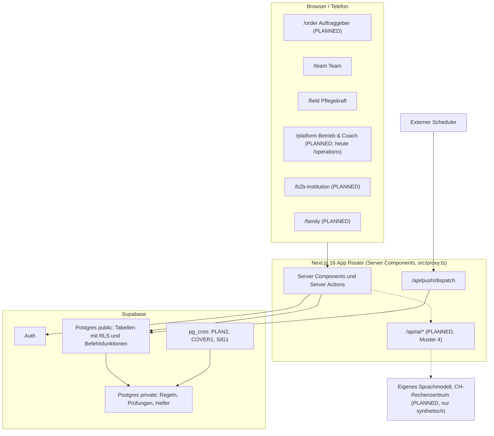
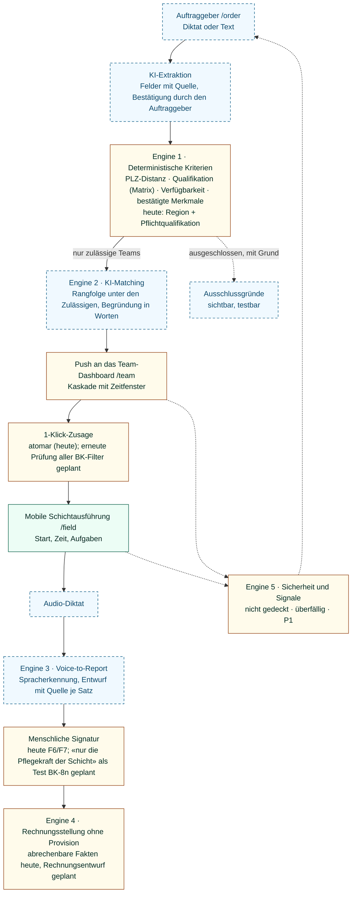
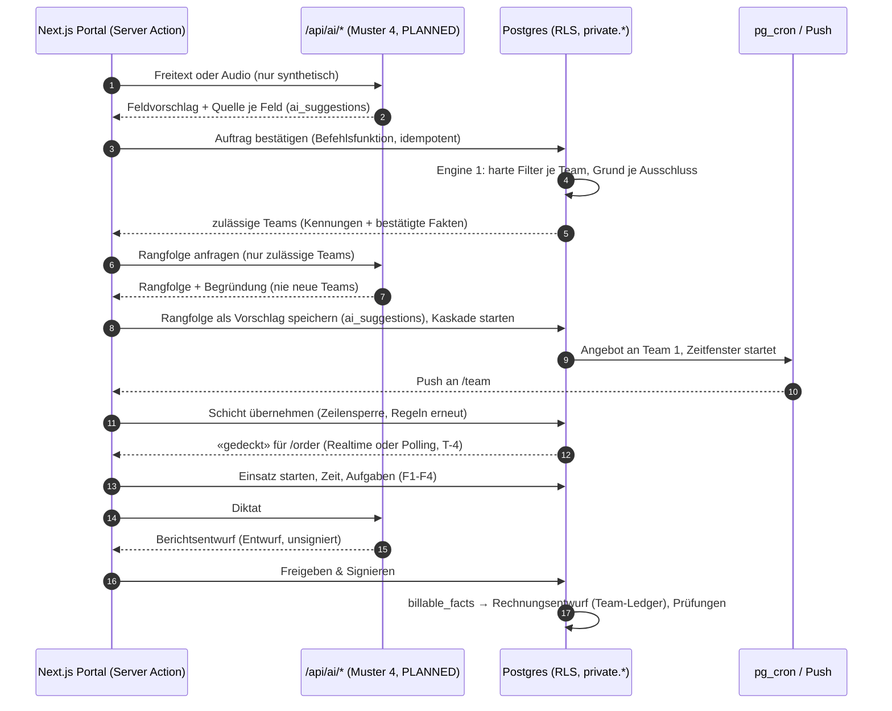
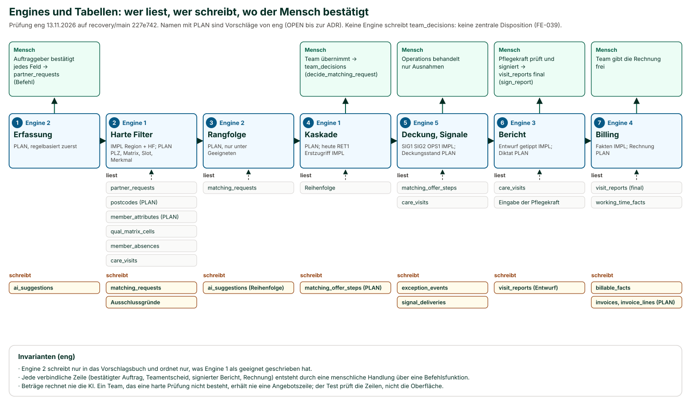
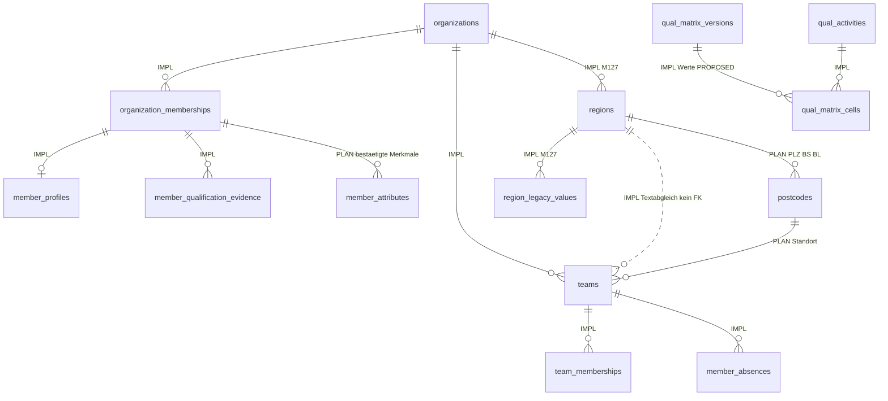
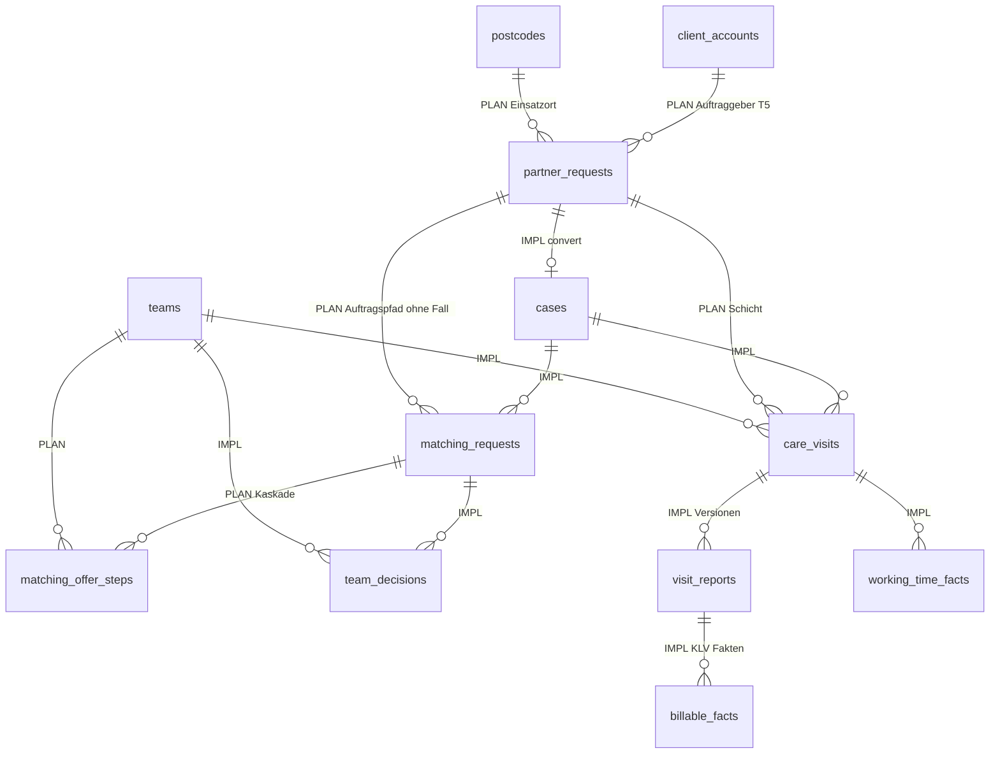
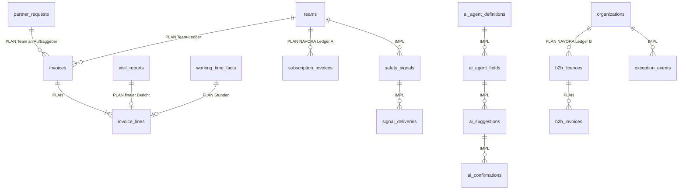
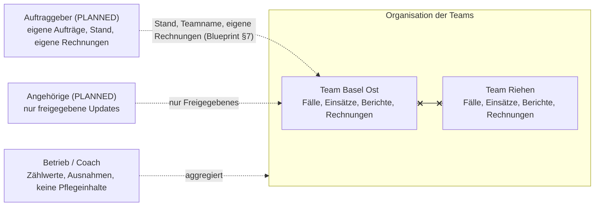
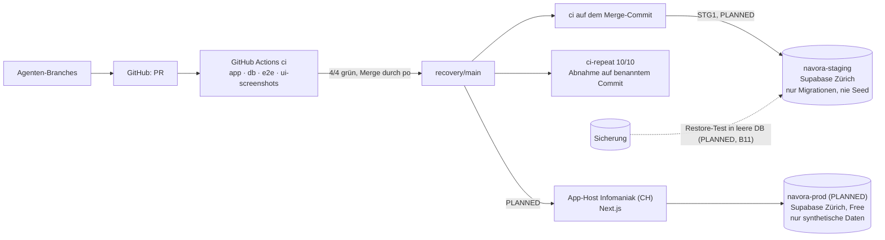

# NAVORA Architecture Handbook V2.2

**Die technische Verfassung: wie NAVORA gebaut wird**

| | |
|---|---|
| **Version** | 2.2, **freigegeben durch den Founder am 2026-11-13 (FE-077)**; von `eng` gegen `recovery/main` `227e742b` geprüft |
| **Verantwortlich** | Engineering (`eng`) entscheidet das WIE. Diesen Entwurf hat der PO aus einem Code-Inventar von `recovery/main` (2026-11-13) geschrieben. `eng` bestätigt oder korrigiert jede Aussage per ADR. |
| **Auftrag** | Founder-Anweisungen FE-075 (Neufassung) und FE-076 (End-to-End-Fluss, Machbarkeit und Unterschrift durch `eng`) |
| **Geltung** | **Einzige technische Quelle des Projekts (FE-077).** `ARCHITECTURE.md` (Handbook V1.x) ist archiviert. **Der Repository-Code hat immer Vorrang** (CLAUDE.md); eine Abweichung wird dokumentiert und per ADR in diesem Handbuch nachgeführt. |
| **Schwesterdokument** | [Blueprint V3.2](../product/ARCHITECTURE_REVIEW_AND_IMPLEMENTATION_BLUEPRINT_V3.md): WAS, WARUM, WANN |

**Kennzeichnung:**

- **IMPLEMENTED:** mit Fundstelle im Code (Migrationen in `supabase/migrations/20261021000NNN_*.sql`, kurz `M/NNN`).
- **PLANNED:** beschlossen, nicht gebaut.
- **OPEN:** Entscheidung ausstehend.
- **UNKNOWN:** nicht geprüft.

---

## 1. Architekturgrundsätze (verbindlich)

1. **Deterministisch vor KI.** Sicherheit, Qualifikation, Verfügbarkeit, Abrechnung und Fristen entscheidet SQL-Logik in der Datenbank. KI ordnet, erklärt und entwirft nur.
2. **Die Datenbank ist die Sicherheitsgrenze.**
   - Row Level Security (RLS) gilt auf jeder Tabelle in `public`.
   - Schreibzugriffe laufen nur über `SECURITY DEFINER`-Befehlsfunktionen mit `search_path=''`.
   - `authenticated` darf nicht direkt einfügen, ändern oder löschen; das prüft pgTAP.
3. **Hilfsfunktionen im nicht exponierten Schema `private`.** Die REST-API sieht nur `public`.
4. **Alles ist auditierbar:** Befehle schreiben `audit_events`, Lesezugriffe mit Zweck schreiben `audit_read_log`, KI-Vorschläge stehen unveränderlich im Vorschlagsbuch (AIG1).
5. **Migrationen nur anhängend.** Es gibt keine Änderung an einer gemergten Migration (ADR-177, CI-Prüfung «Migration order»).
6. **Nur synthetische Daten**, bis die Tore für reale Daten erfüllt sind. Der Repository-Seed wird nie in die Produktion geladen (FE-066).
7. **Keine Klienten- oder Personaldaten an einen KI-Dienst** (D-35 Regel A, FE-024, FE-051).
8. **Keine zentrale Disposition im Code.** Es gibt keinen Befehl, der für ein Team zuteilt (FE-039).
9. **Jede Verhaltensänderung kommt mit Tests** und wird nur bei grüner CI gemergt (Regel 12).

---

## 2. System- und Komponentenarchitektur

### 2.1 Technologie (IMPLEMENTED, `package.json`)

| Ebene | Technologie | Version |
|---|---|---|
| Frontend | Next.js App Router, React | 16.4.1, 19.2 |
| Sprache | TypeScript | 5 |
| Styling | Tailwind CSS v4 (CSS-first, `@import "tailwindcss"` und `@theme` in `src/app/globals.css`; keine `tailwind.config`) | 4 |
| Daten und Auth | Supabase: PostgreSQL, Auth, `@supabase/ssr` | supabase-js 2.118, ssr 0.12 |
| Validierung | zod | 4.6 |
| Laufzeit | Node | 24 (`.nvmrc`), mindestens 22 |
| Unit-Tests | Vitest | 4 |
| DB-Tests | pgTAP (`supabase test db`) | – |
| E2E | Playwright (390 px und 1440 px) | 1.64 |

### 2.2 Supabase-Funktionen

| Funktion | Status | Fundstelle |
|---|---|---|
| PostgreSQL mit RLS | **IMPLEMENTED** | 126 Migrationen, `M/001` bis `M/128` (0102 und 0119 fehlen); Stand `recovery/main` `227e742b` (K1) |
| Auth | **IMPLEMENTED** | Selbstregistrierung ist abgeschaltet (CI-Schritt) |
| pg_cron | **IMPLEMENTED** (bedingt, wo die Erweiterung vorhanden ist) | `navora-plan2-daily` (`M/025:332`), `navora-cover1-events` (alle 10 Minuten, `M/029:146`), `navora-sig1-signals` (jede Minute, `M/060:349`, `M/064:242`) |
| Realtime | **nicht verwendet** | keine Publication, kein `.channel(` |
| Edge Functions | **nicht verwendet** | kein `supabase/functions` |
| Web Push | **IMPLEMENTED** | `/api/push/dispatch` mit Bearer-Secret, einziger `service_role`-Gebrauch (`src/features/push/dispatch.ts:25`) |

**Vorschlag an `eng` (OPEN, ADR):** Realtime für den Deckungsstand im Auftraggeber-Portal und im Team-Dashboard (BK-5, BK-6). Alternative: Polling.

---

## 3. Frontend

### 3.1 Routen heute (IMPLEMENTED) und Zielportale

| Zielportal | Heutige Routen | Lücke |
|---|---|---|
| `/order` | keine; Auftraggeber werden über `/partners` und `/intake` durch Operations erfasst | Auftraggeber-Rolle, Erfassung, Bestätigung, Stand (BK) |
| `/team` | `/team`, `/team/tagesplan`, `/team/vorschlaege`, `/team/rueckblick/[stopId]`, `/teams` | Angebotskarte mit Begründung, Kaskade (BK) |
| `/field` | `/field`, `/work`, `/visits`, `/visits/[visitId]` | Diktat (B6); offline-first **UNKNOWN** |
| `/b2b-institution` | keine | GM-2-Module, Schichtmodell Heim (NH-A1) |
| `/family` | keine | ganzes Portal |
| `/platform` | `/operations` (Ausnahmen, `assistenten`, `tagesvorschlag`), `/analytics`, `/admin`, `/settings` | Zusammenführung, SaaS-Kennzahlen, Coach-Ansicht |

- `/` leitet nach Rolle weiter: Pflegekräfte nach `/field`, alle anderen nach `/operations`.
- `src/proxy.ts` schützt die Routen; die Navigation steht in `src/lib/auth/nav.ts`.
- **Umbenennungen nur per ADR**, mit Weiterleitungen und angepassten E2E-Tests.

### 3.2 UI-Regeln

- Eine App für Telefon und Desktop (UX2).
- Je Karte eine Hauptaktion (UX1).
- Sicherheitssignale stehen immer oben.
- Jede Route wird mit `ui-screenshots` (390 und 1440, jede Rolle) aufgenommen; axe prüft dabei heute nur die Regel `color-contrast` (`tests/screenshots/capture.spec.ts`).
- Texte schreibt `uxa`; es gibt keine Matrixcodes in Benutzertexten.

---

## 4. Die fünf Backend-Engines

### 4.0 End-to-End: wie ein Auftrag durch das System fliesst (FE-076)

**Gesamtfluss.** Durchgezogene Kästen sind heute im Code vorhanden (IMPLEMENTED), gestrichelte sind geplant (PLANNED). Jede KI-Stufe arbeitet in Phase A nur mit synthetischen Daten (D-35 Regel A).

Legende: grün = IMPLEMENTED, gelb = teilweise, blau gestrichelt = PLANNED.

**Technische Sequenz** (Arbeitsnamen für geplante Funktionen und Tabellen; die Namen legt `eng` per ADR fest, T-1 bis T-7):

**Engines und Tabellen (`eng`): wer liest, wer schreibt, wo der Mensch bestätigt.**

**Schnittstellen der Engines**

| Engine | Eingabe | Ausgabe | Läuft in | Status |
|---|---|---|---|---|
| E1 Matching | bestätigter Auftrag, Teams, Qualifikationen, Kalender, PLZ-Tabelle | zulässige Teams; Ausschlussgrund je Team | Postgres (`private.*`) | teilweise IMPLEMENTED |
| E2 Routing | zulässige Teams + bestätigte Fakten | Rangfolge, Begründungssatz, Vorschlag im AIG1-Buch | `/api/ai/*` oder Regel (Art `rule`) | PLANNED |
| E3 Voice-to-Report | Audio, Auftrag, Aufgaben | Entwurf mit Quelle je Satz | `/api/ai/*` (Muster 4) | PLANNED |
| E4 Billing | signierte Berichte, `billable_facts`, Preis des Auftrags | Rechnungsentwurf im Team-Ledger; Abo- und Lizenzrechnungen in den NAVORA-Ledgern | Postgres | Fakten IMPLEMENTED, Rechnung PLANNED |
| E5 Signale | Ereignisse, Fristen, Zustände | Ausnahme mit Priorität, Push, Eskalation | Postgres + pg_cron + Push | IMPLEMENTED (BK-6 PLANNED) |

### Engine 1: On-Platform-Matching (PostgreSQL, deterministisch)

**Heute (IMPLEMENTED):**

1. `convert_partner_request` (erste Fassung `M/010:126`, geltend `M/013:242`) macht aus einer Anfrage einen Fall (K2).
2. `private.open_matching_if_ready` (`M/017:325`) öffnet bei erfüllter Bereitschaft eine `matching_requests`-Zeile mit Region, Dringlichkeit, Pflichtqualifikation und Antwortfrist.
3. `private.request_offered_to_team` (`M/034:204`) ist die Eignungsregel. Ein Team ist geeignet, wenn:
   - es zur selben Organisation gehört und aktiv ist;
   - `t.region = m.region` gilt;
   - es eine diplomierte Pflegefachperson hat, falls die Anfrage eine Qualifikation verlangt;
   - die Erstzugriff-Regel RET1 erfüllt ist (das bisherige Team zuerst).
4. **Verteilung:** Alle geeigneten Teams sehen das Angebot (`team_offers()`); entschieden wird mit `decide_matching_request` (`M/011:115`).
5. Eskalation über `matching_escalations` (`M/017:518`).

**Ziel (PLANNED, BK):**

| Prüfung | Umsetzung | Hinweis |
|---|---|---|
| PLZ-Distanz | PLZ-Liste BS/BL mit Distanzen (Tabelle), Radius je Auftrag | Datenquelle und Nutzungsbedingungen prüft `lca`; in Phase A ist eine synthetische Tabelle zulässig. PostGIS war bewusst nicht rekonstruiert (`M/001:10`). |
| Qualifikation | `private.qual_check` (`M/120:639`) und die Matrix (`qual_matrix_cells`) **auch im Matching**, nicht nur beim Besuch | Heute greift `qual_check` nur in Simulationsorganisationen (`M/121:45`); die Matrix ist v0.2 **PROPOSED** |
| Verfügbarkeit | ganzer Schicht-Slot, auch über Mitternacht | Abwesenheiten (`member_absences`), bestehende Einsätze |
| Bestätigte Merkmale | Pflicht-Tags (z. B. Demenzerfahrung) als bestätigter Fakt | Merkmal von einer Person erfasst; markiert «für den Berater» (D-34) |
| Kaskade | Angebot zuerst an das beste Team, exklusives Zeitfenster, dann das nächste | ADR: Verhältnis zu «1 Team prüft» (FE-072 (4)); FE-074 gilt für BK |

**Invariante:** Ein Team, das eine harte Prüfung nicht besteht, erhält nie eine Angebotszeile. Der Test prüft die Angebotszeilen, nicht die Benutzeroberfläche.

**Zu «KLV 7»:** KLV Art. 7 listet die Pflegeleistungen. Welche Qualifikationsstufe welche Leistung erbringen darf, steht nicht in der KLV; das ist die Matrix, und sie gibt der Clinical Owner frei (D-27). Die Engine liest die Matrix und erfindet keine Zuordnung.

### Engine 2: KI-Orchestrierung und Routing

| Teil | Status | Regel |
|---|---|---|
| Governance: Agentenregister, unveränderliches Vorschlagsbuch, Bestätigung je Wert, Stopp, Rückblick | **IMPLEMENTED** (AIG1, `M/097`) | `set_agent_state` verweigert `kind = 'ai'` (D-35) |
| Regelbasierte Agenten: Bezugspflege-Test, Tagesvorschlag (PLAN3) | **IMPLEMENTED** (`M/097:359`, `M/109:45`) | `kind = 'rule'` |
| Rangfolge unter den Geeigneten (Erfahrung, Vorkenntnisse, Kontinuität, Distanz) mit Begründung in Worten | **PLANNED** (BK-3, BK-4) | erst regelbasiert, dann Muster 4 mit synthetischen Daten; kann ordnen, nie hinzufügen; kein Prozent-Score |
| Erfassung: Felder aus Sprache oder Freitext des Auftraggebers | **PLANNED** (BK-1a) | nichts still raten; der Auftraggeber bestätigt jedes Feld; für reale Daten erst nach D-41 |

Jeder KI-Agent hat einen Vertrag, den `aia` prüft:

- Eingabeumfang;
- Ausgabe und Feldklasse («erkannt» oder «Entwurf»);
- Quellen;
- Stufe L/G/H;
- Stopp-Regel: ohne Quelle kein Wert.

### Engine 3: Voice-to-Report-Pipeline

**Kette (PLANNED, B6, BK-8):**

1. Audio
2. Spracherkennung
3. Strukturierung
4. Berichtsentwurf (`visit_reports` im Status Entwurf)
5. Prüfung und Signatur durch die Pflegekraft

**Heute (IMPLEMENTED):**

- F6 `create_report_draft` (`M/016:146`), `update_report_draft` (`M/016:202`), `sign_report` (geltend `M/041:85`, mit Snapshot-Hash; K7), `countersign_report` (`M/075:199`), `correct_report`;
- F7 Signatur bei Abschluss (`M/026`, gehärtet in `M/041`);
- F6R Rückgabe (`M/065`).

**Regeln:**

- Audio und Transkript sind **Gesundheitsdaten**.
  - In Phase A nur synthetisch.
  - Spracherkennung und Modell laufen nur im eigenen CH-Rechenzentrum (Muster 4).
  - Kein externer Dienst (D-35 Regel A, FE-051).
- Route `/api/ai/transcribe`: **PLANNED**. Die Rechte (nur die eigene Einsatzzeile) und die Löschfrist für Audio definieren `eng` und `lca` per ADR.
- Jeder Satz im Entwurf verweist auf die Eingabe. Was nicht diktiert wurde, steht nicht im Bericht.
- Kein abrechenbarer Fakt ohne finalen Bericht (J5-v3, `M/043`; `M/051:175`, **IMPLEMENTED**; K8, nicht H-05).
- **«Normgerechter KLV-Bericht»:** Die Vorlage gibt der Clinical Owner frei. Bis dahin ist sie PROPOSED.

### Engine 4: Finanzen und Billing

| Teil | Status | Fundstelle |
|---|---|---|
| Abrechenbare Fakten (unveränderlich, nur aus finalen Berichten ohne offene Qualitätssperre) | **IMPLEMENTED** | `billable_facts`, `generate_billable_facts` (geltend `M/051:432`; K9), Härtung `M/043` |
| Tarifsätze, Abrechnungsregeln, Vorschau | **IMPLEMENTED** | `tariff_rates`, `billing_rules`, `billing_preview` (geltend `M/043:343`; K10) |
| Rechnungen | **PLANNED** (BILL1, BK-9) | keine `invoices`-Tabelle (`M/022:5`) |
| **Dienstleistungsrechnung** Team → Auftraggeber (Stunden × Preis des Auftrags, ohne NAVORA-Position) | **PLANNED** (BK-9) | – |
| **Tiers payant** (Rechnung an den Versicherer nach KVG/KLV) | **OPEN** | D-18, D-22, D-44 (`lca`, Rechtsgutachten Q1 2027); nicht in BK |
| Drei getrennte Ledger: Team-Pflegeerlös, NAVORA-Abo, NAVORA-B2B | **PLANNED** (GMSEP) | eigene Tabellen und Rollen; ein Test beweist, dass keine Zeile die Grenze kreuzt |

**Regeln:**

- **Beträge rechnet nie die KI.** Die Rechnung ist Regel-Arithmetik.
- Die KI erklärt nur Abweichungen und angehaltene Fälle.
- Bei einer Doppelabrechnung oder einem Zeitkonflikt entsteht ein Fehler statt einer Rechnung.

### Engine 5: Sicherheits- und Signal-Manager

**Heute (IMPLEMENTED):**

| Teil | Fundstelle |
|---|---|
| SIG1 `safety_signals`, `signal_deliveries`, `private.evaluate_all_signals` (jede Minute) | `M/060` |
| SIG2 Zustellung ausserhalb der App, Wachstunden, Web Push | `M/062`, `M/064` |
| SIGC | `M/068` |
| Operations-Ausnahmen `exception_events`, `exception_rules`, `operations_exceptions` | `M/019`, `M/080:276` |
| SAFE-D11 (wiedereröffneter Fall) | `M/125`, `M/126` |
| COVER1 (Ausfall) | `M/028` (Kern), `M/029` (Zeitplan); K11 |

**Ziel (PLANNED, BK-6):** Für jeden Auftrag einen Deckungsstand, den der Auftraggeber immer sieht:

- «Angebot bei Team 1 von n»;
- «noch nicht gedeckt, Beginn in …»;
- «nicht gedeckt», zusätzlich als Operations-Ausnahme.

Ein Auftrag verfällt nie still.

**Regeln:**

- Prioritäten und Fristen klinischer Signale gibt der Clinical Owner frei.
- Bis dahin sind sie als PROPOSED gekennzeichnet (`CLINICAL_RULE_REGISTER.md`).

---

## 5. Datenmodell

### 5.1 Kern-ERD (von `eng` gegen den Code korrigiert, K12 bis K16)

Legende: `IMPL` = IMPLEMENTED, `PLAN` = PLANNED. Gestrichelt (`..`) = kein Fremdschlüssel, sondern ein Textabgleich. `eng` hat sechs Beziehungen des V3.1-Entwurfs korrigiert: `regions`-`teams` ist kein FK; Profile, Nachweise und Abwesenheiten hängen an `organization_memberships` bzw. `teams`; Berichte sind Versionen (1:n); KI-Vorschläge hängen über `ai_agent_fields` am Agenten. Für die Lesbarkeit in drei Ausschnitten (Quellen `docs/product/blueprint-v3/diagrams/erd-*.mmd`).

#### 5.1a Organisation, Team, Profil und Qualifikation

#### 5.1b Auftrag, Matching, Einsatz und Bericht

#### 5.1c Rechnung, drei Ledger, KI-Governance und Signale

### 5.2 Trennung der Erlösströme im Datenmodell

| Ledger | Tabellen (PLANNED) | Schreibt | Liest |
|---|---|---|---|
| Team-Pflegeerlös | `invoices`, `invoice_lines` aus `billable_facts` | Befehlsfunktion des Teams | Team, Auftraggeber (nur eigene) |
| NAVORA-Abo | `subscription_invoices` | NAVORA-Betrieb | Team (eigene), Betrieb |
| NAVORA-B2B | `b2b_licences`, `b2b_invoices` | NAVORA-Betrieb | Kunde (eigene), Betrieb |

Es gibt keinen Fremdschlüssel und keine Ansicht, die Pflegeerlös und NAVORA-Erlös in einer Zeile verbindet. Ein pgTAP-Test beweist das (GMSEP).

---

## 6. Sicherheit, RLS und Mandantentrennung

Pfeile mit x: keine Sicht. Gestrichelt: eingeschränkte Sicht über eigene Funktionen, nie direkte Tabellenrechte.

| Regel | Status | Fundstelle |
|---|---|---|
| RLS auf jeder `public`-Tabelle | **IMPLEMENTED** | 79 direkte Anweisungen (73 `public`, 6 `private`; K18) plus Schleifen (`M/079`, `M/091`, `M/097`, `M/120`); pgTAP 001 |
| Hilfsfunktionen `private.is_org_member`, `has_org_role`, `is_team_member`, `is_org_admin` | **IMPLEMENTED** | `M/003:113-150`, `M/074`, `M/035:27` |
| `anon` hat keine Rechte | **IMPLEMENTED** | `M/003` §5; CI: anon liest oder schreibt keine Pflegedaten, rund 60 RPCs geprüft |
| `authenticated` schreibt nur über Befehlsfunktionen | **IMPLEMENTED** | pgTAP |
| `service_role` nur für den Push-Versand | **IMPLEMENTED** | `src/features/push/dispatch.ts:25` |
| **Kein Team sieht Daten eines anderen Teams** | **IMPLEMENTED** über Team- und Organisations-Policies; pgTAP je Tabelle | – |
| **Auftraggeber sieht nur eigene Aufträge und deren Stand** | **PLANNED**: eine Auftraggeber-Rolle existiert nicht | BK-1n |
| Privathaushalt: Strassenadresse erst nach Übernahme durch das Team | **PLANNED** | BK-1e |
| Angehörige sehen nur freigegebene Updates | **PLANNED** | `/family` |
| Coach: keine Akteneinsicht | **PLANNED** | `/platform` |
| `force row level security` | nicht gesetzt (OPEN, `eng` prüft per ADR) | – |
| Lesezugriff auf das Audit nur mit Zweck und selbst protokolliert | **IMPLEMENTED** | AUD1 |

---

## 7. Testing, CI/CD und Qualitätsstandard

### 7.1 Die vier Teststufen (IMPLEMENTED)

| Stufe | Werkzeug | Umfang heute |
|---|---|---|
| 1 Unit | Vitest | 115 Testdateien (K21) |
| 2 Datenbank | pgTAP | 133 Dateien (Summe der `plan()`: 4 767; K21) |
| 3 End-to-End | Playwright, 390 und 1440 px, jede Rolle | 37 Spec-Dateien |
| 4 Wiederholung | `ci-repeat`: `db` und `e2e` 10× auf einem Commit | Abnahmenachweis |

**Zusätzlich IMPLEMENTED:**

- Nebenläufigkeitsproben mit zwei echten Sessions (z. B. `region-map-race.sh`);
- Reproduktionen der Races 079 und 080;
- Abgleich der generierten Typen;
- DB-Lint;
- Supply-Chain-Audit;
- Prüfung der Migrationsreihenfolge;
- Agenten-Prüfung.

**Last- und Performancetests: nicht vorhanden** (PLANNED, B11). `ci-repeat` prüft Stabilität, nicht Last.

### 7.2 Workflows

| Workflow | Zweck |
|---|---|
| `ci.yml` | Läuft bei Push und PR. Jobs: `app`: lint, typecheck, unit, audit, build `db`: Migrationen, Seed, pgTAP, Nebenläufigkeit `e2e` `ui-screenshots` Docs-only-PRs laufen verkürzt (CI2, ADR-167). |
| `ci-repeat.yml` | wird aus `ci.yml` erzeugt; Push auf `repeat/**` |
| `db-types-sync.yml`, `lockfile-sync.yml` | Abgleich |
| `agents-coordination.yml` | Koordinations-Issues: stündlich, bei Push von Agentendateien und manuell |

**Gesetze für Tests:**

- Kein Test wird übersprungen, deaktiviert oder abgeschwächt, um Grün zu erreichen.
- Zeitabhängige Tests haben Tageswächter (die Mitternachtsregel in Zürich).
- Abnahme nur aus Roh-Logs.

---

## 8. Staging, Deployment, Backup und Wiederherstellung

| Thema | Status |
|---|---|
| Staging `navora-staging` (Zürich): Migrationen nur aus der CI nach vier grünen Jobs, nie der Seed | **PLANNED**: PR #1087 (STG1) wartet auf das Owner-Secret `STAGING_DB_URL`; App-Host und Produktionsprojekt entschieden (FE-063, FE-064), Auftragsverarbeitungsvertrag OPEN |
| Produktion | **PLANNED**: auf Produktionsniveau gebaut, nur synthetische Daten bis zu den Toren (FE-062) |
| Backup und Wiederherstellung mit belegtem Restore-Test | **PLANNED** (B11); keine Skripte im Repository |
| Red-Team-Tests gegen das Staging (nur Kunstdaten), externer Test vor Phase B | **PLANNED** (FE-049) |
| Live-Supabase-Projekte | von Agenten nie berührt |

---

## 9. Offene technische Entscheidungen (ADR nötig, `eng`)

| # | Frage | Für |
|---|---|---|
| T-1 | Auftragstyp: neue Tabelle `orders` oder Erweiterung von `partner_requests` und Fällen | BK-a |
| T-2 | PLZ- und Distanzquelle für BS/BL; Radius | BK-b |
| T-3 | Kaskade: Zeitfenster-Standard, Verhältnis zu «1 Team prüft» | BK-c |
| T-4 | Realtime oder Polling für den Deckungsstand | BK-c |
| T-5 | Auftraggeber-Rolle und ihre RLS | BK-a |
| T-6 | Muster 4: Hosting, Modell und Spracherkennung im CH-Rechenzentrum; nur synthetische Tests | BK-d, B6 |
| T-7 | Rechnungs- und Ledger-Schema (GMSEP) | BK-f, B8 |
| T-8 | Offline-first für `/field` | B4 |
| T-9 | `force row level security` | B11 |

---

## 10. Abweichungen zu `ARCHITECTURE.md` (CLAUDE.md-Regel: dokumentieren, nicht still ändern)

| `ARCHITECTURE.md` sagt | Code am 2026-11-13 | Vorschlag |
|---|---|---|
| RLS je Organisation, Team und Fall sowie Audit sind PLANNED | IMPLEMENTED (§6) | mit diesem Handbuch korrigieren |
| CI «VERIFY AGAINST REPOSITORY» | IMPLEMENTED (§7) | korrigieren |
| Routing und Radius (Geodaten) PLANNED | weiterhin PLANNED; PostGIS bewusst nicht rekonstruiert | BK-b per ADR |
| keine Versionsnummer; Vollrevision OPEN | – | dieses Handbuch ist V2.1 |

## 11. Machbarkeitsprüfung und Unterschrift durch Engineering (FE-076)

`eng` hat am 13.11.2026 das Handbook gegen den Code geprüft (nur lesend auf `recovery/main` `227e742b`, keine Tests ausser Lese-, Zähl- und `mmdc`-Befehlen). **Ergebnis: machbar unter ADR-Vorbehalten.** 90 Aussagen geprüft, 73 bestätigt, 15 korrigiert (K1 bis K21, oben eingearbeitet), 1 nicht prüfbar. Das ERD hatte sechs falsche Beziehungen, jetzt korrigiert (§5.1).

### 11.1 Unterschrift je Engine

| # | Engine | Einschätzung | Zentrale Risiken und ADR |
|---|---|---|---|
| S-1 | Engine 1 Matching | **machbar mit ADR** | Eignungsregel steht doppelt (`M/034:204` und `M/086:183`, R-E1-1); `qual_check` je Einsatz, Teamfrage nötig; T-1, T-2, T-3, T-5 |
| S-2 | Engine 2 Routing | Rangfolge **machbar** (regelbasiert, AIG1); KI-Erfassung **Risiko** bis T-6 | `set_agent_state` sperrt `kind=ai` (D-35); Parser statt Modell in Phase A |
| S-3 | Engine 3 Voice-to-Report | getippter Entwurf **machbar**; Diktat **Risiko** | keine Spracherkennung, kein Audio-Speicher; nur CH-Rechenzentrum (T-6); Löschfrist mit `lca` |
| S-4 | Engine 4 Billing | **machbar mit ADR** | Rechnung auf `working_time_facts` × Auftragspreis, nicht auf KLV-`billable_facts`; GMSEP-Grenztest; T-7 |
| S-5 | Engine 5 Signale | **machbar** | baut auf `exception_rules`, OPS1; Deckungsstand per Polling (T-4), nicht gespeichert |
| S-6 | ERD | **machbar mit ADR** | T-1: `partner_requests` erweitern plus `matching_offer_steps`, keine Tabelle `orders`; T-5 Auftraggeber-Rolle; T-4 Polling |
| S-7 | Tests | **machbar** | jede Garantie aus Blueprint §6.4 als pgTAP auf Angebotszeilen bzw. e2e im BK-Zuschnitt (BK-2n, BK-5n, BK-6, BK-8n) |

**Unterschrift:** «`eng`-Prüfung in der PO-Sitzung vom 13.11.2026 (FE-076), nur lesend, ohne ausgeführte Tests: machbar unter den genannten ADR-Vorbehalten. Bestätigung per ADR im nächsten regulären `eng`-Lauf (#1212).»

### Empfehlung zu T-1

1. **Der Name `orders` ist belegt.** Im Code heisst «order» die ärztliche Verordnung: `order_basis`, `order_expired`, `order_validity_missing`, `private.order_open_end_episodes`, ORD0. Dazu kommt, dass die Live-Datenbank eine `public.orders` unbekannten Zwecks hat, die bewusst nicht rekonstruiert wurde (`M/001:9`, Backlog O4). Ein Schema-Pull (O1) würde mit einer neuen `orders` kollidieren.
2. **`partner_requests` ist schon der Auftrag des Auftraggebers.** Die Tabelle hat `partner_type` (Heim, Spital, privat), `region` mit Listenprüfung (`M/127`-Trigger), `urgency`, RLS, Audit-Trigger (`M/086:225-237`) und die Befehlsfunktion `record_partner_request`. BK ergänzt die Spalten `order_kind`, `starts_at`/`ends_at` (`timestamptz`, eine Schicht über Mitternacht ist **ein** Bereich), `postcode`, `level`, `activity_tags`, `radius_km`, `price_per_hour`, `client_account_id`, `confirmed_at`.
3. **`cases` nicht für Heim- und Spitalschichten.** `private.case_readiness` (`M/013:159`) verlangt Einwilligung, Wohngemeinde, Versicherer und Versicherungsart. Das sind Klientendaten, die eine Schichtbestellung nicht hat und nach BK-1e nicht erfragen darf. Der Privathaushalt bleibt auf dem heutigen Fallweg (`convert_partner_request`).
4. **Suche ohne Fall.** `matching_requests.case_id` ist schon nullable (`M/001:88`). Neu kommt `matching_requests.partner_request_id` dazu. **Risiko:** `team_offers()` und `request_offered_to_team` verbinden heute `cases` mit einem inneren Join. Beide werden in eine Funktion `private.offer_eligibility(request, team)` zusammengeführt, die die Gründe liefert (K4).
5. **Kaskade als `matching_offer_steps`** (statt `order_offers`), als Verallgemeinerung von RET1. `preferred_team_id` und `first_refusal_until` (`M/034:54-55`) sind schon ein exklusives Zeitfenster für ein Team. `team_decisions` und `decide_matching_request` bleiben.
6. **Schicht als `care_visits`** mit `partner_request_id`. `care_visits.case_id` ist nullable, aber viele Lesemodelle verbinden `cases`. Das prüft die ADR Funktion für Funktion (Risiko R-E1-3).

| Engine | Einschätzung | Aufwand (PRs) | Technische Risiken | Abhängigkeiten |
|---|---|---|---|---|
| **1 Matching** | **machbar mit ADR** | 4–5 (BK-a 2, BK-b 2, BK-c 1 anteilig) | R-E1-1 doppelte Eignungsregel (`M/034:204` und `M/086:183`): nur eine Funktion darf gelten, mit pgTAP auf Angebotszeilen (BK-2n). R-E1-2 `qual_check` arbeitet je Einsatz und Person (`M/120:639`); für das Matching braucht es eine Teamfrage «hat ein Mitglied eine Stufe, die für jeden Tag erlaubt ist», nur in Simulationsorganisationen (`M/121:45`). R-E1-3 Lesemodelle mit innerem Join auf `cases`. R-E1-4 die Mitternachtslogik ist fünfmal kopiert: ein Helfer `private.slot_range()` als `tstzrange`. R-E1-5 `teams` hat keine PLZ; Region bleibt Textabgleich (ADR-186/187), PLZ-Distanz kommt als zusätzlicher Filter, nicht als Ersatz | T-1, T-2, T-3, T-5; T-9 (empfohlen vor realen Daten) |
| **2 KI-Orchestrierung** | Rangfolge und Begründung: **machbar** (regelbasiert, `kind = 'rule'`, AIG1-Vorschlagsbuch). KI-Erfassung: **Risiko** | 2–3 (Rangfolge und Karte in BK-c; Erfassung BK-d) | `set_agent_state` verweigert `kind = 'ai'` (`M/103:126`). Ohne T-6 gibt es kein Modell, also ist BK-d in Phase A ein **deterministischer Parser** (Datum, Zeiten, Stufe, PLZ) als `kind = 'rule'`-Agent. Ein KI-Modell kommt erst mit T-6 und nur auf synthetischen Daten. `partner_requests.need_summary` ist Pflicht-Freitext (`M/086:167`, 3–2000 Zeichen) und widerspricht BK-1e (nicht zugeordneter Freitext wird nicht gespeichert); das braucht eine ADR mit `lca` | T-6, D-35, D-41; T-1 |
| **3 Voice-to-Report** | Getippter Entwurf: **machbar** (Befehle F6 vorhanden). Diktat: **Risiko** | 1 (BK-e: Verknüpfung mit `/field`, Entwurf aus Eingabe) + später B6 | keine Spracherkennung, kein Audio-Speicher, keine Route. Die Browser-Spracherkennung schickt Audio an Dritte (D-35, FE-051); deshalb in BK nur getippt oder mit synthetischem Transkript. Die Rückverfolgung «jeder Satz zur Eingabe» braucht ein Quellenfeld je Satz im Entwurf (Schema-ADR) | T-6, T-8 (für `/field` offline), `lca` (Löschfrist) |
| **4 Finanzen** | **machbar mit ADR** | 2 (BK-f: Schema, Rechnungsentwurf, Doppel- und Zeitkonflikt-Sperre; GMSEP-Grenztest) | `billable_facts` ist KLV-geprägt (`M/022:124`); die Dienstleistungsrechnung baut auf `working_time_facts` und finaler Berichtsversion, mal `price_per_hour` des Auftrags. Doppelrechnung durch einen eindeutigen Index je Auftrag. Abweichung zwischen erfasster und bestellter Zeit ergibt einen Fehler statt einer Rechnung. Drei Ledger: getrennte Tabellen, eigene Befehlsfunktionen, und ein pgTAP-Katalogtest «kein FK und keine View zwischen den Ledgern» | T-7, T-1; D-44 und D-18 bleiben ausserhalb von BK |
| **5 Signale** | **machbar** | 1–2 (Deckungsstand in BK-c; Ausnahme «nicht gedeckt») | baut auf `exception_rules` und `operations_exceptions` (OPS1), Zeitplan SIG1 jede Minute (`M/060:349`). T-4: **Polling empfohlen** (Realtime ist nicht eingerichtet; eine Publication erweitert die RLS-Fläche um einen zweiten Kanal). Der Deckungsstand wird aus `matching_offer_steps` abgeleitet, nicht gespeichert, damit er nie veraltet | T-3, T-4 |

### 11.4 Reihenfolge der BK-Scheiben (Vorschlag `eng`)

1. **BK-a** ADR T-1 und T-5, Auftragsfelder an `partner_requests`, Auftraggeber-Rolle mit RLS, Formular, Zusammenfassung, «Bestätigen & Absenden» (ohne KI).
2. **BK-b** `postcodes` (synthetisch, T-2), PLZ an Teams, `member_attributes`, `private.slot_range()`, **eine** Eignungsfunktion mit Gründen (ersetzt beide Kopien), harte Filter mit pgTAP auf Angebotszeilen.
3. **BK-c** regelbasierte Rangfolge, Angebotskarte, `matching_offer_steps` (T-3), Deckungsstand per Polling (T-4), Ausnahme «nicht gedeckt».
4. **BK-e** Auftrag erscheint in `/field`, Schicht über `care_visits`, getippter Berichtsentwurf, Signatur.
5. **BK-f** Rechnungsentwurf (T-7), Ledger-Grenztest.
6. **BK-d** Erfassung aus Freitext als regelbasierter Parser (`kind = 'rule'`); ein Modell erst nach T-6.
7. **BK-g** Szenario-Matrix im Seed und E2E durch alle Schritte.

Begründung: BK-d steht im Brief an vierter Stelle. Ich schiebe es nach hinten, weil T-6 offen ist und die Kette 1–5 auch mit dem Formular (BK-1, «oder füllt das Formular direkt aus») vollständig ist. T-8 und T-9 blockieren BK nicht. T-9 (`force row level security`) empfehle ich als eigene Sicherheits-ADR vor B11.

### 11.2 Prüfprotokoll (90 Aussagen)

#### §2.1 Technologie

| Abschnitt | Aussage | Ergebnis | Beleg |
|---|---|---|---|
| §2.1 | Next.js 16.4.1, React 19.2 | bestätigt | `package.json` (`next` 16.4.1, `react` ^19.2.8); Lockfile: next 16.4.1, react 19.2.8 |
| §2.1 | TypeScript 5 | bestätigt | `^5`; Lockfile 5.9.3 |
| §2.1 | Tailwind v4 CSS-first, keine `tailwind.config` | bestätigt | `src/app/globals.css:1` `@import "tailwindcss"`, `:17` `@theme inline`; `ls tailwind.config*` → keine Datei |
| §2.1 | supabase-js 2.118, ssr 0.12 | bestätigt | `^2.118.0`, `^0.12.7` (Lockfile identisch) |
| §2.1 | zod 4.6 | bestätigt | `^4.6.6`, Lockfile 4.6.7 |
| §2.1 | Node 24 (`.nvmrc`), mindestens 22 | bestätigt | `.nvmrc` = 24; `engines.node` `>=22.0.0` |
| §2.1 | Vitest 4, Playwright 1.64 | bestätigt | `^4.0.0` (Lockfile 4.1.12), `^1.64.1` |

#### §2.2 Supabase-Funktionen

| Abschnitt | Aussage | Ergebnis | Beleg |
|---|---|---|---|
| §2.2 | 125 Migrationen, `M/001` bis `M/127`, 0102 und 0119 fehlen | **korrigiert** (veraltet) | `ls supabase/migrations \| wc -l` → **126**; letzte Migration `M/128` (`b1_1_1b_cgr201_region_race`). Lücken 102 und 119 bestätigt. Auf `ca778db9` waren es 125 (`git ls-tree`), M/128 kam mit #1181 (`4c963f25`) |
| §2.2 | Selbstregistrierung abgeschaltet (CI-Schritt) | bestätigt | `supabase/config.toml:28` `enable_signup = false`; `.github/workflows/ci.yml:254` Schritt «Self-registration must be disabled» |
| §2.2 | `navora-plan2-daily` (`M/025:332`) | bestätigt | `M/025:332` `cron.schedule('navora-plan2-daily', '15 1 * * *', …)` |
| §2.2 | `navora-cover1-events` alle 10 Minuten (`M/029:146`) | bestätigt | `M/029:146` `'*/10 * * * *'` |
| §2.2 | `navora-sig1-signals` jede Minute (`M/060:349`, `M/064:242`) | bestätigt | beide Zeilen `'* * * * *'`, `private.evaluate_all_signals()` |
| §2.2 | pg_cron bedingt | bestätigt | jede Stelle in `exception when others then raise notice …` |
| §2.2 | Realtime nicht verwendet | bestätigt | `grep -rn "publication\|supabase_realtime" supabase/migrations` → leer; `grep -rn "\.channel(" src` → leer |
| §2.2 | keine Edge Functions | bestätigt | `ls supabase/functions` → nicht vorhanden |
| §2.2 | `/api/push/dispatch` mit Bearer-Secret | bestätigt | `src/app/api/push/dispatch/route.ts:10-18` (`PUSH_DISPATCH_SECRET`, mindestens 32 Zeichen) |
| §2.2 | einziger `service_role`-Gebrauch `src/features/push/dispatch.ts:25` | bestätigt | `grep -rn SERVICE_ROLE src` → nur `dispatch.ts:5,8,25` (Kommentare und Zeile 25) |

#### §4 Engine 1: Matching

| Abschnitt | Aussage | Ergebnis | Beleg |
|---|---|---|---|
| §4 E1.1 | `convert_partner_request` (`M/010:126`) | **korrigiert** | `M/010:126` ist die erste Fassung; geltend ist **`M/013:242`** (`create function`, nach `drop`) |
| §4 E1.2 | `private.open_matching_if_ready` (`M/017:325`) öffnet `matching_requests` mit Region, Dringlichkeit, Pflichtqualifikation, Antwortfrist | **korrigiert** (Fundstelle) / Inhalt bestätigt | geltend **`M/034:171`** (mit RET1 `set_first_refusal`), gepatcht durch **`M/125:67`** (SAFE-D11 R1). Insert mit `region`, `urgency`, `response_due_at`, `required_qualification`: `M/034:189-197` |
| §4 E1.3 | `private.request_offered_to_team` (`M/034:204`) ist die Eignungsregel; Bedingungen gleiche Org und aktiv, `t.region = m.region`, HF falls verlangt, RET1 | bestätigt, **ergänzt** | `M/034:204-221`: zusätzlich `m.status = 'open'` und `c.assigned_team_id is null`. **Die Regel steht ein zweites Mal inline in `public.team_offers()` (`M/086:183-215`)**, zusätzlich mit `private.access_ended` (LEAVE1-3). Zwei Kopien einer Sicherheitsregel |
| §4 E1.4 | alle geeigneten Teams sehen das Angebot (`team_offers()`); Entscheid mit `decide_matching_request` (`M/011:115`) | **korrigiert** (Fundstelle) | `team_offers()` geltend `M/086:183`. `decide_matching_request`: erste Fassung `M/011:115`, geltend **`M/017:430`**, gepatcht `M/074:211` (LEAVE1-3); prüft `request_offered_to_team` (`M/017:479`) |
| §4 E1.5 | Eskalation über `matching_escalations` (`M/017:518`) | bestätigt, präzisiert | `M/017:518` ist eine **Funktion** (Lesemodell), keine Tabelle; gepatcht `M/066:112` |
| §4 E1 Ziel | PostGIS bewusst nicht rekonstruiert (`M/001:10`) | bestätigt | `M/001:10-11`. **Zusätzlich `M/001:9`: «`public.orders` — purpose UNKNOWN (backlog O4)» bewusst nicht rekonstruiert** (wichtig für T-1) |
| §4 E1 Ziel | `private.qual_check` (`M/120:639`) | bestätigt | `M/120:639`, Signatur `(p_visit uuid, p_user uuid)`: **je Einsatz und Person**, nicht je Team und Auftrag |
| §4 E1 Ziel | `qual_check` greift nur in Simulationsorganisationen (`M/121:45`) | bestätigt | `M/121:45-55` `private.qual_may_perform_in`: `when coalesce(o.simulation,false) then … qual_check …`, sonst `may_perform_visit` |
| §4 E1 Ziel | Matrix `qual_matrix_cells`, v0.2 PROPOSED | bestätigt | Tabelle `M/120:76`; Kommentar `M/121:2` «Matrix QAM v0.2, every cell PROPOSED» |
| §4 E1 Ziel | Abwesenheiten `member_absences` | bestätigt | `M/046:48`, Zeitraum `starts_at`/`ends_at` `timestamptz` (über Mitternacht darstellbar) |
| §4 E1 Ziel | «bestehende Einsätze» als Verfügbarkeitsquelle | bestätigt, Risiko | `care_visits` hat `visit_date`, `time_start`, `time_end` (`M/001`); Mitternachtslogik `time_end < time_start → +1 Tag` steht kopiert in mindestens `M/038:126`, `M/046:96`, `M/048:46`, `M/057:272`, `M/058:213` |

#### §4 Engine 2: KI-Orchestrierung

| Abschnitt | Aussage | Ergebnis | Beleg |
|---|---|---|---|
| §4 E2 | Governance AIG1 (`M/097`) | bestätigt | Tabellen `ai_agent_definitions` `M/097:74`, `ai_agent_fields` `:138`, `ai_suggestions` `:182`, `ai_confirmations` `:208` |
| §4 E2 | `set_agent_state` verweigert `kind = 'ai'` | bestätigt | `M/097:528` und geltend `M/103:126` (`ai_not_allowed`, D-35 Regel A); Check `M/097:78-86` |
| §4 E2 | regelbasierte Agenten (`M/097:359`, `M/109:45`), `kind = 'rule'` | bestätigt | `aig1_test_primary_nurse` bzw. `plan3_day_proposal`, beide `'rule'` |
| §4 E2 | Rangfolge, Erfassung PLANNED | bestätigt | kein `src/app/api/ai`; `src/app/api` enthält nur `push/dispatch` |

#### §4 Engine 3: Bericht

| Abschnitt | Aussage | Ergebnis | Beleg |
|---|---|---|---|
| §4 E3 | `create_report_draft`, `update_report_draft` | bestätigt | `M/016:146`, `M/016:202` |
| §4 E3 | `sign_report` (`M/016:240`) | **korrigiert** | `M/041:84` löscht die 2-Parameter-Fassung; geltend **`M/041:85`** `sign_report(p_report_id, p_snapshot_hash, p_idempotency_key)`; aufgerufen in `src/features/field/report-commands.ts:84` |
| §4 E3 | `countersign_report` (`M/075:199`) | bestätigt | `M/075:199` ist die letzte Fassung (vorher Patch `M/065:279`) |
| §4 E3 | `correct_report` | bestätigt | letzte Fassung `M/075:248` |
| §4 E3 | F7 `M/026`, gehärtet `M/041`; F6R `M/065` | bestätigt | `026_sign_at_completion`, `041_csr1_sign_what_she_saw`, `065_f6r_return_report` |
| §4 E3 | `/api/ai/transcribe` PLANNED | bestätigt | nicht vorhanden; kein `SpeechRecognition`/`getUserMedia` in `src`, kein Storage-Bucket in Migrationen |
| §4 E3 | «Kein abrechenbarer Fakt ohne finalen Bericht (H-05, IMPLEMENTED)» | **korrigiert** (Kennung) | Regel bestätigt: `M/051:175` `if not found or r.status <> 'final' then return null`, Rule J5-v3 aus `M/043`. **H-05** ist im `docs/agents/clinical/HAZARD_LOG.md:24` aber «The clinical record is inaccurate or altered after the fact», also nicht diese Regel |

#### §4 Engine 4: Billing

| Abschnitt | Aussage | Ergebnis | Beleg |
|---|---|---|---|
| §4 E4 | `billable_facts`, `generate_billable_facts` (`M/049:414`), Härtung `M/043` | **korrigiert** (Fundstelle) | Tabelle `M/022:124`; geltende Funktion **`M/051:432`** (`csr1_order_as_of_visit_date`), gepatcht `M/074:215`; Härtung `M/043` (J5-v3, Snapshot) bestätigt |
| §4 E4 | `tariff_rates`, `billing_rules`, `billing_preview` (`M/022:297`) | **korrigiert** (Fundstelle) | geltend **`M/043:343`** (Neuanlage nach `M/023:163`) |
| §4 E4 | keine `invoices`-Tabelle (`M/022:5`) | bestätigt | `M/022:5` «No invoice, no e-billing»; keine Tabelle `invoice*` in allen Migrationen |
| §4 E4 | Rechnung «aus `billable_facts`» (§5.2) | **korrigiert** (fachlich) | `billable_facts` ist KLV-geprägt: `planned_minutes_a/b/c`, `payer_chain`, `tariff_versions`, `order_basis` (`M/022:124-147`); Nicht-KVG-Zahler → `payer_not_modelled` (`M/043` Kopf). Für «Stunden × Preis des Auftrags» (BK-9) passt `working_time_facts` (`M/022:152`, je finaler Berichtsversion, BL-9) |

#### §4 Engine 5: Signale

| Abschnitt | Aussage | Ergebnis | Beleg |
|---|---|---|---|
| §4 E5 | SIG1 `safety_signals`, `signal_deliveries`, `private.evaluate_all_signals` (`M/060`) | bestätigt | Tabellen `M/060:61` ff.; Funktion `M/060:321`, geltend `M/064:169` |
| §4 E5 | SIG2 `M/062`, `M/064` | bestätigt | `signal_outside_deliveries`, `organization_watched_hours`, `push_subscriptions` in `M/062` |
| §4 E5 | SIGC `M/068` | bestätigt | `068_sigc_signal_conditions.sql` |
| §4 E5 | `exception_events`, `exception_rules`, `operations_exceptions` (`M/019`, `M/080:276`) | bestätigt, ergänzt | Tabellen `M/019`; Funktion `M/019:218`, Neufassung `M/080:276`, danach gepatcht u. a. `M/085:100`, `M/125:127` |
| §4 E5 | SAFE-D11 `M/125`, `M/126` | bestätigt | Dateinamen `safe_d11_*` |
| §4 E5 | COVER1 `M/029` | **korrigiert** | Kern in **`M/028`** (`network_cover`: `cover_events`, `cover_settings`, Kopf «COVER1»), Zeitplan in `M/029` (`cover_safety`) |

#### §5 Datenmodell

| Abschnitt | Aussage | Ergebnis | Beleg |
|---|---|---|---|
| §5.1a | `organizations ||--o{ organization_memberships`, `organizations ||--o{ teams`, `teams ||--o{ team_memberships` | bestätigt | `M/003:33`, `M/003:60` (`organization_id` per Schleife), `M/003:42` |
| §5.1a | `regions ||--o{ teams` (IMPL) | **korrigiert** | kein Fremdschlüssel: `teams.region` bleibt Text, Abgleich per Name (ADR-186 «No `region_id` column»; Trigger `private.region_from_list`, `M/127`). Echte Beziehung: `organizations ||--o{ regions` (`M/127:17`), `regions ||--o{ region_legacy_values` (`M/127:72`) |
| §5.1a | `regions ||--o{ postcodes` PLAN | bestätigt (PLAN) | keine Tabelle `postcodes`; `cases.plz` existiert (`M/001:50`), `teams` hat keine PLZ-Spalte |
| §5.1a | `team_memberships }o--|| member_profiles` | **korrigiert** | kein FK; `team_memberships.user_id → auth.users` (`M/003:42`); `member_profiles` PK `(organization_id, user_id)` → `organization_memberships` (`M/035:45-53`) |
| §5.1a | `member_profiles ||--o{ member_qualification_evidence` | **korrigiert** | FK auf `organization_memberships (organization_id, user_id)` (`M/120:199-212`) |
| §5.1a | `member_profiles ||--o{ member_absences` | **korrigiert** | FK auf `teams` und `auth.users` (`M/046:48`) |
| §5.1a | `member_profiles ||--o{ member_attributes` PLAN | bestätigt (PLAN), angepasst | keine Tabelle; Vorschlag Anker `organization_memberships` wie bei den Nachweisen |
| §5.1a | `qual_matrix_versions ||--o{ qual_matrix_cells` | bestätigt | `M/120:69`, `:76` (dazu `qual_activities`) |
| §5.1b | `partner_requests ||--o| cases` | bestätigt | `M/013:52` FK, `M/013:53` eindeutiger Index `cases_one_per_referral` |
| §5.1b | `cases ||--o{ matching_requests`, `matching_requests ||--o{ team_decisions`, `cases ||--o{ care_visits` | bestätigt | `M/001:88`, `M/011:23` (unique je Team), `M/001` |
| §5.1b | `care_visits ||--o| visit_reports` | **korrigiert** | Versionen: `unique (visit_id, version)` (`M/016:26-47`) → `||--o{` |
| §5.1b | `visit_reports ||--o{ billable_facts` | bestätigt | `report_id references visit_reports` (`M/022:124`), unique `(report_id, rule_version)` (`M/023:25`) |
| §5.1b | `orders`, `order_offers`, `invoices` PLAN | bestätigt (PLAN) | keine Tabellen; Empfehlung T-1 siehe §3 |
| §5.1c | `ai_agent_definitions ||--o{ ai_suggestions` | **korrigiert** | über `ai_agent_fields`: `M/097:138` (`agent_key` → definitions), `ai_suggestions` FK `(agent_key, field)` → `ai_agent_fields` (`M/097:198`) |
| §5.1c | `ai_suggestions ||--o{ ai_confirmations` | bestätigt | `M/097:211` |
| §5.1c | `subscription_invoices`, `b2b_licences` PLAN | bestätigt (PLAN) | keine Tabellen |
| §5.1 weitere | `audit_events`, `audit_read_log`, `change_log`, `visit_activities`, `visit_observations`, `visit_time_corrections`, `care_plan_items`, `care_notes`, `quality_events`, `quality_holds`, `assessment_*`, `working_time*`, `day_plan_lines`, `region_legacy_values`, `private.signal_evaluations`, `private.test_clock` | bestätigt | alle in der Liste der `create table` (92 Tabellen in `public`, 6 in `private`) |
| §5.2 | keine Zeile verbindet Pflegeerlös und NAVORA-Erlös; pgTAP beweist es | bestätigt (PLAN) | weder Tabellen noch Test vorhanden |

#### §6 Sicherheit

| Abschnitt | Aussage | Ergebnis | Beleg |
|---|---|---|---|
| §6 | 66 direkte RLS-Anweisungen plus Schleifen (`M/079`, `M/091`, `M/097`, `M/120`) | **korrigiert** | `grep -hiE "^\s*alter table\s+(public\.\|private\.)?\w+\s+enable row level security" \| wc -l` → **79** (73 auf `public`, 6 auf `private`); Schleifen bestätigt (`M/120` zweimal). «66» liess sich mit keiner Zählweise reproduzieren (exakte Einzelleerzeichen-Form: 64) |
| §6 | pgTAP 001 prüft RLS auf jeder Tabelle | **korrigiert** | `001_baseline_schema.test.sql:21` prüft nur «all 8 care tables». Der Katalogtest über alle Tabellen in `public` und `private` ist **pgTAP 123** (B0-7-1, ADR-176), dazu `067:371` |
| §6 | `private.is_org_member`, `has_org_role`, `is_team_member` (`M/003:113-150`), `M/074`, `is_org_admin` (`M/035:27`) | bestätigt, präzisiert | `M/003:113`, `:123`, `:133`, Rechte `:143-146` (Zeile 148 beginnt §5); Neufassungen `M/074:138-158`; `M/035:27` |
| §6 | `anon` hat keine Rechte (`M/003` §5) | bestätigt | `M/003:148` «Replace legacy policies (SR-01)»; der vollständige Nachweis ist pgTAP 123 (B0-7-2 bis -5) |
| §6 | CI: anon liest oder schreibt keine Pflegedaten, «rund 60 RPCs» | **korrigiert** | `ci.yml:264` ff.: **22 Tabellen** und **53 RPCs** (48 ohne Parameter, 5 mit `p_date`) |
| §6 | `authenticated` schreibt nur über Befehlsfunktionen (pgTAP) | bestätigt, präzisiert | je Tabelle in 29 pgTAP-Dateien (`has_table_privilege('authenticated', …, 'insert/update/delete')`); **kein** Katalogtest über alle Tabellen. B0-7-6 prüft `search_path = ''` für jede SECURITY-DEFINER-Funktion |
| §6 | `service_role` nur Push | bestätigt | siehe §2.2 |
| §6 | kein Team sieht Daten eines anderen Teams; pgTAP je Tabelle | bestätigt mit Einschränkung | Team-Policies und Tests RLS2/RLS3/RLS4 (`067`, `070`, `099`); «je Tabelle» nicht einzeln nachgezählt: **UNKNOWN** |
| §6 | `force row level security` nicht gesetzt | bestätigt | `grep -il "force row level security"` → leer |
| §6 | Audit-Lesezugriff mit Zweck (AUD1) | bestätigt | `audit_read_log` `M/077`; pgTAP `077_aud1_audit_purpose_reader` |
| §6 | Auftraggeber-Rolle existiert nicht | bestätigt (PLAN) | keine Rolle oder Tabelle dafür |

#### §7.1 Teststufen und §7.2 Workflows

| Abschnitt | Aussage | Ergebnis | Beleg |
|---|---|---|---|
| §7.1 | 114 Unit-Testdateien | **korrigiert** (veraltet) | `ls tests/unit/*.test.ts \| wc -l` → **115**; `src/**/*.test.ts` → 0 (`vitest.config.ts` schliesst beides ein) |
| §7.1 | 132 pgTAP-Dateien | **korrigiert** (veraltet) | `ls supabase/tests/database/*.test.sql \| wc -l` → **133** (Nummern 001–133, ohne 003 und 024, doppelt 048 und 089) |
| §7.1 | letzter grüner Lauf rund 4 770 Tests | nicht prüfbar | kein Lauf ausgeführt. Statische Summe der `plan(n)`: **4 767** über 133 Dateien, passt zur Grössenordnung |
| §7.1 | 37 Spec-Dateien, 390 und 1440 px, jede Rolle | bestätigt / präzisiert | 36 in `tests/e2e` plus 1 `tests/screenshots/capture.spec.ts` = 37. Das E2E-Projekt ist «Desktop Chrome» (`playwright.config.ts:20`); 29 Specs setzen 390 px, 6 Specs 1440 px. «390 und 1440, jede Rolle» gilt für `ui-screenshots` (`capture.spec.ts:21-22`) |
| §7.1 | `ci-repeat`: `db` und `e2e` 10× | bestätigt | `ci-repeat.yml:21`, `:151`, Matrix `[1..10]` (`:26`), `repeat/2/` = 2× |
| §7.1 | Nebenläufigkeitsproben (`region-map-race.sh`) | bestätigt | `ci.yml:159-167`, vier Skripte in `scripts/db-concurrency/` |
| §7.1 | Races 079 und 080 | bestätigt | `ci.yml:170`, `:175` |
| §7.1 | Typenabgleich, DB-Lint, Supply-Chain-Audit, Migrationsreihenfolge, Agenten-Prüfung | bestätigt | `ci.yml:178`, `:188`, `:59`, `:45`, `:43` |
| §7.1 | keine Last- und Performancetests | bestätigt | kein Werkzeug, kein Workflow |
| §7.2 | `ci.yml` bei Push und PR; Jobs `app`, `db`, `e2e`, `ui-screenshots`; Docs-only verkürzt | bestätigt | `ci.yml:4-5`, `:22`, `:69`, `:195`, `:332`; `scripts/ci-scope.mjs` (`:79`) |
| §7.2 | `ci-repeat.yml` aus `ci.yml` erzeugt; `repeat/**` | bestätigt | `ci-repeat.yml:1`, `:8` |
| §7.2 | `db-types-sync.yml`, `lockfile-sync.yml`, `agents-coordination.yml` stündlich | bestätigt | Dateien vorhanden; `agents-coordination.yml:18` `17 * * * *` |

**Bilanz** (Zeilen dieses Protokolls gezählt): 90 Aussagen geprüft. 73 sind bestätigt, davon einige präzisiert oder als PLAN bestätigt. 15 sind korrigiert, 1 ist nicht prüfbar, und 1 ist mit Einschränkung bestätigt (ein Teil davon UNKNOWN). Aus den 15 korrigierten Zeilen entstehen 21 Ersatztexte (§2).

---

### 11.3 Korrekturen K1 bis K21

| # | Stelle | Ersetzen durch |
|---|---|---|
| K1 | §2.2 Zeile PostgreSQL | «126 Migrationen, `M/001` bis `M/128` (0102 und 0119 fehlen); Stand `recovery/main` `227e742b`» |
| K2 | §4 E1.1 | «`convert_partner_request` (erste Fassung `M/010:126`, geltend `M/013:242`) macht aus einer Anfrage einen Fall.» |
| K3 | §4 E1.2 | «`private.open_matching_if_ready` (geltend `M/034:171`, gepatcht `M/125:67`) öffnet bei erfüllter Bereitschaft …» |
| K4 | §4 E1.3 | Ergänzen: «– die Suche ist offen und der Fall hat noch kein Team. Die Regel steht zweimal: in `private.request_offered_to_team` (`M/034:204`, prüft der Entscheid) und inline in `public.team_offers()` (`M/086:183`, zusätzlich LEAVE1-3). BK führt beide in einer Funktion zusammen.» |
| K5 | §4 E1.4 | «… entschieden wird mit `decide_matching_request` (geltend `M/017:430`, gepatcht `M/074:211`).» |
| K6 | §4 E1.5 | «Eskalation über die Lesefunktion `matching_escalations()` (`M/017:518`, gepatcht `M/066:112`).» |
| K7 | §4 E3 | «… `sign_report` (geltend `M/041:85`, mit Snapshot-Hash) …» |
| K8 | §4 E3 Regeln | «Kein abrechenbarer Fakt ohne finalen Bericht (J5-v3, `M/043`; `M/051:175`, **IMPLEMENTED**).» (H-05 streichen) |
| K9 | §4 E4 Zeile 1 | «`billable_facts` (`M/022:124`), `generate_billable_facts` (geltend `M/051:432`), Härtung `M/043`» |
| K10 | §4 E4 Zeile 2 | «… `billing_preview` (geltend `M/043:343`)» |
| K11 | §4 E5 COVER1 | «`M/028` (Kern), `M/029` (Zeitplan)» |
| K12 | §5.1a ERD | `regions ||--o{ teams` ersetzen durch `organizations ||--o{ regions : "IMPL"` und `regions ||..o{ teams : "IMPL Textabgleich kein FK"` |
| K13 | §5.1a ERD | `team_memberships }o--|| member_profiles` ersetzen durch `organization_memberships ||--o| member_profiles : "IMPL"` |
| K14 | §5.1a ERD | `member_profiles ||--o{ member_qualification_evidence` → `organization_memberships ||--o{ member_qualification_evidence : "IMPL"`; `member_profiles ||--o{ member_absences` → `teams ||--o{ member_absences : "IMPL"`; `member_attributes` an `organization_memberships` |
| K15 | §5.1b ERD | `care_visits ||--o| visit_reports` → `care_visits ||--o{ visit_reports : "IMPL Versionen"` |
| K16 | §5.1c ERD | `ai_agent_definitions ||--o{ ai_agent_fields : "IMPL"` und `ai_agent_fields ||--o{ ai_suggestions : "IMPL"` |
| K17 | §5.2 Zeile Team-Pflegeerlös | «`invoices`, `invoice_lines` aus finalen Berichtsversionen und `working_time_facts` (Stunden) mal Preis des Auftrags; `billable_facts` bleiben KLV-Fakten für den späteren Tiers payant (OPEN)» |
| K18 | §6 Zeile RLS | «79 direkte Anweisungen (73 `public`, 6 `private`) plus Schleifen (`M/079`, `M/091`, `M/097`, `M/120`); Katalogtest pgTAP 123 (B0-7-1) über `public` und `private`» |
| K19 | §6 Zeile anon | «`M/003` §5 (`:148`), pgTAP 123 (B0-7-2 bis -5); CI: 22 Tabellen und 53 RPCs über die REST-API geprüft» |
| K20 | §6 Zeile authenticated | «IMPLEMENTED; je Tabelle in 29 pgTAP-Dateien geprüft, kein Katalogtest über alle Tabellen (Vorschlag: B0-7-8)» |
| K21 | §7.1 Tabelle | «1 Unit · Vitest · 115 Testdateien» · «2 Datenbank · pgTAP · 133 Dateien (Summe der `plan()`: 4 767)» · «3 End-to-End · Playwright · 36 Specs in `tests/e2e` (Desktop Chrome, 390 px in 29 Specs) plus `ui-screenshots` (390 und 1440 px, jede Rolle, axe-core)» |

Empfehlung zur Pflege: Fundstellen im Handbook immer als «geltend `M/NNN:Z`» angeben und den Basis-Commit nennen. Zahlen, die mit jedem Merge wachsen (Migrationen, Testdateien), mit Datum und Commit kennzeichnen oder durch den Befehl ersetzen.

---

### Versionen

| Datum | Version | Änderung |
|---|---|---|
| 2026-11-13 | 2.0 Entwurf | Neufassung aus dem Code-Inventar; fünf Engines, Datenmodell, Sicherheit, Tests, Staging; `eng` bestätigt per ADR |
| 2026-11-13 | 2.2 freigegeben | Founder-Freigabe; einzige technische Quelle; `ARCHITECTURE.md` archiviert | FE-077 |
| 2026-11-13 | 2.2 Entwurf | `eng`-Prüfung von 90 Aussagen gegen den Code, Korrekturen K1-K21 eingearbeitet, Engine-Tabellen-Bild, §11 mit Unterschrift je Engine und vollem Prüfprotokoll | FE-076; `eng`-Beitrag |
| 2026-11-13 | 2.1 Entwurf | End-to-End-Fluss des Auftrags durch alle fünf Engines (Gesamtbild und technische Sequenz), Schnittstellen der Engines, Sichtbarkeitsbild der Mandantentrennung, Deployment-Bild, Kapitel 11 Machbarkeitsprüfung mit Unterschrift durch `eng`; axe-Aussage korrigiert |
