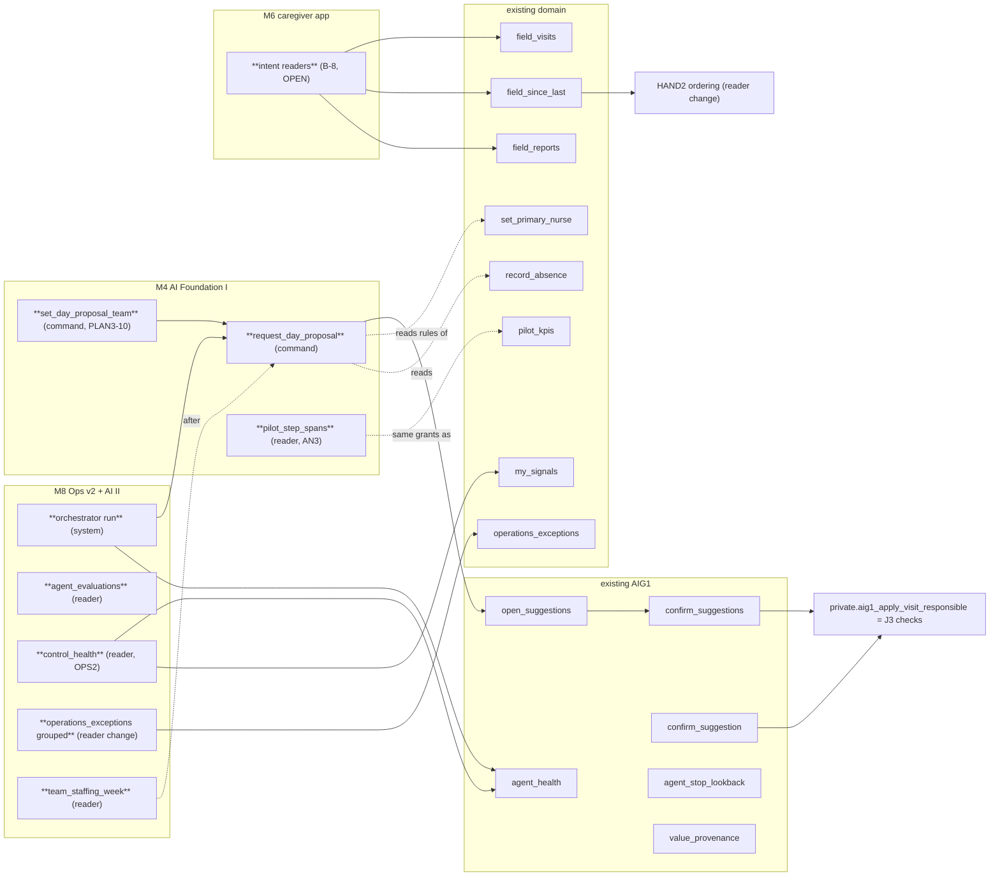
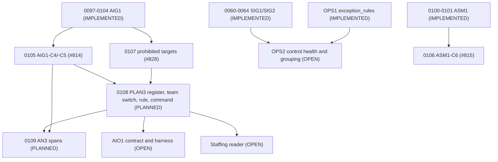

# NAVORA implementation sequence M2-M8

**Owner:** Engineering (`eng`, decides HOW) · **Date:** 2026-11-03 (Europe/Zurich) · **Basis:** `docs/product/DELIVERY_PROGRAM.md` v1 (PO, #832), `recovery/main` at `2981ad5`, open Engineering PRs.

**Status:** version 1. This document is input to the M1 deliverable `docs/engineering/DELIVERY_ESTIMATE.md`, due 2026-11-13. It does not change the PO order: the PO decides WHAT and WHEN. Where it proposes a different path to Pilot Ready (§7), that proposal is an open question for `po` and the owner, not a decision.

**Labels:** IMPLEMENTED (on `recovery/main`) · IN REVIEW (open PR) · PLANNED · OPEN (needs a decision or a brief) · UNKNOWN (not established).

**Binding for every item:**
- Synthetic data only (D-1, D-35 A).
- D-39 and D-40 frozen.
- No AI path writes billing or signal priority (#824, #828).
- Each item passes the `cra` gate where it touches care.
- Every migration has RLS, column grants, an audit trigger, idempotent commands and pgTAP.

---

## 0. Starting point (verified in the repository, 2026-11-03)

| Area | Fact | Label |
|---|---|---|
| App | Next.js. 16 protected routes under `src/app/(protected)`. One route handler: `/api/push/dispatch` | IMPLEMENTED |
| API pattern | Server Action (`src/features/<f>/commands.ts`) calls a Postgres function through `rpc()`. Each command checks the source state, takes an idempotency key and writes the audit in one transaction (ADR-003). Reads use definer readers (`queries.ts`). There is no REST or GraphQL layer. | IMPLEMENTED |
| Database | 104 migrations on `recovery/main` (0001-0104), 105 pgTAP files. 0105, 0106 and 0107 are in open PRs. | IMPLEMENTED / IN REVIEW |
| AI governance | AIG1 register, ledger, confirmations, stop and look-back (0097-0104). Rule agents only: kind `ai` is refused at switch-on. | IMPLEMENTED |
| Installable app | `public/sw.js` exists (push). No web manifest, no offline shell, no command queue. | IMPLEMENTED (push only) |
| Hosting | No staging, no production for this repository (T12 is blocked by D-2). The live Supabase project `jwmfxrmougneeceldhsa` is never touched. | OPEN (D-2) |

**Open Engineering PRs: all green, none merged. This queue is the first blocker.**

| PR | Item | Migration | Milestone |
|---|---|---|---|
| #799 | UX2-1 shell (tab bar, sidebar) | – | M2 |
| #800 | UX2-27, UX2-29 (with CGR-108, CGR-109) | – | M2 |
| #803 | UX2-15, -16, -25 | – | M2 |
| #804 | UX2-18 to -21 | – | M2 |
| #806 | UX2-30 | – | M2 |
| #809 | UX2-26 | – | M2 |
| #810 | CGR-110: pgTAP 062 at any hour | – (test) | M2 |
| #813 | RLS4-C3 | – | M2 |
| #814 | AIG1-C4 + AIG1-C5 | 0105 | M4 |
| #815 | ASM1-C6 with C6 (8) | 0106 | before real assessment data |
| #828 | AIR1: AI prohibited targets (#824) | 0107 | M8 acceptance criterion |

---

## 1. What is built first (order of work)

**Owner priority 2026-11-03 (Engineering Directive Response), binding for this order:** 1 M2 Web App · 2 M4 PLAN3/AN3 · 3 M6 Caregiver App · 4 M8 Operations App · 5 M5 Website. When work competes, the lower priority yields; the website (M5) takes only slots no other milestone needs. Escalation dates: M2 2026-11-27, M4 2026-12-18, M6 2027-01-29, M8 2027-02-19, M9 2027-03-12.

1. **Merge the queue above (PO).** Order:
   1. #799 first: every other screen PR renders inside the shell.
   2. Then #800, #803, #804, #806, #809, #813 (each needs a journal-only merge after the previous one).
   3. #810 at any point.
   4. #814 before any PLAN3 PR.
   5. Then #815 and #828.

   Engineering opens no new UX2 part until the queue is merged (PO order 06:30, item (0)).
2. **M2 remainder:** UX2-31, then the UX2-3 tokens and component port (with UX2-32, -14, -13, -12), then the lint rule and checks (UX2-4, -2, -8, -10), then the remaining screen items.
3. **M4:** PLAN3 database half, then the PLAN3 screens, then AN3. These can run while the M2 remainder is in review: no shared files except `/team` (see §5).
4. **M6 after M2 and M4:** caregiver app (manifest, offline-safe commands, rule intents).
5. **M8 after M4:** AIO1 contract and harness, HAND2, OPS2, then the operations app functions.
6. **Engineering's share of M7:** the *Engineering impact* section of D-40 only.
7. **M5 website last (owner priority 5):** a separate deployment that touches no app code (ADR-142), built in slots M2-M8 do not need.

---

## 2. Frontend implementation sequence

| # | Step | Routes / files | Depends on | Blocks | Label |
|---|---|---|---|---|---|
| F-1 | Shell: tab bar on phone, sidebar on desktop | `(protected)/layout.tsx` | – | every later screen step | IN REVIEW #799 |
| F-2 | Screen PRs on the shell: UX2-15/-16/-25 `/team`, UX2-18-21 `/field`, UX2-26 `/admin`, UX2-27/-29, UX2-30, RLS4-C3 | `/team`, `/field`, `/admin`, `/visits` | F-1 merged (journal merges only) | F-4 (same files) | IN REVIEW |
| F-3 | UX2-31: the role's home is its first tab; a focused control is never under the bar | shell | F-1 | F-4, M6 start screen | PLANNED |
| F-4 | UX2-3 tokens and component set (button, card, section header, badge, list row) with UX2-32 (one name per destination), UX2-14 `ErrorLine`, UX2-13 (red only for safety and destructive actions), UX2-12 (one `h1`) | `src/components/ui/*`, every protected page | F-2, F-3 | F-5; every M4/M6/M8 screen (built on tokens) | PLANNED |
| F-5 | UX2-4 lint rule (no inline layout style), UX2-6 German labels, UX2-5 decision on `/teams`, `/visits`, `/partners` | ESLint config, pages | F-4 | M2 acceptance | PLANNED |
| F-6 | UX2-2 shell assertion in the screenshot job, UX2-8 accessibility floor, UX2-10 axe on working states | `tests/e2e`, CI | F-4 | M2 acceptance | PLANNED |
| F-7 | Safety and field items: UX2-9 signal cards (`cra` C-4), UX2-11 returned report stays in her day, UX2-17, UX2-24, UX2-28 | `/field`, `/team` | F-4 | `cra` UX2 gate (M2) | PLANNED |
| **M2 done** | UX2-1 to UX2-32 on `recovery/main`, `cra` gate clear | | F-1 … F-7 | M4 screens, M6, M8 | |
| F-8 | AIG1-C4: expired proposals leave `/team/vorschlaege` | `/team/vorschlaege`, `/operations/assistenten` | #814 | F-9 | IN REVIEW #814 |
| F-9 | PLAN3 screens:<br>• "Tag vorschlagen" (PLAN3-9);<br>• per-member list with reasons and minutes before and after (PLAN3-4);<br>• ticked list with no select-all and a counted confirm button;<br>• team switch "Tagesvorschlag" (PLAN3-10);<br>• look-back count and link after a stop (PLAN3-11);<br>• "Vorschläge (n)" (PLAN3-12);<br>• PLAN3-13 counts on `/operations/assistenten` | `/team`, `/team/vorschlaege`, `/operations/assistenten` | F-4, B-4 | M4 acceptance | PLANNED |
| F-10 | AN3 block on `/analytics` beside the care share (AN3-2, AN3-5 wording) | `/analytics` | F-4, B-5 | M4 acceptance | PLANNED |
| F-11 | Website, 7 pages and demo flow (§2 of the program), German then English | separate site, not under `(protected)` (§6) | WEB1 brief, `uxa` designs, owner domain and hosting (M3) | M5 | OPEN (brief, hosting) |
| F-12 | Caregiver app shell: web manifest, install prompt, start on `/field`, session on the installed app | `app/manifest.ts`, `public/sw.js` | F-3, F-4, MOB1 brief | F-13, F-14 | PLANNED |
| F-13 | Connection-loss handling: a value entered offline is kept and retried with the same idempotency key; visible "nicht gesendet" state; two-tap reach (e2e at 390 px) | `src/features/field/*`, a client queue | F-12, B-7 | M6 acceptance | PLANNED |
| F-14 | Rule assistant on `/field`: fixed intents (what is next, what changed, who can cover, what is missing before I sign); no free-text clinical answer | `/field` panel | F-12, B-8 | M6 acceptance | PLANNED (design OPEN, B-8) |
| F-15 | HAND2 ordering in "Seit deinem letzten Einsatz" | `/field` handover card | B-10 | M8 | OPEN (brief) |
| F-16 | Operations app:<br>• alert list at 390 px (UX2-31 home);<br>• OPS2 control health and grouped exceptions;<br>• staffing per team and week (never per person) | `/operations` | F-4, B-11, B-12 | M8 | OPEN (brief) |
| F-17 | AIO1 view: agent contract, evaluation results per agent version, no provider | `/operations/assistenten` | B-9 | M8 | OPEN (brief) |

---

## 3. Backend implementation sequence

| # | Step | Database objects | Depends on | Blocks | Label |
|---|---|---|---|---|---|
| B-1 | CGR-110: pgTAP 062 owns the SIG1 evaluation lock and passes at any hour | test only | – | M2 acceptance | IN REVIEW #810 |
| B-2 | M2 has **no migration** (UX2-7 negative). Only read-path reuse for RLS4-C3. | – | – | – | IN REVIEW #813 |
| B-3 | AIG1-C4/-C5: expired proposals filtered on read and counted apart; the stop exception is keyed on its open lines | 0105 | 0097-0104 | B-4 (PLAN3 must be "in or after" it) | IN REVIEW #814 |
| B-4a | PLAN3 register: agent `plan3_day_proposal` (kind `rule`, level `L`, fixture, bar). Field `care_visits.responsible_user_id` with class `schedule`, using the CGR-78 reference already in 0097. Team switch `plan3_team_settings` (team, on/off, since), audited; the actor is in the audit row only (PLAN3-10). | migration 0108 (number after #828) | B-3, 0107 (the register guard must accept the field: it does) | B-4b | PLANNED |
| B-4b | Pure rule `private.plan3_rule(...)` for one visit:<br>• **hard limits** (PLAN3-2): active membership and access not ended (`team_memberships`, `member_access_events`, `member_contract_events`); no covering absence (`member_absences`); J3 qualification; no overlap by `time_start`/`time_end` with her assigned or proposed visits that day;<br>• **continuity order** (PLAN3-3): `cases.primary_nurse_id`, then `deputy_nurse_id`, then completed visits in 90 days (`visit_events`), then fewest planned minutes that day; ties broken by a stable key. | same migration | B-4a | B-4c | PLANNED |
| B-4c | Command `request_day_proposal(team, date, include_assigned, key)`:<br>• writes one `ai_suggestions` row per visit, or a `not_found` row with its reason;<br>• writes nothing to `care_visits` (PLAN3-1);<br>• refused when the team switch is off or the agent is stopped.<br>Confirming reuses `confirm_suggestion(s)` and `aig1_apply_visit_responsible`; the J3 checks run again at confirm time (PLAN3-5). | same migration | B-4b | F-9 | PLANNED |
| B-4d | Measures:<br>• PLAN3-7 per team and month through `agent_correction_rates`, plus AN2 primary/deputy share before and after the team switch date;<br>• PLAN3-11 team-scoped look-back count (reuses `agent_stop_lookback`, no new read);<br>• PLAN3-12 open-proposal count;<br>• PLAN3-13 per-stop counts (six figures, never per person). | same or next migration | B-4c | F-9 | PLANNED |
| B-5 | AN3: one read-only function `pilot_step_spans(org, month)` with AN1's grants, or an extension of `pilot_kpis`, decided in the ADR. Sources:<br>• `visit_reports` (end → signed → countersigned; AN1 figure reused);<br>• `partner_requests`/`cases` (request → ready);<br>• `case_tasks` (ORD0 opened → done, open at month end);<br>• `ai_suggestions`/`ai_confirmations` (proposal → decided, expired apart).<br>AN1 suppression applies. No WORK1 table is read (AN3-6). | migration 0109 | B-3 (expired proposals), AN1, WORK1-6 | F-10 | PLANNED |
| B-6 | Website backend: demo requests go to the owner-chosen destination, **never into the care database**. No migration in this repository. | none | owner decision (M3) | F-11 | OPEN |
| B-7 | Offline safety: a catalogue test that every command a `/field` Server Action calls takes an idempotency key and reports `duplicate`. The fix list is every command without one. | pgTAP catalogue | – | F-13 | PLANNED |
| B-8 | Rule assistant intents. Each intent maps to an existing reader:<br>• "what is next" → `field_visits`;<br>• "what changed" → `field_since_last`;<br>• "who can cover" → cover readers;<br>• "what is missing before I sign" → `field_reports`.<br>**OPEN:** the AIG1 ledger records proposed field values; an intent answers a question and proposes no value. Whether an intent counts as an AIG1 proposal (a ledger row) or needs its own append-only log is a design question for `po`/`aia` before M6. | none, or one log table | AIG1, OPEN decision | F-14 | OPEN |
| B-9 | AIO1:<br>• agent contract (versioned input and output schema per agent; extends `ai_agent_definitions`);<br>• evaluation harness (fixture registry and a results table per run and version);<br>• orchestrator that runs rule agents on schedule (`pg_cron` pattern as in PLAN2, COVER1, SIG1);<br>• no provider configured, kind `ai` still refused (097, 108). | 1-2 migrations | B-4 (first real agent), AIO1 brief | F-17, M8 | OPEN (brief due 2026-12-04) |
| B-10 | HAND2: an ordering rule inside the `field_since_last` reader (deterministic, stated). No new data. | reader change | HAND1, HAND2 brief | F-15 | OPEN (brief) |
| B-11 | OPS2:<br>• control health from the recorded evaluator runs (SIG2-11) and from the AIG1 stop state;<br>• exception grouping by a rule column on `exception_rules`;<br>• OPS1's "only what teams did not resolve" unchanged;<br>• no priority write by any agent (0107). | 1 migration | SIG2, OPS1, OPS2 brief | F-16 | OPEN (brief) |
| B-12 | Staffing reader per team and ISO week: planned minutes, uncovered visits and cover status from `care_visits`, `member_absences` and `cover_events`. Small-team suppression. **No per-person result.** | reader | PLAN3 (B-4), COVER1, ABS1 | F-16 | OPEN (brief) |
| B-13 | **T12 staging and production** (M9 technical, but on the shortest path, see §7):<br>• Supabase EU/CH project and app host;<br>• migrations from CI;<br>• synthetic seed only on staging;<br>• secrets per environment;<br>• restore test;<br>• runbooks. | infrastructure | **D-2 (owner)**, D-7/D-8 | M9 | OPEN (blocked by D-2) |

---

## 4. API dependency map

Calls go from a Server Action to a Postgres function. Mutations are named `command`; reads are named `reader`. New APIs are **bold**.



| New API | Kind | Milestone | Depends on (API) | Consumers |
|---|---|---|---|---|
| `request_day_proposal` | command | M4 | `open_suggestions`, `confirm_suggestion(s)`, J3 apply path | `/team` (F-9) |
| `set_day_proposal_team` (name in the ADR) | command | M4 | `audit_events`, `read_audit_record` | `/team` |
| PLAN3-11/-12/-13 counts | readers | M4 | `agent_stop_lookback`, `open_suggestions`, `agent_health` | `/team`, `/operations/assistenten` |
| `pilot_step_spans` | reader | M4 | `pilot_kpis` suppression rule | `/analytics` |
| intent readers | readers | M6 | `field_visits`, `field_since_last`, `field_reports`, cover readers | `/field` assistant |
| orchestrator, evaluations | system, reader | M8 | `set_agent_state`, AIG1 stop check | `/operations/assistenten` |
| `control_health`, grouped exceptions | readers | M8 | `operations_exceptions`, SIG2 evaluator runs, `agent_health` | `/operations` |
| `team_staffing_week` | reader | M8 | `care_visits`, absences, cover (PLAN3 for proposals) | `/operations`, `/team` |
| website demo endpoint | external | M5 | none in this API (separate site) | public site |

---

## 5. Database dependency map



| Item | Reads (existing tables) | Writes / new | Migration slot | Conflict risk |
|---|---|---|---|---|
| M2 (UX2) | none new | none | – | none (UX2-7) |
| AIG1-C4/-C5 | `ai_suggestions`, `ai_confirmations`, `care_visits` | readers, OPS1 patch | 0105 | 097/104 tests shared with PLAN3 |
| PLAN3 | `care_visits` (times, minutes, B and needs-assessment flags), `cases` (primary nurse, deputy), `team_memberships`, `member_absences`, `member_access_events`, `member_contract_events`, `visit_events` (90 days) | `ai_agent_definitions` and `ai_agent_fields` rows, **`plan3_team_settings`**, `ai_suggestions` rows, audit | 0108 | `derived_exceptions` patch (shared with 0105); `/team` page (F-9 vs F-4) |
| AN3 | `visit_reports`, `visit_report_returns`, `partner_requests`, `cases`, `case_tasks`, `ai_suggestions`, `ai_confirmations` | one reader | 0109 | `pilot_kpis` if extended rather than separate |
| M6 offline | every `/field` command | maybe a fix per command missing a key (B-7) | after 0109 | low |
| M6 intents | `field_*` readers | none, or one log table (B-8 OPEN) | – | AIG1 semantics |
| AIO1 | `ai_agent_*` | contract columns, `ai_agent_evaluations` | M8 | AIG1 tests 097-108 |
| OPS2 | `safety_signals`, SIG2 run records, `exception_rules`, `exception_events` | group column on `exception_rules`, readers | M8 | `derived_exceptions` patch; 0107 forbids agent targets there |
| HAND2 | HAND1 tables (`handover_shown`, `visit_observations`, `visit_plan_changes`, …) | none | M8 | `field_since_last` reader |
| Staffing | `care_visits`, `member_absences`, `cover_events`, `absence_releases` | reader | M8 | none |
| Website | none | none in the care DB | – | – |
| T12 | all | environments, CI deploy | – | D-2 |

**Rule for migration numbers:** take the next free number after the highest one in an open PR. Today that is 0108. Re-check against open PRs before each new branch.

---

## 6. Delivery-form choices (ADR-142, PR #835, ACCEPTED by the owner 2026-11-03)

- **Caregiver and operations apps:** installable web app on the one NAVORA app (UX2 shell). The reasons are one code base, the existing idempotent commands and `sw.js` push.
  - A native app only if M1 finds a requirement the web app cannot meet.
  - The candidate is iOS behaviour for installed web apps (push and background retry). Its current limits are UNKNOWN here and are verified against current platform documentation in M1, not assumed.
- **Website:** a separate static site and deployment, not a route group of the app. The program requires that no session, cookie or data is shared with the app, and a separate origin enforces that by construction.
  - Its host and domain wait for the owner (M3).
  - The demo form posts to the owner-chosen destination.
- **Family app:** no build (D-40 frozen). Engineering writes the impact section only.

---

## 7. What blocks later milestones, and the shortest path to Pilot Ready

### 7.1 Blocker chain

| Blocker | Owner | Blocks | Earliest it can clear |
|---|---|---|---|
| The open green PRs (#799-#815, #828) are unmerged | `po` | M2 (all of it), PLAN3 (needs #814), new UX2 parts | as soon as `po` reviews: 1-3 working days for 11 PRs at the October pace (7-12 Engineering PRs merged per day) |
| WEB1, MOB1, AIO1, OPS2, HAND2 briefs | `po` | M5, M6, M8 | 2026-11-20 (WEB1, AIO1), 2026-11-27 (MOB1), 2026-12-04 (OPS2, HAND2) |
| `uxa` screen inventory and designs | `uxa` | F-11, F-12, F-16 | 2026-11-20 / 12-04 / 12-11 / 2027-01-08 |
| B-8 intent logging (ledger or own log) | `po`/`aia` | M6 assistant | before MOB1 is approved |
| D-2 hosting | owner | T12, M9 | M3 (2026-12-11). Owner planning baseline 2026-11-03 (GitHub, Supabase, Vercel for the website, 99.9 %, PITR, CH/EU data): the **care-app host** is not named, OPEN (`D2_PRODUCTION_HOSTING_ASSESSMENT.md` §12, #838) |
| D-7/D-8 branch protection, merge to `main` | owner | production deploys from `main` | M3 |
| D-1, G-1, D-11, D-12, D-29, D-34, D-14 | owner | M9 gates (G-2 to G-6, G-8 …) | M3 |
| Clinical Owner approvals (G-1, then G-10, G-12, G-14, …) | clinical | M9 | after G-1 is named |

### 7.2 Critical path as the program is written (M9 needs M2, M3, M4, M6, M8)

```text
merge queue (po) ─► M2 remainder (F-3…F-7) ─► M4 PLAN3 (B-4, F-9) + AN3 (B-5, F-10)
                                         └─► M6 caregiver (F-12…F-14) ─► M8 (B-9…B-12, F-15…F-17) ─► M9
M3 owner decisions ─► T12 (B-13) ─► restore test, runbooks, gates ──────────────────────────────────┘
```

On this path the engineering chain ends with M8, about 2027-02-19. The owner chain ends with the gates, and M9 waits for whichever finishes later. That gives 2027-03-12 (program v1).

### 7.3 Shortest path to Pilot Ready (Engineering proposal, OPEN for `po` and the owner)

M4 and M8 add coordination help, not safety. A single pilot team can plan by hand as today (J3, ABS1, COVER1 IMPLEMENTED), and OPS1 and HAND1 are IMPLEMENTED. AN3 reads timestamps the record already holds (AN3 brief, *Problem*), so it can be built after the pilot starts without losing the pilot's first-month baseline. PLAN3's before/after measure (PLAN3-7) even needs a "before" period of manual planning.

**Minimal technical set for M9:**
1. **M2** (one app, `cra` UX2 gate on `/field` and `/team`, the screens the pilot team uses every day). The G-23 preconditions (UX2-22, UX2-23) are already merged (#742).
2. **M6 core only:** F-12 (installable), F-13 (no lost value on a lost connection), push opt-in (exists). F-14 (assistant) is not needed.
3. **B-13 T12:** staging and production, migrations from CI, restore test, runbooks, P1 signal path monitored.
4. **Engineering-owned gate items:** G-17 (DST1-C4/-C5), G-22 (no AI credential in a real-data environment), G-25 (legacy visit data), plus ASM1-C6 (#815) before real assessment data.

**Earliest technical date for that set (estimate, Low confidence):**
- M2: merge queue cleared by about 2026-11-10, remainder by 2026-11-20.
- M6 core: 2026-12-04 (needs MOB1 by 2026-11-27).
- T12: 5-8 working days after D-2 is answered. If D-2 arrives on 2026-12-11, T12 is done about 2026-12-22.
- Restore test and runbooks: early January.

That makes the **technical** Pilot Ready earliest about **2027-01-15**, eight weeks before the program's M9.

**The binding limits are not engineering:**
- G-1 (Clinical Owner) and the clinical approvals that follow it;
- D-12 (licensed partner), DPIA (G-4), D-34 (G-5).

Their dates are UNKNOWN. **Engineering is therefore not the critical path, provided the PO merge queue keeps moving.** M4, M5 and M8 continue in parallel on synthetic data and enter the pilot as switch-ons (PLAN3-10: each team switches it on itself).

---

## 8. Effort estimate

**Units:**
- **Build PRs / agent runs:** Engineering-agent work, at about one PR per hourly run for small items and 3-5 runs per migration-plus-UI item (October record: AIG1 in 5 PRs over about 27 hours; ASM1 in 2 PRs in one day).
- **Person-days (pd):** the effort a human engineer would need. It is given so the plan can be compared with a conventional team, and it is not a commitment.
- **Review days:** calendar days for `po` review plus the `cra` gate. Historically these dominate.

Engineering does not run the tests itself: CI is the test runner.

| Milestone | Item | Build PRs | Agent runs | pd (human equiv.) | Review days | Confidence | Main risk |
|---|---|---|---|---|---|---|---|
| M2 | merge queue (11 PRs) | 0 new | 2-4 (base merges, journal conflicts) | 1 | 1-3 | High | PO review latency; journal conflicts on each merge |
| M2 | UX2 remainder (F-3 … F-7, 19 criteria) | 5-7 | 8-12 | 10-14 | 3-5 | Medium | e2e assertions tied to layout (CGR-96 class); `cra` gate on UX2-9/-11 |
| M4 | PLAN3 (13 criteria) | 4-6 | 12-18 | 15-22 | 3-5 | Medium | `/team` conflicts with F-4; `cra` findings on assignment; tie-break and overlap edge cases |
| M4 | AN3 (7 criteria) | 1-2 | 3-5 | 4-6 | 1-2 | High | a missing start timestamp: that figure is left out, not approximated |
| M5 | website (7 pages, demo flow) | 3-5 | 6-10 | 8-12 | 2-4 (incl. `lca` claims) | Low | no brief, no design, no host or domain yet |
| M6 | caregiver core (F-12, F-13, B-7) | 3-4 | 8-12 | 10-15 | 2-3 | Low-Medium | iOS installed-app behaviour UNKNOWN; offline retry design |
| M6 | rule assistant (F-14, B-8) | 2-3 | 5-8 | 6-10 | 2-3 | Low | B-8 logging decision OPEN |
| M7 | D-40 Engineering impact (spec only) | 1 | 1-2 | 1-2 | 1 | High | frozen package handling (COORD6 unfreeze rule) |
| M8 | AIO1 (contract, harness, orchestrator) | 4-6 | 12-18 | 15-25 | 3-5 | Low | brief missing; AIG1 test surface (097-108) |
| M8 | OPS2 | 2-3 | 6-9 | 6-10 | 2-3 | Low | brief missing; `derived_exceptions` patch conflicts |
| M8 | HAND2 | 1-2 | 3-5 | 3-5 | 1-2 | Medium | ordering rule must be stated, not invented |
| M8 | operations app functions and staffing (F-16, B-12) | 2-3 | 6-9 | 6-10 | 2-3 | Low | brief missing; "never per person" suppression |
| M9 path | T12 staging and production (B-13) | 2-4 | 6-10 | 5-8 | 2-3 | Low | D-2 not answered; secrets and CI deploy permissions |
| **Total M2-M8** (without T12) | | **28-42** | **72-112** | **85-131** | | | |

**Calendar reading:**
- Engineering build time for M2-M8 is about 2-3 weeks of hourly runs if the briefs exist and reviews keep pace.
- Calendar time is set by the briefs (latest 2026-12-04), the designs (latest 2027-01-08) and the review queue.
- The program's dates (M8 on 2027-02-19) are therefore achievable for engineering. The risk sits in the inputs, not in build capacity.

---

## 9. Open questions raised by this sequence

1. **`po`/owner:** accept the minimal technical set for M9 (§7.3), with M4/M5/M8 entering the pilot as later switch-ons? Or keep M9 dependent on M4 and M8 as program v1 states?
2. **`po`/`aia`:** B-8, how a rule-assistant intent is recorded (AIG1 ledger row or its own append-only log)?
3. **`po`:** merge order of the open queue as in §1. #799 first avoids rework in every other screen PR.
4. **owner:** D-2 is the earliest owner decision on the technical path. Each week it slips moves T12 and the technical Pilot Ready by the same week.

## Change log
- 2026-11-03 eng: version 1.
- 2026-11-03 eng: owner accepted this sequence as baseline; owner priority (M5 last) and escalation dates; ADR-142 accepted; D-2 planning baseline noted.
