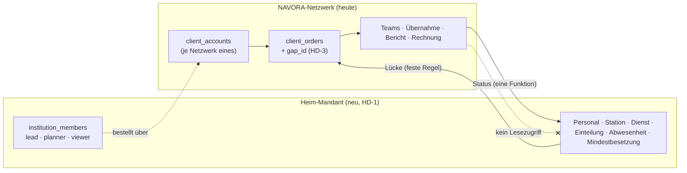
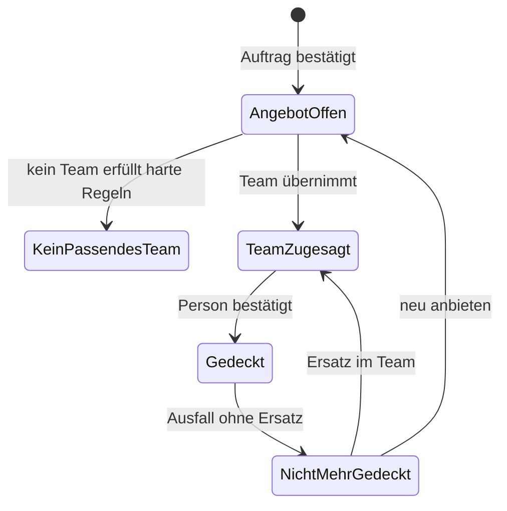

# ARCH1: technische Prüfung des Plattform-Grundrisses durch `eng`

**Auftrag:** Issue #1614 (Founder FE-108; PO-Nachtrag in PR #1618: auch HD-1 bis HD-4 und die `db-lint`-Zeile).
**Geprüft:** `docs/architecture/PLATFORM_GRUNDRISS.md` Fassung 2 (Stand PR #1618, `84fad487`) und `docs/agents/briefs/HD.md` (Entwurf), gegen den Code von `recovery/main` `e238f150` und `feature/STAB-1` `27d1164c`.
**Art:** nur Dokumentation. Kein Code, keine Migration, kein Test geändert. `eng` hat für diese Prüfung keine Produkttests ausgeführt. Die Belege sind Dateistellen und CI-Job-Protokolle.
**Regel:** Die Datei des PO ändert `eng` nicht (andere Rolle; die Datei ist zudem in #1618 offen). Jede Zeile hier sagt, ob eine Angabe **bestätigt**, **ersetzt** oder **nicht geprüft** ist. Der PO übernimmt das in den Grundriss.

Kennzeichnung: IMPLEMENTED (im Code belegt) · PLANNED · OPEN · UNKNOWN · PROPOSED (Vorschlag `eng`, nicht entschieden).

## 1. Grundriss §1 «Fakten aus dem Code»

| Angabe PO | Ergebnis | Beleg |
|---|---|---|
| Rollen `admin`, `coach`, `operations`, `nurse` | **bestätigt** (IMPLEMENTED) | `check (role in ('admin','coach','operations','nurse'))` in `0003`/`0035` |
| Seiten prüfen keine Rollen; RLS setzt durch | **bestätigt, präzisiert:** Das Menü filtert nach Rollen-Prädikaten (`src/lib/auth/nav.ts`), die `tests/unit/nav-access.test.ts` gegen die Datenbankfunktionen prüft. Die Seiten selbst sperren nicht; RLS und `security definer`-Funktionen setzen durch. | `nav.ts` Z. 5–27 |
| Keine Organisationsart; Kontext nur `client_accounts.client_kind` | **bestätigt** (`home`, `hospital_ward`, `household`). **Neu, Befund A1 (unten):** Ein Auftraggeberkonto gehört genau einer Netzwerk-Organisation, und Mitglieder haben keine Rolle. | `0129` Z. 16–38 |
| Keine Heim-Dienstplanung | **bestätigt**: Bis 0158 gibt es keine Tabelle für Standort, Station, Heimpersonal oder Dienstplan. `client_shift_plans` hält nur Schichtbezeichnungen. | `0129` |
| Berichtsentwurf: Modus auf Staging UNKNOWN | **ersetzt durch:** Ein Modell läuft nur, wenn alle sechs Bedingungen gelten: `AI_REPORT_DRAFT_MODE=model`, Not-Aus aus, exakter Staging-Host, Simulationsorganisation, gültige Anbieter-Konfiguration und Ledger-Freigabe (`report_draft_model_gate`). Sonst gilt die feste Regel mit dem Hinweis «regelbasiert, keine KI». In keinem CI- oder Smoke-Lauf lief ein Modell (IMPLEMENTED). Ob die Render-Umgebung `model` setzt, ist **UNKNOWN**: `eng` hat die Render-Variablen nicht gelesen, weil ihre Werte Schlüssel enthalten. Sicherer Test für den Founder: in /field einen Bericht als Entwurf anfordern. Steht «regelbasiert, keine KI» da, ist kein Modell aktiv. | `src/lib/ai/report-draft/config.ts` Z. 47–100; `src/features/field/report-draft-command.ts` Z. 55–66 |

## 2. Grundriss §3, Heim-Register

| Register | Ergebnis `eng` |
|---|---|
| Übersicht | **bestätigt.** `home_overview` als neue lesende `security definer`-Funktion mit `private.is_client_member` und von Anfang an als Datei unter `supabase/schema/functions/` (STAB1-Regel). Sie liest den Status aus derselben Funktion wie die Wochenansicht (§5, HD-3); keine zweite Statuslogik im Frontend. |
| Dienstplanung | **ersetzt (Datengrenze).** «B2B-Bereich des Heims» hat heute keinen Eigentümer im Datenmodell (Befund A1). Vorschlag: §5 HD-1. |
| Externe Aufträge | **bestätigt:** `preview_client_order` und `confirm_client_order` (0132) halten die harten Regeln. Die Vorbefüllung aus der Lücke wird **kein** zweiter Bestellweg: Eine neue Funktion liefert nur die Eingabe für `preview_client_order`, bestätigt wird unverändert über `confirm_client_order`. «Teamname erst nach Übernahme»: `covered_team_name` erscheint nur bei «Gedeckt» (`offer-rules.ts` Z. 246–258). Die Datenbankseite dazu ist in diesem Lauf **nicht geprüft**. |
| Kosten & Rechnungen | **bestätigt:** `team_prices`, `order_take_prices` (0155), `team_invoice_drafts` (0156). «NAVORA-Gebühr nie auf dieser Rechnung»: **nicht geprüft** in diesem Lauf. |
| Mitteilungen & Ausnahmen | **nicht geprüft** (`my_signals` nur für Teammitglieder). Prüfung folgt vor H4. |
| Dokumentation | **ersetzt:** Eine Tabelle `field_reports` gibt es nicht. Berichte sind `public.visit_reports` (0016) mit `sign_report` und `correct_report` (beide in STAB1 als Datei). |
| Angehörige, Einstellungen | **bestätigt als «Fehlt».** Einstellungen brauchen Rollen je Heim-Mitglied, die es heute nicht gibt (A1). |

## 3. PO-ARCH-1: Was liest die Rolle `coach` heute?

**Ergebnis (IMPLEMENTED, aus dem Code):** `coach` ist heute ein **Koordinator mit organisationsweitem Lesezugriff**, kein neutraler Coach.

- `private.is_coordinator(org)` = `admin`, `coach` oder `operations` (0015). Mit dieser Funktion lesen sie organisationsweit die Zeilen aus 26 Tabellen, die eine RLS-Richtlinie mit `is_coordinator` haben, unter anderem `cases`, `care_visits`, `care_notes`, `visit_reports`, `visit_status_notes`, `quality_events`, `quality_holds`, `assessment_records`, `member_absences`, `working_time_facts`, `team_memberships`, `matching_requests` und `partner_requests`.
- Schwere Qualitätsereignisse (`high`, `critical`) sehen `admin` und `coach` ausdrücklich (0020).
- `public.operations_exceptions()` liefert Ausnahmen mit Fallbezug an jeden Koordinator (STAB1-Datei Z. 16).
- Laut Kommentar in 0015 sind die Gesundheitsfelder über Spaltenrechte für niemanden über die Tabellen-API lesbar. Ob das für alle 26 Tabellen gilt, ist **UNKNOWN** (nicht je Tabelle geprüft).

**Widerspruch zu FE-108 / Grundriss §8:** Der neutrale Coach darf keine Namen, Berichte, Beobachtungen, Sicherheitshinweise oder Fallbeträge sehen. Die heutige Rolle sieht davon die Zeilen.

**Vorschlag (PROPOSED, Entscheid `po`, Prüfung `cra`/`lca`):** Die heutige Rolle nicht umdeuten. Für den neutralen Coach entsteht eine eigene Rolle ausserhalb der Organisationsmitgliedschaft, die nur über Funktionen mit Teamzahlen liest (keine Tabellenrechte) und nur, wenn ein Team sie anfragt. Die heutige Rolle `coach` wird später in `coordinator` umbenannt (Migration, Menü, Tests in einem Paket). Jetzt ändert sich nichts.

## 4. `db-lint` und die Meldung «schema net» (PO-Frage in #1618)

**Ergebnis (IMPLEMENTED, Job 136386934504 auf `27d1164c`):** Der Schritt `supabase db lint --level error` meldet in jedem Lauf einen Fehler der Stufe `error` («schema "net" does not exist», `private.push_dispatch_kick`, sqlState `3F000`) und bleibt trotzdem grün. Grund: Die Option `--fail-on` steht standardmässig auf `none` (CLI-Hilfe, v2.121). **Der Schritt kann also nie rot werden.** Ein Fehler der Stufe `error` in irgendeinem Funktionsrumpf, etwa eine falsche Spalte, bliebe in der CI unbemerkt.

**Antwort an den PO:** Nach dem Wortlaut darf er heute nicht scheitern. Tatsächlich kann er es gar nicht, er ist also keine Prüfung. Das ist ein echter Mangel, kein Rauschen.

**Vorschlag (PROPOSED, Folgeposten `STAB1-F1`, nicht in den gemeldeten STAB1-Kopf):** `--fail-on error` setzen und `pg_net` in der lokalen CI aktivieren (oder `push_dispatch_kick` ausdrücklich ausnehmen, mit Begründung). Zuerst ein roter Nachweis auf einem Probe-Branch (eine Funktion mit falscher Spalte → Lint rot). Das passt zum Ziel von STAB1 (Funktionsrümpfe sicher ändern) und kostet etwa einen Lauf (ESTIMATE).

## 5. HD-1 bis HD-4: das WIE

**Befund A1 (IMPLEMENTED, Folge für HD-1):** `client_accounts.organization_id` hängt jedes Auftraggeberkonto an genau eine NAVORA-Netzwerk-Organisation (0129). `client_account_members` hat keine Rolle. Würde HD die Heimmitarbeitenden an `client_accounts` hängen, lägen Personaldaten des Heims unter dem Mandanten eines Netzwerks. Mit weiteren Netzwerken entstünden mehrere Kopien desselben Heims, und es gäbe keine Unterscheidung zwischen Heimleitung, Planerin und Leserecht.

| PR | Bestätigt / ersetzt | WIE (PROPOSED) |
|---|---|---|
| HD-1 | **ersetzt (Grundlage):** zuerst ein **Heim-Mandant** | Neue Tabelle `institutions` (Einrichtung, Art aus `client_kind`) mit `institution_members(role: lead / planner / viewer)`. Ein Heim kann 1..n `client_accounts` haben (je Netzwerk eines), verknüpft über `client_accounts.institution_id`, nullable, damit bestehende Konten unverändert bleiben. Personal, Station, Dienst, Einteilung, Abwesenheit und Mindestbesetzung hängen an `institution_id`. RLS nur über `private.is_institution_member(id, roles)`, `revoke all` für `anon` und `authenticated` auf den Tabellen, Lesen und Schreiben nur über `security definer`-Funktionen als Dateien, Audit-Trigger wie `change_log`. pgTAP: anderes Heim, Netzwerk-`admin`, `coach`/Koordinator, Teammitglied und `anon` lesen **nichts**. Die Regel «nie zugleich Auftraggeber und Teammitglied» (0129) gilt auch für `institution_members`. **Vor dem Bau** muss `lca` klären: Ist das Heim Verantwortlicher und NAVORA Auftragsbearbeiter? Das steht schon in HD.md. |
| HD-2 | **bestätigt** | Lücke = feste Regel in einer Funktion: Mindestbesetzung je Dienst (Daten des Heims) minus eingeteilte, nicht abwesende Personen mit passender Stufe. Eine Lesefunktion `institution_week(institution, week)` liefert Plan, Lücken und Status für Tablet und 390 px. Gleichzeitigkeit: Einteilung mit `unique (shift_id, member_id)` und Prüfung von Überschneidungen in derselben Transaktion (`for update` auf die Person), damit zwei Planerinnen dieselbe Person nicht doppelt einteilen. |
| HD-3 | **bestätigt, mit Schutz gegen Doppelbestellung** | `client_orders.gap_id` (nullable) plus ein partieller eindeutiger Index «eine aktive Bestellung je Lücke» und ein Idempotenzschlüssel. So sendet ein Doppelklick oder eine zweite Planerin nicht zwei Aufträge. Der Statusrückfluss liest die **bestehende** Auftragsstatusfunktion; die fünf Zustände kommen aus einer einzigen Quelle. Ein Ausfall nach «Gedeckt» läuft über den vorhandenen BK-e-Weg (`recheck_member_takes`, STAB1-Datei). Der Wochenplan zeigt dann «Nicht mehr gedeckt». |
| HD-4 | **bestätigt, abhängig von AI1** | Die feste Regel berechnet die zulässigen Optionen. Das Modell erklärt nur diese Optionen, mit Quellenbezug, über das AI1-Gateway (Not-Aus, Ledger, nur Staging und Simulation). Fällt das Modell aus, erscheinen die Optionen mit festem Text. Das Modell kann keine Option hinzufügen, die die Regel nicht erlaubt (Prüfung im Gateway, Test). |

## 6. Innovation (FE-108 (6); alles PROPOSED)

1. **Die Woche aus der Dienstvorlage erzeugen:** Die Heimleitung pflegt nur die Abweichungen, nicht jeden Dienst.
2. **Abwesenheit mit einem Tipp in /field melden:** Die Lücke erscheint sofort im Wochenplan des Heims, ohne Telefonkette.
3. **Lücke → Auftrag ohne Abtippen:** Zeit, Station, Stufe und Tätigkeiten kommen aus der Lücke; das Heim bestätigt nur.
4. **Ein Status für alle Ansichten:** Heim, Team und Pflegekraft lesen dieselbe Datenbankfunktion, also gibt es keine widersprüchlichen Anzeigen.
5. **Der unterschriebene Bericht ist die einzige Quelle** für Leistungsbestätigung, Rechnung und Kosten; nichts wird zweimal erfasst.

## 7. Aufwand (ESTIMATE, in Arbeitsläufen inklusive CI-Runden)

**Kalibrierung:** STAB1 war mit 2–3 Läufen geschätzt. Tatsächlich dauerte es vom ersten Commit (08:36 UTC) bis zur Fertigmeldung (15:46 UTC) rund 7 Stunden über mehrere Sitzungen. Die folgenden Zahlen sind entsprechend höher angesetzt.

| Paket | ESTIMATE |
|---|---|
| H1 Übersicht (aus vorhandenen Daten) | 2–3 Läufe |
| HD-1 Heim-Mandant, Datenmodell, Rechte | 4–7 Läufe (+ `lca`-Klärung vorab) |
| HD-2 Wochenplan, Abwesenheit, Lücke | 3–5 Läufe |
| HD-3 Lücke → Auftrag, Statusrückfluss | 3–5 Läufe |
| HD-4 Ausfall-Optionen mit Modell | 3–4 Läufe nach AI1 |
| STAB1-F1 `db-lint` scharf | ca. 1 Lauf |

## 8. Abweichungen

- **Reihenfolge:** `GRUNDRISS_V1.md` (#1612, Live-Sitzung `eng`) schlug W1 vor STAB1 vor. Das ist durch FE-100 (6) und Grundriss §8 überholt (A/C beginnen mit STAB1). Diese Prüfung folgt §8; #1612 bleibt unverändert.
- **HD.md «Heimmitarbeitende … RLS»:** Ohne Heim-Mandant (A1) gibt es keine saubere Grenze. HD-1 braucht diese Grundlage vor dem Personal. Entscheid `po`; der Datenschutzanteil liegt bei `lca`.
