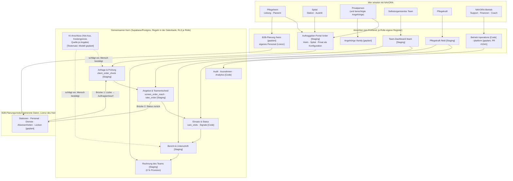
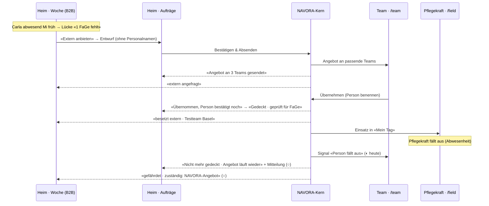
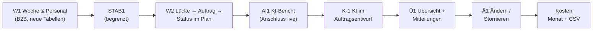

# NAVORA-Grundriss V1: eine Plattform, passende Ansichten (Vorschlag `eng` für PO und Founder)

**Autor:** `eng`, 2026-11-20 ca. 15:30, auf den Founder-Brief «NAVORA-Gesamtarchitektur festlegen und Register für Register bauen».
**Status:** Vorschlag. Er baut auf **Blueprint §5 «Die sechs Portale: der Grundriss»** und dem vorhandenen Code auf; nichts Funktionierendes wird verworfen. Übernimmt der PO den Grundriss, gehört er in Blueprint §5 (WAS) und Handbook (WIE), nach FE-077 die einzigen Quellen. Die Detailvorlage für das Heim ist `HEIM1_VORLAGE.md` Version 3 (PR #1611).
**Kennzeichnung:**

| Kennzeichen | Bedeutung |
|---|---|
| ● **Staging** | auf Staging nachgewiesen (Prüflauf 44744533079, 4/4, App `8051283`, DB bis 0157) |
| ◐ **Code** | gebaut und in der CI getestet, auf Staging nicht durchgeklickt |
| ○ **geplant** | nicht gebaut |

**Abweichung Doku ↔ Code:** Blueprint §5 führt das Auftraggeber-Portal `/order` als PLANNED. Im Code ist es gebaut und auf Staging nachgewiesen. Der PO korrigiert die Zeile; `eng` ändert den Blueprint nicht.

---

## 1. Gesamtgrundriss

**Gemeinsam** für Heim, Spital und Privatperson ist ein Datensatz «Auftrag» mit dem Kontoart-Feld `home`, `hospital_ward` oder `household`; das ist im Code schon so. Gemeinsam sind auch Prüfung, Teamangebot, Teamentscheid, Einsatz, Bericht, Rechnung und Status.
**Verschieden** sind Formular, Sprache, Navigation und Zusatzmodule: Stationsplanung nur beim Heim, Spitalabläufe nur beim Spital, einfache Ansicht für Privatpersonen. Unterschiede entstehen als **Konfiguration auf demselben Datensatz**, nie als zweite Anwendung.

| Fähigkeit | Heim | Spital | Privatperson | Stand |
|---|---|---|---|---|
| Bedarf erfassen und prüfen | Schicht, Station, Stufe, Tätigkeiten | Station, Stunden | Einsatz zuhause, einfache Sprache | ● Heim · ◐ Spital gesperrt (`hosp_in_strict`) · ○ Privat |
| Teamangebot und Teamentscheid | gleich | gleich | gleich | ● |
| Status bis «gedeckt» / «nicht mehr gedeckt» | gleich | gleich | gleich, ohne Fachbegriffe | ● / ◐ |
| Einsatz, Bericht, Unterschrift | gleich | gleich | gleich | ● |
| Rechnung des Teams sehen | gleich | gleich | gleich | ● Heim |
| Eigenes Personal planen | **B2B-Modul** | **B2B-Modul** (später) | – | ○ |
| Versorgungsübergang (Austritt → Spitex-Fall) | – | Zuweisung | – | ◐ (Aufnahme, Weg BD-2 in der CI) |
| Angehörige | B2B-Modul | – | Familienansicht | ○ |

## 2. Rollen und Zugriffsgrenzen

| Rolle | Sieht | Sieht nie | Stand |
|---|---|---|---|
| Heim-Leitung / Planerin | eigene Aufträge, Team und benannte Person **nach** Übernahme, Rechnungen an das Heim; im B2B-Modul eigenes Personal mit Namen | Mitglieder, Preise oder Daten anderer Teams; Angebote, die ein Team abgelehnt hat | ● / ○ |
| Spital-Station | wie Heim, für die eigene Station | wie Heim | ○ |
| Privatperson | die eigenen Einsätze, Team, Rechnung | Daten anderer Kunden | ○ |
| Angehörige | nur freigegebene Updates | Pflegeakte | ○ |
| Team | Angebote der eigenen Region und Eignung, eigene Übernahmen, Einsätze, Preise, Rechnungsentwürfe | Heimpersonal; Angebote, die andere Teams übernommen haben; Personen anderer Teams | ● |
| Pflegekraft | ihr Tag, ihre Einsätze, ihr Bericht | Finanzen anderer, Heimplanung | ● |
| NAVORA-Betrieb / Support | Ausnahmen und Systemzustand, nur Codes, keine Pflegeinhalte | Pflegetexte, Personendaten ohne Anlass | ◐ |
| Coach | aggregierte Teamgesundheit, moderiert | Akten, Aufsicht über Personen | ○ |

**Technik:**
- Jede Grenze ist eine RLS-Regel in der Datenbank mit pgTAP-Test.
- Das Menü zeigt ein Register nur, wenn die Datenbank der Rolle Zugriff gibt (`src/lib/auth/nav.ts`, schon so gebaut, fail-closed).
- Vorhandene Organisationsrollen: `admin`, `coach`, `operations`, `nurse`.
- Auftraggeber sind Mitglieder eines Kundenkontos.

## 3. Navigationskarte

Ein Register wird erst sichtbar, wenn es eine Aufgabe löst. ○-Register sind Zielbild, **kein Menüpunkt**.

| Nutzer | Register (Ziel) | Heute im Menü |
|---|---|---|
| **Pflegeheim** | Übersicht ○ · Woche ○ (B2B) · Personal ○ (B2B) · Aufträge ●◐ · Kosten ◐ · Einstellungen ● | «Auftrag erfassen», «Meine Einstellungen» |
| **Spital** | Station heute ○ · Aufträge ○ · Austritte ◐ · Kosten ○ · Einstellungen | – (Spitalaufträge gesperrt) |
| **Privatperson** | Meine Betreuung ○ (nächster Einsatz, Team, Bericht kurz, Rechnung) · Anfrage ○ | – |
| **Team** | Angebote ● · Unsere Einsätze ◐ · Preis & Rechnungen ● · Mitglieder ◐ · Kennzahlen ◐ | «Dein Team», «Kennzahlen» |
| **Pflegekraft** | Mein Tag ● · Bericht ● · Mein Arbeitstag ◐ | «Mein Tag», «Mein Arbeitstag» |
| **NAVORA-Betrieb** | Ausnahmen ◐ · Aufnahme ◐ · Administration ◐ · Cockpit ○ (PR #1541) | «Ausnahmen», «Aufnahme», «Administration» |

**Privatperson bewusst anders:**
- eine Seite «Meine Betreuung»: nächster Einsatz, Team, letzter Bericht kurz, Rechnung;
- eine Anfrage in einem Satz mit KI-Strukturierung;
- keine Stationen, keine Stufenwahl als Einstieg.

**Spital anders als Heim:**
- Stunden und Station statt Woche;
- dazu der Austritt als Übergang in die Spitex-Versorgung. Der Aufnahmeweg ist im Code (◐).

## 4. Pflegeheim-Register: Frontend, Backend, Daten, KI

| Register | Wer · Aktionen | Daten (Herkunft · Grenze) | Backend | KI | Folgen | Prüfung | Stand |
|---|---|---|---|---|---|---|---|
| **Übersicht** | Leitung · «Jetzt zu entscheiden», Morgenlage | eigene Aufträge, Lücken, Rechnungen · nur eigenes Konto | Lesefunktionen; «gefährdet» nur mit belegtem Grund | feste Regel | Link in Woche oder Auftrag | pgTAP: nur eigenes Konto. e2e: Ausfall erscheint oben | ○ |
| **Woche** (B2B) | Planerin · zuteilen, Abwesenheit, intern vertreten, «extern anbieten» | Personal, Dienste, Abwesenheiten (ohne Grund) · nur Heim-Rollen | neue Tabellen mit eigener RLS; Lücke = Vorlage − Zuteilung − Abwesenheit | feste Regel; später KI-Umplanung | Lücke → Entwurf (Brücke 1) | pgTAP: Team sieht nichts. e2e: Abwesenheit öffnet Lücke | ○ |
| **Personal** (B2B) | Planerin · Mitarbeitende, vom Heim bestätigte Stufe | Heimpersonal · nie an Teams | neue Tabellen | – | «kann vertreten» | pgTAP: Rechte | ○ |
| **Aufträge** | Leitung · erfassen, prüfen, absenden; später ändern und stornieren | Auftrag, Status, Team nach Übernahme | `preview/confirm_client_order`, `screen_order_reach`, `client_orders` | ○ K-1: KI strukturiert den Freitext, jede Angabe markiert | Angebot an Teams, Status in Woche | vorhanden + Nullfall-Test | ● erfassen und Status · ○ Nullfall, Ändern |
| **Kosten** | Leitung · Monat ansehen, CSV | bestellt / vereinbart (Preis aus der Übernahme) / erbracht / in Rechnung / Klärung · nur eigene | `client_invoices` + Lesefunktion Monat | – | – | Summen je Spalte aus Testdaten | ● Rechnungsliste · ○ Monat |
| **Einstellungen** | Leitung · Stationen, Nutzer, Module | Konto des Heims | neue Tabellen für Station und Modulfreischaltung | – | Register erscheinen je Modul | pgTAP: Modul aus → Register weg | ● eigene Einstellungen · ○ Rest |

Mitteilungen stehen zuerst in der **Übersicht**. Dokumentation und Angehörige bleiben unsichtbar, bis ihre Module gebaut und gebucht sind.

## 5. Was in den Ansichten passiert, wenn …

| Ereignis | Heim · Woche | Heim · Aufträge | Team | Stand |
|---|---|---|---|---|
| nicht gedeckt | Lücke offen, Zuständigkeit sichtbar | «Noch nicht gedeckt · Angebot an alle passenden Teams» | Angebotskarte «Neues Angebot» | Aufträge ● · Woche ○ |
| Team übernimmt | «besetzt extern» | «Übernommen» → «Gedeckt» | «Übernommen» | ● / ○ Woche |
| Pflegekraft fällt aus | «gefährdet» | «Nicht mehr gedeckt» + Mitteilung | Signal, neue Besetzung | Team-Signal ◐ · Heim-Mitteilung ○ |

## 6. Wochenablauf des fiktiven Heims

Der vollständige Fall steht in `HEIM1_VORLAGE.md` §3, mit 11 Schritten und je Frontend, Backend, entscheidender Person und Stand:
- «Testheim Rhein», Stationen Rhein 1 und 2, synthetische Mitarbeitende.
- Ablauf: Plan → Abwesenheit → berechnete Lücke → «kann vertreten» → externer Entwurf → KI-Ergänzung → Bestätigung → Teamübernahme → Status im Plan → Ausfall → Durchführung und Rechnung.

Heute auf Staging bedienbar sind davon die Schritte Bestätigen, Übernahme, Durchführung und Rechnung, aber ohne Bezug zum Plan.

## 7. Bau- und Prüfreihenfolge

**Genau ein aktives Implementierungspaket, danach eine echte Demo.**

| Paket | Danach als Rolle neu bedienbar | ESTIMATE |
|---|---|---|
| W1 | **Heim-Planerin:** Woche mit Namen, Abwesenheit, Lücke, «kann vertreten» | 4–6 Läufe |
| STAB1 | nichts Sichtbares; sichere Grundlage für W2 | 2–3 |
| W2 | **Heim:** aus der Lücke einen Auftrag senden, Status im Plan. **Erster zusammenhängender Arbeitsplatz** | 3–5 |
| AI1 | **Pflegekraft:** Berichtsentwurf von Claude | 3–5 |
| K-1 | **Heim:** Ergänzung in eigenen Worten, KI-Vorschläge markiert und bestätigt | 3–4 |
| Ü1 | **Heim:** Morgenlage, Mitteilungen bei Übernahme und Ausfall | 3–4 |
| Ä1 | **Heim:** ändern und stornieren, gleicher Stand bei Heim und Team | 4–6 |
| Kosten | **Heim:** Monat in fünf Spalten, CSV | 2–3 |

Spital und Privatperson werden in jedem Paket **mitgedacht** (Kontoart im Datensatz), aber nicht parallel gebaut.

**Ablauf je Paket:**
1. PO-Vertrag mit Nutzeraufgabe und sichtbarem Ergebnis.
2. `eng` baut Frontend, Backend, RLS und Migration, mit Positiv-, Negativ- und Rechtetests und einem eigenen `staging-smoke`-Pfad.
3. Gates.
4. Der PO merged.
5. Staging-Sync über den CI-Job `staging`.
6. Grüner Staging-Prüflauf.
7. Meldung an dich: «Dieses Register kannst du jetzt als [Rolle] öffnen. Das kannst du darin tun. So prüfst du es.», mit App-Commit, Migrationsstand, Lauf-ID und Grenzen.
8. Dein Feedback geht in ein Korrektur- oder Folgepaket, nie in einen fast fertigen PR.

## 8. Was `eng` als Lead Engineer daran ändern würde

- **Weniger Eingaben:**
  - Die Lücke liefert Zeit, Station, Stufe und Tätigkeiten.
  - Die Dienstvorlage erzeugt die Woche.
  - Der unterschriebene Bericht ist die einzige Quelle für Rechnung, Kosten und Leistungsbestätigung.

  Nichts wird zweimal eingegeben.
- **KI dort, wo Text Arbeit macht:** Bericht (AI1) und Freitext im Auftrag (K-1).
  - Nicht bei der Eignung: Die bleibt feste, prüfbare Regel.
  - Jede KI-Angabe trägt ihre Quelle und wird vom Menschen bestätigt.
- **Ein Statusmodell für alle Ansichten:**
  - Heim, Team und Pflegekraft lesen denselben Zustand aus derselben Datenbankfunktion.
  - Es gibt keine zweite Wahrheit im Frontend.
  - «Team prüft» gibt es nicht, weil NAVORA es nicht weiss.
- **Neue Funktionen als lesbare Dateien** von Anfang an (FE-100), mit Prüfung in der CI. Das B2B-Modul startet so ohne Altlasten.

## 9. Entscheidungen, die wir von dir brauchen

1. **Reihenfolge:** W1 → STAB1 → W2 → AI1 → K-1 statt FE-099 (7) STAB1 → AI1 → BK-d. Die erste echte KI käme so nach W2; die Alternative ist AI1 vor W2.
2. **B2B-Modul in der Simulation:** Darf es auf Staging ohne Lizenzprüfung freigeschaltet sein, bis Preis und Abrechnung (GM-2) entschieden sind?

Alles Übrige entscheiden PO und Fachrollen im Mandat. Das sind die Regeln in HEIM1 §6: Besetzungsanforderungen, Abwesenheitsgrund, Arbeitszeit, Stornierungsfolgen, Inhalt der Mitteilungen.

**PO:** Bitte prüfe:
- ob der Grundriss Geschäftsmodell und Vision trägt (autonome Teams, 0 % Provision, getrenntes B2B-Geschäft);
- §7, die Reihenfolge;
- die Blueprint-Korrektur zu `/order`.
