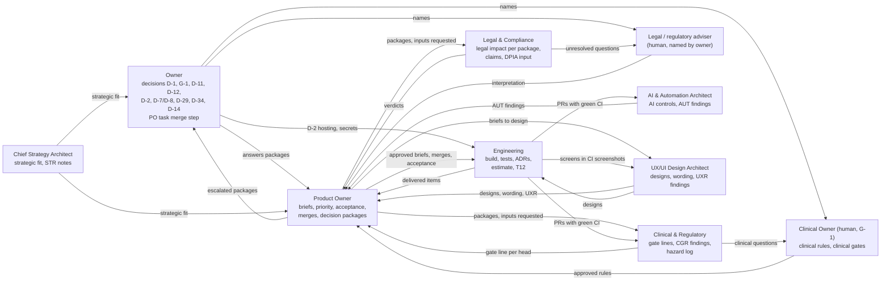
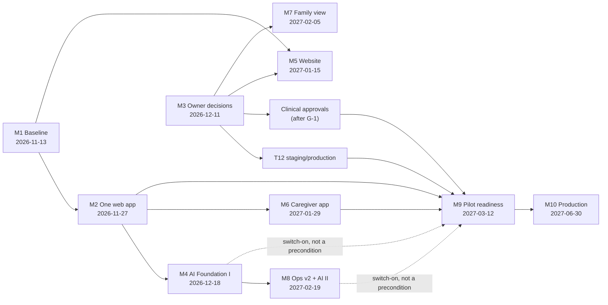

# NAVORA Architecture Review and Implementation Blueprint V2

**Owner of this file:** Product Owner (`po`) · **Written:** 2026-11-06 08:40 (Europe/Zurich), by the owner's *Program Quality Improvement Directive* (2026-11-06) · **Version:** 2.25, 2026-11-07 14:39 (~~2.24, 2026-11-07 13:39~~; ~~2.23, 2026-11-07 12:39~~; ~~2.22, 2026-11-07 10:40~~; ~~2.21, 2026-11-07 09:39~~; see the version table below). Version 2.1 was written after the founder letter of 2026-11-06 (decisions FE-019 to FE-030 in [`FOUNDER_DECISIONS.md`](FOUNDER_DECISIONS.md); answer in [`FOUNDER_DIRECTION_CONFIRMATION_2026-11-06.md`](FOUNDER_DIRECTION_CONFIRMATION_2026-11-06.md)). Version 2 was 2026-11-06 08:40; version 1 is [`DELIVERY_PROGRAM.md`](DELIVERY_PROGRAM.md), 2026-11-03 · **Repository state read:** `recovery/main` @ `9c58939`, open PRs and role branches read through the GitHub API on 2026-11-06 08:20-08:40.


**Status (FE-035, owner 2026-11-06):** this Blueprint is NAVORA's **official, leading working book** (Arbeitsbuch). It is a living document: every content change, new founder decision and milestone progress is recorded in the version table below; substantial changes stay traceable in the text (struck through or marked as replaced, never silently overwritten); with every update the PO synchronises the affected GitHub issues and PRs, and names any scheduled-task prompt that needs a change.

### Version table

| Date (Europe/Zurich) | Version | What changed | Why | Sections affected |
|---|---|---|---|---|
| 2026-11-07 14:39 | v2.25 | **#837 merged** (M1.4 WEB1/APP1 plans, `f898d4a`, head `e906a04`): UXR-94 is now written into ADR-143. CI on the merge commit is green, and **M1.4 is accepted, IMPLEMENTED.** With it, ADR-143 is accepted by `po` as the design for M2, M6 and M8, under build conditions: the CGR-123 point 1d device clock and CGR-124 gate the M6-2 build, and the label constants are PLANNED with M6-2. **M1 63 % → 75 %.** Role PRs #965 (`cra` 13:25) and #970 (`aia` review 38) merged. **NH-A1 amended** (AUT-69: no per-shift confirm, the default takes effect; AUT-70: own recurring pattern NH-A1-15; AUT-71: four measures). | Merge gate met; M1 acceptance criteria (3) checked against both plans; `aia` review 38 | Header, §4 M1, §4 M9.0a |
| 2026-11-07 13:39 | v2.24 | **#961 merged** (MERGE1 status row and COORD-7 row, `47265b0`); COORD-7 placed in the decision index (order 43, tier 4), points 4-5 wait for `cra`/`lca`. **#837 (M1.4) held:** condition 5, `uxa` UXR-94 unanswered (the v2.23 note "next merge, CI green, `clean`" was incomplete). **NH-A1 brief approved** for synthetic data (M9.0a, first of five; ward, shift definitions as data, self-entered shifts, one member *zuständig* per resident per shift with a continuity default, `resident_uncovered` derived with no priority, "Nicht überwacht" list; `uxa` proposal N-01/N-02 taken in; build gate `cra`/`uxa`/`lca`). `cra` 13:25 (on its branch): CGR-156, CGR-157 placed as ORD1-C1/-C2 (also bind BILL1 before a real invoice); FE-042 order D-18 → D-44 → D-42 accepted; #815 cleared at `b221c83` | scheduled PO run 13:39; COORD-7 order; Blueprint M9.0a due 2026-11-27 | header, version table, §4 M1 (blockers), §4 M9.0a |
| 2026-11-07 12:39 | v2.23 | **#835 merged** (M1.3 `DELIVERY_ESTIMATE.md` v1 with founder-decision check, `58da1ba`): M1.3 IMPLEMENTED, **M1 completion 50 % → 63 %**; M1.3 condition: estimate v2 against FE-021/FE-031/FE-036 with the NH-A effort before M1.5 (2026-11-17); PO answers to the estimate's §8 questions 1 and FE-036 row (P-5 outside alert stays before M9, R-2 and R-4 move to the Phase B readiness file, R-4 scope document before M9). **M2.0 = MERGE1** brief approved (`briefs/MERGE1.md`); **COORD-7** points 1-3 decided by po (one open Engineering code PR; order #837 → #961 → #815 → #907 → MERGE1 → QUAL1 part 2 → UX2 remainder → NH-A → BILL1), points 4-5 to the owner after `cra`/`lca`. FE-043, FE-044 recorded | Engineering proposal #960 (owner: coordination lies with the PO); merge and review under `PO_MERGE_PROCESS.md` §4-§5 | version table, header, §4 M1, §4 M2 (M2.0) |
| 2026-11-07 10:40 | v2.22 | **FE-042** (owner, attended session): work milestone by milestone, issues and PRs first, then a status update compared with this Blueprint; D-43, D-42, D-44, D-22, D-18 reopened (Unfreeze 1) for a detailed `cra` research and decision template with reasons (legal parts `lca`). PR/issue clean-up: #840 closed (superseded by #907), #861, #935, #506, #919, #399 closed with evidence; #954 brought up to date | owner instruction 2026-11-07 | version table, header, §7 Founder Decision Board |
| 2026-11-07 09:39 | v2.21 | **#953 merged** (QUAL1 part 2 slice 3, `ac6a303`): one text per QUAL1 reason on every path, no verdict on a person, no code in user text (QUAL1-21 (1)-(3) met for QUAL1; UXR-129 leftovers outside QUAL1 open). `cra` CGR-155 (resume after a lapse during the visit) placed with CGR-154 and UXR-134 in one slice; CR-194 interim text revised (state *pausiert* plus the two implemented steps; the earlier "no next step" line struck in `briefs/QUAL1.md`) | `cra` review 09:25 (#937), merge record on #953 | §1.4 product flow step 3 (refusal texts IMPLEMENTED), `briefs/QUAL1.md` |
| 2026-11-07 08:39 | v2.20 | No Engineering merge (#953 QUAL1-21 waits for a `cra` gate on head `9f6340c`); `uxa` #951 merged. New QUAL1 findings placed: UXR-134 (one "lapsed" text on depart, start and resume) part 2 condition with CGR-154; CR-194 (resume after a lapse) stays a clinical question, no next step in text until answered; UXR-135/-136, AUT-68 folded into QUAL1-21, ADR-165 (3) and QUAL1-15; **QUAL1-22** added (AUT-67: show evidence and delegation ends at planning, release dependent future visits on revocation; part 3) | `uxa` review 07:50, `aia` review 37 (#954, open) | §1.4 product flow step 3 (requirement check: prevention before the start check PLANNED), `briefs/QUAL1.md` |
| 2026-11-07 07:39 | **v2.19** | #945 (QUAL1 part 2 slices 1+2) **merged** as `f1bfe55` on head `3a7a0c5`, including #943 (one Engineering merge for the chain, FE-041 (3); `cra` gated #943 only with #945); slices reviewed in `briefs/QUAL1.md` (evidence table; ADR-164/-165 deviations decided; CGR-153, CGR-154 made part 2 acceptance conditions); QUAL1 stays in progress; §1.4 step 3: requirement check now runs on every assignment path except NH-EXT in the simulation organisation | scheduled PO run 2026-11-07 07:39 | version table, header, §1.4 product flow step 3 |
| 2026-11-07 06:39 | v2.18 | #939 (QUAL1 part 1) **merged** as `4878ace` on head `50e372a` (all seven conditions; the merge call went through this run); CI green on the merge commit; part 1 reviewed in `briefs/QUAL1.md` (evidence table; CGR-151 deferral, CGR-152 stricter reading, UXR-133 strings and the visit-12 nit decided as part 2 conditions); QUAL1 stays in progress; §1.4 product-flow steps 2 and 4 now partly IMPLEMENTED (simulation organisation only, no assignment path yet) | scheduled PO run 2026-11-07 06:39 | version table, header, §1.4 product flow |
| 2026-11-07 05:39 | v2.17 | `lca` review (#947, D-42/D-43/D-44 legal sections) merged. **D-43 escalated** (B + D, Medium), **D-42 escalated** (option B as drafting basis, Medium), **D-44 escalated** for two points (L-10 fee design binding; one adviser mandate before Phase B for Q-42a-c, Q-43a-b, Q-44a-b, D-41 (9)); D-44 Clinical section drafted by po from CGR-146/-147. #939 (QUAL1 part 1): all seven conditions met (`cra-gate: #939 50e372a clear`), merge call refused by the session's permission check; not merged. | `lca` inputs complete for three Phase B packages; the founder sees one bundled adviser question instead of seven | §7 FD-02/FD-28 rows, §9.1 PB-1, PB-6, PB-10 |
| 2026-11-07 04:45 | **v2.16** | `uxa` review (#936) merged; **QUAL1-21** added to the QUAL1 brief (UXR-129 to -133: one label function per QUAL1 reason on every assignment path and at visit start, QUAL1 refusals never shown as a technical fault or a wrong cause, no verdict on a person and no matrix codes in user text while rules are PROPOSED); QUAL1-17's "four result labels shown" replaced by "four result codes"; #939 still waits for the `cra` gate line | a refusal that reads as a fault makes the nurse retry at the door and hides that the fix is another person (patient safety precondition; value 4, team autonomy: the team re-plans itself only when the reason is clear) | Version table; §1.6 |
| 2026-11-07 02:45 | v2.15 | `aia` review 36 (#941) merged; **QUAL1-20** added to the QUAL1 brief for part 2 (AUT-61: the activity list is kept once on the order line or series and inherited by its visits, with four fail-safes; `cra` to confirm the per-visit removal); AUT-62 to AUT-66 noted for the part 2 plan review; #939 (QUAL1 part 1) not merged: CI green, `cra` gate line missing for the remediated head | removes per-visit tagging of every series visit before it is built (value 5, reduced administration; value 1, direct care time) without loosening the check | Version table; §1.6 |
| 2026-11-07 01:39 | v2.14 | #934 (PLAN3 consolidation, FE-041) merged as `48cdb0c`, the 15 included PRs closed; **PLAN3 accepted** (CI green on head and merge commit; evidence table in `briefs/PLAN3.md`); M4.2, M4.3, M4.4, M4.6 ACCEPTED, M4 completion 13 % → 87 % (only M4.5 AN3 left); D-42, D-43, D-44 Engineering sections drafted by po (two-run rule), `lca` still outstanding on all three | merge and acceptance under `PO_MERGE_PROCESS.md` §4-§5; D-43 Engineering draft finds the matrix data has two status values where CR-179 has four steps | §1.4 PLAN3 paragraph, §3.1 Milestones row, §5 M4 |
| 2026-11-07 00:39 | v2.13 | `lca` Basel re-analysis (2026-11-06 16:10) taken into D-22 and D-18: BILL1 on synthetic data with option A (BS/BL rules as sourced, versioned rows, `validated = false`) decided by po; nursing-home level only with an order reference (NH-A5); adviser questions D-22 1-8, D-18 1-6, 9, 10 needed before Phase B, not Phase A; D-41 complete (Engineering drafted by po) and escalated: approve option B as the target AI path, rule A stays (FE-024); PLAN3 consolidation #934 meets all seven conditions on `f9e189d` but the merge call was refused by the session permission check (no merge) | scheduled PO run 00:39; decision packages tier 1 and 3 | §1 AI work flows (BILL1 row), §1 SV-1, SV-6, §5.3 dependency row, §9.1 PB-8 |
| 2026-11-06 23:10 | v2.12 | founder decision **FE-041**: the PLAN3 stack (15 open PRs, several branches) is merged as **one consolidation PR** with one `cra` gate on its head and one PO merge under all seven conditions; ~~stack bottom-up, one PR per run~~ (FE-038 order for PLAN3, replaced); Engineering keeps at most one open chain; `PO_MERGE_PROCESS.md` §4 stop rule extended | founder answer 2026-11-06 23:10 (attended session): the one-PR-per-run rule would have taken until about Saturday noon | §4 M2, M4 (merge path) |
| 2026-11-06 22:40 | v2.11 | `cra` matrix **v0.2** (#929, merged) taken in: §1.6 widened to the four contexts and the check at swap, NH-EXT offer and acceptance, and visit start (CR-183); NH-EXT D and Bst. b E cells count as `ungeklärt` until L-7 (CR-180); **CGR-147** → QUAL1-18 and PB-6/PB-10, **CGR-148** → QUAL1-17; matrix §7 AK/NT mapped through QUAL1-19; matrix §8 P-1 to P-9 placed as the detail list under PB-2, PB-3, PB-5 (§9.1). No rule released; v2.10 text unchanged | scheduled PO run 22:39 (cra hand-over 22:35) | §1.6, §9.1 |
| 2026-11-06 22:30 | v2.10 | founder decision **FE-040**: two business models kept apart (GM-1 team business, GM-2 B2B software with KI-Planung core module and documentation add-on); five order and operating constellations KON-1 to KON-5 with roles, contracts, invoices and money flows (new `BUSINESS_MODELS_AND_CONSTELLATIONS.md`); five-level role model R1-R5; revenue separation U-T / U-N1 / U-N2; economics comparison with sourced figures and marked assumptions (new `ECONOMICS_COMPARISON.md`); how NAVORA uses the matrix values E/D/–/? on every assignment path, expired and contradictory evidence (new §1.6); brief **QUAL1** approved for synthetic data with the nursing-home cover simulation S1-S8 as acceptance criterion; package **D-44** (contract, legal form, billing path; L-7 to L-11); Phase B gate list (new §9.1); FD-28, FD-29 added | founder message 2026-11-06 22:10 (attended session) | §1 (business model line struck and replaced), §1.5, §1.6, §1.4 (Engineering line clarified), §7, §9.1 |
| 2026-11-06 21:55 | v2.9 | founder decision FE-039: new §1.4 (team organisation, professional authority and formal responsibility kept apart; terms not interchangeable; QAM by `cra` with `lca`; product flow with *KI schlägt vor* / *Team entscheidet* / *Voraussetzung nachgewiesen*; PLAN3 behaviour today and gaps; Phase A/B rule split proposal; assumptions); QUAL1 row in §1 corrected; package D-43 opened (§7); M2 cleanup: #922 brought up to date | founder message 2026-11-06 during the 21:39 PO run | §1, §1.4, §7 |
| 2026-11-06 21:10 | v2.8 | founder decision FE-038 recorded: #919 (pgTAP 080) stabilised in isolation by `eng` after the `cra` answer, AN3 accepted once a run is stably green; merge order #850 → #872 (after `cra` gate on `6854d82`) → PLAN3 stack bottom-up; resolved issues closed with the PR; Blueprint and Executive Report as PDF after the batch | founder message 2026-11-06 21:05 | §3.1, §4 M2, M4 |
| 2026-11-06 20:50 | v2.7 | M2 cleanup: #841 AN3 merged (`49ab0e0`), role PRs #860, #899, #918 merged; #850 and #872 brought up to date by the PO; AN3 acceptance waits for green CI (pgTAP 080 non-deterministic on `f5f5e09`, #919); the 19:39 merge refusal did not recur | scheduled PO run 20:39 (FE-033, FE-037) | §3.1, §4 M2, M4 |
| 2026-11-06 19:45 | v2.6 | AIR1 accepted (AIR1-C1 from CGR-115 open); AN3 (#841) ready to merge (CI green, seven conditions hold, ADR-144 deviations accepted, AN3-C1 to C3 placed) but **not merged**: the merge call was refused by the scheduled session's tool permission check; M4.1 marked ACCEPTED (AIG1-C4/C5 accepted 18:55), M4 completion 13 % | scheduled PO run 2026-11-06 19:39 | version table, §4 M4 |
| 2026-11-06 19:15 | v2.5 | M2 progress (cleanup FE-037): merged #803, #804, #806, #809 (UX2 parts 4-7), #810 (CGR-110), #813 (RLS4-C3), #814 (AIG1-C4/C5), #828 (AIR1), `cra` #911 and #915; RLS4-C3 and AIG1-C4/C5 accepted; #815 (ASM1-C6) blocked by a code conflict while Engineering is paused | scheduled PO run 2026-11-06 18:39; cleanup progress in `../agents/reports/CLEANUP_2026-11-06.md` §3 | version table only (no rule, milestone date or gate changed) |
| 2026-11-06 15:00 | v2.4 | DOC-AI scope narrowed (`aia` AUT-54 adopted by the PO): the structured report stays the deterministic F7 snapshot, DOC-AI works only on the nurse's own unstructured note; FD-22 restated; CGR-142 conditions (1)-(5) on every NH-A brief (M9.0a); CGR-143: M-21 "> 7 days" marked PROPOSED (owner `clinical`), M-21 indicator set and margin set by the Clinical Owner before the Phase B baseline, M-15/M-16 read only beside M-21 and the correction rate, hypotheses renamed HYP-1 to HYP-6; scheduled PO merge refused again at 14:45 (§3.1) | `aia` AUT-54 (#912), `cra` 13:30 (CGR-142, CGR-143), scheduled PO run 14:45 | §1 AI work flows, §3.1, §4 M8 and M9, §7 FD-22, §10.2 |
| 2026-11-06 14:45 | v2.3 | Version table and living-document rule added; M9 re-framing **confirmed** by the owner (no longer PROVISIONAL); merge process test run on #800 recorded (passed); scheduled-task prompts of all eight agent tasks updated by the owner's approval (FD-01 closed); SR-26 decided by the owner (delete the foreign `orders` table), execution blocked because the old live project is paused; Decision Board and dashboard updated; M2 progress (#800 merged) | founder message 2026-11-06 (FE-033 to FE-036) | header, §3.1, §4 M2 and M9, §6, §7, §10.3 |
| 2026-11-06 12:30 | v2.2 | Phase A = home care and a simulated nursing-home ward (O-1 decided); FD-21 removed; M3 30 %; nursing-home briefs no longer provisional; `lca` commissioned; D-42 opened | owner answer in the session (FE-031, FE-032) | §1.3, §4 M3, M9.0a, §6, §7 |
| 2026-11-06 12:00 | v2.1 | vision and business model, AI work flows as core, care-context matrix, SV-4 to SV-7, M3 rows, M8.1b, M9 re-framed (provisional), critical path, Decision Board FD-21 to FD-26, metrics M-15 to M-21 | founder letter 2026-11-06 (FE-019 to FE-030) | §1, §4, §6, §7, §10 |
| 2026-11-06 08:40 | v2.0 | first version: measured completion, sub-milestones, dependency maps, critical path, Founder Decision Board, quality gates, weekly metrics | owner *Program Quality Improvement Directive* | all |
| 2026-11-03 | v1 | `DELIVERY_PROGRAM.md` M1-M10 | owner *Executive Delivery Directive* | – |

The *Change log* at the end of this file is kept for history; from v2.3 on, the version table is the record.

**Purpose.** This blueprint turns the delivery program M1-M10 into an execution system you can measure. Every milestone has a completion percentage, sub-milestones, blockers, dependencies, a responsible agent and testable acceptance criteria. Weekly metrics show whether we are on course.

**Where it sits in the reference order (read this first):**

| Question | Primary reference | Notes |
|---|---|---|
| **What** do we build, in which order, by when, and how is it accepted? | **This blueprint** | Primary implementation and execution reference for every agent, from 2026-11-06. |
| **How** is NAVORA structured (bounded contexts, data flow, AI pillar, principles)? | [`ARCHITECTURE.md`](../../ARCHITECTURE.md) (Architecture Handbook) | Stays the primary *architectural* source. This blueprint does not change an architecture rule; it reviews alignment (§2) and proposes changes. |
| Priority queue, briefs, PO status | [`../agents/NEXT_CAPABILITY.md`](../agents/NEXT_CAPABILITY.md), `../agents/briefs/` | Must be consistent with this blueprint. A conflict is a defect: the PO fixes it in the next cycle. |
| Engineering state per item | [`../agents/IMPLEMENTATION_STATUS.md`](../agents/IMPLEMENTATION_STATUS.md) | Engineering's file; this blueprint never overrides it. |
| What the owner decided (newest overrides older, README rule 10) | [`FOUNDER_DECISIONS.md`](FOUNDER_DECISIONS.md) | Versioned FE list. |
| Decisions | [`../agents/OPEN_DECISIONS.md`](../agents/OPEN_DECISIONS.md), [`../agents/decisions/INDEX.md`](../agents/decisions/INDEX.md), [`OWNER_AGENDA.md`](../agents/decisions/OWNER_AGENDA.md) | Only the named owner decides. |
| Detailed milestone text (objectives, v1 criteria) | [`DELIVERY_PROGRAM.md`](DELIVERY_PROGRAM.md) | Still valid as detail. Where it and this blueprint differ, this blueprint holds and the difference is listed in §3.4. |

**Status labels** (CLAUDE.md): **IMPLEMENTED** (on `recovery/main`, synthetic data, CI green) · **BUILT** (in an open PR with green CI, not merged; counts for nothing in acceptance) · **PLANNED** · **OPEN** (needs a decision) · **UNKNOWN**. Percentages are PO estimates, computed as in §4.0. The PO ran no tests for this blueprint; CI states were read through the GitHub API.

**Binding rules:** synthetic data only in Phase A (FE-021); D-1 is answered (no real personal data in the old system, FE-020), and test data and environments are still protected to a strict, production-like standard; D-35 A (no client or staff data to any AI service); the mandatory sequence *Remove → Rules → Monitor → AI prepares → Human reviews → Human decides → Human signs*; the clinical review gate on everything that touches care; no invented medical, clinical, legal, tariff or regulatory rule; a clinical rule is approved only by the named Clinical Owner (D-27).

---

## 1. Strategic Vision Alignment

**Vision (owner, as confirmed 2026-11-06, FE-023, FE-027):** NAVORA is a digital operating system and AI-supported work platform for care and support, not a documentation app, scheduler or chatbot. It connects the work on site with team coordination, documentation, care planning and billing. Its first job is a **measurable reduction of administrative work** for care professionals (writing afterwards, manual planning, coordination calls, billing preparation, error correction), while supporting quality, continuity, safety and team autonomy. Care contexts: home care, nursing homes, hospitals and private persons; not built at the same time, never excluded by design. The care model is the product; technology is a tool.

~~Business model (FE-023, PO wording): the buyer is the licensed care organisation (later also team-owned providers); the users are its teams; payers of care (insurers, cantons, clients) pay for care, not for NAVORA. NAVORA earns platform usage fees; no price is chosen (F3 per active member is one candidate basis; comparison in [`PRICING_MODEL_COMPARISON.md`](PRICING_MODEL_COMPARISON.md)).~~ *(replaced v2.10, FE-040)*

**Business models (FE-040, replaces the line above):** two separate models with separate revenue: **GM-1 team business** (a self-organised team takes orders directly from a home, hospital or private person, delivers and bills through the lawful structure; the care revenue belongs to the team; NAVORA earns a transparent platform fee from the team; KI-Planung and cover coordination are a core part) and **GM-2 B2B software** (a home or hospital licenses NAVORA for its own staff: KI-Planung and cover coordination as core module M-PLAN, AI dictation, minutes and report capture with human review and release as separate add-on M-DOK, or the whole operating platform). Constellations, roles and money flows: §1.5 and [`BUSINESS_MODELS_AND_CONSTELLATIONS.md`](BUSINESS_MODELS_AND_CONSTELLATIONS.md).

**AI work flows are the core (FE-028)**, each inside rules, rights and controls, AI never inventing a fact, a human confirming or signing:

| Work flow | What AI does | What the human does | Control | Data stage |
|---|---|---|---|---|
| Documentation draft (DOC-AI) | ~~drafts a structured report from recorded times, services, observations, each statement with its source~~ (replaced v2.4, AUT-54: the structured report already comes from the recorded facts, F6/F7, with no AI and no added review). **Turns the nurse's own unstructured note (dictated or typed) into proposed observations, each with its source span** (catalogue A7); a narrative report or handover text (A9) only inside the clinical module (D-34 C) | confirms each proposed value in her flow (no accept-all); signs the F7 report as today | source span per value; refused if a time, service or observation that already has a record would be replaced or rewritten; AIG1 ledger `record` class; no new act for a visit without a note | Phase A synthetic; real data only after D-41; device level UNKNOWN until `cra` records it |
| Planning and absence (PLAN3, PLAN4) | proposes who takes which visit or shift by the team's rules (availability, qualification, continuity, open gaps); handles routine cases **only under an explicit, revocable team mandate** | team sets rules and mandate, confirms or overrides; unclear qualification, conflict, risk or rule breach goes to a person | team switch; per-line record; override always possible; escalation list | rules only (no AI service needed) |
| Qualification profile (QUAL1) | drafts a profile from pre-agreed requirements | the member checks and confirms her own profile; verification of evidence per D-29 | "not verified" shown until verified; ~~no automatic exclusion~~ (replaced v2.9, FE-039: a required evidence that is missing or a rule that is unresolved means **no suitability claim** and escalation to the team and the responsible professional role, §1.4) | Phase A synthetic |
| Billing preparation and checks (BILL1) | prepares invoices from confirmed facts, checks missing data, duplicates, contradictions | a person releases; unclear cases are held | versioned rules, confirmed source data, hold list; start synthetic, then shadow mode; **v2.13: synthetic BS/BL reference rows decided (D-18 option A, `lca` compliant); brief with NH-A5 by 2026-11-27** | rules first; AI checks only after D-41 |

**North Star:** *direct care share*, care minutes ÷ nurse-confirmed paid minutes, per team and month, never per person ([`CARE_OPERATING_MODEL.md`](CARE_OPERATING_MODEL.md)). Benchmark Buurtzorg 60 %; NAVORA hypothesis 75 %. Today: computed in AN1 on synthetic data (IMPLEMENTED). A pilot value does not exist yet (UNKNOWN until M9 + one month).

**Value order (owner, 2026-10-22):** 1 direct care time · 2 continuity · 3 nurse income · 4 team autonomy · 5 less administration · 6 patient outcomes · 7 scalability · 8 platform completion · 9 revenue · 10 engineering convenience. Patient safety is a precondition, never traded.

**How each milestone serves the vision:**

| Milestone | Value it moves first | Administration removed or role that disappears | Alignment |
|---|---|---|---|
| M1 Delivery baseline | 7 scalability (of delivery) | guess-based planning of the build | aligned |
| M2 One web app | 1, 5 | two app shells, legacy menus; nurse's search for her next action | aligned |
| M3 Owner decisions | precondition for all | – | aligned; **critical path** |
| M4 AI Foundation I (PLAN3, AN3, AIG1-C4/-C5) | 2 continuity, 4 autonomy, 5 | scheduling administrator, manual day planning, dispatcher | aligned; strongest care-model lever before the pilot |
| M5 Website | 9 revenue | sales coordination by phone and email (demo intake) | aligned, low care value; must not take capacity from M2/M4/M6 |
| M6 Caregiver app v1 | 1, 5 | paper notes and retyping after a visit without connection | aligned |
| M7 Family view (FAM1) | 2, 6 | phone calls "when will the nurse come?" | aligned within D-40 limits |
| M8 Operations v2, AI Foundation II | 5, 7 | intake coordinators, manual exception chasing, handover meetings | aligned |
| M9 Pilot readiness | all | – | aligned; owner-gated |
| M10 Production readiness | 7 | – | aligned |

**Strategic deviations found (OPEN, not changed automatically):**

| ID | Deviation | Cause | Safe proposal |
|---|---|---|---|
| SV-1 | ~~Basel direction not recorded~~ **Resolved 2026-11-06:** D-11 decided by the owner (Basel-Stadt and Basel-Landschaft, FE-019). | – | `lca` Basel re-check of D-18, D-25, D-9, D-4, D-29. **v2.13:** D-18 and D-22 re-checked (BS/BL), taken in; D-25, D-9, D-4, D-29 still with `lca`. |
| SV-2 | ~~Keep D-24 A~~ **Changed 2026-11-06:** nursing homes are in scope and the real pilot partner is to be a nursing home (FE-022). `csa` STR-21 (all-in-one, high: no patient-care benefit shown) is not withdrawn by this; IoT stays frozen (D-39 A). | Owner direction newer than STR-21 | The PO answers STR-21 with the Phase A design (§4 M9.0): one simulated nursing-home ward on the shared platform, measured on the same administrative-relief metrics; `csa` re-checks in its next run. |
| SV-4 | **The built product is home-care shaped** (visits at a client's home, KLV A/B/C per visit, regions, cover between teams), while the real pilot partner is to be a nursing home (24-hour shifts, residents, ward, care-level based financing). | Owner direction 2026-11-06 | Shared platform kept; nursing-home workflows added as a sector layer (§1.3). **Answered 2026-11-06 (FE-031): Phase A simulates home care and a nursing-home ward.** |
| SV-5 | Goal "no medical device" (FE-025) vs. vision items that may cross into decision support: integrated assessment and care planning, AI documentation drafts (level G), the D-34 statement v2 naming home care only and excluding the interpretation of care notes | Statement v2 was written for home care | `lca` re-checks statement v2 for nursing homes and for DOC-AI; the clinical module (D-34 C) stays separate; nothing that scores, ranks or recommends care is built in the core. |
| SV-6 | AI documentation on real data (FE-028) vs. the approved staged path (stage 1 after three pilot months; drafting is stage 2, level G) | Path written before the founder letter | Package D-41 (rule A stays, FE-024). **v2.13:** complete, awaiting approval: owner (option B as the target path; L before G; no earlier entry for G until the adviser answers). |
| SV-7 | Routine assignment under team mandate (FE-028) vs. PLAN3's rule "a proposal becomes an assignment only through a named member's confirmation" | PLAN3 designed as proposal-only | PLAN4 (draft): a team-set deterministic rule ("Regeln anwenden" step of the mandatory sequence), not AI; mandate recorded, revocable, per-line record, escalation; `cra` and `lca` (automated decision affecting staff, DSG) before approval. |
| SV-3 | Benchmark gap: Buurtzorg's limits (manual scheduling inside teams, coach capacity, regional coordination, thin data) are named, but no milestone yet measures that NAVORA removes them. | Measures exist per capability (AN2, AN3), not per milestone. | §10 adds two weekly measures (planning acts per visit, coordination acts outside teams), live from M4 on synthetic data. |

### 1.3 Care contexts: vision, shared platform, sector workflows, test, pilot (FE-027)

| Layer | Home care | Nursing home | Hospital | Private persons |
|---|---|---|---|---|
| **Long-term vision** | self-organised teams run the provider | self-organised wards without unit hierarchy | transitions of care without intake coordinators | care and support bought directly (variants: question O-2) |
| **Shared platform (one build)** | identity and roles, teams and membership, qualification profiles, AIG1 ledger and AI orchestrator, audit, safety signals, documentation core (observations, signed report, versions), handover, absence and cover, quality events and holds, billable-fact engine with versioned rules, working day, analytics never per person | same | same | same |
| **Sector workflows (sector rules as data)** | visits at home, travel, KLV A/B/C per visit, medical orders, Spitex tariff rules (D-18) | wards, 24-hour shifts, residents, care-level based financing and assessment cycle (rules UNKNOWN, `lca`, `cra`; interRAI only after D-36) | referral and discharge hand-over (REF2, D-9) | self-pay contract and invoice; payer split (UNKNOWN) |
| **Phase A (simulated, synthetic; FE-031)** | IMPLEMENTED on synthetic data (47 accepted capabilities), tested in the simulation | **to build:** simulated nursing home with one ward | not in Phase A | not in Phase A |
| **Phase B (real)** | open (with or after the nursing home) | real pilot partner by current direction | later | later |

Rule for reuse: a sector difference is configuration or a sector module on the shared records, never a fork of the record. A rule that differs by sector or canton is versioned data with its source (`ARCHITECTURE.md` rule engine).

---

### 1.4 Self-organisation, professional authority, formal responsibility (FE-039, v2.9)

**Founder rule (FE-039, 2026-11-06):** NAVORA's teams organise themselves and need no hierarchical *Pflegeleitung* that hands out visits every day. Self-organisation does **not** mean that every member may perform every care activity. At order intake and in planning, NAVORA must know which requirements an order sets and which **verified** competences the team has. This is a core requirement of AI planning and absence coordination (PLAN3, PLAN4, COVER1, ABS1).

**Three questions, kept apart:**

| Question | Who answers | What NAVORA does | Status |
|---|---|---|---|
| **Team organisation** (*Teamorganisation*): who coordinates the work together? | the self-organised team, by its agreed rules | proposes (PLAN3), the team confirms, changes or ignores; team switch; every line recorded | IMPLEMENTED for the visit day plan (PLAN3 part (a), #872, #876 merged); rest of the stack in review |
| **Professional authority** (*fachliche Befugnis*): who may perform **this activity in this case**: on her own, under conditions, or after delegation? | a rule from the verified **Qualification and Activity Matrix (QAM)**, prepared by `cra` with `lca`, approved by the clinical rule-approval function (D-43). **Never derived by the PO from a job title.** | applies only rules whose status is shown; never claims suitability without the required evidence | **OPEN.** Today's code uses a coarse provisional gate (below) |
| **Formal responsibility** (*formelle Verantwortung*): does the law require named responsible functions for a provider, a nursing home or a visit? | `lca` and a qualified clinical professional, separately (D-25 for nursing-home licensing; D-43) | records such a function where it is required; it is **not** a dispatcher for the team | **OPEN**: `cra` reads BS and BL as requiring a named, licensed nursing-responsible person and a deputy in every nursing home (QAM v0.1 §1 row 4; `cra` reading, not yet checked by `lca`) |

**Terms, not interchangeable (FE-039):**

| Term | Meaning in NAVORA | NAVORA builds it? |
|---|---|---|
| *Pflegeleitung* (line management that dispatches daily) | a hierarchical role that decides daily who works where | **no**; the team decides (FE-032, D-12 C) |
| *klinische Fachverantwortung* (professional clinical responsibility) | a function the law or a licence may require of a provider or home (content: `lca`, D-25, D-43) | only as a recorded function where it is legally required; never as a dispatcher |
| *Verantwortung für die Freigabe einer Produktregel* (approval of a product rule) | the person or board that approves a rule encoded in NAVORA (Clinical Rule Register `APPROVED`) | the mandate is package D-43; until then no rule is `APPROVED` (D-27) |

Wherever older documents say "Clinical Owner" (D-27, G-1, README), they mean only the **third** term. ~~"The owner names the Clinical Owner" as an open request without a mandate~~ (replaced v2.9, FE-039): the owner receives package **D-43** with options and a defined mandate.

**Starting point (`cra`, 2026-11-06 21:50, PR #923):** [`QUALIFICATION_MATRIX.md`](../agents/clinical/QUALIFICATION_MATRIX.md) v0.1, every cell **PROPOSED** (grades, activity rows A1-A4, B1-B13, C1-C3, N1 with sources, delegation without hierarchy, questions L-1 to L-6 for `lca`, K-1 to K-6 for the approval function; register CR-174 to CR-178). Its own reading already corrects the simplified table in one place (vital signs are KLV Bst. b and in the AGS training plan) and states that KLV assigns only the needs assessment and complex coordination to a Pflegefachperson. Placed by the PO: **CGR-145** (advisory S1 before real data: the matrix loosens CR-007 for FaGe; a database check, a delegation record and D-29 evidence come first) → QUAL1 (draft), not built; **CGR-146** (advisory S1 before Phase B: the licensed nursing-responsible role BS/BL require in a nursing home, modelled without line authority) → D-43 and D-25. v0.1 is extended to the FE-039 fields below (context incl. hospital, evidence checker, canton and validity date per row) under issue #924.

**Qualification and Activity Matrix (QAM): who and what.** Prepared by `cra` (research and evidence), checked together with `lca` (law, form of service delivery and billing), documented row by row in the Clinical Rule Register; approved only by the function D-43 defines. Each row names: the concrete activity (no blanket category such as "Behandlungspflege"); the context (home care, nursing home, hospital); the training, recognition, further training, experience or instruction required; on her own / under conditions / by delegation; who carries which professional responsibility; the evidence NAVORA needs and who may check it; the legal and professional sources; `confirmed` / `provisional` / `unresolved`; cantons (BS, BL first) and validity date. **The simplified HF/FH–FaGe–AGS/SRK table from an earlier discussion is not taken over** as a rule; `cra` researches where the limits actually lie. The KLV service categories (Art. 7) and financing flows do not replace this activity-level check.

**Product flow (target; three states kept apart: *KI schlägt vor* · *Team entscheidet* · *Voraussetzung nachgewiesen*):**

| Step | What happens | State it produces | Status |
|---|---|---|---|
| 1 | an order is recorded with its concrete activities and requirements (QAM row IDs) | – | PLANNED (QUAL1, draft); today an order carries KLV minutes A/B/C and a needs-assessment flag only |
| 2 | NAVORA compares the requirements with each member's profile | per requirement: *nachgewiesen* (evidence checked by the named checker, D-29) · *selbst bestätigt* (member's own statement, no evidence) · *fehlt* · *Regel ungeklärt* | **partly IMPLEMENTED (v2.18):** QUAL1 part 1 (#939, `4878ace`): evidence states and one decision function, in a simulation organisation only, on no assignment path yet (part 2); ~~PLANNED~~; outside simulation today one recorded value per member (`registered_nurse` / `care_assistant`, D-5), not verified (CGR-16) |
| 3 | the planning assistant proposes inside the rules and says **why** this person (reason, continuity, load, and which requirements are *nachgewiesen*) | *KI schlägt vor* | IMPLEMENTED for reason and continuity (PLAN3-3); **requirement check partly IMPLEMENTED (v2.19):** in the simulation organisation the PLAN3 proposal, PLAN2 series and every other assignment path except NH-EXT ask the one QUAL1 decision function (#945, `f1bfe55`); refusal texts one per reason on every path IMPLEMENTED (v2.21, #953, `ac6a303`); requirement states shown on screen PLANNED (QUAL1-21 UI slice); ~~requirement states shown on screen PLANNED (QUAL1-21)~~; evidence and delegation ends shown at planning, before the start check refuses mid-care, PLANNED (QUAL1-22, v2.20); ~~requirement states PLANNED~~ |
| 4 | the member keeps and confirms her own profile | *selbst bestätigt*; **never** *nachgewiesen* by itself | **partly IMPLEMENTED (v2.18):** `self_confirmed` is recorded and never counts; no path writes `verified` (QUAL1 part 1); the profile screen PLANNED (QUAL1 part 2/3); ~~PLANNED (QUAL1)~~ |
| 5 | the team checks, changes and decides | *Team entscheidet* | IMPLEMENTED (AIG1 confirm, J3 checks re-run at confirm) |
| 6 | a required evidence is missing, a rule is *ungeklärt*, or nobody fits | **no suitability claim**; the line reads "kein Vorschlag" with the requirement named; the order or assignment goes to the team **and** the responsible professional role for clarification | partly IMPLEMENTED ("kein Vorschlag" with the failed limit, visit stays open); the professional role is OPEN (D-43) |
| 7 | every decision, change and exception stays traceable | audit trail, per-line record | IMPLEMENTED (AIG1 ledger, `visit_plan_changes`, audit triggers) |

The AI never replaces a missing prerequisite with a persuasive recommendation: a proposal text may only state a requirement as met when its state is *nachgewiesen*; Phase A synthetic evidence reads *vorläufig (synthetisch)*.

**PLAN3 today (IMPLEMENTED, on `recovery/main` after #872/#876 and #934; accepted 2026-11-07 01:39, v2.14):** a member is proposed only if `private.may_perform_visit` passes (team membership, access open, **a recorded qualification**, registered nurse when the visit has KLV-B minutes or is a needs assessment), the contract has not ended, no absence covers the visit, and no overlap (CR-164, CR-007, CR-009; all `UNVALIDATED`/`PROVISIONAL`, D-15, D-29). A member with **no recorded qualification is never proposed**. With nobody eligible the line says "kein Vorschlag" with the limit that failed (e.g. "keine Pflegefachperson verfügbar") and the visit stays open for the team; nothing is assigned without a named member's confirmation, and every check runs again at confirm. **Gaps against FE-039:** the gate is category-based (KLV B, needs assessment), not activity-based; the qualification value is recorded, not verified; there is no "responsible professional role" to escalate to; the screen does not say that the gate rule is provisional. These are synthetic-data (Phase A) behaviours, not approved prerequisites for real visits.

**Phase A / Phase B rule split (PO proposal, to be confirmed in D-43):** in Phase A every QAM row and every gate may run as `provisional` on synthetic data, shown as such; before Phase B (real clients) every rule that gates who may perform an activity, every safety-signal threshold (D-28), the overlap rules (CR-164, CGR-137, CGR-144), the countersignature and quality-hold rules (D-10, D-16) and the KLV mapping (D-15) must be `APPROVED` by the D-43 function, and the formal functions the partner must hold (D-25) must be named.

**Engineering:** no new **binding** assignment rule is handed to `eng` until its QAM row is `confirmed` and approved (FE-039). *Clarified v2.10 (FE-040):* building the matrix rule as **provisional, on synthetic data only, in a simulation organisation**, is allowed and asked for (brief QUAL1); it is not binding and releases nothing for real use. Existing gates stay as provisional safe defaults. The PLAN3 transparency follow-up (PLAN3-18, PLANNED, after the stack) shows provisional rule status and requirement states without adding any rule.

**Assumptions (not facts) in this section:** that Swiss law sets activity-level limits that differ by context and canton (to be researched by `cra`/`lca`); that a provider or nursing home in BS/BL must name formal responsible functions (D-25, UNKNOWN); that a review board can carry product-rule approval (D-43, UNKNOWN); that evidence states can be checked by a team member instead of an administrator (D-29, UNKNOWN).

### 1.5 Business models and order constellations (FE-040, v2.10)

Full text, in German: [`BUSINESS_MODELS_AND_CONSTELLATIONS.md`](BUSINESS_MODELS_AND_CONSTELLATIONS.md); figures: [`ECONOMICS_COMPARISON.md`](ECONOMICS_COMPARISON.md); legal and contract options: package [D-44](../agents/decisions/D-44.md).

| ID | Constellation | Client | Performs care | Pays for care | NAVORA revenue | Team revenue | Status |
|---|---|---|---|---|---|---|---|
| KON-1 | home hires an external self-organised team for defined visits or shifts (e.g. cover) | home | external team | the home (no additional insurer billing assumed; L-8) | platform fee from the team (U-N1) | price paid by the home (U-T) | OPEN: lending vs service contract (L-7); simulated in QUAL1 |
| KON-2 | home runs its whole care day on NAVORA with its own self-organised ward teams | home (software) | home's own staff | as today (OKP contribution by care level to the home, residual financing, resident) | licence for the operating platform (U-N2) | none (salaries by the home) | Phase A simulated ward (FE-031); price OPEN (FD-29) |
| KON-3a / 3b | hospital hires a team for a defined stay-related task / for a transition home | hospital | external team / team as admitted home-care provider | hospital / OKP + residual financing + patient | U-N1 | price / tariff | OPEN (L-7, L-8, L-9, D-12, D-18, D-22) |
| KON-4 | private person hires a team (client, recipient and payer kept apart) | person or authorised relative | team as admitted provider (KLV) or for non-KLV support | OKP + residual financing + patient share / privately | U-N1 | tariff / private price | OPEN (D-12, L-9, FD-24) |
| KON-5 | home or hospital buys software only (M-PLAN, M-DOK) | institution | institution's staff | as today | licence per module (U-N2) | none | OPEN (D-41, D-34 for M-DOK, FD-29) |

**Role model, five levels never merged:** R1 operational planning (team), R2 professional authority per activity (matrix rule, delegation by a qualified nurse, never by AI), R3 a required professionally responsible person or function (variants R3-a to R3-d), R4 formal responsibility of an institution, R5 contract role and invoicing party. **Revenue separation:** U-T care revenue (the team's), U-N1 platform fee (team → NAVORA), U-N2 B2B licence (institution → NAVORA); NAVORA takes no share of care revenue while L-10 is open.

**Economics (scenarios, not forecasts):** a home pays 53 to 82 CHF/h for a temporary HF nurse against about 48 CHF/h for its own (sourced factors 1.1 to 1.7, marked assumptions); a direct team order leaves a nurse +16 % to +46 % hourly equivalent at 65 to 82 CHF/h **at full utilisation**, and nothing or less at 85 % or 70 % utilisation or at a low agency premium. HYP-3 (higher nurse income) stays unproven.

### 1.6 How NAVORA uses the matrix values on every assignment path (FE-040, v2.10)

| Matrix value | Meaning | NAVORA behaviour | Status |
|---|---|---|---|
| **E** | activity in the grade's own scope under a confirmed rule | plannable when the grade evidence is `verified` and valid at the visit time | PROPOSED cells; built provisionally in QUAL1 |
| **D** | only with prerequisites met and a valid delegation | plannable only with `verified` grade **and** a valid delegation (activity, case, member, dates, supervising nurse; recorded by a qualified nurse) | PROPOSED; QUAL1-9 |
| **–** | not for this grade | never proposed, refused on every path | PROPOSED |
| **?** | rule unresolved | never proposed; refused on every path; **no release for a real visit**; the reason names the open rule | PROPOSED; K-1 to K-6, L-1 to L-6 |

Evidence states: `missing`, `self_confirmed` (the member's own confirmation, **never** a verification), `verified` (D-29 decides the real process; Phase A reads `verified (synthetisch)`), `expired` (counts as missing from the expiry instant; planned visits released "Voraussetzung abgelaufen"), `contradictory` (treated as "?" until a person resolves it; notice to the professional role). An AI may draft a profile (synthetic data only, D-35); it never grants or extends a delegation, never upgrades an evidence state, never replaces a missing prerequisite by a recommendation. **Every path** (PLAN3 proposal and confirm, PLAN2 series, hand assignment, take, swap with both sides re-checked, cover, re-assignment after an absence) calls the same database check; there is no override; an overlap stays a fact (CGR-137, CGR-144). Acceptance: QUAL1 cover simulation S1-S8 with expected and observed results; a passed simulation is **not** a clinical release (CGR-145).

**UXR-129 to -133 take-in (v2.16, `uxa` #936, issues #935, #944):** the matrix values are only safe if the team understands a refusal. One QUAL1 reason has one text on every path (hand assignment, move, take, swap, cover, bulk confirm, day plan, series, visit start); the database's QUAL1 refusals are recognised before any generic permission branch, so a refused start never reads as "konnte nicht …". While every rule is PROPOSED, user text names what the visit needs and what is not recorded, never a verdict on the person ("geeignet", "darf nicht") and never a matrix code; CR-183's four results stay internal codes (QUAL1-21; QUAL1-17 wording replaced). Words PROPOSED; `cra` confirms the professional terms.

**AUT-61 take-in (v2.15, `aia` #941, issue #940):** the QUAL1 check needs the activities of each visit. Recording them per visit would make a team tag every visit of a series by hand, which is exactly the administration NAVORA removes. QUAL1-20 keeps the list once on the order line or series; visits inherit it, a per-visit change is the recorded exception, a list change re-checks every future planned visit and releases a visit that no longer fits to the team as open. PROPOSED product default; the per-visit removal of an inherited activity waits for `cra`.

**Matrix v0.2 take-in (v2.11, `cra` #929):** the matrix now distinguishes four contexts (NH-OWN, NH-EXT, HOSP-POST incl. AÜP, PRIV; HOSP-IN is **not** planned with it) and six functions F1 to F6. NAVORA's check returns four results per member and activity (CR-183: `geeignet`, `geeignet mit Delegation`, `nicht geeignet`, `ungeklärt`); only the first two allow responsibility. It runs on every path named above **plus swap (both sides), the NH-EXT offer and acceptance, and again at visit start** (CGR-148; QUAL1-17). In NH-EXT, every D cell and every Bst. b E cell counts as `ungeklärt` until `lca` answers L-7, and an order is offerable only with a complete structured *Einsatzvereinbarung* naming one delegation source and one escalation addressee (CR-180, CR-182, CGR-147; QUAL1-18). All of this is PROPOSED and built only in the simulation organisation.

## 2. Architecture Alignment

**Review result: the build follows the Architecture Handbook's principles; the Handbook's status text is out of date.** No blocking architectural concern. Items reviewed against `ARCHITECTURE.md` on 2026-11-06:

| # | Principle (Handbook) | As built (repository) | Result |
|---|---|---|---|
| A-1 | Supabase/PostgreSQL as the shared truth; server-side authorisation | 103 migrations on `recovery/main` (up to 0104; 0105-0115 BUILT in PRs); RLS on every table; SECURITY DEFINER readers inventoried in `docs/engineering/READ_PATHS.md` | aligned (IMPLEMENTED) |
| A-2 | Domain logic independent of React; no secret rule in React | rules in SQL functions and `src/features/*/…-rules.ts`; IPA1 removed client ranking from React | aligned |
| A-3 | Idempotent commands, audited events, human-in-the-loop | every command takes a key; append-only events; AIG1 ledger with value-by-value confirmation | aligned (IMPLEMENTED) |
| A-4 | AI pillar: orchestrator, agent contract, evaluation harness | AIG1 ledger, register, stop and look-back IMPLEMENTED; orchestrator and harness PLANNED (AIO1, M8); no provider configured (D-35 A) | aligned; AIO1 brief due 2026-11-20 |
| A-5 | P1 safety signals stay deterministic (AI-10) | SIG1/SIG2 rule-based; AIR1 (#828, BUILT) refuses AI targets on billing and signal priority | aligned |
| A-6 | Never per person (AI-9) | AN1, AN3, PLAN3-7, PLAN3-13 suppress small teams and carry no person key (pgTAP) | aligned |
| A-7 | Target folder structure `src/domain`, `src/application`, `src/infrastructure`, `src/ai` | **Not adopted.** The repository uses `src/features/<domain>/` plus `src/app` and `src/components` | **deviation AR-1** |
| A-8 | Bounded-context status | Handbook marks Field Operations, Team Self-Organisation, Documentation, Identity & Governance as PLANNED or PARTIAL; they are largely IMPLEMENTED (F1-F7, J2, J6, PLAN2, ABS1, COVER1, ADM1/ADM2, AUD1, LEAVE1) | **deviation AR-2** |
| A-9 | Workflow orchestrator for the whole chain | the chain runs as commands and state transitions in SQL; there is no separate orchestrator component | **deviation AR-3** |
| A-10 | Hosting | Handbook: UNKNOWN, "do not present Render as existing". D-2 assessment (#838) on `recovery/main`; staging not provisioned (T12 blocked) | aligned with the Handbook's caution |

**Architecture deviations (documented, cause analysed, nothing changed):**

| ID | Deviation | Cause | Risk | Safe proposal (owner of the change) |
|---|---|---|---|---|
| AR-1 | Feature folders instead of the layered target structure | Incremental build from the recovered MVP; each feature kept its rules beside its UI | Low today: rules are in SQL and `*-rules.ts`, React holds none (A-2) | `eng` writes an ADR: either adopt `src/features` as the target in the Handbook, or name the first move (`src/ai` for AIO1). PO preference: adopt `src/features` and add `src/ai` with AIO1; no big-bang move. |
| AR-2 | Handbook bounded-context statuses outdated | The Handbook is a hand-over document; its revision is marked OPEN since 2026-11-03 | Medium: new agents read a wrong baseline | PO proposes a status table per context in the Handbook (next PO cycle), each row pointing to `IMPLEMENTATION_STATUS.md`. |
| AR-3 | No separate workflow orchestrator | State machines in the database already enforce the order (J1 → J2 → J3 → F-series → F6/F7 → QG1 → J5) | Low: the database is the single place the order is enforced | Handbook text: "orchestration = database state machines + OPS1 exception monitor"; a separate component only when an async step needs it (AIO1). |
| AR-4 | Delivery mechanics are not architecture-ready: every PR edits `JOURNAL.md`, `IMPLEMENTATION_STATUS.md` and `docs/engineering/DECISIONS.md`, so each merge makes every other PR conflict | Single shared files by design of the collaboration layer | **High for delivery** (§3, §6) | AUT-49: one journal file per entry and one file per ADR; `scripts/po-merge-gate.mjs` (PO_MERGE_PROCESS §7). Built by `eng` as one PR, ranked first in M2. |

---

## 3. Current Delivery State

### 3.1 Summary (2026-11-06)

| Area | Status | One-line reason |
|---|---|---|
| Overall | 🟡 At risk | Foundation strong (47 capabilities accepted on synthetic data), pilot gated by owner decisions. |
| Delivery | 🔴 Blocked | ~~12 Engineering PRs green and `cra`-cleared, unmerged; the scheduled PO task's stored prompt authorises only the PO's own PR.~~ (v2.4) #800 merged in the attended session (13:59). The stored prompt now has the merge step (FE-033), but the **scheduled run's permission check refused the merge again at 14:45** (`cra` #911, all conditions met). Of the Engineering PRs, #803, #804 and the PLAN3 stack conflict after #800; #910 (stack top) has no `cra` gate on its head yet. Unblock: allow the merge call in the PO task's permission settings (`PO_MERGE_PROCESS.md` §3 (2)). |
| Roadmap | 🟡 At risk | Order unchanged; M3 (2026-12-11) moves M9/M10 day for day. |
| Milestones | 🟡 At risk | M1 UX part met; ~~M2 and M4 largely BUILT, not IMPLEMENTED~~ M2 largely BUILT; M4 87 % (PLAN3 accepted 2026-11-07, v2.14; AN3 left); M3 ≈ 10 % decided. |

### 3.2 Facts

- **Accepted since 2026-10-31:** no new capability (last: AIG1-C1 to -C3, RLS4). IMPLEMENTED since 2026-11-03: #799 (UX2-1 + UX2-31), #833 (implementation sequence), #834 (design baseline), #838 (D-2 support), #832 (delivery program).
- **Open PRs:** about 33, of which about 28 Engineering. Green and cleared, waiting: #800, #803, #804 (UX2); #876 → #880 → #882 → #883 → #885 → #886 → #888 → #890 → #891 (PLAN3 stack), plus #894, #895 (BUILT since 06:15/07:15). Role docs: `cra` #892, `lca` #860, `uxa` #850.
- **Engineering throughput:** 1-2 PRs per hour (journal 2026-11-05/06). **Merge throughput:** 0 Engineering PRs per scheduled run since 2026-11-05 12:00.
- **Go-live gates (M9):** G-13 and G-16 met; G-7, G-9, G-18, G-25 partly met; G-11 and G-21 marked PLANNED although COND1 and IPA1 were accepted (status text possibly stale, PO to verify); the rest OPEN.

### 3.3 Root causes of the delivery block

| # | Cause | Owner | Fix |
|---|---|---|---|
| RC-1 | Scheduled PO task prompt has no Engineering merge step; the permission check refuses unrequested merges | owner | Add `PO_MERGE_PROCESS.md` §3 (1) paragraph to the PO task prompt (FD-01) |
| RC-2 | Shared files make every merge conflict the rest | `eng` | AUT-49 + one file per ADR (AR-4) |
| RC-3 | Owner decisions open since 2026-10-24 to 2026-10-29 | owner | Founder Decision Board, §7 |
| RC-4 | PO briefs for M5, M6, M8 not written yet (due 2026-11-20 to 12-04) | `po` | §4, sub-milestones M5.1, M6.1, M8.1 |

### 3.4 Changes against version 1 (`DELIVERY_PROGRAM.md`)

1. Completion is measured (§4.0) and reported weekly (§10).
2. Each milestone has numbered sub-milestones with an owner and a date.
3. M2 gains sub-milestone **M2.0 merge mechanics** (AUT-49, merge gate script) ahead of the UX2 remainder (AR-4).
4. M3 gets **latest responsible dates** per decision (§6.3), derived backwards from M9.
5. M7 follows the owner's D-40 answer (FAM1 build on synthetic data), as already recorded in `DELIVERY_PROGRAM.md` §0d.
6. M9 adopts Engineering's minimal technical set (IMPLEMENTATION_SEQUENCE §7.3) as the **technical** definition; M4, M5, M8 enter the pilot as switch-ons, not as preconditions. **Patient-safety gates are unchanged.**

---

## 4. Milestone Structure

### 4.0 How completion % is computed

`completion % = Σ (weight of sub-milestones IMPLEMENTED or accepted) ÷ Σ (all weights)`. A sub-milestone counts only when it is on `recovery/main` (or, for a decision, recorded as decided). BUILT work is shown separately as *built %* and never counts. Weights are the effort shares from `IMPLEMENTATION_SEQUENCE.md` §8 where available, otherwise equal. The PO recomputes every Friday (§10).

### M1 Delivery baseline · target Fri 2026-11-13 · **completion 75 %** (built 90 %; ~~63 %~~ until 2026-11-07 14:39; ~~50 %~~ until 2026-11-07 12:39)

- **Responsible:** `eng` + `uxa`; accepts `po`.
- **Sub-milestones:**

  | ID | Sub-milestone | Owner | Due | Weight | Status |
  |---|---|---|---|---|---|
  | M1.1 | Design baseline: IA, screen catalog (57), design system V1 (#834) | `uxa` | 2026-11-20 | 2 | IMPLEMENTED (accepted 2026-11-03) |
  | M1.2 | Implementation sequence M2-M8 (#833) | `eng` | 2026-11-13 | 1 | IMPLEMENTED |
  | M1.3 | Delivery estimate `DELIVERY_ESTIMATE.md` (#835) | `eng` | 2026-11-13 | 2 | IMPLEMENTED (merged `58da1ba` 2026-11-07; ~~BUILT~~). Condition: v2 against FE-021, FE-031, FE-036 with the NH-A effort, before M1.5 |
  | M1.4 | WEB1/APP1 implementation plans, ADR-142/-143 (#837) | `eng` | 2026-11-13 | 1 | IMPLEMENTED (merged `f898d4a` 2026-11-07 14:39, accepted; ~~BUILT~~). Condition: plan v2 adds the NH-A ward screens N-01 and N-02 (NH-A1) together with estimate v2, before M1.5 |
  | M1.5 | Delivery program v2 = this blueprint, dates re-baselined from M1.3 | `po` | 2026-11-17 | 2 | PLANNED (structure done; dates wait for M1.3) |

- **Blockers:** ~~M1.3, M1.4 unmerged (RC-1)~~ ~~M1.4 (#837, CI green, `clean`) is the next Engineering merge (COORD-7 order);~~ ~~**M1.4 (#837) held 2026-11-07 13:39:** CI green and `clean`, but `uxa` UXR-94 (button names in ADR-143 1c and 6) is unanswered (merge condition 5); it merges once `eng` writes it in or answers it;~~ **M1.4 merged and accepted 2026-11-07 14:39** (evidence below); M1.5 waits for the estimate v2 (NH-A effort). **PO answers to the estimate (2026-11-07):** §8 question 1: P-5 (outside alert for the P1 path) **stays before M9**: Phase A must show the alert works before Phase B; R-2 (on-call) and R-4 (external security test) move to the **Phase B readiness file**, the R-4 scope document stays before M9; §2.3: earliest technical M9 2027-01-15, planning value 2027-01-29, before the M9 date 2027-03-12 (no date moved).
- **M1.4 acceptance evidence (PO 2026-11-07 14:39). The PO ran no test; CI was read through the GitHub API.**

  | Criterion | Result | Evidence |
  |---|---|---|
  | (3) every catalog screen has its route, role, data read and components | met for the app and website screens of the M1.1 catalog | APP1 §3 has 35 screen rows (A-, C-, O- and legacy L-rows), with columns for components, reads, commands and sequence. WEB1 §3 has 12 rows, with a content-dependency column. The NH-A screens N-01 and N-02 are newer than the plans: plan v2 condition |
  | (5) no item needs real data or a frozen package | met | Both plans are for synthetic and stage-0 use. ADR-143 keeps CGR-121 to -124 as build conditions |
  | Merge-commit CI | green | `f898d4a`: `app`, `db`, `e2e`, `ui-screenshots` success |
  | Open findings | none blocking | UXR-94 is written in (`e906a04`). AUT-40 to -42, CGR-120 to -124, UXR-92 and UXR-93 were answered on #837 |
  | Deviation: ADR-143 status PROPOSED ("`po` accepts") | **decided: accepted by `po` 2026-11-07 14:39** as the design | `eng` sets the status line in `DECISIONS.md` (Engineering's file). The M6-2 build still needs CGR-123 point 1d (device clock) and CGR-124, and the label-constants module is PLANNED with M6-2 |
- **Dependencies:** none outside the merge path.
- **Acceptance criteria:** (1) every M2-M10 item has an estimate in person-days with confidence, predecessor and moving risk; (2) technical and pilot readiness stated as dates with assumptions; (3) every screen of the catalog has route, role, data read and components; (4) every component has its six states and token references; (5) no item needs real data or a frozen package; (6) this blueprint's §6 dates are re-computed from M1.3 and dated.

### M2 Web application consolidated · target Fri 2026-11-27 · **completion 21 %** (built 75 %; v2.2: 20 %)

- **Responsible:** `eng`; accepts `po`; gate `cra` (UX2 on `/field`, `/team`); review `uxa`.
- **Sub-milestones:**

  | ID | Sub-milestone | Owner | Due | Weight | Status |
  |---|---|---|---|---|---|
  | M2.0 | Merge mechanics: AUT-49 (journal file per entry), one file per ADR, `po-merge-gate.mjs` with unit tests | `eng` | 2026-11-13 | 2 | PLANNED; **brief MERGE1 approved 2026-11-07** (`../agents/briefs/MERGE1.md`, COORD-7 point 1): built after #837, #961, #815, #907, before the next QUAL1 slice |
  | M2.1 | Merge queue: ~~#800~~ (merged 2026-11-06, merge-process test run), #803, #804, #806 (UX2), #813 (RLS4-C3), #810 (CGR-110) | `po` | 2026-11-13 | 2 | 1 of 6 IMPLEMENTED, rest BUILT |
  | M2.2 | UX2 shell part (#799) | `eng` | done | 2 | IMPLEMENTED |
  | M2.3 | UX2 remainder (F-3…F-7, UX2-33 error pages in the shell) | `eng` | 2026-11-20 | 4 | PLANNED |
  | M2.4 | D-7 ruleset and D-8 merge of `recovery/main` into `main` | owner, then `eng` | 2026-11-27 | 1 | OPEN |

- **Blockers:** RC-1, RC-2; D-7/D-8 (owner).
- **Dependencies:** M1.2; AUT-49 before the bulk of M2.1 to keep conflicts down.
- **Acceptance criteria:** (1) UX2-1 to UX2-33 met on `recovery/main`, CI `app`, `db`, `e2e`, `ui-screenshots` green on the merge commit; (2) no `severe` UXR open on a UX2 screen; (3) `cra` UX2 gate line on the merged head; (4) pgTAP 062 passes in two runs at different pinned times (CGR-110); (5) a new journal entry or ADR in one PR does not conflict with another PR (shown on two parallel PRs); (6) `main` equals `recovery/main` after D-8.

### M3 Pilot foundation decisions · target Fri 2026-12-11 · **completion 30 %** (3 of 10 decisions still asked are answered: D-1, D-11, O-1; partner and adviser left the list, FE-021, FE-026)

- **Responsible:** owner; prepares `po` (all packages exist); inputs `lca`, `cra`, `csa`.
- **Sub-milestones (one per decision; equal weight):**

  | ID | Decision | Latest responsible date (§6.3) | Status |
  |---|---|---|---|
  | M3.1 | D-1 fact (no real personal data) | – | **decided 2026-11-06** (FE-020); key rotation and leaked-password protection remain owner actions |
  | M3.2 | G-1 Clinical Owner and deputy (needed before Phase B; recommended earlier for the simulated nursing home, question O-6) | 2027-01-15 | OPEN |
  | M3.3 | D-11 pilot regions | – | **decided 2026-11-06** (Basel-Stadt, Basel-Landschaft, FE-019); municipalities with the Phase B partner |
  | M3.4 | D-12 real partner | Phase B | **not needed now** (FE-021) |
  | M3.5 | D-2 staging and production hosting | 2026-12-11 | OPEN |
  | M3.6 | D-29 qualification verification | 2026-12-11 | OPEN |
  | M3.7 | D-7 / D-8 | 2026-11-20 | OPEN |
  | M3.8 | D-34 regulatory adviser named | 2026-12-11 | OPEN (direction 2026-11-03) |
  | M3.9 | D-14 fee basis | 2026-12-11 | OPEN |
  | M3.10 | External legal adviser | only for questions `lca` cannot settle | **not a precondition** (FE-026) |
  | M3.11 | O-1 Phase A setting | – | **decided 2026-11-06** (FE-031: home care and a simulated nursing-home ward) |
  | M3.12 | O-4 AI provider for synthetic data in Phase A | 2026-11-27 | OPEN (founder) |

- **Blockers:** owner availability.
- **Dependencies:** none; every package is complete.
- **Acceptance criteria:** each row answered in `OPEN_DECISIONS.md` *Decided* with date; `decisions/INDEX.md` status `decided`; dependent packages unfrozen with an `Unfreeze:` reference.

### M4 AI Foundation I · target Fri 2026-12-18 · **completion 87 %** (built 100 %) ~~completion 13 % (built 70 %)~~ (v2.14) ~~completion 0 %~~ (v2.6)

- **Responsible:** `eng`; accepts `po` with `cra`; review `aia`; `lca` on AN3 (D-23 term (b)).
- **Sub-milestones:**

  | ID | Sub-milestone | Owner | Due | Weight | Status |
  |---|---|---|---|---|---|
  | M4.1 | AIG1-C4/-C5: expired proposals apart; stop followed up by open lines (#814) | `eng` | 2026-11-20 | 2 | ACCEPTED (2026-11-06 18:55; ~~BUILT~~ v2.6) |
  | M4.2 | PLAN3 part (a) + PLAN3-14 (#872 superseded by #876) | `eng` | 2026-11-20 | 3 | ACCEPTED (2026-11-07 01:39, PLAN3; ~~BUILT~~ v2.14) |
  | M4.3 | PLAN3 part (b) on `/team/tagesplan`, PLAN3-7, -9, -11, -12, -13, -17 (1) (#880 → #895; merged in #934) | `eng` | 2026-11-27 | 4 | ACCEPTED (2026-11-07 01:39; ~~BUILT~~ v2.14) |
  | M4.4 | PLAN3-15 (fresh request closes old lines), PLAN3-9 (2), PLAN3-17 (2), PLAN3-3 wording, CGR-75 (5) e2e | `eng` | 2026-12-04 | 3 | ACCEPTED (2026-11-07 01:39, in #934; ~~PLANNED~~ v2.14) |
  | M4.5 | AN3 per-step spans per team and month (#841) | `eng` | 2026-12-11 | 2 | BUILT, ready to merge (v2.6: seven conditions hold on `802987f`, merge call refused by the session's permission check) |
  | M4.6 | PLAN3-16 hand-assignment overlap fact (information only) | `eng` | before M9 | 1 | ACCEPTED (2026-11-07 01:39, in #934, pgTAP 119; ~~PLANNED (not gating M4)~~ v2.14) |

- **Blockers:** RC-1, RC-2; M4.1 is a precondition of four PLAN3 points.
- **Dependencies:** M2.1 (shell), M4.1 before M4.3 merges.
- **Acceptance criteria:** (1) every criterion of `briefs/PLAN3.md` (incl. PLAN3-14, -15, -7 (1)(2), -9 (1), -17 (1)) and `briefs/AN3.md` met on `recovery/main` with green CI; (2) every proposal line is in the AIG1 ledger and becomes an assignment only through a named member's confirmation (pgTAP); (3) a confirm-time `overlap` refusal leaves the visit in the uncovered list (e2e, CGR-75 (5)); (4) AN3 and PLAN3-7 return no person key and suppress small teams (pgTAP); (5) `cra` gate line on each merged head; (6) synthetic data only.

### M5 Website and public landing pages · target Fri 2027-01-15 · **completion 15 %**

- **Responsible:** `eng` (build), `uxa` (design); accepts `po` with `lca`; `cra` on care or AI wording.
- **Sub-milestones:**

  | ID | Sub-milestone | Owner | Due | Weight | Status |
  |---|---|---|---|---|---|
  | M5.0 | Structure and design system for the site (W-01 to W-11) | `uxa` | done | 1 | IMPLEMENTED |
  | M5.1 | Brief WEB1 (content, claims, demo flow) | `po` | 2026-11-20 | 1 | PLANNED |
  | M5.2 | Page designs | `uxa` | 2026-12-04 | 1 | PLANNED |
  | M5.3 | Domain, host, demo destination | owner | 2026-12-11 | 1 | OPEN |
  | M5.4 | Privacy notice, imprint, claims check | `lca` | 2027-01-08 | 1 | PLANNED |
  | M5.5 | Build 7 pages + demo flow, DE then EN | `eng` | 2027-01-15 | 2 | PLANNED |

- **Blockers:** M5.1, M5.3.
- **Dependencies:** M1.4 (#837 WEB1 plan).
- **Acceptance criteria:** as `DELIVERY_PROGRAM.md` M5 (Lighthouse a11y ≥ 95, performance ≥ 90 on phone; every AI, nursing-home, family claim cleared by `lca`; demo data never in the care database; no shared session or cookie with the app).

### M6 Caregiver app v1 · target Fri 2027-01-29 · **completion 10 %**

- **Responsible:** `eng`; accepts `po` with `cra`; design `uxa`.
- **Sub-milestones:**

  | ID | Sub-milestone | Owner | Due | Weight | Status |
  |---|---|---|---|---|---|
  | M6.0 | Screens C-01 to C-16 designed; offline rules decided (CGR-122, CGR-123, UXR-92) | `uxa`, `po` | done | 1 | IMPLEMENTED (as documents) |
  | M6.1 | Brief MOB1 (incl. offline number, SC-5, CGR-118/-121) | `po` | 2026-11-27 | 1 | PLANNED |
  | M6.2 | Installable app on `/field` (F-12), push opt-in | `eng` | 2026-12-18 | 2 | PLANNED |
  | M6.3 | No lost value on lost connection; never-queued command list (F-13, B-7) | `eng` | 2027-01-15 | 3 | PLANNED |
  | M6.4 | Offline e2e for CGR-118, -121, -122, -123 | `eng` | 2027-01-29 | 1 | PLANNED |

- **Blockers:** M2; M6.1; offline urgent-call number UNKNOWN until G-1.
- **Dependencies:** M2.3, ADR-142/-143 (#837).
- **Acceptance criteria:** as `DELIVERY_PROGRAM.md` M6, plus: no assistant route at stage 0 (AUT-40); every never-queued command in one shared list, vitest fails when a SIG1-raising or visit-releasing command is missing.

### M7 Family view (FAM1) · target Fri 2027-02-05 (re-set with FAM1 estimate) · **completion 35 %**

- **Responsible:** `po` (brief); build `eng`; inputs `lca`, `cra`, `uxa`.
- **Sub-milestones:** M7.1 owner decision D-40 (decided 2026-11-04, IMPLEMENTED as decision) · M7.2 `lca` consent and `cra` visibility inputs on `recovery/main` (BUILT in #860, #892) · M7.3 FAM1 approved (PLANNED, after M7.2) · M7.4 build F-01, F-02 on synthetic data (PLANNED) · M7.5 real relatives only after D-9 and D-1 (OPEN).
- **Blockers:** M7.2 unmerged; team-ended consent notice unresolved (Clinical Owner and legal adviser).
- **Acceptance criteria:** visit status, planned time and assigned caregiver only; no AI, messaging, clinical content; consent recorded and revocable; every screen at 390 px; pgTAP proves a relative reads nothing else.

### M8 Operations Center v2 and AI Foundation II · target Fri 2027-02-19 · **completion 5 %**

- **Responsible:** `eng`; accepts `po` with `cra`; review `aia`, `uxa`.
- **Sub-milestones:** M8.1 briefs AIO1 (`po`, 2026-11-20), OPS2 and HAND2 (`po`, 2026-12-04); **M8.1b AI work-flow briefs (FE-028, drafts, gates `cra`, `lca`, `aia`): DOC-AI documentation draft with source per statement (2026-11-27; scope since v2.4: unstructured note → proposed observations; the brief carries the AUT-54 acceptance criteria and starts only after M-16 and acts per report are measured per team and month on the synthetic seed), PLAN4 team-mandated routine assignment as a deterministic rule (2026-12-04), QUAL1 qualification profile drafted and self-confirmed (2026-12-04), BILL1 billing preparation, pre-send checks and shadow mode (2026-12-11)** · M8.2 AIR1 guard (#828, BUILT) · M8.3 AIO1 orchestrator, agent contract, evaluation harness, no provider (`eng`) · M8.4 OPS2 control health and exception grouping · M8.5 HAND2 handover ordered by rule · M8.6 operations app functions at 390 px.
- **Blockers:** M8.1; M4.
- **Acceptance criteria:** as `DELIVERY_PROGRAM.md` M8; an `ai` agent cannot switch on (D-35 A, pgTAP); no AI path changes a signal priority or billable fact.

### M9 Pilot readiness · target Fri 2027-03-12 · **completion 8 %** (2 of 25 gates met)

**Re-framed by the pilot phases (FE-021; ~~PO proposal, founder question O-7~~ **confirmed by the owner 2026-11-06, FE-036**):** M9 on 2027-03-12 = **Phase A passed** (M9.0: the simulated pilot, home care and a simulated nursing-home ward (FE-031), run end to end on synthetic data and measured on §10.2) **plus a complete Phase B readiness file** in which every gate that does not need the real partner is closed. The Phase B start date follows the partner and is UNKNOWN; partner-bound gates (licence holder, DPIA signature, watched hours, staffing, D-29 for real nurses) close in Phase B.

- **M9.0a Nursing-home sector layer, briefs (PO; O-1 answered, FE-031):** **Progress 2026-11-07 14:39: NH-A1 amended** after `aia` review 38. AUT-69: the continuity default takes effect, with no team confirm act per shift; whether an acknowledgement is clinically needed is UNKNOWN and sits with `cra`. AUT-70: own recurring pattern, NH-A1-15. AUT-71: four Phase A measures from existing events. **Progress 2026-11-07 13:39: NH-A1 approved** (`../agents/briefs/NH-A1.md`, synthetic only; CGR-142 tables (1) and (2) in the brief; planning unit = resident per shift, PROVISIONAL until the Clinical Owner confirms before Phase B); NH-A2 to NH-A5 open, due 2026-11-27. NH-A1 ward and 24-hour shift model on the shared team records; NH-A2 resident record and care plan without interRAI content (D-36); NH-A3 shift handover reuse of HAND1; NH-A4 absence and cover across shifts (ABS1/COVER1 reuse); NH-A5 billing facts per resident-day as versioned rules marked UNKNOWN until `lca`/`cra` (no invented tariff). Owner `po`, due 2026-11-27; gates `cra`, `lca`, `uxa`. **Conditions on every NH-A brief (v2.4, `cra` CGR-142, S2; blocking for the acceptance of a brief that does not meet them):** (1) a table "reused control → does its trigger exist on the ward? yes / no / UNKNOWN"; every "no" or "UNKNOWN" is an open question for the Clinical Owner and is shown on the ward screen as *not monitored*, never filled by an invented ward rule; (2) a "not invented" list (staffing per shift, skill mix, care-need level, instrument, tariff: UNKNOWN, owners named); (3) NH-A5: the care-need level of a resident-day is entered by a person with source and date, versioned, shadow only, never computed; an upward change shows its author and a second person's review; (4) NH-A2: no score, level or alert derived from resident data; (5) synthetic ward data marked synthetic, and Phase A ward results are not evidence for Phase B until a person with long-term-care expertise has reviewed the NH-A briefs (O-6).
- **M9.0b Nursing-home sector layer, build on synthetic data:** owner `eng`, due 2027-01-29.
- **M9.0 Phase A simulated pilot:** simulated partner organisation (fictitious name, synthetic residents or clients and staff), one ward or team, four synthetic weeks with absences, cover, documentation drafts, billing preparation in shadow mode against an independent reference set, and the §10.2 measures. Owner `po` (scenario), `eng` (seed, environment), `cra` (clinical plausibility), `uxa` (training material). Due 2027-02-26.

- **Responsible:** `po` (readiness file), `eng` (technical); go / no-go: owner. Clinical gates waived only by the Clinical Owner together with the owner (CGR-117).
- **Sub-milestones:**

  | ID | Sub-milestone | Owner | Due | Status |
  |---|---|---|---|---|
  | M9.1 | **Technical minimum** (IMPLEMENTATION_SEQUENCE §7.3): M2 + M6 core (M6.2, M6.3) + T12 staging/production + G-17, G-22, G-25, ASM1-C6 (#815) | `eng` | 2027-01-29 | PLANNED |
  | M9.2 | T12 staging and production, migrations from CI | `eng` after D-2 | 8 working days after D-2 | OPEN |
  | M9.3 | Restore test (≤ 30 days before go), incident and restore runbooks, D-1 reconciliation | `eng` | 2027-02-26 | PLANNED |
  | M9.4 | Clinical rules in use approved; 9 `clinical` packages answered | Clinical Owner | 2027-02-12 | OPEN (needs G-1) |
  | M9.5 | DPIA signed by the licence holder | partner + `lca` | 2027-02-19 | OPEN (needs D-12, D-2) |
  | M9.6 | Readiness file: G-1 to G-25 each with status and evidence; every open S1/S2 CGR, H, PS item listed | `po` | 2027-03-05 | PLANNED |
  | M9.7 | Training and one full synthetic pilot day end to end | `po`, `uxa`, pilot team | 2027-03-05 | PLANNED |

- **Blockers:** G-1, D-1, D-2, D-12, D-11, D-34 adviser.
- **Acceptance criteria:** as `DELIVERY_PROGRAM.md` M9, unchanged.

### M10 Production readiness · target Wed 2027-06-30 · **completion 0 %**

- **Responsible:** `eng` (technical), `po` (product evidence); owner decides.
- **Sub-milestones:** M10.1 three stable pilot months with base counts · M10.2 external security test, no open high · M10.3 monitoring, alerting, on-call, P1 path monitored · M10.4 pilot evaluation (North Star, continuity, administration per step, safety) · M10.5 D-35 stage-1 decision · M10.6 scale plan.
- **Blockers:** M9.
- **Acceptance criteria:** as `DELIVERY_PROGRAM.md` M10.

---

## 5. Dependency Map

### 5.1 Across roles (who hands what to whom)



Reading: every arrow into `PO` is an input the PO must place within one run; every arrow out of `OWN` is on the critical path (§6). The two human roles (Clinical Owner, adviser) do not exist yet; their absence is the largest dependency in the program.

### 5.2 Across milestones



Solid arrows are preconditions; dotted arrows are capabilities a pilot team switches on when ready (§3.4 item 6).

### 5.3 Item-level dependencies that gate merges

| Item | Needs first | Why |
|---|---|---|
| PLAN3 part (b) (#880 →) | #814 AIG1-C4/-C5, #876 | expired lines and stop follow-up must exist before the team decides lines |
| PLAN3-15 | ADR answer whether AIG1-C4's outcome is reused | no new ledger outcome without a reason |
| FAM1 approval | #860 (`lca`), #892 (`cra`) on `recovery/main` | inputs must be on the main line |
| T12 | D-2 | paid plans and secrets |
| D-8 | D-7 | ruleset before merging into `main` |
| ~~D-18,~~ D-25, D-4, D-29 re-check (D-18, D-22 done v2.13) | D-11 recorded (SV-1) | cantonal law differs |
| 9 `clinical` packages | G-1 | only the Clinical Owner decides |
| M6 offline number | G-1 | which number is right for urgent matters is clinical |

---

## 6. Critical Path

### 6.1 Finding

**The critical path runs through the owner, not through Engineering.** Engineering's technical minimum for the pilot can be ready about 2027-01-29 (IMPLEMENTATION_SEQUENCE §7.3 says 2027-01-15, Low confidence; this blueprint adds two weeks for the merge backlog). That leaves about six weeks of slack before M9. The owner-dependent chain has no slack once its latest responsible dates (§6.3) pass.

```text
[owner] PO task merge step ─► M2.0/M2.1 merges ─► M2 ─► M6 core ─► M9.1 technical minimum (≈ 2027-01-29) ─┐
[po/eng] NH-A1..A5 briefs ─► nursing-home sector layer + simulated ward ─────────────────────────┤
[owner] D-2 ─► T12 (8 wd) ─► restore test + runbooks ───────────────────────────────────────────────────┼─► M9 = Phase A passed 2027-03-12
[owner] O-4 provider (synthetic) ─► DOC-AI and BILL1 checks tested in Phase A ─────────────────────────────┘
Phase B (date UNKNOWN): partner found ─► G-1 approvals, DPIA by licence holder, D-29, D-41 ─► first real resident or client
```

### 6.2 Critical-path items (in order of risk)

| # | Item | Owner | Slack today | Status |
|---|---|---|---|---|
| CP-0 | Nursing-home sector layer for Phase A (FE-031) | `po` briefs, `eng` build | ≈ 4 weeks after the briefs (the largest new build) | PLANNED |
| CP-1 | G-1 Clinical Owner named (gate for Phase B; recommended earlier for the simulated nursing home, O-6) | owner | ≈ 9 weeks for Phase A | OPEN |
| CP-2 | ~~D-12 partner by 2026-12-11~~ moved to Phase B (FE-021) | owner | – | not needed now |
| CP-3 | PO task merge step (FD-01) | owner | 0: every week without it adds conflict work | OPEN |
| CP-4 | ~~D-1~~ answered 2026-11-06 (FE-020) | – | – | decided |
| CP-5 | D-2 hosting | owner | ≈ 10 weeks to the technical latest date, 5 weeks to the M3 target | OPEN |

### 6.3 Latest responsible dates (PO estimate, Low confidence; recomputed when M1.3 merges)

Derived backwards from M9 on 2027-03-12:

| Decision | Latest date | Derivation |
|---|---|---|
| ~~O-1 Phase A setting~~ | decided 2026-11-06 (FE-031) | – |
| O-4 AI provider for synthetic data | 2026-11-27 | DOC-AI and BILL1 checks need ≈ 8 weeks of build and evaluation before M9.0 |
| G-1 Clinical Owner | 2027-01-15 for Phase A review; before Phase B for approvals | clinical plausibility of the simulated ward before M9.0 |
| ~~D-1, D-11~~ | decided 2026-11-06 | – |
| ~~D-12 partner~~ | Phase B | – |
| D-2 | 2026-12-11 (M3); technical latest 2027-01-22 | T12 8 working days, restore test ≤ 30 days before go, runbooks |
| D-7 / D-8 | 2026-11-20 | M2 acceptance criterion (6) |

A decision after its latest date moves M9 by the delay, day for day.

---

## 7. Founder Decision Board

**v2.22 (FE-042, 2026-11-07):** before the owner is asked again, **D-43** (FD-02 successor), **D-42**, **D-44** (FD-28), **D-22** and **D-18** each get a detailed `cra` research section and a decision template with reasons in their package (legal parts by `lca`); the asks below stay in force with their defaults until those sections exist.

Updated 2026-11-06 12:00 after the founder letter. Decided items (D-1, D-11, D-24, pilot phases, Phase A setting FE-031) moved to [`FOUNDER_DECISIONS.md`](FOUNDER_DECISIONS.md) and are not asked again. The owner-facing version with reasons and risks is [`FOUNDER_EXECUTIVE_REPORT.md`](FOUNDER_EXECUTIVE_REPORT.md) §3; the open questions with options are in [`FOUNDER_DIRECTION_CONFIRMATION_2026-11-06.md`](FOUNDER_DIRECTION_CONFIRMATION_2026-11-06.md) §4.

| FD | Priority | Decision | Ask (exact) | Latest date | Blocks | Default until answered |
|---|---|---|---|---|---|---|
| ~~FD-01~~ | – | ~~PO task merge step and prompt updates~~ | **closed 2026-11-06 (FE-033):** approved; test run on #800 passed; all eight prompts updated; PO task hourly at :39 | – | – | – |
| FD-27 | High | SR-26 execution path | The old live project is **paused** (INACTIVE), so the table cannot be dropped. Choose: (a) restore the project for one dated session, drop `orders`, pause again (backups keep copies until their retention ends, UNKNOWN); (b) delete the whole old project (no NAVORA use; removes the table and its backups; irreversible) | 2026-11-13 | your SR-26 instruction | table stays contained in the paused project |
| FD-22 | High | O-4 AI provider for synthetic data | Approve one contracted CH/EU provider for synthetic data only in Phase A (no real data; D-35 rule A unchanged), or decide that Phase A tests AI flows without one. **Restated v2.4 (AUT-54):** for the structured report and the billing pre-send checks, deterministic rules are the target, not a stand-in. A provider would test only (a) the unstructured note → proposed observations (A7) and (b) any free-text input to BILL1 | 2026-11-27 | real test of the A7 note flow on synthetic notes | A7 not tested with a model in Phase A; F7 report and rule-based billing checks unaffected |
| ~~FD-23~~ | – | ~~O-7 M9 re-framed~~ | **confirmed 2026-11-06 (FE-036)** | – | – | – |
| ~~FD-02~~ | High | ~~G-1 / O-6: "Name a Clinical Owner (and deputy) for Phase B"~~ (replaced v2.9, FE-039: no naming request without a mandate) → **D-43** | ~~Not asked yet: `cra` and `lca` first prepare the options (…). The owner then receives one package with a recommended option~~ **Asked (v2.17, 2026-11-07 05:39):** "approve option B + D: clinical review board with a product-rule mandate only; Phase A provisional on synthetic data; Phase B binding only with the partner's adoption record; name the members" (Medium) | package ready target 2026-11-20; owner answer 2027-01-15 | clinical plausibility of M9.0; Phase B | no clinical rule `APPROVED`; provisional rules on synthetic data only, shown as provisional |
| FD-07 | High | D-7 | Apply the ruleset and secret scanning; repository visibility is now your choice (D-1 answered) | 2026-11-20 | D-8, M2 | no backstop |
| FD-08 | High | D-8 | Approve B (two `preserve-*` tags, merge PR #3 after D-7) | after FD-07 | M2 | `main` stale |
| FD-09 | High | D-2 | Approve the two paid plans (EU/CH), create them, add staging secrets | 2026-12-11 | T12, M9 | no staging |
| FD-24 | Medium | O-2 "Privatpersonen" | Choose which meaning(s) the vision includes (variants in the confirmation §2, point 4) | 2026-12-11 | private-person sector layer | not built |
| FD-25 | Medium | O-5 team-owned provider in a nursing home | Does the D-12 goal (team-owned provider after a sunset) apply to the nursing-home pilot, or does a nursing home keep its licence with self-organised wards? | before Phase B | D-38, partner contract | D-38 not asked |
| ~~FD-26~~ | – | ~~O-3 Arbeitsbuch~~ | **decided 2026-11-06 (FE-035):** this Blueprint is the official working book | – | – | – |
| FD-28 | High | D-44 contract, legal form and billing path per constellation | ~~Not asked yet: `lca` (L-7 to L-11), `cra` (R3 variants) and `eng` first; then "approve option <X> per constellation"~~ **Asked (v2.17):** (1) approve the L-10 fee design as binding for GM-1/GM-2; (2) approve one adviser mandate before Phase B (Q-42a-c, Q-43a-b, Q-44a-b, D-41 (9)). The option per constellation (A-D) is unresolved until the adviser answers | before Phase B | KON-1, KON-3, KON-4 real orders; D-42 | Phase A simulation only; no insurer invoice for home or hospital settings |
| FD-29 | Medium | B2B module prices (M-PLAN, M-DOK, operating platform) | Not asked yet: price basis after a NAVORA cost basis and the QUAL1/AN3 measurements (`ECONOMICS_COMPARISON.md` §4) | before the first B2B offer | GM-2 offers | no price published |
| FD-14 | Medium | Website | Domain, host, demo destination | 2026-12-11 | M5 | M5 build waits |
| FD-16 | Medium | D-36 | Give `lca` the interRAI licence terms (a fact) | 2026-12-11 | D-37, assessment content | no interRAI content |
| FD-15 | Low | D-26 | No service-role key on the app host in production | before Phase B | invitations in production | Edge Functions path |
| ~~FD-17~~ | – | ~~SR-26~~ | **decided 2026-11-06 (FE-034):** delete the foreign `orders` table entirely; your D-1 statement covers NAVORA care and client data only; execution: FD-27 | – | – | – |
| – | – | Security actions (no decision) | Rotate the anon/JWT key; switch on leaked-password protection (moot if FD-27 (b) deletes the old project) | with FD-27 | – | – |

Not asked now (FE-021, FE-023, FE-026): partner (D-12), legal adviser, D-14 price, D-29, D-38, D-22/D-18/D-9/D-4 to an adviser. They return in Phase B or after Phase A with a package.

---

## 8. Agent Responsibilities

### 8.1 Per milestone (R = delivers, A = accepts/decides, C = consulted, gate = must clear before merge or acceptance)

| Milestone | Owner | PO | Eng | CRA | LCA | UXA | AIA | CSA |
|---|---|---|---|---|---|---|---|---|
| M1 | – | A, R (M1.5) | R | C | – | R | C | – |
| M2 | A (D-7/D-8) | A, merges | R | gate | – | C (UXR) | C | – |
| M3 | **A, R** | R (packages) | C | C | C | – | – | C |
| M4 | – | A, merges | R | gate | C (AN3) | C | C (AI controls) | – |
| M5 | A (domain, host) | A, R (WEB1) | R | C | gate (claims) | R | – | C |
| M6 | – | A, R (MOB1) | R | gate | C | R | C | – |
| M7 | A (D-40 done) | A, R (FAM1) | R | gate | gate | R | C | – |
| M8 | – | A, R (AIO1, OPS2, HAND2) | R | gate | C | C | gate (AI) | – |
| M9 | **A (go / no-go)** | R (readiness file) | R (technical) | gate | gate (DPIA) | C (training) | C | C |
| M10 | A | R (evidence) | R | gate | gate | – | C | C |

### 8.2 Standing duties per role

| Role | Every run | Each week (Friday) | Must not |
|---|---|---|---|
| `po` | merge (§9 QG-6), review delivered items, place every input arrow of §5.1, three packages in INDEX order, one journal entry | recompute §4 %, update §10 dashboard, rewrite [`FOUNDER_EXECUTIVE_REPORT.md`](FOUNDER_EXECUTIVE_REPORT.md) (the owner's primary decision document, German), write due briefs | write code; accept own work; decide a clinical, legal, pricing or irreversible question |
| `eng` | build the next sub-milestone in §4 order; keep PRs conflict-free and green; state deviations | update estimate if a sub-milestone moves > 3 days | merge; reorder priorities |
| `cra` | gate line per new PR head in scope; findings with testable remedy | list open S1/S2 items for M9.6 | present guidance as a rule |
| `lca` | legal impact on requested packages; claims checks | list unresolved legal questions for FD-05 | give a legal determination |
| `uxa` | review CI screenshots; wording for open asks | design deliverables per §4 dates | change a decided rule |
| `aia` | AI-control review on AI-touching PRs | measures in §10.2 (M-11, M-12) from M4 | switch on an agent |
| `csa` | strategic fit on owner packages | strategic alignment check against §1 | reorder the queue |

### 8.3 Reading order for every agent (from 2026-11-06)

1. `CLAUDE.md`; 2. `docs/agents/README.md`, `COORDINATION.md`; 3. **this blueprint** (§3 state, §4 own sub-milestones, §9 gates); 4. `NEXT_CAPABILITY.md`, `IMPLEMENTATION_STATUS.md`, `OPEN_DECISIONS.md`, newest `JOURNAL.md`; 5. `ARCHITECTURE.md` for architecture questions.

Agents cannot change their own scheduled-task prompts. Until the owner adds this file to each prompt (FD-18), `NEXT_CAPABILITY.md` links here at its top.

---

## 9. Quality Gates

A work item passes these gates in order. A gate that is not met stops the item; it is never waived by the role that delivers the item.

| Gate | When | Criteria (testable) | Evidence | Who checks |
|---|---|---|---|---|
| **QG-0 Brief** | before `not-started` | approved brief from `_TEMPLATE.md`; numbered acceptance criteria; *AI leverage* section (AI-1); removed step and its baseline (AI-12); D-34 line for AI level H (CGR-119); no undecided "Blocked by" | `briefs/<ID>.md` | `po` |
| **QG-1 Build** | every PR | CI `app` (lint, typecheck, unit, audit, build), `db` (migrations, seed, pgTAP), `e2e` (Playwright incl. 390 px), `ui-screenshots` all `success`; tests written for every criterion; RLS, grants and audit trigger on every new table or command | check runs on the head | CI, `eng` |
| **QG-2 Clinical** | items in scope (README rule 6) | `cra` gate line on the head; no blocking CGR naming the item; if an earlier head was cleared, `git diff <cleared> <head> -- src supabase tests e2e` is empty (AUT-50) | `CLINICAL_GOVERNANCE.md`, PR comment | `cra`, read by `po` |
| **QG-3 Legal** | items touching data protection, billing, consent, contracts | no unresolved `lca` verdict the item relies on; a legal question without a signed `lca` section counts as unresolved | package `decisions/<ID>.md` | `lca`, read by `po` |
| **QG-4 UX** | items with screens | no `severe` or open `high` UXR on the screen without a PO decision; wording from `uxa` where asked | `UX_REVIEW.md` | `uxa`, read by `po` |
| **QG-5 AI** | items that propose, rank or prepare | every proposal in the AIG1 ledger; human confirmation per value; never per person; no AI target on billing or signal priority (AIR1) | `AUTOMATION_REVIEW.md`, pgTAP | `aia`, read by `po` |
| **QG-6 Merge** | before merge | the seven conditions of `PO_MERGE_PROCESS.md` §4 on the head SHA, merge record comment first | PR comment, merge commit title | `po` |
| **QG-7 Acceptance** | after merge, CI green on the merge commit | evidence table in the brief (criterion | result | evidence), every deviation decided, "the PO did not run the tests" stated | brief | `po` |
| **QG-8 Milestone** | at the milestone date | every acceptance criterion of §4 met on `recovery/main`; completion 100 %; `DELIVERY_PROGRAM.md` status line and `ROADMAP.md` updated | this blueprint §10 | `po`; owner for M3, M9, M10 |
| **QG-9 Go-live** | before the first real client or employee (M9) | G-1 to G-25 each closed with evidence, or waived in writing by the person accountable; a clinical gate only by the Clinical Owner with the owner | readiness file | owner (go / no-go) |

### 9.1 Gates before Phase B (real partner, real clients or residents; FE-040, v2.10)

A gate is closed only with its evidence; a simulation result never closes a clinical or legal gate.

| # | Gate | Needs | Owner | Depends on | Status |
|---|---|---|---|---|---|
| PB-1 | Mandate for clinical rule approval (person or board) | founder decision on package D-43 | owner | ~~`cra`, `lca`, `eng` inputs (D-43)~~ inputs in (v2.17) | ~~OPEN, inputs requested~~ awaiting approval: owner (B + D, v2.17) |
| PB-2 | Matrix cells approved for the activities the pilot uses (K-1 to K-6) | qualified clinical approval | approval function from PB-1 | PB-1; L-1 to L-6 | OPEN (all cells PROPOSED) |
| PB-3 | Legal reading of the matrix (L-1 to L-6) | `lca` signed sections | `lca` | sources not yet read (matrix §5) | OPEN |
| PB-4 | How qualification evidence is verified (D-29) | founder approval of the package | owner | PB-3 | awaiting approval: owner |
| PB-5 | Required professionally responsible function per constellation (R3, CR-178, CGR-146) and nursing-home licensing (D-25) | `lca` answer, then founder choice of the R3 variant | `lca`, owner | L-2 | OPEN |
| PB-6 | Contract, legal form and billing path per constellation (D-44; L-7 to L-11) | `lca` signed section, founder approval | owner | D-12 (partner path in BS/BL), D-18, D-22 | ~~OPEN, inputs requested~~ awaiting approval: owner for L-10 fee design and the adviser mandate (v2.17); legal path A-D unresolved (adviser) |
| PB-7 | Platform fee (D-14) and B2B prices (FD-29) | founder decision | owner | NAVORA cost basis | awaiting approval / not asked |
| PB-8 | AI on real data (D-41; D-35 rule A until then) and the MDR scope of M-DOK (D-34 module) | founder decision after `lca`, `cra`, `eng` | owner | ~~D-41 inputs~~ D-41 awaiting approval: owner (v2.13) | OPEN |
| PB-9 | Legal basis for client and resident data (D-9, D-3) | founder approval | owner | `lca` | awaiting approval |
| PB-10 | Pilot agreement with the nursing home (D-42) and DPIA (M9.5) | founder decision, partner signature | owner, partner | PB-5, PB-6, PB-8, PB-9 | OPEN |
| PB-11 | Technical: M2 consolidated, CI stably green (#919 closed), M9.1 to M9.3, QUAL1 simulation passed | `eng` delivery, PO acceptance | `eng`, `po` | FE-037 cleanup | in progress |
| PB-12 | Go / no-go with the readiness file (G-1 to G-25, M9.6) | founder | owner | PB-1 to PB-11 | PLANNED |

**Detail list (v2.11):** matrix v0.2 §8 P-1 to P-9 is the clinical and legal checklist under PB-2, PB-3 and PB-5; **CGR-147** (NH-EXT: legal form and delegation source UNKNOWN) keeps PB-6 and PB-10 open for an external team in a nursing home, independent of the simulation result.

Not a gate any more: whether nursing homes belong to the vision (decided, FE-024, FE-031).

---

## 10. Weekly Success Metrics

### 10.1 Rules

- The PO updates §10.3 every Friday by 17:00 (Europe/Zurich), newest week first, and states the source of each number.
- The same Friday, the PO rewrites [`FOUNDER_EXECUTIVE_REPORT.md`](FOUNDER_EXECUTIVE_REPORT.md) from these numbers: the owner's primary decision document (owner directive 2026-11-06). Its decision board uses the FD numbers of §7.
- A number the PO cannot read from the repository or GitHub is written UNKNOWN, never estimated silently.
- Targets are the PO's; the owner may change them. Every target without a measured baseline is marked **hypothesis** (founder point 18). All measures are per team or organisation, never per person.

### 10.2 Metric definitions

| # | Metric | Definition | Source | Target | Value moved |
|---|---|---|---|---|---|
| M-01 | Milestone completion | §4.0 formula per milestone | this file | on plan line per milestone | 8 |
| M-02 | Merge queue | Engineering PRs green and cleared but unmerged at Friday 12:00 | GitHub API | ≤ 3 | 8 |
| M-03 | Merge lead time | median hours from "green + gate line" to merge, PRs merged that week | GitHub API, gate lines | ≤ 24 h | 8 |
| M-04 | Conflicts per merge | other open PRs turned `dirty` by a merge | GitHub API | 0 after M2.0 | 10 |
| M-05 | Accepted items | items set `accepted` that week | `NEXT_CAPABILITY.md` | ≥ 2 | all |
| M-06 | Criteria met on main | acceptance criteria met on `recovery/main` ÷ all criteria of the current milestones | briefs | rising weekly | 8 |
| M-07 | Owner decisions answered | FD rows answered that week / open FD rows | §7 | ≥ 3 per week until M3 | precondition |
| M-08 | Decisions past latest date | FD rows past §6.3 date | §6.3, §7 | 0 | precondition |
| M-09 | Go-live gates met | gates of G-1 to G-25 met with evidence | `CARE_OPERATING_MODEL.md` | 25 by 2027-03-05 | safety |
| M-10 | Open blocking findings | blocking CGR, S1/S2 H and PS items open; severe UXR open | `cra`, `uxa` reports | 0 blocking at each merge | safety |
| M-11 | Planning acts per visit | human acts to assign a visit (PLAN3 confirm, hand assignment) ÷ visits planned, per team and week, synthetic | AN2/AN3, PLAN3-7 | falling after M4 | 1, 5 |
| M-12 | Coordination outside teams | OPS1 takes and Operations-assigned visits ÷ visits, per org and week, synthetic | OPS1, AN1 | falling | 4, 5 |
| M-13 | North Star | direct care share per team and month (AN1); real value only in Phase B | AN1 | **hypothesis:** ≥ 60 % (Buurtzorg benchmark), 75 % NAVORA hypothesis | 1 |
| M-14 | CI health | `recovery/main` head 4/4 green at Friday 12:00 | GitHub API | always | 8 |
| M-15 | Administrative minutes per visit (per resident-day in a nursing home) | (confirmed paid minutes − care minutes) ÷ visits, per team and month (WORK1, AN1, AN3 spans) | AN1, AN3 | **hypothesis:** falling month on month; no target until a baseline exists. **Read only beside M-21 and the correction rate** (v2.4, CGR-143 (3)): handover, clinical coordination and travel are inside it | 1, 5 |
| M-16 | Documentation and correction time | minutes from visit end to final report (median); corrections per 100 reports and their minutes (F3, F6, F6R) | AN1, AN3 | **hypothesis:** report final within 10 min for most visits (AN1 measure). **Read only beside M-21 and the correction rate** (v2.4, CGR-143 (3)): a fast signature alone can hide a less complete report | 5 |
| M-17 | Planning and absence coordination | human acts per planned visit (M-11) and minutes from an absence to full cover (ABS1, COVER1) | PLAN3-7, AN2 | **hypothesis:** falling after PLAN3/PLAN4 | 1, 4, 5 |
| M-18 | Billing errors and manual exceptions | invoices held ÷ prepared; corrections after release; share of facts not billable by reason (J5) | J5, BILL1 | **hypothesis:** shadow-mode difference to the reference set → 0 | 5, 9 |
| M-19 | Continuity | distinct nurses per client and month; primary-nurse share (J6) | AN1 | rising primary share | 2 |
| M-20 | Team autonomy | share of assignments and covers decided inside the team (not by Operations); OPS1 takes per 100 visits (M-12) | OPS1, AN1 | rising | 4 |
| M-21 | Safety indicators | P1 signals untaken after their threshold; minutes to take (SIG1, AN2); overdue visits; quality holds open ~~> 7 days~~ past a limit **PROPOSED, owner `clinical`** (v2.4, CGR-143 (1): "7 days" has no source in the Clinical Rule Register). **The indicator set and the margin that counts as "worse" are set by the Clinical Owner before the Phase B baseline; Phase A simulated results are not evidence of "no safety loss" (HYP-2)** (CGR-143 (2)) | AN2, QG1 | 0 untaken past threshold | safety |

### 10.3 Weekly executive dashboard

#### Week 45 (2026-11-02 to 2026-11-08), as of Friday 2026-11-06 08:40

**Overall:** 🟡 At risk · **Delivery:** 🔴 Blocked (merge path) · **Pilot M9 on track:** **No** (owner chain; see §6).

| Milestone | Target | Completion | Built | Trend | Status |
|---|---|---|---|---|---|
| M1 | 2026-11-13 | 50 % | 90 % | ↑ | 🟡 |
| M2 | 2026-11-27 | 20 % | 75 % | → | 🟡 |
| M3 | 2026-12-11 | 30 % (after 2026-11-06) | – | ↑ | 🟡 |
| M4 | 2026-12-18 | 0 % | 70 % | ↑ built, → merged | 🟡 |
| M5 | 2027-01-15 | 15 % | – | → | 🟡 |
| M6 | 2027-01-29 | 10 % | – | → | 🟡 |
| M7 | 2027-02-05 | 35 % | 45 % | ↑ | 🟢 |
| M8 | 2027-02-19 | 5 % | 10 % | → | 🟢 |
| M9 | 2027-03-12 | 8 % | – | → | 🔴 |
| M10 | 2027-06-30 | 0 % | – | → | 🔴 |

| Metric | W45 value | Target | Note |
|---|---|---|---|
| M-02 Merge queue | 12 Engineering + 3 role docs | ≤ 3 | oldest green UX2 PR open since 2026-11-03 |
| M-03 Merge lead time | UNKNOWN (no Engineering PR merged in a scheduled run) | ≤ 24 h | – |
| M-04 Conflicts per merge | every open PR after each merge | 0 | AR-4 |
| M-05 Accepted items | 0 | ≥ 2 | last acceptance 2026-10-31 |
| M-07 Owner decisions answered | 4 this week (D-39, D-40, merge authority, Basel direction) | ≥ 3 | Basel not yet recorded (SV-1) |
| M-08 Decisions past latest date | 0 | 0 | first latest dates fall on 2026-11-20 |
| M-09 Go-live gates met | 2 of 25 (+4 partly) | 25 by 2027-03-05 | – |
| M-10 Open blocking findings | 0 blocking on PLAN3 heads (`cra` 05:30); full S1/S2 count UNKNOWN | 0 | `cra` to list for M9.6 |
| M-11, M-12 | not yet measured | – | from M4 |
| M-13 North Star | synthetic only | – | – |
| M-14 CI health | green on `9c58939` (docs merge) | always | – |

**Top 3 decisions this week:** FD-01 merge step · FD-03 D-1 · FD-02 G-1.
**Top 3 risks:** no Clinical Owner (CP-1); merge backlog grows (CP-3); M3 decisions after 2026-12-11.
**Next week's commitments:** `eng` M2.0 and M1.3/M1.4 ready to merge; `po` WEB1 and AIO1 drafts, D-11 recorded on the owner's answer, §6.3 recomputed when M1.3 merges; `uxa` PLAN3 wordings; `cra` gate lines on #894, #895; `lca` Basel re-check after D-11.

---

## Change log

- 2026-11-06 12:30 (`po`): O-1 answered by the owner (FE-031: Phase A = home care and a simulated nursing-home ward); FD-21 removed; M3 30 %; NH briefs no longer provisional; `lca` re-analyses requested in D-22, D-18, D-9, D-4, D-29, D-36, D-34; D-42 opened (pilot agreement).

- 2026-11-06 12:00 (`po`): **version 2.1** after the founder letter of 2026-11-06: vision and business model (FE-023), AI work flows as core (FE-028), care-context matrix §1.3 (FE-027), SV-1 and SV-2 resolved or changed, SV-4 to SV-7 added; M3 rows D-1, D-11, partner and adviser updated; M3.11, M3.12; M9 re-framed by the pilot phases (M9.0, question O-7); critical path and latest dates; Founder Decision Board rebuilt (FD-21 to FD-26); metrics M-15 to M-21 with hypotheses marked.

- 2026-11-06 09:05 (`po`): founder report linked (§8.2, §10.1); weekly rewrite every Friday.

- 2026-11-06 08:40 (`po`): version 2 created by the owner's *Program Quality Improvement Directive*. Adds measured completion, sub-milestones, dependency maps, critical path with latest responsible dates, Founder Decision Board FD-01 to FD-20, quality gates QG-0 to QG-9, weekly metrics M-01 to M-14 and the W45 dashboard. Architecture deviations AR-1 to AR-4 and strategic deviations SV-1 to SV-3 documented; nothing changed automatically.
