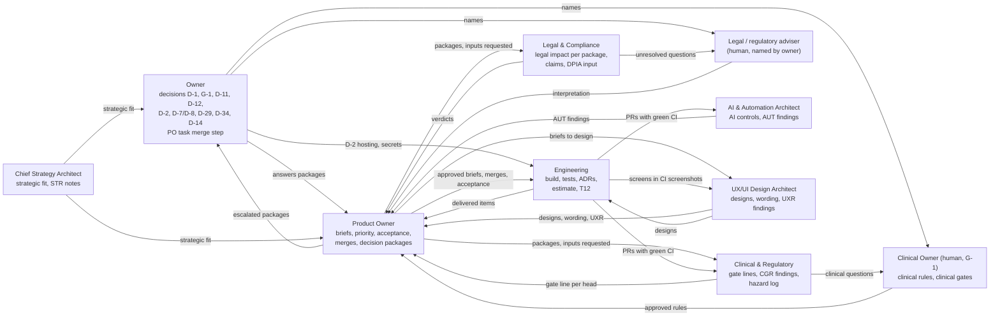
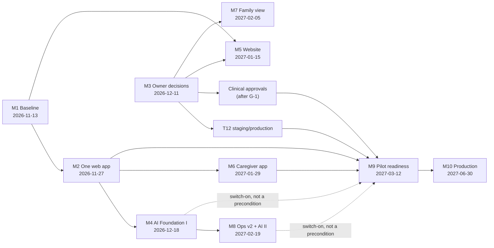

# NAVORA Architecture Review and Implementation Blueprint V2

**Owner of this file:** Product Owner (`po`) · **Written:** 2026-11-06 08:40 (Europe/Zurich), by the owner's *Program Quality Improvement Directive* (2026-11-06) · **Version:** 2 (version 1 is [`DELIVERY_PROGRAM.md`](DELIVERY_PROGRAM.md), 2026-11-03) · **Repository state read:** `recovery/main` @ `9c58939`, open PRs and role branches read through the GitHub API on 2026-11-06 08:20-08:40.

**Purpose.** This blueprint turns the delivery program M1-M10 into an execution system you can measure. Every milestone has a completion percentage, sub-milestones, blockers, dependencies, a responsible agent and testable acceptance criteria. Weekly metrics show whether we are on course.

**Where it sits in the reference order (read this first):**

| Question | Primary reference | Notes |
|---|---|---|
| **What** do we build, in which order, by when, and how is it accepted? | **This blueprint** | Primary implementation and execution reference for every agent, from 2026-11-06. |
| **How** is NAVORA structured (bounded contexts, data flow, AI pillar, principles)? | [`ARCHITECTURE.md`](../../ARCHITECTURE.md) (Architecture Handbook) | Stays the primary *architectural* source. This blueprint does not change an architecture rule; it reviews alignment (§2) and proposes changes. |
| Priority queue, briefs, PO status | [`../agents/NEXT_CAPABILITY.md`](../agents/NEXT_CAPABILITY.md), `../agents/briefs/` | Must be consistent with this blueprint. A conflict is a defect: the PO fixes it in the next cycle. |
| Engineering state per item | [`../agents/IMPLEMENTATION_STATUS.md`](../agents/IMPLEMENTATION_STATUS.md) | Engineering's file; this blueprint never overrides it. |
| Decisions | [`../agents/OPEN_DECISIONS.md`](../agents/OPEN_DECISIONS.md), [`../agents/decisions/INDEX.md`](../agents/decisions/INDEX.md), [`OWNER_AGENDA.md`](../agents/decisions/OWNER_AGENDA.md) | Only the named owner decides. |
| Detailed milestone text (objectives, v1 criteria) | [`DELIVERY_PROGRAM.md`](DELIVERY_PROGRAM.md) | Still valid as detail. Where it and this blueprint differ, this blueprint holds and the difference is listed in §3.4. |

**Status labels** (CLAUDE.md): **IMPLEMENTED** (on `recovery/main`, synthetic data, CI green) · **BUILT** (in an open PR with green CI, not merged; counts for nothing in acceptance) · **PLANNED** · **OPEN** (needs a decision) · **UNKNOWN**. Percentages are PO estimates, computed as in §4.0. The PO ran no tests for this blueprint; CI states were read through the GitHub API.

**Binding rules (unchanged):** synthetic data only until D-1 is clarified (owner, 2026-10-29); D-35 A (no client or staff data to any AI service); the mandatory sequence *Remove → Rules → Monitor → AI prepares → Human reviews → Human decides → Human signs*; the clinical review gate on everything that touches care; no invented medical, clinical, legal, tariff or regulatory rule; a clinical rule is approved only by the named Clinical Owner (D-27).

---

## 1. Strategic Vision Alignment

**Vision (owner):** NAVORA is the operating system for self-organised care teams: home care now, then transitions of care with hospitals, then nursing homes, then integrated care networks. The care model is the product; technology is a tool.

**North Star:** *direct care share*, care minutes ÷ nurse-confirmed paid minutes, per team and month, never per person ([`CARE_OPERATING_MODEL.md`](CARE_OPERATING_MODEL.md)). Benchmark Buurtzorg 60 %; NAVORA hypothesis 75 %. Today: computed in AN1 on synthetic data (IMPLEMENTED). A pilot value does not exist yet (UNKNOWN until M9 + one month).

**Value order (owner, 2026-10-22):** 1 direct care time · 2 continuity · 3 nurse income · 4 team autonomy · 5 less administration · 6 patient outcomes · 7 scalability · 8 platform completion · 9 revenue · 10 engineering convenience. Patient safety is a precondition, never traded.

**How each milestone serves the vision:**

| Milestone | Value it moves first | Administration removed or role that disappears | Alignment |
|---|---|---|---|
| M1 Delivery baseline | 7 scalability (of delivery) | guess-based planning of the build | aligned |
| M2 One web app | 1, 5 | two app shells, legacy menus; nurse's search for her next action | aligned |
| M3 Owner decisions | precondition for all | – | aligned; **critical path** |
| M4 AI Foundation I (PLAN3, AN3, AIG1-C4/-C5) | 2 continuity, 4 autonomy, 5 | scheduling administrator, manual day planning, dispatcher | aligned; strongest care-model lever before the pilot |
| M5 Website | 9 revenue | sales coordination by phone and email (demo intake) | aligned, low care value; must not take capacity from M2/M4/M6 |
| M6 Caregiver app v1 | 1, 5 | paper notes and retyping after a visit without connection | aligned |
| M7 Family view (FAM1) | 2, 6 | phone calls "when will the nurse come?" | aligned within D-40 limits |
| M8 Operations v2, AI Foundation II | 5, 7 | intake coordinators, manual exception chasing, handover meetings | aligned |
| M9 Pilot readiness | all | – | aligned; owner-gated |
| M10 Production readiness | 7 | – | aligned |

**Strategic deviations found (OPEN, not changed automatically):**

| ID | Deviation | Cause | Safe proposal |
|---|---|---|---|
| SV-1 | Owner direction 2026-11-03 sets the pilot market to **Basel-Stadt and Basel-Landschaft** (issue #816). `OWNER_AGENDA.md` and the D-11 package still ask "approve Zurich"; `OPEN_DECISIONS.md` does not record D-11 as decided. | The direction arrived as an issue while D-11 was frozen; no PO run recorded it. | The owner confirms in one line: "D-11: Basel; start canton BS (or BL); municipalities …". The PO then records D-11, unfreezes D-18, D-25, D-9, D-4, D-29 for the `lca` Basel re-check, and updates the agenda. Until then no agent treats Zurich or Basel as decided. |
| SV-2 | All-in-one with nursing homes (#818) and IoT data model (#817) are owner directions, but `csa` rates STR-21 and STR-23 **high** risk and D-39 (A) froze sensors. | Directions came before the pilot gates. | Keep D-24 A (no nursing-home build) and D-39 A until M9 is passed; specification only. No milestone carries them. |
| SV-3 | Benchmark gap: Buurtzorg's limits (manual scheduling inside teams, coach capacity, regional coordination, thin data) are named, but no milestone yet measures that NAVORA removes them. | Measures exist per capability (AN2, AN3), not per milestone. | §10 adds two weekly measures (planning acts per visit, coordination acts outside teams), live from M4 on synthetic data. |

---

## 2. Architecture Alignment

**Review result: the build follows the Architecture Handbook's principles; the Handbook's status text is out of date.** No blocking architectural concern. Items reviewed against `ARCHITECTURE.md` on 2026-11-06:

| # | Principle (Handbook) | As built (repository) | Result |
|---|---|---|---|
| A-1 | Supabase/PostgreSQL as the shared truth; server-side authorisation | 103 migrations on `recovery/main` (up to 0104; 0105-0115 BUILT in PRs); RLS on every table; SECURITY DEFINER readers inventoried in `docs/engineering/READ_PATHS.md` | aligned (IMPLEMENTED) |
| A-2 | Domain logic independent of React; no secret rule in React | rules in SQL functions and `src/features/*/…-rules.ts`; IPA1 removed client ranking from React | aligned |
| A-3 | Idempotent commands, audited events, human-in-the-loop | every command takes a key; append-only events; AIG1 ledger with value-by-value confirmation | aligned (IMPLEMENTED) |
| A-4 | AI pillar: orchestrator, agent contract, evaluation harness | AIG1 ledger, register, stop and look-back IMPLEMENTED; orchestrator and harness PLANNED (AIO1, M8); no provider configured (D-35 A) | aligned; AIO1 brief due 2026-11-20 |
| A-5 | P1 safety signals stay deterministic (AI-10) | SIG1/SIG2 rule-based; AIR1 (#828, BUILT) refuses AI targets on billing and signal priority | aligned |
| A-6 | Never per person (AI-9) | AN1, AN3, PLAN3-7, PLAN3-13 suppress small teams and carry no person key (pgTAP) | aligned |
| A-7 | Target folder structure `src/domain`, `src/application`, `src/infrastructure`, `src/ai` | **Not adopted.** The repository uses `src/features/<domain>/` plus `src/app` and `src/components` | **deviation AR-1** |
| A-8 | Bounded-context status | Handbook marks Field Operations, Team Self-Organisation, Documentation, Identity & Governance as PLANNED or PARTIAL; they are largely IMPLEMENTED (F1-F7, J2, J6, PLAN2, ABS1, COVER1, ADM1/ADM2, AUD1, LEAVE1) | **deviation AR-2** |
| A-9 | Workflow orchestrator for the whole chain | the chain runs as commands and state transitions in SQL; there is no separate orchestrator component | **deviation AR-3** |
| A-10 | Hosting | Handbook: UNKNOWN, "do not present Render as existing". D-2 assessment (#838) on `recovery/main`; staging not provisioned (T12 blocked) | aligned with the Handbook's caution |

**Architecture deviations (documented, cause analysed, nothing changed):**

| ID | Deviation | Cause | Risk | Safe proposal (owner of the change) |
|---|---|---|---|---|
| AR-1 | Feature folders instead of the layered target structure | Incremental build from the recovered MVP; each feature kept its rules beside its UI | Low today: rules are in SQL and `*-rules.ts`, React holds none (A-2) | `eng` writes an ADR: either adopt `src/features` as the target in the Handbook, or name the first move (`src/ai` for AIO1). PO preference: adopt `src/features` and add `src/ai` with AIO1; no big-bang move. |
| AR-2 | Handbook bounded-context statuses outdated | The Handbook is a hand-over document; its revision is marked OPEN since 2026-11-03 | Medium: new agents read a wrong baseline | PO proposes a status table per context in the Handbook (next PO cycle), each row pointing to `IMPLEMENTATION_STATUS.md`. |
| AR-3 | No separate workflow orchestrator | State machines in the database already enforce the order (J1 → J2 → J3 → F-series → F6/F7 → QG1 → J5) | Low: the database is the single place the order is enforced | Handbook text: "orchestration = database state machines + OPS1 exception monitor"; a separate component only when an async step needs it (AIO1). |
| AR-4 | Delivery mechanics are not architecture-ready: every PR edits `JOURNAL.md`, `IMPLEMENTATION_STATUS.md` and `docs/engineering/DECISIONS.md`, so each merge makes every other PR conflict | Single shared files by design of the collaboration layer | **High for delivery** (§3, §6) | AUT-49: one journal file per entry and one file per ADR; `scripts/po-merge-gate.mjs` (PO_MERGE_PROCESS §7). Built by `eng` as one PR, ranked first in M2. |

---

## 3. Current Delivery State

### 3.1 Summary (2026-11-06)

| Area | Status | One-line reason |
|---|---|---|
| Overall | 🟡 At risk | Foundation strong (47 capabilities accepted on synthetic data), pilot gated by owner decisions. |
| Delivery | 🔴 Blocked | 12 Engineering PRs green and `cra`-cleared, unmerged; the scheduled PO task's stored prompt authorises only the PO's own PR. |
| Roadmap | 🟡 At risk | Order unchanged; M3 (2026-12-11) moves M9/M10 day for day. |
| Milestones | 🟡 At risk | M1 UX part met; M2 and M4 largely BUILT, not IMPLEMENTED; M3 ≈ 10 % decided. |

### 3.2 Facts

- **Accepted since 2026-10-31:** no new capability (last: AIG1-C1 to -C3, RLS4). IMPLEMENTED since 2026-11-03: #799 (UX2-1 + UX2-31), #833 (implementation sequence), #834 (design baseline), #838 (D-2 support), #832 (delivery program).
- **Open PRs:** about 33, of which about 28 Engineering. Green and cleared, waiting: #800, #803, #804 (UX2); #876 → #880 → #882 → #883 → #885 → #886 → #888 → #890 → #891 (PLAN3 stack), plus #894, #895 (BUILT since 06:15/07:15). Role docs: `cra` #892, `lca` #860, `uxa` #850.
- **Engineering throughput:** 1-2 PRs per hour (journal 2026-11-05/06). **Merge throughput:** 0 Engineering PRs per scheduled run since 2026-11-05 12:00.
- **Go-live gates (M9):** G-13 and G-16 met; G-7, G-9, G-18, G-25 partly met; G-11 and G-21 marked PLANNED although COND1 and IPA1 were accepted (status text possibly stale, PO to verify); the rest OPEN.

### 3.3 Root causes of the delivery block

| # | Cause | Owner | Fix |
|---|---|---|---|
| RC-1 | Scheduled PO task prompt has no Engineering merge step; the permission check refuses unrequested merges | owner | Add `PO_MERGE_PROCESS.md` §3 (1) paragraph to the PO task prompt (FD-01) |
| RC-2 | Shared files make every merge conflict the rest | `eng` | AUT-49 + one file per ADR (AR-4) |
| RC-3 | Owner decisions open since 2026-10-24 to 2026-10-29 | owner | Founder Decision Board, §7 |
| RC-4 | PO briefs for M5, M6, M8 not written yet (due 2026-11-20 to 12-04) | `po` | §4, sub-milestones M5.1, M6.1, M8.1 |

### 3.4 Changes against version 1 (`DELIVERY_PROGRAM.md`)

1. Completion is measured (§4.0) and reported weekly (§10).
2. Each milestone has numbered sub-milestones with an owner and a date.
3. M2 gains sub-milestone **M2.0 merge mechanics** (AUT-49, merge gate script) ahead of the UX2 remainder (AR-4).
4. M3 gets **latest responsible dates** per decision (§6.3), derived backwards from M9.
5. M7 follows the owner's D-40 answer (FAM1 build on synthetic data), as already recorded in `DELIVERY_PROGRAM.md` §0d.
6. M9 adopts Engineering's minimal technical set (IMPLEMENTATION_SEQUENCE §7.3) as the **technical** definition; M4, M5, M8 enter the pilot as switch-ons, not as preconditions. **Patient-safety gates are unchanged.**

---

## 4. Milestone Structure

### 4.0 How completion % is computed

`completion % = Σ (weight of sub-milestones IMPLEMENTED or accepted) ÷ Σ (all weights)`. A sub-milestone counts only when it is on `recovery/main` (or, for a decision, recorded as decided). BUILT work is shown separately as *built %* and never counts. Weights are the effort shares from `IMPLEMENTATION_SEQUENCE.md` §8 where available, otherwise equal. The PO recomputes every Friday (§10).

### M1 Delivery baseline · target Fri 2026-11-13 · **completion 50 %** (built 90 %)

- **Responsible:** `eng` + `uxa`; accepts `po`.
- **Sub-milestones:**

  | ID | Sub-milestone | Owner | Due | Weight | Status |
  |---|---|---|---|---|---|
  | M1.1 | Design baseline: IA, screen catalog (57), design system V1 (#834) | `uxa` | 2026-11-20 | 2 | IMPLEMENTED (accepted 2026-11-03) |
  | M1.2 | Implementation sequence M2-M8 (#833) | `eng` | 2026-11-13 | 1 | IMPLEMENTED |
  | M1.3 | Delivery estimate `DELIVERY_ESTIMATE.md` (#835) | `eng` | 2026-11-13 | 2 | BUILT |
  | M1.4 | WEB1/APP1 implementation plans, ADR-142/-143 (#837) | `eng` | 2026-11-13 | 1 | BUILT |
  | M1.5 | Delivery program v2 = this blueprint, dates re-baselined from M1.3 | `po` | 2026-11-17 | 2 | PLANNED (structure done; dates wait for M1.3) |

- **Blockers:** M1.3, M1.4 unmerged (RC-1).
- **Dependencies:** none outside the merge path.
- **Acceptance criteria:** (1) every M2-M10 item has an estimate in person-days with confidence, predecessor and moving risk; (2) technical and pilot readiness stated as dates with assumptions; (3) every screen of the catalog has route, role, data read and components; (4) every component has its six states and token references; (5) no item needs real data or a frozen package; (6) this blueprint's §6 dates are re-computed from M1.3 and dated.

### M2 Web application consolidated · target Fri 2026-11-27 · **completion 20 %** (built 75 %)

- **Responsible:** `eng`; accepts `po`; gate `cra` (UX2 on `/field`, `/team`); review `uxa`.
- **Sub-milestones:**

  | ID | Sub-milestone | Owner | Due | Weight | Status |
  |---|---|---|---|---|---|
  | M2.0 | Merge mechanics: AUT-49 (journal file per entry), one file per ADR, `po-merge-gate.mjs` with unit tests | `eng` | 2026-11-13 | 2 | PLANNED |
  | M2.1 | Merge queue: #800, #803, #804, #806 (UX2), #813 (RLS4-C3), #810 (CGR-110) | `po` | 2026-11-13 | 2 | BUILT |
  | M2.2 | UX2 shell part (#799) | `eng` | done | 2 | IMPLEMENTED |
  | M2.3 | UX2 remainder (F-3…F-7, UX2-33 error pages in the shell) | `eng` | 2026-11-20 | 4 | PLANNED |
  | M2.4 | D-7 ruleset and D-8 merge of `recovery/main` into `main` | owner, then `eng` | 2026-11-27 | 1 | OPEN |

- **Blockers:** RC-1, RC-2; D-7/D-8 (owner).
- **Dependencies:** M1.2; AUT-49 before the bulk of M2.1 to keep conflicts down.
- **Acceptance criteria:** (1) UX2-1 to UX2-33 met on `recovery/main`, CI `app`, `db`, `e2e`, `ui-screenshots` green on the merge commit; (2) no `severe` UXR open on a UX2 screen; (3) `cra` UX2 gate line on the merged head; (4) pgTAP 062 passes in two runs at different pinned times (CGR-110); (5) a new journal entry or ADR in one PR does not conflict with another PR (shown on two parallel PRs); (6) `main` equals `recovery/main` after D-8.

### M3 Pilot foundation decisions · target Fri 2026-12-11 · **completion 10 %**

- **Responsible:** owner; prepares `po` (all packages exist); inputs `lca`, `cra`, `csa`.
- **Sub-milestones (one per decision; equal weight):**

  | ID | Decision | Latest responsible date (§6.3) | Status |
  |---|---|---|---|
  | M3.1 | D-1 live database facts, counsel, review date, key rotation | 2026-11-20 | OPEN |
  | M3.2 | G-1 Clinical Owner and deputy | 2026-11-27 | OPEN |
  | M3.3 | D-11 pilot canton (Basel direction, SV-1) and 2-5 municipalities | 2026-11-27 | OPEN (direction given) |
  | M3.4 | D-12 partner named (model B decided 2026-10-27) | 2026-12-11 | partly decided |
  | M3.5 | D-2 staging and production hosting | 2026-12-11 | OPEN |
  | M3.6 | D-29 qualification verification | 2026-12-11 | OPEN |
  | M3.7 | D-7 / D-8 | 2026-11-20 | OPEN |
  | M3.8 | D-34 regulatory adviser named | 2026-12-11 | OPEN (direction 2026-11-03) |
  | M3.9 | D-14 fee basis | 2026-12-11 | OPEN |
  | M3.10 | Legal adviser in the pilot canton named | 2026-11-27 | OPEN |

- **Blockers:** owner availability.
- **Dependencies:** none; every package is complete.
- **Acceptance criteria:** each row answered in `OPEN_DECISIONS.md` *Decided* with date; `decisions/INDEX.md` status `decided`; dependent packages unfrozen with an `Unfreeze:` reference.

### M4 AI Foundation I · target Fri 2026-12-18 · **completion 0 %** (built 70 %)

- **Responsible:** `eng`; accepts `po` with `cra`; review `aia`; `lca` on AN3 (D-23 term (b)).
- **Sub-milestones:**

  | ID | Sub-milestone | Owner | Due | Weight | Status |
  |---|---|---|---|---|---|
  | M4.1 | AIG1-C4/-C5: expired proposals apart; stop followed up by open lines (#814) | `eng` | 2026-11-20 | 2 | BUILT |
  | M4.2 | PLAN3 part (a) + PLAN3-14 (#872 superseded by #876) | `eng` | 2026-11-20 | 3 | BUILT |
  | M4.3 | PLAN3 part (b) on `/team/tagesplan`, PLAN3-7, -9, -11, -12, -13, -17 (1) (#880 → #895) | `eng` | 2026-11-27 | 4 | BUILT |
  | M4.4 | PLAN3-15 (fresh request closes old lines), PLAN3-9 (2), PLAN3-17 (2), PLAN3-3 wording, CGR-75 (5) e2e | `eng` | 2026-12-04 | 3 | PLANNED |
  | M4.5 | AN3 per-step spans per team and month (#841) | `eng` | 2026-12-11 | 2 | BUILT |
  | M4.6 | PLAN3-16 hand-assignment overlap fact (information only) | `eng` | before M9 | 1 | PLANNED (not gating M4) |

- **Blockers:** RC-1, RC-2; M4.1 is a precondition of four PLAN3 points.
- **Dependencies:** M2.1 (shell), M4.1 before M4.3 merges.
- **Acceptance criteria:** (1) every criterion of `briefs/PLAN3.md` (incl. PLAN3-14, -15, -7 (1)(2), -9 (1), -17 (1)) and `briefs/AN3.md` met on `recovery/main` with green CI; (2) every proposal line is in the AIG1 ledger and becomes an assignment only through a named member's confirmation (pgTAP); (3) a confirm-time `overlap` refusal leaves the visit in the uncovered list (e2e, CGR-75 (5)); (4) AN3 and PLAN3-7 return no person key and suppress small teams (pgTAP); (5) `cra` gate line on each merged head; (6) synthetic data only.

### M5 Website and public landing pages · target Fri 2027-01-15 · **completion 15 %**

- **Responsible:** `eng` (build), `uxa` (design); accepts `po` with `lca`; `cra` on care or AI wording.
- **Sub-milestones:**

  | ID | Sub-milestone | Owner | Due | Weight | Status |
  |---|---|---|---|---|---|
  | M5.0 | Structure and design system for the site (W-01 to W-11) | `uxa` | done | 1 | IMPLEMENTED |
  | M5.1 | Brief WEB1 (content, claims, demo flow) | `po` | 2026-11-20 | 1 | PLANNED |
  | M5.2 | Page designs | `uxa` | 2026-12-04 | 1 | PLANNED |
  | M5.3 | Domain, host, demo destination | owner | 2026-12-11 | 1 | OPEN |
  | M5.4 | Privacy notice, imprint, claims check | `lca` | 2027-01-08 | 1 | PLANNED |
  | M5.5 | Build 7 pages + demo flow, DE then EN | `eng` | 2027-01-15 | 2 | PLANNED |

- **Blockers:** M5.1, M5.3.
- **Dependencies:** M1.4 (#837 WEB1 plan).
- **Acceptance criteria:** as `DELIVERY_PROGRAM.md` M5 (Lighthouse a11y ≥ 95, performance ≥ 90 on phone; every AI, nursing-home, family claim cleared by `lca`; demo data never in the care database; no shared session or cookie with the app).

### M6 Caregiver app v1 · target Fri 2027-01-29 · **completion 10 %**

- **Responsible:** `eng`; accepts `po` with `cra`; design `uxa`.
- **Sub-milestones:**

  | ID | Sub-milestone | Owner | Due | Weight | Status |
  |---|---|---|---|---|---|
  | M6.0 | Screens C-01 to C-16 designed; offline rules decided (CGR-122, CGR-123, UXR-92) | `uxa`, `po` | done | 1 | IMPLEMENTED (as documents) |
  | M6.1 | Brief MOB1 (incl. offline number, SC-5, CGR-118/-121) | `po` | 2026-11-27 | 1 | PLANNED |
  | M6.2 | Installable app on `/field` (F-12), push opt-in | `eng` | 2026-12-18 | 2 | PLANNED |
  | M6.3 | No lost value on lost connection; never-queued command list (F-13, B-7) | `eng` | 2027-01-15 | 3 | PLANNED |
  | M6.4 | Offline e2e for CGR-118, -121, -122, -123 | `eng` | 2027-01-29 | 1 | PLANNED |

- **Blockers:** M2; M6.1; offline urgent-call number UNKNOWN until G-1.
- **Dependencies:** M2.3, ADR-142/-143 (#837).
- **Acceptance criteria:** as `DELIVERY_PROGRAM.md` M6, plus: no assistant route at stage 0 (AUT-40); every never-queued command in one shared list, vitest fails when a SIG1-raising or visit-releasing command is missing.

### M7 Family view (FAM1) · target Fri 2027-02-05 (re-set with FAM1 estimate) · **completion 35 %**

- **Responsible:** `po` (brief); build `eng`; inputs `lca`, `cra`, `uxa`.
- **Sub-milestones:** M7.1 owner decision D-40 (decided 2026-11-04, IMPLEMENTED as decision) · M7.2 `lca` consent and `cra` visibility inputs on `recovery/main` (BUILT in #860, #892) · M7.3 FAM1 approved (PLANNED, after M7.2) · M7.4 build F-01, F-02 on synthetic data (PLANNED) · M7.5 real relatives only after D-9 and D-1 (OPEN).
- **Blockers:** M7.2 unmerged; team-ended consent notice unresolved (Clinical Owner and legal adviser).
- **Acceptance criteria:** visit status, planned time and assigned caregiver only; no AI, messaging, clinical content; consent recorded and revocable; every screen at 390 px; pgTAP proves a relative reads nothing else.

### M8 Operations Center v2 and AI Foundation II · target Fri 2027-02-19 · **completion 5 %**

- **Responsible:** `eng`; accepts `po` with `cra`; review `aia`, `uxa`.
- **Sub-milestones:** M8.1 briefs AIO1 (`po`, 2026-11-20), OPS2 and HAND2 (`po`, 2026-12-04) · M8.2 AIR1 guard (#828, BUILT) · M8.3 AIO1 orchestrator, agent contract, evaluation harness, no provider (`eng`) · M8.4 OPS2 control health and exception grouping · M8.5 HAND2 handover ordered by rule · M8.6 operations app functions at 390 px.
- **Blockers:** M8.1; M4.
- **Acceptance criteria:** as `DELIVERY_PROGRAM.md` M8; an `ai` agent cannot switch on (D-35 A, pgTAP); no AI path changes a signal priority or billable fact.

### M9 Pilot readiness · target Fri 2027-03-12 · **completion 8 %** (2 of 25 gates met)

- **Responsible:** `po` (readiness file), `eng` (technical); go / no-go: owner. Clinical gates waived only by the Clinical Owner together with the owner (CGR-117).
- **Sub-milestones:**

  | ID | Sub-milestone | Owner | Due | Status |
  |---|---|---|---|---|
  | M9.1 | **Technical minimum** (IMPLEMENTATION_SEQUENCE §7.3): M2 + M6 core (M6.2, M6.3) + T12 staging/production + G-17, G-22, G-25, ASM1-C6 (#815) | `eng` | 2027-01-29 | PLANNED |
  | M9.2 | T12 staging and production, migrations from CI | `eng` after D-2 | 8 working days after D-2 | OPEN |
  | M9.3 | Restore test (≤ 30 days before go), incident and restore runbooks, D-1 reconciliation | `eng` | 2027-02-26 | PLANNED |
  | M9.4 | Clinical rules in use approved; 9 `clinical` packages answered | Clinical Owner | 2027-02-12 | OPEN (needs G-1) |
  | M9.5 | DPIA signed by the licence holder | partner + `lca` | 2027-02-19 | OPEN (needs D-12, D-2) |
  | M9.6 | Readiness file: G-1 to G-25 each with status and evidence; every open S1/S2 CGR, H, PS item listed | `po` | 2027-03-05 | PLANNED |
  | M9.7 | Training and one full synthetic pilot day end to end | `po`, `uxa`, pilot team | 2027-03-05 | PLANNED |

- **Blockers:** G-1, D-1, D-2, D-12, D-11, D-34 adviser.
- **Acceptance criteria:** as `DELIVERY_PROGRAM.md` M9, unchanged.

### M10 Production readiness · target Wed 2027-06-30 · **completion 0 %**

- **Responsible:** `eng` (technical), `po` (product evidence); owner decides.
- **Sub-milestones:** M10.1 three stable pilot months with base counts · M10.2 external security test, no open high · M10.3 monitoring, alerting, on-call, P1 path monitored · M10.4 pilot evaluation (North Star, continuity, administration per step, safety) · M10.5 D-35 stage-1 decision · M10.6 scale plan.
- **Blockers:** M9.
- **Acceptance criteria:** as `DELIVERY_PROGRAM.md` M10.

---

## 5. Dependency Map

### 5.1 Across roles (who hands what to whom)



Reading: every arrow into `PO` is an input the PO must place within one run; every arrow out of `OWN` is on the critical path (§6). The two human roles (Clinical Owner, adviser) do not exist yet; their absence is the largest dependency in the program.

### 5.2 Across milestones



Solid arrows are preconditions; dotted arrows are capabilities a pilot team switches on when ready (§3.4 item 6).

### 5.3 Item-level dependencies that gate merges

| Item | Needs first | Why |
|---|---|---|
| PLAN3 part (b) (#880 →) | #814 AIG1-C4/-C5, #876 | expired lines and stop follow-up must exist before the team decides lines |
| PLAN3-15 | ADR answer whether AIG1-C4's outcome is reused | no new ledger outcome without a reason |
| FAM1 approval | #860 (`lca`), #892 (`cra`) on `recovery/main` | inputs must be on the main line |
| T12 | D-2 | paid plans and secrets |
| D-8 | D-7 | ruleset before merging into `main` |
| D-18, D-25, D-4, D-29 re-check | D-11 recorded (SV-1) | cantonal law differs |
| 9 `clinical` packages | G-1 | only the Clinical Owner decides |
| M6 offline number | G-1 | which number is right for urgent matters is clinical |

---

## 6. Critical Path

### 6.1 Finding

**The critical path runs through the owner, not through Engineering.** Engineering's technical minimum for the pilot can be ready about 2027-01-29 (IMPLEMENTATION_SEQUENCE §7.3 says 2027-01-15, Low confidence; this blueprint adds two weeks for the merge backlog). That leaves about six weeks of slack before M9. The owner-dependent chain has no slack once its latest responsible dates (§6.3) pass.

```text
[owner] PO task merge step ─► M2.0/M2.1 merges ─► M2 ─► M6 core ─► M9.1 technical minimum (≈ 2027-01-29) ─┐
[owner] D-2 ─► T12 (8 wd) ─► restore test + runbooks ───────────────────────────────────────────────────┤
[owner] G-1 ─► 9 clinical packages + clinical rules approved (≈ 10 weeks, UNKNOWN) ───────────────────────┼─► M9 2027-03-12
[owner] D-11 + D-12 partner ─► legal adviser ─► DPIA signed by licence holder ──────────────────────────────┘
```

### 6.2 Critical-path items (in order of risk)

| # | Item | Owner | Slack today | Status |
|---|---|---|---|---|
| CP-1 | G-1 Clinical Owner named | owner | ≈ 3 weeks | OPEN |
| CP-2 | D-12 partner named, then DPIA | owner, partner | ≈ 6 weeks | OPEN |
| CP-3 | PO task merge step (FD-01) | owner | 0: every week without it adds conflict work | OPEN |
| CP-4 | D-1 facts and review | owner | ≈ 2 weeks | OPEN since 2026-10-29 |
| CP-5 | D-2 hosting | owner | ≈ 10 weeks to the technical latest date, 5 weeks to the M3 target | OPEN |

### 6.3 Latest responsible dates (PO estimate, Low confidence; recomputed when M1.3 merges)

Derived backwards from M9 on 2027-03-12:

| Decision | Latest date | Derivation |
|---|---|---|
| G-1 Clinical Owner | 2026-11-27 | 9 packages + rule approvals + briefing ≈ 10-11 weeks (UNKNOWN; depends on the person) → approvals by 2027-02-12 |
| D-1 | 2026-11-20 | review, rotation and SR-26 precede D-7, staging with real users and G-2 |
| D-11 + legal adviser | 2026-11-27 | `lca` re-check of 5 packages for the canton, adviser answers before the DPIA |
| D-12 partner | 2026-12-11 | DPIA by the licence holder by 2027-02-19 needs ≈ 8 weeks |
| D-2 | 2026-12-11 (M3); technical latest 2027-01-22 | T12 8 working days, restore test ≤ 30 days before go, runbooks |
| D-7 / D-8 | 2026-11-20 | M2 acceptance criterion (6) |

A decision after its latest date moves M9 by the delay, day for day.

---

## 7. Founder Decision Board

One line per ask; answer with one sentence ("FD-03: approved"). Each package holds the reasoning. Until answered, the package's safe default stays in force. Detail: [`OWNER_AGENDA.md`](../agents/decisions/OWNER_AGENDA.md).

| FD | Priority | Decision | Ask (exact) | Latest date | Blocks | Default until answered |
|---|---|---|---|---|---|---|
| FD-01 | Critical | PO task merge step | Add the `PO_MERGE_PROCESS.md` §3 (1) paragraph to the scheduled PO task's prompt; if the permission check still refuses, allow the merge call for that task | now | M1, M2, M4 merges | merges only in an attended PO session |
| FD-02 | Critical | G-1 | Name the Clinical Owner and a deputy (route B), or tell `po` to draft search profile and mandate | 2026-11-27 | 9 clinical packages, M9 | strict defaults; no clinical rule in use |
| FD-03 | Critical | D-1 | Give the facts (yes / no / not sure), name counsel and the data-protection responsible, set a review date; approve rotation after SR-26 step 3; switch on leaked-password protection | 2026-11-20 | containment, SR-26, D-7, G-2 | treat as real; no real data |
| FD-04 | Critical | D-11 (SV-1) | Confirm Basel, name the start canton (BS or BL) and 2-5 municipalities | 2026-11-27 | D-18, D-25, D-4, D-29 re-check | no canton decided |
| FD-05 | High | Legal adviser | Name one adviser in the pilot canton | 2026-11-27 | D-22, D-18, D-9, D-4, D-38, FAM1 notice | legal questions unresolved |
| FD-06 | High | D-12 partner | Name the licensed partner, or say none is in view | 2026-12-11 | DPIA, D-38, D-18, D-29 | route C prepared, no billing |
| FD-07 | High | D-7 | Apply ruleset on `main` and `recovery/main`, secret scanning, private on a paid plan (B) | 2026-11-20 | D-8, M2 | no backstop |
| FD-08 | High | D-8 | Approve B: two `preserve-*` tags, merge PR #3 after D-7 | after FD-07 | M2 | `main` stale |
| FD-09 | High | D-2 | Approve the two paid plans (EU/CH), create them, add staging secrets | 2026-12-11 | T12, M9 | no staging |
| FD-10 | High | D-29 | Approve option B as the real-data gate | 2026-12-11 | real clients, G-6 | no real nurse active |
| FD-11 | High | D-34 adviser | Name the regulatory adviser (MepV) | 2026-12-11 | G-5, AI level H | AI rules only (D-35 A) |
| FD-12 | High | D-38 | Approve T1-T18 as minimum LOI content | before any LOI | C transfer | sign no LOI naming the sunset |
| FD-13 | Medium | D-14 | Approve F3 (per active team member per month) or F4 | 2026-12-11 | J7 team economics | J7 stays draft |
| FD-14 | Medium | Website | Domain, host, demo destination | 2026-12-11 | M5 | M5 build waits |
| FD-15 | Medium | D-26 | No service-role key on the app host in production | before M9 | ADM1 invitations in production | Edge Functions path |
| FD-16 | Medium | D-36 | Give `lca` the interRAI licence terms (a fact) | 2026-12-11 | D-37 | option A terms |
| FD-17 | Medium | SR-26 | After D-1, approve A for the foreign `orders` table | after FD-03 | live DB hygiene | untouched |
| FD-18 | Medium | Agent task prompts | Point every scheduled agent task's prompt to this blueprint (§8.3) | 2026-11-13 | consistent reading order | agents read it only via `NEXT_CAPABILITY.md` |
| FD-19 | Low | D-22, D-18, D-9, D-4 | Pass the `lca` questions to the adviser | after FD-05 | invoicing, intake, retention | defaults in force |
| FD-20 | Low | D-24 / D-25 / D-37 | D-24 A now; D-25 only past A; D-37 after D-36 | none for the pilot | Horizon 3 | no build |

---

## 8. Agent Responsibilities

### 8.1 Per milestone (R = delivers, A = accepts/decides, C = consulted, gate = must clear before merge or acceptance)

| Milestone | Owner | PO | Eng | CRA | LCA | UXA | AIA | CSA |
|---|---|---|---|---|---|---|---|---|
| M1 | – | A, R (M1.5) | R | C | – | R | C | – |
| M2 | A (D-7/D-8) | A, merges | R | gate | – | C (UXR) | C | – |
| M3 | **A, R** | R (packages) | C | C | C | – | – | C |
| M4 | – | A, merges | R | gate | C (AN3) | C | C (AI controls) | – |
| M5 | A (domain, host) | A, R (WEB1) | R | C | gate (claims) | R | – | C |
| M6 | – | A, R (MOB1) | R | gate | C | R | C | – |
| M7 | A (D-40 done) | A, R (FAM1) | R | gate | gate | R | C | – |
| M8 | – | A, R (AIO1, OPS2, HAND2) | R | gate | C | C | gate (AI) | – |
| M9 | **A (go / no-go)** | R (readiness file) | R (technical) | gate | gate (DPIA) | C (training) | C | C |
| M10 | A | R (evidence) | R | gate | gate | – | C | C |

### 8.2 Standing duties per role

| Role | Every run | Each week (Friday) | Must not |
|---|---|---|---|
| `po` | merge (§9 QG-6), review delivered items, place every input arrow of §5.1, three packages in INDEX order, one journal entry | recompute §4 %, update §10 dashboard, rewrite [`FOUNDER_EXECUTIVE_REPORT.md`](FOUNDER_EXECUTIVE_REPORT.md) (the owner's primary decision document, German), write due briefs | write code; accept own work; decide a clinical, legal, pricing or irreversible question |
| `eng` | build the next sub-milestone in §4 order; keep PRs conflict-free and green; state deviations | update estimate if a sub-milestone moves > 3 days | merge; reorder priorities |
| `cra` | gate line per new PR head in scope; findings with testable remedy | list open S1/S2 items for M9.6 | present guidance as a rule |
| `lca` | legal impact on requested packages; claims checks | list unresolved legal questions for FD-05 | give a legal determination |
| `uxa` | review CI screenshots; wording for open asks | design deliverables per §4 dates | change a decided rule |
| `aia` | AI-control review on AI-touching PRs | measures in §10.2 (M-11, M-12) from M4 | switch on an agent |
| `csa` | strategic fit on owner packages | strategic alignment check against §1 | reorder the queue |

### 8.3 Reading order for every agent (from 2026-11-06)

1. `CLAUDE.md`; 2. `docs/agents/README.md`, `COORDINATION.md`; 3. **this blueprint** (§3 state, §4 own sub-milestones, §9 gates); 4. `NEXT_CAPABILITY.md`, `IMPLEMENTATION_STATUS.md`, `OPEN_DECISIONS.md`, newest `JOURNAL.md`; 5. `ARCHITECTURE.md` for architecture questions.

Agents cannot change their own scheduled-task prompts. Until the owner adds this file to each prompt (FD-18), `NEXT_CAPABILITY.md` links here at its top.

---

## 9. Quality Gates

A work item passes these gates in order. A gate that is not met stops the item; it is never waived by the role that delivers the item.

| Gate | When | Criteria (testable) | Evidence | Who checks |
|---|---|---|---|---|
| **QG-0 Brief** | before `not-started` | approved brief from `_TEMPLATE.md`; numbered acceptance criteria; *AI leverage* section (AI-1); removed step and its baseline (AI-12); D-34 line for AI level H (CGR-119); no undecided "Blocked by" | `briefs/<ID>.md` | `po` |
| **QG-1 Build** | every PR | CI `app` (lint, typecheck, unit, audit, build), `db` (migrations, seed, pgTAP), `e2e` (Playwright incl. 390 px), `ui-screenshots` all `success`; tests written for every criterion; RLS, grants and audit trigger on every new table or command | check runs on the head | CI, `eng` |
| **QG-2 Clinical** | items in scope (README rule 6) | `cra` gate line on the head; no blocking CGR naming the item; if an earlier head was cleared, `git diff <cleared> <head> -- src supabase tests e2e` is empty (AUT-50) | `CLINICAL_GOVERNANCE.md`, PR comment | `cra`, read by `po` |
| **QG-3 Legal** | items touching data protection, billing, consent, contracts | no unresolved `lca` verdict the item relies on; a legal question without a signed `lca` section counts as unresolved | package `decisions/<ID>.md` | `lca`, read by `po` |
| **QG-4 UX** | items with screens | no `severe` or open `high` UXR on the screen without a PO decision; wording from `uxa` where asked | `UX_REVIEW.md` | `uxa`, read by `po` |
| **QG-5 AI** | items that propose, rank or prepare | every proposal in the AIG1 ledger; human confirmation per value; never per person; no AI target on billing or signal priority (AIR1) | `AUTOMATION_REVIEW.md`, pgTAP | `aia`, read by `po` |
| **QG-6 Merge** | before merge | the seven conditions of `PO_MERGE_PROCESS.md` §4 on the head SHA, merge record comment first | PR comment, merge commit title | `po` |
| **QG-7 Acceptance** | after merge, CI green on the merge commit | evidence table in the brief (criterion | result | evidence), every deviation decided, "the PO did not run the tests" stated | brief | `po` |
| **QG-8 Milestone** | at the milestone date | every acceptance criterion of §4 met on `recovery/main`; completion 100 %; `DELIVERY_PROGRAM.md` status line and `ROADMAP.md` updated | this blueprint §10 | `po`; owner for M3, M9, M10 |
| **QG-9 Go-live** | before the first real client or employee (M9) | G-1 to G-25 each closed with evidence, or waived in writing by the person accountable; a clinical gate only by the Clinical Owner with the owner | readiness file | owner (go / no-go) |

---

## 10. Weekly Success Metrics

### 10.1 Rules

- The PO updates §10.3 every Friday by 17:00 (Europe/Zurich), newest week first, and states the source of each number.
- The same Friday, the PO rewrites [`FOUNDER_EXECUTIVE_REPORT.md`](FOUNDER_EXECUTIVE_REPORT.md) from these numbers: the owner's primary decision document (owner directive 2026-11-06). Its decision board uses the FD numbers of §7.
- A number the PO cannot read from the repository or GitHub is written UNKNOWN, never estimated silently.
- Targets are the PO's; the owner may change them.

### 10.2 Metric definitions

| # | Metric | Definition | Source | Target | Value moved |
|---|---|---|---|---|---|
| M-01 | Milestone completion | §4.0 formula per milestone | this file | on plan line per milestone | 8 |
| M-02 | Merge queue | Engineering PRs green and cleared but unmerged at Friday 12:00 | GitHub API | ≤ 3 | 8 |
| M-03 | Merge lead time | median hours from "green + gate line" to merge, PRs merged that week | GitHub API, gate lines | ≤ 24 h | 8 |
| M-04 | Conflicts per merge | other open PRs turned `dirty` by a merge | GitHub API | 0 after M2.0 | 10 |
| M-05 | Accepted items | items set `accepted` that week | `NEXT_CAPABILITY.md` | ≥ 2 | all |
| M-06 | Criteria met on main | acceptance criteria met on `recovery/main` ÷ all criteria of the current milestones | briefs | rising weekly | 8 |
| M-07 | Owner decisions answered | FD rows answered that week / open FD rows | §7 | ≥ 3 per week until M3 | precondition |
| M-08 | Decisions past latest date | FD rows past §6.3 date | §6.3, §7 | 0 | precondition |
| M-09 | Go-live gates met | gates of G-1 to G-25 met with evidence | `CARE_OPERATING_MODEL.md` | 25 by 2027-03-05 | safety |
| M-10 | Open blocking findings | blocking CGR, S1/S2 H and PS items open; severe UXR open | `cra`, `uxa` reports | 0 blocking at each merge | safety |
| M-11 | Planning acts per visit | human acts to assign a visit (PLAN3 confirm, hand assignment) ÷ visits planned, per team and week, synthetic | AN2/AN3, PLAN3-7 | falling after M4 | 1, 5 |
| M-12 | Coordination outside teams | OPS1 takes and Operations-assigned visits ÷ visits, per org and week, synthetic | OPS1, AN1 | falling | 4, 5 |
| M-13 | North Star | direct care share per team and month (AN1); pilot value only after M9 | AN1 | ≥ 60 %, hypothesis 75 % | 1 |
| M-14 | CI health | `recovery/main` head 4/4 green at Friday 12:00 | GitHub API | always | 8 |

### 10.3 Weekly executive dashboard

#### Week 45 (2026-11-02 to 2026-11-08), as of Friday 2026-11-06 08:40

**Overall:** 🟡 At risk · **Delivery:** 🔴 Blocked (merge path) · **Pilot M9 on track:** **No** (owner chain; see §6).

| Milestone | Target | Completion | Built | Trend | Status |
|---|---|---|---|---|---|
| M1 | 2026-11-13 | 50 % | 90 % | ↑ | 🟡 |
| M2 | 2026-11-27 | 20 % | 75 % | → | 🟡 |
| M3 | 2026-12-11 | 10 % | – | → | 🔴 |
| M4 | 2026-12-18 | 0 % | 70 % | ↑ built, → merged | 🟡 |
| M5 | 2027-01-15 | 15 % | – | → | 🟡 |
| M6 | 2027-01-29 | 10 % | – | → | 🟡 |
| M7 | 2027-02-05 | 35 % | 45 % | ↑ | 🟢 |
| M8 | 2027-02-19 | 5 % | 10 % | → | 🟢 |
| M9 | 2027-03-12 | 8 % | – | → | 🔴 |
| M10 | 2027-06-30 | 0 % | – | → | 🔴 |

| Metric | W45 value | Target | Note |
|---|---|---|---|
| M-02 Merge queue | 12 Engineering + 3 role docs | ≤ 3 | oldest green UX2 PR open since 2026-11-03 |
| M-03 Merge lead time | UNKNOWN (no Engineering PR merged in a scheduled run) | ≤ 24 h | – |
| M-04 Conflicts per merge | every open PR after each merge | 0 | AR-4 |
| M-05 Accepted items | 0 | ≥ 2 | last acceptance 2026-10-31 |
| M-07 Owner decisions answered | 4 this week (D-39, D-40, merge authority, Basel direction) | ≥ 3 | Basel not yet recorded (SV-1) |
| M-08 Decisions past latest date | 0 | 0 | first latest dates fall on 2026-11-20 |
| M-09 Go-live gates met | 2 of 25 (+4 partly) | 25 by 2027-03-05 | – |
| M-10 Open blocking findings | 0 blocking on PLAN3 heads (`cra` 05:30); full S1/S2 count UNKNOWN | 0 | `cra` to list for M9.6 |
| M-11, M-12 | not yet measured | – | from M4 |
| M-13 North Star | synthetic only | – | – |
| M-14 CI health | green on `9c58939` (docs merge) | always | – |

**Top 3 decisions this week:** FD-01 merge step · FD-03 D-1 · FD-02 G-1.
**Top 3 risks:** no Clinical Owner (CP-1); merge backlog grows (CP-3); M3 decisions after 2026-12-11.
**Next week's commitments:** `eng` M2.0 and M1.3/M1.4 ready to merge; `po` WEB1 and AIO1 drafts, D-11 recorded on the owner's answer, §6.3 recomputed when M1.3 merges; `uxa` PLAN3 wordings; `cra` gate lines on #894, #895; `lca` Basel re-check after D-11.

---

## Change log

- 2026-11-06 09:05 (`po`): founder report linked (§8.2, §10.1); weekly rewrite every Friday.

- 2026-11-06 08:40 (`po`): version 2 created by the owner's *Program Quality Improvement Directive*. Adds measured completion, sub-milestones, dependency maps, critical path with latest responsible dates, Founder Decision Board FD-01 to FD-20, quality gates QG-0 to QG-9, weekly metrics M-01 to M-14 and the W45 dashboard. Architecture deviations AR-1 to AR-4 and strategic deviations SV-1 to SV-3 documented; nothing changed automatically.
