# NAVORA Architecture Blueprint V3.2

**Der Bauplan des Pflege-Betriebssystems ohne Zwischenhandel**

| | |
|---|---|
| **Version** | 3.2, **freigegeben durch den Founder am 2026-11-13 (FE-077)**; laufender Stand 3.2.80 (Versionstabelle Kapitel 14) |
| **Verantwortlich** | Product Owner (`po`), als gemeinsames Werk mit `csa`, `uxa`, `cra`, `lca`, `eng` (und `aia`). Herkunft jedes Beitrags und Stand der Unterschriften: Kapitel 13 |
| **Auftrag** | Founder-Anweisungen FE-075 (Neufassung) und FE-076 (Überarbeitung: visualisiert, alle Agenten, geschärfte Vision) |
| **Grundlage** | `FOUNDER_DECISIONS.md` FE-001 bis FE-076; Code-Inventar von `recovery/main` am 2026-11-13; Rollendokumente (Kapitel 13) |
| **Geltung** | **Einzige fachliche Quelle des Projekts (FE-077).** Blueprint V1.x, V2.x, V3.0 und V3.1 sind archiviert. Bei einem Widerspruch gilt eine neuere Founder-Entscheidung (README Regel 10); Änderungen nur über die Versionstabelle. Fakten über den Code: der Repository-Code hat Vorrang (CLAUDE.md). |
| **Schwesterdokument** | [Architecture Handbook V2.2](../architecture/ARCHITECTURE_HANDBOOK_V2.md): WIE gebaut wird, mit dem technischen End-to-End-Fluss |

**Kennzeichnung.** Jede Zustandsaussage trägt eine der vier Marken:

- **IMPLEMENTED:** im Code auf `recovery/main` vorhanden.
- **PLANNED:** beschlossen, aber nicht gebaut.
- **OPEN:** Entscheidung ausstehend.
- **UNKNOWN:** nicht geprüft.

«Gebaut» ist nicht «abgenommen». Abgenommen ist nur, was nach Kapitel 9 auf einem benannten Commit belegt ist. Alle Bildschirme in diesem Dokument sind **Konzept-Wireframes mit synthetischen Daten**; Namen von Heimen, Teams und Personen sind erfunden.

**V3.2 (13:59).** Zwei PO-Sitzungen zum selben Founder-Auftrag (FE-076) sind hier zusammengeführt. V3.1 lieferte den Grundriss, die Modellrechnung und die Konzept-Wireframes. V3.2 ergänzt die **vollständigen Rollenbeiträge** von `csa`, `cra` und `lca` (Anhänge A bis C), die **Engineering-Prüfung des Handbooks** von `eng` (90 Code-Aussagen, Korrekturen K1 bis K21; Anhang D im Handbook) und zusätzliche Übersichtsbilder (Plattform-Grundriss, Auftragsfluss als Swimlane, Geldfluss je Schicht). Die Beiträge wurden am 13.11. in der Rollenarbeit erstellt (nur gelesen, keine Tests); jede Rolle bestätigt im nächsten regulären Lauf (Issues #1208 bis #1212).

---

## Inhalt

0. NAVORA auf einer Seite
1. Das NAVORA-Zielbild
2. Die Modellrechnung: eine Schicht, zwei Welten
3. Die KI als operatives Rückgrat
4. Finanz- und Geschäftsmodell
5. Die sechs Portale: der Grundriss
6. Wie sich die Menschen durch das Gebäude bewegen: der Kernablauf
7. Wer sieht was: Datensichtbarkeit
8. Die verbindliche Block-Lieferkette
9. Harte Gate-Kriterien, Phase A und Phase B
10. Meilensteine und Kennzahlen
11. Founder-Entscheidungsboard
12. Rollen
13. Das gemeinsame Werk: Beiträge und Unterschriften der Rollen
14. Pflege dieses Dokuments

---

## 0. NAVORA auf einer Seite

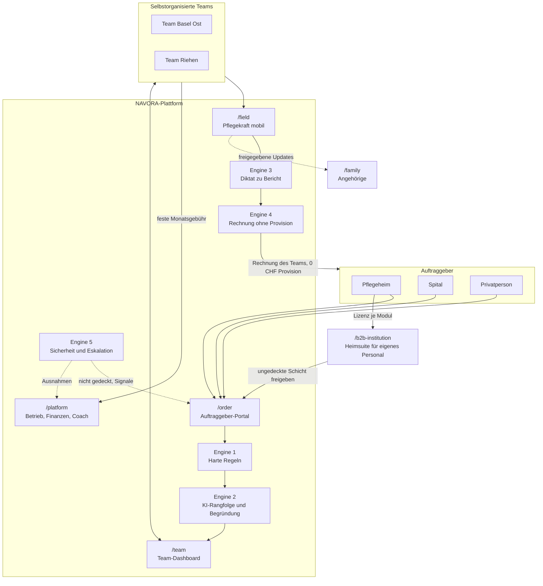

**In einem Satz:** Der Auftraggeber sagt, was er braucht; Regeln und KI finden das passende Team; das Team sagt mit einem Tipp zu; die Pflegekraft pflegt, diktiert und signiert; das Team stellt seine Rechnung ohne Provision; NAVORA lebt von der festen Monatsgebühr und von B2B-Lizenzen.

**Der Grundriss mit dem Stand im Code.** Dasselbe Gebäude in fünf Ebenen, jede Karte mit ihrer Marke (IMPLEMENTED, TEILWEISE, PLANNED):

<div class="landscape" markdown="1">

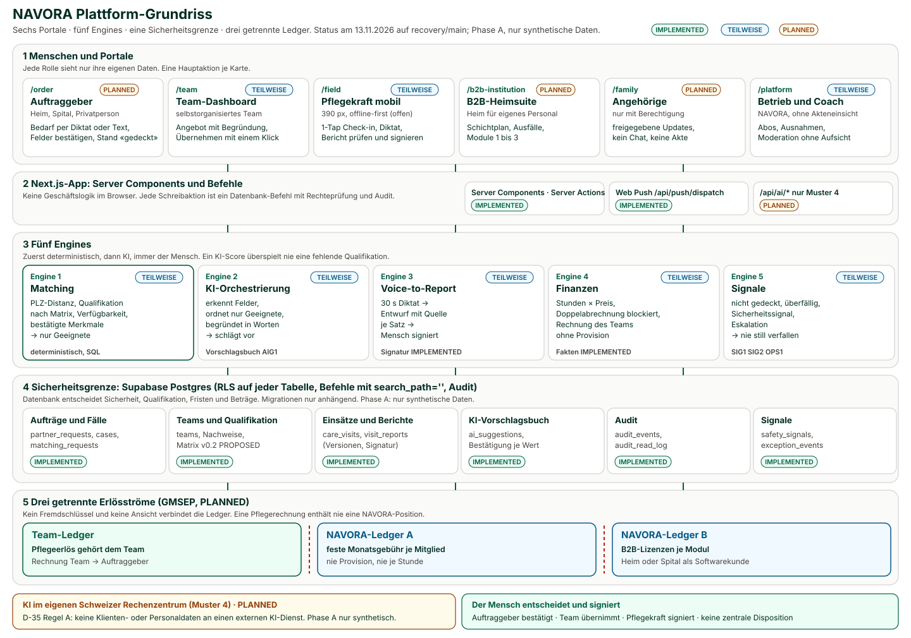

</div>

---

## 1. Das NAVORA-Zielbild

### 1.1 Vier Sätze, die NAVORA ausmachen (FE-076)

1. **Wir bauen ein System, das den Zwischenhandel in der Pflege eliminiert.** Zwischen Heim, Spital oder Privatperson und der Pflegekraft steht keine Vermittlungsagentur und keine Dispositionszentrale mehr, sondern Software.
2. **Die Pflegenden arbeiten als autonome Unternehmerinnen und Unternehmer im Team und behalten den vollen Erlös ihrer Arbeit.** Es gibt keine Marge auf ihre Stunden; der Auftraggeber bezahlt das Team.
3. **NAVORA finanziert sich sauber über eine feste Monatsgebühr** je Teammitglied oder Team und über B2B-Lizenzen, nie über eine Provision.
4. **Die KI ist das Herzstück, das die administrative Arbeit erledigt:** Erfassung, Matching, Koordination, Berichtsentwurf und Abrechnungsvorbereitung. Der Mensch prüft, entscheidet und unterschreibt.

### 1.2 Was abgelöst wird

| Heute | Was es kostet | NAVORA ersetzt es durch |
|---|---|---|
| **Temporärbüro** | Marge auf jeder Stunde; Telefonketten bei jedem Ausfall | direkten Auftrag an ein Team; Preis ohne Vermittlungsaufschlag |
| **Spitex-Verwaltung** | Disposition, Einsatzleitung, Hierarchie, Dokumentationslast | Teamentscheid, KI-Vorschläge, Diktat statt Schreibarbeit |
| **Dienstplanerin im Heim** | Stunden pro Woche für Plan und Ausfälle | KI-Planungsmodul (B2B), das Lücken früh zeigt und Aufträge vorbereitet |

**Spitex-Organisationen und Temporärbüros sind weder Rolle noch Kunde noch Organisationsart in NAVORA** (FE-066). Der Anbieter ist das Team.

### 1.3 Buurtzorg ist der Ausgangspunkt, nicht das Ziel

Buurtzorg hat gezeigt, dass selbstorganisierte Teams ohne Hierarchie funktionieren; laut eigenen Angaben mit 6,7 % Overhead gegenüber 16,9 % bei vergleichbaren Organisationen (`STRATEGY.md`, von Buurtzorg berichtet). NAVORA geht zwei Schritte weiter (`csa`, `STRATEGY.md`):

- **Die Koordinationsarbeit, die bei Buurtzorg noch Menschen leisten, macht bei NAVORA die KI.** NAVORA muss zeigen, dass es den Overhead von 6,7 % ohne Coach-Ebene erreicht oder unterbietet.
- **Die Teams gehören sich selbst.** Ziel sind teameigene Leistungserbringer, nicht Teams innerhalb einer grossen Organisation.

### 1.4 Werteordnung (verbindlich)

**Patientensicherheit ist Voraussetzung und wird nie verrechnet.** Danach gilt diese Reihenfolge:

1. mehr direkte Pflegezeit
2. bessere Kontinuität der Versorgung
3. höheres Nettoeinkommen der Pflegenden
4. Teamautonomie
5. weniger Administration
6. bessere Patientenergebnisse
7. operative Skalierbarkeit
8. Plattformvollständigkeit
9. Umsatz
10. Bequemlichkeit für Engineering

### 1.5 Nordstern

- **Nordstern:** Anteil direkter Pflegezeit je Team und Monat (Kennzahl M-13). Marken: mindestens 60 % (Buurtzorg-Massstab), 75 % als NAVORA-Hypothese.
- **Messbarkeit:** Der Nordstern ist heute nicht messbar (D-23); ein realer Wert entsteht erst mit realen Arbeitszeiten. AN1 zeigt heute den Pflegeanteil innerhalb eines Einsatzes und wird nicht mit den 60 % von Buurtzorg verglichen.

### 1.6 Was NAVORA nie baut

- **keine zentrale Disposition und kein «für das Team zuteilen»** (Produkt-Invariante, FE-039). Die KI schlägt vor, das Team entscheidet.
- **keine hierarchische Aufsicht.** Der Coach moderiert bei Konflikten und Engpässen und hat keinen allgemeinen Zugriff auf Gesundheitsdaten.
- **keine Provision auf Pflegeumsätze**, weder als Prozentsatz noch je Stunde (FE-055 (3)).
- **keine erfundenen medizinischen, rechtlichen oder tariflichen Regeln.** Eine klinische Regel gibt nur der Clinical Owner frei (D-27, D-43).

---

## 2. Die Modellrechnung: eine Schicht, zwei Welten

Referenzfall des Founders (FE-073 (5)): Spätschicht 16:30–21:30 (5 Stunden) auf einer Demenzabteilung in 4052 Basel, Qualifikation AGS / SRK-Pflegehelfer:in.

### 2.1 Modellrechnung mit Beispielwerten (kein Tarif, kein Einkommensversprechen)

| Je Schicht (5 Std.) | Temporärbüro | Mit NAVORA (Beispielpreis Team) | Unterschied |
|---|---|---|---|
| Heim zahlt | 75 CHF/Std. × 5 = **375 CHF** | 52 CHF/Std. × 5 = **260 CHF** | **Heim spart 115 CHF** |
| Bei der Pflege kommt an | 28 CHF/Std. × 5 = **140 CHF** (Lohn der Pflegekraft) | **260 CHF** an das Team | **+120 CHF Umsatz des Teams (vor Teamkosten)** |
| Zwischen Heim und Pflege | 235 CHF beim Temporärbüro (Beispielwert; enthält dessen Arbeitgeberkosten und Marge) | **0 CHF** NAVORA-Anteil; Arbeitgeberkosten trägt das Team (2.2) | kein Zwischenanteil |

75, 28 und 52 CHF/Std. sind Beispielwerte aus der Founder-Fallsimulation (FE-073), keine Markt-, Lohn- oder Tarifangaben; den Preis vereinbaren Auftraggeber und Team, nie NAVORA (R-10). 260 CHF (Umsatz des Teams) und 140 CHF (Lohn) sind nicht dieselbe Grösse; vergleichbar ist «+46 CHF brutto» in 2.2. **Keine Verwendung ausserhalb des Projekts** (Website, Gespräch mit einem Heim, Rekrutierung) der Zeilen «Heim spart 115 CHF» oder «+33 %», solange die Zahlen nicht aus realen Daten stammen (Phase B, D-42) oder nicht direkt daneben so beschriftet sind wie hier (`lca` W-1, W-2, W-7; UWG Art. 3 Abs. 1 lit. b, e).

<div class="landscape" markdown="1">

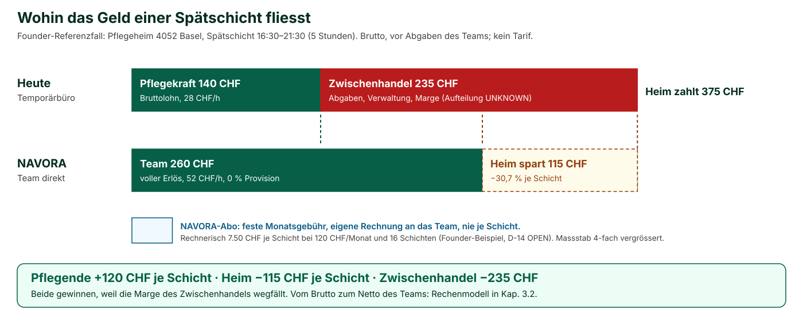

</div>

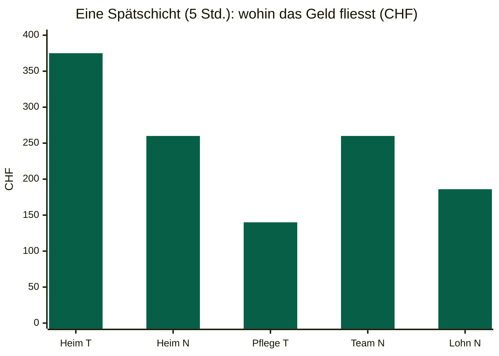

T = Temporärbüro, N = NAVORA. Heim T/N: was das Heim zahlt. Pflege T: Lohn der Pflegekraft beim Temporärbüro. Team N: was das Team erhält. Lohn N: Bruttolohn-Äquivalent nach allen Teamkosten (2.2).

### 2.2 Was davon als Lohn bleibt

Das Team ist Unternehmerin: Aus den 260 CHF bezahlt es die Arbeitgeberkosten (Sozialversicherungen, BVG, UVG), die über die Pflege-Genossenschaft als Arbeitgeberin der Mitglieder anfallen (FE-083, FE-084 (2); Höhe der Abgaben **OPEN**, D-44 L-7, L-11; nach `csa` STR-43 (b), V3.2.42), seine eigenen Kosten (Versicherung, Material, Buchhaltung) und das NAVORA-Abo. Mit den Modellannahmen aus `ECONOMICS_COMPARISON.md` (Arbeitgeberkosten 20 %, Teamkosten 10 %, Abo umgerechnet 4 %):

| | Rechnung | Ergebnis |
|---|---|---|
| Bruttolohn-Äquivalent je Stunde | 52 × (1 − 0,10 − 0,04) ÷ 1,20 | **37.27 CHF/Std.** |
| je Schicht | 37.27 × 5 | **186 CHF** |
| gegenüber Temporärlohn | 186 − 140 | **+46 CHF brutto je Schicht (+33 %)** |

**Lesart:** Im Modell spart das Heim 115 CHF je Schicht, und das Team setzt 120 CHF mehr um (vor Teamkosten); als Bruttolohn bleiben nach allen Teamkosten rund 46 CHF mehr (+33 %). Das ist die Zielrechnung von NAVORA, bei voller Auslastung gerechnet. Ob sie in der Praxis aufgeht, hängt vor allem von der Auslastung ab: Bei 70 % Auslastung fällt der Vorteil im Modell unter einen festen Lohn (`ECONOMICS_COMPARISON.md` §2.3). Der Einkommensvorteil ist deshalb zu belegen, nicht zu versprechen (FE-070 (1)); der Pilot in Phase B liefert die realen Werte.

**Grundlage der Zahlen:** 75 und 28 CHF/Std. sind die Beispielwerte aus der Founder-Fallsimulation (FE-073, Brief BK in der Fassung vom 13.11. 11:25: «founder figures, illustrative»), 52 CHF/Std. ist der Beispielpreis des Referenzfalls; die 28 CHF/Std. sind als Bruttolohn gelesen, die Arbeitgeberkosten des Büros stecken in den 235 CHF; die Kostenannahmen sind die Modellannahmen A1 bis A3 aus `ECONOMICS_COMPARISON.md`. Die Rechnung ist ein Modell der Phase A; reale Werte liefert der Pilot in Phase B (D-42). Der grösste Hebel auf das Einkommen ist die Auslastung des Teams (`csa` BM-11). Die Modellrechnung vertieft `csa` (Kapitel 13).

### 2.3 Wie sich die Gebühr verhält

Die Gebühr ist fest je Monat und Teammitglied, gewichtet nach Pensum (FE-055 (3)). Sie steigt nicht mit dem Umsatz. Je mehr ein Team arbeitet, desto kleiner wird ihr Anteil (`csa` BM-12: entspricht die Gebühr bei voller Auslastung 4 % des Umsatzes, sind es bei 70 % Auslastung rund 5,7 %). Die Höhe ist **OPEN** (D-14).

---

## 3. Die KI als operatives Rückgrat

### 3.1 Grundsatz: zuerst deterministisch, dann KI, immer der Mensch

Jeder KI-gestützte Ablauf folgt derselben Reihenfolge (`AI_FIRST_ARCHITECTURE_UPDATE.md`):

**Unnötiges entfernen → Regeln anwenden → laufend überwachen → KI bereitet vor → Mensch prüft → Mensch entscheidet → Mensch signiert.**

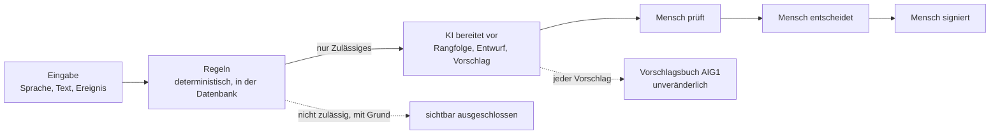

| Bereich | Regeln (deterministisch) | KI bereitet vor | Mensch entscheidet oder signiert |
|---|---|---|---|
| **Erfassung** | Pflichtfelder, PLZ-Liste, Schichtlogik (auch über Mitternacht) | Felder aus Sprache oder Freitext erkennen | der Auftraggeber bestätigt |
| **Matching** | PLZ-Distanz, Qualifikation nach Matrix, Verfügbarkeit, bestätigte Merkmale | Rangfolge **nur unter den Geeigneten**, Begründung in Worten | das Team übernimmt |
| **Koordination** (statt Disposition) | Kontinuitäts-Standard, Lücken, Ausfälle | Tagesvorschlag, Vertretungsvorschlag | das Team bestätigt jeden Wert (AIG1) |
| **Dokumentation** | Pflichtteile, Signaturstatus | Berichtsentwurf aus dem Diktat, jeder Satz mit Quelle | die Pflegekraft signiert |
| **Abrechnung** | Stunden × Preis, Doppelabrechnung, Zeitkonflikte | Erklärung der Abweichungen | das Team gibt die Rechnung frei |
| **Sicherheit** | Signale, Fristen, Eskalation | – | die zuständige Person handelt |

**Ein KI-Score überspielt nie eine fehlende Qualifikation, Lizenz oder Delegation.** Die KI kann eine Rangfolge ordnen, aber kein Team hinzufügen.

### 3.2 KI und Daten (verbindlich)

- **D-35 Regel A gilt:** Keine Klienten- oder Personaldaten gehen an einen KI-Dienst (FE-024).
- **Synthetische Testdaten in Phase A (FE-085, V3.2.37):** KI-Schnittstellen für Sprach-Transkription und Berichtsentwurf dürfen mit den 100 % synthetischen Testdaten angebunden und getestet werden; Voraussetzungen: Schlüssel nur in einer Umgebung, deren Datenbank nur den synthetischen Seed hält, ein Aus-Schalter für alle Aufrufe, Kontrollschicht (Quelle je Wert, benannte Person signiert, kein «alles übernehmen») vor dem ersten Aufruf (`aia` AUT-136). Die echte Anbindung erst im aktiven Teilstück (Blockregel). Anbieter wählt der Owner. **PLANNED.**
- **interRAI und BESA** sind nicht Teil der aktuellen Planung (FE-085).
- **Gewählte Muster** (FE-051):
  - Muster 1: Planung nur mit Kennungen.
  - Muster 2: nur Team-Kennzahlen.
  - Muster 3: strukturierte Erfassung, Bericht per Regel.
  - Muster 4: eigenes Sprachmodell im Schweizer NAVORA-Rechenzentrum. Wird mit synthetischen Daten vorbereitet und getestet; für echte Daten erst nach Rechtsgutachten und DSFA (D-41).
  - Muster 5 (Pseudonymisierung für externe KI) ist **nicht** gewählt.
- **Phase A:** Jede KI arbeitet ausschliesslich mit synthetischen Daten. Synthetische Eingaben enthalten absichtlich einen Namen und eine Diagnose, um zu beweisen, dass sie verworfen werden (`lca` 12:20).
- **Medizinprodukt-Abgrenzung:** Der Kern bleibt ausserhalb des Medizinprodukte-Bereichs; der KI-Dokumentationsentwurf wird als separat qualifiziertes Modul mit eigener Zweckbestimmung gebaut (D-34, entschieden A plus C).
- **Stand heute:** Es gibt im Code keinen Aufruf eines KI- oder Sprachdienstes. Beide registrierten «Agenten» sind regelbasiert. Die Governance (Vorschlagsbuch, Bestätigung je Wert, Stopp, Rückblick) ist **IMPLEMENTED** (AIG1).

---

## 4. Finanz- und Geschäftsmodell

### 4.1 Zwei Geschäftsmodelle (FE-040, FE-055)

| | **GM-1 Teamgeschäft** | **GM-2 B2B-Software** |
|---|---|---|
| Kunde | Heim, Spital oder Privatperson erteilt einem Team einen Auftrag | Heim oder Spital für die eigene Belegschaft |
| Leistung | das Team pflegt und rechnet über eine rechtlich geeignete Struktur ab | Module (4.2) |
| NAVORA-Erlös | **feste monatliche Plattformgebühr je Teammitglied oder Team**, gewichtet nach effektivem Pensum (VZE); **Höhe OPEN** (D-14) | Softwarelizenz je Modul; **Preis OPEN** |
| Verboten | Provision in Prozent, Betrag je Stunde, jeder Anteil an der Pflegevergütung | – |
| Rechtsform | **Ziel-Organisationsform der Teams: Pflegegenossenschaft** (Founder FE-082 bis FE-084): Angestellt im eigenen Kollektivunternehmen (OR Art. 828 ff.), eine Stimme pro Kopf, Teamzellen entscheiden Aufträge und Einsätze selbst, die Genossenschaft ist nur Klammer für Arbeitgeberpflichten, Bewilligung und Zulassung (D-44 `lca` G-1 bis G-3). Rechtlich bestätigt erst mit Notar und Rechtsberater vor Phase B (G-2 Art. 3, 6, 7, 10; AVG-Abgrenzung im Heim **unresolved: needs legal adviser**). Datenmodell bleibt rechtsformneutral (D-44 `lca` 13:53 (i)). | – |

**Auftragskonstellationen** (`BUSINESS_MODELS_AND_CONSTELLATIONS.md`): KON-1 Heim beauftragt ein externes Team · KON-2 Heim führt den ganzen Pflegealltag auf NAVORA · KON-3a/b Spital (Einsatz, Übergang) · KON-4 Privatperson · KON-5 B2B-Modul. Ein Einsatz in einem Heim, das NAVORA als B2B-Software nutzt, ist immer ein eigener GM-1-Auftrag (FE-055 (4)).

### 4.2 Modulares B2B-Portfolio (GM-2)

| Modul | Inhalt | Status |
|---|---|---|
| **1 Kern: KI-Planung** | vorausschauende Schicht- und Einsatzplanung, Ausfallkoordination; ungedeckte Schicht als vorausgefüllter Auftrag an Teams | Planung und Ausfall ambulant **IMPLEMENTED** (PLAN3, ABS1, COVER1); Schichtmodell Heim **PLANNED** (NH-A1) |
| **2 Add-on: KI-Protokoll** | Diktat → konformer Berichtsentwurf → zwingende menschliche Signatur | Signatur und Rückgabe **IMPLEMENTED** (F6, F6R, F7); Diktat und KI-Entwurf **PLANNED** (B6) |
| **3 Add-on: Angehörigenportal** | berechtigte, strukturierte Updates und Fotos; getrennt von der klinischen Akte; schützt die Pflegenden vor Unterbrechungen; Erreichbarkeit ausserhalb der Arbeitszeit **OPEN** (FE-070 (4)) | **PLANNED** (D-40 minimale Option B; kein Brief) |

### 4.3 Strikte Trennung der drei Erlösströme

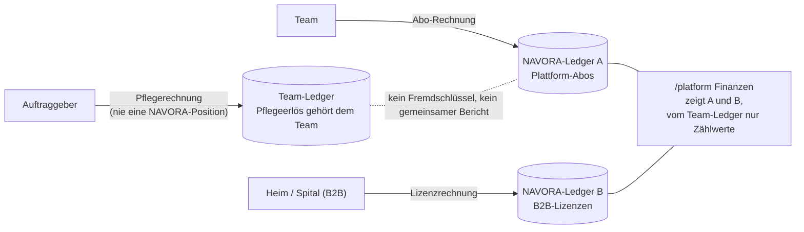

| Strom | Gehört | Beleg | Ledger | Dashboard |
|---|---|---|---|---|
| **Pflegeerlös** | dem Team | Rechnung des Teams an den Auftraggeber | Team-Ledger | Team-Dashboard |
| **NAVORA-Abo-Umsatz** | NAVORA | Abo-Rechnung an das Team | NAVORA-Ledger A | Betreiber-Cockpit |
| **NAVORA-B2B-Umsatz** | NAVORA | Lizenzrechnung an das Heim oder Spital | NAVORA-Ledger B | Betreiber-Cockpit |

- Die Trennung ist im Datenmodell erzwungen und getestet (FE-055 (2), Brief GMSEP).
- Eine Pflegerechnung enthält nie eine NAVORA-Position.
- Kein Betreiber-Dashboard zeigt Pflegeerlöse einzelner Teams, nur aggregierte Zählwerte.

**Stand:** Abrechenbare Fakten und eine Umsatzvorschau sind **IMPLEMENTED** (J5). Rechnungen, Abo-Ledger und B2B-Ledger sind **PLANNED**.

### 4.4 Rechtliche Leitplanken des Modells (`lca`, beratend)

- **NAVORA ist Software, keine Vermittlerin (Zielmodell).** NAVORA ist ein Software-Betriebssystem für selbständige Pflegeteams. Sie vermittelt niemanden in ein Arbeitsverhältnis, stellt niemanden an und erteilt keine Weisungen; das Team übernimmt den Auftrag direkt vom Auftraggeber. Nach den SECO-Weisungen ist das Zusammenführen zu einem Auftrag oder Werkvertrag keine Arbeitsvermittlung; NAVORA ist darum nach `lca` mit hoher Wahrscheinlichkeit weder Vermittlerin noch Verleiherin, **sofern** das Verhältnis zwischen Auftraggeber und Team tatsächlich ein Auftrag ist (D-44 `lca` 15.11. und 17.11.) [AT]. Massgebend sind die Tatsachen, nicht die Bezeichnung: feste Gebühr ohne Bezug zu Aufträgen, kein Geldfluss, keine Auswahl und keine Weisung durch NAVORA, keine Personenauswahl durch den Auftraggeber. Offen ist die Frage beim Team: ob die Schicht eines Teams in einem Heim (KON-1) Auftrag oder Personalverleih durch die Trägerstruktur ist (Q-44a, FE-050). *(W-4 (1), FE-084 (4))*
- **Sprache:** NAVORA spricht von «Auftrag» und «Schichtauftrag», nie von «Vermittlung» oder «Personalverleih».
- **Rechnungsentwurf in Phase A:** Titel «Rechnungsentwurf (Simulation) – keine gültige Rechnung»; keine KVG/KLV-Position, keine ZSR/GLN, keine MWST-Zeile, keine Provision.
- **KVG-Abrechnung (Tiers payant, Tiers garant):** **OPEN** (D-18, D-22, D-44); in BK nicht gebaut.

---

## 5. Die sechs Portale: der Grundriss

| Portal | Route (Ziel) | Nutzende | Zweck | Heute im Code | Status |
|---|---|---|---|---|---|
| **Auftraggeber-Portal** | `/order` | Heim, Spital, Privatperson | Bedarf per Sprache oder Text, erkannte Felder bestätigen, Stand «gedeckt / nicht gedeckt», Rechnungen | `/intake` wird von Operations bedient; keine Auftraggeber-Rolle | **PLANNED** (BK) |
| **Team-Dashboard** | `/team` | selbstorganisiertes Team | Angebote mit Begründung, Teamentscheid, Planung, Kontinuität, Team-Finanzen | `/team`, `/team/tagesplan`, `/team/vorschlaege` | **IMPLEMENTED** (Angebotskarte BK **PLANNED**) |
| **Caregiver Mobile** | `/field` | Pflegekraft | nächster Einsatz, Zeit, Aufgaben, Diktat, Signatur; offline-first | `/field`, `/work` | **IMPLEMENTED** (Diktat **PLANNED**; offline-first **PLANNED**) |
| **B2B-Heimsuite** | `/b2b-institution` | Heim oder Spital für die eigene Belegschaft | Schichtplanung, Ausfall, Protokoll (GM-2-Module) | – | **PLANNED** (B9, GM-2) |
| **Angehörigen-Ansicht** | `/family` | berechtigte Angehörige | strukturierte Updates, keine klinische Akte | – | **PLANNED** |
| **Betreiber- und Coach-Cockpit** | `/platform` | NAVORA-Betrieb, Finanzen, Support, Coach | SaaS-Kennzahlen, Teamgesundheit (aggregiert), Systemausnahmen; der Coach moderiert ohne Aufsicht und ohne Akteneinsicht | `/operations` (Ausnahmen), `/analytics`, `/admin` | **PLANNED** als Zusammenführung; Teile **IMPLEMENTED** |

Die folgenden Bildschirme sind **Konzept-Wireframes** im NAVORA-Designsystem (v77: Farben, Schrift, 390-px-Regeln). Texte folgen den Vorschlägen von `uxa` (`UX_REVIEW.md`, UXR-188) und den Leitplanken von `lca` (12:20). Sie sind **PROPOSED**; `uxa` bestätigt oder korrigiert sie (Kapitel 13).

### 5.1 P1 `/order`: Bedarf in eigenen Worten melden

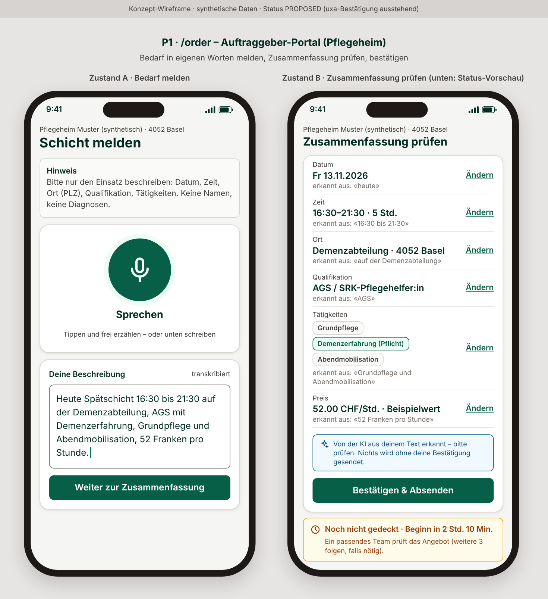

- **Erfassen:** sprechen oder schreiben. Der Hinweis verlangt nur Einsatzdaten, keine Namen und keine Diagnosen (`lca` M-a).
- **Zusammenfassung:** Jedes Feld zeigt, woraus es erkannt wurde («erkannt aus: «heute»») und lässt sich ändern. Relative Angaben werden als Datum gezeigt (FE-074).
- **Ein Klick:** «Bestätigen & Absenden». Ohne Bestätigung wird nichts gesendet.
- **Stand:** «Noch nicht gedeckt · Beginn in 2 Std. 10 Min.», dann «Gedeckt durch Team …», wenn kein geeignetes Team mehr frei ist «Kein passendes Team mehr frei» (V3.2.13: Rundruf statt Kaskade). **V3.2.16 (CGR-222 (b)):** zur spätesten Deckungszeit (oder wenn alle geeigneten Teams abgelehnt haben, was zuerst eintritt) ein Zustand, der sagt, dass die Schicht nicht gedeckt ist, **vor** dem Schichtbeginn, mit Operations-Ausnahme; nicht erst ab Schichtbeginn (bis V3.2.15 «ab Schichtbeginn ‹Nicht gedeckt›», UXR-188). Wortlaut: `uxa` (OPEN). Kein stilles Verfallen (BK-6). **V3.2.18 (`lca` D-44 20:25 (2), PO-Ergänzung BK 20:40 (3)):** der Auftraggeber (Privatperson, Heim, Spital) sieht **keine Zahl** angebotener, sehender oder ablehnender Teams, nur die Zustände gedeckt, noch nicht gedeckt, kein passendes Team (Option (a), PLANNED BK-c).

### 5.2 P2 `/team`: das begründete Angebot

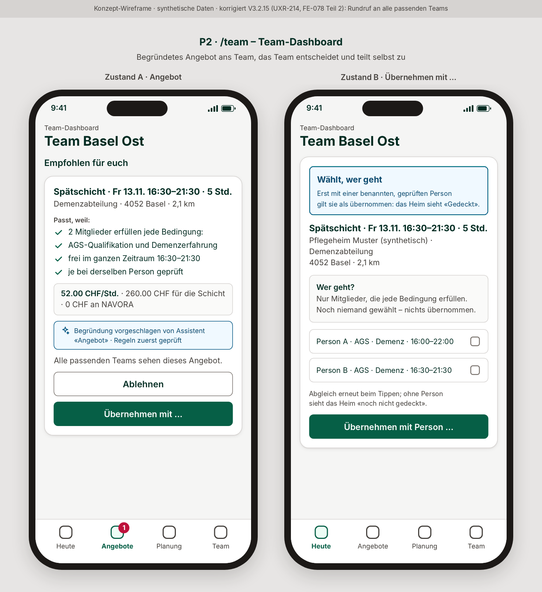

- **Empfohlen für euch:** Schicht, Ort, Distanz; darunter «Passt, weil:» mit den geprüften Fakten. **Kein Prozentwert, keine Sterne, kein Rang** (`uxa`).
- **Transparenz:** jedes ausgeschlossene Team hat seinen Grund in der internen Prüfspur (BK-2); ein Team sieht nur den eigenen Stand, nie Gründe anderer Teams (§7; `lca` B-4).
- **Rundruf (V3.2.13, FE-078 Teil 2):** Alle Teams, die jede harte Prüfung bestehen, sehen das Angebot **gleichzeitig**; es gibt kein exklusives Zeitfenster. Die Sortierung ist eine Empfehlung («Empfohlen für euch, weil …»), kein Ausschluss. Wer zuerst «Übernehmen mit …» tippt und die harte Prüfung in diesem Moment besteht, hat die Schicht; die anderen Teams sehen «Bereits übernommen» (BK-5, **PLANNED**; Wortlaut `uxa`).
- **Teamautonomie, je benannter Person (V3.2.1, CGR-204, UXR-191):** Das Team entscheidet selbst, wer geht, und zwar **im selben Schritt wie die Übernahme** («Übernehmen mit …»), nur unter Mitgliedern, die **jede** Bedingung erfüllen (Stufe, bestätigte Merkmale, Verfügbarkeit für die ganze Schicht: dieselbe Person). «Passt, weil:» nennt nur Fakten, die für mindestens ein und dasselbe Mitglied gelten. Der Auftraggeber sieht «Gedeckt» erst mit einer benannten, geprüften Person; ob er deren Namen sieht, hat `lca` beantwortet (D-44 00:20, G-5: Phase A mit (a) bis (e) vereinbar; reale Nutzung **ungelöst, braucht den Owner**). Vor der Übernahme sieht das Team keine Klientendaten und keine Strassenadresse (`lca` M-b); Merkmale erscheinen ohne Namen der Person (`uxa`, `UX_REVIEW.md`).
- **Geprüft (V3.2.18):** «Empfohlen für euch» ist aus Sicht `lca` in Ordnung (Empfehlung an jedes Team über sich selbst, FE-078 Teil 2); Ausschlussgründe anderer Teams sieht kein Team (`lca` B-4, D-44 12:20). Vorlage der Angebotskarte: `docs/design/BK5_OFFER_TEMPLATE.md` (`uxa`, PROPOSED).

### 5.3 P3 `/field`: ein Tipp, eigene Worte, eine Unterschrift

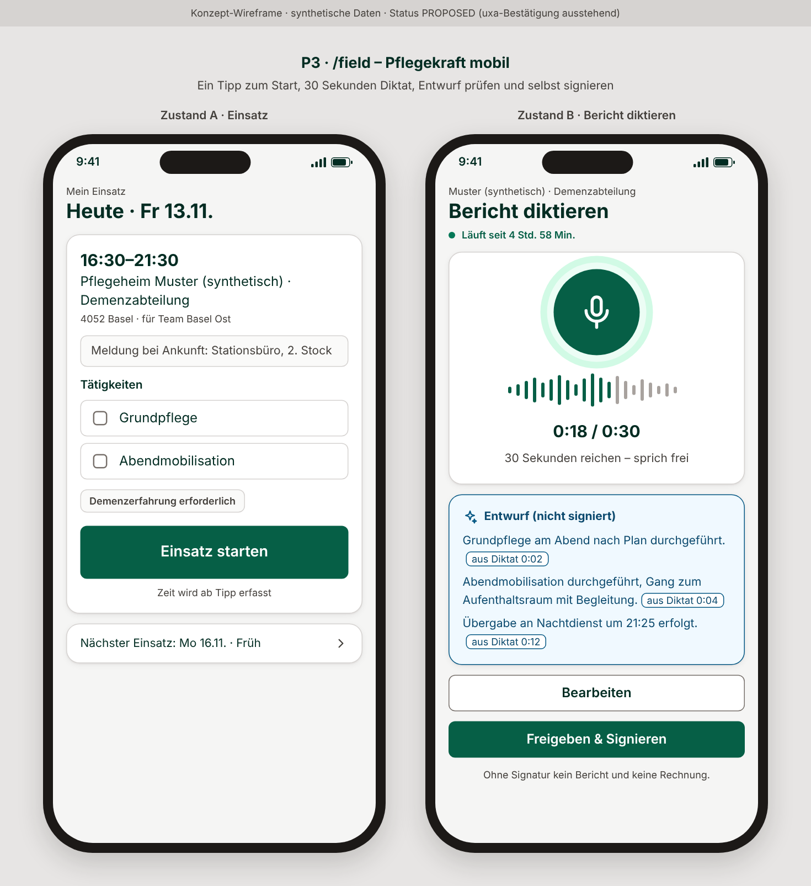

- **1-Tap-Check-in:** «Einsatz starten»; die Zeit läuft ab dem Tipp (F1 bis F4, IMPLEMENTED).
- **Bericht aus eigenen Worten (V3.2.5, UXR-195, AUT-118, CGR-213 (b)):** **keine Zeitgrenze.** In BK ist der Entwurf eine **Regel über Text** (getippt oder Handy-Tastatur, synthetische Daten), keine KI und **keine Audioaufnahme in NAVORA** (D-35 Regel A; Sprache-zu-Text ist später A7, D-41). Jeder Satz trägt seine Quelle («aus deinem Text», «aus Zeiterfassung»); Sätze werden unverändert übernommen (AUT-114). PLANNED (BK-8, BK-e). **V3.2.6:** Gebaut wird die Variante «Signieren gesperrt, solange n > 0» (PO 21:39 auf Prüfposition `cra` 21:40): keine Sammelaktion «alle weglassen», «Bewusst weglassen» ist ein protokollierter Akt je Abschnitt, der weggelassene Text bleibt im Eingabeprotokoll der signierten Fassung; Messung je Team, nie je Person. Vor realen Daten bestätigt oder ersetzt der Clinical Owner diese Regel (D-27). OPEN.
- **Nichts fällt still weg:** Über dem Signierknopf steht «Nicht übernommen (n)», ein Eintrag je nicht übernommener Stelle mit «Einfügen» oder «Bewusst weglassen». Ob ein nicht geklärter Eintrag das Signieren sperrt (`uxa`) oder standardmässig in den Bericht geht (`aia`), entscheidet `cra` am BK-e-Gate; in beiden Fällen gilt der Test «40 Eingaben → 40 übernommen oder gelistet, keine verloren». PLANNED.
- **Bild P3:** Die Zeitangabe «0:18 / 0:30» und «höchstens 30 Sek.» im PNG sind überholt; `field.svg` ist in V3.2.5 korrigiert (nur Text), die Zeichnung des Blocks «Nicht übernommen (n)», das Ersetzen der Aufnahme-Zeichnung durch ein Texteingabefeld und das PNG liefert `uxa` nach (#1233). OPEN.
- **Signatur:** «Freigeben & Signieren». Ohne Signatur gibt es keinen Bericht und keine Rechnung (BK-8n).

### 5.4 P4 `/b2b-institution`: das Planungsmodul des Heims

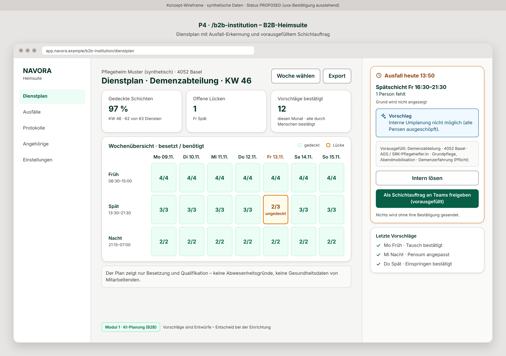

- **Dienstplan der Abteilung:** Woche × Schicht, Lücken sofort sichtbar.
- **Ausfall:** «1 Person fehlt» ohne Name und ohne Grund (Abwesenheitsgründe bleiben verborgen). Auch Beispieltexte, Platzhalter und Testdaten tragen nie einen Abwesenheitsgrund (V3.2.1, UXR-192, `lca` M-a).
- **Brücke zum Teamgeschäft:** «Als Schichtauftrag an Teams freigeben (vorausgefüllt)»: aus der Lücke wird mit einem Klick ein bestätigter Auftrag (Demand-Pooling, FE-055 (4)).

### 5.5 P5 `/family`: Transparenz ohne Unterbrechung

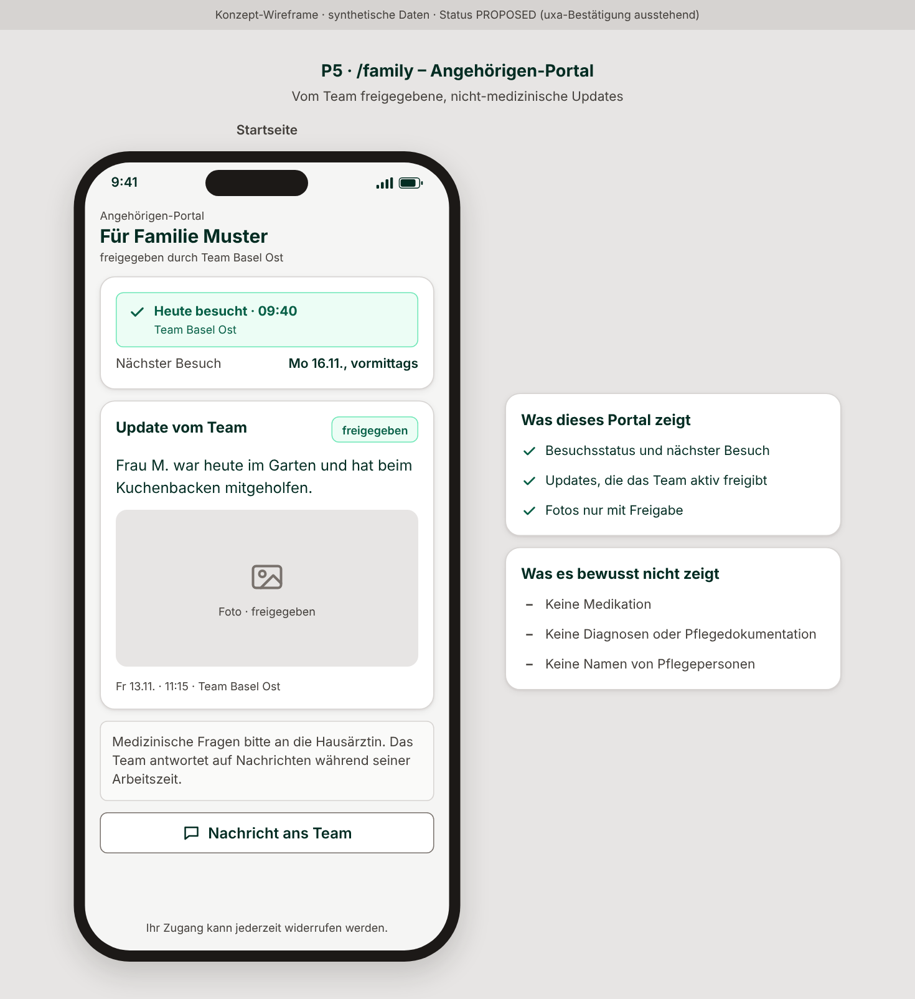

- **Statuskarte:** besucht wann, von welchem Team, nächster Besuch.
- **Update vom Team:** nur freigegebene, nicht-medizinische Inhalte und Fotos.
- **Schutz der Pflegenden:** Nachrichten gehen an das Team, beantwortet während der Arbeitszeit; medizinische Fragen an die Hausärztin. Zugang jederzeit widerrufbar.

### 5.6 P6 `/platform`: das Gründer-Cockpit

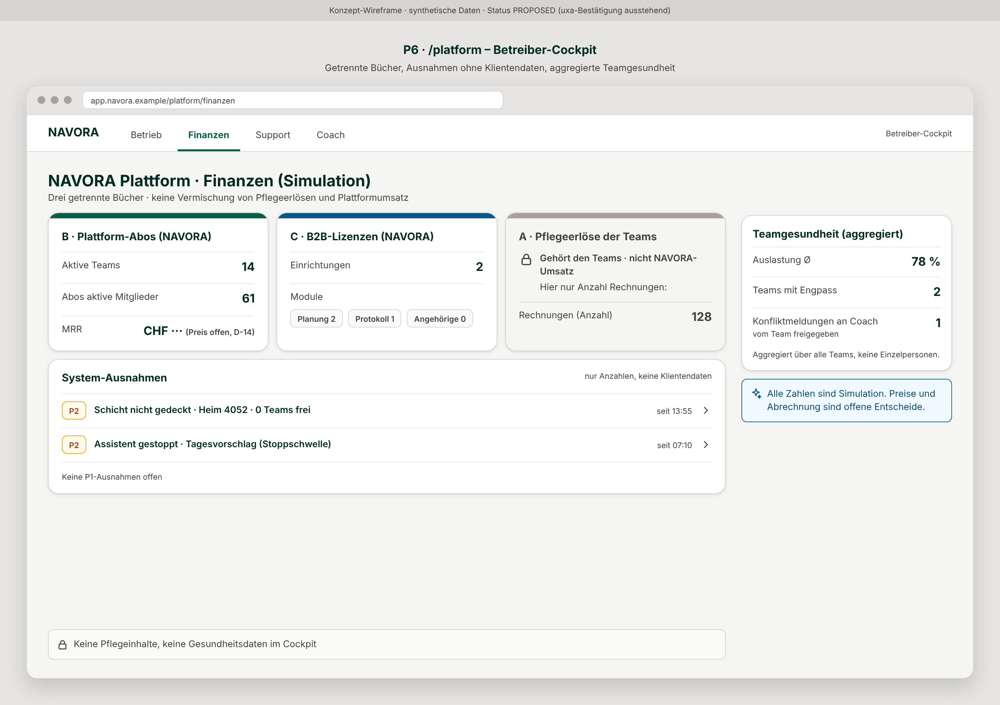

- **Getrennte Bücher:** Plattform-Abos und B2B-Lizenzen als NAVORA-Umsatz; Pflegeerlöse der Teams gesperrt, nur als Anzahl.
- **System-Ausnahmen:** nur Zählwerte und Typen, keine Klientendaten.
- **Teamgesundheit:** aggregiert, nie je Person; Konfliktmeldungen erreichen den Coach nur, wenn das Team sie freigibt.
- **Rollen im Cockpit:** Betrieb, Finanzen, Support und Coach sind getrennte Funktionen ohne unbeschränkten Adminzugang (FE-070 (2)).

---

## 6. Wie sich die Menschen durch das Gebäude bewegen: der Kernablauf

Der Kernablauf gilt für jeden Auftrag, nicht für einen Einzelfall (FE-074). Brief: [`briefs/BK.md`](../agents/briefs/BK.md).

### 6.1 Der Weg einer Schicht vom Anruf bis zur Rechnung

Zuerst der Weg als Swimlane über alle Beteiligten (FE-076 (3)); darunter dieselbe Abfolge als Sequenzdiagramm.

<div class="landscape" markdown="1">

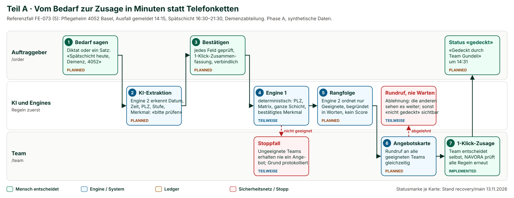

</div>

<div class="landscape" markdown="1">

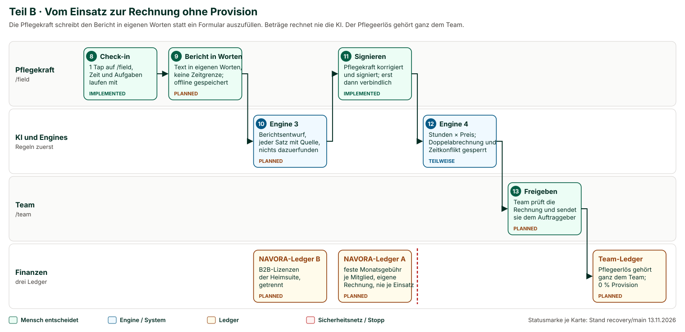

</div>

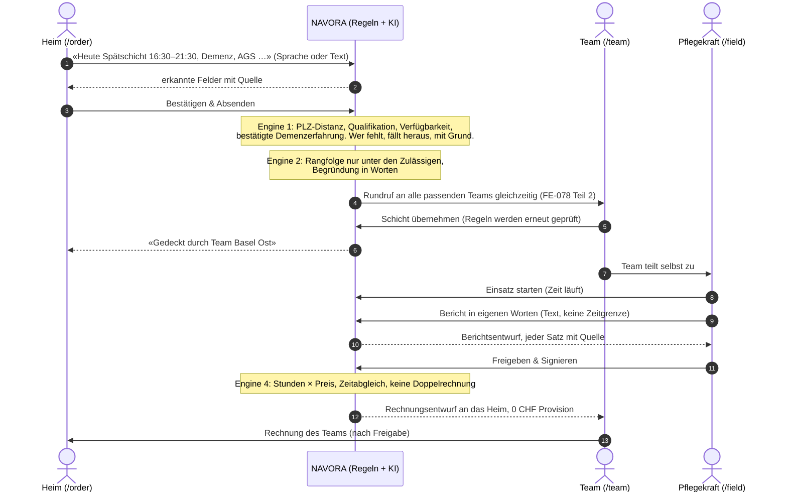

### 6.2 Der Rundruf: alle geeigneten Teams gleichzeitig, nie stilles Warten (V3.2.13, FE-078 Teil 2)

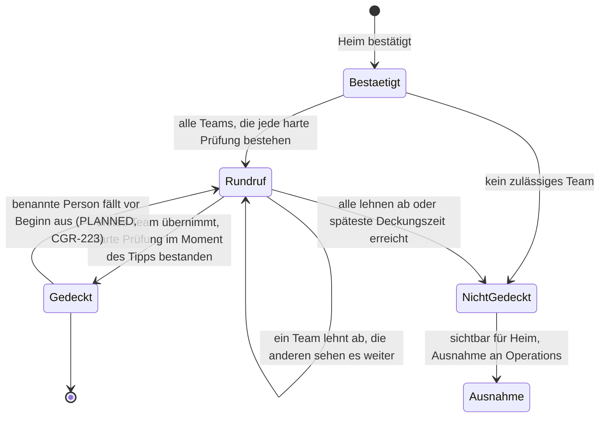

- **Ersetzt die exklusive Kaskade** (V3.2 bis V3.2.12) durch Founder-Entscheid FE-078 Teil 2.
- **Sichtbar** wird das Angebot nur für Teams, die **jede** harte Prüfung von Engine 1 bestehen (Distanz, Stufe, Pflichtmerkmale, Verfügbarkeit, gültige Nachweise). Die KI bzw. in BK die Regel sortiert und begründet, schliesst aber kein geeignetes Team aus (Engine 2).
- **Übernahme:** Das Team entscheidet frei. Bei gleichzeitigem Tippen gewinnt genau eine Übernahme; die harte Prüfung läuft im Moment des Tipps erneut (BK-5a, `cra`).
- **Nie stilles Warten:** Ab welchem Abstand zum Schichtbeginn «nicht gedeckt» als Ausnahme erscheint, ist ein Betriebsparameter, kein klinischer Wert; den Standard schlägt `eng` per ADR vor (BK-6). **V3.2.16 (CGR-222 (a)):** Standard per `eng`-ADR für die Simulation, im Clinical Rule Register als PROPOSED geführt; vor realen Daten bestätigt oder ersetzt der Clinical Owner den Wert (K-8). Der Zustand «nicht gedeckt» erreicht den Auftraggeber zu dieser spätesten Deckungszeit, immer **vor** dem Schichtbeginn (G9). Was der Heim-Stand wörtlich sagt, steht in 5.1.
- **Recht:** Der Rundruf ist gute Produktlogik und schwächt den Einwand, die Plattform steuere die Arbeit. Er ist aber nicht der rechtliche Schutz; dieser liegt im echten Auftrag zwischen Auftraggeber und Team und in der festen Gebühr (Anhang C §1.2, D-44 `lca` 15.11.). **OPEN** bis zum Gutachten (FE-050). *(W-4 (2), FE-084 (4))*

### 6.3 Schritte, Engines und Stand

| # | Schritt | Wer | Engine | Status |
|---|---|---|---|---|
| 1 | Bedarf erfassen (Sprache oder Text) → KI erkennt Felder → Auftraggeber bestätigt | Auftraggeber | E2 (Erfassung) | **PLANNED** (BK-1) |
| 2 | Harte Prüfung: PLZ-Distanz, Qualifikation nach Matrix, Verfügbarkeit, bestätigte Merkmale | System | E1 | Region und Pflichtqualifikation **IMPLEMENTED**; PLZ-Distanz und Teamreichweite für Aufträge **IMPLEMENTED** (nicht abgenommen; `M/130`, `M/131`); Matrix im Matching, Merkmale und Verfügbarkeit je Mitglied **PLANNED** (#1273) |
| 3 | Rangfolge unter den Geeigneten, Begründung in Worten | System | E2 | **PLANNED** (BK-3, BK-4); Umfang BK-c3 (PO 17.11. 17:39): Begründung je eigenem Team aus gespeicherten Fakten, Liste nach Schichtbeginn, keine Rangfolge zwischen Teams (FE-078 (2)); Ordnen nach Kontinuität erst nach Entscheid Clinical Owner (CGR-196) |
| 4 | Angebot gleichzeitig an alle geeigneten Teams (Rundruf, FE-078 Teil 2), Sortierung nur als Empfehlung | System → Team | E1, E2, E5 | Fallpfad: alle geeigneten Teams sehen das Angebot (**IMPLEMENTED**, `team_offers()`); Auftragspfad: Angebotszeilen **IMPLEMENTED** (`M/130`), Sicht der Teams **PLANNED** (BK-5; `eng` V-8, `aia` AUT-128); Empfehlung «weil …», Übernahme-Wettlauf und Ausnahme beim Schichtbeginn **PLANNED** (BK-5, BK-6) |
| 5 | Teamentscheid mit einem Tipp; der Auftraggeber sieht «gedeckt» | Team | E1 | Teamentscheid **IMPLEMENTED** (J2); Anzeige für den Auftraggeber **PLANNED** |
| 6 | Einsatz: Zeit, Aufgaben | Pflegekraft | – | **IMPLEMENTED** (F1-F4) |
| 7 | Diktat → KI-Berichtsentwurf | Pflegekraft | E3 | **PLANNED** (B6, BK-8) |
| 8 | Prüfung und Signatur | Pflegekraft | – | **IMPLEMENTED** (F6, F7) |
| 9 | Rechnung des Teams an den Auftraggeber, ohne Provision | Team | E4 | Fakten **IMPLEMENTED** (J5); Rechnung **PLANNED** (BK-9) |
| ∞ | Nicht gedeckt, überfällig, Sicherheitssignal → Eskalation | System | E5 | Signale **IMPLEMENTED** (SIG1, SIG2, OPS1); «nicht gedeckt» je Auftrag **PLANNED** (BK-6) |

**Ziel für die Handgriffe je Auftrag (BK):** höchstens einer beim Auftraggeber, einer im Team, drei bei der Pflegekraft nach der Schicht.

### 6.4 Patientensicherheits-Garantien im Ablauf (`cra`-Gate)

| Garantie | Wo im Ablauf | Test |
|---|---|---|
| Ein Team, das eine harte Regel verletzt, erhält **nie** ein Angebot, egal was die Rangfolge sagt | Schritt 2–4 | BK-2n (pgTAP auf den Angebotszeilen) |
| Die Regeln werden beim Tipp «übernehmen» erneut geprüft | Schritt 5 | BK-5n |
| «Nicht gedeckt» bleibt sichtbar; kein stilles Verfallen | ∞ | BK-6 |
| Ein Entwurf wird nur von der Pflegekraft der Schicht signiert; ohne Signatur keine Rechnung | Schritt 7–9 | BK-8n |
| Ein wiedereröffneter Fall ohne Team geht nie verloren | ∞ | SAFE-D11 (abgenommen) |
| Qualifikationsregeln sind nur Simulationsregeln, bis der Clinical Owner sie freigibt | Schritt 2 | Matrix v0.2 PROPOSED (D-27, D-43) |
| «Gedeckt» erst, wenn beim «Übernehmen» eine benannte, geprüfte Pflegeperson feststeht; vorher «Pflegekraft noch nicht benannt» (PLANNED; V3.2.2, `cra` CGR-213 (a), CGR-204 (c), UXR-191) | Schritt 5–6 | BK-5n, BK-6 |
| «Nicht gedeckt» erreicht den Auftraggeber **vor** dem Schichtbeginn, spätestens zu einer festen Deckungsfrist (PLANNED; V3.2.2, CGR-207 (a); Frist: Clinical Owner, K-8. V3.2.16, CGR-222 (a): Standard per `eng`-ADR für die Simulation, im Clinical Rule Register als PROPOSED geführt; vor realen Daten bestätigt oder ersetzt der Clinical Owner den Wert) | Schritt 6 | BK-6 |
| Kein diktierter Inhalt geht still verloren: jedes nicht übernommene Eingabesegment wird vor dem Signieren gelistet und behandelt (PLANNED; V3.2.2, CGR-208 (a)) | Schritt 7–8 | BK-8n |
| Dauern werden aus Zeitstempeln in Europe/Zurich berechnet; eine Nacht über Mitternacht und die Umstellungsnacht ergeben eine Schicht mit richtiger Dauer (PLANNED; V3.2.2, CGR-206, CGR-200) | Schritt 1 | BK-1c |
| Übergabe und Eskalation am Ort der Pflege sind in Phase A **nicht modelliert**; das steht im BK-Abnahmeprotokoll (PLANNED als Vermerk; V3.2.2, CGR-209 (b)) | Schritt 7 | BK-Abnahme |

---

## 7. Wer sieht was: Datensichtbarkeit

| Daten | Auftraggeber | Team (vor Übernahme) | Team (nach Übernahme) | Pflegekraft | Angehörige | Betrieb / Finanzen | Coach |
|---|---|---|---|---|---|---|---|
| Eigener Auftrag und Stand | ja | – | – | – | – | Zählwert | – |
| Angebot (Schicht, Ort, PLZ, Qualifikation) | ja | ja | ja | ja | – | Zählwert | – |
| Strassenadresse | ja | **nein** | nur Mitglieder auf diesem Auftrag | nur Mitglieder auf diesem Auftrag | – | – | – |
| Name der betreuten Person | ja (eigene; beim Heim die eigene Bewohnerin) | **nein** | nach Bedarf | nur Mitglieder auf diesem Auftrag | eigene Angehörige | – | – |
| Bestätigte Merkmale des Teams | «im Team bestätigt» | eigene | eigene | eigene, einsehbar und bestreitbar (A-c) | – | – | – |
| Bericht | nach Vereinbarung (OPEN; siehe unten) | – | ja | ja | **nur Updates, die die betreute Person oder ihre Vertretung freigegeben hat** (D-9 OPEN) | – | – |
| Pflegerechnung | eigene | – | ja | – | – | nur Anzahl | – |
| Abo- und B2B-Rechnungen | eigene Lizenz (B2B) | Mitglieder mit Abrechnungsrecht: eigene Gebühr, unabhängig von Übernahmen (R-1) | (wie links) | – | – | ja | – |
| Konflikte und Engpässe | – | – | ja | – | – | aggregiert | nur vom Team freigegeben |
| Ausschlussgründe je Team | – | – | – | – | – | nur interne Prüfspur | – |
| KI-Dienst | nur synthetische Daten (D-35 Regel A), für alle Spalten | | | | | | |

**Bericht an den Auftraggeber (V-3):** in KON-1 behält das Heim die Fachaufsicht und die Pflegedokumentation seiner Bewohnerinnen (D-43, Bewilligungsrecht) und braucht den Bericht wahrscheinlich in der eigenen Dokumentation; wer die Akte führt und unter welchem Berufsgeheimnis (StGB 321) die Weitergabe läuft, ist **UNKNOWN** (D-42 Q-42a). Beim Privathaushalt ist der Auftraggeber die Person oder ihre Vertretung. Strassenadresse: eine Regel für alle Auftragsarten, nur PLZ vor Übernahme (P-2, P-3).

**Status: Vorschlag des PO (PLANNED).** Quelle: `lca` 12:20 (M-a bis M-d, A-a bis A-d), FE-070 (2); von `lca` 16:40 bestätigt mit V-1 bis V-7 (in V3.2.4 eingetragen). Die verbindliche Berechtigungsmatrix je Rolle ist **OPEN** (D-3, Freigabe durch den Clinical Owner); technische Umsetzung im Handbook §6.

---

## 8. Die verbindliche Block-Lieferkette

**Es ist genau ein Block aktiv** (README Regel 12). Vorbereitung, also Briefs, ADRs und rote Tests auf Branches, läuft parallel. Konkurrierende Feature-Merges sind verboten.

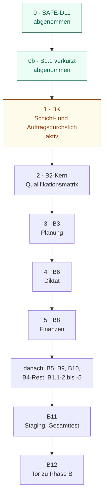

| Schritt | Block | Inhalt | Status am 2026-11-13 |
|---|---|---|---|
| 0 | **SAFE-D11** | ein wiedereröffneter Fall ohne Team geht nie verloren | **abgenommen** für Simulation, synthetische Daten (`29e54ec`, 20/20) |
| 0b | **B1.1 (verkürzt)** | Regionsliste, Altwert-Absicherung (#1181, #1184), Seed nur BS/BL mit PLZ | **für die Simulation abgenommen** 13.11. 18:40 auf `33523a5` (#1164, #1181, #1184, #1196, #1224; `ci-repeat` 20/20; `ABNAHMEAKTE.md` §2) (V3.2.3) |
| 1 | **BK** | universeller Auftragsdurchstich: Erfassung → Prüfung → Empfehlung → Teamentscheid → `/field` → Bericht → Rechnung; Szenario-Matrix | **aktiv** seit 13.11. 18:40 (V3.2.3); Teilstück **BK-a für die Simulation abgenommen** 14.11. 09:39 auf `634ccb7` (`ci-repeat` 20/20; `ABNAHMEAKTE.md` §2); Teilstück **BK-b für die Simulation abgenommen** 17.11. 02:39 auf `ab90875` (`ci-repeat` 43994886883 20/20, 0 übersprungen; `ABNAHMEAKTE.md` §2); **BK-c aktiv** (V3.2.25), in drei PRs: BK-c1 Datenbank (Übernahme, Ablehnung, Runden, Deckungsstand, Ausnahme «nicht gedeckt»), BK-c2 Bildschirme, BK-c3 Rangfolge und Gründe; eine Abnahme nach allen drei (V3.2.26); **BK-c1 gemergt** 17.11. 09:39 (#1342, `781944f`, Gates `cra`/`lca`/`aia` auf `abe0c5d`; nicht abgenommen) (V3.2.31); **BK-c2 gemergt** 17.11. (#1358, `25d7cdf`, Gates `lca`/`cra`/`uxa` auf `9a7fc56`; nicht abgenommen) (V3.2.39); **BK-c3 gemergt** 17.11. 20:52 (#1388, `ad21dd2`, Gates `cra`/`uxa`/`aia`/`lca` auf `8744acd`; Begründung nur mit `member_free`, keine Rangfolge zwischen Teams; nicht abgenommen; BK-c-Abnahme mit `ci-repeat` 10/10 offen) (V3.2.42); **Abnahmeprüfung BK-c** 17.11. 21:39 auf `ad21dd2`: `ci-repeat` 44166631679 20/20 grün, aber `changes-requested`, weil drei Datenschutzkriterien (`lca` G-2, G-3 (2), G-6) ohne Test sind; Test-PR, dann neuer `ci-repeat` im Tagesfenster (V3.2.43); **Test-PR #1403** (pgTAP 147) geliefert, `cra` frei, wartet auf das `lca`-Gate (V3.2.44); **#1403 gemergt** 17.11. 23:39 (`a71c0bc`, Kopf `863c778`; `lca`-Gate frei 23:20 mit bestätigter G-2- und G-6-Lesart, `cra`-Gate frei auf `863c778`); `ci-repeat` auf dem Merge-Commit im Tagesfenster ab 02:20 offen, dann Abnahme BK-c (V3.2.45); `ci` auf `a71c0bc` grün (ein vollständiger Lauf `success`, ein paralleler Lauf durch die Concurrency-Gruppe abgebrochen), ebenso auf `36ec51a` (V3.2.46); `cra` hält das #1403-Gate über `c03dcbf` (kein Code-Unterschied) und stimmt dem vorgeschlagenen BK-d-Schnitt beratend mit vier Bedingungen zu; Schnitt weiter nur Vorschlag (V3.2.47); **Teilstück BK-c für die Simulation abgenommen** 18.11. 02:39 auf `d51d1c1` (`ci` 44209867556 5/5; `ci-repeat` 44215240768 20/20, `db` 147 Dateien / 5213 Tests «Result: PASS», `e2e` 188 bestanden, 0 übersprungen; `ABNAHMEAKTE.md` §2); **BK-e aktiv** (`/field`-Verknüpfung, Berichtsentwurf aus Text; ohne externen KI-Dienst und ohne Audio; Testersatz nie als KI-Funktion ausgewiesen, FE-088 (4); Vorschlag BK-e1/BK-e2; Reihenfolge a, b, c, e, f, d, g unverändert) (V3.2.48); Zuschnitt BK-e nach ADR-202 in vier PRs (BK-e1a Ortszeile, BK-e1b Einsatz aus der Übernahme, BK-e2a Entwurf und Liste «nicht übernommen», BK-e2b Unterschrift und Kontrollen), eine Abnahme nach allen vier; **BK-e1a geliefert** (#1417, Kopf `a5bae13`, `ci` grün, `cra` frei; wartet auf `uxa`); Bedingungen für BK-e1b: CGR-242, CGR-243 (V3.2.49); **BK-e1a gemergt** 18.11. 04:39 (#1417, `3d9f1e6`, Gates `cra`/`uxa` auf `a5bae13`; nicht abgenommen); weitere BK-e1b-Bedingung CGR-244 (keine Rückgabe, solange der Einsatz nicht mehr `planned` ist); CGR-245 (bestellte Tätigkeiten einzeln bestätigen) in BK-e2; Hausadresse als eigenes Teilstück nach BK-e vorgeschlagen (BK-e3), reale Nutzung nur durch den Owner; Tastaturdiktat nur in Phase A (V3.2.50); Merge-CI auf `3d9f1e6` grün; weitere BK-e1b-Bedingungen CGR-246 (sofortiger Hinweis an Team und Pflegekraft, wenn sie unterwegs ausfällt), UXR-237, UXR-239; CGR-247 in BK-e3; Abhakliste bestellter Tätigkeiten als Richtung für BK-e2 (PROPOSED) (V3.2.51); BK-e1b (#1421) aus dem Entwurf, ohne `cra`-Gate; zusätzliche Bedingungen CGR-248/UXR-241 (Übernahme-Einsatz ohne «Einsatz absagen», serverseitig abgelehnt) und UXR-240; Korrektur: im Zustand CGR-246 liest die Auftraggeberin «nicht gedeckt» (V3.2.52); zusätzliche Bedingung CGR-249 (solange eine Übernahme lebt, verschiebt, löscht oder vergibt kein Personenbefehl ihren Einsatz) und Deckungs-Eigenschaft in pgTAP 148 (kein Auftrag «gedeckt» ohne genau einen geplanten oder laufenden Einsatz am bestellten Termin) (V3.2.53); CGR-249 gebaut auf `ccd0f4b` (nicht gemergt); zusätzliche Bedingungen CGR-250 (eine Abwesenheit verändert einen Übernahme-Einsatz nie; nach Beginn Hinweis ans eigene Team, Auftraggeberin liest «nicht gedeckt»), CGR-251 und eine Liste aller Schreiber von `care_visits` mit je einem Prüfergebnis (V3.2.54); CGR-250, CGR-251 und Schreiberliste gebaut auf `82e7323` (nicht gemergt); CGR-246 für das `cra`-Gate blockierend; zusätzliche Bedingungen CGR-252 (jeder abgelehnte Versuch an einem Übernahme-Einsatz hinterlässt eine Prüfspur) und UXR-244 (V3.2.55); CGR-246 gebaut auf `d9f4a4b` (Migration 0144: Hinweis `take_member_dropped` an ihr Team und an sie; nicht gemergt; `cra`-Gate auf dem Endstand offen) (V3.2.56); CGR-251-Kontrolle und CGR-252 gebaut auf `8d4a1ff` (Migration 0145; nicht gemergt); neu blockierend CGR-253/UXR-245: der Ausfall-Hinweis bekommt für niemanden «Ich übernehme», die Karte zeigt den nächsten Schritt (PO-Wahl für die Simulation) (V3.2.57); CGR-253/UXR-245 gebaut auf `2346b34` (Migration 0146), `cra` 12:27 erfüllt, kein blockierender Befund; CGR-254 Voraussetzung vor realen Klientinnen (V3.2.58); CGR-233-Test auf `883d21c` (Migration 0147, Zwei-Sitzungs-Skript) grün, aber `cra` 13:29 neu blockierend CGR-255: das Skript erwartet im Wettlauf eine Doppelbelegung, die keine serielle Reihenfolge erzeugt; Bedingung präzisiert (Ergebnis gleich einem seriellen Ergebnis); CGR-256 (Überschneidung über Mitternacht) und UXR-247 als Folgepunkte (V3.2.59); CGR-255 gebaut auf `592c7ae` (Migration 0148: die automatische Freigabe liest unter der Personensperre; Wettlauf gleich serieller Kontrolle, Invariante 0), `cra` 14:27 CGR-255 und CGR-233 erfüllt, kein klinischer Blocker offen; offen Playwright der Übernahmekarte, F1–F4, Endstand, `cra`-/`uxa`-Gate (V3.2.60); **BK-e1b gemergt** 18.11. 17:41 (#1421, `7c042400`, Gates `cra`/`uxa` auf `386848b`; nicht abgenommen; Staging-Datenbank 0148); **BK-e1c** (laufende Nachtschicht mit Sicherheitshinweisen am Tag 2 unter «Heute», CGR-257, UXR-248) nächster Schritt und Voraussetzung der BK-e-Abnahme (V3.2.64); **BK-e1c gemergt** 18.11. 20:41 (#1476, `0ca04b6`, Gates `cra`/`uxa` auf `bb2d101`; Staging-Datenbank 0149; nicht abgenommen); nächste Schritte #1460 (ADR-204), dann `ci-repeat`-Abnahmelauf BK-e; Folgepunkte CGR-256, CGR-258, UXR-249, UXR-250 vor realen Klientinnen (V3.2.65); #1460 gemergt 18.11. (`09712bb`); **Teilstück BK-e1 für die Simulation abgenommen** 18.11. (21:39-Lauf) auf `3ea17ee` (`ci-repeat` 44393766620 20/20; `ABNAHMEAKTE.md` §2); BK-e bleibt aktiv mit BK-e2a, BK-e2b; nächster Schritt CGR-256 (V3.2.66); **Teilstück BK-e als Ganzes für die Simulation abgenommen** 20.11. 05:39 auf `8155ac6` (BK-e2: #1494, #1497, #1527, #1549, #1572; `ci` 44669357371 5/5; `ci-repeat` 44669473293 20/20, `db` 153 Dateien / 5483 Tests «Result: PASS», `e2e` 192 bestanden, 0 übersprungen; `ABNAHMEAKTE.md` §2); Berichtsentwurf auf Staging Testersatz «regelbasiert, keine KI», kein KI-Modell angeschlossen; nächstes Paket BK-f (Paketvertrag durch den PO, `lca`-Gate) (V3.2.73); **BK-f aktiv** 20.11. 06:39: Paketvertrag (Rechnungsentwurf automatisch aus dem `final`-Bericht, Teampreis als Momentaufnahme bei der Übernahme, ein Tipp «Bestätigen und senden», Auftraggeber liest «Rechnungen»; Toleranzwert für die Simulation durch `lca` am Gate; keine Provision, kein Geldfluss über NAVORA, kein KVG/KLV; BKF-F1 rot zuerst) (V3.2.74) |
| 2 | **B2-Kern** | Qualifikationsmatrix auf jedem Zuteilungsweg, Nachweise, Delegation | QUAL1 Teil 1-2 **IMPLEMENTED** (nur Simulation); Matrix **PROPOSED** |
| 3 | **B3** | Team- und KI-Planung, Ausfallkoordination, Kontinuität | **IMPLEMENTED**, nicht als Block abgenommen |
| 4 | **B6** | Diktat, KI-Dokumentationsentwurf, menschliche Freigabe | Signatur **IMPLEMENTED**; Diktat und Entwurf **PLANNED** |
| 5 | **B8** | Finanzen: Rechnung, Validierung, Doppelabrechnung, drei getrennte Ledger | **PLANNED** (BILL1, GMSEP) |
| danach | B5 Sicherheitssignale · B9 Pflegeheim-Betrieb · B10 Kennzahlen · B4-Rest · B1.1-2 bis -5 | Vertiefung und Sonderfälle (FE-073 (4)) | gemäss `PRODUCT_BLOCKS.md` |
| Abschluss Phase A | **B11** | Staging, Wiederherstellung, Gesamttest beider Abläufe | **PLANNED** (D-2; Staging wartet auf ein Owner-Secret) |
| Tor zu Phase B | **B12** | Clinical Owner, Rechtsgutachten, Pilotvertrag, externer Sicherheitstest, KI-Pfad, Produktion | **OPEN**, Founder |

**Hinweis zur Kette (PO).** BK nimmt von B2, B3, B6 und B8 je einen dünnen, durchgehenden Schnitt vorweg. Diese Blöcke vertiefen danach, was BK erstmals verbindet. B5 bleibt bestehen, weil die Eskalation ungedeckter Schichten patientensicherheitskritisch ist. Ihr Kern liegt schon in BK (BK-6).

---

## 9. Harte Gate-Kriterien, Phase A und Phase B

### 9.1 Merge und Abnahme (FE-071, README Regel 12)

1. **Spezifikation vor Bau.** Jeder Brief nennt:
   - Problem und Nutzen;
   - Umfang und Nicht-Ziele;
   - Rollen und Ansichten;
   - Abhängigkeiten;
   - positive und negative Abnahmetests;
   - nötige Prüfungen (UX, klinisch, rechtlich, Sicherheit);
   - die acht Fragen der Vision.
2. **Merge** eines Engineering-PR nur:
   - für den aktiven Block oder eine benannte Sicherheitsausnahme;
   - mit automatisierten Tests für das geänderte Verhalten;
   - mit grüner CI auf dem aktuellen Kopf;
   - mit den Gate-Zeilen der Rollen.
   CI auf dem Merge-Commit muss grün sein, sonst folgt ein Revert-PR.
3. **Abnahme** nur auf einem **benannten integrierten Commit**: `ci` grün und **`ci-repeat` 10/10** (`db`, `e2e`). Belegt wird aus den Roh-Logs; übersprungene oder abgebrochene Läufe zählen nicht.
4. **Jede Abnahme nennt ihr Gate:** «Simulation, synthetische Daten» oder «freigegeben für reale Personen und Daten».

### 9.2 Phase A und Phase B (strikt getrennt)

| | Phase A (jetzt bis M9, 2027-03-12) | Phase B (später) |
|---|---|---|
| Partner | simuliert: Pflegeheim-Abteilung, ambulante Teams, Auftraggeber in Basel-Stadt und Basel-Landschaft | reale Pilotorganisation, nach heutiger Richtung ein Pflegeheim |
| Daten | **nur synthetisch** (FE-021, FE-066); Testumgebungen auf Produktionsniveau geschützt | reale Daten erst nach allen Toren |
| KI | nur synthetische Eingaben | erst nach D-41 (Muster 4, Rechtsgutachten, DSFA) |
| Regeln | Matrix und klinische Regeln PROPOSED | vom Clinical Owner freigegeben (D-43) |

**Tore vor realen Daten (B12):**

- Clinical Owner ernannt (G-1, D-43);
- Rechtsgutachten Q1 2027 (FE-050: D-18, D-22, D-42, D-44, D-41);
- Pilotvertrag;
- externer Sicherheitstest (FE-049);
- Repository privat (D-7);
- Staging und belegte Wiederherstellung (B11);
- DSFA.

---

## 10. Meilensteine und Kennzahlen

| Meilenstein | Ziel | Stand |
|---|---|---|
| Lieferung 2 / 3 / 4 | 13.11. / 16.11. / 17.11.2026 (FE-072 (6)) | Lieferung 2 ist dieses Dokumentpaar |
| M9 Phase A bestanden | **2027-03-12**: beide Abläufe (ambulant und Heim) und der BK-Auftragsablauf auf einem benannten Commit im Staging, alle Stoppfälle belegt | in Arbeit |
| M10 Produktionsbereitschaft | Tore aus §9.2 | **OPEN** |

| Kennzahl | Was | Wert |
|---|---|---|
| M-13 Nordstern | Anteil direkter Pflegezeit je Team und Monat | 1 |
| M-15 / M-16 | Administrationsminuten je Einsatz; Zeit bis zum finalen Bericht | 1, 5 |
| M-11 / M-17 | menschliche Handlungen je Planung und Ausfall | 4, 5 |
| M-12 / M-20 | Eingriffe von Operations; Entscheide im Team | 4 |
| M-19 | Kontinuität (Bezugspflege-Anteil) | 2 |
| M-18 | Abrechnungsfehler und manuelle Ausnahmen | 5, 9 |
| M-21 / M-10 | Sicherheitsindikatoren; offene blockierende Befunde | Sicherheit |
| M-02 / M-03 / M-14 | Merge-Warteschlange, Durchlaufzeit, CI-Gesundheit | 8 |
| **neu (BK)** | Minuten von der Erfassung bis «gedeckt»; Anteil gedeckter Aufträge; Handlungen je Auftrag (Auftraggeber, Team, Pflegekraft) | 1, 4, 5 |

Alle Werte gelten je Team und nie je Person. In Phase A sind es synthetische Werte. Die Prozentwerte je Meilenstein führt der PO wöchentlich in V2 §4 weiter, bis sie in V3 übernommen sind.

---

## 11. Founder-Entscheidungsboard (offen)

| # | Frage | Wirkt auf |
|---|---|---|
| D-14 | Höhe der Plattformgebühr (Variante F3/F6 nach VZE) | Kap. 2.3, 4, Abo-Ledger |
| D-44 | Rechtsform und Vertragsweg je Auftragskonstellation (Genossenschaft? Personalverleih oder Auftrag, AVG); Gebührengestaltung L-10 in der Richtung entschieden (FE-055 (1), (3); FE-078 Teil 1); **offener Satz an den Founder:** «Über NAVORA laufen keine Zahlungsflüsse zwischen Auftraggeber und Team» (von FE-055 nicht ausdrücklich gedeckt, `lca` 16:40); **dieser Satz ist seit 2026-11-14 entschieden: FE-078 Teil 1.** Rechtsform und Vertragsweg bleiben offen; die rechtliche Bestätigung von L-10 bleibt beim Gutachten (FE-050) | GM-1, BK-Rechnung, Phase B |
| D-41 | KI-Pfad für reale Daten (Muster 4: Rechenzentrum, Gutachten, DSFA) | E2, E3 |
| D-2 | Hosting: App-Host Infomaniak und `navora-prod` entschieden (FE-063, FE-064); offen sind der Auftragsverarbeitungsvertrag und das Upgrade vor realen Daten | B11 |
| STG1 | Owner-Secret `STAGING_DB_URL` für das Staging | B11 |
| B0-6 | Repository-Schutz (Ruleset) | B12 |
| G-1 / D-43 | Ernennung des Clinical Owners | Matrix, klinische Regeln, D-3, Phase B |
| PLZ-Quelle | Phase A: synthetische Tabelle (konform, ADR-193); später swisstopo-Verzeichnis: schriftliche Bestätigung von swisstopo nötig, Inhalt in sieben Punkten (`lca` 16:40 §3), vom Founder selbst anzufragen | BK-b, Produktion |
| GM-2 | Preis und Reihenfolge der B2B-Module; Angehörigenportal-Brief | Kap. 4.2 |

---

## 12. Rollen

| Rolle | Verantwortung |
|---|---|
| `po` | WAS, WARUM, WANN; einzige Merge-Instanz; Abnahme mit Belegen; dieses Dokument |
| `eng` | WIE; Code, Migrationen, Tests, ADRs; Architecture Handbook |
| `cra` | klinische Sicherheit und Dokumentation; Gate je PR |
| `lca` | Recht, Datenschutz, Tarife, Verträge; Gate je PR |
| `uxa` | UX, Texte, 390/1440 px; Gate je PR |
| `aia` | KI-Verträge (Eingabe, Ausgabe, Stopp-Regel) |
| `csa` | Strategie, Geschäftsmodell, Markt |
| Founder | Strategie, Preis, Recht, Verträge, Einstellungen, Freigabe dieses Dokuments |

---

## 13. Das gemeinsame Werk: Beiträge und Unterschriften der Rollen

**Arbeitsweise (FE-076).** Die Rollen arbeiten als eigene Agenten im Stundentakt und koordinieren über das Repository. Diese Fassung baut deshalb auf allem, was jede Rolle bereits geschrieben hat; jeder Beitrag ist mit seiner Quelle genannt. Gleichzeitig hat jede Rolle einen konkreten Auftrag erhalten (Issues unten). Ihre Ergänzungen und Unterschriften fliessen in V3.2 ein. **Bis eine Rolle unterschrieben hat, gilt ihr Teil als PO-Entwurf auf Grundlage ihrer Dokumente.**

| Rolle | Was in dieser Fassung von ihr stammt (Quelle) | Auftrag für V3.2 | Unterschrift |
|---|---|---|---|
| `csa` | Buurtzorg-Massstab und Schritt darüber hinaus (`STRATEGY.md`); Gebührenhypothesen BM-1, BM-2, BM-11, BM-12; Konstellationen | Marktdisruption und Modellrechnung (Kap. 1, 2) als marktführendes Modell ausarbeiten | **eingereicht 13:59 (Anhang A)**; Bestätigung ausstehend (#1212) |
| `uxa` | Designsystem v77 (Farben, Schrift, 390 px); Angebotskarte, Deckungsstand, Zusammenfassung «Bestätigen & Absenden» (`UX_REVIEW.md`, UXR-188) | die sechs Wireframes (Kap. 5) prüfen und in den Screenkatalog übernehmen | **eingereicht 13:59** (zweiter Satz Wireframes mit Zuständen und Texten in `blueprint-v3/wireframes/`); Bestätigung #1208; erste Prüfung 16:20 mit UXR-191 bis UXR-194 (UXR-191, UXR-192 in V3.2.1 eingearbeitet); Unterschrift ausstehend |
| `cra` | Qualifikationsmatrix v0.2 (PROPOSED); Befund CGR-200 (Schicht über Mitternacht); die Garantien BK-2n, BK-6, BK-8n stammen aus dem PO-Brief BK; von `cra` geprüft und bestätigt (Anhang B, 17:40), keine klinische Freigabe (D-27) | Matrix und Sicherheitsgarantien in den BK-Ablauf einarbeiten | **eingereicht 13:59 (Anhang B)**: 18 Garantien, Barrieren je Schritt, Matrix-Entscheid, Fall 4052. **Unterschrieben** (#1209): «`cra` 2026-11-13 17:40: Annex B confirmed with the corrections of `CLINICAL_GOVERNANCE.md` 17:40 (CGR-213); no clinical approval (D-27, D-43, G-1); every matrix cell PROPOSED.» Korrekturen CGR-213 (a) in V3.2.2 eingetragen; P3-Korrektur CGR-213 (b) bei `uxa` |
| `lca` | PLZ-Quelle und Regeln PLZ-a bis PLZ-c; Datenminimierung M-a bis M-d; Merkmale A-a bis A-d; Rechnungsentwurf I-a bis I-c; AVG-Einordnung und D-44 (12:20) | AVG-Abgrenzung je Konstellation und datenschutzkonforme PLZ-Zuordnung ausformulieren | **eingereicht 13:59 (Anhang C)**: Leitplanken, rote Linien R-1 bis R-10, PLZ P-1 bis P-8, Q-44e. **Unterschrieben** (#1210): «`lca`, 2026-11-13 16:40: Annex C and §4.4 confirmed with corrections C-1 to C-7; §7 confirmed with V-1 to V-7; §2 wording W-1 to W-7. AVG per constellation and Q-44e, Q-44f signed in D-44 (16:40), catalogue v7. Phase A: compliant under every plausible interpretation. Real use: unresolved, needs legal adviser (Q-44a, Q-44e, Q-44f) and owner (L-11, «no payment through NAVORA», swisstopo confirmation). Advisory, not legal advice.» Korrekturen C-1 bis C-7 (Anhang C, §4.4), V-1 bis V-7 (§7) und W-1 bis W-6 (§2) **in V3.2.4 eingetragen**; W-7 als Nutzungsregel in §2.1; Anhang A (Text `csa`) unverändert, Beschriftung dort bei `csa` |
| `eng` | Code-Inventar; ADR-186, ADR-187; offene Fragen T-1 bis T-9; Kaskade als Betriebsparameter | Machbarkeit der fünf Engines und des Datenmodells prüfen und unterzeichnen | **eingereicht 13:59**: 90 Aussagen geprüft, K1 bis K21 im Handbook §4-§6 und Anhang §11 eingearbeitet; unterzeichnet «machbar unter ADR-Vorbehalten»; Bestätigung #1211 |
| `aia` | – | KI-Verträge für Erfassung (BK-1a), Rangfolge (BK-3, BK-4), Berichtsentwurf (BK-8) | **Unterschrieben** (#1202): «`aia` 2026-11-13 16:00: KI-Verträge K-1 Erfassung, K-2 Rangfolge, K-3 Berichtsentwurf in `AUTOMATION_REVIEW.md` review 53 §2 und `AI_OPERATING_MODEL_REVIEW.md` §12. Unterzeichnet für BK mit Gate «Simulation, synthetische Daten», unter den Vorbehalten AUT-112 (Ledger-Bereich des Auftraggebers, ADR `eng`), AUT-113 (Kriterienfolge PO, Kontinuität `cra`), AUT-114 (Stufe des Berichtsentwurfs, `cra` und Regulatory Adviser). Alle drei als `kind = 'rule'`; keine KI-Sperre wird für BK gelockert (AUT-115).» |

Aufträge V3.2 (eigene Bestätigung je Rolle; Nummern in V3.2.2 korrigiert, `uxa` 16:20, `lca` 16:40, `cra` 17:40): `uxa` #1208 · `cra` #1209 · `lca` #1210 · `eng` #1211 · `csa` #1212. Frühere Aufträge aus der 13:14-Sitzung (`csa` #1195, `uxa` #1199, `cra` #1200, `lca` #1201, `aia` #1202, `eng` #1194) bleiben für die Vertiefung bestehen.

**Vollständige Beiträge als Anhänge:** A `csa` (Modell und Markt) · B `cra` (Patientensicherheit) · C `lca` (Recht). Die `eng`-Prüfung steht im Handbook V2.2 §11. Die Wireframes von `uxa` sind als SVG in `blueprint-v3/wireframes/`.


### Formales Sign-off FE-079 (Founder-Auftrag 2026-11-14)

**Auftrag (FE-079).** Jede Fachrolle bestätigt in ihrem nächsten Lauf, in ihrer Journal-Datei und als Kommentar auf Issue #1279: «Ich habe Blueprint V3.2 und Architecture Handbook V2.2 gelesen und vollinhaltlich verstanden. Ich bestätige hiermit mein formales Sign-off für meinen Fachbereich. Mein System-Prompt ist aktualisiert, und ich arbeite ausschliesslich auf dieser Grundlage.» **Das Master-Paket ist erst besiegelt, wenn alle sechs Zeilen unten unterschrieben sind.** Der PO trägt jede Bestätigung wörtlich ein, mit Vorbehalten und Befund-ID; ein Vorbehalt wird nie gestrichen oder umformuliert.

**Was ein Sign-off ist und was nicht.** Es bestätigt die gemeinsame Arbeitsgrundlage. Es ist **keine klinische Freigabe** (D-27: nur der benannte Clinical Owner), **keine Rechtsauskunft** (`lca` bleibt beratend), ändert keinen Status PROPOSED und keine Abnahme nach Kapitel 9.

**Prompts (IMPLEMENTED 2026-11-14 14:00-14:07, `po` im Auftrag des Founders):** die Aufgabenbeschreibungen von `cra`, `lca`, `uxa`, `aia`, `csa`, `eng` (stündlich und Wochenstatus) und `po` nennen jetzt Blueprint V3.2 und Handbook V2.2 als einzige Quellen (vorher Blueprint V2 und `ARCHITECTURE.md`), die Block-Regel mit BK als aktivem Block, das Geschäftsmodell mit FE-078 und den Sign-off-Auftrag.

| Rolle | Fachbereich | Nächster planmässiger Lauf | Sign-off (wörtlich) | Quelle |
|---|---|---|---|---|
| `eng` | 5 Engines, Datenmodell, Testpyramide, `ci-repeat` 10/10 (§3, §6.3, §9.1; Handbook V2.2) | stündlich, Minute 09 | **unterschrieben mit Vorbehalt** (V-1 bis V-6, Wortlaut unten), 2026-11-14 15:12; **erneuert** 2026-11-14 20:14 auf 3.2.16 (Vorbehalte V-1 bis V-8); **erneuert** 2026-11-14 22:09 auf 3.2.18 (Vorbehalte V-1, V-2, V-3 (Rest), V-4 bis V-7; V-8 von `eng` geschlossen); **erneuert** 2026-11-14 23:10 auf 3.2.19 (Vorbehalte V-1, V-2, V-4 bis V-7; V-3 und V-8 von `eng` geschlossen) | `docs/agents/journal/2026-11-14-1512-eng.md` (PR #1283, Merge `0b952ce`); [Kommentar #1279](https://github.com/Ivica1984/navora-mvp/issues/1279#issuecomment-6878581304); Erneuerung: `docs/agents/journal/2026-11-14-2014-eng.md` (PR #1301, Merge `fca9405`), [Kommentar #1279](https://github.com/Ivica1984/navora-mvp/issues/1279#issuecomment-6882788966); Erneuerung: `docs/agents/journal/2026-11-14-2209-eng.md` (PR #1310, Merge `fb35907`), [Kommentar #1279](https://github.com/Ivica1984/navora-mvp/issues/1279#issuecomment-6884260957); Erneuerung: `docs/agents/journal/2026-11-14-2310-eng.md` (PR #1312, Merge `b4a1189`), [Kommentar #1279](https://github.com/Ivica1984/navora-mvp/issues/1279#issuecomment-6884989780) |
| `cra` | Patientensicherheits-Garantien Anhang B §1 (**20** seit V3.2.2; vom Founder am 2026-11-14 bestätigt) und Qualifikationsmatrix (PROPOSED) | alle 4 Std., Minute 26 | **unterschrieben mit Vorbehalt** (CGR-221, CGR-222, CGR-223, Wortlaut unten), 2026-11-14 17:26; **erneuert** 2026-11-14 21:30 auf 3.2.17 (Vorbehalt CGR-221 (Rest)); **erneuert** 2026-11-15 01:30 auf 3.2.21 (Vorbehalt CGR-221 (Rest, nur Handbook); Teil Anhang B von `cra` geschlossen) | `docs/agents/journal/2026-11-14-1726-cra.md` (PR #1293, Merge `c860cc3`); Details `CLINICAL_GOVERNANCE.md` 17:26; [Kommentar #1279](https://github.com/Ivica1984/navora-mvp/issues/1279#issuecomment-6880720873); Erneuerung: `docs/agents/journal/2026-11-14-2130-cra.md` (PR #1308, Merge `65d8057`), Details `CLINICAL_GOVERNANCE.md` 21:30, [Kommentar #1279](https://github.com/Ivica1984/navora-mvp/issues/1279#issuecomment-6883799759); Erneuerung 01:30: `docs/agents/journal/2026-11-15-0130-cra.md` (PR #1320, Merge `2c85586`), Details `CLINICAL_GOVERNANCE.md` 01:30, [Kommentar #1279](https://github.com/Ivica1984/navora-mvp/issues/1279#issuecomment-6886609845) |
| `lca` | AVG-Abgrenzung (Anhang C §1), rote Linien R-1 bis R-10, FE-078 | alle 4 Std., Minute 20 | **unterschrieben mit Vorbehalt** (S-1 bis S-5, Wortlaut unten), 2026-11-14 16:25; **erneuert** 2026-11-15 00:25 auf 3.2.20 (Vorbehalte S-3, S-7; S-1, S-2, S-4, S-5, S-6 von `lca` geschlossen); **erneuert** 2026-11-15 04:20 auf 3.2.22 (Vorbehalte S-3, S-8; S-7 von `lca` geschlossen); **erneuert** 2026-11-17 00:20 auf 3.2.23 (Vorbehalt S-3; S-8 von `lca` geschlossen); **erneuert** 2026-11-17 16:21 auf 3.2.37 (Vorbehalt S-3) | `docs/agents/journal/2026-11-14-1625-lca.md` (PR #1289, Merge `65f5363`); [Kommentar #1279](https://github.com/Ivica1984/navora-mvp/issues/1279#issuecomment-6879658721); Erneuerung: `docs/agents/journal/2026-11-15-0025-lca.md` (PR #1315, Merge `a9f37b5`), Details `decisions/D-44.md` 00:25, [Kommentar #1279](https://github.com/Ivica1984/navora-mvp/issues/1279#issuecomment-6885840913); Erneuerung 00:20 (2026-11-17): `docs/agents/journal/2026-11-17-0020-lca.md` (PR #1334, Merge `8ec17a4`), [Kommentar #1279](https://github.com/Ivica1984/navora-mvp/issues/1279#issuecomment-6932410556); Erneuerung 16:21 (2026-11-17): `docs/agents/journal/2026-11-17-1621-lca.md` (PR #1377, Merge `e6b6c6f`), [Kommentar #1279](https://github.com/Ivica1984/navora-mvp/issues/1279#issuecomment-6952398395) |
| `uxa` | Wireframes und Klickpfade der 6 Portale (§5, §6) | alle 4 Std., Minute 47 | **unterschrieben mit Vorbehalt** (UXR-214, UXR-195, Wortlaut unten), 2026-11-14 15:51; **erneuert** 2026-11-14 19:58 auf 3.2.16 (Vorbehalte UXR-214 (Rest), UXR-195); **erneuert** 2026-11-14 23:50 auf 3.2.19 (Vorbehalte UXR-195, UXR-220; UXR-214 von `uxa` geschlossen); **erneuert** 2026-11-15 03:47 auf 3.2.22 (Vorbehalt UXR-195; UXR-220 von `uxa` geschlossen) | `docs/agents/journal/2026-11-14-1551-uxa.md` (PR #1287, Merge `7e6c30c`); [Kommentar #1279](https://github.com/Ivica1984/navora-mvp/issues/1279#issuecomment-6879192359); Erneuerung: `docs/agents/journal/2026-11-14-1958-uxa.md` (PR #1300, Merge `1959721`), [Kommentar #1279](https://github.com/Ivica1984/navora-mvp/issues/1279#issuecomment-6882530952); Erneuerung: `docs/agents/journal/2026-11-14-2350-uxa.md` (PR #1314, Merge `09d7123`), Details `UX_REVIEW.md` 23:50, [Kommentar #1279](https://github.com/Ivica1984/navora-mvp/issues/1279#issuecomment-6885439670) |
| `aia` | On-Platform-Matching (Engine 1, Engine 2) und Voice-to-Report (Engine 3) (§3, §5.3, §6.3) | alle 6 Std., Minute 17 | **unterschrieben mit Vorbehalt** (AUT-127, AUT-128, AUT-129, Wortlaut unten), 2026-11-14 20:25 | `docs/agents/journal/2026-11-14-2025-aia.md` (PR #1302, Merge `500946c`); Details `AUTOMATION_REVIEW.md` Review 58; [Kommentar #1279](https://github.com/Ivica1984/navora-mvp/issues/1279#issuecomment-6882931222) |
| `csa` | Markt-Disruption und Schichtrechnung (§1, §2, Anhang A) | wöchentlich, Montag 18:37 (2026-11-16) | **unterschrieben mit Vorbehalt** (STR-35, STR-36, STR-37, STR-38, Wortlaut unten), 2026-11-15 00:59; **erneuert** 2026-11-17 20:11 auf 3.2.41 (Vorbehalt STR-43; STR-35 bis STR-38 von `csa` geschlossen) | `docs/agents/journal/2026-11-15-0059-csa.md` (PR #1318, Merge `c1a45a9`); Details `STRATEGIC_ALIGNMENT_REVIEW.md` 2026-11-15 §1; [Kommentar #1279](https://github.com/Ivica1984/navora-mvp/issues/1279#issuecomment-6886290274); Erneuerung 20:11 (2026-11-17): `docs/agents/journal/2026-11-17-2011-csa.md` (PR #1392, Merge `8da6eed`), Details `STRATEGIC_ALIGNMENT_REVIEW.md` 2026-11-17 §2, [Kommentar #1279](https://github.com/Ivica1984/navora-mvp/issues/1279#issuecomment-6958225788) |

**Wortlaut der Sign-offs (vom PO wörtlich übertragen, Reihenfolge des Eingangs).** Die Vorbehalts-IDs sind die der jeweiligen Rolle; zur Unterscheidung von den `lca`-Korrekturen V-1 bis V-7 (PR #1220) zitiert der PO sie als «`eng` V-1» usw., ohne den Wortlaut zu ändern.

**`eng`, 2026-11-14 15:12 Europe/Zurich** (gelesen auf `recovery/main` `90d5614`; Journal `docs/agents/journal/2026-11-14-1512-eng.md`, PR #1283; [Kommentar auf #1279](https://github.com/Ivica1984/navora-mvp/issues/1279#issuecomment-6878581304), Kommentar-Wortlaut):

> Ich habe Blueprint V3.2 und Architecture Handbook V2.2 gelesen und vollinhaltlich verstanden. Ich bestätige hiermit mein formales Sign-off für meinen Fachbereich, **unter den Vorbehalten V-1 bis V-6**. Mein System-Prompt ist aktualisiert, und ich arbeite ausschliesslich auf dieser Grundlage. Das Sign-off bestätigt die Arbeitsgrundlage; es ist keine Aussage, dass ungetesteter Code funktioniert.
>
> Field: the five engines, the data model, and the test pyramid with `ci-repeat` 10/10.
>
> - **V-1** Engine 1 data model: the code (M/130, ADR-195, merged `9b691af`) writes BK screening into `order_offers` / `order_exclusions` via `private.screen_order_reach`; Handbook §4.0, §5.1b and §11 still name `matching_offer_steps` and `private.offer_eligibility`. Proposal: Handbook V2.3 adopts ADR-195; the cascade (T-3) is still to be decided.
> - **V-2** R-E1-1: the old eligibility rule is still in two copies on the case path (`M/034` `request_offered_to_team`, `M/086` `team_offers()`). «One function» is PLANNED.
> - **V-3** Blueprint §6.3 step 2: the distance filter has been IMPLEMENTED since `9b691af` but is not accepted. Matrix, attributes and whole-slot availability are PLANNED (#1273).
> - **V-4** Handbook counts are stale: 128 migrations, 136 pgTAP files and 122 unit test files on `90d5614`, against 126 / 133 / 115 in the Handbook.
> - **V-5** E2–E5 and the three ledgers (GMSEP test) are PLANNED. There is no payment integration and no commission field (FE-078). ADRs T-3, T-4 and T-6 to T-9 are open.
> - **V-6** BK-b has no `ci-repeat` acceptance yet. Acceptance only from raw logs, per job.
>
> I changed nothing in either document. Each reservation is a proposal.

**Hinweis PO zu den `eng`-Vorbehalten (keine Änderung am Wortlaut):** `eng` V-5 nennt T-3 (Kaskadenfenster) offen; seit FE-078 Teil 2 (V3.2.13) ist die exklusive Kaskade durch den Rundruf ersetzt, T-3 betrifft damit nur noch die technische Form des Rundrufs (BK-5, BK-5a). `eng` V-1 bis V-4 sind Vorschläge für Handbook V2.3 und eine Statuszeile in §6.3; der PO nimmt sie in die Handbook-Pflege auf (kein stilles Ändern, Versionstabelle).

**`uxa`, 2026-11-14 15:51 Europe/Zurich** (gelesen auf `recovery/main` `0b952ce`, Blueprint 3.2.13; Journal `docs/agents/journal/2026-11-14-1551-uxa.md`, PR #1287; Details `UX_REVIEW.md` 15:51; [Kommentar auf #1279](https://github.com/Ivica1984/navora-mvp/issues/1279#issuecomment-6879192359), Kommentar-Wortlaut):

> «Ich habe Blueprint V3.2 und Architecture Handbook V2.2 gelesen und vollinhaltlich verstanden. Ich bestätige hiermit mein formales Sign-off für meinen Fachbereich, **unter den Vorbehalten UXR-214 und UXR-195**. Mein System-Prompt ist aktualisiert, und ich arbeite ausschliesslich auf dieser Grundlage.»
>
> - **UXR-214 (high, #1286):** P2 image (`img/v3/p2-team.png`), `team.svg:38`, `order.svg:107`, `platform.svg:42`, `e2e-a-auftrag.svg:66-70` and §6.1 line 408 still show the exclusive window that FE-078 part 2 removed; P2 also shows other teams' exclusion reasons (§7: internal trail only) and «Vermittlungsgebühr» (§4.4); `e2e-b-einsatz.svg:5` still says «spricht 30 Sekunden».
> - **UXR-195 (#1233):** the P3 drawing («Nicht übernommen (n)», text field instead of recording) is still owed by `uxa`.
> - Not a clinical or legal approval; no `cra` or `lca` wording changed.

**`lca`, 2026-11-14 16:25 Europe/Zurich** (gelesen auf `recovery/main` `a86a5aa`, Blueprint 3.2.14; Journal `docs/agents/journal/2026-11-14-1625-lca.md`, PR #1289; Details D-44 `lca` 16:25; [Kommentar auf #1279](https://github.com/Ivica1984/navora-mvp/issues/1279#issuecomment-6879658721), Kommentar-Wortlaut):

> «Ich habe Blueprint V3.2 und Architecture Handbook V2.2 gelesen und vollinhaltlich verstanden. Ich bestätige hiermit mein formales Sign-off für meinen Fachbereich, **unter den Vorbehalten S-1 bis S-5 (D-44, `lca` 2026-11-14 16:25)**. Mein System-Prompt ist aktualisiert, und ich arbeite ausschliesslich auf dieser Grundlage.»
>
> - **S-1** Blueprint §4.4, Annex C §1.5 and §1.6 (R-3 row) still call «keine Zahlungsflüsse über NAVORA» open or awaiting approval; FE-078 (1) has decided it (direction).
> - **S-2** Annex C §1.2, §1.6, §2.2 P-1, §2.6 and §5 Q-44e still describe the exclusive cascade that FE-078 (2) replaced.
> - **S-3** Handbook V2.2 still describes the cascade in seven places (same point as `eng` V-1/V-5).
> - **S-4** «keine Vermittlungsgebühr» (P2 image) and «Vermittlung» / «Vermittlung (Coach)» (`platform.svg`) breach the language rule Annex C §1.3 (10) / R-9.
> - **S-5** P2 image shows an exclusive window and other teams' exclusion reasons (= `uxa` UXR-214).
>
> Unchanged: R-1 to R-10 stand as written. FE-078 (1) is compliant for NAVORA's own fee and payment role. Real use stays **unresolved: needs legal adviser** (Q-44a, Q-44e, Q-44f). This sign-off confirms the working basis; it is not legal advice, not a legal determination and changes no «unresolved» verdict.

**Hinweis PO zu den Vorbehalten `uxa` und `lca` (keine Änderung am Wortlaut, PLANNED):** `uxa` UXR-214, `lca` S-2, S-4, S-5 und `eng` V-1/V-5 (`lca` S-3) betreffen denselben Rückstand: Bilder, Wireframes und Anhangstexte zeigen noch die exklusive Kaskade, die FE-078 Teil 2 (V3.2.13) durch den Rundruf ersetzt hat, und Wörter der Vermittlungssprache (R-9). `lca` S-1 betrifft den Satz «keine Zahlungsflüsse über NAVORA», den FE-078 Teil 1 entschieden hat. Die Korrektur ist Dokumentpflege: Bilder und Wireframes durch `uxa` (UXR-214, #1286), Anhang C durch `lca` (Rollentext, der PO ändert ihn nicht), PO-Kapitel (§4.4, §6.1) und Handbook V2.3 durch den PO mit Versionszeile. Sie ändert keine harte Prüfung, keine Garantie und kein Gate; bis dahin gilt §6.2 (Rundruf) vor jedem älteren Bild.

**`cra`, 2026-11-14 17:26 Europe/Zurich** (gelesen auf `recovery/main` `db2b298`, Blueprint 3.2.15, Handbook V2.2; Journal `docs/agents/journal/2026-11-14-1726-cra.md`, PR #1293, Merge `c860cc3`; Details `CLINICAL_GOVERNANCE.md` 17:26; [Kommentar auf #1279](https://github.com/Ivica1984/navora-mvp/issues/1279#issuecomment-6880720873), Kommentar-Wortlaut):

> Field: the patient-safety guarantees of Blueprint Annex B §1 (20 since V3.2.2; the founder's request says 18) and the qualification matrix QAM v0.2 (PROPOSED).
>
> «Ich habe Blueprint V3.2 und Architecture Handbook V2.2 gelesen und vollinhaltlich verstanden. Ich bestätige hiermit mein formales Sign-off für meinen Fachbereich, **unter den Vorbehalten CGR-221, CGR-222 und CGR-223 (`cra` 2026-11-14 17:26)**. Mein System-Prompt ist aktualisiert, und ich arbeite ausschliesslich auf dieser Grundlage.»
>
> - **CGR-221:** Some text in my field is out of date after FE-078 part 2 and the #1268 merge.
>   - Annex B: §1 G1, §2 rows «3 Engine 1» and «5 Angebot (Kaskade)», the stop case of row 6, and §4.1 «Nicht gedeckt».
>   - Handbook: §4.0, §4 E1 «Kaskade» and §4 E5.
>   - The Annex B header gives issue #1210; it should be #1209.
>   - Replacement text for Annex B is in `CLINICAL_GOVERNANCE.md` 17:26.
> - **CGR-222:** The documents disagree about the latest time by which a shift must be covered.
>   - Who sets it: §6.2 and BK-6 say it is an operating parameter with a default from `eng`. §6.4, G9 and Annex B §6 item 9 say the Clinical Owner sets it (K-8).
>   - When the client learns «nicht gedeckt»: §5.1 says from the start of the shift. G9 says before the start.
> - **CGR-223:** In the broadcast, no guarantee covers a taken order whose named person drops out before the start. That order must stop showing «gedeckt» at once and go back into the broadcast.
>
> Unchanged: the 20 guarantees stand as written, and every matrix cell stays PROPOSED. CR-180 is applied on #1273 because the PO chose my strict default; that is not an approval. This sign-off confirms the working basis. It is **not a clinical approval** (D-27, D-43, G-1), not legal advice, and it changes no PROPOSED status and no acceptance.

**Hinweis PO zu den `cra`-Vorbehalten (keine Änderung am Wortlaut; Vorbehalte bleiben stehen, bis `cra` sie selbst schliesst):** In V3.2.16 übertragen: der Ersatztext von `cra` für Anhang B (Kopf #1209, §1 G1 «Heute», G9-Unterpunkt, §2 Zeile 5 und Stoppfall Zeile 6, §4.1 «Nicht gedeckt») (CGR-221) und die Sätze zu CGR-222 (a) in §6.2 und §6.4 sowie (b) in §5.1 (Wortlaut des Zustands: `uxa`, OPEN); Übergang «Gedeckt → Rundruf» im Zustandsdiagramm §6.2 (CGR-223 (d), PLANNED). Ohne Ersatztext von `cra` bleiben Anhang B §2 Zeile «3 Engine 1» und der Handbook-Teil (§4.0, §4 E1, §4 E5); diese gehen mit `eng` V-1 und `lca` S-3 in Handbook V2.3 (PLANNED). CGR-222 (c) und CGR-223 (a) bis (c) sind Abnahmebedingungen von BK-c (`briefs/BK.md` PO-Ergänzung 17:40). Kein Wert für die Deckungszeit ist gesetzt.

**`uxa`, Erneuerung 2026-11-14 19:58 Europe/Zurich** (gelesen auf `recovery/main` `879f97c`, Blueprint 3.2.16, Handbook V2.2; Journal `docs/agents/journal/2026-11-14-1958-uxa.md`, PR #1300, Merge `1959721`; [Kommentar auf #1279](https://github.com/Ivica1984/navora-mvp/issues/1279#issuecomment-6882530952), Kommentar-Wortlaut; das Sign-off von 15:51 bleibt für 3.2.13 stehen):

> «Ich habe Blueprint V3.2 und Architecture Handbook V2.2 gelesen und vollinhaltlich verstanden. Ich bestätige hiermit mein formales Sign-off für meinen Fachbereich, **unter den Vorbehalten UXR-214 (Rest) und UXR-195**. Mein System-Prompt ist aktualisiert, und ich arbeite ausschliesslich auf dieser Grundlage.»
>
> - **UXR-214 part 1 verified closed** (no exclusive window, §6.1 broadcast, P2 image clean). **Rest (#1286):** «Vermittlung» / «Vermittlung (Coach)» in `platform.svg:16, 46` and «Vermittlung ohne Aufsicht» in `platform-map.svg:59` (proposed «Moderation», `lca` confirms); «Kaskade» in `engine-map.svg:83` and `erd-b-auftrag.mmd:7` (with Handbook V2.3).
> - **UXR-195 (#1233):** my P3 drawing is still owed.
> - The §5.1 words for «nicht gedeckt» before the start are now PROPOSED in `UX_REVIEW.md` 19:58 (`cra` confirms); not a reservation.
> - The 15:51 sign-off stays as given for 3.2.13. No clinical or legal approval; no `cra` or `lca` wording changed.

**`eng`, Erneuerung 2026-11-14 20:14 Europe/Zurich** (gelesen auf `recovery/main` `879f97c`, Blueprint 3.2.16, Handbook V2.2; Journal `docs/agents/journal/2026-11-14-2014-eng.md`, PR #1301, Merge `fca9405`; [Kommentar auf #1279](https://github.com/Ivica1984/navora-mvp/issues/1279#issuecomment-6882788966), Kommentar-Wortlaut; V-1 bis V-6 von 15:12 bleiben stehen):

> Ich habe Blueprint V3.2 und Architecture Handbook V2.2 gelesen und vollinhaltlich verstanden. Ich bestätige hiermit mein formales Sign-off für meinen Fachbereich, **unter den Vorbehalten V-1 bis V-8 unten** (gelesen auf Blueprint 3.2.16, Handbook V2.2, `recovery/main` `879f97c`). Mein System-Prompt ist aktualisiert, und ich arbeite ausschliesslich auf dieser Grundlage. Das Sign-off bestätigt die Arbeitsgrundlage; es ist keine Aussage, dass ungetesteter Code funktioniert.
>
> **Reservations (document against code on `879f97c`; nothing changed in either document; proposals only):**
>
> - **V-1 to V-6 stand as written 15:12** (journal `2026-11-14-1512-eng.md`). Re-checked facts: V-3 still holds (Blueprint §6.3 step 2 «PLZ-Distanz … PLANNED», while the distance filter and team reach are IMPLEMENTED since `9b691af`, not accepted). V-4 counts on `879f97c`: migrations up to `M/130` (unchanged), 136 pgTAP files, 122 unit test files, 37 e2e specs (unchanged since 15:12; nothing in `src/` or `supabase/` merged since).
> - **V-7 (new, 3.2.16 §6.2, §6.4, CGR-222 (a), CGR-223): both are PLANNED, no ADR number yet.** The latest-coverage default and the reopen path «Gedeckt → Rundruf» exist only as the docs draft `docs/engineering/probes/BK-c_ADR_DRAFT.md` (merged with #1298, `84220d8`): default **4 h PROPOSED for «Simulation, synthetic data»** (same as the visit-cover `fallback_lead_hours`, M/028); the value before real data stays with the Clinical Owner (K-8, OPEN). They get an ADR number in `DECISIONS.md` with the first BK-c PR, only when the PO activates BK-c. The draft also records that ADR-191 (4), (6) and ADR-195 (3) still assume a cascade (FE-078 part 2); superseded by the BK-c ADR, no accepted ADR text changed.
> - **V-8 (new, deviation): Blueprint §6.3 step 4 «heute sehen alle geeigneten Teams das Angebot (IMPLEMENTED)» holds only for the case path.** On `879f97c` the BK order path writes `public.order_offers` at confirmation (`M/130`), but no screen or RPC reads it for a team: `order_offers` appears in `src/` only in `database.types.ts`. What teams see today is the case-path list `public.team_offers()` (`M/086`, label check, V-2). The team-facing broadcast of orders is PLANNED (BK-c/BK-5). Proposal to the PO: status line «Fallpfad IMPLEMENTED; Auftragspfad: Angebotszeilen IMPLEMENTED, Sicht der Teams PLANNED (BK-5)».

**`aia`, 2026-11-14 20:25 Europe/Zurich** (gelesen auf `recovery/main` `879f97c`, Blueprint 3.2.16, Handbook V2.2; Journal `docs/agents/journal/2026-11-14-2025-aia.md`, PR #1302, Merge `500946c`; Details `AUTOMATION_REVIEW.md` Review 58; [Kommentar auf #1279](https://github.com/Ivica1984/navora-mvp/issues/1279#issuecomment-6882931222), Kommentar-Wortlaut):

> - **Field:** on-platform matching (Engine 1 hard rules, Engine 2 ranking and explanation) and voice-to-report (Engine 3) (Blueprint §3, §5.3, §6.3).
> - **Journal:** `docs/agents/journal/2026-11-14-2025-aia.md`. Details in `AUTOMATION_REVIEW.md` review 58 (both in PR #1302).
>
> «Ich habe Blueprint V3.2 und Architecture Handbook V2.2 gelesen und vollinhaltlich verstanden. Ich bestätige hiermit mein formales Sign-off für meinen Fachbereich, **unter den Vorbehalten AUT-127, AUT-128 und AUT-129**. Mein System-Prompt ist aktualisiert, und ich arbeite ausschliesslich auf dieser Grundlage.»
>
> - **AUT-127 (medium):** Blueprint §6.3 rows 1 and 7 and the §3.1 table name a model or dictation as the path. So does the Handbook §4.0 diagram («KI-Extraktion», «Audio-Diktat → Spracherkennung», «KI-Matching»). §5.3 and Handbook S-2/S-3 say otherwise for BK: a rule over typed text, no audio, and a rule-based ranking. The code has no model or speech call, and `kind = 'ai'` is refused. Proposal: give the BK form first in each place.
> - **AUT-128 (medium):** these are the same facts as `eng` V-8 (`lca` S-3 and `cra` CGR-221 for the «Kaskade» text). The order path writes `order_offers`, but no team reads them yet. Until a team view exists, the Engine 2 rule «ordnet, schliesst kein geeignetes Team aus» cannot be checked on that path. Proposal: one assertion in BK-c/BK-5 that the set of teams shown equals the offer rows, and that the ranking only reorders them.
> - **AUT-129 (low):** the Handbook agent contract lacks three controls: a named confirmer with ledger scope, no accept-all on listed fields, and a correction rate per agent and field at team level with a stop rule. Proposal: add them by reference to AI Operating Model Review §8.
>
> This sign-off confirms the working basis. It relaxes no AI lock (AUT-115), chooses no AI provider and moves no data to an AI service (D-35 rule A). Stage 0 only. I changed nothing in either document. Each reservation is a proposal.

**Hinweis PO zu den Vorbehalten `eng` V-7, V-8 und `aia` AUT-127 bis AUT-129 (keine Änderung am Wortlaut; Vorbehalte bleiben stehen, bis die Rolle sie selbst schliesst; PLANNED):** `eng` V-8 und `aia` AUT-128 sind derselbe Befund: auf dem Auftragspfad schreibt `M/130` Angebotszeilen, aber kein Team liest sie (Sicht der Teams PLANNED, BK-5); die Statuszeile in §6.3 Schritt 4 wird mit der nächsten Dokumentpflege entsprechend getrennt (Fallpfad / Auftragspfad), und die Prüfung «gezeigte Teams = Angebotszeilen, Rangfolge ordnet nur» wird Abnahmebedingung des BK-c/BK-5-Briefs. `eng` V-7: Simulations-Standard 4 Std. bleibt PROPOSED, der Wert vor realen Daten bleibt beim Clinical Owner (K-8, OPEN). AUT-127 (BK-Form zuerst: Regel über getippten Text, kein Audio, regelbasierte Rangfolge) und AUT-129 (Agentenvertrag) gehen mit `eng` V-1, `lca` S-3 und `cra` CGR-221 in Handbook V2.3 und die §3.1/§6.3-Pflege. Kein KI-Schloss gelockert (AUT-115), keine Daten an einen KI-Dienst (D-35 Regel A).

**`cra`, Erneuerung 2026-11-14 21:30 Europe/Zurich** (gelesen auf `recovery/main` `ed8bcf9`, Blueprint 3.2.17, Handbook V2.2; Journal `docs/agents/journal/2026-11-14-2130-cra.md`, PR #1308, Merge `65d8057`; Details `CLINICAL_GOVERNANCE.md` 21:30; [Kommentar auf #1279](https://github.com/Ivica1984/navora-mvp/issues/1279#issuecomment-6883799759), Kommentar-Wortlaut; das Sign-off von 17:26 bleibt für 3.2.15 stehen):

> Blueprint 3.2.16 changed my field (Annex B text, G9 sub-point), so I renew the sign-off. The 17:26 sign-off stands for 3.2.15.
>
> «Ich habe Blueprint V3.2 und Architecture Handbook V2.2 gelesen und vollinhaltlich verstanden. Ich bestätige hiermit mein formales Sign-off für meinen Fachbereich, **unter dem Vorbehalt CGR-221 (Rest) (`cra` 2026-11-14 21:30, gelesen auf Blueprint 3.2.17)**. Mein System-Prompt ist aktualisiert, und ich arbeite ausschliesslich auf dieser Grundlage.»
>
> - **Field:** the patient-safety guarantees of Annex B §1 (20) and the qualification matrix QAM v0.2 (PROPOSED).
> - **Removed from the reservation:** CGR-222 and CGR-223. Their document parts are in 3.2.16 (§5.1, §6.2, §6.4, the G9 sub-point, the transition «Gedeckt → Rundruf»). Their build parts stay BK-c acceptance conditions.
> - **CGR-221 (rest):** Annex B §2 rows «3 Engine 1» («heute nur Etikett», «PLZ PLANNED», both stale since `9b691af`) and the Handbook cascade text (V2.3). Replacement text is in `CLINICAL_GOVERNANCE.md` 21:30.
> - **Honesty:** this confirms the working basis. It is not a clinical approval (D-27, G-1), not legal advice, and it changes no PROPOSED status. I ran no test.

**Hinweis PO zur `cra`-Erneuerung und zu den Übertragungen in V3.2.18 (keine Änderung am Wortlaut; der Vorbehalt CGR-221 (Rest) bleibt stehen, bis `cra` ihn selbst schliesst):** Der Ersatztext von `cra` 21:30 für Anhang B §2, drei Zeilen «3 Engine 1», ist in V3.2.18 wörtlich übertragen; offen bleibt der Handbook-Teil (V2.3, mit `eng` V-1, `lca` S-3), PLANNED. Ebenfalls in V3.2.18 übertragen: der Ersatztext von `lca` (D-44 20:25 (5)) für Anhang C §1.2, §1.5 (Zeile und Owner-Punkt), §1.6 (drei Zeilen), §2.2 P-1 und der Satz in §4.4 (`lca` S-1, S-2); §5.1 und §5.2 nach `lca` (2), (4), (6); «moderiert» in §1.6 und §5 nach `lca` (1); §6.3 Schritt 4 getrennt nach Fallpfad und Auftragspfad (`eng` V-8, `aia` AUT-128). Die Bilder (`uxa` UXR-214 (Rest)) sind mit PR #1305 (Merge `b122a60`) angeglichen. **Nicht übertragen in V3.2.18 (PLANNED, nächster PO-Lauf):** Anhang C §2.6 (Diagramm, Knoten F/G) und §5 Zeile Q-44e (Fragetext aus `ADVISER_CATALOGUE.md` v9); der «Hinweis PO (V3.2.13)» vor Anhang C §1 bleibt deshalb noch stehen. Ob `lca` S-1, S-2, S-4, S-5 und `uxa` UXR-214 (Rest) damit schliessen, entscheidet die jeweilige Rolle selbst.

**`eng`, Erneuerung 2026-11-14 22:09 Europe/Zurich** (gelesen auf `recovery/main` `fc3f126`, Blueprint 3.2.18, Handbook V2.2; Journal `docs/agents/journal/2026-11-14-2209-eng.md`, PR #1310, Merge `fb35907`; [Kommentar auf #1279](https://github.com/Ivica1984/navora-mvp/issues/1279#issuecomment-6884260957), Kommentar-Wortlaut; das Sign-off von 20:14 bleibt für 3.2.16 stehen):

> Blueprint 3.2.18 changed my field (§6.3 step 4, Annex B §2 «3 Engine 1»). The 20:14 sign-off stands for 3.2.16.
>
> Ich habe Blueprint V3.2 und Architecture Handbook V2.2 gelesen und vollinhaltlich verstanden. Ich bestätige hiermit mein formales Sign-off für meinen Fachbereich, **unter den Vorbehalten V-1, V-2, V-3 (Rest), V-4 bis V-7 unten** (gelesen auf Blueprint 3.2.18, Handbook V2.2, `recovery/main` `fc3f126`). Mein System-Prompt ist aktualisiert, und ich arbeite ausschliesslich auf dieser Grundlage. Das Sign-off bestätigt die Arbeitsgrundlage; es ist keine Aussage, dass ungetesteter Code funktioniert.
>
> **Reservations (document against code on `fc3f126`; nothing changed in either document; proposals only):**
>
> - **V-8 closed.** §6.3 step 4 now reads «Fallpfad IMPLEMENTED (`team_offers()`); Auftragspfad: Angebotszeilen IMPLEMENTED (`M/130`), Sicht der Teams PLANNED (BK-5)». Code fact re-checked: `order_offers` still appears in `src/` only in `database.types.ts`, so the line is correct.
> - **V-3 (Rest).** Annex B §2 is now right. **§6.3 step 2 still says «PLZ-Distanz … PLANNED»**, while the order-path distance filter (`M/130`, `9b691af`) and the team's own reach (`M/131`, `a076731`) are IMPLEMENTED, not accepted. Proposal to the PO: «Region und Pflichtqualifikation IMPLEMENTED; PLZ-Distanz und Teamreichweite für Aufträge IMPLEMENTED (nicht abgenommen); Matrix im Matching, Merkmale und Verfügbarkeit je Mitglied PLANNED (#1273)».
> - **V-4 (counts updated).** On `fc3f126`: 129 migration files (up to `M/131`; 0102 and 0119 missing), 137 pgTAP files, 123 unit test files, 38 e2e specs in `tests/e2e`. The Handbook numbers stay stale; proposal unchanged (counting command and base commit instead of numbers, Handbook V2.3).
> - **V-1, V-2, V-5, V-6, V-7 stand as written** (15:12 and 20:14). BK-b has still no acceptance run (V-6); V-7 (latest-coverage default 4 h PROPOSED for the simulation, reopen path) is still only `docs/engineering/probes/BK-c_ADR_DRAFT.md`, no ADR number, because BK-c is not active.

**Hinweis PO zur `eng`-Erneuerung 22:09 und zu den Übertragungen in V3.2.19 (keine Änderung am Wortlaut; die Vorbehalte bleiben stehen, bis `eng` sie selbst schliesst):** Der Vorschlag `eng` V-3 (Rest) ist in §6.3 Schritt 2 wörtlich als Statuszeile übernommen (Code-Fakt: `M/130`, `M/131` auf `recovery/main` vorhanden, vom PO nur per Dateiliste geprüft, kein Test). Die gleiche veraltete Aussage steht noch in Anhang A §4.3 (Text `csa`) und Anhang B §4.1 (Text `cra`); der PO ändert Rollentext nicht und meldet sie den Rollen. Ebenfalls in V3.2.19 übertragen (Rest aus V3.2.18): Anhang C §2.6 Knoten F und G und §5 Zeile Q-44e nach `lca` D-44 20:25 (5); der «Hinweis PO (V3.2.13)» vor Anhang C §1 ist damit erledigt und durch einen Verweis ersetzt. Ob `lca` S-1, S-2 schliessen, entscheidet `lca` selbst. `eng` V-4 und V-1 bleiben Aufgaben für Handbook V2.3 (PLANNED).

**`eng`, Erneuerung 2026-11-14 23:10 Europe/Zurich** (gelesen auf `recovery/main` `87f04f4`, Blueprint 3.2.19, Handbook V2.2; Journal `docs/agents/journal/2026-11-14-2310-eng.md`, PR #1312, Merge `b4a1189`; [Kommentar auf #1279](https://github.com/Ivica1984/navora-mvp/issues/1279#issuecomment-6884989780), Kommentar-Wortlaut; das Sign-off von 22:09 bleibt für 3.2.18 stehen):

> Ich habe Blueprint V3.2 und Architecture Handbook V2.2 gelesen und vollinhaltlich verstanden. Ich bestätige hiermit mein formales Sign-off für meinen Fachbereich, **unter den Vorbehalten V-1, V-2, V-4 bis V-7** (gelesen auf Blueprint 3.2.19, Handbook V2.2, `recovery/main` `87f04f4`; V-3 und V-8 von `eng` geschlossen). Mein System-Prompt ist aktualisiert, und ich arbeite ausschliesslich auf dieser Grundlage. Das Sign-off bestätigt die Arbeitsgrundlage; es ist keine Aussage, dass ungetesteter Code funktioniert.
>
> - **V-3 closed**: §6.3 step 2 now carries the status line I proposed; `M/130` and `M/131` exist on `87f04f4` (file list check, no test run).
> - **V-1, V-2, V-4, V-5, V-6, V-7 stand as written** (15:12, 20:14, 22:09).

**Hinweis PO zur `eng`-Erneuerung 23:10 (keine Änderung am Wortlaut):** `eng` hat V-3 selbst geschlossen; der PO hat ihn nicht entfernt, die früheren Einträge mit V-3 bleiben stehen. Offen bleiben V-1, V-2, V-4 bis V-7 (V-1, V-4: Handbook V2.3, PLANNED; V-6: Abnahmelauf BK-b, OPEN). Die gleiche veraltete PLZ-Zeile in Anhang A §4.3 (`csa`) und Anhang B §4.1 (`cra`) ist nach `eng` kein Vorbehalt von `eng`; sie bleibt bei den Rollen gemeldet.

**`uxa`, Erneuerung 2026-11-14 23:50 Europe/Zurich** (gelesen auf `recovery/main` `b4a1189`, Blueprint 3.2.19, Handbook V2.2; Journal `docs/agents/journal/2026-11-14-2350-uxa.md`, PR #1314, Merge `09d7123`; Details `UX_REVIEW.md` 23:50; [Kommentar auf #1279](https://github.com/Ivica1984/navora-mvp/issues/1279#issuecomment-6885439670), Kommentar-Wortlaut; das Sign-off von 19:58 bleibt für 3.2.16 stehen):

> Blueprint 3.2.17 and 3.2.18 changed my field (§5 portal table, §5.1 «Transparenz»), so my 19:58 sign-off (3.2.16) is replaced by:
>
> «Ich habe Blueprint V3.2 und Architecture Handbook V2.2 gelesen und vollinhaltlich verstanden. Ich bestätige hiermit mein formales Sign-off für meinen Fachbereich, **unter den Vorbehalten UXR-195 und UXR-220**. Mein System-Prompt ist aktualisiert, und ich arbeite ausschliesslich auf dieser Grundlage.»
>
> - **Field:** wireframes and click paths of the six portals (Blueprint §5, §6; `blueprint-v3/wireframes/`).
> - **UXR-214 removed:** closed on merge `b122a60` (#1305); pictures unchanged since, grep for «exklusiv|kaskade|vermittlung|Team 1 von» in wireframes and diagrams finds nothing.
> - **UXR-195** (#1233): P3 dictation drawing still missing; due before BK-e becomes active.
> - **UXR-220 (low):** Annex C §2.4 client row still says «Angebot bei Team 1 von 4» (client sees no team count since FE-078 part 2, `lca` 20:25); Annex C still carries the stale V3.2.13 note, the 3.2.19 note sits in Annex B. `lca` text and PO note; details in `UX_REVIEW.md` 23:50.
> - **Honesty:** confirms the working basis only; no clinical or legal wording changed; I ran no NAVORA test.

**`lca`, Erneuerung 2026-11-15 00:25 Europe/Zurich** (gelesen auf `recovery/main` `698ad10`, Blueprint 3.2.20, Handbook V2.2; Journal `docs/agents/journal/2026-11-15-0025-lca.md`, PR #1315, Merge `a9f37b5`; Details `decisions/D-44.md` 00:25; [Kommentar auf #1279](https://github.com/Ivica1984/navora-mvp/issues/1279#issuecomment-6885840913), Kommentar-Wortlaut; das Sign-off von 16:25 bleibt für 3.2.13 stehen):

> Blueprint 3.2.18 and 3.2.19 changed my field (Annex C), so my 16:25 sign-off (3.2.13) is replaced for my field by:
>
> «Ich habe Blueprint V3.2 und Architecture Handbook V2.2 gelesen und vollinhaltlich verstanden. Ich bestätige hiermit mein formales Sign-off für meinen Fachbereich, **unter den Vorbehalten S-3 und S-7 (D-44, `lca` 2026-11-15 00:25)**. Mein System-Prompt ist aktualisiert, und ich arbeite ausschliesslich auf dieser Grundlage.»
>
> - **Closed:** S-1, S-2, S-4, S-5 (and S-6): the Annex C text of D-44 20:25 (5) is transferred word for word; pictures say «Moderation …».
> - **S-3:** Handbook V2.2 still describes the cascade; waits for Handbook V2.3.
> - **S-7 (low):** six stale rests (Annex C §1 PO note V3.2.13, its V3.2.19 replacement sits above Annex B §2; §1.1 row (a); §1.3 item 3; §2.4 client row; «Zusammenfassung» point «An `po`»; PO chapters §6.2 «Recht» and §11 row D-44). Replacement text in `decisions/D-44.md` 00:25 (3).
> - Field: AVG delimitation (Annex C §1), R-1 to R-10, FE-078 «Kein Geldfluss über NAVORA». Unchanged: R-1 to R-10 stand; real use stays **unresolved: needs legal adviser** (Q-44a, Q-44e, Q-44f). This sign-off confirms the working basis; it is not legal advice, not a legal determination and changes no «unresolved» verdict.
> - Journal: `docs/agents/journal/2026-11-15-0025-lca.md` (PR #1315).

**Hinweis PO zu den Erneuerungen `uxa` 23:50 und `lca` 00:25 und zu den Übertragungen in V3.2.21 (keine Änderung am Wortlaut; die Vorbehalte bleiben stehen, bis die Rolle sie selbst schliesst):** `uxa` hat UXR-214 und `lca` S-1, S-2, S-4, S-5, S-6 selbst geschlossen; der PO hat nichts entfernt, die früheren Einträge bleiben stehen. Berichtigung zu V3.2.19: der Hinweis «V3.2.13 ersetzt» war damals vor Anhang B §2 statt vor Anhang C §1 eingesetzt worden (Fehler des PO, gemeldet von `uxa` UXR-220 (2) und `lca` S-7 (a)). In V3.2.21 übertragen: **S-7 (a)** Hinweis V3.2.19 vor Anhang C §1 an Stelle des Hinweises V3.2.13 verschoben, in Anhang B §2 entfernt (PO-Text, nicht `cra`-Text); **S-7 (b) bis (e)** wörtlich nach `decisions/D-44.md` 00:25 (3) in Anhang C §1.1 Zeile (a), §1.3 Punkt 3, §2.4 (Zeile Auftraggeber, inklusive `uxa` UXR-220 (1), und Zeilenname «Team mit offenem Angebot (Rundruf)») und «Zusammenfassung», Punkt «An `po`»; **S-7 (f)** §6.2 «Recht» und §11 Zeile D-44 nach dem Vorschlag von `lca`. Kein Verdikt geändert; Q-44a, Q-44e bleiben **OPEN** (FE-050). Ob S-7 und UXR-220 damit schliessen und ob #1306 geschlossen wird, entscheiden `lca` und `uxa` selbst. Offen bleiben `lca` S-3 (Handbook V2.3, PLANNED) und `uxa` UXR-195 (Bild P3 vor BK-e, #1233).

**`csa`, 2026-11-15 00:59 Europe/Zurich** (gelesen auf `recovery/main` `5db36ff1`, Blueprint 3.2.21, Handbook V2.2; Journal `docs/agents/journal/2026-11-15-0059-csa.md`, PR #1318, Merge `c1a45a9`; Details `STRATEGIC_ALIGNMENT_REVIEW.md` 2026-11-15 §1; [Kommentar auf #1279](https://github.com/Ivica1984/navora-mvp/issues/1279#issuecomment-6886290274), Kommentar-Wortlaut):

> «Ich habe Blueprint V3.2 und Architecture Handbook V2.2 gelesen und vollinhaltlich verstanden. Ich bestätige hiermit mein formales Sign-off für meinen Fachbereich, **unter den Vorbehalten STR-35, STR-36, STR-37 und STR-38**. Mein System-Prompt ist aktualisiert, und ich arbeite ausschliesslich auf dieser Grundlage.»
>
> - **STR-35 (high):** Annex A §3.2/§3.3 uses a fee of «120 CHF je Mitglied und Monat» labelled [F] (founder value). No FE row contains it, and the PO removed it as unsourced on 2026-11-13 (journals 1314-po, 1359-po).
> - **STR-36 (medium):** the gross-wage equivalent is 186 CHF (§2.2) and 188.75 CHF (Annex A §3.2). With A3 = 4 % used everywhere it is 186.33 CHF (+46.33, +33.1 %).
> - **STR-37 (medium):** Annex A §3.1 «die Pflegenden erhalten CHF 120 mehr» compares the team's revenue with a wage, which goes against §2.1 and `lca` W-2 (binding under FE-078 (3)).
> - **STR-38 (medium):** Annex A still describes the cascade (superseded by FE-078 (2)) and shows the order form and distance filter as PLANNED, although `M/129` and `M/130` are merged (not accepted). Three header lines are stale.
>
> The sign-off confirms the working basis. It sets no price and turns no example value or hypothesis into a fact. It also answers #1212, with the same reservations.

**`cra`, Erneuerung 2026-11-15 01:30 Europe/Zurich** (gelesen auf `recovery/main` `5db36ff`, Blueprint 3.2.21, Handbook V2.2; Journal `docs/agents/journal/2026-11-15-0130-cra.md`, PR #1320, Merge `2c85586`; Details `CLINICAL_GOVERNANCE.md` 01:30; [Kommentar auf #1279](https://github.com/Ivica1984/navora-mvp/issues/1279#issuecomment-6886609845), Kommentar-Wortlaut; das Sign-off von 21:30 bleibt für 3.2.17 stehen):

> «Ich habe Blueprint V3.2 und Architecture Handbook V2.2 gelesen und vollinhaltlich verstanden. Ich bestätige hiermit mein formales Sign-off für meinen Fachbereich, **unter dem Vorbehalt CGR-221 (Rest, nur Handbook) (`cra` 2026-11-15 01:30, gelesen auf Blueprint 3.2.21)**. Mein System-Prompt ist aktualisiert, und ich arbeite ausschliesslich auf dieser Grundlage.»
>
> - **Closed from the reservation:** the Annex B §2 rows «3 Engine 1». Blueprint 3.2.18 carries my 21:30 text word for word.
> - **CGR-221 (rest):** Handbook V2.2 §4.0, §4 E1, §4 E5 and the ERD `matching_offer_steps` still describe the cascade. This is for V2.3 (`eng`/`po`).
> - This confirms the working basis only. It is not a clinical approval (D-27), not legal advice, and it changes no PROPOSED status.

**Hinweis PO zum Sign-off `csa` 00:59, zur `cra`-Erneuerung 01:30 und zu den Übertragungen in V3.2.22 (keine Änderung am Wortlaut; die Vorbehalte bleiben stehen, bis die Rolle sie selbst schliesst):** `cra` hat den Anhang-B-Teil von CGR-221 selbst geschlossen; der PO hat nichts entfernt, die früheren Einträge bleiben stehen. Der Anhang A wurde in der PO-Sitzung vom 2026-11-13 in der Rolle `csa` geschrieben (Kopfzeile Anhang A) und wird nur über die Versionstabelle geändert. In V3.2.22 übertragen, nach den Vorschlägen von `csa` in `STRATEGIC_ALIGNMENT_REVIEW.md` 2026-11-15 §1 (P-11): **STR-35** die Kennzeichnung [F] und der Betrag 120 CHF im Anhang A entfernt; die Gebühr `F` ist OPEN (D-14), §3.3 rechnet als Formel ohne CHF-Betrag; **STR-36** §3.2 rechnet mit A3 = 4 % [A] wie §2.2 (186.33 CHF, +46.33 CHF, +33,1 %; Spielraum 55.60 CHF; Marge `249.60 − 140 × (1 + s_ag)`; Rechnung vom PO nachgerechnet, kein Test); **STR-37** Kernsatz und Zeilenname in §3.1 wörtlich; **STR-38** (a) und (b) in §4.1 und §4.3, (c) Kopfzeilen als historisch markiert. Der PO setzt damit keinen Preis und keine Gebührenhöhe; D-14 bleibt OPEN. Ob STR-35 bis STR-38 schliessen, entscheidet `csa`. **STR-39** (Kontinuität im Rundruf) und **CGR-227** (eine Präferenz ordnet nur, hält das Angebot nie zurück) sind Kandidaten für BK-g; **STR-41** (Erneuerungsregel) ist ein Vorschlag an den Founder, keine Regeländerung (Journal PO 2026-11-15 01:40).

**`uxa`, Erneuerung 2026-11-15 03:47 Europe/Zurich** (gelesen auf `recovery/main` `6c4b74b`, Blueprint 3.2.22, Handbook V2.2; Journal `docs/agents/journal/2026-11-15-0347-uxa.md`, PR #1326, Merge `ffc173d`; Details `UX_REVIEW.md` 2026-11-15 03:47; [Kommentar auf #1279](https://github.com/Ivica1984/navora-mvp/issues/1279#issuecomment-6888169318), Kommentar-Wortlaut):

> «Ich habe Blueprint V3.2 und Architecture Handbook V2.2 gelesen und vollinhaltlich verstanden. Ich bestätige hiermit mein formales Sign-off für meinen Fachbereich, unter dem Vorbehalt UXR-195. Mein System-Prompt ist aktualisiert, und ich arbeite ausschliesslich auf dieser Grundlage.»
>
> - Field: wireframes and click paths of the six portals (Blueprint §5, §6; `blueprint-v3/wireframes/`).
> - Removed from the reservation: **UXR-220**, closed on 3.2.21 (merge `5db36ff`): Annex C §2.4 client row shows only cover states and no team count; the V3.2.19 note now stands before Annex C §1.
> - Still reserved: **UXR-195** (#1233, P3 dictation drawing), due before BK-e.
> - Confirms the working basis only; no `cra` or `lca` wording changed. No NAVORA test run by me.
> - Details: `docs/agents/reports/UX_REVIEW.md` 2026-11-15 03:47 (PR follows).

**`lca`, Erneuerung 2026-11-15 04:20 Europe/Zurich** (gelesen auf `recovery/main` `9c752ea`, Blueprint 3.2.22, Handbook V2.2; Journal `docs/agents/journal/2026-11-15-0420-lca.md`, PR #1328, Merge `5996cf5`; Details D-44 `lca` 04:20; [Kommentar auf #1279](https://github.com/Ivica1984/navora-mvp/issues/1279#issuecomment-6888507697), Kommentar-Wortlaut):

> «Ich habe Blueprint V3.2 und Architecture Handbook V2.2 gelesen und vollinhaltlich verstanden. Ich bestätige hiermit mein formales Sign-off für meinen Fachbereich, **unter den Vorbehalten S-3 und S-8 (D-44, `lca` 2026-11-15 04:20)**. Mein System-Prompt ist aktualisiert, und ich arbeite ausschliesslich auf dieser Grundlage.»
>
> - **Closed:** S-7 (all six rests transferred in 3.2.21/3.2.22).
> - **S-3:** Handbook V2.2 still describes the cascade (Handbook V2.3, PLANNED).
> - **S-8 (low):** Annex C §1.2 item 3 «bis Q-44a und Q-44c beantwortet sind» → «bis Q-44a und Q-44e beantwortet sind (FE-050)».
> - R-1 to R-10 and the AVG delimitation unchanged. Real use stays **unresolved: needs legal adviser** (Q-44a, Q-44e, Q-44f). This confirms the working basis only; it is not legal advice, not a legal determination and changes no «unresolved» verdict.

**Hinweis PO zu den Erneuerungen `uxa` 03:47 und `lca` 04:20 und zur Übertragung in V3.2.23 (keine Änderung am Wortlaut; die früheren Einträge bleiben stehen):** `uxa` hat UXR-220 und `lca` hat S-7 selbst geschlossen; der PO hat nichts entfernt. In V3.2.23 übertragen: `lca` S-8 wörtlich in Anhang C §1.2 Punkt 3 («Q-44e (FE-050)» statt «Q-44c»). Ob S-8 schliesst, entscheidet `lca`. Die Bemerkung von `lca` 04:20 zu Anhang A §3.1 («nach allen Teamkosten rund CHF 46 mehr» überzeichnet §3.2, Versicherung UNKNOWN, Verlustreserve OPEN) ist kein Vorbehalt; der PO gibt sie an `csa` weiter (Anhang A wird nur über `csa` geändert) und ändert Anhang A nicht.

**`lca`, Erneuerung 2026-11-17 00:20 Europe/Zurich** (gelesen auf `recovery/main` `ab90875`, Blueprint 3.2.23, Handbook V2.2; Journal `docs/agents/journal/2026-11-17-0020-lca.md`, PR #1334, Merge `8ec17a4`; [Kommentar auf #1279](https://github.com/Ivica1984/navora-mvp/issues/1279#issuecomment-6932410556), Kommentar-Wortlaut; das Sign-off von 04:20 bleibt für 3.2.22 stehen):

> «Ich habe Blueprint V3.2 und Architecture Handbook V2.2 gelesen und vollinhaltlich verstanden. Ich bestätige hiermit mein formales Sign-off für meinen Fachbereich, **unter dem Vorbehalt S-3 (D-44, `lca` 2026-11-15 00:25)**. Mein System-Prompt ist aktualisiert, und ich arbeite ausschliesslich auf dieser Grundlage.»
>
> - **Closed: S-8.** Annex C §1.2 item 3 now reads «bis Q-44a und Q-44e beantwortet sind (FE-050)», word for word. Other «Q-44c» mentions (§1.3 item 3, risk table, question list) use Q-44c in its own meaning and are correct.
> - **S-3 stands:** Handbook V2.2 still describes the cascade (Handbook V2.3, PLANNED).
> - R-1 to R-10, the AVG delimitation and FE-078 (1) unchanged. Real use stays **unresolved: needs legal adviser** (Q-44a, Q-44e, Q-44f). This confirms the working basis only; it is not legal advice, not a legal determination and changes no «unresolved» verdict.

**Hinweis PO zur Erneuerung `lca` 2026-11-17 00:20 (keine Änderung am Wortlaut; die früheren Einträge bleiben stehen):** `lca` hat S-8 selbst geschlossen; der PO hat nichts entfernt. Offen bleibt `lca` S-3 (Handbook V2.3, PLANNED), gleicher Punkt wie `eng` V-1 und `cra` CGR-221 (Rest, nur Handbook). Keine weitere Übertragung in V3.2.24.

**`lca`, Erneuerung 2026-11-17 16:21 Europe/Zurich** (gelesen auf Blueprint 3.2.37, Handbook V2.2; Journal `docs/agents/journal/2026-11-17-1621-lca.md`, PR #1377, Merge `e6b6c6f`; [Kommentar auf #1279](https://github.com/Ivica1984/navora-mvp/issues/1279#issuecomment-6952398395), Kommentar-Wortlaut; das Sign-off von 00:20 bleibt für 3.2.23 stehen):

> `lca` 2026-11-17 16:21 (advisory, not legal advice; read on Blueprint 3.2.37, Handbook V2.2; journal `docs/agents/journal/2026-11-17-1621-lca.md`, PR #1377). Renewal, because 3.2.36 changed my field (Annex C §1.1 (a), §1.2, §1.3 (10), §1.4 R-11/R-12, §1.5 KON-1, new §1.7):
>
> «Ich habe Blueprint V3.2 und Architecture Handbook V2.2 gelesen und vollinhaltlich verstanden. Ich bestätige hiermit mein formales Sign-off für meinen Fachbereich, **unter dem Vorbehalt S-3 (D-44, `lca` 2026-11-15 00:25)**. Mein System-Prompt ist aktualisiert, und ich arbeite ausschliesslich auf dieser Grundlage.»
>
> - The transferred texts match my D-44 W-3, W-4 (1) to (8) and T-2/T-4. R-11 and R-12 are consistent with R-3, R-6 and FE-078 (1). R-1 to R-10 unchanged.
> - **S-3 stands:** Handbook V2.2 still describes the cascade (Handbook V2.3, PLANNED).
> - Real use stays **unresolved: needs legal adviser** (Q-44a, Q-44e; Heim question W-2). This confirms the working basis only; it is not legal advice, not a legal determination and changes no «unresolved» verdict.

**Hinweis PO zur Erneuerung `lca` 2026-11-17 16:21 (keine Änderung am Wortlaut; die früheren Einträge bleiben stehen):** `lca` bestätigt die in V3.2.36 übertragenen Texte (Anhang C §1.1 (a), §1.2, §1.3 (10), §1.4 R-11/R-12, §1.5 KON-1, §1.7) als übereinstimmend mit D-44 W-3, W-4 (1) bis (8), T-2/T-4. Offen bleibt S-3 (Handbook V2.3, PLANNED), gleicher Punkt wie `eng` V-1 und `cra` CGR-221 (Rest, nur Handbook). Keine weitere Übertragung in V3.2.38.

**`csa`, Erneuerung 2026-11-17 20:11 Europe/Zurich** (gelesen auf `recovery/main` `7a054518`, Blueprint 3.2.41, Handbook V2.2; Journal `docs/agents/journal/2026-11-17-2011-csa.md`, PR #1392, Merge `8da6eed`; Details `STRATEGIC_ALIGNMENT_REVIEW.md` 2026-11-17 §2; [Kommentar auf #1279](https://github.com/Ivica1984/navora-mvp/issues/1279#issuecomment-6958225788), Kommentar-Wortlaut; das Sign-off von 2026-11-15 00:59 bleibt für 3.2.21 stehen):

> **`csa` FE-079 sign-off, renewed on Blueprint 3.2.41 / Handbook V2.2 (`recovery/main` `7a054518`), 2026-11-17 20:11 CET.** Field: market disruption and the shift calculation (Blueprint §1, §2, Annex A). Why I am renewing: FE-084 (5) added a requirement to my field (Annex A becomes the binding reference, labelled «Modellannahme / Beispielrechnung nach UWG Art. 3»). That meets the renewal rule I proposed in STR-41.
>
> > «Ich habe Blueprint V3.2 und Architecture Handbook V2.2 gelesen und vollinhaltlich verstanden. Ich bestätige hiermit mein formales Sign-off für meinen Fachbereich, **unter dem Vorbehalt STR-43**. Mein System-Prompt ist aktualisiert, und ich arbeite ausschliesslich auf dieser Grundlage.»
>
> - **Closed:** STR-35, STR-36, STR-37 and STR-38. I re-read them on 3.2.41, and the transfers in 3.2.22 and 3.2.36 hold.
> - **STR-43 (medium, stale statements):**
>   - Annex A §1 point 2 still says the Rechtsform is OPEN, although FE-082 to FE-084 decided on the cooperative.
>   - §2.2 and the §3.2 row `s_ag` still treat employer contributions as conditional.
>   - `L_äqu` is a wage-cost capacity, not a wage (`lca` T-3 (2)).
>   - Annex A §4 shows BK-a and BK-b as «nicht abgenommen», although both were accepted for the simulation.
>   - Details and wording: `STRATEGIC_ALIGNMENT_REVIEW.md` 2026-11-17 §2, PR from branch `csa/review-2026-11-17-2011`.
> - **Not a reservation:** STR-42, the founder's 7.50 CHF/shift and 17.50 CHF/h, which are not in the Blueprint. The bridge to Annex A is in the same section (P-14).
> - This sign-off sets no price and turns no example value or hypothesis into a fact.

**Hinweis PO zur Erneuerung `csa` 2026-11-17 20:11 (keine Änderung am Wortlaut; die früheren Einträge bleiben stehen):** `csa` hat STR-35 bis STR-38 selbst geschlossen; der PO hat nichts entfernt. In V3.2.42 übertragen, nach den Vorschlägen `csa` STR-43 (a) bis (d) (`STRATEGIC_ALIGNMENT_REVIEW.md` 2026-11-17 §2, P-15): Anhang A §1 Punkt 2 (Pflege-Genossenschaft statt «Rechtsform OPEN», Satz wörtlich), §2.2 und Anhang A §3.2 Zeile `s_ag` (Abgaben im Modell > 0, Höhe OPEN), ein Satz unter der Formel in Anhang A §3.2 (`L_äqu` als Lohnkosten-Kapazität), Anhang A §4 (BK-a und BK-b für die Simulation abgenommen). Ob STR-43 damit schliesst, entscheidet `csa`. **Nicht übertragen in V3.2.42:** die Brücke zur Founder-Rechnung (STR-42, P-14). Der Founder hat in FE-084 (5) festgehalten «kein Widerspruch, zwei Betrachtungsebenen»; die Regel «nie Netto-Plus 17.50» würde eine Founder-Zahl ausschliessen und braucht deshalb ein Wort des Founders (Frage im nächsten Wochenbericht, PLANNED). Bis dahin gilt: keine dieser Zahlen geht nach aussen (`lca` T-3 (6), (9)). Kein Preis gesetzt, D-14 bleibt OPEN.

**Stand Master-Paket: besiegelt am 2026-11-15** (PO-Lauf 01:40 Europe/Zurich, Blueprint 3.2.22). Alle sechs Rollen haben unterschrieben, alle mit Vorbehalt: `eng` (zuletzt 23:10 auf 3.2.19: V-1, V-2, V-4 bis V-7), `cra` (zuletzt 01:30 auf 3.2.21: CGR-221 (Rest, nur Handbook)), `lca` (zuletzt 00:25 auf 3.2.20: S-3, S-7), `uxa` (zuletzt 23:50 auf 3.2.19: UXR-195, UXR-220), `aia` (20:25 auf 3.2.16: AUT-127, AUT-128, AUT-129), `csa` (00:59 auf 3.2.21: STR-35 bis STR-38). Die Besiegelung bestätigt die gemeinsame Arbeitsgrundlage. Sie ist keine klinische Freigabe (D-27), keine Rechtsauskunft, keine Block-Abnahme und ändert keinen Status PROPOSED oder OPEN; alle Vorbehalte bleiben offen, bis die jeweilige Rolle sie schliesst. *Nachgeführt V3.2.23 (PO-Lauf 04:39): `uxa` zuletzt 03:47 auf 3.2.22 (UXR-195), `lca` zuletzt 04:20 auf 3.2.22 (S-3, S-8); die Besiegelung bleibt bestehen. Nachgeführt V3.2.24 (PO-Lauf 2026-11-17 00:39): `lca` zuletzt 2026-11-17 00:20 auf 3.2.23 (S-3); die Besiegelung bleibt bestehen. Nachgeführt V3.2.42 (PO-Lauf 2026-11-17 20:39): `lca` zuletzt 16:21 auf 3.2.37 (S-3), `csa` zuletzt 20:11 auf 3.2.41 (STR-43); die Besiegelung bleibt bestehen. Nachgeführt V3.2.48 (PO-Lauf 2026-11-18 02:39): kein neues Sign-off; `aia` meldet im Journal `2026-11-18-0220-aia.md`, dass ihr Vorbehalt AUT-128 mit #1388 (`ad21dd2`) geschlossen ist (Schliessung durch die Rolle, nicht durch den PO; der eingetragene Wortlaut von 20:25 bleibt unverändert stehen); offen bei `aia`: AUT-127, AUT-129; die Besiegelung bleibt bestehen.*

---

## 14. Pflege dieses Dokuments

- Der PO hält das Dokument lebendig:
  - Versionszeile je Änderung;
  - Grund und betroffene Kapitel;
  - Abgleich mit `FOUNDER_DECISIONS.md`, `PRODUCT_BLOCKS.md`, `NEXT_CAPABILITY.md`.
- **Kein Inhalt wird still geändert.** Eine Founder-Entscheidung wird nur durch eine neuere ersetzt.
- Freitags schreibt der PO aus Kapitel 10 den `FOUNDER_EXECUTIVE_REPORT.md`.
- Wireframes werden aus Quelldateien erzeugt; nach der Übernahme durch `uxa` gilt der Screenkatalog als Quelle.

### Versionen

| Datum | Version | Änderung | Grund |
|---|---|---|---|
| 2026-11-17 | 3.2.26 Ablauf | §8 Zeile BK: Teilstück BK-c in drei PRs geschnitten (BK-c1 Datenbank, BK-c2 Bildschirme, BK-c3 Rangfolge und Gründe), eine Abnahme von BK-c nach allen drei auf einem benannten Commit. PO-Vorgabe Phase A (nur Simulation): jedes aktive Mitglied eines angebotenen Teams darf für sein Team übernehmen; keine Leitungsrolle. Kopfzeile auf 3.2.26. | `eng`-Vorschlag ADR-199 (1) und offene Frage «Übernahmerecht im Team» (Journal `2026-11-17-0310-eng.md`, PR #1342); BK-b-Vorbild (b1, b1s, b2); FE-039, FE-071 (2). Keine klinische Regel; Vorlaufzeit 4 h bleibt PROPOSED (K-8). |
| 2026-11-17 | 3.2.27 Ablauf | Kopfzeile auf 3.2.27. Kein inhaltlicher Kapitelwechsel: BK-c1 (#1342) bereit zur Prüfung auf `9543ad1` (Rennen zweier Sitzungen getestet, Schreiberliste ADR-199 Nachtrag 04:25); wartet auf `cra`- und `aia`-Freigabe. Für BK-c2 gesetzt: eine neutrale Kundenanzeige für «kein passendes Team» und «alle abgelehnt» (`lca` F-1) und die Karte «Übernommen» für das übernehmende Team und die benannte Person (`uxa` UXR-221). Kapitel 13 unverändert (kein neues Sign-off). | Brief `BK.md` §PO-Nachtrag 04:39; Journale `2026-11-17-0420-lca.md`, `2026-11-17-0348-uxa.md`, `eng` 04:10 (PR #1342). Keine klinische Regel; Vorlaufzeit 4 h (K-8) und P2 (CGR-226) bleiben PROPOSED. |
| 2026-11-17 | 3.2.28 Ablauf | Kopfzeile auf 3.2.28. Kein inhaltlicher Kapitelwechsel: Werkzeug ADR-198 gemergt (#1337, `abaddca`; die Wiederholungsprüfung kennzeichnet sich selbst als Abnahmebeleg oder nicht). BK-c1 (#1342) von `cra` freigegeben (`9543ad1`), aber vor dem Merge verlangt: dieselbe Person darf nicht in zwei gleichzeitigen Sitzungen auf zwei überlappende Aufträge übernommen werden (CGR-229) und ein Test für eine Freigabe ohne passendes Team (CGR-225 (b)). Für BK-c2 gesetzt: eine benannte Kollegin bestätigt ihre Einteilung, sonst gilt die Übernahme als freigegeben (CGR-230, PROPOSED). Kapitel 13 unverändert (kein neues Sign-off). | Brief `BK.md` §PO-Nachtrag 05:39; Journal `2026-11-17-0529-cra.md`; `CLINICAL_GOVERNANCE.md` 05:29. Keine klinische Regel gesetzt; Vorlaufzeit 4 h (K-8), P2 und Eskalation (CGR-226, CGR-231) bleiben PROPOSED. |
| 2026-11-17 | 3.2.29 Ablauf | Kopfzeile auf 3.2.29. Kein inhaltlicher Kapitelwechsel: BK-c1 (#1342) schliesst die Lücke CGR-229 auf `abe0c5d` (eine Person wird pro Übernahme gesperrt, zwei gleichzeitige Sitzungen ergeben genau eine Übernahme; Test zuerst rot, dann grün) und testet die leere neue Runde (CGR-225 (b)). Vom PO aus erfüllt; Merge wartet auf neue Freigabezeilen von `cra`, `lca`, `aia`. Restfall «Besuch und Übernahme im selben Augenblick» zu CGR-232 gelegt. Kapitel 13 unverändert (kein neues Sign-off). | Brief `BK.md` §PO-Nachtrag 06:39; PR-Kommentar `eng` 6939600897; `db`-Job 133837476095. Keine klinische Regel gesetzt; K-8, CGR-226, CGR-231 bleiben PROPOSED. |
| 2026-11-17 | 3.2.30 Ablauf | Kopfzeile auf 3.2.30. Kein Kapitelwechsel: `lca` und `aia` geben BK-c1 (#1342) auf `abe0c5d` frei, `cra` fehlt noch (AUT-50). Für BK-c2 platziert (Brief `BK.md` PO 08:39): «Ich kann nicht» der benannten Kollegin gibt die Übernahme sofort frei (UXR-222, #1351); die Kundin liest «Noch nicht gedeckt» bis zur Bestätigung (UXR-223, Entscheid für die Simulation); eigene «frei / nicht frei»-Anzeige (AUT-132). Kapitel 13 unverändert (keine neue Sign-off-Formulierung; 6 von 6). Abschnittsbezug §5 (Klickpfade Team-Portal), Anhang B (Garantien unverändert). |
| 2026-11-17 | 3.2.31 Ablauf | Kopfzeile auf 3.2.31. §8 Zeile BK: BK-c1 (#1342) nach `cra-gate: #1342 abe0c5d clear` (09:30) als `781944f` gemergt; Simulation, synthetische Daten; keine Abnahme (eine BK-c-Abnahme nach BK-c1 bis BK-c3). Für BK-c2 platziert (Brief `BK.md` PO 09:39): CGR-234 als Bedingungen von «Ich kann nicht» (eigener Freigabecode und `released_by`, kein Grund, Ausnahme sofort nahe `latest_cover_at`, keine stille Freigabe nach Beginn, die Übernehmende sieht die Freigabe); CGR-233 mit CGR-232 im Teilstück, das aus einer Übernahme einen Besuch schreibt. Kap. 13 unverändert (kein neues Sign-off). Keine Änderung an Umfang, Blockfolge, Zahl der Garantien, Matrix, Gates oder einem Verdikt | PR #1342 Merge-Protokoll; `CLINICAL_GOVERNANCE.md` 09:30 (#1356); Issue #1213 |
| 2026-11-17 | 3.2.32 Ablauf | Kopfzeile auf 3.2.32. Kein Kapitelwechsel: Merge-Commit-CI von BK-c1 (`781944f`, `ci` 44048826903) grün, kein Revert. BK-c2 als Entwurf #1358 (ADR-200 VORGESCHLAGEN, Tests zuerst). PO-Entscheide für die Simulation (Brief `BK.md` PO 10:39 (3)): kein Rückzug einer offenen Übernahme durch die Übernehmende in BK-c2; «Ich kann nicht» nach der Bestätigung in BK-c2 abgelehnt, Kurzfristausfall gehört zur Ausfallkoordination (B3); Frage an `cra` vor der BK-c-Abnahme. Kap. 13 unverändert (kein neues Sign-off; 6 von 6, besiegelt). Abschnittsbezug §8 (Zeile BK unverändert), §5 (Klickpfade Team-Portal). | Brief `BK.md` §PO-Nachtrag 10:39; PR #1358; ADR-200 |
| 2026-11-17 | 3.2.33 Ablauf | Kopfzeile auf 3.2.33. Kein Kapitelwechsel: BK-c2-Bildschirme auf dem Entwurf #1358 (Tests zuerst; letzter Code-Stand `f3ea229` laut `eng` 4/4 grün). PO-Entscheid für die Simulation (Brief `BK.md` PO 11:39): vor dem Verlassen des Entwurfs ein Playwright-Pfad «Kollegin benannt» (Bestätigen, «Ich kann nicht», fremdes Team sieht nichts) mit einer benannten synthetischen Zusatzperson im Seed, dazu Bildschirmfotos 390/1440. Keine Folgezeile unter «Nicht gedeckt», bis `cra`/Clinical Owner entscheidet (CGR-226 (b)). Hypothese H-BK-11:39 (Team sieht, welche Stufe ihm Aufträge kostet) als Kandidat nach BK. Kap. 13 unverändert (kein neues Sign-off; 6 von 6, besiegelt). Abschnittsbezug §8 (Zeile BK unverändert), §5 (Klickpfade Team- und Kundenportal). | Brief `BK.md` §PO-Nachtrag 11:39; PR #1358; ADR-200 Nachtrag 11:15 |
| 2026-11-17 | 3.2.34 Ablauf | Kopfzeile auf 3.2.34. Kein Kapitelwechsel: Prüfberichte `uxa` 11:48 (#1362) und `lca` 12:22 (#1363) gemergt. PO-Entscheid für die Simulation (Brief `BK.md` PO 12:39): UXR-224 (Bestätigungsschritt für «Ich kann nicht» und «Ablehnen»), UXR-225 mit `lca` F-2 («Nicht mehr gedeckt» nur nach gezeigtem «Gedeckt», dann ohne Person und Grund), UXR-226, UXR-228 als Merge-Kriterien von BK-c2 (#1358, Entwurf). UXR-227 und `lca` H-2/H-5 bleiben Bedingungen vor realem Einsatz. Hypothese H-BK-12:39 (Tausch zuerst im eigenen Team). Kap. 13 unverändert (kein neues Sign-off; 6 von 6, besiegelt). Abschnittsbezug §8 (Zeile BK unverändert), §5 (Klickpfade Team- und Kundenportal), Anhang C (Datenschutz-Bedingungen vor realem Einsatz). | Brief `BK.md` §PO-Nachtrag 12:39; #1361; `UX_REVIEW.md` 11:48; `decisions/D-44.md` 12:22 |
| 2026-11-17 | 3.2.35 Ablauf | Kopfzeile auf 3.2.35. Kein Kapitelwechsel: Prüfberichte `cra` 13:28 (#1366) und `lca` 12:42 bis 13:27 (#1364) gemergt. PO-Entscheid für die Simulation (Brief `BK.md` PO 13:39): CGR-235 (a) Merge-Kriterium BK-c2, CGR-235 (b) Abnahmekriterium BK-c, CGR-235 (c) mit UXR-225. Founder-Leitplanke «Werkzeug-Modell» als FE-080 (Richtung) eingetragen; `lca`-Ersatztexte D-44 W-4 (1) bis (8) **nicht** übertragen: (1) bis (4), (7), (8) nach Founder-Bestätigung (Wortlaut der Nachricht liegt dem PO nicht vor), (5) und (6) ändern rote Linien und brauchen einen Founder-Entscheid; Abweichung Founder-Rechnung (+ rund CHF 17 je Stunde) gegen Anhang A an `csa`. Kap. 13 unverändert (kein neues Sign-off; 6 von 6, besiegelt). Abschnittsbezug §4.4, §6.2, Anhang A, Anhang C §1 (Bereinigung offen), §5 (Klickpfad Teamportal). | Brief `BK.md` §PO-Nachtrag 13:39; `CLINICAL_GOVERNANCE.md` 13:28; `decisions/D-44.md` 12:42, 12:57, 13:27; FE-080 |
| 2026-11-17 | 3.2.36 Founder FE-084 | **Live-Sitzung mit dem Founder (14:28).** §3 Zeile «Rechtsform»: Pflegegenossenschaft als Ziel-Organisationsform (FE-082 bis FE-084; D-44 G-1 bis G-3; rechtlich offen bis Notar/Rechtsberater vor Phase B). `lca`-Ersatztexte D-44 W-4 (1) bis (8) übertragen: §4.4 erster Punkt, §6.2 «Recht», Anhang C §1.1 Zeile (a), §1.2 Founder-Satz, §1.3 (10) Selbstbeschreibung und Wortregel «Pflegeauftrag» / «Zuweisung» (ärztliche Zuweisung bleibt Fachbegriff), §1.5 KON-1, Anhang A «Davon an Agentur»; die Paketrechnung W-4 (7) zweiter Teil bleibt bei `csa`. Neue rote Linien **R-11** (keine Direktanstellung) und **R-12** (keine Kontrolle über Teamkonten, keine Pflegegelder) in Anhang C §1.4. Anhang A §3.1 als «Modellannahme / Beispielrechnung nach UWG Art. 3» gekennzeichnet; Zahlen unverändert (siehe PO-Vermerk FE-084 (c)). Neuer Anhang C §1.7 Referenzfälle (W-3 wörtlich). Behördenbrief bleibt archiviert (FE-081, FE-082). Text in Anhang A und C ist Rollentext von `csa` bzw. `lca`; die Übertragung erfolgt auf Founder-Weisung. Kap. 13: kein neues Sign-off; R-11, R-12 erweitern den Fachbereich von `lca` (Wiedervorlage an `lca` zur Bestätigung). | `FOUNDER_DECISIONS.md` FE-081 bis FE-084; `decisions/D-44.md` W-3, W-4, G-1 bis G-5; PR #1364, #1368 |
| 2026-11-17 | 3.2.37 Founder FE-085 | Geplanter PO-Lauf 14:39. Founder-Entscheid FE-085 (zwei Nachrichten in der `aia`-Sitzung, nicht vom PO selbst gehört; `AUTOMATION_REVIEW.md` Review 63, 64): §3.2 zwei Zeilen (KI-Schnittstellen mit synthetischen Testdaten in Phase A freigegeben, mit den Voraussetzungen `aia` AUT-136; interRAI und BESA nicht in der aktuellen Planung); Zeile «Grenze» unter der Arbeitsschritt-Tabelle: Pfad für reale Daten ist ein geprüfter Schweizer/EU-Endpunkt statt Muster 4 (FE-051 Teil ersetzt). Grund: neuere Founder-Entscheidung (README Regel 10). Kein Code, keine Blockänderung; AUT-135 ist Vorbereitung für BK-d (Brief `BK.md` PO 14:39). Kapitel 13 unverändert (kein neues Sign-off). Gemergt: #1371 (`aia`), #1370 (PO live 14:30). |
| 2026-11-17 | 3.2.39 Umfang | Geplanter PO-Lauf 17:39. §8 Zeile BK: BK-c2 gemergt (#1358, `25d7cdf`; nicht abgenommen). §6.3 Schritt 3: Umfang BK-c3 festgelegt (Begründung je eigenem Team aus gespeicherten Fakten; Liste nach `starts_at`; keine Rangfolge zwischen Teams gespeichert oder gezeigt; Sprache, Praxiserfahrung und Preiszeile nicht in BK-c3). Abweichung gemeldet: FE-078 (1) «ordnet die Liste» gilt in Phase A nur als Erklärung. Kap. 13 unverändert (kein neues Sign-off; 6 von 6, besiegelt). Kopfzeile auf 3.2.39 | `eng`-Entwurf #1381 §5; `cra` CGR-236 (a) bis (d) (`CLINICAL_GOVERNANCE.md` 17:29, PR #1382); `briefs/BK.md` §PO 17:39. Keine klinische Regel; Fenster für `knows_client` vor realen Personen OPEN (PO mit Clinical Owner) |
| 2026-11-17 | 3.2.40 Stand | Geplanter PO-Lauf 18:39. Kein inhaltlicher Wechsel. `eng`-Entwurf BK-c3 (#1381, `23c88f9`) als Dokument gemergt; Umfang nach §6.3 Schritt 3 (V3.2.39) unverändert. Befund Staging: Migration 0136 (BK-c2) ist auf `navora-staging` **nicht** eingespielt (OPEN); der Schreibweg ist in unbeaufsichtigten Läufen gesperrt, `STAGING_DB_URL` ist nicht gesetzt. Kap. 13 unverändert (kein neues Sign-off; 6 von 6, besiegelt). Kopfzeile auf 3.2.40 | `eng` Journal 2026-11-17-1815 (#1385); PO-Journal 17:39 (Staging-Job ohne Wirkung). Keine klinische Regel |
| 2026-11-17 | 3.2.41 Stand | Geplanter PO-Lauf 19:39. Kein inhaltlicher Wechsel an §6.3 Schritt 3: BK-c3 (#1388, Entwurf) zeigt die Begründung nur, wenn im Team jemand frei ist (`member_free`); `knows_client` allein ergibt keine Empfehlung (CGR-238 (c), PO-Entscheid Produktumfang). CGR-238 (a), (b) als benannte Grenzen von Phase A, OFFEN vor realen Personen. Kap. 13 unverändert (kein neues Sign-off; 6 von 6, besiegelt). Kopfzeile auf 3.2.41 | `cra` Journal 2026-11-17-1926 (#1389); `eng` Journal 2026-11-17-1915 (#1388); Brief `BK.md` §PO 19:39. Keine klinische Regel |
| 2026-11-17 | 3.2.42 Sign-off und Übertragung | Geplanter PO-Lauf 20:39. §8 Zeile BK: BK-c3 gemergt (#1388, `ad21dd2`; nicht abgenommen; damit BK-c1 bis BK-c3 gemergt, Abnahme BK-c offen). Kap. 13 «Formales Sign-off FE-079»: Erneuerung `csa` (2026-11-17 20:11 auf 3.2.41, Vorbehalt STR-43; STR-35 bis STR-38 von `csa` geschlossen) wörtlich eingetragen, Tabelle nachgeführt, Hinweis PO; Stand 6 von 6, Master-Paket bleibt besiegelt. Übertragen nach `csa` STR-43 (a) bis (d): Anhang A §1 Punkt 2 (Pflege-Genossenschaft), §2.2 und Anhang A §3.2 Zeile `s_ag` (Abgaben im Modell > 0, Höhe OPEN), Satz zu `L_äqu` unter der Formel, Anhang A §4 (BK-a, BK-b für die Simulation abgenommen). Nicht übertragen: Brücke STR-42 (P-14), Frage an den Founder. Kopfzeile auf 3.2.42. Kein Preis gesetzt; keine Änderung an Umfang, Blockfolge, Zahl der Garantien, Matrix, Gates oder einem Verdikt | FE-079, FE-082 bis FE-084; Issue #1279 Kommentar `csa` 20:11; PR #1392; Issue #1393; `STRATEGIC_ALIGNMENT_REVIEW.md` 2026-11-17 §2 |
| 2026-11-17 | 3.2.43 Stand | Geplanter PO-Lauf 21:39. §8 Zeile BK: Abnahmeprüfung BK-c auf `ad21dd2` (Lauf vollständig grün: `ci` 44163100048, `ci-repeat` 44166631679 `db` 10/10 und `e2e` 10/10 aus den Rohprotokollen; `cra` 21:27 fachlich frei für die Simulation), Entscheid `changes-requested`: drei im Brief gesetzte Datenschutzkriterien ohne Test (`lca` D-44 G-2 (i), (ii), G-3 (2), G-6); kein Codefehler gefunden. Kap. 13: keine neue Unterschrift seit 3.2.42, Stand 6 von 6, Master-Paket bleibt besiegelt. `csa` P-19 beantwortet (Journal PO 21:39): FE-084 (2) gibt die Richtung für KON-1 (Teamzellen in der Pflege-Genossenschaft) vor; ob ein Heim in Phase B mit selbstorganisierten Abteilungen seine Bewilligung behält (O-5, früher FD-25), bleibt Founder-Frage vor Phase B. Keine Änderung an Umfang, Blockfolge, Garantien, Matrix, Gates oder einem Verdikt | FE-071 (4), FE-084; Brief `BK.md` §PO review 21:39; PR #1399, #1400; Issue #1393 |
| 2026-11-17 | 3.2.44 Stand | Geplanter PO-Lauf 22:39. §8 Zeile BK: der Test-PR der Änderungsforderung vom 21:39 ist geliefert (#1403, pgTAP 147, nur Test, Kopf `863c778`, CI grün; `cra-gate` frei auf `6007fd5`, kein Code-Unterschied bis `863c778`); nicht gemergt, weil das `lca`-Gate und `lca`s Sicht auf die G-6-Lesart fehlen. BK-c bleibt `changes-requested`. Kap. 13: keine neue Unterschrift seit 3.2.43 (#1279 und Journale gelesen), Stand 6 von 6, Master-Paket bleibt besiegelt. Keine Änderung an Umfang, Blockfolge, Garantien, Matrix, Gates oder einem Verdikt | FE-071 (3), (4); `PO_MERGE_PROCESS.md` §4 Bedingung 3; PR #1402, #1403, #1404 |
| 2026-11-17 | 3.2.45 Stand | Geplanter PO-Lauf 23:39. §8 Zeile BK: #1403 (pgTAP 147, nur Test) gemergt als `a71c0bc` auf Kopf `863c778`, nachdem `lca` das Gate gab (G-2 auf Aufträge eines Haushalts-Kundenkontos, G-3 (2), G-6: kein Lesemodell verbindet Auftraggeber- und Mitgliedsrolle; DSG Art. 5 lit. a, Art. 6 Abs. 3; Hinweis, keine Rechtsberatung). BK-c bleibt `changes-requested`, bis `ci-repeat` auf dem Merge-Commit (Tagesfenster ab 02:20) aus Rohprotokollen gelesen ist. Kap. 13: keine neue Unterschrift (6 von 6, besiegelt 15.11.); unverändert. Grund: Stand nachführen. |
| 2026-11-18 | 3.2.46 Stand | Geplanter PO-Lauf 00:39. §8 Zeile BK: `ci` auf dem Merge-Commit `a71c0bc` (#1403) grün gelesen (`app`, `db`, `e2e`, `ui-screenshots`, `staging` je ein Lauf `success`; der zweite, abgebrochene Lauf ist die Concurrency-Gruppe, kein Fehler), ebenso auf `36ec51a`; kein Revert nötig (`PO_MERGE_PROCESS.md` §5.4). BK-c bleibt `changes-requested` bis `ci-repeat` im Tagesfenster ab 02:20. Kap. 13: keine neue Unterschrift (#1279 letzter Kommentar 19:14 UTC), 6 von 6, besiegelt 15.11.; unverändert. Keine Änderung an Umfang, Blockfolge, Garantien, Matrix, Gates oder einem Verdikt | FE-071 (3), (4); `PO_MERGE_PROCESS.md` §5.4 |
| 2026-11-18 | 3.2.47 Stand | Geplanter PO-Lauf 01:39. Rollen-PRs #1410 (`uxa` 00:48, Design System v97, kein Bildschirm geändert) und #1411 (`cra` 01:26, CGR-239 geschlossen) gemergt. §8 Zeile BK: `cra` bestätigt, dass das #1403-Gate auf `c03dcbf` weiter gilt; Sicht `cra` zum BK-d-Schnitt (PO 00:39) eingetragen: Fake nur mit Werten aus dem synthetischen Eingabetext, Bestätigung Feld für Feld, Schwelle der Stopp-Regel UNKNOWN (Owner, `aia`), Brief 3 (d) bleibt beim späteren Teilstück mit echtem Aufruf. Der Schnitt bleibt Vorschlag; `aia` und `lca` fehlen noch. BK-c bleibt `changes-requested` bis `ci-repeat` ab 02:20. Kap. 13: keine neue Unterschrift (#1279 letzter Kommentar 19:14 UTC), 6 von 6, besiegelt 15.11.; unverändert. Keine Änderung an Umfang, Blockfolge, Garantien, Matrix, Gates oder einem Verdikt | FE-071 (3), (4); PR #1410, #1411; `CLINICAL_GOVERNANCE.md` (cra 01:26) |
| 2026-11-18 | 3.2.48 Abnahme | Geplanter PO-Lauf 02:39. §8 Zeile BK: **Teilstück BK-c für die Simulation abgenommen** auf `d51d1c1` (Gate «Simulation, synthetische Daten»; keine Freigabe für reale Personen und Daten); alle 20 Rohprotokolle des `ci-repeat` 44215240768 vom PO gelesen (`db` 10/10 «Result: PASS», pgTAP 141 bis 147 «ok», 0 übersprungen; `e2e` 10/10 «188 passed», 0 übersprungen/instabil/fehlgeschlagen; im Tagesfenster 02:22–02:33). **BK-e aktiv** (§6.3 Schritt 4, `/field` und Bericht): Startbedingungen im Brief `BK.md` §PO-Nachtrag 2026-11-18 02:39 (UXR-190 zuerst; CGR-232, CGR-233, CGR-200, CGR-208, CGR-213 (b) durch `cra`; kein externer KI-Dienst, kein Audio). Korrektur: PO-Journal 00:39 nannte BK-d vor BK-e; die Reihenfolge a, b, c, e, f, d, g gilt unverändert. Gemergt: #1415 (`eng`-Journal), #1413 (`aia` 02:20), #1414 (`cra` 02:26). Kap. 13: kein neues Sign-off; `aia` schliesst Vorbehalt AUT-128 (Vermerk ergänzt, Wortlaut unverändert); 6 von 6, besiegelt. Abschnittsbezug §8, §6.3, Kap. 13. Kopfzeile auf 3.2.48 | Brief `BK.md` §PO acceptance und §PO-Nachtrag 2026-11-18 02:39; `ABNAHMEAKTE.md` §2; `ci-repeat` 44215240768; `eng`-Journal 2026-11-18-0237. Keine klinische Regel |
| 2026-11-18 | 3.2.49 Fortschreibung | Geplanter PO-Lauf 03:39. §8 Zeile BK: Zuschnitt BK-e nach ADR-202 (PROPOSED, `eng`) übernommen, ersetzt den PO-Vorschlag BK-e1/BK-e2; BK-e1a (#1417) geliefert, nicht gemergt (`uxa`-Gate fehlt). BK-e1b-Bedingungen aus `cra` 03:26: CGR-242 (Rückgabe nach «gedeckt» vor Beginn beendet den Einsatz in derselben Transaktion; keine automatische Freigabe nach Beginn; Vorlaufzeit UNKNOWN, Clinical Owner), CGR-243 (Übernahme-Einsätze ohne Strasse; benannte Grenze Phase A). Herkunft der Hausadresse: PO-Vorschlag an `lca` (nur benanntes Mitglied nach «gedeckt»), nicht entschieden. Gemergt: #1418 (`cra` 03:26). Kap. 13: kein neues Sign-off; 6 von 6, besiegelt. Abschnittsbezug §8, §6.3. Kopfzeile auf 3.2.49 | Brief `BK.md` §PO-Nachtrag 2026-11-18 03:39; #1417; `cra`-Journal 2026-11-18-0326. Keine klinische Regel |
| 2026-11-18 | 3.2.50 Fortschreibung | Geplanter PO-Lauf 04:39. §8 Zeile BK: BK-e1a (#1417) gemergt als `3d9f1e6` auf Kopf `a5bae13` (`ci` 5/5, Gates `cra` und `uxa`); nicht abgenommen. BK-e1b-Bedingung CGR-244 aus `cra` 04:27 (Rückgabe einer Übernahme abgelehnt, solange ihr Einsatz `on_the_way`, `started` oder `paused` ist; sichtbarer Grund); Worte für CGR-242 (c) aus `uxa` 03:50 als Baugrundlage; UXR-237 (Ortszeile bei Übernahme-Einsätzen) nur mit `cra`-Bestätigung. CGR-245 (bestellte Tätigkeiten einzeln bestätigen, keine Sammelbestätigung) in BK-e2a/e2b. Hausadresse: `lca` 04:20 hält den PO-Vorschlag für die schützendste Option (Bedingungen (a)–(f)); als eigenes Teilstück nach BK-e vorgeschlagen, reale Nutzung nur durch den Owner (G-5/H-5, D-9). Tastaturdiktat nur in Phase A mit synthetischen Daten; vor realen Daten Owner-Regel (D-35 Regel A). Gemergt: #1420 (`uxa`), #1422 (`lca`), #1423 (`cra`). Kap. 13: kein neues Sign-off; 6 von 6, besiegelt. Abschnittsbezug §8, §6.3. Kopfzeile auf 3.2.50 | Brief `BK.md` §PO-Nachtrag 2026-11-18 04:39; #1417; Journale `uxa` 0350, `lca` 0420, `cra` 0427. Keine klinische Regel |
| 2026-11-18 | 3.2.51 Fortschreibung | Geplanter PO-Lauf 05:39. §8 Zeile BK: CI auf dem Merge-Commit `3d9f1e6` (BK-e1a) grün (5/5), UXR-190 und CGR-212 geschlossen. BK-e1b-Bedingungen ergänzt: CGR-246 (fällt die benannte Pflegekraft aus, während ihr Einsatz unterwegs ist, sofortiger sichtbarer Hinweis an ihr Team und an sie; Lesart der Auftraggeberin benannte Grenze Phase A, OPEN Clinical Owner), UXR-237 (von `cra` für die Simulation bestätigt), UXR-239 («Übernommene Schicht»). CGR-247 (Kennzeichen der Klientin für die benannte Pflegekraft) ins vorgeschlagene Teilstück BK-e3 neben CGR-243. Abhakliste bestellter Tätigkeiten auf der `/field`-Karte als Richtung für BK-e2 (PROPOSED; Gültigkeit als Dokumentation OPEN, Clinical Owner). Gemergt: #1425 (`uxa`), #1426 (`cra`). Kap. 13: kein neues Sign-off; 6 von 6, besiegelt. Keine Änderung an Umfang, Blockfolge, Garantien, Matrix oder Gates | FE-071; `briefs/BK.md` §PO amendment 05:39; `cra` 05:26, `uxa` 04:48; `ci` 44232056461 |
| 2026-11-18 | 3.2.52 Fortschreibung | Geplanter PO-Lauf 06:39. §8 Zeile BK: BK-e1b (#1421) aus dem Entwurf (Code-Kopf `db8b5b9`, CI grün), kein `cra`-Gate. BK-e1b-Bedingungen ergänzt: CGR-248 / UXR-241 (#1428; ein Übernahme-Einsatz bietet kein «Einsatz absagen», `cancel_visit` lehnt ihn serverseitig ab, Zeile «Kannst du nicht? Melde dich sofort bei deinem Team. …» von `cra` für die Simulation bestätigt) und UXR-240 (beendete Übernahme-Karte ohne Aktion). Entwurf ADR-203 (12) für CGR-246 inhaltlich übernommen (Empfänger eigenes Team und sie selbst, nie anderes Team oder Auftraggeberin). **Korrektur 3.2.51:** im Zustand CGR-246 liest die Auftraggeberin «nicht gedeckt» (Sicherheitsnetz ADR-199 (5), pgTAP 148 §10), nicht «gedeckt»; offen bleibt das fehlende Signal und das fehlende Neuangebot. Absage eines Auftrags durch die Auftraggeberin: UNKNOWN, zuerst `lca`. Gemergt: #1429 (`uxa`), #1430 (`cra`). Kap. 13: kein neues Sign-off; 6 von 6, besiegelt. Keine Änderung an Umfang, Blockfolge, Garantien, Matrix oder Gates. Abschnittsbezug §8, §6.3. Kopfzeile auf 3.2.52 | Brief `BK.md` §PO-Nachtrag 2026-11-18 06:39; #1421, #1428; Journale `eng` 06:09, `uxa` 05:48, `cra` 06:27. Keine klinische Regel |
| 2026-11-18 | 3.2.53 Fortschreibung | Geplanter PO-Lauf 07:39. §8 Zeile BK: BK-e1b (#1421, Kopf `18ed302`) weiter ohne `cra`-Gate. Bedingung CGR-249 aus `cra` 07:27 ergänzt: solange eine Übernahme lebt, darf kein Personenbefehl ihren Einsatz verschieben, neu datieren, neu vergeben oder löschen («Heute machen», `move_visit_to_today`, `reschedule_visit`, `remove_planned_visit` serverseitig abgelehnt; `take_open_visit`, `propose_visit_responsible` mit Test oder benanntem Grund). Deckungs-Eigenschaft als Pflichttest in pgTAP 148 übernommen (kein Auftrag `covered` ohne genau einen geplanten oder laufenden Einsatz der lebenden Übernahme am bestellten Termin). UXR-242: Erreichbarkeit nennt `eng`, keine Gate-Bedingung. Challenge H-BK-07:39: Deckung aus dem Einsatz statt aus der Übernahme ableiten (ADR-Frage an `eng` nach BK-e1b; nicht entschieden). Gemergt: #1432 (`uxa`), #1433 (`cra`). Kap. 13: kein neues Sign-off; 6 von 6, besiegelt. Keine Änderung an Umfang, Blockfolge, Garantien, Matrix oder Gates. Abschnittsbezug §8, §6.3. Kopfzeile auf 3.2.53 | Brief `BK.md` §PO-Nachtrag 2026-11-18 07:39; #1421; Journale `uxa` 06:48, `cra` 07:27. Keine klinische Regel |
| 2026-11-18 | 3.2.54 Fortschreibung | Geplanter PO-Lauf 08:39. §8 Zeile BK: BK-e1b (#1421) mit CGR-249 und Deckungs-Eigenschaft auf Code-Kopf `ccd0f4b` (CI laut `eng` grün), weiter ohne `cra`-Gate. Bedingung CGR-250 aus `cra` 08:27 ergänzt, PO-Wahl (b): der Abwesenheitsweg (`record_absence`, `release_visits_between`, `change_absence`) entfernt, vergibt oder verschiebt nie einen Einsatz mit `order_take_id`; vor Beginn Freigabe mit Grund (CGR-242), nach Beginn bleiben Übernahme und Einsatz unverändert, die Auftraggeberin liest «nicht gedeckt», der Hinweis CGR-246 geht an das eigene Team und an sie; Tests (a)–(d) über den echten Befehl. CGR-251 (Deckungs-Eigenschaft auch mit `suspended_at`/`covered_by` leer) und eine Liste aller Schreiber von `care_visits` in ADR-203 als Bedingungen. Sichtbarkeit CGR-246 nach `lca` D-44 (2): Name auf der Teamzeile, nie die Art der Abwesenheit. Für BK-e2 vorgemerkt: AUT-141, drei Quellenklassen (`aia`), Zählregel AUT-142. Absage durch die Auftraggeberin als Kandidat nach BK-e, ohne Gebühr (FE-078; Q-44g, Q-44h beim Berater). Challenge H-BK-08:39 (Abwesenheit als «Ich kann nicht»; nicht entschieden). Gemergt: #1435 (`uxa`), #1436 (`aia`), #1437 (`lca`), #1438 (`cra`). Kap. 13: kein neues Sign-off; 6 von 6, besiegelt. Keine Änderung an Umfang, Blockfolge, Garantien, Matrix oder Gates. Abschnittsbezug §8, §6.3. Kopfzeile auf 3.2.54 | Brief `BK.md` §PO-Nachtrag 2026-11-18 08:39; #1421; Journale `eng` 08:14, `uxa` 07:49, `lca` 08:20, `aia` 08:22, `cra` 08:27. Keine klinische Regel |
| 2026-11-18 | 3.2.55 Fortschreibung | Geplanter PO-Lauf 09:39. §8 Zeile BK: BK-e1b (#1421, Kopf `82e7323`) mit CGR-250 (Migration 0143: die Freigaberegel lässt Übernahme-Einsätze unverändert; AIG1-Übernahme lehnt einen Übernahme-Einsatz ab), CGR-251 und der Liste aller 21 Schreiber von `care_visits` (ADR-203 (15)); weiter ohne `cra`-Gate. `cra` 09:27: CGR-246 ist unter der PO-Wahl (b) blockierend für das Gate (vom PO bestätigt). Bedingungen ergänzt: CGR-252 (jeder abgelehnte `take_visit`-Befehl schreibt genau eine Ablehnungszeile; ein abgelehnter Versuch löst in BK-e1b keinen CGR-246-Hinweis aus) und UXR-244 (Ablehnung `take_visit` in Worten statt «Planung konnte nicht gespeichert werden.»; Kollegenzeile VORGESCHLAGEN, `cra` bestätigt). Keine Änderung an Umfang, Blockfolge, Matrix, Gates oder einem Verdikt; keine klinische Regel gesetzt (D-27) | `cra` 09:27 (#1441), `uxa` 08:48 (#1440), `eng` 09:10 (#1421); `briefs/BK.md` §PO amendment 09:39 |
| 2026-11-18 | 3.2.56 Fortschreibung | Geplanter PO-Lauf 10:39. §8 Zeile BK: auf #1421 (Kopf `d9f4a4b`, alle fünf Prüfläufe grün) ist CGR-246 gebaut (Migration 0144: Hinweis `take_member_dropped` an ihr Team und an sie; ADR-203 (16); SIG1-Sperre im Test). `cra` 10:26 (auf `b2fe4d0`): CGR-250 erfüllt, Befund (d) bestätigt, rote Tests zu CGR-246 passen, Kollegenzeile UXR-244 für die Simulation bestätigt, eigene Prüfung findet dieselben 21 Schreiber. Weiter ohne `cra`- und `uxa`-Gate auf dem Endstand; offen CGR-251-Kontrolle, CGR-252, UXR-244, Playwright, CGR-233. Keine Änderung an Umfang, Blockfolge, Matrix, Gates oder einem Verdikt; keine klinische Regel gesetzt (D-27) | `cra` 10:26 (#1443), `eng` (#1421 `c696266`, `d9f4a4b`) |
| 2026-11-18 | 3.2.57 Fortschreibung | Geplanter PO-Lauf 11:39. §8 Zeile BK: auf #1421 (Code-Kopf `8d4a1ff`, alle Prüfläufe grün) CGR-251-Kontrolle und CGR-252 (Migration 0145, eine Prüfzeile je abgelehntem Versuch) gebaut; `cra` 11:26: CGR-246, CGR-251, CGR-252 erfüllt, neu CGR-253 blockierend (der Ausfall-Hinweis `take_member_dropped` kann von der ausfallenden Person oder einer Kollegin abgehakt werden und stoppt die Eskalation), deckungsgleich mit `uxa` UXR-245 (#1445). PO-Wahl für die Simulation: kein «Ich übernehme» für diese Art, `take_signal` lehnt für alle ab, die Karte zeigt den nächsten Schritt; UXR-246 Linkteil in BK-e1b. Challenge H-BK-11:39 (neue Signalart oder Einsatzherkunft standardmässig geschlossen). Keine Änderung an Umfang, Blockfolge, Matrix, Gates oder einem Verdikt; keine klinische Regel gesetzt (D-27) | `cra` 11:26 (#1447), `uxa` 10:48 (#1446), `eng` (#1421 `8d4a1ff`) |
| 2026-11-18 | 3.2.58 Fortschreibung | Geplanter PO-Lauf 12:39. §8 Zeile BK: auf #1421 (Code-Kopf `2346b34`, alle Prüfläufe grün) CGR-253/UXR-245 gebaut (Migration 0146: niemand kann den Ausfall-Hinweis abhaken, die Eskalation an Operations läuft weiter; Karte ohne Übernahme-Knopf, nächster Schritt je Empfängerin) und UXR-246 Linkteil; `cra` 12:27: CGR-253 erfüllt, kein blockierender Befund offen, neu CGR-254 beratend (die Kartentexte verlangen Handlungen, die NAVORA noch nicht erfassen kann). PO: CGR-254 als Voraussetzung vor realen Klientinnen mit H-BK-10:39 und L-11 geführt, nicht als Bedingung für BK-e1b; Namensteil UXR-246 (von `lca` D-44 12:22 freigegeben) und Bereinigung der Übernahme-Kennzahl als erste Folgepunkte. Challenge H-BK-12:39 (Kennzahl misst nur, was eine Handlung erlaubt). Keine Änderung an Umfang, Blockfolge, Matrix, Gates oder einem Verdikt; keine klinische Regel gesetzt (D-27) | `cra` 12:27 (#1450), `lca` 12:22 (#1449), `eng` (#1421 `2346b34`) |
| 2026-11-18 | 3.2.60 Fortschreibung | Geplanter PO-Lauf 14:39. §8 Zeile BK: auf #1421 (Kopf `592c7ae`, alle Prüfläufe grün) CGR-255 gebaut (Migration 0148, ADR-203 (20)): die automatische Freigabe einer Übernahme liest unter der Personensperre; das Zwei-Sitzungs-Skript erwartet im Wettlauf das serielle Ergebnis, mit seriellen Kontrollen und Invariante je Fall. `cra` 14:27: CGR-255 und CGR-233 erfüllt, kein klinischer Blocker offen, Gate wartet auf den Endstand; UXR-247 (2) neue Worte (`uxa` 13:50) ohne klinischen Einwand für die Simulation. CGR-256 nicht in BK-e1b (`eng`: ändert die Überschneidungsangabe, die auch AIG1 liest), bleibt erster Folgepunkt. H-BK-13:39 (serielles Orakel) von `cra` (zwei Bedingungen) und `aia` gestützt, als Folgekonvention geplant; AUT-144 (Signalart ausserhalb der Übernahme-Quote bekommt eine eigene Teamzeile) mit H-BK-12:39 als Folgepunkt. Challenge H-BK-14:39 (Bedingungsliste je Teilstück auf dem PR). Keine Änderung an Umfang, Blockfolge, Matrix, Gates oder einem Verdikt; keine klinische Regel gesetzt (D-27) | `cra` 14:27 (#1457), `uxa` 13:50 (#1455), `aia` 14:23 (#1456), `eng` (#1421 `592c7ae`) |
| 2026-11-18 | 3.2.63 Fortschreibung | Geplanter PO-Lauf 16:39. §8 Zeile BK: #1421 Endstand `614aad6` von `eng` benannt, Kopf `386848b` (nur Journal) mit allen fünf Prüfläufen grün; Oberflächentest der Übernahmekarte bei 390 px jetzt grün (R2). Gate-Start `cra` und `uxa` durch den PO (FE-091 Vermerk (h)); R3b (laufende Nachtschicht nach Mitternacht unter «heute» in `/field`) wird BK-e1c, Voraussetzung der BK-e-Abnahme, sofern `cra` sie nicht als wesentlichen Funktionsfehler für #1421 einstuft. Staging (#1465): Datenbank 0137, Seed-Konto `kolleginbs` fehlt, Klickpfad UNKNOWN. Kap. 13 unverändert (6 von 6, besiegelt; keine neue Unterschrift auf #1279). Keine Änderung an Umfang, Blockfolge, Matrix oder einem Verdikt; keine klinische Regel gesetzt (D-27) | `briefs/BK.md` §PO amendment 16:39; PR #1421; #1465 |
| 2026-11-19 | 3.2.69 Fortschreibung | Geplanter PO-Lauf 01:39. Stand BK (§8-Zeile unverändert): kein Engineering-Merge; #1494 (`cf1b6e9`, alle Prüfläufe grün) wartet weiter auf das `aia`-Gate. `eng`-Vorschlag «Engineering-Standards S1–S8» (`docs/engineering/STANDARDS.md`, PROPOSED; Herkunftsnachweis jedes KI-Werts, KI-Bewertungssatz in CI ohne Live-Aufruf, Handgriffe als Test, Invarianten, Mutationstests, Staging-Nachweis, Handy zuerst, erklärbare Ablehnungen) als Rollendokument gemergt und eingeordnet: S1 mit BK-e2a Teil 2b, S2 vor dem ersten Live-Entwurf, keine Bedingung für #1494/#1497. Staging-App auf `011dfd5` (laut `eng`). Grund: Founder-Auftrag an `eng` (weitergegeben). Kap. 13 FE-079 unverändert (6 von 6, besiegelt). Keine klinische Regel gesetzt (D-27) | `briefs/BK.md` §PO amendment 01:39; PR #1500 |
| 2026-11-20 | 3.2.80 Statuspflege | Geplanter PO-Lauf 12:39: BK-f (#1581, `ba19210`) hat `cra-gate … clear` und `uxa-gate … clear`; `lca` fehlt. Zweiter `lca`-Start von der Berechtigungsprüfung abgelehnt (FE-091 (q)), Founder-Klick «Run now» erneut erbeten. #1596 (`eng` `LEARNINGS.md`, FE-101/FE-102, nur Dokumentation) gemergt; FE-101/FE-102 in `FOUNDER_DECISIONS.md` v56 (neben FE-105 aus der PO-Live-Sitzung, #1597). §8 Zeile BK unverändert. Kap. 13 unverändert (kein neues Sign-off auf #1279; 6 von 6, besiegelt 2026-11-15). Kopfzeile auf 3.2.80. KI-Ehrlichkeit: kein Modell angeschlossen; BK-f nur feste Regeln | #1581 Kommentare 7037575054, 7037583660; #1596 |
| 2026-11-20 | 3.2.79 Statuspflege | Geplanter PO-Lauf 11:39: BK-f (#1581) `Paket prüfbereit:` auf `ba19210`, alle CI-Jobs grün; Gate-Fenster nach FE-097 geöffnet: `cra` und `uxa` gestartet, `lca`-Start von der Berechtigungsprüfung abgelehnt (Founder-Klick «Run now» erbeten, FE-091 (p)). #1592 (eng-Journal, nur Dokumentation) gemergt. §8 Zeile BK unverändert. Kap. 13 unverändert (kein neues Sign-off; 6 von 6, besiegelt). Kopfzeile auf 3.2.79. KI-Ehrlichkeit: kein Modell angeschlossen; BK-f nur feste Regeln | #1581 Kommentar 7037015711; #1592 |
| 2026-11-20 | 3.2.77 Founder-Entscheid | Geplanter PO-Lauf 09:39, FE-100 (zweite Founder-Nachricht ca. 09:35): Datenbankfunktionen nur noch als ganze, lesbare Datei je Funktion unter `supabase/schema/functions/`, Neuaufsetzen mit `create or replace`, Drift-Wächter in der CI, Textflicken verboten; eine Konsolidierungs-Migration in STAB1; vor BK-d und vor der echten Claude-Funktion. Für BK-f: Migration 0154 mit vollständigen Definitionen statt Flick-Helfer; Toleranzzeile für Staging als eigener einzeiliger PR nach dem BK-f-Merge (Wert von `lca` im Gate), Voraussetzung der BK-f-Abnahme. §8 Zeile BK unverändert (BK-f aktiv, #1581 Entwurf). Richtung «weniger Logik in SQL» als späteres ADR, nicht in STAB1. Kap. 13 unverändert (kein neues Sign-off; 6 von 6, besiegelt). Kopfzeile auf 3.2.77. KI-Ehrlichkeit: kein Modell angeschlossen; BK-f nur feste Regeln | FE-100; Issue #1587 Kommentar 7034490863; `briefs/STAB1.md` und `briefs/BK.md` §PO amendment 09:39; #1581 Kommentar 7033651450 |
| 2026-11-20 | 3.2.78 Statuspflege | Geplanter PO-Lauf 10:39: #1590 (eng-Journal 10:10, nur Dokumentation) gemergt. BK-f (#1581) weiter Entwurf, nicht `Paket prüfbereit:`; neuer Stand `986fb0a` (eine Zeile im E2E-Test BD-2 auf Founder-Auftrag, Ursache: Testdaten eines anderen Tests, kein Produktfehler), `e2e` lief beim Lesen noch. §8 Zeile BK unverändert. Kap. 13 unverändert (kein neues Sign-off; 6 von 6, besiegelt). Kopfzeile auf 3.2.78. KI-Ehrlichkeit: kein Modell angeschlossen; BK-f nur feste Regeln | #1590; #1581 Kommentare 7035342374, 7036003759 |
| 2026-11-20 | 3.2.76 Founder-Entscheid | PO-Live-Sitzung 09:30, FE-099: Engineering setzt seine drei Verbesserungen um. Reihenfolge nach BK-f: technisches Paket **STAB1** (eine lesbare Quelle je Datenbankfunktion, Tranche 1 mit den Funktionen der nächsten Schritte; `staging-smoke` nach jedem Merge; kein neues Verhalten), dann **AI1** (erste angeschlossene Modellfunktion: Berichtsentwurf aus den Worten der Pflegenden auf Staging, synthetische Daten, Kosten- und Abschaltgrenzen; Founder-Entscheide offen), dann BK-d «Station bestellt», dann Abwesenheit für die Station, dann BK-g. BK-f bekommt seinen `staging-smoke`-Pfad. Engineering-Prompt bereinigt (`ENG_PROMPT_FE-099.md`). Widerspruch FE-094 ↔ «Anbieter erst nach Vorlage» dem Founder vorgelegt. Kap. 13 unverändert. | `FOUNDER_DECISIONS.md` FE-099; `briefs/STAB1.md`, `briefs/AI1.md` |
| 2026-11-20 | 3.2.75 Fortschreibung | Geplanter PO-Lauf 08:39. §8 Zeile BK unverändert (BK-f aktiv, Entwurf #1581 nicht prüfbereit). Staging-Nachweis des benannten Fixes #1580: `staging-version` auf `8823e2a` und `a04dd77` grün, App und Staging-Datenbank stimmen überein (Migration 0153). PO-Schnitt: BKF-F2 (Rundungsreihenfolge, 1 Rappen zu tief) wird in #1581 behoben (bestehendes Kriterium «Betrag auf 2 Dezimalen genau»); AUT-162 und AUT-163 als Folgepunkte BK-f-F1 und BK-f-F2, keine Merge-Bedingung. Gemergt: `aia` #1583, `eng` #1584 (nur Dokumente). Keine Regel zu Tarif, Rundung oder Toleranz gesetzt. Kap. 13 unverändert (6 von 6, besiegelt 2026-11-15). | PR #1581 Kommentar 7033546532; `briefs/BK.md` §PO cut 08:39 |
| 2026-11-20 | 3.2.74 Paketvertrag | Geplanter PO-Lauf 06:39. §8 Zeile BK: **Teilstück BK-f aktiv**, Paketvertrag nach FE-095 in `briefs/BK.md` (Umfang, Nicht-Umfang, Ansichten, Tests, ein Gate-Fenster `lca`/`cra`/`uxa`, Bedienpfad). Eingabe: `eng`-Entwurf `probes/BK-f_ADR_DRAFT.md` (#1577). Gemergt: #1561 (Q1 (a) Versionszeile, `/api/version`, Abgleich App ↔ Staging-Datenbank, `f0229a4`) und #1577. Keine Regel zu Tarif, Zuschlag, Rundung, MWST oder Toleranz gesetzt. Kap. 13 unverändert (6 von 6, besiegelt 2026-11-15). | Reihenfolge, Paketvertrag |
| 2026-11-20 | 3.2.73 Abnahme | Geplanter PO-Lauf 05:39. §8 Zeile BK: **Teilstück BK-e als Ganzes für die Simulation abgenommen** auf `8155ac6` (BK-e2 Kriterien 5–7 und FE-095 Vertragspunkt 2; `ci-repeat` 44669473293 20/20 aus den Rohprotokollen; Gate «Simulation, synthetische Daten»; keine klinische Freigabe, D-27). Gemergt: #1560 (Q6 (a) CodeQL, `1646ee0`) und `eng`-Dokumente #1558. Nächstes Paket BK-f (`QUAL2.md` Punkt 3: kein Q1-Founder-Entscheid erfasst); CGR-261 und CGR-262/AUT-160 in den Q2-Vertrag (Korrektur des Vorschlags 3.2.72). Empfehlung zum Prüfrhythmus (FE-089 (6)) im PO-Journal 05:39. Kap. 13 unverändert (6 von 6, besiegelt 2026-11-15). | Abnahme, Reihenfolge |
| 2026-11-20 | 3.2.72 Fortschreibung | Geplanter PO-Lauf 02:39. Stand BK (§8-Zeile unverändert, BK aktiv, Teilstück BK-e): **BK-e2-Abschlusspaket #1549 auf Kopf `e149e04` gemergt** (`9f1d673`); Gate-Fenster FE-097 mit vier klaren Zeilen (`aia`, `cra`, `lca`, `uxa`; nur Simulation, synthetische Daten; `cra` ausdrücklich keine klinische Freigabe, D-27). Gemergt, nicht abgenommen. Offen bis zur BK-e-Abnahme: AUT-152-Schwellenzeile als kleiner Folge-PR mit eigener `cra`-Prüfung (Simulationsparameter, kein klinischer Schwellenwert), dann `ci-repeat` 10/10. Brief `QUAL2.md` (FE-098) geschrieben: Paketvertrag Q1 (b)–(d); Startbedingung: ohne die drei Founder-Entscheide FE-098 (6) geht BK-f vor Q1 (Reihenfolge, keine Änderung eines Founder-Entscheids). KI-Kennzeichnung: Berichtsentwurf auf Staging Testersatz (feste Regeln); Claude-Pfad gebaut, geschlossen; kein Modell angeschlossen. Kap. 13 FE-079 unverändert (6 von 6, besiegelt). Keine klinische Regel gesetzt (D-27) | PR #1549 (Kommentare 7027369915, 7021790626, 7021718022, 7021714020, 7027712132); `briefs/QUAL2.md`; PR (dieser Lauf) |
| 2026-11-19 | 3.2.71 Fortschreibung | Geplanter PO-Lauf 22:39. Stand BK (§8-Zeile unverändert): Gate-Fenster #1549 (`e149e04`, FE-097): `uxa`, `lca`, `cra` klar (nur Simulation, synthetische Daten; `cra` ausdrücklich keine klinische Freigabe, D-27); `aia` offen (Lauf 02:17). Folgepunkte, keine Merge-Bedingung (FE-097 (4)): UXR-257, UXR-258, CGR-261 (Einheitentausch an AUT-149 vorbei), CGR-262 (Stopp-Regel zählt verworfene Entwürfe nicht), CGR-213 (b)(iii); AUT-152-Zeile als eigener Folgekopf mit eigener `cra`-Zeile. Rollen-PRs #1562, #1564, #1565 gemergt (nur Dokumente, keine Dateiüberschneidung mit #1549). Kap. 13 FE-079 unverändert (6 von 6, besiegelt). Keine klinische Regel gesetzt (D-27) | PR #1549 Kommentare 7021714020, 7021718022, 7021790626; PR (dieser Lauf) |
| 2026-11-19 | 3.2.70 Fortschreibung | Geplanter PO-Lauf 21:39. Stand BK (§8-Zeile unverändert): BK-e2-Abschlusspaket #1549 fertig gemeldet (`e149e04`, alle fünf Prüfläufe grün); ein Gate-Fenster nach FE-097 gestartet (`cra`, `lca`, `uxa`; `aia` im Lauf 02:17). FE-098 (Qualitätsprogramm Q1–Q6, Founder über `eng`, Issue #1557) eingeordnet: jedes Q-Paket als eigenes Paket in der Blockkette (§8) zwischen den BK-Teilstücken; Mass `docs/engineering/QUALITY_SCORECARD.md`; Ergänzungen des PO Q7 (Barrierefreiheit) und Q8 (Wirkungsmessung auf Teamebene, §10) als Vorschläge. Kap. 13 FE-079 unverändert (6 von 6, besiegelt). Keine klinische Regel gesetzt (D-27) | `FOUNDER_DECISIONS.md` FE-098; PR (dieser Lauf) |
| 2026-11-19 | 3.2.68 Fortschreibung | Geplanter PO-Lauf 00:39. Stand BK (§8-Zeile unverändert): #1489 (CGR-256, Überschneidung über Mitternacht bei Handzuteilungen) in der Founder-Live-Sitzung auf Kopf `6322ea2` gemergt (`8532942`, `cra`-Gate frei, nur Simulation); CI auf dem Merge-Commit 5/5 grün; Migration 0150 auf `navora-staging`. FE-094 nachgetragen (Claude über die Anthropic-API direkt, nur synthetische Daten, nur Staging; Ausnahme zu FE-085 (A) für Phase A; D-35 Regel A für reale Personen unverändert); feste Restliste #1494 entsprechend angepasst, keine Bedingung hinzugefügt; `aia`-Gate offen; `lca`-Lesung der Anbieterbedingungen vor der ersten Freischaltung. Grund: Founder-Entscheid aus der `eng`-Live-Sitzung. Kap. 13 FE-079 unverändert (6 von 6, besiegelt). Keine klinische Regel gesetzt (D-27) | `briefs/BK.md` §PO amendment 00:39; PR #1489, #1494; FE-094 |
| 2026-11-18 | 3.2.67 Fortschreibung | Geplanter PO-Lauf 23:39. Stand BK (§8-Zeile unverändert): #1492 (ADR-205, Staging-Prüfjob der Klickpfade 1 und 2; CI-Infrastruktur) auf Kopf `3152c4e` gemergt (`2201628`), Lauf gegen Staging UNKNOWN bis zu den drei Founder-Secrets. #1489 (CGR-256) mit Endstand `6322ea2` grün; `cra`-Gate gestartet. FE-092 (Staging per Job, BK-e vor BK-d, Anbieter-Empfehlung zuerst) und FE-093 (KI-Berichtsentwurf jetzt, Anbieter wählt der Founder; verschiebt FE-085 (3) teilweise) nachgetragen. Grund: Founder-Entscheide aus der `eng`-Live-Sitzung. Kap. 13 FE-079 unverändert (6 von 6, besiegelt). |
| 2026-11-18 | 3.2.66 Fortschreibung | Geplanter PO-Lauf 21:39. §8 Zeile BK: #1460 (ADR-204, eine Docker-Hub-Wiederholung nach Ratenbegrenzung; CI-Infrastruktur) auf Kopf `91b2f37` gemergt (`09712bb`); **Teilstück BK-e1 für die Simulation abgenommen** auf `3ea17ee` (`ci-repeat` 44393766620 20/20; `ABNAHMEAKTE.md` §2); BK-e bleibt aktiv (BK-e2a, BK-e2b offen; Abnahme in zwei Teilen statt einer, PO-Entscheid). Nächster Schritt CGR-256. Staging: Render live auf `3ea17ee`, Datenbank 0149, Klickpfad UNKNOWN. Founder-Nachricht FE-090 erneut erhalten; Übersicht `FOUNDER_STAGING_UEBERSICHT.md` Stand 22:00. Kap. 13 unverändert (6 von 6, besiegelt; keine neue Unterschrift auf #1279). Keine Änderung an Umfang, Blockfolge, Matrix oder einem Verdikt; keine klinische Regel gesetzt (D-27) | `briefs/BK.md` §PO amendment 21:39; PR #1460; #1465 |
| 2026-11-18 | 3.2.65 Fortschreibung | Geplanter PO-Lauf 20:39. §8 Zeile BK: #1476 (BK-e1c, laufende Nachtschicht samt Sicherheitshinweisen am Tag 2 unter «Heute») auf Kopf `df70b7e` gemergt (Merge-Commit `0ca04b6`); Gate-Zeilen `cra` und `uxa` «clear» (nur Simulation) auf `bb2d101`, Differenz bis `df70b7e` nur Dokumente; CI auf dem Merge-Commit 5/5 grün; Migration 0149 auf `navora-staging` eingespielt. CGR-257 und UXR-248 erfüllt; Folgepunkte CGR-256, CGR-258 (a)–(d), UXR-249, UXR-250 benannt, vor realen Klientinnen. Kap. 13 unverändert (6 von 6, besiegelt; keine neue Unterschrift auf #1279). Keine Änderung an Umfang, Blockfolge, Matrix oder einem Verdikt; keine klinische Regel gesetzt (D-27) | `briefs/BK.md` §PO amendment 20:39; PR #1476; #1465 |
| 2026-11-18 | 3.2.64 Fortschreibung | Geplanter PO-Lauf 17:39. §8 Zeile BK: #1421 (BK-e1b, Einsatz aus der Übernahme) auf Kopf `386848b` gemergt (Merge-Commit `7c04240`), nachdem `cra` und `uxa` je eine Gate-Zeile «clear» (nur Simulation) gaben; CI auf dem Merge-Commit 5/5 grün; Staging-Job spielte 0138 bis 0148 in `navora-staging` ein. BK-e1c (laufende Nachtschicht samt Sicherheitshinweisen am Tag 2 unter «Heute»; CGR-257, UXR-248) mit fester Restliste C1–C5 als nächster Engineering-Schritt und Voraussetzung der BK-e-Abnahme. Kap. 13 unverändert (6 von 6, besiegelt; keine neue Unterschrift auf #1279). Keine Änderung an Umfang, Blockfolge, Matrix oder einem Verdikt; keine klinische Regel gesetzt (D-27) | `briefs/BK.md` §PO amendment 17:39; PR #1421; #1465 |
| 2026-11-18 | 3.2.62 Arbeitsweise | PO-Live-Sitzung mit dem Founder, FE-091: Prüfrollen `cra`, `uxa`, `lca` befristet pausiert (Chief Strategy Architect wöchentlich), Gates bleiben verbindlich, gezielter Start durch den PO erst auf einem von `eng` gemeldeten stabilen Endstand; feste Restliste R1–R5 für BK-e1b (Brief `BK.md` §PO amendment 15:45; neu R3b: laufende Nachtschicht nach Mitternacht unter «heute» in `/field`); Staging-Datenbank seit 15:47 auf 0137 (CI-Job 134884613655); KI-Vorlage mit `aia` bis 19.11. mit zwei Kandidaten (`BK_ROADMAP.md` v2 §9). Keine Änderung an Umfang, Blockfolge, Matrix oder einem Verdikt; keine klinische Regel gesetzt (D-27) | FE-091; `BK_ROADMAP.md` v2; #1421 `2d67323` |
| 2026-11-18 | 3.2.61 Fortschreibung | Geplanter PO-Lauf 15:39. §8 Zeile BK: auf #1421 (Kopf `2d67323`) Oberflächentest der Übernahmekarte bei 390 px, Nachtzeitachse 22:00–07:00 in pgTAP 148 §14 und Summen F2 über Mitternacht gebaut; der neue Oberflächentest ist rot (`e2e` 134872594477), darum kein Merge. ADR-204 (#1460, eine Wiederholung über Docker Hub nach einer erkannten Registry-Ratenbegrenzung) als CI-Infrastruktur nach #1421 und vor dem `ci-repeat`-Abnahmelauf eingeordnet, `csa` um Sicherheitssicht gebeten. Staging: `STAGING_DB_URL` vom Founder gesetzt (FE-089, Wiedergabe `eng`); Stand 0136/0137 auf `navora-staging` UNKNOWN. Challenge H-BK-15:39 (`/field` nach Schicht statt Kalendertag). Kap. 13 unverändert (6 von 6, besiegelt). Keine Änderung an Umfang, Blockfolge, Matrix, Gates oder einem Verdikt; keine klinische Regel gesetzt (D-27) | `briefs/BK.md` §PO amendment 15:39; FE-089; PR #1421, #1460 |
| 2026-11-18 | 3.2.59 Fortschreibung | Geplanter PO-Lauf 13:39. §8 Zeile BK: auf #1421 (Kopf `883d21c`) CGR-233 mit Zwei-Sitzungs-Skript und Personensperre (Migration 0147) gebaut, `db` grün; `cra` 13:29 neu blockierend CGR-255: die automatische Freigabe der Übernahme läuft vor der neuen Sperre, im Wettlauf «Übernahme zuerst» bleiben Übernahme («gedeckt») und überschneidender Einsatz derselben Person stehen, und das Skript erwartet genau das. PO: CGR-255 ist die bestehende Bedingung CGR-233, präzisiert (Ergebnis des Wettlaufs gleich einem seriellen Ergebnis, serielle Kontrolle, Invariante je Fall); CGR-256 (Überschneidungsangabe übersieht eine Nachtübernahme über Mitternacht) erster Folgepunkt mit UXR-246 Namensteil, Voraussetzung vor realen Klientinnen; UXR-247 (Operations-Texte) Folgepunkt mit CGR-254 (c). Challenge H-BK-13:39 (serielles Orakel für Wettlauf-Tests). Keine Änderung an Umfang, Blockfolge, Matrix, Gates oder einem Verdikt; keine klinische Regel gesetzt (D-27) | `cra` 13:29 (#1453), `uxa` 12:48 (#1452), `eng` (#1421 `883d21c`) |
| 2026-11-17 | 3.2.38 Sign-off | Geplanter PO-Lauf 16:40. Kap. 13 «Formales Sign-off FE-079»: Erneuerung `lca` (2026-11-17 16:21 auf 3.2.37, Vorbehalt S-3) wörtlich eingetragen, Tabelle nachgeführt, Hinweis PO; Stand 6 von 6, Master-Paket bleibt besiegelt. Founder-Entscheid FE-087 (Prüfweg über CI und Freigabezeilen statt Staging; Merge-Ablauf #1358) in `FOUNDER_DECISIONS.md` v34, ohne Kapitelwechsel hier. Kopfzeile auf 3.2.38. Keine Änderung an Umfang, Blockfolge, Zahl der Garantien, Matrix, Gates oder einem Verdikt | FE-079, FE-087; Issue #1279 Kommentar `lca` 16:21; PR #1377 |
| 2026-11-17 | 3.2.25 Status | §8 Zeile BK: Teilstück BK-b (harte Prüfung: PLZ-Distanz, Stufe und Tätigkeit je Person, ganze Schicht, Team im Aufbau ausgeschlossen, Grund je Ausschluss) für die Simulation abgenommen auf `ab90875`; BK-c (Rangfolge, Angebotskarte, Rundruf, Übernahme, «nicht gedeckt») ist das aktive Teilstück. Gate «Simulation, synthetische Daten»; keine klinische Freigabe (D-27), Matrixzellen bleiben VORGESCHLAGEN. Kap. 13 unverändert (kein neues Sign-off, 6 von 6, besiegelt). Kopfzeile auf 3.2.25 | FE-071 (4); `ci` 43682107812, `ci-repeat` 43994886883 (Rohprotokolle vom PO gelesen); `briefs/BK.md` §PO acceptance 2026-11-17 02:39 |
| 2026-11-17 | 3.2.24 Sign-off | Kap. 13 «Formales Sign-off FE-079»: Erneuerung `lca` (2026-11-17 00:20, Vorbehalt S-3; S-8 von `lca` geschlossen) wörtlich eingetragen, Tabelle nachgeführt, Hinweis PO; Stand 6 von 6, Master-Paket bleibt besiegelt. Kopfzeile auf 3.2.24. Keine Änderung an Umfang, Blockfolge, Zahl der Garantien, Matrix, Gates oder einem Verdikt | FE-079; Issue #1279 Kommentar `lca` 2026-11-17 00:20; PR #1334 |
| 2026-11-15 | 3.2.23 Sign-off und Übertragung | Kap. 13 «Formales Sign-off FE-079»: Erneuerungen `uxa` (03:47, Vorbehalt UXR-195; UXR-220 von `uxa` geschlossen) und `lca` (04:20, Vorbehalte S-3, S-8; S-7 von `lca` geschlossen) wörtlich eingetragen, Tabelle nachgeführt, Hinweis PO; Stand 6 von 6, Master-Paket bleibt besiegelt. Anhang C §1.2 Punkt 3 nach `lca` S-8 wörtlich («Q-44a und Q-44e (FE-050)»). Kopfzeile auf 3.2.23. Keine Änderung an Umfang, Blockfolge, Zahl der Garantien, Matrix, Gates oder einem Verdikt | FE-079; Issue #1279 Kommentare `uxa` 03:47, `lca` 04:20; PR #1326, #1328; `decisions/D-44.md` `lca` 04:20 (2) |
| 2026-11-15 | 3.2.22 Sign-off, Besiegelung und Übertragungen | Kap. 13 «Formales Sign-off FE-079»: Sign-off `csa` (00:59, Vorbehalte STR-35 bis STR-38) und Erneuerung `cra` (01:30, Vorbehalt CGR-221 (Rest, nur Handbook); Teil Anhang B von `cra` geschlossen) wörtlich eingetragen, Tabelle nachgeführt, Hinweis PO; **Stand 6 von 6, Master-Paket besiegelt am 2026-11-15**. Anhang A nach `csa` P-11: STR-35 ([F] und 120 CHF entfernt, §3.3 als Formel, Gebühr OPEN D-14), STR-36 (§3.2 mit A3 = 4 %: 186.33 CHF, +46.33 CHF, +33,1 %), STR-37 (Kernsatz und Zeilenname §3.1), STR-38 (§4.1 Rundruf statt Kaskade, §4.3 Status Formular und Distanzfilter IMPLEMENTED nicht abgenommen, Kopfzeilen historisch). Kopfzeile auf 3.2.22. Kein Preis gesetzt; keine Änderung an Umfang, Blockfolge, Zahl der Garantien, Matrix, Gates oder einem Verdikt | FE-079; Issue #1279 Kommentare `csa` 00:59, `cra` 01:30; PR #1318, #1320; `STRATEGIC_ALIGNMENT_REVIEW.md` 2026-11-15 §1; Issue #1319 |
| 2026-11-15 | 3.2.21 Sign-off und Übertragungen | Kap. 13 «Formales Sign-off FE-079»: Erneuerungen `uxa` (23:50, Vorbehalte UXR-195, UXR-220; UXR-214 von `uxa` geschlossen) und `lca` (00:25, Vorbehalte S-3, S-7; S-1, S-2, S-4, S-5, S-6 von `lca` geschlossen) wörtlich eingetragen, Tabelle nachgeführt, Hinweis PO mit Berichtigung zu V3.2.19; Stand 5 von 6, ausstehend `csa`. Übertragungen `lca` S-7: (a) Hinweis PO V3.2.19 von Anhang B §2 vor Anhang C §1 verschoben (ersetzt V3.2.13); (b) bis (e) wörtlich in Anhang C §1.1 Zeile (a), §1.3 Punkt 3, §2.4 (Zeile Auftraggeber mit `uxa` UXR-220 (1), Zeilenname «Team mit offenem Angebot (Rundruf)»), «Zusammenfassung» Punkt «An `po`»; (f) §6.2 «Recht», §11 Zeile D-44. Kopfzeile auf 3.2.21. Keine Änderung an Umfang, Blockfolge, Zahl der Garantien, Matrix, Gates oder einem Verdikt | FE-079; Issue #1279 Kommentare `uxa` 23:50, `lca` 00:25; PR #1314, #1315; `decisions/D-44.md` `lca` 00:25 (3); `UX_REVIEW.md` 23:50 (UXR-220) |
| 2026-11-14 | 3.2.20 Sign-off | Kap. 13 «Formales Sign-off FE-079»: Erneuerung `eng` (23:10, Vorbehalte V-1, V-2, V-4 bis V-7; V-3 und V-8 von `eng` geschlossen) wörtlich eingetragen, Tabelle nachgeführt, Hinweis PO; Stand 5 von 6, ausstehend `csa`. Kopfzeile auf 3.2.20. Keine Änderung an Umfang, Blockfolge, Zahl der Garantien, Matrix, Gates oder einem Verdikt | FE-079; Issue #1279 Kommentar `eng` 23:10; PR #1312 |
| 2026-11-14 | 3.2.19 Sign-off und Übertragungen | Kap. 13 «Formales Sign-off FE-079»: Erneuerung `eng` (22:09, Vorbehalte V-1, V-2, V-3 (Rest), V-4 bis V-7; V-8 von `eng` geschlossen) wörtlich eingetragen, Tabelle nachgeführt, Hinweis PO; Stand 5 von 6, ausstehend `csa`. §6.3 Schritt 2 Statuszeile nach `eng` V-3 (Rest) wörtlich. Anhang C §2.6 Knoten F, G und Kante zu J nach `lca` D-44 20:25 (5) (Text J unverändert, Wortlaut `uxa`/`cra`); §5 Zeile Q-44e mit Fragetext Katalog v9 (Übersetzung PO, beide Varianten) und Status nach `lca`; Hinweis PO V3.2.13 vor Anhang C §1 durch Verweis ersetzt. Gemeldet, nicht geändert: gleiche veraltete PLZ-Statuszeile in Anhang A §4.3 (`csa`) und Anhang B §4.1 (`cra`). Kopfzeile auf 3.2.19. Keine Änderung an Umfang, Blockfolge, Zahl der Garantien, Matrix, Gates oder einem Verdikt | FE-079; Issue #1279 Kommentar `eng` 22:09; PR #1310; `decisions/D-44.md` `lca` 20:25 (5); `ADVISER_CATALOGUE.md` v9 |
| 2026-11-14 | 3.2.18 Sign-off und Übertragungen | Kap. 13 «Formales Sign-off FE-079»: Erneuerung `cra` (21:30, Vorbehalt CGR-221 (Rest)) wörtlich eingetragen, Tabelle nachgeführt, Hinweis PO; Stand 5 von 6, ausstehend `csa`. Anhang B §2 drei Zeilen «3 Engine 1»: Ersatztext `cra` 21:30 wörtlich. Anhang C §1.2, §1.5, §1.6, §2.2 P-1: Ersatztext `lca` D-44 20:25 (5) wörtlich; §4.4 Satz L-10 und Klammer Q-44e (`lca` S-1); §5.1 keine Teamzahl an den Auftraggeber (`lca` (2) Option (a), BK 20:40 (3)); §5.2 Transparenz, Name der Person, «Geprüft»-Zeile (`lca` (4), (6)); §1.6 und §5 «moderiert» (`lca` (1)); §6.3 Schritt 4 Fallpfad/Auftragspfad (`eng` V-8, `aia` AUT-128). Bilder: PR #1305 (`uxa`, «Rundruf», «Moderation», keine Teamzahl). Offen: Anhang C §2.6 und §5 Q-44e (PLANNED). Kopfzeile auf 3.2.18. Keine Änderung an Umfang, Blockfolge, Zahl der Garantien, Matrix, Gates oder einem Verdikt | FE-079; Issue #1279 Kommentar `cra` 21:30; PR #1308, #1305; `CLINICAL_GOVERNANCE.md` 21:30; `decisions/D-44.md` `lca` 20:25 |
| 2026-11-14 | 3.2.17 Sign-off | Kap. 13 «Formales Sign-off FE-079»: Sign-off `aia` (20:25, Vorbehalte AUT-127, AUT-128, AUT-129) und die Erneuerungen `uxa` (19:58, UXR-214 (Rest), UXR-195) und `eng` (20:14, V-1 bis V-8) wörtlich eingetragen; Tabelle der Rollen nachgeführt; Hinweis PO zu `eng` V-7, V-8 und AUT-127 bis AUT-129; Stand 5 von 6, ausstehend `csa`. Kopfzeile auf 3.2.17. Keine Änderung an Umfang, Blockfolge, Zahl der Garantien, Matrix oder Gates | FE-079; Issue #1279 Kommentare `uxa`, `eng`, `aia`; PR #1300, #1301, #1302 |
| 2026-11-14 | 3.2.16 Sign-off | Kap. 13 «Formales Sign-off FE-079»: Sign-off `cra` (17:26, Vorbehalte CGR-221, CGR-222, CGR-223) wörtlich eingetragen, Hinweis PO; Stand 4 von 6. Anhang B: Ersatztext von `cra` (CGR-221) wörtlich übertragen (Kopf #1209 statt #1210; §1 G1 «Heute»; G9 neuer Unterpunkt ohne neue Nummer, CGR-223; §2 Zeile «5 Angebot (Rundruf)» statt «(Kaskade)»; Stoppfall Zeile 6; §4.1 «Nicht gedeckt»); Hinweis PO vor §2 ergänzt. CGR-222: §6.2 und §6.4 Satz zur Deckungszeit (Simulations-Standard per `eng`-ADR, PROPOSED, Clinical Owner vor realen Daten, K-8), §5.1 «nicht gedeckt» vor dem Schichtbeginn statt ab Schichtbeginn (Wortlaut `uxa` OPEN); §6.2 Zustandsdiagramm: «späteste Deckungszeit» statt «Schichtbeginn naht», neuer Übergang «Gedeckt → Rundruf» (PLANNED, CGR-223 (d)). Kopfzeile auf 3.2.16. Kein Wert gesetzt; keine Änderung an Umfang, Blockfolge, Zahl der Garantien, Matrix oder Gates | FE-079; Issue #1279 Kommentar `cra`; PR #1293; `CLINICAL_GOVERNANCE.md` 17:26 (CGR-221 bis CGR-223) |
| 2026-11-14 | 3.2.15 Sign-off | Kap. 13 «Formales Sign-off FE-079»: Sign-offs `uxa` (15:51, Vorbehalte UXR-214, UXR-195) und `lca` (16:25, Vorbehalte S-1 bis S-5) wörtlich eingetragen; Hinweis PO (gemeinsamer Rückstand Kaskade/R-9 in Bildern und Anhängen, Zuständigkeiten); Stand 3 von 6. Bilder nach FE-078 Teil 2 (UXR-214, #1286, Teil 1): §6.1 Sequenz «Rundruf an alle passenden Teams gleichzeitig» statt «exklusiv bis 14:45»; `team.svg` ohne Countdown, neutrale Zeile; `order.svg`, `b2b.svg`, `platform.svg` Status «Angebot an alle passenden Teams» statt Teamreihenfolge; Swimlane Teil A (Rundruf statt Kaskade) und Teil B (Bericht in eigenen Worten, keine Zeitgrenze) aus `gen-e2e-swimlane.py` neu erzeugt; Bild P2 ohne Uhrzeile, ohne «Nicht angeboten an 3 Teams», «0 CHF an NAVORA» statt «keine Vermittlungsgebühr». Offen: «Vermittlung (Coach)» in `platform.svg`/`platform-map.svg` (`lca` S-4, Wort von `uxa`/`lca`), «Kaskade» in `engine-map.svg` (mit Handbook V2.3), Kundenstatus-Wortlaut (`cra`). Kopfzeile auf 3.2.15. Keine Änderung an Umfang, Blockfolge, Garantien, Matrix oder Gates | FE-079; Issue #1279 Kommentare `uxa`, `lca`; PR #1287, #1289; UXR-214 (#1286); FE-078 Teil 2 |
| 2026-11-14 | 3.2.14 Sign-off | Kap. 13 «Formales Sign-off FE-079»: Sign-off `eng` (15:12, mit Vorbehalten V-1 bis V-6) wörtlich eingetragen, Hinweis PO zu T-3 nach FE-078 Teil 2; Stand 1 von 6. Kopfzeile auf 3.2.14. Keine Änderung an Umfang, Blockfolge, Garantien, Matrix oder Gates | FE-079; Issue #1279 Kommentar `eng`; PR #1283 |
| 2026-11-14 | 3.2.13 Founder-Entscheid | FE-078 Teil 2 und 3: §6.2 neu (Rundruf an alle geeigneten Teams statt exklusiver Kaskade, Zustandsdiagramm ersetzt), §5.1 Stand, §5.2 Zeile «Rundruf» statt «Zeitfenster», §6.3 Schritt 4; Hinweise PO vor Anhang B §2 und Anhang C §1 (Rollentexte unverändert); Kap. 13 Zeile `cra`: 20 Garantien vom Founder bestätigt. Keine Änderung an harten Prüfungen, Garantien, Matrix oder Gates | FE-078 (Founder, zweite Nachricht 2026-11-14); BK-Brief PO-Ergänzung 15:00 |
| 2026-11-14 | 3.2.12 Nachtrag | Kap. 11 Zeile D-44: Satz «keine Zahlungsflüsse» als entschieden (FE-078 Teil 1) markiert. Kap. 13: neuer Abschnitt «Formales Sign-off FE-079» (Auftrag, Abgrenzung, Prompt-Synchronisation, Tabelle der sechs Rollen, Stand 0 von 6). Kopfzeile auf 3.2.12. Keine Änderung an Umfang, Blockfolge, Garantien, Matrix oder Gates | FE-078, FE-079 (Founder, Live-Sitzung 2026-11-14); Issue #1279 |
| 2026-11-13 | 3.0 Entwurf | Neufassung von Grund auf: Vision, Geschäftsmodell, sechs Portale, Kernablauf, Lieferkette, Gates | Founder-Anweisung FE-075 |
| 2026-11-14 | 3.2.11 Status | §8 unverändert (BK-b aktiv). #1268: Freigaben UX, Recht, Klinik liegen vor, Automatisierung fehlt, nicht gemergt. Operative PO-Entscheidung (keine klinische Regel, D-27): für #1273 gilt bis zum Entscheid zu CR-180 die strengste Kontextlesart je Auftraggeberart (CGR-218 (A)), Absenden und Mitgliederprüfung lesen gleich (CGR-219); Audit-Auslöser nach geänderten Spalten vor der BK-b-Abnahme (CGR-220). | `cra` 13:30 (#1277); `briefs/BK.md` §PO amendment 13:39 |
| 2026-11-14 | 3.2.12 Status | §8 unverändert (BK-b aktiv). #1268 (BK-b1) mit allen vier Freigaben gemergt (`9b691af`), nicht abgenommen. AUT-125 (Einsatzgebiet zeigt eigene Ausschlüsse) und AUT-126 (Formular aus derselben Serverlesart) in BK-g eingeplant; Hypothese H-BK-14:39 (Auftrag ohne erreichbares Team vor dem Absenden melden). | `aia` 14:22 (#1280); `briefs/BK.md` §PO amendment 14:39 |
| 2026-11-14 | 3.2.10 Status | §8 unverändert (BK-b aktiv). #1268: Freigaben UX (11:48) und Recht (12:20, beratend) liegen vor, Klinik und Automatisierung fehlen, nicht gemergt; #1273 (BK-b2, Stufe/Tätigkeit/Verfügbarkeit pro Mitglied) als Entwurf auf #1268, Lesart «D» (ADR-196 (3)) wartet auf `cra`. Operative PO-Einordnung ohne klinische oder rechtliche Regel: UXR-209 und `lca` B-5 vor der BK-b-Abnahme, UXR-213 vor der BK-Blockabnahme; `lca` B-2 (b) als stehendes Kriterium (Distanzen nur aus der vorberechneten Tabelle, kein Auftragsfeld verlässt NAVORA) | BK-Brief, PO-Ergänzung 12:39; D-44 `lca` 12:20; UX_REVIEW 11:48 |
| 2026-11-14 | 3.2.9 Status | §8 unverändert (BK-b aktiv). #1268 mit CI 4/4 grün, Gates von `cra`, `lca`, `uxa`, `aia` fehlen, nicht gemergt; #1270 (BK-b1s, Einsatzgebiet-Bildschirm) als Entwurf auf #1268. Operative PO-Entscheidung ohne klinische oder rechtliche Regel: Ex-Mitglied für BK-b1s per pgTAP nachgewiesen, e2e-Negativtest mit eigenem synthetischem Ex-Mitglied vor der BK-Blockabnahme | BK-Brief, PO-Ergänzung 11:39; ADR-195 Nachtrag 11:10 (5) |
| 2026-11-14 | 3.2.8 Status | §8 unverändert (BK-b aktiv). Operative PO-Entscheidung ohne klinische oder rechtliche Regel: der Bildschirm, auf dem ein Team sein Einsatzgebiet selbst einstellt (AUT-117 (c)), ist ein eigener PR BK-b1s vor der Abnahme von BK-b; ohne ihn setzt nur der Seed die Reichweite (zentraler Schritt). PR #1268 (BK-b1) gelesen, nicht gemergt (Prüfungen laufen, Gates fehlen) | README-Regel 12, Wertfolge 4; BK-Brief, PO-Ergänzung 10:39 |
| 2026-11-14 | 3.2.7 Status | §8: BK-a (Auftrag erfassen, Zusammenfassung, einmal absenden) für die Simulation abgenommen auf `634ccb7`; BK-b aktiv. Operative PO-Antworten ohne klinische oder rechtliche Regel: BK-b in zwei PRs (Distanz/Reichweite, dann Stufe/Merkmale/Verfügbarkeit), Teams im Aufbau ausgeschlossen, Phase A nur eigene Organisation, leeres Einsatzgebiet abgelehnt (BK-Brief, PO-Ergänzung 09:39) | README-Regel 12, FE-071 |
| 2026-11-13 | 3.2.6 Korrektur | §5.3: BK-8 baut die Variante «Signieren gesperrt, solange n > 0» mit vier Bedingungen; §13 Zeile `cra`: «zur Prüfung vorgelegt» ersetzt durch «geprüft und bestätigt (Anhang B, 17:40)». Keine Änderung an Matrix, Garantien oder Gates | `cra` 21:40 (#1239): Antwort 1 und Hinweis zu §13; PO-Korrektur: `cra` prüft, entscheidet nicht (D-27); BK-Nachtrag 21:39 |
| 2026-11-13 | 3.2.5 Korrektur | §5.3 Titel und Text: keine 30-Sekunden-Grenze, Entwurf in BK als Regel über Text ohne Audio, Block «Nicht übernommen (n)» vor der Signatur; Sequenzdiagramm §6 und Tabelle «Bericht schreiben» angepasst; `field.svg` Text («Sprachnotiz», «0:18»). Keine Änderung an Umfang, Blockfolge oder Founder-Entscheid; keine klinische Regel (Position und Sperrwirkung des Blocks: `cra`) | `uxa` UXR-195 (#1233), `aia` AUT-118, `cra` CGR-213 (b); BK-Brief Nachtrag 20:40 |
| 2026-11-13 | 3.2.4 Korrektur | `lca`-Korrekturen vom 16:40 eingetragen: §2.1 Titel, Spalte «Mit NAVORA (Beispielpreis Team)», «+120 CHF Umsatz des Teams», Beispielwert-Zeile und Nutzungsregel (W-1 bis W-5, W-7); §2.2 Vorbehalt Arbeitgeberrolle (W-6); §4.4 SECO-Weisungen und Q-44e (C-7); §7 Adresse und Name nur für Mitglieder auf diesem Auftrag, Freigabe der Angehörigen-Updates durch die betreute Person oder Vertretung, Gebühr unabhängig von Übernahmen, zwei neue Zeilen, Merkmale bestreitbar, Bericht-Vorbehalt (V-1 bis V-7); Anhang C mit «[C-n]» markiert (C-1 bis C-6; Q-44e und Q-44f im Katalog v7); Issue-Nummer in Anhang C (#1210). Kap. 11: Satz «keine Zahlungsflüsse über NAVORA» als offene Founder-Frage; PLZ-Quelle präzisiert. Hinweis PO über Anhang A (Text `csa` unverändert). Kap. 13: `lca`-Zeile. Keine Änderung an Umfang, Blockfolge, Zahlen oder Founder-Entscheid; keine neue Rechtsregel (alle Texte von `lca`, beratend) | `lca`-Journal 2026-11-13 16:40 §2, §3, §4, §5; D-44 `lca` 16:40; `ADVISER_CATALOGUE.md` v7 |
| 2026-11-13 | 3.2.3 Status | §8: B1.1 (verkürzt) für die Simulation abgenommen auf `33523a5`, BK aktiv (Bild und Tabelle). Zwei operative PO-Antworten für BK ohne klinische oder rechtliche Regel: Fahrdistanz bestimmt das Team (Höchstdistanz zu seinen Einsatz-PLZ), der Auftraggeber kann sie je Auftrag nur verengen, keine NAVORA-Vorgabe; Schichtnamen kommen aus dem Schichtplan des Auftraggebers und steuern weder Prüfung noch Preis. Anhang B (Text `cra`, «PLZ-Distanz und Radius») bleibt wörtlich; die Lesart steht im BK-Brief. **Noch offen (nächster PO-Lauf):** `lca`-Korrekturen C-1 bis C-7, V-1 bis V-7, W-1 bis W-7 (16:40). Keine Änderung an Umfang, Blockfolge oder Founder-Entscheid | B1.1-Abnahme (`briefs/B1.1.md` §PO 18:40); BK-Brief Nachtrag 18:40; ADR-191, ADR-193 (#1228) |
| 2026-11-13 | 3.2.2 Nachtrag | §6.4 und Anhang B §1/§2: fünf Sicherheitsbedingungen aus dem BK-Brief (Nachtrag 13:40) als Garantien mit Status PLANNED und Test nachgetragen (Garantien 5, 9, 14 ergänzt; 19, 20 neu; Schritt 7). Kapitel 13: Unterschriften `cra`, `lca`, `aia` wörtlich eingetragen; Issue-Nummern korrigiert. Keine Änderung an Umfang, Blockfolge oder Founder-Entscheid | `cra` CGR-213 (a) und Antwort auf #1209 (`CLINICAL_GOVERNANCE.md` 17:40); `lca` 16:40 §6; `aia` review 53 §2; `uxa` 16:20 Widerspruch (2) |
| 2026-11-13 | 3.2.1 Korrektur | Bild P2 und Wireframes `team.svg`, `order.svg`, `b2b.svg` sowie Swimlane-Beschriftung korrigiert; §5.2 Teamautonomie je benannter Person; §5.4 keine Abwesenheitsgründe in Beispielen. Keine Änderung an Umfang, Blockfolge oder Founder-Entscheid; der Text von FE-073 bleibt unverändert | `uxa` UXR-191 (#1217) und UXR-192 (#1218); `cra` CGR-204; BK-Brief Nachtrag 13:40 Punkt 1. Widerspruch zwischen freigegebenem Bild und verbindlicher Sicherheitsbedingung, vom PO 16:39 behoben und dem Founder gemeldet |
| 2026-11-13 | 3.2 freigegeben | Founder-Freigabe; einzige fachliche Quelle; ältere Stände archiviert | FE-077 |
| 2026-11-13 | 3.2 Entwurf | Zwei PO-Sitzungen zu FE-076 zusammengeführt: vollständige Rollenbeiträge `csa`/`cra`/`lca` als Anhänge A-C, `eng`-Prüfung (K1-K21) im Handbook; Plattform-Grundriss, Auftragsfluss als Swimlane, Geldfluss je Schicht als zusätzliche Bilder | FE-076; beide PO-Sitzungen |
| 2026-11-13 | 3.1 Entwurf | Zielbild in vier Sätzen; Modellrechnung der Referenzschicht (Heim −115 CHF, Pflege +120 CHF, Bruttolohn +46 CHF); Plattform auf einer Seite; sechs Wireframes; Ablauf als Sequenz- und Zustandsdiagramm; Sicherheitsgarantien; Sichtbarkeitsmatrix; Lieferkette als Diagramm; AVG-Leitplanken; Kapitel 13 mit Beiträgen und Unterschriften aller Rollen; «Founder-Beispiel 120 CHF/Monat» aus V3.0 entfernt (keine Quelle gefunden) | Founder-Feedback FE-076 |


---

## Anhang A · Beitrag `csa`: Geschäftsmodell, Disruption und Schichtrechnung

> **Hinweis PO (V3.2.4, `lca` W-1 bis W-7):** Alle Beträge in diesem Anhang sind Beispielwerte der Founder-Fallsimulation (FE-073), kein Tarif, keine Lohnangabe und kein Einkommensversprechen; den Preis vereinbaren Auftraggeber und Team, nie NAVORA (R-10). Keine Verwendung ausserhalb des Projekts ohne diese Beschriftung direkt daneben. Den Anhangstext passt `csa` selbst an.

*Erstellt in der PO-Sitzung 13.11.2026 (FE-076) in der Rolle `csa`, nur gelesen, keine Tests. Bestätigung durch `csa` am 2026-11-15 00:59 mit Vorbehalten STR-35 bis STR-38 (#1212, Kapitel 13). Die Zahlen bleiben ein Rechenmodell mit Herkunft (FE-040 (1), FE-070 (1)).*

**Rolle:** Chief Strategy Architect (`csa`) · **Stand:** 13.11.2026 · **Auftrag:** Founder, 13.11.2026 (FE-076) · *(historisch, V3.2.22, `csa` STR-38 (c): ersetzte die Abschnitte 1.1, 1.2, 1.4 und 3 des archivierten Entwurfs V3.0)* · **Grundlage:** FE-032, FE-040, FE-055, FE-066, FE-070, FE-073 bis FE-075; `ECONOMICS_COMPARISON.md`; `PRICING_MODEL_COMPARISON.md`; `BUSINESS_MODELS_AND_CONSTELLATIONS.md`; `CARE_OPERATING_MODEL.md`; `STRATEGY.md`; Paket D-44

**Marken:** IMPLEMENTED (im Code auf `recovery/main`, synthetische Daten) · PLANNED (beschlossen, nicht gebaut) · OPEN (Entscheid ausstehend) · UNKNOWN (nicht belegt).
**Zahlenherkunft:** **[F]** Founder-Referenzwert (FE-073 (5)) · **[B]** belegt mit Quelle im Repo · **[A]** Annahme, als solche markiert.

---

### 1. Das NAVORA-Zielbild

**1. Der Zwischenhandel fällt weg.**
Heime, Spitäler und Privatpersonen beauftragen ein Pflegeteam direkt. Temporärbüros und Spitex-Verwaltungen sind in NAVORA weder Rolle noch Kunde (FE-066). Das Team ist der Anbieter.

**2. Der Erlös gehört dem Team, das pflegt.**
Was der Auftraggeber für die Pflege zahlt, fliesst ganz an das Team. Die Pflegenden führen ihr Team wie ein eigenes Unternehmen. Sie entscheiden, welche Aufträge sie annehmen, wer geht und wie sie ihren Überschuss einsetzen. Ziel-Organisationsform ist die Pflege-Genossenschaft mit Teamzellen (FE-083, FE-084 (2)); rechtlich offen bis Notar und Rechtsberater vor Phase B (`lca` D-44 T-1). *(Satz nach `csa` STR-43 (a), V3.2.42.)*

**3. NAVORA lebt von der Software, nie von der Pflege.**
NAVORA erhält eine feste Monatsgebühr. Es gibt keine Provision, keinen Betrag je Stunde und keinen Anteil an der Pflegevergütung, auch künftig nicht (FE-055 (1), (3); FE-070 (1)). NAVORA verdient, wenn Teams gut arbeiten wollen, nicht wenn sie mehr Stunden verrechnen.

**4. Die KI ist das Herzstück und erledigt die Administration.**
Erfassen, Abgleichen, Planen, Ausfälle decken, Berichte entwerfen, Rechnungen vorbereiten: Das macht die Maschine. Der Mensch prüft, entscheidet und signiert (FE-013, FE-028). Ein KI-Score überspielt nie eine fehlende Qualifikation.

**5. Die Pflegezeit gehört der Pflege.**
Der Massstab ist der Anteil direkter Pflegezeit (M-13). Buurtzorg zeigt, dass 60 % möglich sind. NAVORA zielt auf 75 %, weil die Koordination, die dort noch Menschen leisten, bei NAVORA die Software übernimmt.

**6. Sicherheit ist die Bedingung, nicht der Preis.**
Patientensicherheit wird nie gegen Tempo oder Marge verrechnet. Harte Regeln prüfen Ort, Qualifikation und Verfügbarkeit vor jeder Empfehlung. Klinische Regeln gibt nur die benannte Freigabestelle frei (D-27, D-43).

---

### 2. Wo heute das Geld bleibt

#### 2.1 Wertschöpfungskette einer Spätschicht

Founder-Referenzfall (FE-073 (5)): Pflegeheim in 4052 Basel, Spätschicht 16:30–21:30, also 5 Stunden.

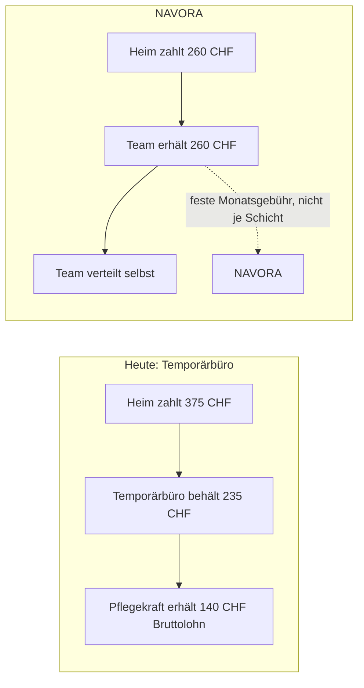

| Glied der Kette | Heute: Temporärbüro | Heute: Spitex-Verwaltung | NAVORA |
|---|---|---|---|
| Wer nimmt den Auftrag an | Büro, per Telefon | Disposition | das Team, per Klick |
| Wer behält einen Teil des Preises | Büro: 47 CHF/h, 235 CHF je Schicht [F]. Aufteilung in Arbeitgeberabgaben, Verwaltung und Marge: UNKNOWN | Verwaltung und Hierarchie: Schweizer Anteil UNKNOWN. Referenz Niederlande: 16,9 % Overhead bei vergleichbaren Anbietern [B] | niemand. NAVORA erhält nur die feste Monatsgebühr |
| Marktreferenz | Temporärpersonal kostet ein Heim rund 1,7-mal so viel wie Festangestellte [B2, SRF 2025] | Buurtzorg 6,7 % Overhead gegenüber 16,9 % [B, Kwaliteitsbeeld 2025]; früher 8 % gegenüber 25 % [B, EY 2009] | Ziel: höchstens 6,7 %, ohne Coach-Schicht (BM-6) |
| Wer koordiniert | Menschen im Büro | Menschen in der Disposition | Regeln und KI; das Team entscheidet |

Quellen: `ECONOMICS_COMPARISON.md` [B2], `STRATEGY.md` §7 (Kwaliteitsbeeld 2025), `CARE_OPERATING_MODEL.md` (Commonwealth Fund 2015, EY 2009). Die Werte sind so berichtet, nicht von NAVORA geprüft.

---

### 3. Die Schichtrechnung

#### 3.1 Stufe 1: Was fliesst (Brutto)

Rechenmodell mit Founder-Referenzwerten [F]. **Modellannahme / Beispielrechnung nach UWG Art. 3** (FE-084 (5)); verbindliche Referenz für Vergleiche im Blueprint. Kein Tarif, kein Angebot, kein Einkommensversprechen. Der Preis von 52 CHF/h ist ein synthetischer Beispielwert (FE-073).

| Position | Temporärbüro | NAVORA | Differenz |
|---|---|---|---|
| Stundensatz an das Heim | 75 CHF/h | 52 CHF/h | −23 CHF/h |
| Dauer | 5 h | 5 h | – |
| **Heim zahlt je Schicht** | **375 CHF** | **260 CHF** | **−115 CHF (−30,7 %)** |
| Umsatz des Teams (vor Teamkosten) | 28 CHF/h × 5 h = 140 CHF Bruttolohn | 52 CHF/h × 5 h = 260 CHF Teamerlös | **+120 CHF Umsatz (vor Teamkosten), kein Lohnvergleich (§3.2)** |
| Davon an Agentur (heutiger Zwischenhandel) | 235 CHF (62,7 % des Preises) | 0 CHF | −235 CHF |
| NAVORA je Schicht | – | 0 CHF Provision | – |

**Kernsatz:** Das Heim zahlt im Modell CHF 115 weniger, das Team setzt CHF 120 mehr um (vor Teamkosten); als Bruttolohn-Äquivalent bleiben nach allen Teamkosten rund CHF 46 mehr. Beispielwerte, kein Tarif, kein Einkommensversprechen.

#### 3.2 Stufe 2: Vom Brutto zum Netto des Teams

Die 140 CHF sind ein Bruttolohn. Das Temporärbüro trägt darüber hinaus die Arbeitgeberabgaben. Die 260 CHF sind ein Teamerlös. Das Team trägt seine Kosten selbst. Für einen fairen Vergleich rechnet NAVORA den Teamerlös in ein **Bruttolohn-Äquivalent** um. Die Formel folgt `ECONOMICS_COMPARISON.md` §2.2.

**Formel je Schicht:**

```
E        = p × h                                   Teamerlös je Schicht
K_team   = c_abo + c_vers + c_adm + c_ausfall      Kosten des Teams je Schicht
L_äqu    = (E − K_team) ÷ (1 + s_ag)               Bruttolohn-Äquivalent je Schicht
Vorteil  = L_äqu − L_temp                           gegenüber dem Temporärlohn
```

`L_äqu` ist die Lohnkosten-Kapazität bei voller Auslastung, nicht der Lohn: in einer Anstellung wird der Lohn im Voraus unter dem erwarteten Erlös festgelegt, der Rest geht in Reserven und einen jährlichen Ergebnisanteil, dessen Status als Lohn UNKNOWN ist (`lca` D-44 T-3 (2), T-3 (8) (e); Satz nach `csa` STR-43 (c), V3.2.42).

| Parameter | Bedeutung | Wert | Herkunft | Liefert den belastbaren Wert |
|---|---|---|---|---|
| `p` | Preis je Stunde an den Auftraggeber | 52 CHF/h | [F] FE-073 | Founder; Phase B: Pilotvertrag (D-42) |
| `h` | Dauer der Schicht | 5 h | [F] 16:30–21:30 | – |
| `L_temp` | Bruttolohn heute, Temporär | 140 CHF | [F] 28 CHF/h × 5 h | Founder. OPEN: sind Ferien- und Feiertagsanteile darin enthalten? |
| `s_ag` | Arbeitgeberabgaben auf dem Lohn: AHV/IV/EO, ALV, BVG, UVG, KTG, FAK, Ferienanteil | **OPEN** (Höhe). Seit FE-083, FE-084 (2) im Modell > 0, weil die Mitglieder bei der Genossenschaft angestellt sind (`csa` STR-43 (b)). Im Repo nur der Platzhalter A1 = 20 % [A], nicht belegt | `ECONOMICS_COMPARISON.md` A1 | `lca` mit Rechtsgutachten Q1 2027: Rechtsform (D-44) und AHV-Statut (L-11) bestimmen den Satz |
| `c_abo` | NAVORA-Abo, umgelegt auf die Schicht | siehe 3.3; in der Illustration A3 = 4 % des Umsatzes [A] wie §2.2 | Gebühr `F` je Mitglied und Monat **OPEN** (D-14); A3 aus `ECONOMICS_COMPARISON.md` | Founder (D-14) |
| `c_vers` | Berufshaftpflicht und Betriebsversicherung des Teams | **UNKNOWN** | kein Wert im Repo | registrierter Versicherungsbroker als Partner (FE-055 (5), L-12); Founder |
| `c_adm` | Verbleibende Administration: Buchhaltung, Treuhand, Weiterbildung, Material | **OPEN**. Im Repo nur der Platzhalter A2 = 10 % des Umsatzes [A]. Referenz Overhead Buurtzorg 6,7 % [B] | `ECONOMICS_COMPARISON.md` A2; `STRATEGY.md` §7 | Phase B: Buchhaltung des ersten Teams (BM-6) |
| `c_ausfall` | Rücklage für Ausfallrisiko: Krankheit, Unfall, abgesagte Schichten | **OPEN** | kein Wert im Repo; teilweise in `s_ag` (KTG, UVG), je Rechtsform | `lca` (D-44, L-11) |
| `u` | Auslastung: gebuchte ÷ angebotene Stunden, für das Monatseinkommen | Szenarien 100 / 85 / 70 % [A] | `ECONOMICS_COMPARISON.md` A4 | Phase B: reale Buchungen (BM-11) |
| Steuern | Einkommenssteuer der Pflegenden | fällt in beiden Modellen an, nicht Teil des Vergleichs. Steuerfragen des Teams je Rechtsform: UNKNOWN | – | `lca`, Rechtsgutachten |

**Sicherheitsmarge des Modells.** Das Team erreicht den heutigen Temporärlohn, solange gilt:

```
c_vers + c_adm + c_ausfall  ≤  E − c_abo − L_temp × (1 + s_ag)
```

Mit den Founder-Werten und dem Abo als A3 = 4 % [A] bleiben `249.60 − 140 × (1 + s_ag)` CHF je Schicht für Versicherung, Administration und Ausfall. Jeder Franken darunter ist zusätzlicher Lohn.

**Illustration, nur mit den Repo-Platzhaltern A1, A2 und A3 [A]** (keine Prognose):

| Schritt | Rechnung | CHF je Schicht |
|---|---|---|
| Teamerlös `E` | 52 × 5 | 260.00 |
| − Administration `c_adm` (A2 = 10 %) | 260 × 0,10 | −26.00 |
| − Abo `c_abo` (A3 = 4 %) | 260 × 0,04 | −10.40 |
| = verfügbar für Lohn und Abgaben | | 223.60 |
| Bruttolohn-Äquivalent (A1 = 20 %) | 223.60 ÷ 1,20 | **186.33** |
| Vorteil gegenüber `L_temp` | 186.33 − 140 | **+46.33 (+33,1 %)** |
| Spielraum für `c_vers` und `c_ausfall` bis zum Gleichstand | (186.33 − 140) × 1,20 | 55.60 |

Lesart: Selbst nach Abgaben und Administration bleibt mit diesen Platzhaltern ein Lohnvorteil je Schicht. Ob er trägt, entscheiden `s_ag`, `c_vers` und die Auslastung `u`. Diese drei Werte liefern `lca`, der Broker und Phase B.

#### 3.3 Die Abo-Rechnung

Die Höhe der Gebühr `F` je Mitglied und Monat ist **OPEN** (D-14); kein Founder-Entscheid nennt einen Betrag (FE-055 (3) «Preishöhe bleibt offen»). Die Gebühr wird nach effektivem Pensum (VZE) gewichtet (FE-055 (3)); die Rechnung unten rechnet ohne Gewichtung. *(V3.2.22, `csa` STR-35: der frühere Beispielbetrag mit Kennzeichnung [F] ist entfernt, weil keine FE-Zeile ihn enthält.)*

| Schichten je Mitglied und Monat `n` [A] | Abo je Schicht | Anteil am Teamerlös von 260 CHF |
|---|---|---|
| 8 | `F ÷ 8` | `F ÷ 2080` |
| 12 | `F ÷ 12` | `F ÷ 3120` |
| **16 (Referenzannahme)** | **`F ÷ 16`** | **`F ÷ 4160`** |
| 20 | `F ÷ 20` | `F ÷ 5200` |

Zum Vergleich: Der Zwischenhandel nimmt heute 235 CHF je Schicht. Mit dem Platzhalter A3 = 4 % [A] (§2.2, §3.2) wären es 10.40 CHF je Schicht.

Wichtig: Die Gebühr ist fest und nicht an Schichten gebunden. Die Umrechnung je Schicht dient nur dem Vergleich und ist kein Vorschlag für eine Gebühr je Schicht (L-10). Wenige Schichten machen die feste Gebühr je Schicht teurer (BM-12). Die VZE-Gewichtung gleicht das aus (FE-055 (3), Brief FEE1, PLANNED).

---

### 4. Warum das Modell trägt

#### 4.1 Disruptionslogik

| Gegner | Was er heute leistet | Was er dafür nimmt | Was NAVORA an seine Stelle setzt | Status |
|---|---|---|---|---|
| **Temporärbüro** | Ersatz bei Ausfall finden | Marge auf jeder Stunde; im Referenzfall 235 CHF je Schicht [F] | Bedarf per Diktat oder Text, harte Prüfung, Angebot gleichzeitig an alle Teams, die alle harten Prüfungen bestehen; die KI ordnet und begründet, schliesst keines aus (FE-078 (2)); Zusage per Klick | Teamentscheid IMPLEMENTED (J2); Formular und Distanzfilter IMPLEMENTED (BK-a, BK-b1; nicht abgenommen); KI-Erfassung, Matrix im Matching, Rangfolge, Rundruf an die Teams, Anzeige «gedeckt» PLANNED (BK) |
| **Spitex-Verwaltung** | Disposition, Hierarchie, Abrechnung | Overhead; Referenz 16,9 % bis 25 % [B] | Team plant selbst; Regeln und KI koordinieren; Abrechnung aus signierten Einsätzen | Tagesplanung, Ausfall, Vertretung IMPLEMENTED (PLAN3, ABS1, COVER1); Abrechnungsfakten IMPLEMENTED (J5); Rechnung PLANNED (B8) |

Die Logik ist einfach. Beide Apparate verkaufen Koordination. Koordination ist Informationsfluss. Informationsfluss kann Software leisten, schneller und ohne Marge. Damit bleibt der Preisvorteil beim Heim und der Lohnvorteil bei den Pflegenden.

#### 4.2 Buurtzorg als Messlatte

Buurtzorg beweist, dass selbstorganisierte Teams mit wenig Overhead gute Pflege leisten: 6,7 % Overhead, Kundenzufriedenheit 9,2, Mitarbeitenden-NPS 66 % gegenüber 4 % im Sektor [B, Kwaliteitsbeeld 2025]. NAVORA geht drei Schritte weiter:

1. **Ohne Coach-Schicht.** Buurtzorg braucht rund 15 Coaches für rund 700 Teams [B, Commonwealth Fund 2015]. Bei NAVORA rufen Signale den Coach nur bei Ausnahmen (OPS1, SIG1 IMPLEMENTED).
2. **Ohne Papierarbeit beim Team.** Buurtzorg-Teams planen, dokumentieren und rechnen selbst ab. Bei NAVORA bereitet die Maschine vor, das Team bestätigt.
3. **Mit eigenem Erlös.** Buurtzorg-Teams sind Angestellte einer Stiftung. NAVORA-Teams behalten den Erlös ihres Auftrags.

#### 4.3 Wie die KI die Koordination übernimmt

| Arbeit, die heute Menschen tun | NAVORA | Status |
|---|---|---|
| Bedarf telefonisch aufnehmen | KI erkennt Felder aus Diktat oder Text; Auftraggeber bestätigt | Formular IMPLEMENTED (BK-a, für die Simulation abgenommen 2026-11-14, `ABNAHMEAKTE.md`); KI-Erfassung PLANNED (BK-1) |
| Passende Person suchen | Regeln filtern Ort, Qualifikation, Verfügbarkeit; KI ordnet nur unter den Geeigneten und begründet | Region und Pflichtqualifikation IMPLEMENTED; Distanzfilter IMPLEMENTED (BK-b, für die Simulation abgenommen 2026-11-17, `ABNAHMEAKTE.md`); Matrix im Matching, Rangfolge PLANNED (BK-3, BK-4) |
| Ausfall abtelefonieren | Abwesenheit mit zwei Tipps; Vertretung wird automatisch angeboten | IMPLEMENTED (ABS1, COVER1) |
| Bericht schreiben | eigene Worte ohne Zeitgrenze; regelbasierter Entwurf mit Quellenbezug und Liste «Nicht übernommen»; Pflegekraft signiert | Signatur IMPLEMENTED (F6, F7); Diktat und Entwurf PLANNED (B6) |
| Rechnung erstellen | Rechnung aus signierten Einsätzen, Prüfung auf Doppelabrechnung | Fakten IMPLEMENTED (J5); Rechnung PLANNED (B8) |

Grenze: In Phase A arbeitet jede KI nur mit synthetischen Daten (externe Schnittstellen dafür freigegeben, FE-085). Für reale Daten gilt D-35 Regel A, bis ein geprüfter Schweizer/EU-Endpunkt steht (FE-085: Phase B gemietete Rechenleistung für offene Modelle bei einem Schweizer Cloud-Anbieter; Wahl Owner, Prüfung `lca`); ~~bis Muster 4 mit Rechtsgutachten und DSFA freigegeben ist (FE-051)~~ (V3.2.37).

#### 4.4 Netzwerkeffekte

- **Mehr Teams, mehr Deckung.** Jedes Team erhöht die Chance, dass eine offene Schicht innert Minuten gedeckt wird. Teamübergreifende Vertretung ist IMPLEMENTED (COVER1).
- **Mehr Auftraggeber, bessere Auslastung.** Demand-Pooling schlägt Teams bei Leerlauf Einsätze vor, immer als eigener GM-1-Auftrag (FE-055 (4), POOL1 PLANNED). Auslastung ist der stärkste Hebel auf das Einkommen (BM-11).
- **Mehr Einsätze, besseres Matching.** Bestätigte Erfahrung und Kontinuität machen die Empfehlung genauer, ohne je eine harte Regel zu überspielen.
- **Geteilte Dienste ohne Zentrale.** Regelkatalog, Vertretung und Back-Office-Leistungen werden von vielen Teams gemeinsam genutzt, ohne Weisungsrecht (`STRATEGY.md` §8.1 (5)).

#### 4.5 Zweites Standbein: die B2B-Suite (GM-2)

Heime und Spitäler kaufen NAVORA auch für ihr eigenes Personal. Kein externes Team ist nötig.

| Modul | Nutzen | Status |
|---|---|---|
| **1 Kern: KI-Planung und Ausfall** | weniger Temporärstunden, weniger Koordinationszeit. Rechenbeispiel im Repo: 3'378 CHF je Monat bei 100 vermiedenen Temporärstunden [B2, B5, A1; 100 h ist A] | ambulant IMPLEMENTED; Schichtmodell Heim PLANNED (NH-A1, B9) |
| **2 Add-on: KI-Protokoll** | Diktat, Berichtsentwurf, menschliche Signatur | Signatur IMPLEMENTED; Diktat PLANNED (B6) |
| **3 Add-on: Angehörigenportal** | strukturierte, freigegebene Updates; schützt Pflegende vor Unterbrechungen | PLANNED, kein Brief |

Preis je Modul: OPEN. Die Planung bleibt auch in GM-2 vom Team bestätigt (STR-27).

#### 4.6 Drei getrennte Erlösströme

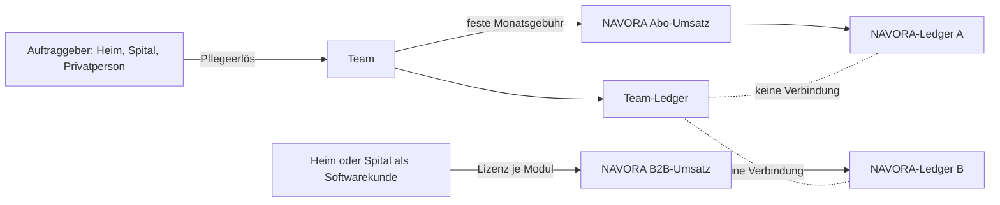

Regeln (FE-055 (2), FE-070 (1)):

- Eine Pflegerechnung enthält nie eine NAVORA-Position.
- Ein Auftraggeber im Teamgeschäft schuldet NAVORA nichts.
- Pflegeerlöse sind nie NAVORA-Umsatz. Das Betreiber-Cockpit zeigt nur aggregierte Zählwerte.
- Stand: Abrechnungsfakten und Umsatzvorschau IMPLEMENTED (J5). Rechnungen, Ledger A und Ledger B PLANNED (B8, GMSEP).

---

### 5. Was das Modell beweisen muss

Jede Hypothese hat eine Kennzahl, einen Zielwert und einen Prüfzeitpunkt. Kennzahlen gelten je Team, nie je Person (Blueprint Kap. 9).

| # | Hypothese | Kennzahl | Ziel | Phase A (synthetisch) | Phase B (real) |
|---|---|---|---|---|---|
| H-1 | Das Heim zahlt je gedeckter Schicht weniger als beim Temporärbüro | **neu (Vorschlag `csa`):** Kosten je gedeckter Schicht, Heim | ≤ Referenz [F]; Messung gegen reale Rechnungen | Szenario mit aggregierten Monatszahlen eines Basler Heims (FE-055 (6), RDATA1) | Rechnungen des Pilotheims (D-42) |
| H-2 | Das Team verdient je Schicht mehr als der Temporärlohn | **neu (Vorschlag `csa`):** Bruttolohn-Äquivalent je Schicht und je VZE und Monat, nach Auslastung | > `L_temp`, bei realer Auslastung `u` | Rechenmodell 3.2 mit eingesetzten `lca`-Werten | reale Buchungen, Abgaben, Versicherung (BM-4, BM-5) |
| H-3 | Eine offene Schicht wird ohne Telefonkette gedeckt | **BK-Kennzahlen:** Minuten bis «gedeckt», Anteil gedeckter Aufträge; M-12 | Normalfall ohne Eingriff von Operations | Szenario-Matrix BK, Früh/Spät/Nacht, BS und BL | Pilotheim |
| H-4 | Die KI nimmt die Administration ab | M-15, M-16, M-11 / M-17 | sinkend gegenüber Ausgangswert | AN3-Messung auf synthetischem Seed | reale Teams nach D-41 |
| H-5 | Mehr Zeit geht in die Pflege | M-13 Nordstern | ≥ 60 % (Buurtzorg), Ziel 75 % | nicht aussagekräftig; nur Rechenweg prüfbar | erster echter Wert |
| H-6 | Das Team entscheidet selbst, NAVORA bleibt schlank | M-20 Entscheide im Team; Overhead des Teams (BM-6) | M-20 steigend; Overhead ≤ 6,7 % | M-20 synthetisch | Buchhaltung nach dem ersten Jahr |

---

### 6. Strategische Risiken und Gegenmittel

| Risiko | Wirkung | Gegenmittel | Zuständig | Status |
|---|---|---|---|---|
| **Personalverleih statt Auftrag (AVG).** Ein Teameinsatz im Heim kann als Personalverleih gelten, wenn das Heim das wesentliche Weisungsrecht behält (L-7). Eine Plattform, die Parteien zusammenbringt, kann als Arbeitsvermittlung gelten (L-10) | Bewilligungspflicht, GAV, Bussen nach Art. 39 AVG; Konflikt mit Teamautonomie | Gebühr nie an Aufträge gebunden, keine Zahlungen über NAVORA (nach `lca` zulässig in jeder plausiblen Auslegung); Auftragsmodell mit eigener fachverantwortlicher Person prüfen; Fragen Q-44a, Q-44c ins Rechtsgutachten | `lca`, Rechtsgutachten Q1 2027 (FE-050) | **OPEN** |
| Bewilligungspflicht des Heims: PDL muss die Fachaufsicht behalten | drängt KON-1 Richtung Verleih | Team als bewilligter Anbieter oder Partner-Trägerschaft (D-12 B) | `lca`, Founder | OPEN (L-8, D-43) |
| Scheinselbständigkeit der Pflegenden | Abgaben und Haftung beim falschen Träger | Anstellung bei der Teamstruktur statt Einzelselbständigkeit prüfen | `lca` (L-11) | OPEN |
| Tiefe Auslastung | Lohnvorteil schrumpft oder kippt (BM-11) | Demand-Pooling, mehrere Auftraggeber, ambulante Einsätze kombinieren | `po` (POOL1), Founder | PLANNED |
| Feste Gebühr belastet kleine Teams | Abo je Schicht steigt bei wenigen Einsätzen (BM-12) | Gewichtung nach VZE (FE-055 (3)) | Founder (D-14), `po` (FEE1) | PLANNED |
| Gegenreaktion der Temporärbüros | Preissenkung; Studie im Auftrag eines Verleihers nennt nur 10 % Mehrkosten [B3] | Vorsprung über Tempo, Kontinuität und gemessene Entlastung, nicht nur Preis | `csa`, Founder | OPEN |
| Referenzzahlen werden als Zusage gelesen | Vertrauensverlust bei Heimen und Pflegenden | Zahlen als Rechenmodell mit Herkunft zeigen; reale Werte ab Phase B einsetzen | `po`, `csa` | IMPLEMENTED in diesem Beitrag |
| Klinische Sicherheit beim Teamwechsel | Qualifikationslücke im Einsatz | harte Prüfung vor jeder Empfehlung; Matrix bis zur Freigabe PROPOSED | `cra`, Freigabestelle D-43 | Teile IMPLEMENTED; Matrix PROPOSED |

---

**Abgleich mit Founder-Entscheiden (dokumentiert, nichts automatisch geändert):**

- FE-040 (1) und FE-070 (1) verlangen, die Einkommenswirkung zu prüfen und nicht als bewiesen darzustellen. Dieser Beitrag löst das so: Das Zielbild ist verbindlich. Die Zahlen sind ein Rechenmodell mit Founder-Referenzwerten. Kapitel 5 enthält den Beweisplan.
- «Autonome Unternehmerinnen» im Founder-Auftrag ist hier als unternehmerische Teamführung formuliert. Ob die Pflegenden selbständig oder bei der Teamstruktur angestellt sind, ist OPEN (D-44, L-11).
- FE-076 ist in `FOUNDER_DECISIONS.md` (Version 25, letzte Zeile FE-075) noch nicht eingetragen. Der PO trägt den Auftrag ein.

---

## Anhang B · Beitrag `cra`: Patientensicherheit im Kernablauf

*Erstellt in der PO-Sitzung 13.11.2026 (FE-076) in der Rolle `cra`, nur gelesen, keine Tests. **Keine klinische Freigabe**; klinische Regeln gibt nur der Clinical Owner frei (D-27, D-43). Bestätigung im nächsten regulären `cra`-Lauf (#1209; bis V3.2.15 fälschlich #1210, korrigiert V3.2.16, CGR-221).*

**Rolle:** `cra` (Clinical & Regulatory Architect, Prüfrolle, KI-Agent, keine zugelassene Pflegefachperson) · **Auftrag:** Founder, 13.11.2026 (FE-076) · **Grundlage:** `recovery/main`, nur gelesen · **Geltung:** nur Phase A (Simulation, synthetische Daten). Dieser Beitrag ist **keine klinische Freigabe**. Klinische Regeln gibt nur der Clinical Owner frei (D-27, D-43). Dieser ist noch nicht benannt (G-1).

**Kennzeichnung:**
- **IMPLEMENTED:** im Code auf `recovery/main` mit Fundstelle.
- **PLANNED:** in einem genehmigten Brief (meist BK) oder im Blueprint V3 / Handbook V2, aber nicht gebaut.
- **OPEN:** braucht einen Entscheid (Clinical Owner, `lca`, Founder).
- **UNKNOWN:** im Repo nicht beantwortet.

Migrationen sind als `M/nnn` abgekürzt (`supabase/migrations/20261021000nnn_*.sql`), pgTAP-Tests als `pgTAP nnn` (`supabase/tests/database/nnn_*.test.sql`). **Ich habe keinen Test ausgeführt.** Die Testverweise nennen Dateien, die im Repo liegen; ob sie auf dem aktuellen Commit grün laufen, habe ich in dieser Sitzung nicht geprüft.

---

### 0. Stichprobe: Dokumentation gegen Code

| # | Aussage in der Dokumentation | Befund im Code | Bewertung |
|---|---|---|---|
| A1 | Handbook V2, Engine 1: Die Eignungsregel ist `private.request_offered_to_team` (`M/034:204`) mit Region und Pflichtqualifikation | bestätigt, `M/034:204`. Die Qualifikation prüft nur `private.team_has_registered_nurse` (`M/017:308-310`), also ob irgendeine Mitgliedschaft das Etikett `registered_nurse` trägt | **Abweichung im Wortsinn (dokumentiert, nichts geändert).** Blueprint V3 §5 Schritt 2 nennt «Pflichtqualifikation IMPLEMENTED». Gemeint ist ein Mitgliedschafts-Etikett, nicht ein geprüfter Nachweis und nicht die Matrix (CGR-197, PS-168). **Vorschlag:** In V3 §5 «Pflichtqualifikation (Etikett, nicht QUAL1)» schreiben |
| A2 | Handbook V2: `private.qual_check` (`M/120:639`) | bestätigt, `M/120:639`. Prüft je Besuch (`care_visits`) und Person, nicht je Auftrag und Team. Delegationen sind an `case_id` gebunden | **Lücke für BK.** Wie die Prüfung auf einen Schichtauftrag ohne Fall je Bewohnerin angewendet wird, ist **UNKNOWN** (BK, offene Frage 1: ADR `eng`) |
| A3 | `qual_check` greift nur in Simulationsorganisationen (`M/121:45`) | bestätigt: `organizations.simulation`, Standard `false` (`M/120:51`). Sonst gilt `private.may_perform_visit` (CR-007/CR-164) | übereinstimmend; Risiko CGR-190 / PS-162 bleibt |
| A4 | BK-2 «Qualifikationsstufe AGS, FaGe, HF» | Der Code kennt die Stufen `nurse_hf_fh`, `fage_efz`, `ags_eba`, `pflegehelfer_srk`, `trained_other` (CR-174). Die Teamsuche nutzt weiter `registered_nurse` / `care_assistant` | **Abweichung im Begriff.** Die Abbildung AGS→`ags_eba`, FaGe→`fage_efz`, HF→`nurse_hf_fh` ist naheliegend, aber nirgends festgelegt (**UNKNOWN**, ADR `eng`). Für PH SRK und «trained other» gibt es keine Auftragsstufe |
| A5 | Matrix: Kontextmodifikatoren NH-EXT / HOSP-IN (CR-180), Einsatzvereinbarung (CR-182) | Der Kopf von `M/120` sagt ausdrücklich «NOT checked in this slice»: medizinische Verordnung für Bst.-b-Zeilen, Kontextmodifikatoren, Einsatzvereinbarung | **Lücke für den Referenzfall 4052** (siehe §4) |
| A6 | Matrix-Code: 23 Tätigkeiten | bestätigt, `M/120`: A1-A4, B1-B13 mit B3H und B4I, C1-C3, N1. **Es gibt keine Tätigkeit und kein Merkmal «Demenz»** | siehe §4 |

---

### 1. Die Sicherheitsgarantien von NAVORA

Die Garantien sind verbindlich formuliert. Ihr **Status** sagt, ob sie heute schon gelten. Eine Garantie mit Status PLANNED ist eine Abnahmebedingung, kein heutiges Versprechen.

1. **Kein Team ohne geprüfte Qualifikation erhält je ein Angebot.** Ein Team, das eine harte Prüfung nicht besteht, erhält keine Angebotszeile, was auch immer die Rangfolge sagt.
   - **PLANNED:** BK-2, BK-2n. Der Test prüft die Angebotszeilen (Handbook V2, Engine 1, Invariante).
   - **Heute (Ersatztext `cra` 17:26, CGR-221, V3.2.16):** «IMPLEMENTED for the order path (distance part only): `private.screen_order_reach` (`M/130`, merged `9b691af`) writes each team of the organisation into `order_offers` or `order_exclusions`, never both (pgTAP 136). Level, activities and availability per member are PLANNED (#1273, not merged). On the case path still the label check only (`M/034:204`, `M/017:308-310`; CGR-197).»
2. **Niemand wird für eine Tätigkeit verantwortlich, die für ihn nicht «geeignet» oder «geeignet mit Delegation» ist.** Dieselbe Funktion entscheidet auf jedem Weg.
   - **IMPLEMENTED in Simulationsorganisationen:** `private.qual_check` (`M/120:639`), `private.qual_may_perform` (`M/120:756`), `private.qual_may_perform_in` auf allen Zuweisungswegen und als Rückhalt auf `care_visits` (`M/121`; CR-191, CR-192); pgTAP 120, 121, 122, 127.
   - **Ausserhalb der Simulation** gilt nur CR-007/CR-164 (CGR-190).
   - **Im Auftragsfluss PLANNED** (BK-2).
3. **«Ungeklärt» ist nie «geeignet».** Eine Matrixzelle «?», eine Zelle mit offener Frage (K-2, K-3) oder eine fehlende Zelle zählt wie «–». Es gibt keinen Rückfall auf eine lockerere Regel.
   - **IMPLEMENTED:** `private.qual_label` (`M/120:628-635`: alles ausser `allowed_*` und `not_allowed` wird `ungeklaert`); `qual_check` (`M/120:683-687`); CR-183, CR-186, CGR-149.
   - **In Anzeige und KI-Rangfolge PLANNED** (BK-4).
4. **Eine Selbstbestätigung ist kein Nachweis.** Nur `verified` zählt. `self_confirmed`, `missing`, `expired` und `contradictory` zählen nicht.
   - **IMPLEMENTED:** CR-187; `M/120:238-239` (`verified` nur als synthetische Fixture in einer Simulationsorganisation); pgTAP 120.
   - Wer echte Nachweise prüft, ist **OPEN** (D-29, L-9).
5. **Die Prüfung läuft erneut bei der Zusage und beim Start.**
   - **IMPLEMENTED beim Start** (Simulation): `qualification_lapsed` (`M/121:212`), CR-194; pgTAP 121, 128 (R3).
   - **Bei der Zusage («Übernehmen») PLANNED** (BK-5a, CGR-197 (4)).
   - Ein Entzug nach der Zuweisung und vor dem Start wird erst an der Tür bemerkt. Die Freigabe an das Team ist **PLANNED** (CR-204, CGR-164).
   - **Ergänzt V3.2.2 (`cra` 17:40):** und die Pflegeperson wird beim «Übernehmen» benannt; «gedeckt» erst danach (**PLANNED**, CGR-204 (c)).
6. **Keine KI vergibt, verlängert oder erschliesst eine Delegation. Keine KI fügt ein Team hinzu, entfernt einen Filter, bestätigt einen Auftrag, signiert oder setzt einen Preis.**
   - **IMPLEMENTED für Delegation und Nachweis:** Beide Tabellen sind gesperrte AIG1-Ziele der Klasse `qualification` (`M/120`, Kopf §4). `set_agent_state` verweigert `kind = 'ai'` (`M/097`).
   - **Übrige Punkte PLANNED** (BK, «AI leverage», Gate). Heute ruft kein Code einen KI-Dienst auf (Blueprint V3 §2.2, **IMPLEMENTED**-Fakt).
7. **Kein KI-Score überspielt eine fehlende Qualifikation, Lizenz oder Delegation.** Die Rangfolge ordnet nur unter den Geeigneten. Es gibt keinen Prozentwert, sondern Gründe aus Fakten.
   - **PLANNED:** BK-3, BK-4; Blueprint V3 §2.1.
8. **Niemand weist einem Team einen Auftrag zu. Das Team entscheidet.**
   - **IMPLEMENTED für die Teamsuche:** `decide_matching_request` (`M/011:115`); Ausnahmetext «nie automatisch zuweisen» (`M/019:40`).
   - **Für BK PLANNED** (BK-5n).
9. **Kein Auftrag verfällt still.**
   - **Teilweise IMPLEMENTED für die Teamsuche:** `deadline_passed` und `candidates_exhausted` als Operations-Ausnahme P2 (`M/017:517-556`, `M/019:40, 124`). Diese Ausnahmen sind nur abrufbar und werden niemandem zugestellt (CGR-160, PS-144).
   - **Deckungsstand je Auftrag für den Auftraggeber PLANNED** (BK-6; Handbook V2, Engine 5).
   - **Ergänzt V3.2.2 (`cra` 17:40):** vor dem Start, zu einer spätesten Deckungsfrist (**PLANNED**, CGR-207 (a)).
   - **Ergänzt V3.2.16 (`cra` 17:26, Unterpunkt ohne neue Nummer, Zahl bleibt 20):** «Eine übernommene Schicht, deren benannte Person vor dem Beginn ausfällt, ist sofort wieder ‹nicht gedeckt› und geht zurück in den Rundruf (PLANNED, CGR-223).»
10. **Kein Auftrag wird ohne Bestätigung des Auftraggebers verbindlich. Kein Pflichtfeld wird still geraten oder vorbelegt.**
    - **PLANNED:** BK-1b, BK-1d.
11. **Ein Auftrag ohne vollständige Einsatzvereinbarung in einem Heim (NH-EXT) ist nicht anbietbar.** Für jede Tätigkeit einer Bewohnerin gibt es genau eine Delegationsquelle und genau einen Eskalationsadressaten.
    - **PROPOSED / PLANNED:** CR-182, QAM §2.3; nicht im Code (`M/120`, Kopf). H-33.
12. **Eine Versorgungslücke wird nie mit einer ungeeigneten Person gefüllt.** Sie wird gezeigt und eskaliert.
    - **PROPOSED:** CR-184, QAM §7.1 AK-9.
    - **Besuchsseitig IMPLEMENTED als Verweigerung:** CR-192.
    - **Für BK PLANNED** (BK-6).
13. **Kein Bericht wird ohne menschliche Signatur verbindlich.** Nur die Person, die den Einsatz geleistet hat, signiert, und sie signiert genau den Stand, den sie gesehen hat.
    - **IMPLEMENTED:** `sign_report` (`M/016:240`, ersetzt in `M/041:85` mit Snapshot-Hash); Gegenzeichnung (`M/075`); Rückgabe (`M/065`); pgTAP 040, 041, 066.
    - **KI-Entwurf PLANNED** (BK-8, BK-8n).
14. **Kein Satz im Berichtsentwurf ohne Quelle in der Eingabe.** Was nicht diktiert wurde, steht nicht im Bericht.
    - **PLANNED:** BK-8; Handbook V2, Engine 3.
    - **Ergänzt V3.2.2 (`cra` 17:40):** und nichts Diktiertes fällt weg: jedes nicht verwendete Eingabesegment wird vor dem Signieren gelistet und behandelt (**PLANNED**, BK-8, CGR-208).
15. **Keine Rechnung ohne finalen, signierten Bericht. Beträge rechnet nie die KI.**
    - **IMPLEMENTED für abrechenbare Fakten:** nur aus dem signierten Snapshot (`M/043`, `M/049:414`; pgTAP 043, 049).
    - **Rechnung, Doppelrechnung und Zeitkonflikt PLANNED** (BK-9, BK-9n).
16. **Die KI stellt keine Diagnose, keinen Risikoscore und keinen Behandlungsvorschlag.** Das umfasst auch keine Medikationsänderung.
    - **IMPLEMENTED als Produktregel (sicherer Standard):** D-34 (`decisions/D-34.md:25`). Technisch erzwungen ist das heute dadurch, dass es keinen KI-Aufruf gibt.
    - **Für KI-Pfade PLANNED:** Vertrag je Agent, Prüfung durch `aia`.
    - Ein Medikationsmodul gibt es nicht. Ob Teams Medikamente verabreichen, ist **UNKNOWN** (H-11).
17. **In Phase A arbeitet jede KI nur mit synthetischen Daten.**
    - **IMPLEMENTED als Regel:** D-35 Regel A, FE-051 Muster 4.
    - **Für echte Daten OPEN:** D-41, Rechtsgutachten, DSFA.
18. **Keine klinische Regel wird ohne den Clinical Owner verbindlich.**
    - **IMPLEMENTED als Governance:** D-27. Jede Matrixzelle ist PROPOSED, jede Regelzeile UNVALIDATED.
    - **Freigabefunktion OPEN:** D-43, G-1.
19. **Dauern stimmen auch über Mitternacht und in der Umstellungsnacht.** Sie werden aus Zeitstempeln in Europe/Zurich berechnet. (Ergänzt V3.2.2, `cra` 17:40.)
    - **PLANNED:** BK-1c (CGR-206, H-36); Abhängigkeit CGR-200 für BK-7.
20. **Übergabe und Eskalation am Ort der Pflege sind in Phase A nicht modelliert, und das wird gesagt.** (Ergänzt V3.2.2, `cra` 17:40.)
    - **PLANNED als Vermerk** im BK-Abnahmeprotokoll (CGR-209 (b)); Modellierung OPEN (D-17).

---

### 2. Gefährdungen und Barrieren je Schritt des BK-Flows

«Neu» heisst: Ich finde im HAZARD_LOG keine passende H-ID. Eine neue ID setze ich nicht selbst. Das ist ein Vorschlag für den nächsten regulären `cra`-Lauf.

| Schritt | Gefährdung (Hazard-ID) | Sicherheitsbarriere | deterministisch / Mensch | Stoppfall (wenn die Barriere greift) | Status |
|---|---|---|---|---|---|
| 1 Auftrag erfassen | falsches Datum, falsche Zeit oder falscher Schichttyp; Nacht über Mitternacht als zwei Tage oder mit negativer Dauer (**neu**; verwandt: H-36, CGR-200) | BK-1c: eine Nacht ist ein Auftrag (Start + Ende am Folgetag); BK-1b: ein Widerspruch wird gezeigt | deterministisch | Auftrag nicht absendbar, bis der Auftraggeber den Widerspruch löst | PLANNED |
| 1 Auftrag erfassen | Sicherheitsinformation zu Bewohnenden (Sturz, Allergie, Isolation) steht im Freitext und geht verloren, weil BK-1e nicht zugeordneten Freitext nicht speichert (H-03; CGR-193 (4b)) | Die Erfassung ist **nicht** der Kanal für Sicherheitsinformationen. Diese gehören in einen festgelegten Weg (CR-182, CGR-173 (4)), und die Ansicht sagt das | Mensch (Auftraggeber) + Text | Hinweis in der Erfassung; ohne festgelegten Weg ist der Auftrag nicht anbietbar (für NH-EXT, CR-182) | **OPEN** (`lca`, `uxa`, Clinical Owner); Zielkonflikt Datenminimierung gegen Sicherheit |
| 2 KI-Extraktion | Feld weggelassen, erfunden oder falsch (z. B. «Sonntag» als falsches Datum, Stufe falsch erkannt); Bestätigung ohne Lesen (Automationsbias) (H-20) | Jedes Feld «erkannt» oder «eingegeben»; leer statt geraten; kein Standardwert in einem Pflichtfeld; Zusammenfassung vor «Bestätigen & Absenden» (BK-1a, -1b, -1d) | KI bereitet vor, Mensch bestätigt | Ein leeres Pflichtfeld verhindert das Absenden; vor der Bestätigung erreicht nichts ein Team | PLANNED (KI nur synthetisch, D-35) |
| 3 Engine 1: harte Prüfung | Angebot an ein Team, in dem niemand die Tätigkeiten ausführen darf (H-04, PS-168, CGR-197) | QUAL1-Prüfung je Tätigkeit und Mitglied mit derselben Funktion wie auf Besuchsebene (CGR-197 (1), (2)); «ungeklärt» besteht nicht (§3) | deterministisch (Datenbank) | Das Team erhält keine Angebotszeile; der Ausschlussgrund wird gespeichert (BK-2, BK-2n) | Auftragspfad: Distanz IMPLEMENTED (`M/130`, `9b691af`, nicht abgenommen); Stufe, Tätigkeit im Kontext des Auftraggebers und Verfügbarkeit je Mitglied PLANNED (#1273, CR-220, CR-222, CR-223). Fallpfad: nur Etikett (`M/017:308`, CGR-197). |
| 3 Engine 1: harte Prüfung | Heimauftrag ohne geklärte Delegationsquelle und ohne Eskalationsadressat (H-33) | Einsatzvereinbarung vollständig (CR-182); NH-EXT-Modifikator (CR-180) | deterministisch + Mensch (Heim füllt aus) | Auftrag nicht anbietbar, fehlende Felder genannt | PROPOSED / nicht gebaut |
| 3 Engine 1: harte Prüfung | Team erreicht den Ort nicht (falscher Kanton oder falsche Region) (H-37, H-38) | PLZ-Distanz und Radius; Ort der Pflege, nie still abgeleitet | deterministisch | Team ausgeschlossen mit Grund | Region IMPLEMENTED (B1.1-1); PLZ-Distanz für Aufträge IMPLEMENTED (`M/130`, `9b691af`, nicht abgenommen; pgTAP 136); Teamreichweite durch das Team IMPLEMENTED (`M/131`, `a076731`). |
| 3 Engine 1: harte Prüfung | Person ist doppelt eingeplant oder abwesend (H-10, H-17) | Verfügbarkeit für den **ganzen** Slot (BK-2); Überschneidung über Teams (PLAN3-14, `M/110`). Auf dem Auftragspfad zählt eine übernommene, überlappende Schicht derselben Person als belegt (CGR-224, PLANNED BK-c). | deterministisch | Mitglied zählt nicht; ohne geeignetes Mitglied wird das Team nicht angeboten | Besuchsseitig IMPLEMENTED; für Aufträge PLANNED |
| 3 Engine 1: harte Prüfung | Produktion läuft ohne QUAL1 (Flag `false`) (H-04, CGR-190, PS-162) | Rückfall CR-007/CR-164 nie nur auf das Etikett (CGR-197 (5)) | deterministisch | – | OPEN |
| 4 Engine 2: Rangfolge | Die KI fügt ein Team hinzu oder hebt ein «ungeklärtes» Team an; ein Prozentwert suggeriert Eignung (H-20) | Rangfolge nur über die Menge aus Schritt 3; keine Prozente; Gründe aus Fakten (BK-3, BK-4) | KI ordnet, Regel begrenzt | Ein Team ausserhalb der geeigneten Menge kann technisch nicht in die Rangfolge (Test auf Angebotszeilen) | PLANNED |
| 5 Angebot (Rundruf) | niemand ist Halter des Angebots, jedes Team nimmt an, ein anderes übernimmt; zwei Teams übernehmen gleichzeitig (H-40, H-43) | genau eine Übernahme je Auftrag in der Datenbank mit erneuter Prüfung im selben Schritt (BK-5a, CGR-211); späteste Deckungszeit vor dem Beginn (CGR-207 (a), CGR-222) | deterministisch | zweiter Tipp abgelehnt «Bereits übernommen»; zur Deckungszeit «nicht gedeckt» beim Auftraggeber und als Operations-Ausnahme, vor dem Beginn | PLANNED |
| 6 Zusage | Nachweis oder Delegation läuft zwischen Angebot und Tipp ab (H-04, CGR-197 (4)) | Erneute harte Prüfung im Moment des Tipps (BK-5a) | deterministisch | Zusage verweigert mit Grund; das Angebot bleibt für die anderen geeigneten Teams offen (BK-5n) | PLANNED |
| 7 `/field` Einsatz | Start durch eine Person, deren Nachweis seit der Planung abgelaufen ist (H-04) | Prüfung beim Start und bei der Wiederaufnahme (CR-194) | deterministisch | Start verweigert (`qualification_lapsed`). Der Besuch **bleibt zugewiesen, und niemand wird alarmiert** (CGR-154) | IMPLEMENTED (Simulation); Freigabe PLANNED |
| 7 `/field` Einsatz | Pflegeperson kommt ohne Kontext und Sicherheitsinformation der Bewohnenden (H-03, H-09) | Sicherheitsinformationen im Auftrag beziehungsweise in der Einsatzvereinbarung (CGR-173 (4)) | Mensch (Heim) | – | OPEN (D-17); Phase A: nicht modelliert, im BK-Abnahmeprotokoll genannt (V3.2.2, CGR-209 (b)) |
| 7 `/field` Einsatz | Auf der Heimstation greifen die Signale nicht, weil sie nur für geplante Besuche feuern (H-32, H-34) | Je NH-Brief eine Tabelle «Auslöser auf der Station ja / nein / UNKNOWN» (CGR-142) | – | – | PLANNED / OPEN |
| 7 `/field` Einsatz | Zeit über Mitternacht am falschen Tag erfasst oder korrigiert (H-36, CGR-200) | Tag gewählt oder abgeleitet, nicht aus dem Tipp-Datum | deterministisch | – | OPEN |
| 8 Diktat | Medikamentenname, Dosis oder Wert falsch transkribiert; Eingabe offline geht verloren (H-20, H-26, H-29) | Transkript sichtbar neben dem Entwurf; Audio nur im CH-Rechenzentrum (Muster 4); offline: «noch nicht beim Team» | KI + Mensch | – | PLANNED |
| 9 Engine 3: Bericht | Der Entwurf behauptet Beobachtungen, die niemand gemacht hat, oder lässt eine Zustandsänderung weg (H-20, H-27, H-05) | Jeder Satz mit Quelle; ohne Quelle kein Satz; Status «Entwurf»; kein Ausnahmebericht ohne signierte Zustandsantwort (CGR-116) | KI bereitet vor, Mensch prüft | Entwurf bleibt Entwurf; kein abrechenbarer Fakt | PLANNED |
| 10 Signatur | Signatur eines Standes, den sie nicht gesehen hat; Bericht bleibt unsigniert, wenn die Person ausfällt (H-05, H-12) | Snapshot-Hash (`M/041`); nur die ausführende Person (BK-8n); Rückgabe (F6R, `M/065`) | Mensch | Signatur verweigert bei abweichendem Stand | IMPLEMENTED; für Abwesende OPEN (D-30) |
| 11 Engine 4: Rechnung | Rechnung ohne signierte Leistung, doppelt, oder mit falschen Stunden (H-14) | Fakten nur aus dem finalen Snapshot (`M/043`); Abweichung oder Doppelrechnung ergibt einen Fehler statt einer Rechnung (BK-9n) | deterministisch | Keine Rechnung, sichtbarer Fehler | Fakten IMPLEMENTED; Rechnung PLANNED |
| ∞ Engine 5 | Lücke, Überfälligkeit oder Signal erreicht niemanden (H-01, H-07) | SIG1/SIG2 Zustellung an benannte Personen (`M/060`, `M/062`); Fristen und Prioritäten PROVISIONAL (D-28) | deterministisch, Mensch handelt | Eskalation an Operations | IMPLEMENTED (Schwellen nicht freigegeben) |

---

### 3. Wie die Qualifikationsmatrix in Engine 1 wirkt

> **Matrix QAM v0.2 ist PROPOSED.** Sie dient nur der Simulation und ist keine klinische Freigabe. Jede Zelle bleibt `PROPOSED`, bis der Clinical Owner beziehungsweise die D-43-Funktion sie fachlich prüft, `lca` sie rechtlich prüft und die F5 der Organisation sie übernimmt (CR-179). Klinische Regeln gibt nur der Clinical Owner frei (D-27, D-43, G-1). Ich erfinde keine Zelle. Die Werte stehen in `docs/agents/clinical/QUALIFICATION_MATRIX.md` §4.2 und im Code `M/120` (CR-186).

#### 3.1 Eingaben (je Tätigkeit und Mitglied)

| Eingabe | Herkunft | Status |
|---|---|---|
| **Tätigkeit** (Matrixzeile A1 … N1) | Besuch: `visit_activities`, sonst Rückfall A1 / B13 / C1 (CR-189). Auftrag: Tags → Zeile | Besuch IMPLEMENTED; **Tag → Zeile UNKNOWN** (Clinical Owner; CGR-197) |
| **Qualifikationsstufe** | Nachweis `grade` mit Zustand (CR-187) | IMPLEMENTED (Simulation) |
| **Nachweis gültig** | `verified` zum Prüfzeitpunkt. Dieser ist der spätere Wert aus geplantem Ende und jetzt (CR-202). Zusätzliche Anforderungen der Zelle (Berufsausübungsbewilligung, Erfahrung, Instruktion; CR-190) | IMPLEMENTED (Simulation) |
| **Delegation** | gleicher Fall, gleiches Mitglied, gleiche Tätigkeit; Datum im Gültigkeitsbereich; vor dem Einsatz instruiert und erfasst; nicht widerrufen; delegierende und überwachende Person selbst gültig (CR-188, CGR-150) | IMPLEMENTED (Simulation); **für Heimschichten ohne Fall UNKNOWN** |
| **Kontext** (NH-OWN, NH-EXT, HOSP-IN, HOSP-POST, PRIV) | Auftrag | PLANNED; Modifikatoren CR-180 nicht im Code |
| **Medizinische Verordnung** für Bst.-b-Zeilen | Fall bzw. Auftrag | auf Besuchsebene nur bei der Planung (CR-003); in `qual_check` nicht geprüft (`M/120`, Kopf) |

#### 3.2 Entscheid

`qual_check` liefert je Tätigkeit vier Ergebnisse (CR-183, `M/120:628-635`). Die Aufgabe nennt drei. Das vierte Ergebnis, «ungeklärt», ist entscheidend.

| Ergebnis | Bedingung | Darf verantworten? |
|---|---|---|
| **geeignet** | Zelle E, Stufe und alle Zusatzanforderungen `verified` | ja |
| **geeignet mit Delegation** («nur mit Delegation») | Zelle D und gültige Delegation | ja |
| **nicht geeignet** | Zelle «–» | nein |
| **ungeklärt** | Zelle «?» oder offene Frage, keine Zelle, Nachweis nicht `verified`, Delegation fehlt, abgelaufen oder «Überprüfung nötig» | **nein**: nie als geeignet, nie «wahrscheinlich geeignet», nie mit Score |

Ein Mitglied ist nur geeignet, wenn **jede** Tätigkeit des Einsatzes geeignet oder geeignet mit Delegation ist (`M/120:756-765`, IMPLEMENTED). Teilt das Team eine Schicht in Teile, wird jeder Teil einzeln geprüft, und das nur von Hand (QAM NT-5, PROPOSED). Auf Teamebene (PLANNED, BK-2) muss **ein und dieselbe Person** alle Tätigkeiten bestehen und für den ganzen Slot verfügbar sein. Die Regel dazu legt `eng` per ADR fest. Sie muss dieselbe Funktion aufrufen (CGR-197 (2)).

**Abweichung, dokumentiert:** CGR-197 (3) riet für B1.2, «nicht geprüft» (○) solle ein Angebot **nicht** verbergen. Dort sind die Tätigkeiten bei der Teamsuche unbekannt, und die Besuchsprüfung fängt später ab. In BK nennt der Auftrag seine Tätigkeiten. Daher gilt hier BK-2n: «ungeklärt» ist ein Ausschluss, und wenn kein Team besteht, wird «nicht gedeckt» sichtbar (BK-6). Das ist ein Vorschlag von `cra` und keine klinische Regel. Die Bestätigung erfolgt im nächsten regulären Lauf.

#### 3.3 Ablauf (Mermaid)

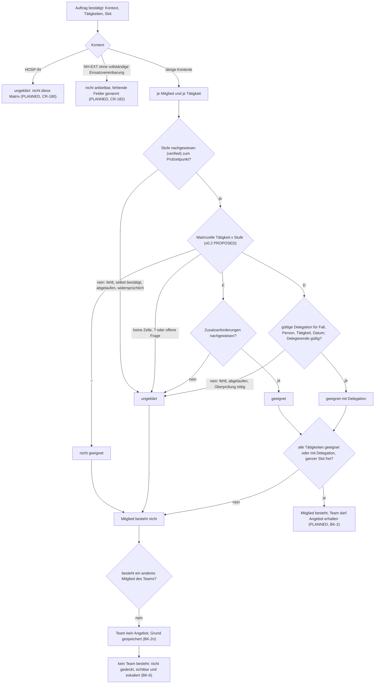

Status der Knoten: Die Kette von «Stufe nachgewiesen» bis «geeignet mit Delegation» ist **IMPLEMENTED** in `private.qual_check`, nur für Besuche in Simulationsorganisationen. Kontext, Einsatzvereinbarung, Teamebene, Slot und «nicht gedeckt» je Auftrag sind **PLANNED**.

---

### 4. Referenzfall: Demenz-Spätschicht 4052

**Fall** (Blueprint V3 §1.2, FE-073 (5), synthetisch): Ein Pflegeheim in 4052 Basel meldet um 14:15 einen Ausfall für die Spätschicht 16:30–21:30 auf der Demenzabteilung. Ein externes Team soll übernehmen.

#### 4.1 Welche Prüfungen greifen

| Prüfung | Was sie im Fall tut | Status |
|---|---|---|
| Kontext | Ein externes Team im Heim ist **NH-EXT** (QAM §2.1). Damit wird jedes D zu «?», und jedes E in den B-Zeilen wird «?», bis L-7 die Delegationsquelle klärt und die Einsatzvereinbarung vollständig ist (CR-180) | PROPOSED, nicht im Code |
| Einsatzvereinbarung | Kontext, Kanton BS, Tätigkeitsliste mit Verordnung ja/nein je Bst.-b-Zeile, wessen Matrixversion gilt, wer delegiert (Heim-Pflegefachperson oder Team-Pflegefachperson), erreichbare F5 des Heims, Beginn und Ende (CR-182). Fehlt ein Feld, ist der Auftrag nicht anbietbar | PROPOSED; Phase A simuliert beide Varianten, Phase B erlaubt keine vor `rechtlich geprüft` |
| Tätigkeiten der Schicht | Welche Matrixzeilen eine Spätschicht auf dieser Station umfasst (z. B. C1 Grundpflege, B3 Medikamente, B1 Vitalzeichen), muss **das Heim** angeben. NAVORA leitet aus «Spätschicht Demenz» keine Tätigkeit ab | **UNKNOWN** je Auftrag; Tag → Zeile OPEN (Clinical Owner) |
| Stufe und Nachweis | z. B. «FaGe»: `fage_efz` `verified`. C1 ist E. B1, B3 und B7 sind D und brauchen eine Delegation je Bewohnerin. In NH-EXT sind sie «?», bis L-7 geklärt ist | Matrix PROPOSED |
| Delegation | `qual_check` verlangt eine Delegation je Fall (`case_id`). Bewohnende eines fremden Heims sind in NAVORA kein Fall des Teams. Eine D-Tätigkeit ist in diesem Fall heute im Code **nie erfüllbar** und ergibt «ungeklärt» | IMPLEMENTED-Fakt; Lösung UNKNOWN (ADR, L-7) |
| Verfügbarkeit | ganzer Slot 16:30–21:30, keine Überschneidung | PLANNED |
| PLZ-Distanz | 4052 zum Team im Radius | PLANNED |
| Pflichtmerkmal | «Demenzerfahrung» als bestätigtes Merkmal (BK-2) | PLANNED |
| Zusage | erneute Prüfung beim Tipp; Heim sieht «gedeckt» | PLANNED |
| Nicht gedeckt | Beginn in 2 h 15 nach der Meldung; Rundruf an alle geeigneten Teams; zur spätesten Deckungszeit (Wert OPEN, CGR-222) «nicht gedeckt» beim Heim und in OPS1, vor dem Beginn; Eskalation an die F5 des Heims (QAM §7.3 NH-EXT) | PLANNED; Zeitschritte OPEN (K-8, D-28) |
| Signale auf der Station | Es gibt keine geplanten Besuche je Bewohnerin. Deshalb feuern Überfällig-, Nicht-erschienen- und Lücken-Signale auf der Station nicht (H-32) | IMPLEMENTED-Fakt (Lücke) |

#### 4.2 Was «Demenzerfahrung bestätigt» klinisch bedeutet und was nicht

**Es bedeutet nur:** Eine Person hat zu einem Zeitpunkt erfasst, dass das Mitglied (oder das Team) Erfahrung in der Betreuung von Menschen mit Demenz hat. BK stuft das als «care-context fact recorded by a person» ein. Es lenkt das Angebot und ist deshalb für den D-34-Berater markiert («for the adviser», BK, Regeltabelle).

**Es bedeutet nicht:**
- **Keine Qualifikation.** Ein bestätigtes Merkmal ist kein Nachweis im Sinn von CR-187 und keine Matrixzelle. Die Matrix kennt keine Zeile «Demenz». Es ersetzt weder «geeignet» noch eine Delegation.
- **Keine Erlaubnis für eine Tätigkeit.** Eine FaGe mit «Demenzerfahrung» darf B3 Medikamente nur unter D und mit gültiger Delegation geben, in NH-EXT erst nach L-7.
- **Kein Kompetenznachweis.** Das Merkmal sagt nichts über Umfang, Dauer, Weiterbildung oder Aktualität der Erfahrung, solange der Clinical Owner keine Definition festlegt.
- **Kein Nachweis über die Bewohnenden.** Es sagt nichts über Weglaufgefährdung, Sturzrisiko, herausforderndes Verhalten oder freiheitsbeschränkende Massnahmen. Das sind Sicherheitsinformationen des Heims (H-03).
- **Keine Bestätigung durch eine prüfende Stelle**, solange nicht geregelt ist, wer das Merkmal bestätigen darf (analog D-29, L-9). Eine Selbstangabe darf nicht als «bestätigt» erscheinen.

**Anzeige** (Vorschlag, Text `uxa`): Auf der Karte stehen «Demenzerfahrung (erfasst von …, am …)» und die Qualifikationsprüfung getrennt. Ein grünes Häkchen beim Merkmal darf nicht als Qualifikation gelesen werden (vgl. CGR-197, «✓ Qualifikation»).

#### 4.3 Offene klinische Fragen zum Fall

1. Welche Matrixzeilen umfasst eine Spätschicht auf einer Demenzstation, und wer legt die Tätigkeitsliste je Auftrag fest? (UNKNOWN; Heim + Clinical Owner)
2. Ist «Demenzerfahrung» ein Merkmal, eine Zusatzanforderung einer Zeile (wie die Erfahrung bei A3 und A4) oder gar nicht entscheidrelevant? Gilt dafür C2 («Daily-life support in psychiatric illness», heute «?» ausser HF/FH)? Ich setze keine Zuordnung. (OPEN; Clinical Owner)
3. Wer bestätigt das Merkmal, worauf stützt sich die Bestätigung, und wie lange gilt sie? (OPEN; Clinical Owner, `lca`)
4. Wer delegiert in NH-EXT, die Pflegefachperson des Heims oder des Teams? (L-7, FD-Q1; OPEN)
5. Mindestbesetzung der Schicht (eine HF erreichbar?) (K-5, P-8; OPEN)
6. Welche Sicherheitsinformationen der Bewohnenden braucht die Pflegeperson vor Schichtbeginn, und über welchen Weg erhält sie diese? (D-17, CGR-173 (4); OPEN)
7. Eskalationsfristen bei «nicht gedeckt» kurz vor Schichtbeginn (K-8, D-28; OPEN)

---

### 5. Grenzen der KI in Erfassung und Bericht

| Grenze | Erfassung (BK-1a/b) | Bericht (BK-8, Engine 3) | Status |
|---|---|---|---|
| **Nichts still raten** | Ein nicht erkanntes Feld bleibt leer und wird erfragt. Ein relatives Datum wird als konkretes Datum gezeigt. Ein Widerspruch muss gelöst werden. Kein Standardwert in einem Pflichtfeld | Nichts ergänzen, was nicht diktiert wurde | PLANNED |
| **Quelle je Wert / Satz** | Jedes Feld «erkannt» oder «eingegeben» | Jeder Satz verweist auf die Eingabestelle; ohne Quelle kein Satz | PLANNED |
| **Mensch entscheidet** | Der Auftraggeber bestätigt die Zusammenfassung | Die Pflegeperson liest, ändert und signiert; vorher kein abrechenbarer Fakt | Signatur IMPLEMENTED; KI-Entwurf PLANNED |
| **Keine Diagnose, kein Risikoscore, keine Behandlungsempfehlung** | Aus dem Freitext wird keine klinische Einschätzung abgeleitet | Kein Satz im Entwurf bewertet den Zustand über das Diktierte hinaus | IMPLEMENTED als Produktregel (D-34 sicherer Standard); KI-Vertrag PLANNED (`aia`) |
| **Keine Medikationsänderung per KI** | – | Medikamentenname, Dosis und Zeit nur wörtlich aus dem Diktat, als Entwurf sichtbar markiert; keine Korrektur, keine Ergänzung, keine Plausibilisierung durch die KI | **PROPOSED** (`cra`); Medikationsmodul nicht vorhanden, Umfang UNKNOWN (H-11) |
| **Keine Qualifikationsentscheide** | Die KI setzt keine Stufe als erfüllt | Die KI vergibt keine Delegation und bestätigt kein Merkmal | IMPLEMENTED für Delegation (AIG1-Sperre); übrige PLANNED |
| **Kein «Alles übernehmen» bei Sicherheitsfeldern** | jede Sicherheitsangabe einzeln bestätigt | Beobachtung einer Zustandsänderung nicht wegfassbar (CGR-116) | PLANNED (H-20, Liste der Sicherheitsfelder: Clinical Owner) |
| **Daten** | Phase A nur synthetisch; für echte Daten D-41, Rechtsgutachten, DSFA | Audio und Transkript sind Gesundheitsdaten; nur Muster 4 im CH-Rechenzentrum; Löschfrist `eng` + `lca` | Regel IMPLEMENTED (D-35); Pfad PLANNED |
| **Messung mit Stoppregel** | Fehlerquote der Extraktion auf synthetischen Fällen | Anteil der Sätze ohne Quelle, Anteil der Korrekturen | PLANNED; Stoppschwelle OPEN (Clinical Owner, H-20) |

---

### 6. Offene Punkte für den Clinical Owner

1. **Benennung und Mandat** der Freigabefunktion (G-1, D-43). Ohne sie bleibt jede Zelle und jede Regel PROPOSED bzw. UNVALIDATED.
2. **Matrix v0.2** fachlich prüfen, zuerst die Seed-Zeilen A1, B3, B7, C1 und die Zeilen, die ein BK-Szenario braucht (K-1, P-1, P-2).
3. **Tag → Tätigkeit:** Welche Auftrags-Tags bilden auf welche Matrixzeilen ab? Darf ein Auftrag ohne Tätigkeitsliste angeboten werden? (CGR-197, §4.3 Frage 1)
4. **Bestätigte Merkmale** (z. B. Demenzerfahrung): Definition, wer bestätigt, Gültigkeit, und ob ein Merkmal je eine Tätigkeit beeinflusst (§4.3 Fragen 2, 3).
5. **NH-EXT:** Delegationsquelle (mit `lca` L-7), Einsatzvereinbarung als Pflicht (CR-182), Eskalation an die F5 des Heims (CR-184).
6. **K-2 / K-3:** Hochrisiko-Medikamente, Insulin, komplexe Wundversorgung (heute «?», zählt als «–»).
7. **K-4:** maximale Gültigkeit einer Delegation, Erinnerungsfrist.
8. **K-5:** Mindestbesetzung je Schicht im Heim, auch nachts.
9. **K-8 / D-28:** Fristen und Prioritäten für «nicht gedeckt» je Auftrag, insbesondere kurz vor Schichtbeginn. Heute ist eine offene Teamsuche nur P2 und abrufbar (CGR-160).
10. **Nach einem Startverweigerungsfall:** Freigabe an das Team und Alarm (CGR-154, CR-204), und ob ein begonnener Einsatz nach einem Ablauf fortgesetzt werden darf (CR-194, UNKNOWN).
11. **Sicherheitsinformationen der Bewohnenden** vor Schichtbeginn: Inhalt und Weg (D-17). Zielkonflikt mit BK-1e (Freitext wird nicht gespeichert).
12. **Berichtsvorlage** («normgerechter Bericht») und **Liste der Sicherheitsfelder** für KI-Entwürfe; Stoppschwelle für die KI-Messung (H-20, Handbook Engine 3).
13. **Medikation:** Gehört Medikamentengabe in BK-Schichten zum Umfang? Wenn ja, braucht es ein klinisch spezifiziertes Modul (H-11).
14. **Produktion ohne Simulationsflag:** Bestätigung, dass vor echten Daten die Matrixprüfung und nicht nur CR-007/CR-164 greift (CGR-190, PS-162).

---

## Anhang C · Beitrag `lca`: Rechtliche Leitplanken des Kernablaufs

*Erstellt in der PO-Sitzung 13.11.2026 (FE-076) in der Rolle `lca`, nur gelesen, keine Tests. **Keine Rechtsauskunft**; die rechtliche Einordnung bestätigt erst das Rechtsgutachten Q1 2027 (FE-050). Bestätigung im nächsten regulären `lca`-Lauf (#1210; Nummer in V3.2.4 korrigiert).* *Korrekturen `lca` 16:40 C-1 bis C-7 in V3.2.4 eingetragen, jeweils mit «[C-n]» markiert.*

**Rolle:** `lca` (Legal & Compliance Agent) · **Anlass:** Founder-Auftrag vom 13.11.2026 (in dieser Sitzung FE-076 genannt) · **Gelesen auf:** `recovery/main` `227e742` (13.11.2026 13:29), nur gelesen, nichts geändert · **Bezug:** Brief [BK](../agents/briefs/BK.md), FE-040, FE-050, FE-055, FE-066, FE-073, FE-074, D-1, D-4, D-9, D-23, D-34, D-35, D-41, D-44, `BUSINESS_MODELS_AND_CONSTELLATIONS.md` v1.2, Blueprint V3 (Entwurf) Kap. 3 und 7, Architecture Handbook V2 §4 (Engine 1, 4), §5.2, §6, §9, `lca`-Journal 13.11. 12:20

**Status dieses Beitrags.** Beratend. Ich bin ein KI-Analyst, kein Anwalt. **Dies ist keine Rechtsauskunft und keine rechtliche Feststellung.** «Verbindlich absichern» kann `lca` nicht selbst: verbindlich wird eine Leitplanke erst, wenn der PO sie als Abnahmekriterium und Test in BK übernimmt (Produktregel) oder der Owner sie entscheidet; die rechtliche Einordnung wird erst im Rechtsgutachten Q1 2027 (FE-050) bestätigt. Ich habe keinen Test ausgeführt und das Live-Projekt nicht berührt.

**Kennzeichnung:** IMPLEMENTED (im Code auf `recovery/main`), PLANNED (Brief, Paket oder Entscheid vorhanden, nicht gebaut), OPEN (Entscheid oder Antwort fehlt), UNKNOWN (nicht belegt oder nicht gelesen). Eine Einordnung, die nicht entschieden ist, trägt den Zusatz **«Arbeitsthese `lca`, zu bestätigen im Rechtsgutachten Q1 2027 (FE-050)»**, kurz **[AT]**.

**Rechtsgrundlagen, die ich nenne:** AVG (SR 823.11), AVV (SR 823.111), revDSG (SR 235.1), KVG/KLV, OR Art. 328b, jeweils nur so weit, wie sie im Repo bereits zitiert sind (D-44 [A1], [A2]; Journal 12:20 [S1]-[S4]; D-3, D-9, D-13 für DSG Art. 5 lit. c und Art. 6). Keine Bewilligungsdetails, Fristen oder Gebühren. **[C-2]** Die Schwelle der Gewerbsmässigkeit ist nicht mehr UNKNOWN: regelmässiger Verleih mit Gewinnabsicht **oder** ein jährlicher Verleihumsatz von CHF 100 000 (Art. 29 Abs. 1 AVV, Stand der gelesenen Fassung 1.10.2021, neuere Fassung möglich). Kaution und GAV Personalverleih bleiben **UNKNOWN**.

~~**Abweichung Dokumentation/Repo (CLAUDE.md-Regel):** FE-076 ist in `docs/product/FOUNDER_DECISIONS.md` noch nicht eingetragen.~~ **[C-6] Erledigt:** FE-076 steht seit Fassung v26 (13.11. 13:08) in `FOUNDER_DECISIONS.md`.

---

### 1. Abgrenzung zum Arbeitsvermittlungsgesetz (AVG)

> **Hinweis PO (V3.2.19):** Der Ersatztext von `lca` (D-44 20:25 (5)) für §1.2, §1.5, §1.6, §2.2 P-1 (V3.2.18), §2.6 und §5 Q-44e (V3.2.19) ist wörtlich übertragen; damit entfällt der Hinweis V3.2.13 zur exklusiven Kaskade (FE-078 Teil 2), wie von `lca` vorgesehen. Die Verdikte bleiben unverändert, bis `lca` sie ändert. Die Korrekturen aus PR #1220 (C-1 bis C-7, V-1 bis V-7, W-1 bis W-7) sind seit V3.2.4 eingetragen und nach FE-078 Teil 3 verbindlich. *(In V3.2.21 von Anhang B §2 an diese Stelle verschoben; ersetzt den Hinweis V3.2.13, `lca` S-7 (a), `uxa` UXR-220 (2).)*

#### 1.1 Worum es geht

Das AVG kennt zwei bewilligungspflichtige Tätigkeiten: die **Arbeitsvermittlung** (jemand bringt Stellensuchende und Arbeitgeber zusammen) und den **Personalverleih** (jemand überlässt eigene Arbeitnehmende einem Einsatzbetrieb und tritt diesem wesentliche Weisungsbefugnisse ab). Für NAVORA stellen sich daraus drei getrennte Fragen, die nicht vermischt werden dürfen:

| Frage | Wen betrifft sie | Stand |
|---|---|---|
| **(a) Ist NAVORA Vermittler?** Bringt die Plattform Auftraggeber und Pflegende so zusammen, dass das AVG greift? | NAVORA | nach dem Zielmodell **nein, mit hoher Wahrscheinlichkeit** [AT], **sofern** Frage (c) als Auftrag beantwortet ist; bestätigt erst mit Q-44a, Q-44e (FE-050) *(W-4 (3))* |
| **(b) Ist NAVORA Verleiher?** Überlässt NAVORA eigene Arbeitnehmende? | NAVORA | nach dem Zielmodell **nein**: NAVORA stellt keine Pflegenden an (FE-040, FE-066) [AT] |
| **(c) Ist der Teameinsatz selbst Personalverleih?** Verleiht die Trägerstruktur des Teams ihre Mitglieder an das Heim oder Spital (V-1), oder erbringt sie eine Dienstleistung im Auftrag (V-2)? | das Team bzw. seine Trägerstruktur, und das Heim als Einsatzbetrieb | **OPEN** (L-7, Q-44a); für KON-1 und KON-3a ungelöst, braucht Rechtsberatung |

Frage (c) ist keine Frage über NAVORA, aber sie ist die **schwierigste Stelle des Kernablaufs**: Das Hauptszenario von BK (Spätschicht auf einer Heimabteilung, Preis je Stunde, im Schichtplan des Heims) ist KON-1, also genau die Konstellation, in der Verleih oder Auftrag ungeklärt ist (D-44 `lca` 2026-11-07, Journal 12:20 §5). Die Software kann diese Frage **nicht lösen**, aber sie darf sie auch **nicht verschlechtern**.

#### 1.2 Warum NAVORA nach dem Zielmodell als Softwareanbieter konzipiert ist [AT]

NAVORA vermittelt niemanden in ein Arbeitsverhältnis. NAVORA unterstützt selbständige Leistungserbringer bei der Organisation ihrer eigenen Aufträge. *(Founder-Wortlaut, W-4 (4), FE-080, FE-084 (4))*

Das Zielmodell (FE-040, FE-055 (1), FE-066, Blueprint V3 §1.1 und §1.5) lautet: **Das Team ist der Anbieter.** Heim, Spital oder Privatperson erteilen dem Team direkt einen Auftrag. NAVORA liefert Software und KI gegen eine **feste Abonnementsgebühr**, nimmt **keine Provision**, **wählt niemanden aus** und **entscheidet nichts**; das Team entscheidet.

Auf den in D-44 gelesenen Quellen spricht das aus folgenden Gründen für eine Einordnung als Softwareanbieter **[AT]**:

1. **Kein Verleih durch NAVORA.** Verleiher ist, wer eigene Arbeitnehmende überlässt und dem Einsatzbetrieb die wesentlichen Weisungsbefugnisse abtritt (D-44 [A1], Kommentar zu Art. 26 AVV, Sekundärquelle). NAVORA hat keine Arbeitsverhältnisse mit Pflegenden und kein Weisungsrecht, das es abtreten könnte.
2. **Keine Vermittlung «gegen Entgelt» für die Vermittlung.** Die Bewilligungspflicht knüpft an Vermittlung, die «regelmässig und gegen Entgelt» erfolgt; **[C-1]** das steht in Art. 2 Abs. 1 AVG selbst, nicht nur in den SECO-Weisungen (D-44 [A2] S. 13-15). Die NAVORA-Gebühr ist eine **feste Softwaregebühr** des Teams (bzw. eine Lizenz der Einrichtung), unabhängig davon, ob, wie viele und welche Aufträge zustande kommen (FE-055 (3): F1 je Stunde und F2 Umsatzprozent **verboten**). `lca` hat diese Gebührengestaltung in D-44 (L-10) als **vereinbar unter jeder plausiblen Auslegung** eingestuft, **sofern** keine Zuführung gegen Entgelt und keine Zahlungsflüsse über NAVORA stattfinden.
3. **Kein Arbeitsverhältnis als Gegenstand.** Die SECO-Aussage, eine Internetplattform, die Parteien zusammenführt, sei «immer auch Arbeitsvermittlung im Sinne des AVG», betrifft die Vermittlung von **Anstellungen** (D-44 L-10). Im Zielmodell wird kein Arbeitsvertrag vermittelt, sondern ein Auftrag an eine Trägerstruktur. Ob das hält, hängt aber an Frage (c): ist der Teameinsatz in Wahrheit Verleih oder eine verdeckte Anstellung, kann auch die Plattform näher an die Vermittlung rücken. **Darum bleibt Frage (a) OPEN, bis Q-44a und Q-44e beantwortet sind (FE-050).** *(V3.2.23, `lca` S-8, D-44 2026-11-15 04:20 (2): ersetzt «Q-44c».)*
4. **Entscheid beim Team, nicht bei NAVORA.** Kein «für das Team zuteilen» (Produkt-Invariante FE-039, BK-5n); die KI ordnet nur unter den Geeigneten und fügt nie ein Team hinzu (BK-3, Blueprint §2.1). Wer Auftrag und Annahme verantwortet, sind Auftraggeber und Team.

**Wichtige Einschränkung (aktualisiert `lca` 14.11.2026 20:25, FE-078 Teil 2).** Mein D-44-Verdikt «vereinbar» stand unter der Bedingung «kein Matching von Einrichtungen und Teams gegen Entgelt». BK führt harte Filter und eine Empfehlung durch die Software ein. Seit FE-078 Teil 2 erhalten **alle** Teams, die jede harte Prüfung bestehen, das Angebot **gleichzeitig**; es gibt kein exklusives Zeitfenster; die Sortierung ist eine Empfehlung an jedes Team über das eigene Profil; die erste gültige Übernahme gewinnt (Rundruf). Damit fällt das stärkste Indiz weg, das ich am 13.11. genannt hatte (die Software wählt **ein** Team exklusiv zuerst). Ob objektive harte Filter mit einer Empfehlung unter einer festen Abogebühr ein «Auswahlverfahren» im Sinne von Art. 1 lit. a AVV sind, ist auf den gelesenen Quellen weiterhin **UNKNOWN** (Q-44e, Variante (b)). Für Phase A (Simulation, synthetische Parteien, kein realer Auftrag) ist das **unkritisch**. Vor dem ersten realen Auftrag braucht es dazu eine Antwort (Q-44e, Abschnitt 5).

#### 1.3 Design-Leitplanken, die die Abgrenzung tragen

Jede Leitplanke ist als Produktregel formuliert, damit der PO sie als Abnahmekriterium mit Negativtest übernehmen kann. Die rechtliche Wirkung jeder einzelnen ist **[AT]**.

1. **Keine erfolgsabhängige Vergütung.** NAVORA erhält ausschliesslich eine feste Plattformgebühr (U-N1, gewichtet nach Pensum, FE-055 (3)) oder eine Modullizenz (U-N2). Kein Betrag je Auftrag, je Stunde, je Vermittlung, kein Prozentsatz der Pflegevergütung, keine Erfolgs- oder Abschlussprämie, auch nicht vom Auftraggeber.
2. **Keine NAVORA-Position auf der Pflegerechnung.** Die Rechnung geht vom Team an den Auftraggeber; sie enthält keine Provision und keinen Hinweis auf das Abo (BK-9, Journal 12:20 (I-c)).
3. **Kein Geldfluss über NAVORA.** Zahlungen laufen direkt zwischen Auftraggeber und Team (FE-078 Teil 1, 14.11.2026). Ein Durchleiten über NAVORA ist ausgeschlossen, als Founder-Grundsatz und nicht nur bis zu einer Antwort auf L-10/Q-44c (BUSINESS_MODELS §3 Regel 2; BK ausser Umfang: «payment»). Eine Änderung bräuchte einen neuen Founder-Entscheid und vorher eine Antwort auf Q-44c (GwG).
4. **Kein Weisungsrecht von NAVORA.** NAVORA erteilt weder dem Team noch einzelnen Pflegenden Weisungen zu Ort, Zeit, Art oder Ausführung der Arbeit. Operations ist Ausnahmestelle, nie Disponent (Blueprint §4).
5. **Das Team entscheidet.** Kein Auftrag wird einem Team zugeteilt; ein berechtigtes Mitglied übernimmt mit «Übernehmen» (BK-5a, BK-5n, FE-039). Ein Team kann jedes Angebot ohne Begründung und ohne Nachteil ablehnen.
6. **Die KI empfiehlt nur.** Harte Prüfung deterministisch in der Datenbank; die KI ordnet nur unter den Geeigneten, fügt kein Team hinzu, entfernt keinen Filter, bestätigt keinen Auftrag, setzt keinen Preis (BK-2, BK-2n, BK-3, BK §AI leverage).
7. **Vertrag zwischen Auftraggeber und Team.** Vertragspartei der Pflegeleistung sind Auftraggeber und Team bzw. dessen Trägerstruktur. NAVORA ist nicht Partei, nicht Stellvertreterin und nicht Garantin dieses Vertrags (BUSINESS_MODELS §3 Regel 3: ein Heim, das ein Team beauftragt, schuldet NAVORA nichts).
8. **Angebot an das Team, nicht an Personen.** Der Auftraggeber bestellt eine Leistung (eine Schicht, einen Einsatz) beim Team, nicht eine namentliche Person. Die Angebotskarte für den Auftraggeber nennt das Team und bestätigte Merkmale auf Teamebene («im Team bestätigt: Demenzerfahrung»), keinen Mitgliedernamen, bis das Team übernommen und intern eingeteilt hat (Journal 12:20 (A-b)). Wer die Schicht leistet, bestimmt das Team.
9. **Preis zwischen Auftraggeber und Team.** NAVORA setzt keinen Preis und keine Löhne. In Phase A sind Preise synthetische Beispielwerte, keine Tarife (FE-073). Wer im realen Betrieb den Preis eines Auftrags festlegt, ist **OPEN** (D-44); die Regel lautet: nie NAVORA, nie die KI.
10. **Neutrale Sprache.** Texte nennen den Vorgang «Auftrag» bzw. «Schichtauftrag», nicht «Personalverleih», «Einsatz von Personal», «Vermittlung» oder «Temporär» (Journal 12:20 §5). Kein Text behauptet eine rechtliche Einordnung, die UNKNOWN ist. Selbstbeschreibung: «Software-Betriebssystem für selbständige Pflegeteams» oder «Auftragsplattform»; nicht «Zuweisung», «Disposition», «Vermittlung» (W-4 (6)). In den Masken heisst der Vorgang «Pflegeauftrag»; «Zuweisung» ist im Plattform-Routing verboten. Ausnahme: die ärztliche oder spitalseitige «Zuweisung» eines Falls (Intake, Analytik) bleibt als medizinischer Fachbegriff zulässig. «Werkauftrag» für Pflegepakete nicht verwenden (D-44 `lca` G-5, FE-083, FE-084 (4)).
11. **Keine Bindungs- oder Abwerbeklauseln zugunsten von NAVORA.** NAVORA verlangt weder vom Auftraggeber noch vom Team eine Entschädigung, wenn diese später ohne Plattform zusammenarbeiten, und keine Exklusivität. Eine solche Klausel wäre ein Entgelt für die Zuführung **[AT]**.
12. **Keine Deckungsgarantie durch NAVORA.** NAVORA verspricht nicht, eine Schicht zu decken, sondern zeigt den Deckungsstand an (BK-6, «nicht gedeckt» bleibt sichtbar). Eine Garantie würde NAVORA zur Leistungsschuldnerin machen **[AT]**.
13. **Jedes Team ist eigenständig.** NAVORA betreibt kein eigenes Team und keinen eigenen Personalpool, aus dem Lücken gefüllt werden (FE-066: Spitex-Organisationen und Temporärbüros sind weder Rolle noch Kunde noch Organisationsart).

#### 1.4 Rote Linien (Produktmerkmale, die die Abgrenzung gefährden würden)

Jede rote Linie gilt, bis eine Antwort aus dem Rechtsgutachten vorliegt und der Owner neu entscheidet. Die Gefährdungswirkung ist **[AT]**.

- **R-1** Gebühr je Auftrag, je Stunde, je übernommene Schicht oder in Prozent der Pflegevergütung, auch versteckt (z. B. Abo-Stufe, die mit der Zahl der Aufträge steigt).
- **R-2** Provision, Servicegebühr oder Vermittlungsgebühr des **Auftraggebers** an NAVORA in KON-1, KON-3 oder KON-4.
- **R-3** Zahlungen des Auftraggebers über ein NAVORA-Konto oder einen von NAVORA kontrollierten Zahlungsfluss.
- **R-4** NAVORA (Operations, Coach, Betrieb oder KI) teilt einen Auftrag einem Team oder einer Person zu, oder ein «automatisch übernehmen» ohne Tipp eines Teammitglieds.
- **R-5** Der Auftraggeber wählt eine **namentliche Pflegeperson** aus einem Personenkatalog aus, oder NAVORA zeigt Bewertungen und Rankings einzelner Pflegender (zugleich ein Personaldatenproblem nach OR Art. 328b, Journal 12:20 §3).
- **R-6** NAVORA stellt Pflegende an, zahlt Löhne oder führt einen eigenen Springerpool.
- **R-7** Die Pflegerechnung enthält eine NAVORA-Position, oder NAVORA stellt dem Auftraggeber in KON-1, KON-3 oder KON-4 eine Rechnung.
- **R-8** Weisungen von NAVORA an Pflegende (Arbeitszeit, Ort, Ausführung), oder Kennzahlen je Person, die als Steuerung wirken (D-23: keine Auswertung je Person für andere als die Person selbst).
- **R-9** Vermarktung als «Personalvermittlung», «Temporärlösung» oder «Personalverleih».
- **R-10** Die Plattform setzt oder empfiehlt Preise oder Löhne.
- **R-11** Keine Direktanstellung von Pflegekräften über die Plattform: NAVORA führt keinen Auftraggeber mit einer einzelnen Pflegeperson zum Abschluss eines Arbeitsvertrags zusammen; kein Export von Personenprofilen an Auftraggeber, keine Vermittlungsfunktion «Person anstellen». *(Founder FE-084 (4), Text W-4 (5))*
- **R-12** NAVORA kontrolliert zu keinem Zeitpunkt die Bankkonten der Teams und fasst keine Pflegegelder an (No Money Through NAVORA); Lohnlauf und Zahlungen werden in der Bank der Trägerschaft freigegeben. *(Founder FE-084 (4), `lca` D-44 T-2/T-4; ergänzt R-3, FE-078 (1))*

#### 1.5 Konstellationen (D-44): was offen ist

| Konstellation | AVG-Frage | Stand | Paket / Frage |
|---|---|---|---|
| **KON-1** Heim beauftragt externes Team (BK-Hauptszenario) | Verleih (V-1, AVG-Bewilligung) oder Auftrag (V-2)? Indizien für Verleih: Heim-PDL führt die Fachaufsicht (R3-c), Team in den Schichtplan des Heims eingebunden, Material des Heims, **Preis je Stunde**. Zusätzlich muss das Heim die fachliche Organisation und Aufsicht behalten (BS/BL-Bewilligungsrecht, D-43/D-44). **[C-4]** Das Heim riskiert eine Busse nach Art. 39 Abs. 2 AVG, wenn es wissentlich einen Verleiher ohne Bewilligung einsetzt; Texte für Heime nennen KON-1 nie «risikofrei» für das Heim. | **OPEN**, ungelöst, braucht Rechtsberatung. Phase A: nur Simulation. Plausibelste Auftragsform: vollständiges Leistungspaket mit eigener Schichtverantwortung und Pauschale (D-44 `lca` 17.11. W-2); kantonale Frage zur fachlichen Führung im Heim offen *(W-4 (8))* | D-44 L-7, L-8, **Q-44a**; Q-43b |
| **KON-2** Heim nutzt NAVORA mit eigenem Personal | keine AVG-Frage (keine Drittleistung) [AT]. Achtung: Demand-Pooling in einem B2B-Heim ist **immer** ein eigener KON-1-Auftrag (FE-055 (4)) und trägt dessen offene Fragen | **OPEN** nur für Lizenz und Auftragsbearbeitung | D-42, D-41 |
| **KON-3a** Spital beauftragt Team für Einsatz im Spital | wie KON-1 | **OPEN** | D-44 L-7, L-8, Q-44a |
| **KON-3b** Versorgungsübergang nach Hause | primär keine Verleihfrage, sondern Zulassung als ambulanter Leistungserbringer (Art. 49/51 KVV) oder Partner (D-12) [AT] | **OPEN** | D-44 L-9, **Q-44b**; D-12, D-18, D-22 |
| **KON-4** Privatperson beauftragt Team | Zulassung (wie KON-3b) und Status der Mitglieder (selbständig/angestellt); bei KON-4b Mindestlöhne Betreuung im Haushalt **UNKNOWN** | **OPEN** | D-44 L-9, L-11, Q-44b; D-9 |
| **KON-5** Heim oder Spital kauft nur Software | keine AVG-Frage [AT]; NAVORA ist Auftragsbearbeiterin | Phase A **vereinbar** (D-44 Option E); real über D-41, D-34 | D-41, D-34, D-42 |
| **alle Teamkonstellationen** | Ist die Plattform mit harten Filtern, Empfehlung und Rundruf an alle geeigneten Teams unter fester Gebühr Arbeitsvermittlung? | **OPEN** (Rundruf seit FE-078 Teil 2; geringeres Risiko als die frühere Kaskade) | Q-44a, **Q-44e** (Katalog v9: Variante (b) aktuell, (a) Vergleich) |

**Owner-Punkt (D-44, eskaliert 2026-11-07, Punkt 1): in der Richtung entschieden.** FE-055 (1), (3) (keine Provision, kein Betrag je Stunde) und FE-078 Teil 1 («Kein Geldfluss über NAVORA», 14.11.2026) decken die Gebührengestaltung L-10 ab. Präzisierungen `lca` als Abnahmeformulierung (nicht Teil des Entscheids): (N-1) ein Treuhandkonto, falls je nötig, gehört dem Team oder einer unabhängigen Stelle, nie NAVORA; (N-2) NAVORA zieht keine Pflegerechnungen ein, mahnt sie nicht, kauft sie nicht und garantiert sie nicht. Die rechtliche Bestätigung bleibt beim Gutachten (FE-050).

#### 1.6 Übersicht: Merkmal, Abgrenzung, rote Linie, Status

| Merkmal | trägt die Abgrenzung | Rote Linie | Status |
|---|---|---|---|
| Feste Abogebühr, nicht an Aufträge gebunden | NAVORA erhält kein Entgelt für die Zuführung [AT] | R-1, R-2 | Richtung **entschieden** (FE-055 (1), (3)); Höhe **OPEN** (D-14); Abo-Ledger **PLANNED** (GMSEP); kein Gebührencode im Repo (D-44 Engineering-Entwurf, nicht getestet) |
| Keine NAVORA-Position auf der Pflegerechnung | NAVORA ist nicht Partei der Pflegeleistung [AT] | R-7 | **PLANNED** (BK-9, (I-a)-(I-c)); keine `invoices`-Tabelle (**IMPLEMENTED**-Fakt: Handbook §4 Engine 4) |
| Kein Geldfluss über NAVORA | keine Zahlungsvermittlung, keine GwG-Frage [AT] | R-3 | Richtung **entschieden** (FE-078 Teil 1); als Ausschluss **PLANNED** (BK ausser Umfang); Suche nach Zahlungs-SDK und Provisionsfeld in `package.json`, `src/`, `supabase/migrations/` ohne Treffer (14.11., nur Suche, kein Test); GMSEP-Test (drei Ledger) **PLANNED** |
| Team entscheidet, kein Zuteilen | keine Auswahl durch NAVORA | R-4 | Teamentscheid **IMPLEMENTED** (J2, `decide_matching_request`); Invariante entschieden (FE-039); Rundruf und BK-5n **PLANNED** |
| KI ordnet nur unter den Geeigneten | KI ersetzt keinen Entscheid | R-4 | Governance **IMPLEMENTED** (AIG1, nur synthetisch); Rangfolge **PLANNED** (BK-3) |
| Empfehlung durch die Software, Rundruf an alle geeigneten Teams | stützt die Abgrenzung, wenn kein geeignetes Team verborgen wird und der Auftraggeber keine Teamliste erhält ((B-1), (B-2)) | R-4 | **UNKNOWN** rechtlich (Q-44e Variante (b), Katalog v9); **PLANNED** technisch (BK-5) |
| Kein Weisungsrecht von NAVORA | kein Verleih durch NAVORA | R-8 | Richtung **entschieden** (FE-039, Blueprint §1.5); Operations nur Ausnahmestelle **PLANNED** als Ziel (M-12) |
| Vertrag zwischen Auftraggeber und Team | NAVORA nicht Vertragspartei | R-7 | **OPEN** (D-44: Vertragsform, Rechtsform); Phase A ohne Vertrag |
| Angebot an das Team, keine Personenauswahl | Leistung statt Person spricht eher für Auftrag (V-2) [AT] | R-5 | **PLANNED** ((A-b), BK-4) |
| Preis zwischen Auftraggeber und Team | NAVORA setzt keine Preise und Löhne | R-10 | **OPEN** (wer den Preis setzt); KI setzt nie einen Preis **PLANNED** (BK) |
| Preis je Stunde (BK-9: Stunden × Preis) | – (Indiz Richtung Verleih bei KON-1, D-44 L-7) | – | **OPEN** (Q-44a); in Phase A synthetisch unkritisch |
| Fachaufsicht durch die Heim-PDL (R3-c) | – (starkes Indiz für Verleih, BUSINESS_MODELS §1) | – | **OPEN** (CGR-146, CGR-147, Q-43b) |
| NAVORA stellt keine Pflegenden an, kein eigener Pool | kein Verleih, keine Anstellung durch NAVORA | R-6 | Richtung **entschieden** (FE-040, FE-066); Rechtsform der Teams **OPEN** (D-44) |
| Neutrale Sprache «Auftrag» | keine Selbsteinordnung als Vermittler | R-9 | **PLANNED** (Journal 12:20 §5) |
| Keine Bindungs-/Abwerbeklausel, keine Deckungsgarantie | kein Zuführungsentgelt, keine Leistungsschuld NAVORA [AT] | – | **PLANNED** als Vorschlag dieses Beitrags (AGB-Punkt für den Owner) |

---

#### 1.7 Referenzfälle: drei Praxisbeispiele (Founder FE-084 (6); Text `lca` D-44 W-3, wörtlich übernommen; Phase A simuliert, kein realer Auftrag; beratend, keine Rechtsauskunft)

Verweise wie W-1, W-2, G-2, G-3, [O3], [S2] beziehen sich auf Abschnitte und Quellen in `decisions/D-44.md`.

**Beispiel 1 · Pflegeheim, Nachtwache (KON-1).**
- *Erfassung:* Die Pflegeleitung des Heims erfasst in `/order` «Nachtwache Abteilung 2, 22:00 bis 07:00, Stufe HF, PLZ 4051». **IMPLEMENTED** (BK-a, nur Simulation); Leistungspaket mit Pauschale **PLANNED** (P-1).
- *Ablauf über NAVORA:* Die Datenbank prüft hart (Distanz, Stufe, Verfügbarkeit, Nachweise); **alle** geeigneten Teams sehen das Angebot gleichzeitig; ein Teammitglied tippt «Übernehmen» und bestimmt, wer geht; die benannte Kollegin bestätigt. **IMPLEMENTED** bis zur Übernahme (BK-b, BK-c1); Bildschirme **PLANNED** (#1358, Entwurf). Das Heim sieht «gedeckt» und den Teamnamen, keine Teamzahl und keine Person vor der Einteilung. NAVORA wählt niemanden aus und weist niemanden an.
- *Vertrag:* Rahmenvertrag Heim–Team (Auftrag nach OR Art. 394 ff., Merkmale W-2), jede übernommene Schicht ist ein Einzelauftrag. NAVORA ist nicht Partei (Anhang C §1.3 (7)). Vertragsmuster **PLANNED** (Owner, D-44).
- *Geld:* Das Team stellt dem Heim die Rechnung, das Heim zahlt auf das Konto des Teams; die Rechnung enthält keine NAVORA-Position. NAVORA zieht beim Team die feste Monatsgebühr ein (U-N1); das Heim schuldet NAVORA nichts, ausser es lizenziert separat die B2B-Suite (U-N2). Rechnung **PLANNED** (BK-9), Ledger-Trennung **PLANNED** (GMSEP).
- *Rechtliche Einordnung:* NAVORA: mit hoher Wahrscheinlichkeit keine Vermittlung, wenn der Auftrag echt ist (W-1). Team–Heim: als Paket mit eigener Schichtverantwortung plausibel Auftrag, abhängig von der kantonalen Frage in W-2 (**unresolved: needs legal adviser**); stundenweise Mitarbeit im Heimteam: wahrscheinlich Verleih, so nicht real betreiben.

**Beispiel 2 · Spital, Austritt mit Akut- und Übergangspflege (KON-3b).**
- *Gesichert [O3]:* Akut- und Übergangspflege wird **im Spital von einer Ärztin oder einem Arzt zusammen mit einer Pflegefachperson angeordnet**, dauert **längstens zwei Wochen**, wird nach den Regeln der Spitalfinanzierung bezahlt (Krankenversicherung höchstens 45 %, Kanton mindestens 55 %), mit Pauschalen zwischen Versicherern und Leistungserbringern. Behandlungspflege (Wundversorgung, Infusion) braucht eine ärztliche Anordnung. Selbständig über die Krankenversicherung abrechnen darf eine Pflegefachperson nur mit anerkanntem Diplom und zwei Jahren praktischer Tätigkeit bei einem zugelassenen Leistungserbringer (Art. 49 KVV); ein Team als Organisation braucht die Zulassung nach Art. 51 KVV.
- *Ablauf:* Das Spital erfasst den Pflegeauftrag (Austrittsdatum, Wohnort, Leistungen nach Anordnung); die geeigneten Teams sehen ihn; ein **zugelassenes** Team übernimmt das Mandat, plant die Einsätze, dokumentiert und rechnet ab. NAVORA ist Dienstplan, Dokumentation (Diktat nur mit menschlicher Freigabe, B6 **PLANNED**) und Plausibilitätsprüfung der Leistungsdaten (Abrechnungsvorbereitung J5 **IMPLEMENTED**, nur Simulation; eine «KLV-Validierung» darf nur als Prüfhilfe gelten, nie als Einstufungsentscheid).
- *Vertrag und Geld:* Behandlungsvertrag zwischen Patientin und Team; die Anordnung kommt vom Spital. Versicherer und Kanton zahlen an das Team (Tiers payant oder garant: **OPEN**, D-18, D-22); NAVORA berührt das Geld nicht.
- *Rechtliche Einordnung:* Das ist der klarste Auftragsfall: Das Team arbeitet allein beim Patienten, unter eigener fachlicher Führung, wie typische Spitex [S2 E. 4.3.2]. AVG-Risiko gering. **Offen** sind Zulassung und Tarif: ob ein Team selbständiger Pflegefachpersonen die AÜP-Pauschalen in BS/BL abrechnen kann, hängt an den Tarifverträgen (**UNKNOWN**; D-18, D-22, Q-44b). Datenschutz: Das Spital übermittelt Gesundheitsdaten an das Team, nicht an NAVORA als Dritte; NAVORA ist Auftragsbearbeiterin (D-9); D-35 Regel A: keine Klientendaten an eine KI. Ob der Patient vor der Übermittlung an mehrere Teams einwilligen muss (der Rundruf zeigt allen geeigneten Teams den Auftrag): **unresolved: needs owner/legal adviser** (D-9/2); Vorschlag: der Rundruf zeigt bis zur Übernahme keine Personendaten, nur PLZ, Zeitraum, Stufe und Leistungsart (wie BK-a).

**Beispiel 3 · Familie, Grundpflege und Demenzbetreuung, dreimal pro Woche (KON-4).**
- *Erfassung:* Die Tochter erfasst als Privatperson den Bedarf (Tage, Zeitfenster, PLZ, «Grundpflege, Betreuung bei Demenz»). Privatpersonen sind Auftraggeberinnen **PLANNED** (Haushaltsauftrag nach BK-a nicht gebaut). Bis zur Übernahme sieht kein Team den Namen oder die Adresse (G-2, G-3 (2) oben).
- *Annahme:* Ein geeignetes Team übernimmt, macht beim ersten Besuch die Bedarfsabklärung (fachlich `cra`) und schliesst mit dem Vater, vertreten durch die Tochter, einen Pflegevertrag. **Wer für einen Vater mit Demenz unterschreiben darf** (Vorsorgeauftrag, Vertretung, Beistandschaft), habe ich nicht gelesen: **UNKNOWN**, Frage an den Rechtsberater vor dem ersten realen Privatauftrag.
- *Geld:* Grundpflege braucht keine ärztliche Anordnung [O3]; über die Krankenversicherung abrechnen kann nur ein zugelassenes Team (Art. 49 oder 51 KVV) nach Bedarfsabklärung; Betreuung zahlt die Familie selbst. Die Familie zahlt das Team direkt; NAVORA zieht beim Team nur die Monatsgebühr ein.
- *Warum das kein Temporärbüro ist:* Das Team plant die Besuche selbst, arbeitet allein beim Vater unter eigener fachlicher Führung und schuldet die vereinbarte Leistung, nicht eine Person; die Familie wählt keine Pflegeperson aus einem Katalog (R-5). Genau diese Merkmale unterscheiden Spitex-artige Arbeit vom Verleih [S2 E. 4.3.2]. **Grenze:** Je mehr die Familie die Arbeit selbst anleitet (lange Präsenzzeiten, «live-in», Weisungen des Haushalts), desto näher rückt der Verleih oder eine Anstellung durch den Haushalt [S2 E. 4.4]; diese Form sollte NAVORA nicht abbilden. Die Praxissoftware-Analogie (Hebamme, Physiotherapie) trifft für Planung, Dokumentation und Rechnung zu; der Unterschied ist der Rundruf, und den tragen die vier Tatsachen aus W-1 (2).

### 2. PLZ-Zuordnung und Datenschutz

#### 2.1 Grundsatz

Das Matching braucht einen Ort, nicht eine Adresse. BK prüft die Distanz zwischen dem Einsatzort und dem Einsatzgebiet des Teams über die **Postleitzahl** und eine Distanztabelle (BK-1a, BK-2; Handbook §4 Engine 1). Die Strassenadresse wird für die Auswahl nicht gebraucht und darum erst freigegeben, wenn ein Team den Auftrag übernommen hat (BK-1e). Das entspricht dem Grundsatz der Verhältnismässigkeit und der Datenminimierung (revDSG Art. 6 Abs. 2, wie in D-3, D-9, D-13 zitiert) **[AT]** für reale Daten.

#### 2.2 Leitplanken

| # | Leitplanke | Begründung | Status |
|---|---|---|---|
| P-1 | **Matching nur über PLZ und Distanz.** Harte Prüfung, Empfehlung, Angebotskarte und Rundruf lesen PLZ, Ortsname und Distanz, nie Strasse, Hausnummer oder Koordinaten einer Person. | Datenminimierung | **PLANNED** (BK-2, BK-4) |
| P-2 | **Strassenadresse erst nach Übernahme (Privathaushalt).** Strasse, Hausnummer und Kontaktname werden nur dem übernehmenden Team freigegeben, und dort nur den Mitgliedern auf diesem Auftrag; ein ablehnendes Team hat sie nie gesehen (Journal 12:20 (M-b)). | Verhältnismässigkeit | **PLANNED** (BK-1e; Handbook §6) |
| P-3 | **Einrichtungen:** Die PLZ eines Heims oder einer Spitalabteilung ist Geschäftsadresse, kein Personendatum einer betreuten Person (Journal 12:20 §1). Der Einrichtungsname darf auf der Karte stehen (BK-4: «kennt diese Einrichtung»). Vorschlag: dieselbe Logik «nur PLZ vor Übernahme» für alle Auftragsarten, damit es nur eine Regel und einen Test gibt. | Einheitlichkeit, weniger Fehlerquellen | Vorschlag `lca` |
| P-4 | **Zweckbindung.** PLZ und Distanz dienen nur der Eignungsprüfung und der Angabe auf der Karte. Keine Bewegungsprofile, kein Standort-Tracking von Pflegenden (D-23 Begriff d: «no location data»), keine Auswertung, wo eine Person gepflegt wird, für andere Zwecke. | Zweckbindung (revDSG Art. 6 Abs. 3, wie zitiert) | **PLANNED** |
| P-5 | **Ausgangspunkt der Distanz ist das Einsatzgebiet des Teams**, nicht die Privatadresse eines Mitglieds und kein GPS. | Personaldaten der Mitglieder (OR Art. 328b) | Vorschlag `lca`; im Brief nicht ausdrücklich geregelt (**OPEN** für `eng` im ADR T-2) |
| P-6 | **Tätigkeits-Tags als geschlossene Liste.** Ein Tag wie «Demenz» zusammen mit PLZ und Zeit ist bei einem Privathaushalt eine gesundheitsbezogene Angabe über eine bestimmbare Person (revDSG Art. 5 lit. c, wie zitiert). Ablehnende Teams sehen nur die Tags, die für das Angebot nötig sind (Journal 12:20 (M-d)). | besonders schützenswerte Daten | Phase A **vereinbar**; real über D-9, D-41 (**OPEN**) |
| P-7 | **Nicht zugeordneter Freitext wird nicht gespeichert**, weder am Auftrag noch in Logs, Audit-Payloads, Fehlerberichten oder KI-Spuren (Journal 12:20 (M-c)). | Datenminimierung | **PLANNED** (BK-1e) |
| P-8 | **Die Distanztabelle enthält nur Orte und Distanzen**, nie eine Klientenadresse (PLZ-c). | Trennung Referenzdaten und Personendaten | **PLANNED** |

#### 2.3 Speicherdauer

- **Auftrag (bestätigte Felder):** folgt der provisorischen Regel von D-4 (kein Löschen vor der endgültigen Regel; Abrechnungsbelege 10 Jahre, Pflegedokumentation nach kantonaler Frist). Status **OPEN** (D-4 wartet auf den Owner; Fragen D-4/1 bis D-4/3).
- **Strassenadresse eines Privathaushalts:** Zugriff nur für das übernehmende Team während des Auftrags und eines Korrekturfensters; wie lange die Adresse am Auftrag gespeichert bleibt, ist **OPEN** (D-4). Vorschlag: die Adresse ist ein eigenes Feld mit eigener Zugriffsregel, damit sie später getrennt gelöscht oder gesperrt werden kann, ohne die Abrechnungsbelege zu berühren.
- **Rohtext und Audio der Erfassung:** existieren nur für die Erfassungssitzung (Journal 12:20 (M-c)); wenn `eng` einen Rohinput für die Nachvollziehbarkeit (BK-1a) aufbewahren muss, ist das ein neuer Aufbewahrungspunkt für D-4, nicht still. Löschfrist für Audio: per ADR `eng` mit `lca` (Handbook §4 Engine 3). **OPEN**.
- **Ausschlussgründe je Team (BK-2):** interne Prüfspur, nicht an das Team oder den Auftraggeber ausgeliefert; Aufbewahrung nach D-4 (**OPEN**).

#### 2.4 Rollenrechte

| Rolle | sieht | sieht nie | Status |
|---|---|---|---|
| Auftraggeber | eigene Aufträge, Deckungsstand («Noch nicht gedeckt», «Gedeckt durch Team …», «Kein passendes Team mehr frei»), Team und Merkmale auf Teamebene | Daten anderer Auftraggeber, Zahl angebotener, sehender oder ablehnender Teams (`lca` 20:25 (2)), Ausschlussgründe anderer Teams, Mitgliedernamen vor der Einteilung | **PLANNED** (BK-1n, BK-6; Rolle fehlt heute, T-5) |
| Team mit offenem Angebot (Rundruf) | PLZ, Ort, Distanz, Zeit, Schichtart, Stufe, nötige Tags, Einrichtungsname | Strasse, Hausnummer, Kontaktname eines Privathaushalts | **PLANNED** |
| Team nach Übernahme (nur Mitglieder auf dem Auftrag) | zusätzlich Strasse, Hausnummer, Kontakt | – | **PLANNED** |
| ausgeschlossenes oder ablehnendes Team | nichts (keine Angebotszeile) bzw. nichts Weiteres nach Ablehnung | Adresse | **PLANNED** (BK-2n) |
| anderes Team | nichts | alles | **IMPLEMENTED** für bestehende Tabellen (Team- und Organisations-Policies, pgTAP; Handbook §6) |
| NAVORA-Betrieb | Zählwerte, Ausnahmen («nicht gedeckt») | Pflegeinhalte, Adressen | **PLANNED** (BK: «counts only») |
| Coach | – | Akteneinsicht | **PLANNED** |
| KI-Dienst | nur synthetische Daten | jede reale Klienten- oder Personaldatenangabe | **IMPLEMENTED** als Zustand (kein KI-Aufruf im Code, Suche 13.11.); Regel **in Kraft** (D-35 Regel A) |

**Heute im Code (IMPLEMENTED, nur gelesen):** Das bestehende ambulante Fallmodell führt `address`, `plz` und `ort` am Fall (`cases`, Baseline-Migration Z. 50) und gibt sie in der Field-Sicht aus (Migration 0006 Z. 29-37). Ob diese Sicht die Adresse nur dem zuständigen Team zeigt, habe ich in diesem Lauf **nicht geprüft (UNKNOWN)**. Für BK gilt: die neue Auftragslogik übernimmt diese Felder nicht ungeprüft, sondern trennt PLZ (für das Matching) und Adresse (nach Übernahme).

#### 2.5 Quelle der PLZ- und Distanzdaten (ADR T-2)

- **Phase A, synthetische Distanztabelle:** keine Lizenzfrage. **Vereinbar unter jeder plausiblen Auslegung** (Journal 12:20 §1).
- **Amtliches Ortschaftenverzeichnis mit PLZ (swisstopo):** Die OGD-Bedingungen von swisstopo erlauben Bearbeitung und kommerzielle Nutzung mit **Pflicht zur Quellenangabe** («©swisstopo»; [S3]); opendata.swiss zeigt für das Dataset jedoch die Kategorie «kommerzielle Nutzung mit Bewilligung» ([O1], [S1]). Der Widerspruch ist **eingegrenzt, nicht gelöst**.
- **Schutzregeln:** (PLZ-a) Quelle, Versionsdatum und «©swisstopo» an der Tabelle und im Datenquellenhinweis des Produkts; (PLZ-b) monatlich eine Datei laden, keine Abfrage des Geodienstes je Auftrag (Klausel zur übermässigen Nutzung, [S3]); (PLZ-c) nur Orte und Distanzen.
- **Verdikt:** **ungelöst: braucht den Owner**, geringer Aufwand: eine schriftliche Bestätigung von swisstopo, dass die OGD-Bedingungen für das PLZ-Verzeichnis in einer kommerziellen SaaS gelten (Frage im Journal 12:20 §1). Nicht Phase-A-kritisch, keine Rechtsberatung nötig.
- **Distanzberechnung** (Luftlinie aus Ortsmittelpunkten oder Strassendistanz aus einem Routingdienst): **OPEN** im ADR T-2. Ein externer Routingdienst wäre eine neue Datenquelle mit eigenen Bedingungen und, wenn je Auftrag abgefragt, eine Übermittlung von Ortsangaben an Dritte; Schutzregel: Distanzen vorab als Tabelle berechnen, keine Abfrage mit Auftragsdaten.

#### 2.6 Wer sieht wann welche Daten

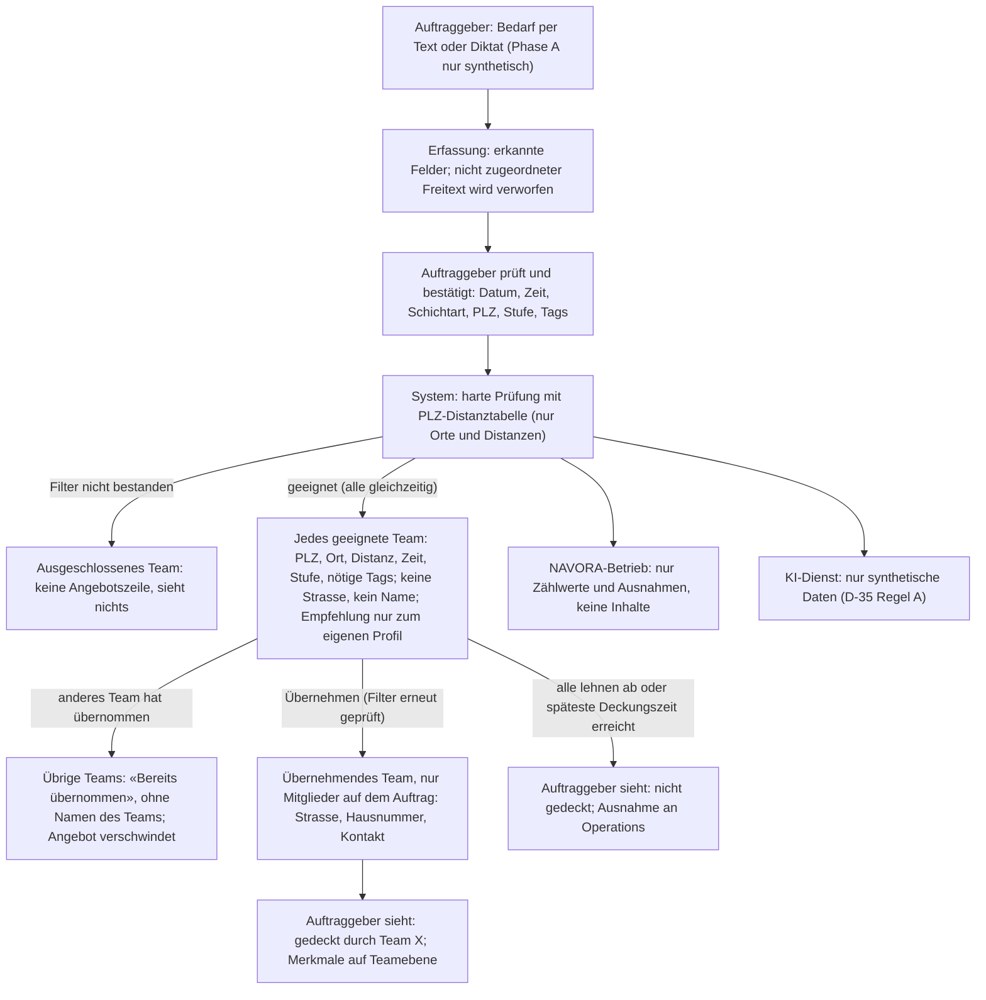

**Gesamtverdikt PLZ und Datenschutz:** Phase A (synthetisch) innerhalb P-1 bis P-8 und (PLZ-a) bis (PLZ-c): **vereinbar unter jeder plausiblen Auslegung**. Reale Daten: **ungelöst, braucht den Owner** über D-9 (Rechtsgrundlage), D-41 (KI-Pfad), D-4 (Aufbewahrung) und eine DSFA (Blueprint §7.2), keine neue Frage.

---

### 3. D-35 Regel A und KI

#### 3.1 Was gilt

**D-35 Regel A** (po-decided 2026-10-26, vom Owner als Stufe 0 des gestuften KI-Pfads bestätigt 2026-10-27, bekräftigt durch FE-024 und D-41 Punkt 1): **Keine Klienten- oder Personaldaten gehen an einen KI-Dienst**, in keiner Umgebung mit realen Daten, **weder über das Produkt noch über Entwicklungs- und Betriebswerkzeuge** (Zusatz Begriff 11: keine KI-Agentensitzung, kein Coding-Assistent, kein KI-Connector mit Zugang zu einer Umgebung mit realen Daten). Status: **in Kraft**. Heute gibt es im Code keinen Aufruf eines KI- oder Sprachdienstes (Blueprint §2.2; meine Suche nach KI-SDKs in `package.json`, `src/`, `supabase/` am 13.11.: kein Treffer; kein Test).

Zusammenhang mit **D-1:** Ob das Live-Supabase-Projekt reale Personen enthält, ist **UNKNOWN**; Agenten berühren es nie. BK läuft nur auf Seed und CI-Daten.

#### 3.2 Was das für die Erfassung (BK-1a, BK-d) heisst

1. **Phase A:** KI-Erfassung nur mit synthetischen Eingaben. Kein externer KI- oder Spracherkennungsdienst. Muster 4 (eigenes Modell im Schweizer NAVORA-Rechenzentrum) wird nur mit synthetischen Daten vorbereitet (FE-051; ADR T-6). Status **PLANNED**.
2. **Reale Eingaben erst nach D-41** (Muster 4, Rechtsgutachten, DSFA), weil Auftraggeber-Freitext und Diktat Namen und Gesundheitsdaten der gepflegten Person enthalten können (revDSG Art. 5 lit. c, wie zitiert). Der Hinweis unter dem Textfeld (M-a) verringert das Risiko, schliesst es aber nicht aus. Status **OPEN** (D-41 wartet auf den Owner).
3. **Nachweis für das spätere Tor:** Die synthetischen Testeingaben enthalten absichtlich Texte **mit** Namen und Diagnose; BK-d muss zeigen, dass diese verworfen werden (Journal 12:20 §6). Status **PLANNED** (Vorschlag an `aia`).
4. **Kein Rohtext in Logs, Audit-Payloads oder KI-Spuren** (M-c). Status **PLANNED**.
5. **Nichts still raten:** jedes erkannte Feld ist als «erkannt» markiert, der Auftraggeber bestätigt (BK-1b, BK-1d). Rechtlich wichtig, weil der verbindliche Auftrag eine Erklärung des Auftraggebers bleibt, nicht der KI **[AT]**.

#### 3.3 Was das für Diktat und Bericht (BK-8, Engine 3) heisst

1. **Audio und Transkript sind Gesundheitsdaten** (Handbook §4 Engine 3). Phase A nur synthetisch; Spracherkennung und Modell nur im eigenen CH-Rechenzentrum; kein externer Dienst. Route `/api/ai/transcribe` **PLANNED**; Rechte (nur die eigene Einsatzzeile) und Löschfrist für Audio per ADR `eng` mit `lca` (**OPEN**).
2. **Eintrittsbedingungen für ein späteres reales Diktat** (D-35, Begriff 10): Diktat nur der eigenen Worte der Pflegeperson, ausserhalb der Anwesenheit der Klientin oder mit dem Einverständnis aller Anwesenden; das Diktat (A7) ist **nicht** der erste reale KI-Pilot.
3. **Die Pflegeperson signiert, die KI nie** (BK-8, BK-8n; F6/F7 **IMPLEMENTED**). Jeder Satz verweist auf die Eingabe; was nicht diktiert wurde, steht nicht im Bericht.
4. **Medizinprodukte-Abgrenzung (D-34, entschieden: A plus C):** Ein Berichtsentwurf, der erfasste Beobachtungen **zusammenfasst**, liegt in der Grauzone (D-34 Quelle: Software, die klinische Informationen zusammenfasst, priorisiert oder interpretiert). Die Zweckbestimmung v2 und ihr Satz «NAVORA does not use an AI service to process client data» müssen wahr bleiben; wer Regel A verlässt, schreibt diesen Satz zuerst neu (D-35 Punkt 3). M-DOK ist als eigenes qualifiziertes Modul zu behandeln. Status **OPEN** (Regulierungsberater nicht benannt).

#### 3.4 Personaldaten in der Rangfolge (BK-3, BK-4)

Bestätigte Merkmale (Demenzerfahrung, Sprache, Stufe, Vorkenntnis einer Einrichtung) sind Personendaten der Mitglieder. Sie sind nur arbeitsbezogen (nie Gesundheit, Impfung, Schwangerschaft, Absenzgründe, Gewerkschaft, Religion, keine Werturteile), werden mit «wer, wann bestätigt» geführt, sind für das Mitglied einseh- und bestreitbar, und die KI-Rangfolge liest sie **nur auf synthetischen Daten** (Journal 12:20 (A-a) bis (A-d); OR Art. 328b). Ob ein Kontinuitätssignal aus vergangenen Aufträgen Profiling eines Mitglieds ist: **UNKNOWN**; Schutzregel: es bleibt auf Teamebene.

---

### 4. Trennung der Erlösströme aus rechtlicher Sicht

#### 4.1 Die drei Ströme

| Strom | Von → an | Beleg | Rechtliche Funktion der Trennung [AT] | Status |
|---|---|---|---|---|
| **U-T Pflegeerlös** | Auftraggeber → Team bzw. Trägerstruktur | Rechnung des Teams | Die Pflegeleistung und ihr Entgelt gehören dem Team; NAVORA ist nicht Leistungserbringerin | Fakten **IMPLEMENTED** (J5); Rechnung **PLANNED** (BK-9) |
| **U-N1 Plattformgebühr** | Team → NAVORA | Abo-Rechnung | Entgelt für Software, nicht für Zuführung (AVG-Abgrenzung, 1.2 Punkt 2) | **PLANNED** (GMSEP); Höhe **OPEN** (D-14) |
| **U-N2 B2B-Lizenz** | Heim/Spital → NAVORA | Lizenzrechnung | Softwarelizenz; keine Teamvergütung | **PLANNED** |

#### 4.2 Regeln

1. **Eine Pflegerechnung enthält nie eine NAVORA-Position** (Blueprint §3.3). Weder Provision, noch Servicegebühr, noch ein Hinweis auf das Abo (Journal 12:20 (I-c)). Begründung: Eine NAVORA-Position auf der Rechnung an den Auftraggeber würde NAVORA als Beteiligte am Pflegeentgelt zeigen und wäre ein Indiz für ein Entgelt je Vermittlung (L-10) **[AT]**.
2. **Der Auftraggeber schuldet NAVORA in KON-1, KON-3 und KON-4 nichts** (BUSINESS_MODELS §3 Regel 3). Ein B2B-Heim, das zusätzlich ein Team beauftragt (Demand-Pooling), erhält dafür einen eigenen GM-1-Auftrag mit eigener Rechnung des Teams; die Lizenzrechnung bleibt unberührt (FE-055 (4)).
3. **Keine gemeinsame Zeile im Datenmodell.** Kein Fremdschlüssel und keine Ansicht verbindet Pflegeerlös und NAVORA-Erlös; ein pgTAP-Test beweist es (Handbook §5.2, GMSEP). Status **PLANNED**. So kann auch kein Bericht eine Gebühr als Anteil am Pflegeerlös darstellen.
4. **Kein Betreiber-Dashboard zeigt Pflegeerlöse einzelner Teams**, nur aggregierte Zählwerte (Blueprint §3.3). Status **PLANNED**.
5. **Rechnungstext in Phase A** (Journal 12:20 (I-a), (I-b)): Titel «Rechnungsentwurf (Simulation) – keine gültige Rechnung»; Absender das fiktive Team, Empfänger der fiktive Auftraggeber; «synthetischer Beispielpreis, kein Tarif»; keine Begriffe, die eine ungeklärte Einordnung behaupten (nicht «Personalverleih», nicht «Pflegeleistung nach KVG/KLV»), keine ZSR, keine GLN, kein Tarifcode, keine Restfinanzierung, **keine MWST-Zeile und keine MWST-Aussage** (MWST-Behandlung einer Schicht im Heim **UNKNOWN**, MWSTG nicht gelesen).
6. **Keine KVG/KLV-Abrechnung in BK** (BK-10). Eine Rechnung an einen Versicherer für einen Einsatz im Heim oder Spital ist ausgeschlossen, bis L-8 beantwortet ist (D-44 Risiko «double billing»). Tiers payant bleibt **OPEN** (D-18, D-22, D-44).
7. **Beträge rechnet nie die KI** (Handbook §4 Engine 4). Die Rechnung ist Regel-Arithmetik aus den erfassten Einsatzzeiten des Auftrags; die **Arbeitszeiterfassung speist die Abrechnung nicht** (D-23 Punkt 6).
8. **Gebühr aus Pensumdaten (L-14):** synthetisch vereinbar; real erst mit AGB und Teamvereinbarung (Owner), weil die bestätigte Arbeitszeit je Mitglied lohnnahe Daten sind (D-14 `lca` 2026-11-11). Status **OPEN**.

**Verdikt:** Phase A innerhalb dieser Regeln: **vereinbar unter jeder plausiblen Auslegung**.

---

### 5. Offene Rechtsfragen für das Gutachten Q1 2027 (FE-050)

Bestehende Fragen aus `docs/agents/decisions/ADVISER_CATALOGUE.md`, soweit sie den Kernablauf betreffen, plus zwei Vorschläge dieses Beitrags. Kein Agent kontaktiert eine Kanzlei; der Owner versendet (FE-050).

| ID | Paket | Frage (Kurzform) | Wofür im Kernablauf | Status |
|---|---|---|---|---|
| **Q-44a** | D-44 | Kann eine Team-Trägerstruktur Bewohnenden eines bewilligten BS/BL-Heims Pflege im Auftrag erbringen (eigene verantwortliche Pflegefachperson, eigene Planung, eigenes Risiko, Pauschale), wenn die Heim-PDL Organisation und Aufsicht behalten muss, und welche Vertrags- und Praxismerkmale verhindern Personalverleih (Art. 12 AVG, Art. 26 AVV)? | KON-1, KON-3a, BK-Hauptszenario; Preis je Stunde | **OPEN** |
| **Q-44b** | D-44 | Begrenzen BS und BL OKP-Zulassungen (Art. 49/51 KVV), und gilt die Restfinanzierung für neue private Anbieter gleich? | KON-3b, KON-4 | **OPEN** |
| **Q-44c** | D-44 (mit D-14) | Ist eine Plattform, die Heimen das Finden von Teams ermöglicht und einen Prozentsatz oder einen Betrag je Auftrag verlangt, Arbeitsvermittlerin nach Art. 2 AVG, und macht ein Zahlungsfluss über sie sie zur Finanzintermediärin (GwG)? | Gebührengestaltung, Zahlungsweg | **OPEN** (durch FE-055 zum Teil gegenstandslos: Prozent und je Stunde verboten; der GwG-Teil bleibt relevant, falls je Zahlungen über NAVORA geplant werden) |
| **Q-44e** (**[C-5]** in D-44 16:40 unterschrieben, Beraterkatalog v7; Fassung v9) | D-44 | «Ist eine Pflege-Software, die ausschliesslich eine feste monatliche Abogebühr der Pflegeteams erhält (unabhängig davon, ob, wie viele oder welche Aufträge zustande kommen), und die für den Auftrag einer Einrichtung oder Privatperson die geeigneten Teams nach festen objektiven Kriterien (Region, Qualifikationsstufe) filtert und dann **entweder (a)** sie ordnet und den Auftrag zuerst und für ein Zeitfenster exklusiv dem bestplatzierten Team zeigt (Kaskade), **oder (b)** ihn gleichzeitig an alle geeigneten Teams sendet und jedem Team eine Empfehlung zur Passung seines eigenen Profils zeigt, wobei die erste Übernahme den Auftrag erhält (Rundruf), eine Arbeitsvermittlerin im Sinne von Art. 2 AVG und Art. 1 lit. a AVV («Auswahlverfahren»): (i) wenn das Verhältnis Auftraggeber–Team ein Auftrag ist, (ii) wenn es Personalverleih ist, (iii) wenn Teammitglieder beim Auftraggeber angestellt wären? Unterscheidet sich die Antwort zwischen (a) und (b)? Welche Produktmerkmale (Auswahl benannter Personen, Bewertungen von Personen, eine Rangliste für den Auftraggeber, Bindungs- oder Abwerbegebühren, eine Deckungsgarantie, Gebühren vom Auftraggeber, Zahlung über die Plattform) würden die Antwort ändern?» (Übersetzung PO aus `ADVISER_CATALOGUE.md` v9; massgebend ist der englische Katalogtext) | BK-2 bis BK-5 (Rundruf; Kaskade nur als Vergleich) | **im Katalog** (v9); Variante (b) ist das aktuelle Design |
| **Q-44d** | D-44 | Ist die Weitergabe der Kontaktdaten eines Teams an einen registrierten Versicherungsbroker Versicherungsvermittlung (Art. 40 VAG, Art. 182a AVO), mit und ohne Entgelt? | Teambildung (ONB1), nicht BK | **OPEN** |
| **L-11** | D-44 | AHV-Statut freiberuflicher Mitglieder («Die Kasse entscheidet») | KON-1, KON-3, KON-4 | **OPEN** (Schritt je Person bei der Ausgleichskasse, keine Beraterfrage) |
| **Q-43b** | D-43 | Erfüllt die Pflegeleitung eines Partners mit Matrix, Delegation und Widerruf die «fachliche Organisation und Aufsicht»? | R3 im Heim; Indiz Verleih (R3-c) | **OPEN** |
| **D-41/9** | D-41 | Darf ein BS/BL-Leistungserbringer als Verantwortlicher Gesundheitsdaten (Freitext) einem KI-Modell als Unterauftragsbearbeiter oder bei NAVORA anvertrauen (revDSG Art. 9, StGB Art. 321)? **Vorschlag:** ausdrücklich auf **Auftraggeber-Freitext und Diktat der Erfassung** (BK-1a) erweitern, nicht nur auf Pflegenotizen | BK-d, BK-8 mit realen Daten | **OPEN** (Erweiterung vorgeschlagen) |
| **D-9/1, D-9/2** | D-9 | Rechtsgrundlage für Klientendaten bei Aufnahme; darf ein Spital oder Hausarzt Zuweisungsdaten an einen noch nicht beauftragten Anbieter weitergeben? | Privathaushalt (KON-4), Spitalaustritt (KON-3b); Tags mit Gesundheitsbezug | **OPEN** |
| **D-4/1 bis D-4/3** | D-4 | Aufbewahrung von Audit, Abrechnungsbelegen und operativen Zeilen | Auftrag, Adresse, Ausschlussgründe, Rohinput | **OPEN** |
| **Q-42a, Q-42b** | D-42 | Hilfspersonen-Einbindung des Softwareanbieters (StGB Art. 321, § 26 GesG BS); Aufbewahrung und Löschung nach Export | erster realer Heimpilot | **OPEN** |
| **Q-44f** MWST (**[C-5]** Beraterkatalog v7) | D-44 | Wie ist eine Schicht eines Teams in einem Heim mehrwertsteuerlich zu behandeln, und was muss die Team-Rechnung dazu enthalten? | BK-9 real | **UNKNOWN**, im Katalog (v7) |
| **swisstopo-Bestätigung** | – (T-2) | Gelten die OGD-Bedingungen für das PLZ-Verzeichnis trotz der Kategorie auf opendata.swiss? | PLZ-Tabelle in Produktion | **OPEN**, Owner-Schritt, keine Beraterfrage |

---

### Zusammenfassung für die Rollen

- **An `po`:** Leitplanken 1.3 (1-13), rote Linien R-1 bis R-10, P-1 bis P-8 und die Regeln 4.2 als BK-Abnahmekriterien mit Negativtest übernehmen; Q-44e und die MWST-Frage in den Beraterkatalog aufnehmen; D-41/9 auf Auftraggeber-Freitext erweitern; (erledigt: FE-078 Teil 1 und FE-076 sind in `FOUNDER_DECISIONS.md` eingetragen).
- **An `eng` (ADR T-2, T-5):** Distanz vom Einsatzgebiet des Teams, nie von Privatadressen oder GPS (P-5); Distanzen vorab als Tabelle, keine Abfrage je Auftrag (PLZ-b); Adresse als eigenes Feld mit eigener Zugriffsregel; kein Rohtext in Logs (M-c).
- **An `uxa`:** neutrale Begriffe («Auftrag», «Schichtauftrag»); Karte nennt das Team, keine Person; Rechnungstitel (I-a).
- **An `aia`:** synthetische Testeingaben mit Name und Diagnose, die verworfen werden müssen.
- **An den Owner:** nichts für Phase A. Vor dem ersten realen Auftrag: Q-44a beantwortet; vor einer swisstopo-Tabelle in Produktion: eine Bestätigung von swisstopo.

