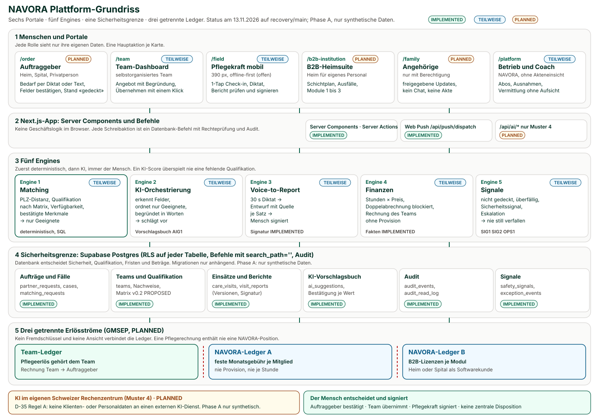
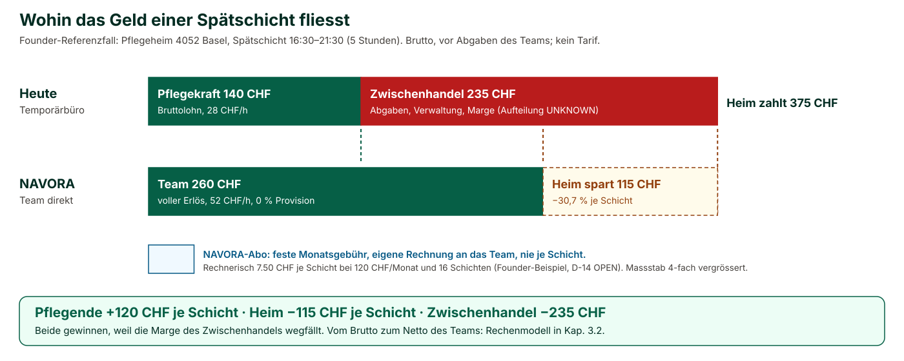
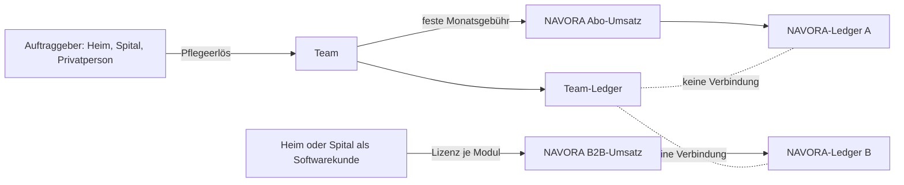
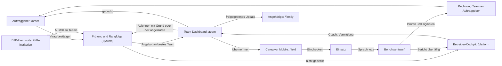
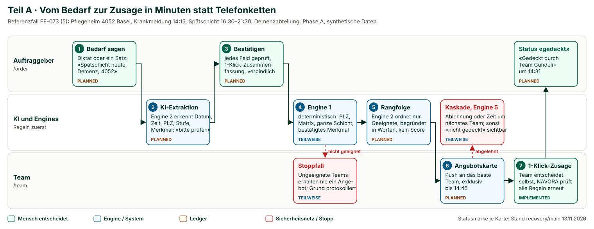
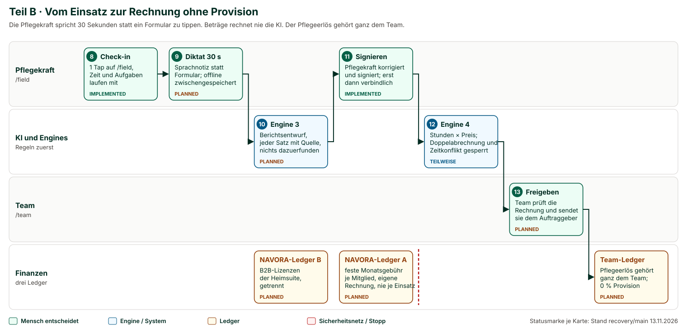
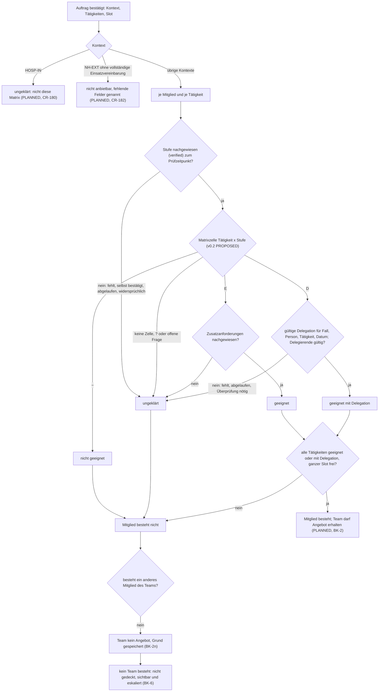
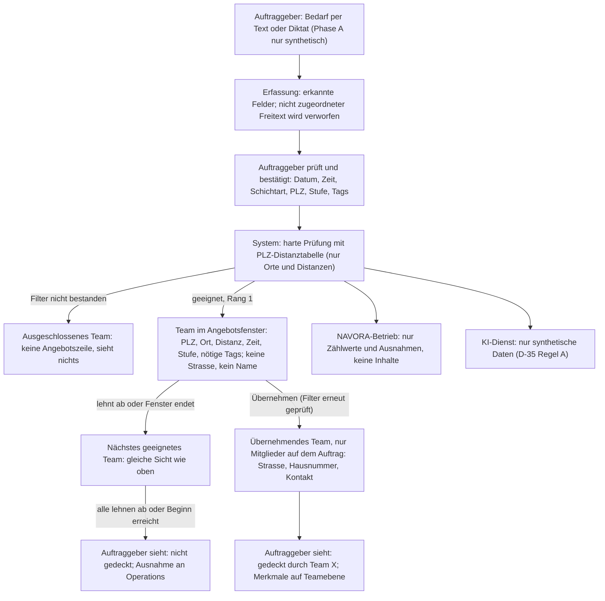

# NAVORA Architecture Blueprint V3.1

**Das Arbeitsbuch für Produkt und Blockumsetzung: Zielbild, Plattform, Kernablauf, Sicherheit, Recht, Lieferkette**

| | |
|---|---|
| **Version** | 3.1 (Entwurf zur Founder-Freigabe), 2026-11-13 |
| **Verantwortlich** | Product Owner (`po`) |
| **Mitgewirkt** | `csa` (Kap. 1, 3), `uxa` (Kap. 4, sechs Wireframes), `cra` (Kap. 6), `lca` (Kap. 7), `eng` (Prüfung der Engines und des Datenmodells im Handbook, Reihenfolge in Kap. 8) |
| **Auftrag** | Founder-Anweisungen FE-075 und FE-076 vom 2026-11-13 |
| **Grundlage** | `FOUNDER_DECISIONS.md` FE-001 bis FE-076; Code auf `recovery/main` am 2026-11-13 (`227e742`); Blueprint V2.95 |
| **Geltung** | Bis zur Freigabe durch den Founder gilt Blueprint V2.x weiter. Nach der Freigabe ist V3 das führende Arbeitsbuch und V2 wird Archiv. Bei einem Widerspruch gilt die neueste Founder-Entscheidung (README Regel 10). |
| **Schwesterdokument** | [Architecture Handbook V2.1](../architecture/ARCHITECTURE_HANDBOOK_V2.md): WIE gebaut wird |

**Kennzeichnung.** Jede Zustandsaussage trägt eine der vier Marken:

- **IMPLEMENTED:** im Code auf `recovery/main` vorhanden.
- **PLANNED:** beschlossen, aber nicht gebaut.
- **OPEN:** Entscheidung ausstehend.
- **UNKNOWN:** nicht geprüft.

«Gebaut» ist nicht «abgenommen». Abgenommen ist nur, was nach Kapitel 9 auf einem benannten Commit belegt ist.

---

## Das NAVORA-Zielbild in vier Sätzen

1. **Wir bauen ein System, das den Zwischenhandel in der Pflege eliminiert.** Heime, Spitäler und Privatpersonen beauftragen Pflegeteams direkt, ohne Temporärbüro und ohne Spitex-Verwaltung dazwischen.
2. **Die Pflegenden führen ihr Team unternehmerisch und behalten den vollen Erlös.** Was der Auftraggeber für die Pflege zahlt, gehört dem Team.
3. **NAVORA finanziert sich ausschliesslich über eine feste Monatsgebühr.** Es gibt nie eine Provision, nie einen Betrag je Stunde und nie einen Anteil an der Pflegevergütung.
4. **Die KI ist das Herzstück und erledigt die Administration.** Erfassen, Abgleichen, Planen, Berichte entwerfen und Rechnungen vorbereiten macht die Maschine. Der Mensch prüft, entscheidet und signiert.

**Die Schichtrechnung des Referenzfalls** (Spätschicht 16:30–21:30 in einem Basler Pflegeheim, Founder-Referenzwerte, Kap. 3.2):

| | Heute: Temporärbüro | NAVORA | Wirkung |
|---|---|---|---|
| Das Heim zahlt | 375 CHF | 260 CHF | **Das Heim spart 115 CHF je Schicht.** |
| Bei der Pflege kommt an | 140 CHF Bruttolohn | 260 CHF Teamerlös | **Die Pflegenden erhalten 120 CHF mehr je Schicht.** |
| Beim Zwischenhandel bleibt | 235 CHF | 0 CHF | **Der Zwischenhandel fällt weg.** |

Beide Seiten gewinnen, weil die Marge des Zwischenhandels wegfällt. Kapitel 3 zeigt den Weg vom Brutto zum Netto des Teams als offenes Rechenmodell. Jede Eingabe hat ihre Herkunft und jeder offene Parameter eine zuständige Stelle. So wird die Zahl in Phase B mit echten Werten belegt.

---

## 0. Die Plattform auf einen Blick

Ein Architekt zeichnet zuerst den Grundriss. Das Bild unten zeigt NAVORA als Gebäude mit fünf Ebenen. Oben stehen die Menschen und ihre sechs Portale. Darunter liegen die App, die fünf Engines und die Datenbank, die als Sicherheitsgrenze dient. Ganz unten stehen drei Ledger, die nie miteinander verbunden sind. Jede Karte trägt ihren Stand im Code.

<div class="landscape" markdown="1">



</div>

**So liest man das Dokument:**

| Kapitel | Frage | Bild |
|---|---|---|
| 1 | Warum gibt es NAVORA, und wen löst es ab? | Wertschöpfungskette heute und morgen |
| 2 | Was macht die KI, und was nie? | Tabelle Regeln, KI, Mensch |
| 3 | Wie verdienen Pflegende mehr und Heime zahlen weniger? Wovon lebt NAVORA? | Schichtrechnung, drei Erlösströme |
| 4 | Wie sehen die sechs Portale aus? | sechs Wireframes, Navigationskarte |
| 5 | Wie fliesst ein Auftrag vom Diktat bis zur Rechnung? | Swimlane-Diagramme Teil A und B |
| 6 | Was garantiert die Patientensicherheit an jedem Schritt? | Matrix-Entscheid als Ablauf |
| 7 | Wo verlaufen die rechtlichen Grenzen (AVG, Datenschutz)? | Wer sieht wann welche Daten |
| 8–12 | Was wird wann gebaut, wie wird abgenommen, was entscheidet der Founder? | Lieferkette, Gates, Board |
| 13 | Wer hat was beigetragen, und wer bestätigt? | Mitwirkungstabelle |

---

## 1. Zielbild, Disruption und Werteordnung

*Ausgearbeitet von `csa` (Chief Strategy Architect); vom PO übernommen. Zahlenherkunft: **[F]** Founder-Referenzwert, **[B]** belegt mit Quelle im Repo, **[A]** Annahme.*

### 1.1 Das NAVORA-Zielbild (verbindlich)

**1. Der Zwischenhandel fällt weg.**
Heime, Spitäler und Privatpersonen beauftragen ein Pflegeteam direkt. Temporärbüros und Spitex-Verwaltungen sind in NAVORA weder Rolle noch Kunde (FE-066). Das Team ist der Anbieter.

**2. Der Erlös gehört dem Team, das pflegt.**
Was der Auftraggeber für die Pflege zahlt, fliesst ganz an das Team. Die Pflegenden führen ihr Team wie ein eigenes Unternehmen. Sie entscheiden, welche Aufträge sie annehmen, wer geht und wie sie ihren Überschuss einsetzen. Welche Rechtsform das Team erhält, ist OPEN (D-44, FE-070).

**3. NAVORA lebt von der Software, nie von der Pflege.**
NAVORA erhält eine feste Monatsgebühr. Es gibt keine Provision, keinen Betrag je Stunde und keinen Anteil an der Pflegevergütung, auch künftig nicht (FE-055 (1), (3); FE-070 (1)). NAVORA verdient, wenn Teams gut arbeiten wollen, nicht wenn sie mehr Stunden verrechnen.

**4. Die KI ist das Herzstück und erledigt die Administration.**
Erfassen, Abgleichen, Planen, Ausfälle decken, Berichte entwerfen, Rechnungen vorbereiten: Das macht die Maschine. Der Mensch prüft, entscheidet und signiert (FE-013, FE-028). Ein KI-Score überspielt nie eine fehlende Qualifikation.

**5. Die Pflegezeit gehört der Pflege.**
Der Massstab ist der Anteil direkter Pflegezeit (M-13). Buurtzorg zeigt, dass 60 % möglich sind. NAVORA zielt auf 75 %, weil die Koordination, die dort noch Menschen leisten, bei NAVORA die Software übernimmt.

**6. Sicherheit ist die Bedingung, nicht der Preis.**
Patientensicherheit wird nie gegen Tempo oder Marge verrechnet. Harte Regeln prüfen Ort, Qualifikation und Verfügbarkeit vor jeder Empfehlung. Klinische Regeln gibt nur die benannte Freigabestelle frei (D-27, D-43).

**Spitex-Organisationen und Temporärbüros sind weder Rolle noch Kunde noch Organisationsart in NAVORA** (FE-066). Der Anbieter ist das Team.

### 1.2 Wo heute das Geld bleibt

#### 1.2.1 Wertschöpfungskette einer Spätschicht

Founder-Referenzfall (FE-073 (5)): Pflegeheim in 4052 Basel, Spätschicht 16:30–21:30, also 5 Stunden.

<div class="landscape" markdown="1">



</div>

| Glied der Kette | Heute: Temporärbüro | Heute: Spitex-Verwaltung | NAVORA |
|---|---|---|---|
| Wer nimmt den Auftrag an | Büro, per Telefon | Disposition | das Team, per Klick |
| Wer behält einen Teil des Preises | Büro: 47 CHF/h, 235 CHF je Schicht [F]. Aufteilung in Arbeitgeberabgaben, Verwaltung und Marge: UNKNOWN | Verwaltung und Hierarchie: Schweizer Anteil UNKNOWN. Referenz Niederlande: 16,9 % Overhead bei vergleichbaren Anbietern [B] | niemand. NAVORA erhält nur die feste Monatsgebühr |
| Marktreferenz | Temporärpersonal kostet ein Heim rund 1,7-mal so viel wie Festangestellte [B2, SRF 2025] | Buurtzorg 6,7 % Overhead gegenüber 16,9 % [B, Kwaliteitsbeeld 2025]; früher 8 % gegenüber 25 % [B, EY 2009] | Ziel: höchstens 6,7 %, ohne Coach-Schicht (BM-6) |
| Wer koordiniert | Menschen im Büro | Menschen in der Disposition | Regeln und KI; das Team entscheidet |

Quellen: `ECONOMICS_COMPARISON.md` [B2], `STRATEGY.md` §7 (Kwaliteitsbeeld 2025), `CARE_OPERATING_MODEL.md` (Commonwealth Fund 2015, EY 2009). Die Werte sind so berichtet, nicht von NAVORA geprüft.

### 1.3 Warum das Modell trägt

#### 1.3.1 Disruptionslogik

| Gegner | Was er heute leistet | Was er dafür nimmt | Was NAVORA an seine Stelle setzt | Status |
|---|---|---|---|---|
| **Temporärbüro** | Ersatz bei Ausfall finden | Marge auf jeder Stunde; im Referenzfall 235 CHF je Schicht [F] | Bedarf per Diktat oder Text, harte Prüfung, Angebot an das passende Team, Zusage per Klick | Teamentscheid IMPLEMENTED (J2); Erfassung, Angebotskaskade, Anzeige «gedeckt» PLANNED (BK) |
| **Spitex-Verwaltung** | Disposition, Hierarchie, Abrechnung | Overhead; Referenz 16,9 % bis 25 % [B] | Team plant selbst; Regeln und KI koordinieren; Abrechnung aus signierten Einsätzen | Tagesplanung, Ausfall, Vertretung IMPLEMENTED (PLAN3, ABS1, COVER1); Abrechnungsfakten IMPLEMENTED (J5); Rechnung PLANNED (B8) |

Die Logik ist einfach. Beide Apparate verkaufen Koordination. Koordination ist Informationsfluss. Informationsfluss kann Software leisten, schneller und ohne Marge. Damit bleibt der Preisvorteil beim Heim und der Lohnvorteil bei den Pflegenden.

#### 1.3.2 Buurtzorg als Messlatte

Buurtzorg beweist, dass selbstorganisierte Teams mit wenig Overhead gute Pflege leisten: 6,7 % Overhead, Kundenzufriedenheit 9,2, Mitarbeitenden-NPS 66 % gegenüber 4 % im Sektor [B, Kwaliteitsbeeld 2025]. NAVORA geht drei Schritte weiter:

1. **Ohne Coach-Schicht.** Buurtzorg braucht rund 15 Coaches für rund 700 Teams [B, Commonwealth Fund 2015]. Bei NAVORA rufen Signale den Coach nur bei Ausnahmen (OPS1, SIG1 IMPLEMENTED).
2. **Ohne Papierarbeit beim Team.** Buurtzorg-Teams planen, dokumentieren und rechnen selbst ab. Bei NAVORA bereitet die Maschine vor, das Team bestätigt.
3. **Mit eigenem Erlös.** Buurtzorg-Teams sind Angestellte einer Stiftung. NAVORA-Teams behalten den Erlös ihres Auftrags.

#### 1.3.3 Wie die KI die Koordination übernimmt

| Arbeit, die heute Menschen tun | NAVORA | Status |
|---|---|---|
| Bedarf telefonisch aufnehmen | KI erkennt Felder aus Diktat oder Text; Auftraggeber bestätigt | PLANNED (BK-1) |
| Passende Person suchen | Regeln filtern Ort, Qualifikation, Verfügbarkeit; KI ordnet nur unter den Geeigneten und begründet | Region und Pflichtqualifikation IMPLEMENTED; PLZ-Distanz, Matrix, Rangfolge PLANNED (BK-3, BK-4) |
| Ausfall abtelefonieren | Abwesenheit mit zwei Tipps; Vertretung wird automatisch angeboten | IMPLEMENTED (ABS1, COVER1) |
| Bericht schreiben | 30 Sekunden Diktat; KI-Entwurf mit Quellenbezug; Pflegekraft signiert | Signatur IMPLEMENTED (F6, F7); Diktat und Entwurf PLANNED (B6) |
| Rechnung erstellen | Rechnung aus signierten Einsätzen, Prüfung auf Doppelabrechnung | Fakten IMPLEMENTED (J5); Rechnung PLANNED (B8) |

Grenze: In Phase A arbeitet jede KI nur mit synthetischen Daten. Für reale Daten gilt D-35 Regel A, bis Muster 4 mit Rechtsgutachten und DSFA freigegeben ist (FE-051).

#### 1.3.4 Netzwerkeffekte

- **Mehr Teams, mehr Deckung.** Jedes Team erhöht die Chance, dass eine offene Schicht innert Minuten gedeckt wird. Teamübergreifende Vertretung ist IMPLEMENTED (COVER1).
- **Mehr Auftraggeber, bessere Auslastung.** Demand-Pooling schlägt Teams bei Leerlauf Einsätze vor, immer als eigener GM-1-Auftrag (FE-055 (4), POOL1 PLANNED). Auslastung ist der stärkste Hebel auf das Einkommen (BM-11).
- **Mehr Einsätze, besseres Matching.** Bestätigte Erfahrung und Kontinuität machen die Empfehlung genauer, ohne je eine harte Regel zu überspielen.
- **Geteilte Dienste ohne Zentrale.** Regelkatalog, Vertretung und Back-Office-Leistungen werden von vielen Teams gemeinsam genutzt, ohne Weisungsrecht (`STRATEGY.md` §8.1 (5)).

### 1.4 Werteordnung (verbindlich)

**Patientensicherheit ist Voraussetzung und wird nie verrechnet.** Danach gilt diese Reihenfolge:

1. mehr direkte Pflegezeit
2. bessere Kontinuität der Versorgung
3. höheres Nettoeinkommen der Pflegenden
4. Teamautonomie
5. weniger Administration
6. bessere Patientenergebnisse
7. operative Skalierbarkeit
8. Plattformvollständigkeit
9. Umsatz
10. Bequemlichkeit für Engineering

### 1.5 Nordstern und Massstab

- **Nordstern:** Anteil direkter Pflegezeit je Team und Monat (Kennzahl M-13).
- **Hypothesen:** Buurtzorg-Massstab mindestens 60 %, NAVORA-Ziel 75 %. Ein echter Wert entsteht erst in Phase B.
- **Buurtzorg** ist die Messlatte, die NAVORA übertreffen will: KI übernimmt die Koordination, die dort noch Menschen leisten.

### 1.6 Was NAVORA nie baut

- **keine zentrale Disposition und kein «für das Team zuteilen»** (Produkt-Invariante, FE-039). Die KI schlägt vor, das Team entscheidet.
- **keine hierarchische Aufsicht.** Der Coach vermittelt bei Konflikten und Engpässen und hat keinen allgemeinen Zugriff auf Gesundheitsdaten.
- **keine Provision auf Pflegeumsätze**, weder als Prozentsatz noch je Stunde (FE-055 (3)).
- **keine erfundenen medizinischen, rechtlichen oder tariflichen Regeln.** Eine klinische Regel gibt nur der Clinical Owner frei (D-27, D-43).

---

## 2. Die KI als operatives Rückgrat

### 2.1 Grundsatz: zuerst deterministisch, dann KI, immer der Mensch

Jeder KI-gestützte Ablauf folgt derselben Reihenfolge (`AI_FIRST_ARCHITECTURE_UPDATE.md`):

**Unnötiges entfernen → Regeln anwenden → laufend überwachen → KI bereitet vor → Mensch prüft → Mensch entscheidet → Mensch signiert.**

| Bereich | Regeln (deterministisch) | KI bereitet vor | Mensch entscheidet oder signiert |
|---|---|---|---|
| **Erfassung** | Pflichtfelder, PLZ-Liste, Schichtlogik (auch über Mitternacht) | Felder aus Sprache oder Freitext erkennen | der Auftraggeber bestätigt |
| **Matching** | PLZ-Distanz, Qualifikation nach Matrix, Verfügbarkeit, bestätigte Merkmale | Rangfolge **nur unter den Geeigneten**, Begründung in Worten | das Team übernimmt |
| **Koordination** (statt Disposition) | Kontinuitäts-Standard, Lücken, Ausfälle | Tagesvorschlag, Vertretungsvorschlag | das Team bestätigt jeden Wert (AIG1) |
| **Dokumentation** | Pflichtteile, Signaturstatus | Berichtsentwurf aus dem Diktat, jeder Satz mit Quelle | die Pflegekraft signiert |
| **Abrechnung** | Stunden × Preis, Doppelabrechnung, Zeitkonflikte | Erklärung der Abweichungen | das Team gibt die Rechnung frei |
| **Sicherheit** | Signale, Fristen, Eskalation | – | die zuständige Person handelt |

**Ein KI-Score überspielt nie eine fehlende Qualifikation, Lizenz oder Delegation.** Die KI kann eine Rangfolge ordnen, aber kein Team hinzufügen.

### 2.2 KI und Daten (verbindlich)

- **D-35 Regel A gilt:** Keine Klienten- oder Personaldaten gehen an einen KI-Dienst (FE-024).
- **Gewählte Muster** (FE-051):
  - Muster 1: Planung nur mit Kennungen.
  - Muster 2: nur Team-Kennzahlen.
  - Muster 3: strukturierte Erfassung, Bericht per Regel.
  - Muster 4: eigenes Sprachmodell im Schweizer NAVORA-Rechenzentrum. Wird mit synthetischen Daten vorbereitet und getestet; für echte Daten erst nach Rechtsgutachten und DSFA.
  - Muster 5 (Pseudonymisierung für externe KI) ist **nicht** gewählt.
- **Phase A:** Jede KI arbeitet ausschliesslich mit synthetischen Daten.
- **Stand heute:** Es gibt im Code keinen Aufruf eines KI- oder Sprachdienstes. Beide registrierten «Agenten» sind regelbasiert. Die Governance (Vorschlagsbuch, Bestätigung je Wert, Stopp, Rückblick) ist **IMPLEMENTED** (AIG1).

---

## 3. Das NAVORA-Finanz- und Geschäftsmodell

*Kapitel 3.2 bis 3.7 ausgearbeitet von `csa`; vom PO übernommen.*

### 3.1 Zwei Geschäftsmodelle (FE-040, FE-055)

| | **GM-1 Teamgeschäft** | **GM-2 B2B-Software** |
|---|---|---|
| Kunde | Heim, Spital oder Privatperson erteilt einem Team einen Auftrag | Heim oder Spital für die eigene Belegschaft |
| Leistung | das Team pflegt und rechnet über eine rechtlich geeignete Struktur ab | Module (3.2) |
| NAVORA-Erlös | **feste monatliche Plattformgebühr je Teammitglied oder Team**, gewichtet nach effektivem Pensum (VZE); **Höhe OPEN** (D-14; Founder-Beispiel 120 CHF/Monat) | Softwarelizenz je Modul; **Preis OPEN** |
| Verboten | Provision in Prozent, Betrag je Stunde, jeder Anteil an der Pflegevergütung | – |
| Rechtsform | **OPEN** (D-44; z. B. Genossenschaft; Entscheid des Founders) | – |

### 3.2 Die Schichtrechnung

#### 3.2.1 Stufe 1: Was fliesst (Brutto)

Rechenmodell mit Founder-Referenzwerten [F]. Kein Tarif, kein Angebot. Der Preis von 52 CHF/h ist ein synthetischer Beispielwert (FE-073).

| Position | Temporärbüro | NAVORA | Differenz |
|---|---|---|---|
| Stundensatz an das Heim | 75 CHF/h | 52 CHF/h | −23 CHF/h |
| Dauer | 5 h | 5 h | – |
| **Heim zahlt je Schicht** | **375 CHF** | **260 CHF** | **−115 CHF (−30,7 %)** |
| Davon an die Pflege | 28 CHF/h × 5 h = 140 CHF Bruttolohn | 52 CHF/h × 5 h = 260 CHF Teamerlös | **+120 CHF (+85,7 %)** |
| Davon an Vermittler | 235 CHF (62,7 % des Preises) | 0 CHF | −235 CHF |
| NAVORA je Schicht | – | 0 CHF Provision | – |

**Kernsatz:** Das Heim spart CHF 115, die Pflegenden erhalten CHF 120 mehr pro Schicht. Beide gewinnen, weil die 235 CHF des Zwischenhandels wegfallen.

#### 3.2.2 Stufe 2: Vom Brutto zum Netto des Teams

Die 140 CHF sind ein Bruttolohn. Das Temporärbüro trägt darüber hinaus die Arbeitgeberabgaben. Die 260 CHF sind ein Teamerlös. Das Team trägt seine Kosten selbst. Für einen fairen Vergleich rechnet NAVORA den Teamerlös in ein **Bruttolohn-Äquivalent** um. Die Formel folgt `ECONOMICS_COMPARISON.md` §2.2.

**Formel je Schicht:**

```
E        = p × h                                   Teamerlös je Schicht
K_team   = c_abo + c_vers + c_adm + c_ausfall      Kosten des Teams je Schicht
L_äqu    = (E − K_team) ÷ (1 + s_ag)               Bruttolohn-Äquivalent je Schicht
Vorteil  = L_äqu − L_temp                           gegenüber dem Temporärlohn
```

| Parameter | Bedeutung | Wert | Herkunft | Liefert den belastbaren Wert |
|---|---|---|---|---|
| `p` | Preis je Stunde an den Auftraggeber | 52 CHF/h | [F] FE-073 | Founder; Phase B: Pilotvertrag (D-42) |
| `h` | Dauer der Schicht | 5 h | [F] 16:30–21:30 | – |
| `L_temp` | Bruttolohn heute, Temporär | 140 CHF | [F] 28 CHF/h × 5 h | Founder. OPEN: sind Ferien- und Feiertagsanteile darin enthalten? |
| `s_ag` | Arbeitgeberabgaben auf dem Lohn: AHV/IV/EO, ALV, BVG, UVG, KTG, FAK, Ferienanteil | **OPEN**. Im Repo nur der Platzhalter A1 = 20 % [A], nicht belegt | `ECONOMICS_COMPARISON.md` A1 | `lca` mit Rechtsgutachten Q1 2027: Rechtsform (D-44) und AHV-Statut (L-11) bestimmen den Satz |
| `c_abo` | NAVORA-Abo, umgelegt auf die Schicht | siehe 3.3 | [F] 120 CHF/Monat; D-14 OPEN | Founder (D-14) |
| `c_vers` | Berufshaftpflicht und Betriebsversicherung des Teams | **UNKNOWN** | kein Wert im Repo | registrierter Versicherungsbroker als Partner (FE-055 (5), L-12); Founder |
| `c_adm` | Verbleibende Administration: Buchhaltung, Treuhand, Weiterbildung, Material | **OPEN**. Im Repo nur der Platzhalter A2 = 10 % des Umsatzes [A]. Referenz Overhead Buurtzorg 6,7 % [B] | `ECONOMICS_COMPARISON.md` A2; `STRATEGY.md` §7 | Phase B: Buchhaltung des ersten Teams (BM-6) |
| `c_ausfall` | Rücklage für Ausfallrisiko: Krankheit, Unfall, abgesagte Schichten | **OPEN** | kein Wert im Repo; teilweise in `s_ag` (KTG, UVG), je Rechtsform | `lca` (D-44, L-11) |
| `u` | Auslastung: gebuchte ÷ angebotene Stunden, für das Monatseinkommen | Szenarien 100 / 85 / 70 % [A] | `ECONOMICS_COMPARISON.md` A4 | Phase B: reale Buchungen (BM-11) |
| Steuern | Einkommenssteuer der Pflegenden | fällt in beiden Modellen an, nicht Teil des Vergleichs. Steuerfragen des Teams je Rechtsform: UNKNOWN | – | `lca`, Rechtsgutachten |

**Sicherheitsmarge des Modells.** Das Team erreicht den heutigen Temporärlohn, solange gilt:

```
c_vers + c_adm + c_ausfall  ≤  E − c_abo − L_temp × (1 + s_ag)
```

Mit den Founder-Werten und 16 Schichten im Monat bleiben `252.50 − 140 × (1 + s_ag)` CHF je Schicht für Versicherung, Administration und Ausfall. Jeder Franken darunter ist zusätzlicher Lohn.

**Illustration, nur mit den Repo-Platzhaltern A1 und A2 [A]** (keine Prognose):

| Schritt | Rechnung | CHF je Schicht |
|---|---|---|
| Teamerlös `E` | 52 × 5 | 260.00 |
| − Administration `c_adm` (A2 = 10 %) | 260 × 0,10 | −26.00 |
| − Abo `c_abo` (16 Schichten, 3.3) | 120 ÷ 16 | −7.50 |
| = verfügbar für Lohn und Abgaben | | 226.50 |
| Bruttolohn-Äquivalent (A1 = 20 %) | 226.50 ÷ 1,20 | **188.75** |
| Vorteil gegenüber `L_temp` | 188.75 − 140 | **+48.75 (+34,8 %)** |
| Spielraum für `c_vers` und `c_ausfall` bis zum Gleichstand | 188.75 − 140, × 1,20 | 58.50 |

Lesart: Selbst nach Abgaben und Administration bleibt mit diesen Platzhaltern ein Lohnvorteil je Schicht. Ob er trägt, entscheiden `s_ag`, `c_vers` und die Auslastung `u`. Diese drei Werte liefern `lca`, der Broker und Phase B.

#### 3.2.3 Die Abo-Rechnung

Founder-Beispiel: 120 CHF je Mitglied und Monat [F]. Die Höhe ist OPEN (D-14). Die Gebühr wird nach effektivem Pensum (VZE) gewichtet (FE-055 (3)); das Beispiel rechnet ohne Gewichtung.

| Schichten je Mitglied und Monat [A] | Abo je Schicht | je Stunde (5 h) | Anteil am Teamerlös von 260 CHF |
|---|---|---|---|
| 8 | 15.00 CHF | 3.00 CHF | 5,8 % |
| 12 | 10.00 CHF | 2.00 CHF | 3,8 % |
| **16 (Referenzannahme)** | **7.50 CHF** | **1.50 CHF** | **2,9 %** |
| 20 | 6.00 CHF | 1.20 CHF | 2,3 % |

Zum Vergleich: Der Zwischenhandel nimmt heute 235 CHF je Schicht. Das Abo kostet bei 16 Schichten 7.50 CHF, also rund 1/31 davon.

Wichtig: Die Gebühr ist fest und nicht an Schichten gebunden. Die Umrechnung je Schicht dient nur dem Vergleich und ist kein Vorschlag für eine Gebühr je Schicht (L-10). Wenige Schichten machen die feste Gebühr je Schicht teurer (BM-12). Die VZE-Gewichtung gleicht das aus (FE-055 (3), Brief FEE1, PLANNED).

### 3.3 Zweites Standbein: die B2B-Suite (GM-2)

Heime und Spitäler kaufen NAVORA auch für ihr eigenes Personal. Kein externes Team ist nötig.

| Modul | Nutzen | Status |
|---|---|---|
| **1 Kern: KI-Planung und Ausfall** | weniger Temporärstunden, weniger Koordinationszeit. Rechenbeispiel im Repo: 3'378 CHF je Monat bei 100 vermiedenen Temporärstunden [B2, B5, A1; 100 h ist A] | ambulant IMPLEMENTED; Schichtmodell Heim PLANNED (NH-A1, B9) |
| **2 Add-on: KI-Protokoll** | Diktat, Berichtsentwurf, menschliche Signatur | Signatur IMPLEMENTED; Diktat PLANNED (B6) |
| **3 Add-on: Angehörigenportal** | strukturierte, freigegebene Updates; schützt Pflegende vor Unterbrechungen | PLANNED, kein Brief |

Preis je Modul: OPEN. Die Planung bleibt auch in GM-2 vom Team bestätigt (STR-27).

### 3.4 Strikte Trennung der drei Erlösströme



Regeln (FE-055 (2), FE-070 (1)):

- Eine Pflegerechnung enthält nie eine NAVORA-Position.
- Ein Auftraggeber im Teamgeschäft schuldet NAVORA nichts.
- Pflegeerlöse sind nie NAVORA-Umsatz. Das Betreiber-Cockpit zeigt nur aggregierte Zählwerte.
- Stand: Abrechnungsfakten und Umsatzvorschau IMPLEMENTED (J5). Rechnungen, Ledger A und Ledger B PLANNED (B8, GMSEP).

| Strom | Gehört | Beleg | Ledger | Dashboard |
|---|---|---|---|---|
| **Pflegeerlös** | dem Team | Rechnung des Teams an den Auftraggeber | Team-Ledger | Team-Dashboard |
| **NAVORA-Abo-Umsatz** | NAVORA | Abo-Rechnung an das Team | NAVORA-Ledger A | Betreiber-Cockpit |
| **NAVORA-B2B-Umsatz** | NAVORA | Lizenzrechnung an das Heim oder Spital | NAVORA-Ledger B | Betreiber-Cockpit |

- Die Trennung ist im Datenmodell erzwungen und getestet (FE-055 (2), Brief GMSEP).
- Eine Pflegerechnung enthält nie eine NAVORA-Position.
- Kein Betreiber-Dashboard zeigt Pflegeerlöse einzelner Teams, nur aggregierte Zählwerte.

**Stand:** Abrechenbare Fakten und eine Umsatzvorschau sind **IMPLEMENTED** (J5). Rechnungen, Abo-Ledger und B2B-Ledger sind **PLANNED**.

### 3.5 Was das Modell beweisen muss

Jede Hypothese hat eine Kennzahl, einen Zielwert und einen Prüfzeitpunkt. Kennzahlen gelten je Team, nie je Person (Kap. 11).

| # | Hypothese | Kennzahl | Ziel | Phase A (synthetisch) | Phase B (real) |
|---|---|---|---|---|---|
| H-1 | Das Heim zahlt je gedeckter Schicht weniger als beim Temporärbüro | **neu (Vorschlag `csa`):** Kosten je gedeckter Schicht, Heim | ≤ Referenz [F]; Messung gegen reale Rechnungen | Szenario mit aggregierten Monatszahlen eines Basler Heims (FE-055 (6), RDATA1) | Rechnungen des Pilotheims (D-42) |
| H-2 | Das Team verdient je Schicht mehr als der Temporärlohn | **neu (Vorschlag `csa`):** Bruttolohn-Äquivalent je Schicht und je VZE und Monat, nach Auslastung | > `L_temp`, bei realer Auslastung `u` | Rechenmodell 3.2 mit eingesetzten `lca`-Werten | reale Buchungen, Abgaben, Versicherung (BM-4, BM-5) |
| H-3 | Eine offene Schicht wird ohne Telefonkette gedeckt | **BK-Kennzahlen:** Minuten bis «gedeckt», Anteil gedeckter Aufträge; M-12 | Normalfall ohne Eingriff von Operations | Szenario-Matrix BK, Früh/Spät/Nacht, BS und BL | Pilotheim |
| H-4 | Die KI nimmt die Administration ab | M-15, M-16, M-11 / M-17 | sinkend gegenüber Ausgangswert | AN3-Messung auf synthetischem Seed | reale Teams nach D-41 |
| H-5 | Mehr Zeit geht in die Pflege | M-13 Nordstern | ≥ 60 % (Buurtzorg), Ziel 75 % | nicht aussagekräftig; nur Rechenweg prüfbar | erster echter Wert |
| H-6 | Das Team entscheidet selbst, NAVORA bleibt schlank | M-20 Entscheide im Team; Overhead des Teams (BM-6) | M-20 steigend; Overhead ≤ 6,7 % | M-20 synthetisch | Buchhaltung nach dem ersten Jahr |

### 3.6 Strategische Risiken und Gegenmittel

| Risiko | Wirkung | Gegenmittel | Zuständig | Status |
|---|---|---|---|---|
| **Personalverleih statt Auftrag (AVG).** Ein Teameinsatz im Heim kann als Personalverleih gelten, wenn das Heim das wesentliche Weisungsrecht behält (L-7). Eine Plattform, die Parteien zusammenbringt, kann als Arbeitsvermittlung gelten (L-10) | Bewilligungspflicht, GAV, Bussen nach Art. 39 AVG; Konflikt mit Teamautonomie | Gebühr nie an Aufträge gebunden, keine Zahlungen über NAVORA (nach `lca` zulässig in jeder plausiblen Auslegung); Auftragsmodell mit eigener fachverantwortlicher Person prüfen; Fragen Q-44a, Q-44c ins Rechtsgutachten | `lca`, Rechtsgutachten Q1 2027 (FE-050) | **OPEN** |
| Bewilligungspflicht des Heims: PDL muss die Fachaufsicht behalten | drängt KON-1 Richtung Verleih | Team als bewilligter Anbieter oder Partner-Trägerschaft (D-12 B) | `lca`, Founder | OPEN (L-8, D-43) |
| Scheinselbständigkeit der Pflegenden | Abgaben und Haftung beim falschen Träger | Anstellung bei der Teamstruktur statt Einzelselbständigkeit prüfen | `lca` (L-11) | OPEN |
| Tiefe Auslastung | Lohnvorteil schrumpft oder kippt (BM-11) | Demand-Pooling, mehrere Auftraggeber, ambulante Einsätze kombinieren | `po` (POOL1), Founder | PLANNED |
| Feste Gebühr belastet kleine Teams | Abo je Schicht steigt bei wenigen Einsätzen (BM-12) | Gewichtung nach VZE (FE-055 (3)) | Founder (D-14), `po` (FEE1) | PLANNED |
| Gegenreaktion der Temporärbüros | Preissenkung; Studie im Auftrag eines Verleihers nennt nur 10 % Mehrkosten [B3] | Vorsprung über Tempo, Kontinuität und gemessene Entlastung, nicht nur Preis | `csa`, Founder | OPEN |
| Referenzzahlen werden als Zusage gelesen | Vertrauensverlust bei Heimen und Pflegenden | Zahlen als Rechenmodell mit Herkunft zeigen; reale Werte ab Phase B einsetzen | `po`, `csa` | IMPLEMENTED in diesem Beitrag |
| Klinische Sicherheit beim Teamwechsel | Qualifikationslücke im Einsatz | harte Prüfung vor jeder Empfehlung; Matrix bis zur Freigabe PROPOSED | `cra`, Freigabestelle D-43 | Teile IMPLEMENTED; Matrix PROPOSED |

### 3.7 Abgleich mit älteren Founder-Entscheiden

- FE-040 (1) und FE-070 (1) verlangen, die Einkommenswirkung zu prüfen und nicht als bewiesen darzustellen. FE-076 (4) verlangt das Zielbild ohne Entschuldigung. Beides gilt: **Das Zielbild ist verbindlich. Die Zahlen sind ein offenes Rechenmodell mit Founder-Referenzwerten, und Kapitel 3.5 ist der Beweisplan.**
- «Autonome Unternehmerinnen» ist als unternehmerische Teamführung formuliert. Ob die Pflegenden selbständig oder bei der Teamstruktur angestellt sind, ist OPEN (D-44, L-11).

---

## 4. Die Plattform vor Augen: sechs Portale

*Screen-Konzepte und Wireframes von `uxa` (UX/UI Design Architect); vom PO übernommen. Die Wireframes sind Low-/Mid-Fidelity-Vorschläge mit synthetischen Daten. Sie zeigen, wie es aussehen soll; sie sind keine Abnahme. Gestrichelte Kästen «Wireframe-Notiz» sind Hinweise an die Prüfenden.*

### 4.1 Übersicht und Rollentrennung

| Portal | Route (Ziel) | Nutzende | Zweck | Heute im Code | Status |
|---|---|---|---|---|---|
| **Auftraggeber-Portal** | `/order` | Heim, Spital, Privatperson | Bedarf per Sprache oder Text, erkannte Felder bestätigen, Stand «gedeckt / nicht gedeckt», Rechnungen | `/partners` und `/intake` werden von Operations bedient; keine Auftraggeber-Rolle | **PLANNED** (BK) |
| **Team-Dashboard** | `/team` | selbstorganisiertes Team | Angebote mit Begründung, Teamentscheid, Planung, Kontinuität, Team-Finanzen | `/team`, `/team/tagesplan`, `/team/vorschlaege`, `/teams` | **IMPLEMENTED** (Angebotskarte BK **PLANNED**) |
| **Caregiver Mobile** | `/field` | Pflegekraft | nächster Einsatz, Zeit, Aufgaben, Diktat, Signatur; offline-first | `/field`, `/work`, `/visits` | **IMPLEMENTED** (Diktat **PLANNED**; offline-first **UNKNOWN**) |
| **B2B-Heimsuite** | `/b2b-institution` | Heim oder Spital für die eigene Belegschaft | Schichtplanung, Ausfall, Protokoll (GM-2-Module) | – | **PLANNED** (B9, GM-2) |
| **Angehörigen-Ansicht** | `/family` | berechtigte Angehörige | strukturierte Updates, keine klinische Akte | – | **PLANNED** |
| **Betreiber- und Coach-Cockpit** | `/platform` | NAVORA-Betrieb, Coach | SaaS-Kennzahlen, Teamgesundheit (aggregiert), Systemausnahmen; der Coach vermittelt ohne Aufsicht und ohne Akteneinsicht | `/operations` (Ausnahmen), `/analytics`, `/admin` | **PLANNED** als Zusammenführung; Teile **IMPLEMENTED** |

**Rollentrennung.** Jedes Portal sieht nur seine Daten (Handbook §6):

- Kein Team sieht die Daten eines anderen Teams.
- Ein Auftraggeber sieht seine eigenen Aufträge und deren Stand.
- Angehörige sehen nur freigegebene Updates.
- Betrieb und Coach sehen Zählwerte und Ausnahmen, keine Pflegeinhalte.

**Operations** bleibt in Phase A eine **Ausnahmestelle** (nur was niemand übernimmt) und kein Disponent. Ziel ist, dass im Normalfall niemand bei Operations eingreift (Kennzahl M-12).

**Wie die Portale zusammenhängen (Navigationskarte `uxa`):**



<div class="landscape" markdown="1">

### 4.2 Auftraggeber-Portal `/order`


</div>

- **Zweck:** Ein Heim, ein Spital oder eine Privatperson beschreibt den Bedarf per Sprache oder Text, prüft die erkannten Felder, bestätigt den Auftrag und sieht, ob er gedeckt ist (BK-1 bis BK-1e, BK-6).
- **Nutzende:** Auftraggeber (im Wireframe: «Pflegeheim Rheinblick (synthetisch)»). Diese Rolle gibt es im Code heute nicht.
- **Hauptaktion:** «Auftrag bestätigen» (eine gefüllte Schaltfläche in der Zusammenfassung). In der Karte «Ihr Bedarf» ist das Mikrofon die Hauptaktion. «Felder neu erkennen» und «Felder ändern» sind Outline-Schaltflächen.
- **Zustände:**
  - *Leer:* Das Textfeld zeigt das Beispiel «z. B. Brauche für Sonntag Nachtdienst eine FaGe, 22:00–07:00 Uhr» als Platzhalter. Die Felder lesen «noch nicht erkannt». Die Zusammenfassung ist ausgeblendet.
  - *Laden:* «Felder werden erkannt …» als `role="status"`. Die Schaltfläche bleibt sichtbar, ist deaktiviert und trägt den Verlaufstext (DS §6, UXR-148).
  - *Fehler:* Die Erkennung schlägt fehl: «Die Felder konnten nicht erkannt werden. Sie können sie direkt ausfüllen.» Danach das leere Formular, nie ein geratener Wert. Bei einem Widerspruch, etwa «Nachtdienst 14:00–18:00», stehen beide Werte in einer Zeile, und «Auftrag bestätigen» bleibt gesperrt, bis der Auftraggeber ihn auflöst (BK-1b).
  - *Feld nicht gefunden:* Das Feld bleibt leer und zeigt «nicht im Text gefunden – bitte wählen», nie einen Standardwert. Im Wireframe ist das die Qualifikation, danach «von Ihnen gewählt».
  - *Offline:* Nicht vorgesehen, denn Desktop und Auftraggeber sind nicht offline-first. Die Seite sagt «Keine Verbindung. Ihr Auftrag ist noch nicht gesendet.»
- **Texte der Schlüsselelemente:** «Neuer Auftrag» · «Sagen oder schreiben Sie, was Sie brauchen. Sie prüfen alles, bevor etwas an Teams geht.» · «Erkannte Felder – vorgeschlagen von Erfassungs-Assistent» · Status je Feld «erkannt – bitte prüfen» oder «von Ihnen gewählt» · «Fr, 13.11.2026 (aus «heute»)» · «Bitte keine Namen oder Gesundheitsangaben. Text ohne Feld wird nicht gespeichert.» · «Auftrag bestätigen» · «Noch ist nichts an Teams gegangen.» · Statuskarte: «Gedeckt durch Team Gundeli – übernommen um 14:31», «Angebot bei Team 1 von 3 passenden Teams · gedeckt um 14:31» und «Noch nicht gedeckt – Beginn in 17 Std. 05 Min.».
- **UX-Prinzip:** Nichts wird still geraten. Jeder Wert zeigt seine Herkunft (erkannt oder eingegeben). Ein relatives Datum wird als konkretes Datum angezeigt. Verbindlich wird der Auftrag erst mit einem Klick auf die Zusammenfassung. Der Deckungsstand steht zuerst, der Weg des Angebots darunter in Worten (DS §2 «An open need states its cover first»).
- **Status:** **PLANNED** (Blueprint Kap. 4: BK). Heute bedient Operations `/partners` und `/intake` (IMPLEMENTED). Eine Auftraggeber-Rolle gibt es nicht.

<div class="landscape" markdown="1">

### 4.3 Team-Dashboard `/team`


</div>

- **Zweck:** Das Team erhält ein Angebot mit Begründung, entscheidet selbst und sieht Wochenplan und Team-Finanzen.
- **Nutzende:** Mitglieder eines selbstorganisierten Teams (im Wireframe «Team Gundeli»). Übernehmen darf nur ein berechtigtes Mitglied.
- **Hauptaktion:** «Übernehmen» (die einzige gefüllte Schaltfläche der Angebotskarte). Nebenaktion: «Ablehnen mit Grund» (Outline). Das P1-Signal hat seine eigene Aktion «Signal öffnen» in seiner Karte.
- **Zustände:**
  - *Leer:* «Zurzeit kein Angebot für euch.» Kein Zähler bei 0.
  - *Laden:* Grauer Platzhalter in Kartengrösse. Die Signalzone wird zuerst geladen.
  - *Fehler:* Die Signale lassen sich nicht laden: «Sicherheitssignale konnten nicht geladen werden.» mit «Erneut laden» ganz oben, nie als «keine» (DS §1, Wortlaut `cra`). Das Übernehmen wird abgelehnt: Die Karte nennt den Grund aus der erneuten Prüfung (BK-5n), und die Kaskade läuft weiter.
  - *Zeitfenster abgelaufen:* Die Karte bleibt einmal stehen mit «Das Angebot ist an das nächste passende Team gegangen.», ohne Aktion.
  - *Offline:* Am Desktop nicht offline-first. «Übernehmen» bleibt an seinem Platz mit `aria-disabled` und einer `info`-Zeile mit dem Grund (DS §5).
- **Texte der Schlüsselelemente:** «Sicherheitssignal: Einsatz 13:30 bei Klientin B. (synthetisch) ist noch nicht gestartet.» · «Empfohlen für euch: 4052 Basel, Demenz-Erfahrung bestätigt» · «Exklusiv für euch bis 14:45 · noch 11 Min.» · «Passt, weil:» mit vier Häkchen: Ort, Qualifikation, Verfügbarkeit, Merkmal · «Warum zuerst euch – vorgeschlagen von Empfehlungs-Assistent · aus Planungsfakten, ohne Punktzahl» · «Übernehmen» · «Ablehnen mit Grund» · «Beim Übernehmen prüft NAVORA alle Bedingungen erneut» · «Pflegeerlös des Teams» getrennt von «NAVORA-Abo (eigene Rechnung) · nie Teil der Pflegerechnung».
- **UX-Prinzip:** Die drei Fragen (Jetzt → Als Nächstes → Später). Eine Empfehlung nennt Gründe, nie eine Punktzahl. Harte Prüfungen stehen als Fakten vor dem Satz des Assistenten. Ein Zeitlimit steht als Uhrzeit. Das Team entscheidet, niemand teilt zu.
- **Status:** **IMPLEMENTED** (`/team`, `/team/tagesplan`, `/team/vorschlaege`). Angebotskarte, Kaskade und Zeitfenster sind **PLANNED** (BK-4, BK-5). Team-Finanzen auf dem Dashboard sind **OPEN** (siehe Abweichung A3).

<div class="landscape" markdown="1">

### 4.4 Pflegekraft mobil `/field`


</div>

- **Zweck:** Die Pflegekraft sieht ihren nächsten Einsatz, checkt mit einem Tipp ein, diktiert 30 Sekunden und prüft und signiert den KI-Berichtsentwurf.
- **Nutzende:** Pflegekraft im Team.
- **Hauptaktion:** Links «Einchecken» (72 px hoch, volle Breite). Rechts gibt es während der Aufnahme «Stopp» und danach «Prüfen und signieren». «Ereignis melden» bleibt als Outline neben der Hauptaktion, mit einem Tipp erreichbar (DS §2, UX1-9).
- **Zustände:**
  - *Leer:* «Heute sind dir keine Einsätze zugeteilt.» mit dem Link «Offen im Team», wenn n ≥ 1 (Katalog C-01).
  - *Laden:* Der Kartenplatzhalter erscheint. Die Signalzone wird zuerst geladen.
  - *Fehler:* Sicherheitssignale lassen sich nicht laden: Zeile ganz oben mit «Erneut laden». Der Entwurf lässt sich nicht erstellen: «Kein Entwurf möglich. Du kannst den Bericht selbst schreiben.» Ohne Quelle gibt es keinen Satz (BK-8).
  - *Offline:* «Offline gespeichert, wird synchronisiert» mit «Noch nicht beim Team.» auf dem ausstehenden Eintrag. Die Signalzone zeigt «Stand 14:02». Befehle, die eine Verbindung brauchen, bleiben mit `aria-disabled` und einer `info`-Zeile an ihrem Platz (DS §5).
- **Texte der Schlüsselelemente:** «Zu erledigen: Zur Gegenzeichnung (1)» · «Als Nächstes» · «Spätdienst · 16:30–21:30» · «Einchecken» · «Ein Tippen erfasst deinen Beginn mit der Uhrzeit.» · «Sprachnotiz (höchstens 30 Sek.)» · «0:18 / 0:30» · «Stopp» · «Aufnahme läuft · nur auf diesem Gerät gespeichert» · «Entwurf – bitte prüfen und signieren» · «vorgeschlagen von Berichts-Assistent» · Quellenmarken «Quelle: Zeiterfassung», «Quelle: Sprachnotiz 0:04» · «Prüfen und signieren».
- **UX-Prinzip:** Ein Einsatz, eine Hauptaktion, bedienbar mit dem Daumen. Jeder Satz im Entwurf ist auf seine Quelle zurückführbar. Abrechenbar wird erst die Signatur der Person, die den Einsatz geleistet hat (BK-8n). Offline sagt der Bildschirm ehrlich, was noch nicht beim Team ist.
- **Status:** **IMPLEMENTED** (`/field`, F1–F4, F6/F7: Signatur und Rückgabe). Diktat und KI-Entwurf sind **PLANNED** (B6, BK-8). Offline-first ist **UNKNOWN** (Blueprint Kap. 4); das Offline-Banner ist **OPEN** (DS §5, MOB1).

<div class="landscape" markdown="1">

### 4.5 B2B-Heimsuite `/b2b-institution`


</div>

- **Zweck:** Ein Heim oder Spital plant die eigene Belegschaft über die Module 1 Planung, 2 Protokoll und 3 Angehörige und koordiniert Ausfälle.
- **Nutzende:** Leitung oder Planung des Heims (im Wireframe «Pflegeheim Rheinblick (synthetisch)»).
- **Hauptaktion:** «Vorschlag prüfen» in der Karte Ausfallkoordination. «Stand ansehen» und die Wochennavigation sind Outline.
- **Zustände:**
  - *Leer:* «Für diese Woche ist noch kein Schichtplan erfasst.» mit einem nächsten Schritt.
  - *Laden:* Rasterplatzhalter. Die Ausfallkarte lädt zuerst.
  - *Fehler:* Der Plan lässt sich nicht lesen: Der Bildschirm sagt das und bietet «Erneut laden», nie ein leeres Raster, das nach «alles besetzt» aussieht (DS §1, RLS4-C3).
  - *Nicht gebuchtes Modul:* Es bleibt sichtbar mit «nicht gebucht», hat aber keine Funktion.
  - *Offline:* Am Desktop nicht vorgesehen.
- **Texte der Schlüsselelemente:** «Modul 1 Planung · aktiv», «Modul 2 Protokoll · aktiv», «Modul 3 Angehörige · nicht gebucht» · «Ausfallkoordination» · «2 Ausfälle diese Woche, 1 Vorschlag zur Bestätigung» · «Vorschlag: Ersatz aus Wohnbereich 2 … · vorgeschlagen von Planungs-Assistent» · «Auftrag an NAVORA-Teams gesendet · noch nicht gedeckt» · Rasterzellen «3/3», «2/3 · Vorschlag», «Lücke · 2/3» · Legende «eingeteilt / Bedarf (synthetisches Beispiel)».
- **UX-Prinzip:** Was heute Handlung braucht, steht oben. Eine Lücke wird mit Wort und gestrichelter Amber-Umrandung gezeigt, nie nur mit Farbe und nie rot, denn sie ist kein Sicherheitssignal. Vorschläge erscheinen im Proposal-Ton, bis ein Mensch sie bestätigt. Für Stations- und Schichtbildschirme gilt dieselbe Hülle und dieselbe Designsprache (DS §5, NH-A1).
- **Status:** **PLANNED** (B9, GM-2). Planung und Ausfall ambulant sind **IMPLEMENTED** (PLAN3, ABS1, COVER1). Das Schichtmodell für Heime ist **PLANNED** (NH-A1). Die Bedarfszahlen je Schicht sind synthetisch. Eine Regel dafür gibt es nicht, und der Wireframe erfindet keine.

<div class="landscape" markdown="1">

### 4.6 Angehörigen-Portal `/family`


</div>

- **Zweck:** Berechtigte Angehörige erhalten einmal täglich ein vom Team freigegebenes, strukturiertes Update. Es gibt keinen Chat und keine klinische Akte. Die Pflegenden werden nicht unterbrochen.
- **Nutzende:** Benannte Angehörige mit Einwilligung (F-01). Die Anrede ist «Sie» (DS §4).
- **Hauptaktion:** Keine Handlungsaufforderung. Die einzige Aktion ist «144 anrufen» (Outline, Notfall). Kontakt läuft über das Register «Kontakt» (F-06).
- **Zustände:**
  - *Leer:* «Heute gibt es noch kein freigegebenes Update.» Es gibt keinen Hinweis, warum.
  - *Laden:* Platzhalter.
  - *Fehler:* «Die Übersicht konnte nicht geladen werden.» mit der absoluten Zeit «Stand».
  - *Zugang beendet:* Ein einziger Satz, gleich für jede Ursache (DS §4).
  - *Offline:* Keine zwischengespeicherte Liste (DS §4). Die Seite sagt «Keine Verbindung».
- **Texte der Schlüsselelemente:** «Übersicht» · «für Frau E. Muster (synthetisch) · Stand heute 14:02» · Badge «Durchgeführt» · «Heute besucht · 09:10 · Team Gundeli» · «Update von heute – freigegeben vom Team Gundeli um 11:30» · «Foto (Platzhalter)» · «Updates einmal täglich, freigegeben vom Team.» · «Hier gibt es keinen Chat mit den Pflegenden.» · «Gesundheitsangaben stehen nicht hier.» · «144 anrufen».
- **UX-Prinzip:** Ein neutraler Ton für jeden Status, ohne Entwarnungsgrün und ohne Alarmrot. Nur freigegebene Inhalte. Die Statuswörter stammen aus einer gemeinsamen Konstante.
- **Status:** **PLANNED** (Blueprint Kap. 4; Modul 3 ohne Brief). Laut IA §5 ist die Family-App **FROZEN** (D-40): Es gibt keine Route und keinen Code.

<div class="landscape" markdown="1">

### 4.7 Betreiber- und Coach-Cockpit `/platform`


</div>

- **Zweck:** Der NAVORA-Betrieb sieht SaaS-Kennzahlen, aggregierte Teamgesundheit und Systemausnahmen. Der Coach vermittelt ohne Aufsicht und ohne Akteneinsicht.
- **Nutzende:** NAVORA-Betrieb, Coach.
- **Hauptaktion:** Je Ausnahme «Öffnen» (Outline). Im Coach-Bereich «Termin vorschlagen» (eine gefüllte Schaltfläche).
- **Zustände:**
  - *Leer:* «Keine Systemausnahmen.» mit Stand-Zeit. Das ist das Ziel M-12 und nie ein «alles gut» ohne Zeitangabe.
  - *Laden:* Platzhalterkacheln.
  - *Fehler:* Ein Zählwert lässt sich nicht lesen: «nicht bekannt» mit Grund, nie 0 (DS §1).
  - *Offline:* Nicht vorgesehen.
- **Texte der Schlüsselelemente:** «Zählwerte und Ausnahmen, keine Pflegeinhalte» · «Systemausnahmen (3) – Nur was niemand übernommen hat» · Badges «Auftrag nicht gedeckt», «Bericht überfällig» · «Vermittlung (Coach) – Anfragen von Teams · ohne Akteneinsicht» · «Keine Pflegeinhalte, keine Akten, keine Aufsicht» · Kacheln «Aktive Team-Abos», «MRR NAVORA-Abo (Ledger A)», «B2B-Lizenzen (Ledger B)», «Aufträge diese Woche» · «Teamgesundheit (nur aggregiert)» · «Was diese Ansicht nie zeigt: Pflegeerlöse einzelner Teams …».
- **UX-Prinzip:** Strikte Trennung der Erlösströme (Blueprint §3.3). Gezeigt werden Zählwerte statt Inhalten. Ausnahmen stehen oben. Operations bleibt Ausnahmestelle und wird kein Disponent.
- **Status:** **PLANNED** als Zusammenführung. Teile sind **IMPLEMENTED**: `/operations` (Ausnahmen), `/analytics`, `/admin`. Abo- und B2B-Ledger sind **PLANNED**. Alle Zahlen sind synthetisch; der Preis von 120 CHF ist ein Founder-Beispiel, die Höhe ist **OPEN** (D-14).

### 4.8 Abweichungen, die `uxa` gefunden hat (dokumentiert, nichts automatisch geändert)

| # | Founder-Auftrag | Design-System, Code oder Brief | Umsetzung im Wireframe | Sicherer Vorschlag, Entscheid bei |
|---|---|---|---|---|
| A1 | «Angebot bei Team 1 von 3» | DS §2 (UXR-188, PROPOSED): Der Deckungsstand steht zuerst, der Weg in Worten statt «Team 1 von 4» | Der Deckungsstand steht oben; der Founder-Text steht als zweite Zeile, beim offenen Auftrag in Worten | Wortlaut prüft `cra`, weil es ein Sicherheitssignal ist |
| A2 | Exklusives Zeitfenster als Countdown | DS §2: Ein Zeitlimit steht als Uhrzeit, nie nur als Countdown | «Exklusiv für euch bis 14:45 · noch 11 Min.» | Erledigt, Uhrzeit und Countdown stehen beide da |
| A3 | Team-Finanzen rechts im Team-Dashboard | DS §3 und CGR-178: Abrechnungszahlen nur auf `/abrechnung`, nie auf einer Planungsseite (`cra` c1/c2) | Gezeichnet, mit Wireframe-Notiz | Sicherer Weg: Finanzen bleiben auf `/abrechnung`, im Dashboard nur ein Menüeintrag ohne Zahl. Entscheid PO mit `cra` |
| A4 | «Einchecken» | Code: «Losfahren» und «Einsatz starten» (`field`); DS §4: ein Befehl, ein Label | «Einchecken» | Ein Label wählen und überall verwenden; PO mit `cra` |
| A5 | «Prüfen und signieren» | Code: «Bericht prüfen und unterschreiben» | Founder-Text | Ein Label je Befehl; Vorschlag: den bestehenden Code-Text behalten |
| A6 | «Heute besucht · 09:10 · Team Gundeli» | DS §4 (von `cra` bestätigt): fünf Statuswörter, darunter «Durchgeführt» | Badge «Durchgeführt» plus Founder-Zeile | Der Founder-Satz braucht `cra`. Foto-Updates brauchen eine Einwilligung (`lca`, D-9). Die Family-App ist FROZEN (D-40) |
| A7 | «Offline gespeichert, wird synchronisiert» | DS §5 (OPEN): Das Banner nennt drei Fakten, dazu «Noch nicht beim Team.» auf dem Eintrag | Founder-Text plus «Noch nicht beim Team.» | Volles Banner nach DS §5, wenn MOB1 gebaut wird |
| A8 | Route `/platform` | Heute `/operations`, `/analytics`, `/admin`; IA kennt `/platform` nicht | Neue Route gezeichnet | Die IA-Routenkarte ergänzt `uxa` erst nach einem PO-Entscheid |
| A9 | Hinweis zur Datensparsamkeit im Diktat | BK-1e: Wortlaut und Regel bei `lca`, `uxa` | «Bitte keine Namen oder Gesundheitsangaben. Text ohne Feld wird nicht gespeichert.» | Wortlaut bestätigt `lca` |
| A10 | Klientinnen-Kürzel im Team-Signal und im Entwurf | DS §4 keine Codes; Namen synthetisch | «Klientin B. (synthetisch)», «Frau A. (synthetisch)» | Wie Namen im echten Betrieb erscheinen, entscheidet `lca` |

**UNKNOWN:** wie die Seiten mit 200 % Textgrösse aussehen (DS §6 OPEN); wie die Seiten auf 390 px aussehen (nur `/field` und `/family` sind als Telefon gezeichnet, Desktop-Portale brauchen eine eigene Telefonfassung nach DS §5 «phone first»).

---

## 5. Der durchgehende Kernablauf

Der Kernablauf gilt für jeden Auftrag, nicht für einen Einzelfall (FE-074). Brief: [`briefs/BK.md`](../agents/briefs/BK.md).

Die zwei Bilder zeigen den Weg eines Auftrags über alle Beteiligten (FE-076 (3)): Teil A vom Diktat des Auftraggebers bis zur Zusage des Teams, Teil B vom Check-in bis zur Rechnung ohne Provision. Jede Karte trägt ihren Stand im Code. Die Engines sind im Handbook §4 technisch beschrieben.

<div class="landscape" markdown="1">



</div>

<div class="landscape" markdown="1">



</div>

**Der Ablauf als Tabelle:**

| # | Schritt | Wer | Engine | Status |
|---|---|---|---|---|
| 1 | Bedarf erfassen (Sprache oder Text) → KI erkennt Felder → Auftraggeber bestätigt | Auftraggeber | E2 (Erfassung) | **PLANNED** (BK-1) |
| 2 | Harte Prüfung: PLZ-Distanz, Qualifikation nach Matrix, Verfügbarkeit, bestätigte Merkmale | System | E1 | Region und Pflichtqualifikation **IMPLEMENTED**, die Qualifikation heute nur als Etikett «diplomiert» eines Mitglieds, nicht als geprüfter Nachweis und nicht nach Matrix (`cra` CGR-197); PLZ-Distanz, Matrix im Matching und Merkmale **PLANNED** |
| 3 | Rangfolge unter den Geeigneten, Begründung in Worten | System | E2 | **PLANNED** (BK-3, BK-4) |
| 4 | Angebot zuerst an das beste Team (Kaskade mit exklusivem Zeitfenster), nie stilles Warten | System → Team | E1, E5 | heute sehen alle geeigneten Teams das Angebot (**IMPLEMENTED**); Kaskade **PLANNED** (BK-5) |
| 5 | Teamentscheid mit einem Tipp; der Auftraggeber sieht «gedeckt» | Team | E1 | Teamentscheid **IMPLEMENTED** (J2); Anzeige für den Auftraggeber **PLANNED** |
| 6 | Einsatz: Zeit, Aufgaben | Pflegekraft | – | **IMPLEMENTED** (F1-F4) |
| 7 | Diktat → KI-Berichtsentwurf | Pflegekraft | E3 | **PLANNED** (B6, BK-8) |
| 8 | Prüfung und Signatur | Pflegekraft | – | **IMPLEMENTED** (F6, F7) |
| 9 | Rechnung des Teams an den Auftraggeber, ohne Provision | Team | E4 | Fakten **IMPLEMENTED** (J5); Rechnung **PLANNED** (BK-9) |
| ∞ | Nicht gedeckt, überfällig, Sicherheitssignal → Eskalation | System | E5 | Signale **IMPLEMENTED** (SIG1, SIG2, OPS1); «nicht gedeckt» je Auftrag **PLANNED** (BK-6) |

---

## 6. Patientensicherheit im Kernablauf

*Ausgearbeitet von `cra` (Clinical & Regulatory Architect); vom PO übernommen. Keine klinische Freigabe.*

**Rolle:** `cra` (Clinical & Regulatory Architect, Prüfrolle, KI-Agent, keine zugelassene Pflegefachperson) · **Auftrag:** Founder, 13.11.2026 (FE-076) · **Grundlage:** `recovery/main`, nur gelesen · **Geltung:** nur Phase A (Simulation, synthetische Daten). Dieser Beitrag ist **keine klinische Freigabe**. Klinische Regeln gibt nur der Clinical Owner frei (D-27, D-43). Dieser ist noch nicht benannt (G-1).

**Kennzeichnung:**
- **IMPLEMENTED:** im Code auf `recovery/main` mit Fundstelle.
- **PLANNED:** in einem genehmigten Brief (meist BK) oder im Blueprint V3 / Handbook V2, aber nicht gebaut.
- **OPEN:** braucht einen Entscheid (Clinical Owner, `lca`, Founder).
- **UNKNOWN:** im Repo nicht beantwortet.

Migrationen sind als `M/nnn` abgekürzt (`supabase/migrations/20261021000nnn_*.sql`), pgTAP-Tests als `pgTAP nnn` (`supabase/tests/database/nnn_*.test.sql`). **Ich habe keinen Test ausgeführt.** Die Testverweise nennen Dateien, die im Repo liegen; ob sie auf dem aktuellen Commit grün laufen, habe ich in dieser Sitzung nicht geprüft.

---

### 6.1 Stichprobe: Dokumentation gegen Code

| # | Aussage in der Dokumentation | Befund im Code | Bewertung |
|---|---|---|---|
| A1 | Handbook V2, Engine 1: Die Eignungsregel ist `private.request_offered_to_team` (`M/034:204`) mit Region und Pflichtqualifikation | bestätigt, `M/034:204`. Die Qualifikation prüft nur `private.team_has_registered_nurse` (`M/017:308-310`), also ob irgendeine Mitgliedschaft das Etikett `registered_nurse` trägt | **Abweichung im Wortsinn (dokumentiert, nichts geändert).** Blueprint V3 §5 Schritt 2 nennt «Pflichtqualifikation IMPLEMENTED». Gemeint ist ein Mitgliedschafts-Etikett, nicht ein geprüfter Nachweis und nicht die Matrix (CGR-197, PS-168). **Vorschlag:** In V3 §5 «Pflichtqualifikation (Etikett, nicht QUAL1)» schreiben |
| A2 | Handbook V2: `private.qual_check` (`M/120:639`) | bestätigt, `M/120:639`. Prüft je Besuch (`care_visits`) und Person, nicht je Auftrag und Team. Delegationen sind an `case_id` gebunden | **Lücke für BK.** Wie die Prüfung auf einen Schichtauftrag ohne Fall je Bewohnerin angewendet wird, ist **UNKNOWN** (BK, offene Frage 1: ADR `eng`) |
| A3 | `qual_check` greift nur in Simulationsorganisationen (`M/121:45`) | bestätigt: `organizations.simulation`, Standard `false` (`M/120:51`). Sonst gilt `private.may_perform_visit` (CR-007/CR-164) | übereinstimmend; Risiko CGR-190 / PS-162 bleibt |
| A4 | BK-2 «Qualifikationsstufe AGS, FaGe, HF» | Der Code kennt die Stufen `nurse_hf_fh`, `fage_efz`, `ags_eba`, `pflegehelfer_srk`, `trained_other` (CR-174). Die Teamsuche nutzt weiter `registered_nurse` / `care_assistant` | **Abweichung im Begriff.** Die Abbildung AGS→`ags_eba`, FaGe→`fage_efz`, HF→`nurse_hf_fh` ist naheliegend, aber nirgends festgelegt (**UNKNOWN**, ADR `eng`). Für PH SRK und «trained other» gibt es keine Auftragsstufe |
| A5 | Matrix: Kontextmodifikatoren NH-EXT / HOSP-IN (CR-180), Einsatzvereinbarung (CR-182) | Der Kopf von `M/120` sagt ausdrücklich «NOT checked in this slice»: medizinische Verordnung für Bst.-b-Zeilen, Kontextmodifikatoren, Einsatzvereinbarung | **Lücke für den Referenzfall 4052** (siehe §4) |
| A6 | Matrix-Code: 23 Tätigkeiten | bestätigt, `M/120`: A1-A4, B1-B13 mit B3H und B4I, C1-C3, N1. **Es gibt keine Tätigkeit und kein Merkmal «Demenz»** | siehe §4 |

---

### 6.2 Die Sicherheitsgarantien von NAVORA

Die Garantien sind verbindlich formuliert. Ihr **Status** sagt, ob sie heute schon gelten. Eine Garantie mit Status PLANNED ist eine Abnahmebedingung, kein heutiges Versprechen.

1. **Kein Team ohne geprüfte Qualifikation erhält je ein Angebot.** Ein Team, das eine harte Prüfung nicht besteht, erhält keine Angebotszeile, was auch immer die Rangfolge sagt.
   - **PLANNED:** BK-2, BK-2n. Der Test prüft die Angebotszeilen (Handbook V2, Engine 1, Invariante).
   - **Heute IMPLEMENTED nur als Etikett-Prüfung:** `M/034:204`, `M/017:308-310`. Nicht IMPLEMENTED als QUAL1-Prüfung (CGR-197).
2. **Niemand wird für eine Tätigkeit verantwortlich, die für ihn nicht «geeignet» oder «geeignet mit Delegation» ist.** Dieselbe Funktion entscheidet auf jedem Weg.
   - **IMPLEMENTED in Simulationsorganisationen:** `private.qual_check` (`M/120:639`), `private.qual_may_perform` (`M/120:756`), `private.qual_may_perform_in` auf allen Zuweisungswegen und als Rückhalt auf `care_visits` (`M/121`; CR-191, CR-192); pgTAP 120, 121, 122, 127.
   - **Ausserhalb der Simulation** gilt nur CR-007/CR-164 (CGR-190).
   - **Im Auftragsfluss PLANNED** (BK-2).
3. **«Ungeklärt» ist nie «geeignet».** Eine Matrixzelle «?», eine Zelle mit offener Frage (K-2, K-3) oder eine fehlende Zelle zählt wie «–». Es gibt keinen Rückfall auf eine lockerere Regel.
   - **IMPLEMENTED:** `private.qual_label` (`M/120:628-635`: alles ausser `allowed_*` und `not_allowed` wird `ungeklaert`); `qual_check` (`M/120:683-687`); CR-183, CR-186, CGR-149.
   - **In Anzeige und KI-Rangfolge PLANNED** (BK-4).
4. **Eine Selbstbestätigung ist kein Nachweis.** Nur `verified` zählt. `self_confirmed`, `missing`, `expired` und `contradictory` zählen nicht.
   - **IMPLEMENTED:** CR-187; `M/120:238-239` (`verified` nur als synthetische Fixture in einer Simulationsorganisation); pgTAP 120.
   - Wer echte Nachweise prüft, ist **OPEN** (D-29, L-9).
5. **Die Prüfung läuft erneut bei der Zusage und beim Start.**
   - **IMPLEMENTED beim Start** (Simulation): `qualification_lapsed` (`M/121:212`), CR-194; pgTAP 121, 128 (R3).
   - **Bei der Zusage («Übernehmen») PLANNED** (BK-5a, CGR-197 (4)).
   - Ein Entzug nach der Zuweisung und vor dem Start wird erst an der Tür bemerkt. Die Freigabe an das Team ist **PLANNED** (CR-204, CGR-164).
6. **Keine KI vergibt, verlängert oder erschliesst eine Delegation. Keine KI fügt ein Team hinzu, entfernt einen Filter, bestätigt einen Auftrag, signiert oder setzt einen Preis.**
   - **IMPLEMENTED für Delegation und Nachweis:** Beide Tabellen sind gesperrte AIG1-Ziele der Klasse `qualification` (`M/120`, Kopf §4). `set_agent_state` verweigert `kind = 'ai'` (`M/097`).
   - **Übrige Punkte PLANNED** (BK, «AI leverage», Gate). Heute ruft kein Code einen KI-Dienst auf (Blueprint V3 §2.2, **IMPLEMENTED**-Fakt).
7. **Kein KI-Score überspielt eine fehlende Qualifikation, Lizenz oder Delegation.** Die Rangfolge ordnet nur unter den Geeigneten. Es gibt keinen Prozentwert, sondern Gründe aus Fakten.
   - **PLANNED:** BK-3, BK-4; Blueprint V3 §2.1.
8. **Niemand weist einem Team einen Auftrag zu. Das Team entscheidet.**
   - **IMPLEMENTED für die Teamsuche:** `decide_matching_request` (`M/011:115`); Ausnahmetext «nie automatisch zuweisen» (`M/019:40`).
   - **Für BK PLANNED** (BK-5n).
9. **Kein Auftrag verfällt still.**
   - **Teilweise IMPLEMENTED für die Teamsuche:** `deadline_passed` und `candidates_exhausted` als Operations-Ausnahme P2 (`M/017:517-556`, `M/019:40, 124`). Diese Ausnahmen sind nur abrufbar und werden niemandem zugestellt (CGR-160, PS-144).
   - **Deckungsstand je Auftrag für den Auftraggeber PLANNED** (BK-6; Handbook V2, Engine 5).
10. **Kein Auftrag wird ohne Bestätigung des Auftraggebers verbindlich. Kein Pflichtfeld wird still geraten oder vorbelegt.**
    - **PLANNED:** BK-1b, BK-1d.
11. **Ein Auftrag ohne vollständige Einsatzvereinbarung in einem Heim (NH-EXT) ist nicht anbietbar.** Für jede Tätigkeit einer Bewohnerin gibt es genau eine Delegationsquelle und genau einen Eskalationsadressaten.
    - **PROPOSED / PLANNED:** CR-182, QAM §2.3; nicht im Code (`M/120`, Kopf). H-33.
12. **Eine Versorgungslücke wird nie mit einer ungeeigneten Person gefüllt.** Sie wird gezeigt und eskaliert.
    - **PROPOSED:** CR-184, QAM §7.1 AK-9.
    - **Besuchsseitig IMPLEMENTED als Verweigerung:** CR-192.
    - **Für BK PLANNED** (BK-6).
13. **Kein Bericht wird ohne menschliche Signatur verbindlich.** Nur die Person, die den Einsatz geleistet hat, signiert, und sie signiert genau den Stand, den sie gesehen hat.
    - **IMPLEMENTED:** `sign_report` (`M/016:240`, ersetzt in `M/041:85` mit Snapshot-Hash); Gegenzeichnung (`M/075`); Rückgabe (`M/065`); pgTAP 040, 041, 066.
    - **KI-Entwurf PLANNED** (BK-8, BK-8n).
14. **Kein Satz im Berichtsentwurf ohne Quelle in der Eingabe.** Was nicht diktiert wurde, steht nicht im Bericht.
    - **PLANNED:** BK-8; Handbook V2, Engine 3.
15. **Keine Rechnung ohne finalen, signierten Bericht. Beträge rechnet nie die KI.**
    - **IMPLEMENTED für abrechenbare Fakten:** nur aus dem signierten Snapshot (`M/043`, `M/049:414`; pgTAP 043, 049).
    - **Rechnung, Doppelrechnung und Zeitkonflikt PLANNED** (BK-9, BK-9n).
16. **Die KI stellt keine Diagnose, keinen Risikoscore und keinen Behandlungsvorschlag.** Das umfasst auch keine Medikationsänderung.
    - **IMPLEMENTED als Produktregel (sicherer Standard):** D-34 (`decisions/D-34.md:25`). Technisch erzwungen ist das heute dadurch, dass es keinen KI-Aufruf gibt.
    - **Für KI-Pfade PLANNED:** Vertrag je Agent, Prüfung durch `aia`.
    - Ein Medikationsmodul gibt es nicht. Ob Teams Medikamente verabreichen, ist **UNKNOWN** (H-11).
17. **In Phase A arbeitet jede KI nur mit synthetischen Daten.**
    - **IMPLEMENTED als Regel:** D-35 Regel A, FE-051 Muster 4.
    - **Für echte Daten OPEN:** D-41, Rechtsgutachten, DSFA.
18. **Keine klinische Regel wird ohne den Clinical Owner verbindlich.**
    - **IMPLEMENTED als Governance:** D-27. Jede Matrixzelle ist PROPOSED, jede Regelzeile UNVALIDATED.
    - **Freigabefunktion OPEN:** D-43, G-1.

---

### 6.3 Gefährdungen und Barrieren je Schritt des BK-Flows

«Neu» heisst: Ich finde im HAZARD_LOG keine passende H-ID. Eine neue ID setze ich nicht selbst. Das ist ein Vorschlag für den nächsten regulären `cra`-Lauf.

| Schritt | Gefährdung (Hazard-ID) | Sicherheitsbarriere | deterministisch / Mensch | Stoppfall (wenn die Barriere greift) | Status |
|---|---|---|---|---|---|
| 1 Auftrag erfassen | falsches Datum, falsche Zeit oder falscher Schichttyp; Nacht über Mitternacht als zwei Tage oder mit negativer Dauer (**neu**; verwandt: H-36, CGR-200) | BK-1c: eine Nacht ist ein Auftrag (Start + Ende am Folgetag); BK-1b: ein Widerspruch wird gezeigt | deterministisch | Auftrag nicht absendbar, bis der Auftraggeber den Widerspruch löst | PLANNED |
| 1 Auftrag erfassen | Sicherheitsinformation zu Bewohnenden (Sturz, Allergie, Isolation) steht im Freitext und geht verloren, weil BK-1e nicht zugeordneten Freitext nicht speichert (H-03; CGR-193 (4b)) | Die Erfassung ist **nicht** der Kanal für Sicherheitsinformationen. Diese gehören in einen festgelegten Weg (CR-182, CGR-173 (4)), und die Ansicht sagt das | Mensch (Auftraggeber) + Text | Hinweis in der Erfassung; ohne festgelegten Weg ist der Auftrag nicht anbietbar (für NH-EXT, CR-182) | **OPEN** (`lca`, `uxa`, Clinical Owner); Zielkonflikt Datenminimierung gegen Sicherheit |
| 2 KI-Extraktion | Feld weggelassen, erfunden oder falsch (z. B. «Sonntag» als falsches Datum, Stufe falsch erkannt); Bestätigung ohne Lesen (Automationsbias) (H-20) | Jedes Feld «erkannt» oder «eingegeben»; leer statt geraten; kein Standardwert in einem Pflichtfeld; Zusammenfassung vor «Bestätigen & Absenden» (BK-1a, -1b, -1d) | KI bereitet vor, Mensch bestätigt | Ein leeres Pflichtfeld verhindert das Absenden; vor der Bestätigung erreicht nichts ein Team | PLANNED (KI nur synthetisch, D-35) |
| 3 Engine 1: harte Prüfung | Angebot an ein Team, in dem niemand die Tätigkeiten ausführen darf (H-04, PS-168, CGR-197) | QUAL1-Prüfung je Tätigkeit und Mitglied mit derselben Funktion wie auf Besuchsebene (CGR-197 (1), (2)); «ungeklärt» besteht nicht (§3) | deterministisch (Datenbank) | Das Team erhält keine Angebotszeile; der Ausschlussgrund wird gespeichert (BK-2, BK-2n) | PLANNED; heute nur Etikett (`M/017:308`) |
| 3 Engine 1: harte Prüfung | Heimauftrag ohne geklärte Delegationsquelle und ohne Eskalationsadressat (H-33) | Einsatzvereinbarung vollständig (CR-182); NH-EXT-Modifikator (CR-180) | deterministisch + Mensch (Heim füllt aus) | Auftrag nicht anbietbar, fehlende Felder genannt | PROPOSED / nicht gebaut |
| 3 Engine 1: harte Prüfung | Team erreicht den Ort nicht (falscher Kanton oder falsche Region) (H-37, H-38) | PLZ-Distanz und Radius; Ort der Pflege, nie still abgeleitet | deterministisch | Team ausgeschlossen mit Grund | Region IMPLEMENTED (B1.1-1); PLZ PLANNED |
| 3 Engine 1: harte Prüfung | Person ist doppelt eingeplant oder abwesend (H-10, H-17) | Verfügbarkeit für den **ganzen** Slot (BK-2); Überschneidung über Teams (PLAN3-14, `M/110`) | deterministisch | Mitglied zählt nicht; ohne geeignetes Mitglied wird das Team nicht angeboten | Besuchsseitig IMPLEMENTED; für Aufträge PLANNED |
| 3 Engine 1: harte Prüfung | Produktion läuft ohne QUAL1 (Flag `false`) (H-04, CGR-190, PS-162) | Rückfall CR-007/CR-164 nie nur auf das Etikett (CGR-197 (5)) | deterministisch | – | OPEN |
| 4 Engine 2: Rangfolge | Die KI fügt ein Team hinzu oder hebt ein «ungeklärtes» Team an; ein Prozentwert suggeriert Eignung (H-20) | Rangfolge nur über die Menge aus Schritt 3; keine Prozente; Gründe aus Fakten (BK-3, BK-4) | KI ordnet, Regel begrenzt | Ein Team ausserhalb der geeigneten Menge kann technisch nicht in die Rangfolge (Test auf Angebotszeilen) | PLANNED |
| 5 Angebot (Kaskade) | Angebot wartet still bei einem Team, während der Schichtbeginn naht (**neu** für BK; verwandt: H-01, H-19, PS-144) | Exklusives Fenster, kürzer bei nahem Beginn; Deckungsstand immer sichtbar; «nicht gedeckt» als Operations-Ausnahme (BK-5, BK-6) | deterministisch | Weiter zum nächsten Team; am Ende «nicht gedeckt» beim Auftraggeber und in OPS1 | PLANNED; die Fensterlänge ist kein klinischer Wert |
| 6 Zusage | Nachweis oder Delegation läuft zwischen Angebot und Tipp ab (H-04, CGR-197 (4)) | Erneute harte Prüfung im Moment des Tipps (BK-5a) | deterministisch | Zusage verweigert mit Grund; Kaskade läuft weiter (BK-5n) | PLANNED |
| 7 `/field` Einsatz | Start durch eine Person, deren Nachweis seit der Planung abgelaufen ist (H-04) | Prüfung beim Start und bei der Wiederaufnahme (CR-194) | deterministisch | Start verweigert (`qualification_lapsed`). Der Besuch **bleibt zugewiesen, und niemand wird alarmiert** (CGR-154) | IMPLEMENTED (Simulation); Freigabe PLANNED |
| 7 `/field` Einsatz | Pflegeperson kommt ohne Kontext und Sicherheitsinformation der Bewohnenden (H-03, H-09) | Sicherheitsinformationen im Auftrag beziehungsweise in der Einsatzvereinbarung (CGR-173 (4)) | Mensch (Heim) | – | OPEN (D-17) |
| 7 `/field` Einsatz | Auf der Heimstation greifen die Signale nicht, weil sie nur für geplante Besuche feuern (H-32, H-34) | Je NH-Brief eine Tabelle «Auslöser auf der Station ja / nein / UNKNOWN» (CGR-142) | – | – | PLANNED / OPEN |
| 7 `/field` Einsatz | Zeit über Mitternacht am falschen Tag erfasst oder korrigiert (H-36, CGR-200) | Tag gewählt oder abgeleitet, nicht aus dem Tipp-Datum | deterministisch | – | OPEN |
| 8 Diktat | Medikamentenname, Dosis oder Wert falsch transkribiert; Eingabe offline geht verloren (H-20, H-26, H-29) | Transkript sichtbar neben dem Entwurf; Audio nur im CH-Rechenzentrum (Muster 4); offline: «noch nicht beim Team» | KI + Mensch | – | PLANNED |
| 9 Engine 3: Bericht | Der Entwurf behauptet Beobachtungen, die niemand gemacht hat, oder lässt eine Zustandsänderung weg (H-20, H-27, H-05) | Jeder Satz mit Quelle; ohne Quelle kein Satz; Status «Entwurf»; kein Ausnahmebericht ohne signierte Zustandsantwort (CGR-116) | KI bereitet vor, Mensch prüft | Entwurf bleibt Entwurf; kein abrechenbarer Fakt | PLANNED |
| 10 Signatur | Signatur eines Standes, den sie nicht gesehen hat; Bericht bleibt unsigniert, wenn die Person ausfällt (H-05, H-12) | Snapshot-Hash (`M/041`); nur die ausführende Person (BK-8n); Rückgabe (F6R, `M/065`) | Mensch | Signatur verweigert bei abweichendem Stand | IMPLEMENTED; für Abwesende OPEN (D-30) |
| 11 Engine 4: Rechnung | Rechnung ohne signierte Leistung, doppelt, oder mit falschen Stunden (H-14) | Fakten nur aus dem finalen Snapshot (`M/043`); Abweichung oder Doppelrechnung ergibt einen Fehler statt einer Rechnung (BK-9n) | deterministisch | Keine Rechnung, sichtbarer Fehler | Fakten IMPLEMENTED; Rechnung PLANNED |
| ∞ Engine 5 | Lücke, Überfälligkeit oder Signal erreicht niemanden (H-01, H-07) | SIG1/SIG2 Zustellung an benannte Personen (`M/060`, `M/062`); Fristen und Prioritäten PROVISIONAL (D-28) | deterministisch, Mensch handelt | Eskalation an Operations | IMPLEMENTED (Schwellen nicht freigegeben) |

---

### 6.4 Wie die Qualifikationsmatrix in Engine 1 wirkt

> **Matrix QAM v0.2 ist PROPOSED.** Sie dient nur der Simulation und ist keine klinische Freigabe. Jede Zelle bleibt `PROPOSED`, bis der Clinical Owner beziehungsweise die D-43-Funktion sie fachlich prüft, `lca` sie rechtlich prüft und die F5 der Organisation sie übernimmt (CR-179). Klinische Regeln gibt nur der Clinical Owner frei (D-27, D-43, G-1). Ich erfinde keine Zelle. Die Werte stehen in `docs/agents/clinical/QUALIFICATION_MATRIX.md` §4.2 und im Code `M/120` (CR-186).

#### 6.4.1 Eingaben (je Tätigkeit und Mitglied)

| Eingabe | Herkunft | Status |
|---|---|---|
| **Tätigkeit** (Matrixzeile A1 … N1) | Besuch: `visit_activities`, sonst Rückfall A1 / B13 / C1 (CR-189). Auftrag: Tags → Zeile | Besuch IMPLEMENTED; **Tag → Zeile UNKNOWN** (Clinical Owner; CGR-197) |
| **Qualifikationsstufe** | Nachweis `grade` mit Zustand (CR-187) | IMPLEMENTED (Simulation) |
| **Nachweis gültig** | `verified` zum Prüfzeitpunkt. Dieser ist der spätere Wert aus geplantem Ende und jetzt (CR-202). Zusätzliche Anforderungen der Zelle (Berufsausübungsbewilligung, Erfahrung, Instruktion; CR-190) | IMPLEMENTED (Simulation) |
| **Delegation** | gleicher Fall, gleiches Mitglied, gleiche Tätigkeit; Datum im Gültigkeitsbereich; vor dem Einsatz instruiert und erfasst; nicht widerrufen; delegierende und überwachende Person selbst gültig (CR-188, CGR-150) | IMPLEMENTED (Simulation); **für Heimschichten ohne Fall UNKNOWN** |
| **Kontext** (NH-OWN, NH-EXT, HOSP-IN, HOSP-POST, PRIV) | Auftrag | PLANNED; Modifikatoren CR-180 nicht im Code |
| **Medizinische Verordnung** für Bst.-b-Zeilen | Fall bzw. Auftrag | auf Besuchsebene nur bei der Planung (CR-003); in `qual_check` nicht geprüft (`M/120`, Kopf) |

#### 6.4.2 Entscheid

`qual_check` liefert je Tätigkeit vier Ergebnisse (CR-183, `M/120:628-635`). Die Aufgabe nennt drei. Das vierte Ergebnis, «ungeklärt», ist entscheidend.

| Ergebnis | Bedingung | Darf verantworten? |
|---|---|---|
| **geeignet** | Zelle E, Stufe und alle Zusatzanforderungen `verified` | ja |
| **geeignet mit Delegation** («nur mit Delegation») | Zelle D und gültige Delegation | ja |
| **nicht geeignet** | Zelle «–» | nein |
| **ungeklärt** | Zelle «?» oder offene Frage, keine Zelle, Nachweis nicht `verified`, Delegation fehlt, abgelaufen oder «Überprüfung nötig» | **nein**: nie als geeignet, nie «wahrscheinlich geeignet», nie mit Score |

Ein Mitglied ist nur geeignet, wenn **jede** Tätigkeit des Einsatzes geeignet oder geeignet mit Delegation ist (`M/120:756-765`, IMPLEMENTED). Teilt das Team eine Schicht in Teile, wird jeder Teil einzeln geprüft, und das nur von Hand (QAM NT-5, PROPOSED). Auf Teamebene (PLANNED, BK-2) muss **ein und dieselbe Person** alle Tätigkeiten bestehen und für den ganzen Slot verfügbar sein. Die Regel dazu legt `eng` per ADR fest. Sie muss dieselbe Funktion aufrufen (CGR-197 (2)).

**Abweichung, dokumentiert:** CGR-197 (3) riet für B1.2, «nicht geprüft» (○) solle ein Angebot **nicht** verbergen. Dort sind die Tätigkeiten bei der Teamsuche unbekannt, und die Besuchsprüfung fängt später ab. In BK nennt der Auftrag seine Tätigkeiten. Daher gilt hier BK-2n: «ungeklärt» ist ein Ausschluss, und wenn kein Team besteht, wird «nicht gedeckt» sichtbar (BK-6). Das ist ein Vorschlag von `cra` und keine klinische Regel. Die Bestätigung erfolgt im nächsten regulären Lauf.

#### 6.4.3 Ablauf (Mermaid)



Status der Knoten: Die Kette von «Stufe nachgewiesen» bis «geeignet mit Delegation» ist **IMPLEMENTED** in `private.qual_check`, nur für Besuche in Simulationsorganisationen. Kontext, Einsatzvereinbarung, Teamebene, Slot und «nicht gedeckt» je Auftrag sind **PLANNED**.

---

### 6.5 Referenzfall: Demenz-Spätschicht 4052

**Fall** (Kap. 1.2 und 3.2, FE-073 (5), synthetisch): Ein Pflegeheim in 4052 Basel meldet um 14:15 einen Ausfall für die Spätschicht 16:30–21:30 auf der Demenzabteilung. Ein externes Team soll übernehmen.

#### 6.5.1 Welche Prüfungen greifen

| Prüfung | Was sie im Fall tut | Status |
|---|---|---|
| Kontext | Ein externes Team im Heim ist **NH-EXT** (QAM §2.1). Damit wird jedes D zu «?», und jedes E in den B-Zeilen wird «?», bis L-7 die Delegationsquelle klärt und die Einsatzvereinbarung vollständig ist (CR-180) | PROPOSED, nicht im Code |
| Einsatzvereinbarung | Kontext, Kanton BS, Tätigkeitsliste mit Verordnung ja/nein je Bst.-b-Zeile, wessen Matrixversion gilt, wer delegiert (Heim-Pflegefachperson oder Team-Pflegefachperson), erreichbare F5 des Heims, Beginn und Ende (CR-182). Fehlt ein Feld, ist der Auftrag nicht anbietbar | PROPOSED; Phase A simuliert beide Varianten, Phase B erlaubt keine vor `rechtlich geprüft` |
| Tätigkeiten der Schicht | Welche Matrixzeilen eine Spätschicht auf dieser Station umfasst (z. B. C1 Grundpflege, B3 Medikamente, B1 Vitalzeichen), muss **das Heim** angeben. NAVORA leitet aus «Spätschicht Demenz» keine Tätigkeit ab | **UNKNOWN** je Auftrag; Tag → Zeile OPEN (Clinical Owner) |
| Stufe und Nachweis | z. B. «FaGe»: `fage_efz` `verified`. C1 ist E. B1, B3 und B7 sind D und brauchen eine Delegation je Bewohnerin. In NH-EXT sind sie «?», bis L-7 geklärt ist | Matrix PROPOSED |
| Delegation | `qual_check` verlangt eine Delegation je Fall (`case_id`). Bewohnende eines fremden Heims sind in NAVORA kein Fall des Teams. Eine D-Tätigkeit ist in diesem Fall heute im Code **nie erfüllbar** und ergibt «ungeklärt» | IMPLEMENTED-Fakt; Lösung UNKNOWN (ADR, L-7) |
| Verfügbarkeit | ganzer Slot 16:30–21:30, keine Überschneidung | PLANNED |
| PLZ-Distanz | 4052 zum Team im Radius | PLANNED |
| Pflichtmerkmal | «Demenzerfahrung» als bestätigtes Merkmal (BK-2) | PLANNED |
| Zusage | erneute Prüfung beim Tipp; Heim sieht «gedeckt» | PLANNED |
| Nicht gedeckt | Beginn in 2 h 15 nach der Meldung; Kaskade mit kurzem Fenster; am Ende «nicht gedeckt» beim Heim und in OPS1; Eskalation an die F5 des Heims (QAM §7.3 NH-EXT) | PLANNED; Zeitschritte OPEN (K-8, D-28) |
| Signale auf der Station | Es gibt keine geplanten Besuche je Bewohnerin. Deshalb feuern Überfällig-, Nicht-erschienen- und Lücken-Signale auf der Station nicht (H-32) | IMPLEMENTED-Fakt (Lücke) |

#### 6.5.2 Was «Demenzerfahrung bestätigt» klinisch bedeutet und was nicht

**Es bedeutet nur:** Eine Person hat zu einem Zeitpunkt erfasst, dass das Mitglied (oder das Team) Erfahrung in der Betreuung von Menschen mit Demenz hat. BK stuft das als «care-context fact recorded by a person» ein. Es lenkt das Angebot und ist deshalb für den D-34-Berater markiert («for the adviser», BK, Regeltabelle).

**Es bedeutet nicht:**
- **Keine Qualifikation.** Ein bestätigtes Merkmal ist kein Nachweis im Sinn von CR-187 und keine Matrixzelle. Die Matrix kennt keine Zeile «Demenz». Es ersetzt weder «geeignet» noch eine Delegation.
- **Keine Erlaubnis für eine Tätigkeit.** Eine FaGe mit «Demenzerfahrung» darf B3 Medikamente nur unter D und mit gültiger Delegation geben, in NH-EXT erst nach L-7.
- **Kein Kompetenznachweis.** Das Merkmal sagt nichts über Umfang, Dauer, Weiterbildung oder Aktualität der Erfahrung, solange der Clinical Owner keine Definition festlegt.
- **Kein Nachweis über die Bewohnenden.** Es sagt nichts über Weglaufgefährdung, Sturzrisiko, herausforderndes Verhalten oder freiheitsbeschränkende Massnahmen. Das sind Sicherheitsinformationen des Heims (H-03).
- **Keine Bestätigung durch eine prüfende Stelle**, solange nicht geregelt ist, wer das Merkmal bestätigen darf (analog D-29, L-9). Eine Selbstangabe darf nicht als «bestätigt» erscheinen.

**Anzeige** (Vorschlag, Text `uxa`): Auf der Karte stehen «Demenzerfahrung (erfasst von …, am …)» und die Qualifikationsprüfung getrennt. Ein grünes Häkchen beim Merkmal darf nicht als Qualifikation gelesen werden (vgl. CGR-197, «✓ Qualifikation»).

#### 6.5.3 Offene klinische Fragen zum Fall

1. Welche Matrixzeilen umfasst eine Spätschicht auf einer Demenzstation, und wer legt die Tätigkeitsliste je Auftrag fest? (UNKNOWN; Heim + Clinical Owner)
2. Ist «Demenzerfahrung» ein Merkmal, eine Zusatzanforderung einer Zeile (wie die Erfahrung bei A3 und A4) oder gar nicht entscheidrelevant? Gilt dafür C2 («Daily-life support in psychiatric illness», heute «?» ausser HF/FH)? Ich setze keine Zuordnung. (OPEN; Clinical Owner)
3. Wer bestätigt das Merkmal, worauf stützt sich die Bestätigung, und wie lange gilt sie? (OPEN; Clinical Owner, `lca`)
4. Wer delegiert in NH-EXT, die Pflegefachperson des Heims oder des Teams? (L-7, FD-Q1; OPEN)
5. Mindestbesetzung der Schicht (eine HF erreichbar?) (K-5, P-8; OPEN)
6. Welche Sicherheitsinformationen der Bewohnenden braucht die Pflegeperson vor Schichtbeginn, und über welchen Weg erhält sie diese? (D-17, CGR-173 (4); OPEN)
7. Eskalationsfristen bei «nicht gedeckt» kurz vor Schichtbeginn (K-8, D-28; OPEN)

---

### 6.6 Grenzen der KI in Erfassung und Bericht

| Grenze | Erfassung (BK-1a/b) | Bericht (BK-8, Engine 3) | Status |
|---|---|---|---|
| **Nichts still raten** | Ein nicht erkanntes Feld bleibt leer und wird erfragt. Ein relatives Datum wird als konkretes Datum gezeigt. Ein Widerspruch muss gelöst werden. Kein Standardwert in einem Pflichtfeld | Nichts ergänzen, was nicht diktiert wurde | PLANNED |
| **Quelle je Wert / Satz** | Jedes Feld «erkannt» oder «eingegeben» | Jeder Satz verweist auf die Eingabestelle; ohne Quelle kein Satz | PLANNED |
| **Mensch entscheidet** | Der Auftraggeber bestätigt die Zusammenfassung | Die Pflegeperson liest, ändert und signiert; vorher kein abrechenbarer Fakt | Signatur IMPLEMENTED; KI-Entwurf PLANNED |
| **Keine Diagnose, kein Risikoscore, keine Behandlungsempfehlung** | Aus dem Freitext wird keine klinische Einschätzung abgeleitet | Kein Satz im Entwurf bewertet den Zustand über das Diktierte hinaus | IMPLEMENTED als Produktregel (D-34 sicherer Standard); KI-Vertrag PLANNED (`aia`) |
| **Keine Medikationsänderung per KI** | – | Medikamentenname, Dosis und Zeit nur wörtlich aus dem Diktat, als Entwurf sichtbar markiert; keine Korrektur, keine Ergänzung, keine Plausibilisierung durch die KI | **PROPOSED** (`cra`); Medikationsmodul nicht vorhanden, Umfang UNKNOWN (H-11) |
| **Keine Qualifikationsentscheide** | Die KI setzt keine Stufe als erfüllt | Die KI vergibt keine Delegation und bestätigt kein Merkmal | IMPLEMENTED für Delegation (AIG1-Sperre); übrige PLANNED |
| **Kein «Alles übernehmen» bei Sicherheitsfeldern** | jede Sicherheitsangabe einzeln bestätigt | Beobachtung einer Zustandsänderung nicht wegfassbar (CGR-116) | PLANNED (H-20, Liste der Sicherheitsfelder: Clinical Owner) |
| **Daten** | Phase A nur synthetisch; für echte Daten D-41, Rechtsgutachten, DSFA | Audio und Transkript sind Gesundheitsdaten; nur Muster 4 im CH-Rechenzentrum; Löschfrist `eng` + `lca` | Regel IMPLEMENTED (D-35); Pfad PLANNED |
| **Messung mit Stoppregel** | Fehlerquote der Extraktion auf synthetischen Fällen | Anteil der Sätze ohne Quelle, Anteil der Korrekturen | PLANNED; Stoppschwelle OPEN (Clinical Owner, H-20) |

---

### 6.7 Offene Punkte für den Clinical Owner

1. **Benennung und Mandat** der Freigabefunktion (G-1, D-43). Ohne sie bleibt jede Zelle und jede Regel PROPOSED bzw. UNVALIDATED.
2. **Matrix v0.2** fachlich prüfen, zuerst die Seed-Zeilen A1, B3, B7, C1 und die Zeilen, die ein BK-Szenario braucht (K-1, P-1, P-2).
3. **Tag → Tätigkeit:** Welche Auftrags-Tags bilden auf welche Matrixzeilen ab? Darf ein Auftrag ohne Tätigkeitsliste angeboten werden? (CGR-197, §4.3 Frage 1)
4. **Bestätigte Merkmale** (z. B. Demenzerfahrung): Definition, wer bestätigt, Gültigkeit, und ob ein Merkmal je eine Tätigkeit beeinflusst (§4.3 Fragen 2, 3).
5. **NH-EXT:** Delegationsquelle (mit `lca` L-7), Einsatzvereinbarung als Pflicht (CR-182), Eskalation an die F5 des Heims (CR-184).
6. **K-2 / K-3:** Hochrisiko-Medikamente, Insulin, komplexe Wundversorgung (heute «?», zählt als «–»).
7. **K-4:** maximale Gültigkeit einer Delegation, Erinnerungsfrist.
8. **K-5:** Mindestbesetzung je Schicht im Heim, auch nachts.
9. **K-8 / D-28:** Fristen und Prioritäten für «nicht gedeckt» je Auftrag, insbesondere kurz vor Schichtbeginn. Heute ist eine offene Teamsuche nur P2 und abrufbar (CGR-160).
10. **Nach einem Startverweigerungsfall:** Freigabe an das Team und Alarm (CGR-154, CR-204), und ob ein begonnener Einsatz nach einem Ablauf fortgesetzt werden darf (CR-194, UNKNOWN).
11. **Sicherheitsinformationen der Bewohnenden** vor Schichtbeginn: Inhalt und Weg (D-17). Zielkonflikt mit BK-1e (Freitext wird nicht gespeichert).
12. **Berichtsvorlage** («normgerechter Bericht») und **Liste der Sicherheitsfelder** für KI-Entwürfe; Stoppschwelle für die KI-Messung (H-20, Handbook Engine 3).
13. **Medikation:** Gehört Medikamentengabe in BK-Schichten zum Umfang? Wenn ja, braucht es ein klinisch spezifiziertes Modul (H-11).
14. **Produktion ohne Simulationsflag:** Bestätigung, dass vor echten Daten die Matrixprüfung und nicht nur CR-007/CR-164 greift (CGR-190, PS-162).

---

---

## 7. Rechtliche Leitplanken des Kernablaufs

*Ausgearbeitet von `lca` (Legal & Compliance Agent); vom PO übernommen. Keine Rechtsauskunft.*

**Rolle:** `lca` (Legal & Compliance Agent) · **Anlass:** Founder-Auftrag vom 13.11.2026 (in dieser Sitzung FE-076 genannt) · **Gelesen auf:** `recovery/main` `227e742` (13.11.2026 13:29), nur gelesen, nichts geändert · **Bezug:** Brief [BK](../agents/briefs/BK.md), FE-040, FE-050, FE-055, FE-066, FE-073, FE-074, D-1, D-4, D-9, D-23, D-34, D-35, D-41, D-44, `BUSINESS_MODELS_AND_CONSTELLATIONS.md` v1.2, Blueprint V3 (Entwurf) Kap. 3 und 7, Architecture Handbook V2 §4 (Engine 1, 4), §5.2, §6, §9, `lca`-Journal 13.11. 12:20

**Status dieses Beitrags.** Beratend. Ich bin ein KI-Analyst, kein Anwalt. **Dies ist keine Rechtsauskunft und keine rechtliche Feststellung.** «Verbindlich absichern» kann `lca` nicht selbst: verbindlich wird eine Leitplanke erst, wenn der PO sie als Abnahmekriterium und Test in BK übernimmt (Produktregel) oder der Owner sie entscheidet; die rechtliche Einordnung wird erst im Rechtsgutachten Q1 2027 (FE-050) bestätigt. Ich habe keinen Test ausgeführt und das Live-Projekt nicht berührt.

**Kennzeichnung:** IMPLEMENTED (im Code auf `recovery/main`), PLANNED (Brief, Paket oder Entscheid vorhanden, nicht gebaut), OPEN (Entscheid oder Antwort fehlt), UNKNOWN (nicht belegt oder nicht gelesen). Eine Einordnung, die nicht entschieden ist, trägt den Zusatz **«Arbeitsthese `lca`, zu bestätigen im Rechtsgutachten Q1 2027 (FE-050)»**, kurz **[AT]**.

**Rechtsgrundlagen, die ich nenne:** AVG (SR 823.11), AVV (SR 823.111), revDSG (SR 235.1), KVG/KLV, OR Art. 328b, jeweils nur so weit, wie sie im Repo bereits zitiert sind (D-44 [A1], [A2]; Journal 12:20 [S1]-[S4]; D-3, D-9, D-13 für DSG Art. 5 lit. c und Art. 6). Keine Bewilligungsdetails, Fristen oder Gebühren: die Bewilligungsbedingungen (Kaution, GAV Personalverleih, Schwelle der Gewerbsmässigkeit) waren in D-44 **nicht lesbar** und bleiben **UNKNOWN**.

---

### 7.1 Abgrenzung zum Arbeitsvermittlungsgesetz (AVG)

#### 7.1.1 Worum es geht

Das AVG kennt zwei bewilligungspflichtige Tätigkeiten: die **Arbeitsvermittlung** (jemand bringt Stellensuchende und Arbeitgeber zusammen) und den **Personalverleih** (jemand überlässt eigene Arbeitnehmende einem Einsatzbetrieb und tritt diesem wesentliche Weisungsbefugnisse ab). Für NAVORA stellen sich daraus drei getrennte Fragen, die nicht vermischt werden dürfen:

| Frage | Wen betrifft sie | Stand |
|---|---|---|
| **(a) Ist NAVORA Vermittler?** Bringt die Plattform Auftraggeber und Pflegende so zusammen, dass das AVG greift? | NAVORA | **OPEN** (Q-44c, siehe 1.5) |
| **(b) Ist NAVORA Verleiher?** Überlässt NAVORA eigene Arbeitnehmende? | NAVORA | nach dem Zielmodell **nein**: NAVORA stellt keine Pflegenden an (FE-040, FE-066) [AT] |
| **(c) Ist der Teameinsatz selbst Personalverleih?** Verleiht die Trägerstruktur des Teams ihre Mitglieder an das Heim oder Spital (V-1), oder erbringt sie eine Dienstleistung im Auftrag (V-2)? | das Team bzw. seine Trägerstruktur, und das Heim als Einsatzbetrieb | **OPEN** (L-7, Q-44a); für KON-1 und KON-3a ungelöst, braucht Rechtsberatung |

Frage (c) ist keine Frage über NAVORA, aber sie ist die **schwierigste Stelle des Kernablaufs**: Das Hauptszenario von BK (Spätschicht auf einer Heimabteilung, Preis je Stunde, im Schichtplan des Heims) ist KON-1, also genau die Konstellation, in der Verleih oder Auftrag ungeklärt ist (D-44 `lca` 2026-11-07, Journal 12:20 §5). Die Software kann diese Frage **nicht lösen**, aber sie darf sie auch **nicht verschlechtern**.

#### 7.1.2 Warum NAVORA nach dem Zielmodell als Softwareanbieter konzipiert ist [AT]

Das Zielmodell (FE-040, FE-055 (1), FE-066, Blueprint V3 §1.1 und §1.5) lautet: **Das Team ist der Anbieter.** Heim, Spital oder Privatperson erteilen dem Team direkt einen Auftrag. NAVORA liefert Software und KI gegen eine **feste Abonnementsgebühr**, nimmt **keine Provision**, **wählt niemanden aus** und **entscheidet nichts**; das Team entscheidet.

Auf den in D-44 gelesenen Quellen spricht das aus folgenden Gründen für eine Einordnung als Softwareanbieter **[AT]**:

1. **Kein Verleih durch NAVORA.** Verleiher ist, wer eigene Arbeitnehmende überlässt und dem Einsatzbetrieb die wesentlichen Weisungsbefugnisse abtritt (D-44 [A1], Kommentar zu Art. 26 AVV, Sekundärquelle). NAVORA hat keine Arbeitsverhältnisse mit Pflegenden und kein Weisungsrecht, das es abtreten könnte.
2. **Keine Vermittlung «gegen Entgelt» für die Vermittlung.** Die SECO-Weisungen knüpfen die Bewilligungspflicht an Vermittlung, die «regelmässig und gegen Entgelt» erfolgt (D-44 [A2] S. 13-15). Die NAVORA-Gebühr ist eine **feste Softwaregebühr** des Teams (bzw. eine Lizenz der Einrichtung), unabhängig davon, ob, wie viele und welche Aufträge zustande kommen (FE-055 (3): F1 je Stunde und F2 Umsatzprozent **verboten**). `lca` hat diese Gebührengestaltung in D-44 (L-10) als **vereinbar unter jeder plausiblen Auslegung** eingestuft, **sofern** keine Zuführung gegen Entgelt und keine Zahlungsflüsse über NAVORA stattfinden.
3. **Kein Arbeitsverhältnis als Gegenstand.** Die SECO-Aussage, eine Internetplattform, die Parteien zusammenführt, sei «immer auch Arbeitsvermittlung im Sinne des AVG», betrifft die Vermittlung von **Anstellungen** (D-44 L-10). Im Zielmodell wird kein Arbeitsvertrag vermittelt, sondern ein Auftrag an eine Trägerstruktur. Ob das hält, hängt aber an Frage (c): ist der Teameinsatz in Wahrheit Verleih oder eine verdeckte Anstellung, kann auch die Plattform näher an die Vermittlung rücken. **Darum bleibt Frage (a) OPEN, bis Q-44a und Q-44c beantwortet sind.**
4. **Entscheid beim Team, nicht bei NAVORA.** Kein «für das Team zuteilen» (Produkt-Invariante FE-039, BK-5n); die KI ordnet nur unter den Geeigneten und fügt nie ein Team hinzu (BK-3, Blueprint §2.1). Wer Auftrag und Annahme verantwortet, sind Auftraggeber und Team.

**Wichtige Einschränkung (neu in diesem Beitrag).** Mein D-44-Verdikt «vereinbar» stand unter der Bedingung «**kein Matching von Einrichtungen und Teams gegen Entgelt**». BK führt ein Matching ein: harte Filter, eine **Rangfolge durch die Software** und eine **Angebotskaskade**, in der das bestplatzierte Team das Angebot zuerst und exklusiv erhält (BK-2 bis BK-5). Die Gebühr ist zwar nicht an das Matching gebunden, aber die Software **wählt die Reihenfolge**, in der Teams angefragt werden. Ob eine solche Rangfolge mit Kaskade unter einer festen Abogebühr noch «keine Auswahl durch NAVORA» ist oder bereits eine Vermittlungstätigkeit im Sinne von Art. 2 AVG, ist auf den gelesenen Quellen **UNKNOWN**. Für Phase A (Simulation, synthetische Parteien, kein realer Auftrag) ist das **unkritisch**. Vor dem ersten realen Auftrag braucht es dazu eine Antwort; ich schlage dafür eine Präzisierung des Beraterkatalogs vor (Q-44e, Abschnitt 5).

#### 7.1.3 Design-Leitplanken, die die Abgrenzung tragen

Jede Leitplanke ist als Produktregel formuliert, damit der PO sie als Abnahmekriterium mit Negativtest übernehmen kann. Die rechtliche Wirkung jeder einzelnen ist **[AT]**.

1. **Keine erfolgsabhängige Vergütung.** NAVORA erhält ausschliesslich eine feste Plattformgebühr (U-N1, gewichtet nach Pensum, FE-055 (3)) oder eine Modullizenz (U-N2). Kein Betrag je Auftrag, je Stunde, je Vermittlung, kein Prozentsatz der Pflegevergütung, keine Erfolgs- oder Abschlussprämie, auch nicht vom Auftraggeber.
2. **Keine NAVORA-Position auf der Pflegerechnung.** Die Rechnung geht vom Team an den Auftraggeber; sie enthält keine Provision und keinen Hinweis auf das Abo (BK-9, Journal 12:20 (I-c)).
3. **Kein Geldfluss über NAVORA.** Zahlungen laufen direkt zwischen Auftraggeber und Team. Ein Durchleiten über NAVORA ist ausgeschlossen, bis L-10/Q-44c (inkl. GwG) beantwortet ist (BUSINESS_MODELS §3 Regel 2; BK ausser Umfang: «payment»).
4. **Kein Weisungsrecht von NAVORA.** NAVORA erteilt weder dem Team noch einzelnen Pflegenden Weisungen zu Ort, Zeit, Art oder Ausführung der Arbeit. Operations ist Ausnahmestelle, nie Disponent (Blueprint §4).
5. **Das Team entscheidet.** Kein Auftrag wird einem Team zugeteilt; ein berechtigtes Mitglied übernimmt mit «Übernehmen» (BK-5a, BK-5n, FE-039). Ein Team kann jedes Angebot ohne Begründung und ohne Nachteil ablehnen.
6. **Die KI empfiehlt nur.** Harte Prüfung deterministisch in der Datenbank; die KI ordnet nur unter den Geeigneten, fügt kein Team hinzu, entfernt keinen Filter, bestätigt keinen Auftrag, setzt keinen Preis (BK-2, BK-2n, BK-3, BK §AI leverage).
7. **Vertrag zwischen Auftraggeber und Team.** Vertragspartei der Pflegeleistung sind Auftraggeber und Team bzw. dessen Trägerstruktur. NAVORA ist nicht Partei, nicht Stellvertreterin und nicht Garantin dieses Vertrags (BUSINESS_MODELS §3 Regel 3: ein Heim, das ein Team beauftragt, schuldet NAVORA nichts).
8. **Angebot an das Team, nicht an Personen.** Der Auftraggeber bestellt eine Leistung (eine Schicht, einen Einsatz) beim Team, nicht eine namentliche Person. Die Angebotskarte für den Auftraggeber nennt das Team und bestätigte Merkmale auf Teamebene («im Team bestätigt: Demenzerfahrung»), keinen Mitgliedernamen, bis das Team übernommen und intern eingeteilt hat (Journal 12:20 (A-b)). Wer die Schicht leistet, bestimmt das Team.
9. **Preis zwischen Auftraggeber und Team.** NAVORA setzt keinen Preis und keine Löhne. In Phase A sind Preise synthetische Beispielwerte, keine Tarife (FE-073). Wer im realen Betrieb den Preis eines Auftrags festlegt, ist **OPEN** (D-44); die Regel lautet: nie NAVORA, nie die KI.
10. **Neutrale Sprache.** Texte nennen den Vorgang «Auftrag» bzw. «Schichtauftrag», nicht «Personalverleih», «Einsatz von Personal», «Vermittlung» oder «Temporär» (Journal 12:20 §5). Kein Text behauptet eine rechtliche Einordnung, die UNKNOWN ist.
11. **Keine Bindungs- oder Abwerbeklauseln zugunsten von NAVORA.** NAVORA verlangt weder vom Auftraggeber noch vom Team eine Entschädigung, wenn diese später ohne Plattform zusammenarbeiten, und keine Exklusivität. Eine solche Klausel wäre ein Entgelt für die Zuführung **[AT]**.
12. **Keine Deckungsgarantie durch NAVORA.** NAVORA verspricht nicht, eine Schicht zu decken, sondern zeigt den Deckungsstand an (BK-6, «nicht gedeckt» bleibt sichtbar). Eine Garantie würde NAVORA zur Leistungsschuldnerin machen **[AT]**.
13. **Jedes Team ist eigenständig.** NAVORA betreibt kein eigenes Team und keinen eigenen Personalpool, aus dem Lücken gefüllt werden (FE-066: Spitex-Organisationen und Temporärbüros sind weder Rolle noch Kunde noch Organisationsart).

#### 7.1.4 Rote Linien (Produktmerkmale, die die Abgrenzung gefährden würden)

Jede rote Linie gilt, bis eine Antwort aus dem Rechtsgutachten vorliegt und der Owner neu entscheidet. Die Gefährdungswirkung ist **[AT]**.

- **R-1** Gebühr je Auftrag, je Stunde, je übernommene Schicht oder in Prozent der Pflegevergütung, auch versteckt (z. B. Abo-Stufe, die mit der Zahl der Aufträge steigt).
- **R-2** Provision, Servicegebühr oder Vermittlungsgebühr des **Auftraggebers** an NAVORA in KON-1, KON-3 oder KON-4.
- **R-3** Zahlungen des Auftraggebers über ein NAVORA-Konto oder einen von NAVORA kontrollierten Zahlungsfluss.
- **R-4** NAVORA (Operations, Coach, Betrieb oder KI) teilt einen Auftrag einem Team oder einer Person zu, oder ein «automatisch übernehmen» ohne Tipp eines Teammitglieds.
- **R-5** Der Auftraggeber wählt eine **namentliche Pflegeperson** aus einem Personenkatalog aus, oder NAVORA zeigt Bewertungen und Rankings einzelner Pflegender (zugleich ein Personaldatenproblem nach OR Art. 328b, Journal 12:20 §3).
- **R-6** NAVORA stellt Pflegende an, zahlt Löhne oder führt einen eigenen Springerpool.
- **R-7** Die Pflegerechnung enthält eine NAVORA-Position, oder NAVORA stellt dem Auftraggeber in KON-1, KON-3 oder KON-4 eine Rechnung.
- **R-8** Weisungen von NAVORA an Pflegende (Arbeitszeit, Ort, Ausführung), oder Kennzahlen je Person, die als Steuerung wirken (D-23: keine Auswertung je Person für andere als die Person selbst).
- **R-9** Vermarktung als «Personalvermittlung», «Temporärlösung» oder «Personalverleih».
- **R-10** Die Plattform setzt oder empfiehlt Preise oder Löhne.

#### 7.1.5 Konstellationen (D-44): was offen ist

| Konstellation | AVG-Frage | Stand | Paket / Frage |
|---|---|---|---|
| **KON-1** Heim beauftragt externes Team (BK-Hauptszenario) | Verleih (V-1, AVG-Bewilligung) oder Auftrag (V-2)? Indizien für Verleih: Heim-PDL führt die Fachaufsicht (R3-c), Team in den Schichtplan des Heims eingebunden, Material des Heims, **Preis je Stunde**. Zusätzlich muss das Heim die fachliche Organisation und Aufsicht behalten (BS/BL-Bewilligungsrecht, D-43/D-44). | **OPEN**, ungelöst, braucht Rechtsberatung. Phase A: nur Simulation | D-44 L-7, L-8, **Q-44a**; Q-43b |
| **KON-2** Heim nutzt NAVORA mit eigenem Personal | keine AVG-Frage (keine Drittleistung) [AT]. Achtung: Demand-Pooling in einem B2B-Heim ist **immer** ein eigener KON-1-Auftrag (FE-055 (4)) und trägt dessen offene Fragen | **OPEN** nur für Lizenz und Auftragsbearbeitung | D-42, D-41 |
| **KON-3a** Spital beauftragt Team für Einsatz im Spital | wie KON-1 | **OPEN** | D-44 L-7, L-8, Q-44a |
| **KON-3b** Versorgungsübergang nach Hause | primär keine Verleihfrage, sondern Zulassung als ambulanter Leistungserbringer (Art. 49/51 KVV) oder Partner (D-12) [AT] | **OPEN** | D-44 L-9, **Q-44b**; D-12, D-18, D-22 |
| **KON-4** Privatperson beauftragt Team | Zulassung (wie KON-3b) und Status der Mitglieder (selbständig/angestellt); bei KON-4b Mindestlöhne Betreuung im Haushalt **UNKNOWN** | **OPEN** | D-44 L-9, L-11, Q-44b; D-9 |
| **KON-5** Heim oder Spital kauft nur Software | keine AVG-Frage [AT]; NAVORA ist Auftragsbearbeiterin | Phase A **vereinbar** (D-44 Option E); real über D-41, D-34 | D-41, D-34, D-42 |
| **alle Teamkonstellationen** | Ist die Plattform mit Rangfolge und Kaskade unter fester Gebühr Arbeitsvermittlung? | **OPEN** (neu präzisiert) | Q-44c, **Q-44e (Vorschlag)** |

**Offener Owner-Punkt (D-44, eskaliert 2026-11-07, Punkt 1):** «L-10-Gebührengestaltung als verbindlich für GM-1 und GM-2 genehmigen (Softwaregebühr, nie an Pflegeerlös oder Vermittlungen gebunden, keine Zahlungsflüsse über NAVORA)». FE-055 (1) und (3) decken inhaltlich den Teil «keine Provision, kein Betrag je Stunde» ab. **Nicht ausdrücklich gedeckt** ist «keine Zahlungsflüsse über NAVORA». Vorschlag an `po`: diesen Rest als einen Satz dem Owner vorlegen; damit wäre die Gebührenseite der Abgrenzung durch den Owner verbindlich (die rechtliche Bestätigung bleibt beim Gutachten).

#### 7.1.6 Übersicht: Merkmal, Abgrenzung, rote Linie, Status

| Merkmal | trägt die Abgrenzung | Rote Linie | Status |
|---|---|---|---|
| Feste Abogebühr, nicht an Aufträge gebunden | NAVORA erhält kein Entgelt für die Zuführung [AT] | R-1, R-2 | Richtung **entschieden** (FE-055 (1), (3)); Höhe **OPEN** (D-14); Abo-Ledger **PLANNED** (GMSEP); kein Gebührencode im Repo (D-44 Engineering-Entwurf, nicht getestet) |
| Keine NAVORA-Position auf der Pflegerechnung | NAVORA ist nicht Partei der Pflegeleistung [AT] | R-7 | **PLANNED** (BK-9, (I-a)-(I-c)); keine `invoices`-Tabelle (**IMPLEMENTED**-Fakt: Handbook §4 Engine 4) |
| Kein Geldfluss über NAVORA | keine Zahlungsvermittlung, keine GwG-Frage [AT] | R-3 | **PLANNED** als Ausschluss (BK ausser Umfang); Suche nach Zahlungs-SDK in `package.json`, `src/`, `supabase/` ohne Treffer (13.11., nur Suche, kein Test); Owner-Bestätigung **OPEN** |
| Team entscheidet, kein Zuteilen | keine Auswahl durch NAVORA | R-4 | Teamentscheid **IMPLEMENTED** (J2, `decide_matching_request`); Invariante entschieden (FE-039); Kaskade und BK-5n **PLANNED** |
| KI ordnet nur unter den Geeigneten | KI ersetzt keinen Entscheid | R-4 | Governance **IMPLEMENTED** (AIG1, nur synthetisch); Rangfolge **PLANNED** (BK-3) |
| Rangfolge und exklusive Kaskade durch die Software | stützt die Abgrenzung nur, wenn sie als Werkzeug des Auftraggebers und der Teams gilt | – | **UNKNOWN** rechtlich (Q-44e Vorschlag); **PLANNED** technisch (BK-5) |
| Kein Weisungsrecht von NAVORA | kein Verleih durch NAVORA | R-8 | Richtung **entschieden** (FE-039, Blueprint §1.5); Operations nur Ausnahmestelle **PLANNED** als Ziel (M-12) |
| Vertrag zwischen Auftraggeber und Team | NAVORA nicht Vertragspartei | R-7 | **OPEN** (D-44: Vertragsform, Rechtsform); Phase A ohne Vertrag |
| Angebot an das Team, keine Personenauswahl | Leistung statt Person spricht eher für Auftrag (V-2) [AT] | R-5 | **PLANNED** ((A-b), BK-4) |
| Preis zwischen Auftraggeber und Team | NAVORA setzt keine Preise und Löhne | R-10 | **OPEN** (wer den Preis setzt); KI setzt nie einen Preis **PLANNED** (BK) |
| Preis je Stunde (BK-9: Stunden × Preis) | – (Indiz Richtung Verleih bei KON-1, D-44 L-7) | – | **OPEN** (Q-44a); in Phase A synthetisch unkritisch |
| Fachaufsicht durch die Heim-PDL (R3-c) | – (starkes Indiz für Verleih, BUSINESS_MODELS §1) | – | **OPEN** (CGR-146, CGR-147, Q-43b) |
| NAVORA stellt keine Pflegenden an, kein eigener Pool | kein Verleih, keine Anstellung durch NAVORA | R-6 | Richtung **entschieden** (FE-040, FE-066); Rechtsform der Teams **OPEN** (D-44) |
| Neutrale Sprache «Auftrag» | keine Selbsteinordnung als Vermittler | R-9 | **PLANNED** (Journal 12:20 §5) |
| Keine Bindungs-/Abwerbeklausel, keine Deckungsgarantie | kein Zuführungsentgelt, keine Leistungsschuld NAVORA [AT] | – | **PLANNED** als Vorschlag dieses Beitrags (AGB-Punkt für den Owner) |

---

### 7.2 PLZ-Zuordnung und Datenschutz

#### 7.2.1 Grundsatz

Das Matching braucht einen Ort, nicht eine Adresse. BK prüft die Distanz zwischen dem Einsatzort und dem Einsatzgebiet des Teams über die **Postleitzahl** und eine Distanztabelle (BK-1a, BK-2; Handbook §4 Engine 1). Die Strassenadresse wird für die Auswahl nicht gebraucht und darum erst freigegeben, wenn ein Team den Auftrag übernommen hat (BK-1e). Das entspricht dem Grundsatz der Verhältnismässigkeit und der Datenminimierung (revDSG Art. 6 Abs. 2, wie in D-3, D-9, D-13 zitiert) **[AT]** für reale Daten.

#### 7.2.2 Leitplanken

| # | Leitplanke | Begründung | Status |
|---|---|---|---|
| P-1 | **Matching nur über PLZ und Distanz.** Harte Prüfung, Rangfolge, Angebotskarte und Kaskade lesen PLZ, Ortsname und Distanz, nie Strasse, Hausnummer oder Koordinaten einer Person. | Datenminimierung | **PLANNED** (BK-2, BK-4) |
| P-2 | **Strassenadresse erst nach Übernahme (Privathaushalt).** Strasse, Hausnummer und Kontaktname werden nur dem übernehmenden Team freigegeben, und dort nur den Mitgliedern auf diesem Auftrag; ein ablehnendes Team hat sie nie gesehen (Journal 12:20 (M-b)). | Verhältnismässigkeit | **PLANNED** (BK-1e; Handbook §6) |
| P-3 | **Einrichtungen:** Die PLZ eines Heims oder einer Spitalabteilung ist Geschäftsadresse, kein Personendatum einer betreuten Person (Journal 12:20 §1). Der Einrichtungsname darf auf der Karte stehen (BK-4: «kennt diese Einrichtung»). Vorschlag: dieselbe Logik «nur PLZ vor Übernahme» für alle Auftragsarten, damit es nur eine Regel und einen Test gibt. | Einheitlichkeit, weniger Fehlerquellen | Vorschlag `lca` |
| P-4 | **Zweckbindung.** PLZ und Distanz dienen nur der Eignungsprüfung und der Angabe auf der Karte. Keine Bewegungsprofile, kein Standort-Tracking von Pflegenden (D-23 Begriff d: «no location data»), keine Auswertung, wo eine Person gepflegt wird, für andere Zwecke. | Zweckbindung (revDSG Art. 6 Abs. 3, wie zitiert) | **PLANNED** |
| P-5 | **Ausgangspunkt der Distanz ist das Einsatzgebiet des Teams**, nicht die Privatadresse eines Mitglieds und kein GPS. | Personaldaten der Mitglieder (OR Art. 328b) | Vorschlag `lca`; im Brief nicht ausdrücklich geregelt (**OPEN** für `eng` im ADR T-2) |
| P-6 | **Tätigkeits-Tags als geschlossene Liste.** Ein Tag wie «Demenz» zusammen mit PLZ und Zeit ist bei einem Privathaushalt eine gesundheitsbezogene Angabe über eine bestimmbare Person (revDSG Art. 5 lit. c, wie zitiert). Ablehnende Teams sehen nur die Tags, die für das Angebot nötig sind (Journal 12:20 (M-d)). | besonders schützenswerte Daten | Phase A **vereinbar**; real über D-9, D-41 (**OPEN**) |
| P-7 | **Nicht zugeordneter Freitext wird nicht gespeichert**, weder am Auftrag noch in Logs, Audit-Payloads, Fehlerberichten oder KI-Spuren (Journal 12:20 (M-c)). | Datenminimierung | **PLANNED** (BK-1e) |
| P-8 | **Die Distanztabelle enthält nur Orte und Distanzen**, nie eine Klientenadresse (PLZ-c). | Trennung Referenzdaten und Personendaten | **PLANNED** |

#### 7.2.3 Speicherdauer

- **Auftrag (bestätigte Felder):** folgt der provisorischen Regel von D-4 (kein Löschen vor der endgültigen Regel; Abrechnungsbelege 10 Jahre, Pflegedokumentation nach kantonaler Frist). Status **OPEN** (D-4 wartet auf den Owner; Fragen D-4/1 bis D-4/3).
- **Strassenadresse eines Privathaushalts:** Zugriff nur für das übernehmende Team während des Auftrags und eines Korrekturfensters; wie lange die Adresse am Auftrag gespeichert bleibt, ist **OPEN** (D-4). Vorschlag: die Adresse ist ein eigenes Feld mit eigener Zugriffsregel, damit sie später getrennt gelöscht oder gesperrt werden kann, ohne die Abrechnungsbelege zu berühren.
- **Rohtext und Audio der Erfassung:** existieren nur für die Erfassungssitzung (Journal 12:20 (M-c)); wenn `eng` einen Rohinput für die Nachvollziehbarkeit (BK-1a) aufbewahren muss, ist das ein neuer Aufbewahrungspunkt für D-4, nicht still. Löschfrist für Audio: per ADR `eng` mit `lca` (Handbook §4 Engine 3). **OPEN**.
- **Ausschlussgründe je Team (BK-2):** interne Prüfspur, nicht an das Team oder den Auftraggeber ausgeliefert; Aufbewahrung nach D-4 (**OPEN**).

#### 7.2.4 Rollenrechte

| Rolle | sieht | sieht nie | Status |
|---|---|---|---|
| Auftraggeber | eigene Aufträge, Deckungsstand («Angebot bei Team 1 von 4», «gedeckt durch Team …»), Team und Merkmale auf Teamebene | Daten anderer Auftraggeber, Ausschlussgründe anderer Teams, Mitgliedernamen vor der Einteilung | **PLANNED** (BK-1n, BK-6; Rolle fehlt heute, T-5) |
| Team im Angebotsfenster | PLZ, Ort, Distanz, Zeit, Schichtart, Stufe, nötige Tags, Einrichtungsname | Strasse, Hausnummer, Kontaktname eines Privathaushalts | **PLANNED** |
| Team nach Übernahme (nur Mitglieder auf dem Auftrag) | zusätzlich Strasse, Hausnummer, Kontakt | – | **PLANNED** |
| ausgeschlossenes oder ablehnendes Team | nichts (keine Angebotszeile) bzw. nichts Weiteres nach Ablehnung | Adresse | **PLANNED** (BK-2n) |
| anderes Team | nichts | alles | **IMPLEMENTED** für bestehende Tabellen (Team- und Organisations-Policies, pgTAP; Handbook §6) |
| NAVORA-Betrieb | Zählwerte, Ausnahmen («nicht gedeckt») | Pflegeinhalte, Adressen | **PLANNED** (BK: «counts only») |
| Coach | – | Akteneinsicht | **PLANNED** |
| KI-Dienst | nur synthetische Daten | jede reale Klienten- oder Personaldatenangabe | **IMPLEMENTED** als Zustand (kein KI-Aufruf im Code, Suche 13.11.); Regel **in Kraft** (D-35 Regel A) |

**Heute im Code (IMPLEMENTED, nur gelesen):** Das bestehende ambulante Fallmodell führt `address`, `plz` und `ort` am Fall (`cases`, Baseline-Migration Z. 50) und gibt sie in der Field-Sicht aus (Migration 0006 Z. 29-37). Ob diese Sicht die Adresse nur dem zuständigen Team zeigt, habe ich in diesem Lauf **nicht geprüft (UNKNOWN)**. Für BK gilt: die neue Auftragslogik übernimmt diese Felder nicht ungeprüft, sondern trennt PLZ (für das Matching) und Adresse (nach Übernahme).

#### 7.2.5 Quelle der PLZ- und Distanzdaten (ADR T-2)

- **Phase A, synthetische Distanztabelle:** keine Lizenzfrage. **Vereinbar unter jeder plausiblen Auslegung** (Journal 12:20 §1).
- **Amtliches Ortschaftenverzeichnis mit PLZ (swisstopo):** Die OGD-Bedingungen von swisstopo erlauben Bearbeitung und kommerzielle Nutzung mit **Pflicht zur Quellenangabe** («©swisstopo»; [S3]); opendata.swiss zeigt für das Dataset jedoch die Kategorie «kommerzielle Nutzung mit Bewilligung» ([O1], [S1]). Der Widerspruch ist **eingegrenzt, nicht gelöst**.
- **Schutzregeln:** (PLZ-a) Quelle, Versionsdatum und «©swisstopo» an der Tabelle und im Datenquellenhinweis des Produkts; (PLZ-b) monatlich eine Datei laden, keine Abfrage des Geodienstes je Auftrag (Klausel zur übermässigen Nutzung, [S3]); (PLZ-c) nur Orte und Distanzen.
- **Verdikt:** **ungelöst: braucht den Owner**, geringer Aufwand: eine schriftliche Bestätigung von swisstopo, dass die OGD-Bedingungen für das PLZ-Verzeichnis in einer kommerziellen SaaS gelten (Frage im Journal 12:20 §1). Nicht Phase-A-kritisch, keine Rechtsberatung nötig.
- **Distanzberechnung** (Luftlinie aus Ortsmittelpunkten oder Strassendistanz aus einem Routingdienst): **OPEN** im ADR T-2. Ein externer Routingdienst wäre eine neue Datenquelle mit eigenen Bedingungen und, wenn je Auftrag abgefragt, eine Übermittlung von Ortsangaben an Dritte; Schutzregel: Distanzen vorab als Tabelle berechnen, keine Abfrage mit Auftragsdaten.

#### 7.2.6 Wer sieht wann welche Daten



**Gesamtverdikt PLZ und Datenschutz:** Phase A (synthetisch) innerhalb P-1 bis P-8 und (PLZ-a) bis (PLZ-c): **vereinbar unter jeder plausiblen Auslegung**. Reale Daten: **ungelöst, braucht den Owner** über D-9 (Rechtsgrundlage), D-41 (KI-Pfad), D-4 (Aufbewahrung) und eine DSFA (Blueprint §7.2), keine neue Frage.

---

### 7.3 D-35 Regel A und KI

#### 7.3.1 Was gilt

**D-35 Regel A** (po-decided 2026-10-26, vom Owner als Stufe 0 des gestuften KI-Pfads bestätigt 2026-10-27, bekräftigt durch FE-024 und D-41 Punkt 1): **Keine Klienten- oder Personaldaten gehen an einen KI-Dienst**, in keiner Umgebung mit realen Daten, **weder über das Produkt noch über Entwicklungs- und Betriebswerkzeuge** (Zusatz Begriff 11: keine KI-Agentensitzung, kein Coding-Assistent, kein KI-Connector mit Zugang zu einer Umgebung mit realen Daten). Status: **in Kraft**. Heute gibt es im Code keinen Aufruf eines KI- oder Sprachdienstes (Blueprint §2.2; meine Suche nach KI-SDKs in `package.json`, `src/`, `supabase/` am 13.11.: kein Treffer; kein Test).

Zusammenhang mit **D-1:** Ob das Live-Supabase-Projekt reale Personen enthält, ist **UNKNOWN**; Agenten berühren es nie. BK läuft nur auf Seed und CI-Daten.

#### 7.3.2 Was das für die Erfassung (BK-1a, BK-d) heisst

1. **Phase A:** KI-Erfassung nur mit synthetischen Eingaben. Kein externer KI- oder Spracherkennungsdienst. Muster 4 (eigenes Modell im Schweizer NAVORA-Rechenzentrum) wird nur mit synthetischen Daten vorbereitet (FE-051; ADR T-6). Status **PLANNED**.
2. **Reale Eingaben erst nach D-41** (Muster 4, Rechtsgutachten, DSFA), weil Auftraggeber-Freitext und Diktat Namen und Gesundheitsdaten der gepflegten Person enthalten können (revDSG Art. 5 lit. c, wie zitiert). Der Hinweis unter dem Textfeld (M-a) verringert das Risiko, schliesst es aber nicht aus. Status **OPEN** (D-41 wartet auf den Owner).
3. **Nachweis für das spätere Tor:** Die synthetischen Testeingaben enthalten absichtlich Texte **mit** Namen und Diagnose; BK-d muss zeigen, dass diese verworfen werden (Journal 12:20 §6). Status **PLANNED** (Vorschlag an `aia`).
4. **Kein Rohtext in Logs, Audit-Payloads oder KI-Spuren** (M-c). Status **PLANNED**.
5. **Nichts still raten:** jedes erkannte Feld ist als «erkannt» markiert, der Auftraggeber bestätigt (BK-1b, BK-1d). Rechtlich wichtig, weil der verbindliche Auftrag eine Erklärung des Auftraggebers bleibt, nicht der KI **[AT]**.

#### 7.3.3 Was das für Diktat und Bericht (BK-8, Engine 3) heisst

1. **Audio und Transkript sind Gesundheitsdaten** (Handbook §4 Engine 3). Phase A nur synthetisch; Spracherkennung und Modell nur im eigenen CH-Rechenzentrum; kein externer Dienst. Route `/api/ai/transcribe` **PLANNED**; Rechte (nur die eigene Einsatzzeile) und Löschfrist für Audio per ADR `eng` mit `lca` (**OPEN**).
2. **Eintrittsbedingungen für ein späteres reales Diktat** (D-35, Begriff 10): Diktat nur der eigenen Worte der Pflegeperson, ausserhalb der Anwesenheit der Klientin oder mit dem Einverständnis aller Anwesenden; das Diktat (A7) ist **nicht** der erste reale KI-Pilot.
3. **Die Pflegeperson signiert, die KI nie** (BK-8, BK-8n; F6/F7 **IMPLEMENTED**). Jeder Satz verweist auf die Eingabe; was nicht diktiert wurde, steht nicht im Bericht.
4. **Medizinprodukte-Abgrenzung (D-34, entschieden: A plus C):** Ein Berichtsentwurf, der erfasste Beobachtungen **zusammenfasst**, liegt in der Grauzone (D-34 Quelle: Software, die klinische Informationen zusammenfasst, priorisiert oder interpretiert). Die Zweckbestimmung v2 und ihr Satz «NAVORA does not use an AI service to process client data» müssen wahr bleiben; wer Regel A verlässt, schreibt diesen Satz zuerst neu (D-35 Punkt 3). M-DOK ist als eigenes qualifiziertes Modul zu behandeln. Status **OPEN** (Regulierungsberater nicht benannt).

#### 7.3.4 Personaldaten in der Rangfolge (BK-3, BK-4)

Bestätigte Merkmale (Demenzerfahrung, Sprache, Stufe, Vorkenntnis einer Einrichtung) sind Personendaten der Mitglieder. Sie sind nur arbeitsbezogen (nie Gesundheit, Impfung, Schwangerschaft, Absenzgründe, Gewerkschaft, Religion, keine Werturteile), werden mit «wer, wann bestätigt» geführt, sind für das Mitglied einseh- und bestreitbar, und die KI-Rangfolge liest sie **nur auf synthetischen Daten** (Journal 12:20 (A-a) bis (A-d); OR Art. 328b). Ob ein Kontinuitätssignal aus vergangenen Aufträgen Profiling eines Mitglieds ist: **UNKNOWN**; Schutzregel: es bleibt auf Teamebene.

---

### 7.4 Trennung der Erlösströme aus rechtlicher Sicht

#### 7.4.1 Die drei Ströme

| Strom | Von → an | Beleg | Rechtliche Funktion der Trennung [AT] | Status |
|---|---|---|---|---|
| **U-T Pflegeerlös** | Auftraggeber → Team bzw. Trägerstruktur | Rechnung des Teams | Die Pflegeleistung und ihr Entgelt gehören dem Team; NAVORA ist nicht Leistungserbringerin | Fakten **IMPLEMENTED** (J5); Rechnung **PLANNED** (BK-9) |
| **U-N1 Plattformgebühr** | Team → NAVORA | Abo-Rechnung | Entgelt für Software, nicht für Zuführung (AVG-Abgrenzung, 1.2 Punkt 2) | **PLANNED** (GMSEP); Höhe **OPEN** (D-14) |
| **U-N2 B2B-Lizenz** | Heim/Spital → NAVORA | Lizenzrechnung | Softwarelizenz; keine Teamvergütung | **PLANNED** |

#### 7.4.2 Regeln

1. **Eine Pflegerechnung enthält nie eine NAVORA-Position** (Blueprint §3.3). Weder Provision, noch Servicegebühr, noch ein Hinweis auf das Abo (Journal 12:20 (I-c)). Begründung: Eine NAVORA-Position auf der Rechnung an den Auftraggeber würde NAVORA als Beteiligte am Pflegeentgelt zeigen und wäre ein Indiz für ein Entgelt je Vermittlung (L-10) **[AT]**.
2. **Der Auftraggeber schuldet NAVORA in KON-1, KON-3 und KON-4 nichts** (BUSINESS_MODELS §3 Regel 3). Ein B2B-Heim, das zusätzlich ein Team beauftragt (Demand-Pooling), erhält dafür einen eigenen GM-1-Auftrag mit eigener Rechnung des Teams; die Lizenzrechnung bleibt unberührt (FE-055 (4)).
3. **Keine gemeinsame Zeile im Datenmodell.** Kein Fremdschlüssel und keine Ansicht verbindet Pflegeerlös und NAVORA-Erlös; ein pgTAP-Test beweist es (Handbook §5.2, GMSEP). Status **PLANNED**. So kann auch kein Bericht eine Gebühr als Anteil am Pflegeerlös darstellen.
4. **Kein Betreiber-Dashboard zeigt Pflegeerlöse einzelner Teams**, nur aggregierte Zählwerte (Blueprint §3.3). Status **PLANNED**.
5. **Rechnungstext in Phase A** (Journal 12:20 (I-a), (I-b)): Titel «Rechnungsentwurf (Simulation) – keine gültige Rechnung»; Absender das fiktive Team, Empfänger der fiktive Auftraggeber; «synthetischer Beispielpreis, kein Tarif»; keine Begriffe, die eine ungeklärte Einordnung behaupten (nicht «Personalverleih», nicht «Pflegeleistung nach KVG/KLV»), keine ZSR, keine GLN, kein Tarifcode, keine Restfinanzierung, **keine MWST-Zeile und keine MWST-Aussage** (MWST-Behandlung einer Schicht im Heim **UNKNOWN**, MWSTG nicht gelesen).
6. **Keine KVG/KLV-Abrechnung in BK** (BK-10). Eine Rechnung an einen Versicherer für einen Einsatz im Heim oder Spital ist ausgeschlossen, bis L-8 beantwortet ist (D-44 Risiko «double billing»). Tiers payant bleibt **OPEN** (D-18, D-22, D-44).
7. **Beträge rechnet nie die KI** (Handbook §4 Engine 4). Die Rechnung ist Regel-Arithmetik aus den erfassten Einsatzzeiten des Auftrags; die **Arbeitszeiterfassung speist die Abrechnung nicht** (D-23 Punkt 6).
8. **Gebühr aus Pensumdaten (L-14):** synthetisch vereinbar; real erst mit AGB und Teamvereinbarung (Owner), weil die bestätigte Arbeitszeit je Mitglied lohnnahe Daten sind (D-14 `lca` 2026-11-11). Status **OPEN**.

**Verdikt:** Phase A innerhalb dieser Regeln: **vereinbar unter jeder plausiblen Auslegung**.

---

### 7.5 Offene Rechtsfragen für das Gutachten Q1 2027 (FE-050)

Bestehende Fragen aus `docs/agents/decisions/ADVISER_CATALOGUE.md`, soweit sie den Kernablauf betreffen, plus zwei Vorschläge dieses Beitrags. Kein Agent kontaktiert eine Kanzlei; der Owner versendet (FE-050).

| ID | Paket | Frage (Kurzform) | Wofür im Kernablauf | Status |
|---|---|---|---|---|
| **Q-44a** | D-44 | Kann eine Team-Trägerstruktur Bewohnenden eines bewilligten BS/BL-Heims Pflege im Auftrag erbringen (eigene verantwortliche Pflegefachperson, eigene Planung, eigenes Risiko, Pauschale), wenn die Heim-PDL Organisation und Aufsicht behalten muss, und welche Vertrags- und Praxismerkmale verhindern Personalverleih (Art. 12 AVG, Art. 26 AVV)? | KON-1, KON-3a, BK-Hauptszenario; Preis je Stunde | **OPEN** |
| **Q-44b** | D-44 | Begrenzen BS und BL OKP-Zulassungen (Art. 49/51 KVV), und gilt die Restfinanzierung für neue private Anbieter gleich? | KON-3b, KON-4 | **OPEN** |
| **Q-44c** | D-44 (mit D-14) | Ist eine Plattform, die Heimen das Finden von Teams ermöglicht und einen Prozentsatz oder einen Betrag je Auftrag verlangt, Arbeitsvermittlerin nach Art. 2 AVG, und macht ein Zahlungsfluss über sie sie zur Finanzintermediärin (GwG)? | Gebührengestaltung, Zahlungsweg | **OPEN** (durch FE-055 zum Teil gegenstandslos: Prozent und je Stunde verboten; der GwG-Teil bleibt relevant, falls je Zahlungen über NAVORA geplant werden) |
| **Q-44e** (Vorschlag `lca`, noch nicht im Katalog) | D-44 | «Ist eine Pflege-Software, die ausschliesslich eine feste, auftragsunabhängige Abogebühr der Teams erhält, aber für den Auftrag einer Einrichtung oder Privatperson die geeigneten Teams nach festen Kriterien ordnet und das Angebot in einer Kaskade mit exklusivem Zeitfenster zuerst dem bestplatzierten Team zeigt, eine Arbeitsvermittlerin im Sinne von Art. 2 AVG, (i) wenn das Verhältnis Auftraggeber–Team ein Auftrag ist, (ii) wenn es Personalverleih ist? Welche Produktmerkmale (Personenauswahl, Bewertungen, Bindungsklauseln, Deckungsgarantie) würden die Einordnung ändern?» | BK-3 bis BK-5 (Rangfolge, Kaskade) | **Vorschlag** an `po` zur Aufnahme in den Katalog |
| **Q-44d** | D-44 | Ist die Weitergabe der Kontaktdaten eines Teams an einen registrierten Versicherungsbroker Versicherungsvermittlung (Art. 40 VAG, Art. 182a AVO), mit und ohne Entgelt? | Teambildung (ONB1), nicht BK | **OPEN** |
| **L-11** | D-44 | AHV-Statut freiberuflicher Mitglieder («Die Kasse entscheidet») | KON-1, KON-3, KON-4 | **OPEN** (Schritt je Person bei der Ausgleichskasse, keine Beraterfrage) |
| **Q-43b** | D-43 | Erfüllt die Pflegeleitung eines Partners mit Matrix, Delegation und Widerruf die «fachliche Organisation und Aufsicht»? | R3 im Heim; Indiz Verleih (R3-c) | **OPEN** |
| **D-41/9** | D-41 | Darf ein BS/BL-Leistungserbringer als Verantwortlicher Gesundheitsdaten (Freitext) einem KI-Modell als Unterauftragsbearbeiter oder bei NAVORA anvertrauen (revDSG Art. 9, StGB Art. 321)? **Vorschlag:** ausdrücklich auf **Auftraggeber-Freitext und Diktat der Erfassung** (BK-1a) erweitern, nicht nur auf Pflegenotizen | BK-d, BK-8 mit realen Daten | **OPEN** (Erweiterung vorgeschlagen) |
| **D-9/1, D-9/2** | D-9 | Rechtsgrundlage für Klientendaten bei Aufnahme; darf ein Spital oder Hausarzt Zuweisungsdaten an einen noch nicht beauftragten Anbieter weitergeben? | Privathaushalt (KON-4), Spitalaustritt (KON-3b); Tags mit Gesundheitsbezug | **OPEN** |
| **D-4/1 bis D-4/3** | D-4 | Aufbewahrung von Audit, Abrechnungsbelegen und operativen Zeilen | Auftrag, Adresse, Ausschlussgründe, Rohinput | **OPEN** |
| **Q-42a, Q-42b** | D-42 | Hilfspersonen-Einbindung des Softwareanbieters (StGB Art. 321, § 26 GesG BS); Aufbewahrung und Löschung nach Export | erster realer Heimpilot | **OPEN** |
| **MWST** (Vorschlag, noch nicht im Katalog) | D-44 | Wie ist eine Schicht eines Teams in einem Heim mehrwertsteuerlich zu behandeln, und was muss die Team-Rechnung dazu enthalten? | BK-9 real | **UNKNOWN**, Aufnahme vorgeschlagen |
| **swisstopo-Bestätigung** | – (T-2) | Gelten die OGD-Bedingungen für das PLZ-Verzeichnis trotz der Kategorie auf opendata.swiss? | PLZ-Tabelle in Produktion | **OPEN**, Owner-Schritt, keine Beraterfrage |

---

### 7.6 Zusammenfassung für die Rollen

- **An `po`:** Leitplanken 1.3 (1-13), rote Linien R-1 bis R-10, P-1 bis P-8 und die Regeln 4.2 als BK-Abnahmekriterien mit Negativtest übernehmen; Q-44e und die MWST-Frage in den Beraterkatalog aufnehmen; D-41/9 auf Auftraggeber-Freitext erweitern; dem Owner den offenen Rest der D-44-Gebührengestaltung («keine Zahlungsflüsse über NAVORA») vorlegen; FE-076 in `FOUNDER_DECISIONS.md` eintragen.
- **An `eng` (ADR T-2, T-5):** Distanz vom Einsatzgebiet des Teams, nie von Privatadressen oder GPS (P-5); Distanzen vorab als Tabelle, keine Abfrage je Auftrag (PLZ-b); Adresse als eigenes Feld mit eigener Zugriffsregel; kein Rohtext in Logs (M-c).
- **An `uxa`:** neutrale Begriffe («Auftrag», «Schichtauftrag»); Karte nennt das Team, keine Person; Rechnungstitel (I-a).
- **An `aia`:** synthetische Testeingaben mit Name und Diagnose, die verworfen werden müssen.
- **An den Owner:** nichts für Phase A. Vor dem ersten realen Auftrag: Q-44a beantwortet; vor einer swisstopo-Tabelle in Produktion: eine Bestätigung von swisstopo.

---

## 8. Die verbindliche Block-Lieferkette (sequenzieller Masterplan)

**Es ist genau ein Block aktiv** (README Regel 12). Vorbereitung, also Briefs, ADRs und rote Tests auf Branches, läuft parallel. Konkurrierende Feature-Merges sind verboten.

| Schritt | Block | Inhalt | Status am 2026-11-13 |
|---|---|---|---|
| 0 | **SAFE-D11** | ein wiedereröffneter Fall ohne Team geht nie verloren | **abgenommen** für Simulation, synthetische Daten (`29e54ec`, 20/20) |
| 0b | **B1.1 (verkürzt)** | Regionsliste, Altwert-Absicherung (#1181, #1184), Seed nur BS/BL mit PLZ (B1.1-1c) | **aktiv**. #1181 gemergt (`4c963f2`, CI auf dem Merge-Commit grün). #1184 wartet auf einen CI-Lauf gegen `recovery/main` und die `cra`-Gate-Zeile. Danach folgt B1.1-1c (#1196). Die Abnahme erfolgt auf dem Merge-Commit von B1.1-1c |
| 1 | **BK** | universeller Auftragsdurchstich: Erfassung → Prüfung → Empfehlung → Teamentscheid → `/field` → Bericht → Rechnung; Szenario-Matrix | **genehmigt**, startet nach B1.1 |
| 2 | **B2-Kern** | Qualifikationsmatrix auf jedem Zuteilungsweg, Nachweise, Delegation | QUAL1 Teil 1-2 **IMPLEMENTED** (nur Simulation); Matrix **PROPOSED** |
| 3 | **B3** | Team- und KI-Planung, Ausfallkoordination, Kontinuität | **IMPLEMENTED**, nicht als Block abgenommen |
| 4 | **B6** | Diktat, KI-Dokumentationsentwurf, menschliche Freigabe | Signatur **IMPLEMENTED**; Diktat und Entwurf **PLANNED** |
| 5 | **B8** | Finanzen: Rechnung, Validierung, Doppelabrechnung, drei getrennte Ledger | **PLANNED** (BILL1, GMSEP) |
| danach | B5 Sicherheitssignale · B9 Pflegeheim-Betrieb · B10 Kennzahlen · B4-Rest (UX2) · B1.1-2 bis -5 | Vertiefung und Sonderfälle (FE-073 (4)) | gemäss `PRODUCT_BLOCKS.md` |
| Abschluss Phase A | **B11** | Staging, Wiederherstellung, Gesamttest beider Abläufe | **PLANNED** (D-2; Staging wartet auf ein Owner-Secret) |
| Tor zu Phase B | **B12** | Clinical Owner, Rechtsgutachten, Pilotvertrag, externer Sicherheitstest, KI-Pfad, Produktion | **OPEN**, Founder |

**Hinweis zur Kette (PO).** BK nimmt von B2, B3, B6 und B8 je einen dünnen, durchgehenden Schnitt vorweg. Diese Blöcke vertiefen danach, was BK erstmals verbindet. B5 bleibt bestehen, weil die Eskalation ungedeckter Schichten patientensicherheitskritisch ist. Ihr Kern liegt schon in BK (BK-6).

### 8.1 Reihenfolge der BK-Scheiben (Vorschlag `eng`, PO übernimmt sie als Planungsgrundlage)

`eng` hat die fünf Engines gegen den Code geprüft (Handbook §11). Daraus folgt diese Reihenfolge. Sie bringt die Kette vom Auftrag bis zur Rechnung zuerst vollständig und ohne KI-Modell zum Laufen. Die KI-Erfassung kommt am Schluss, weil ihr Rechenzentrum (T-6) noch offen ist.

| # | Scheibe | Inhalt | Engine |
|---|---|---|---|
| 1 | **BK-a** | ADR T-1 und T-5; Auftragsfelder an `partner_requests`; Auftraggeber-Rolle mit RLS; Formular, Zusammenfassung, «Bestätigen» (ohne KI) | E1 |
| 2 | **BK-b** | synthetische PLZ-Tabelle (T-2), PLZ an Teams, bestätigte Merkmale, ein Helfer für Schichten über Mitternacht, **eine** Eignungsfunktion mit Gründen (ersetzt die heutige doppelte Regel), harte Filter mit pgTAP auf Angebotszeilen | E1 |
| 3 | **BK-c** | regelbasierte Rangfolge, Angebotskarte, Kaskade (T-3), Deckungsstand per Polling (T-4), Ausnahme «nicht gedeckt» | E2, E1, E5 |
| 4 | **BK-e** | Auftrag erscheint in `/field`, Schicht als Einsatz, getippter Berichtsentwurf, Signatur | E3 |
| 5 | **BK-f** | Rechnungsentwurf (T-7) aus Arbeitszeit mal Auftragspreis, Ledger-Grenztest | E4 |
| 6 | **BK-d** | Erfassung aus Freitext, zuerst als regelbasierter Parser; ein Sprachmodell erst nach T-6 und nur mit synthetischen Daten | E2 |
| 7 | **BK-g** | Szenario-Matrix im Seed und E2E durch alle Schritte | alle |

**PO-Einordnung.** Der Brief BK nennt BK-d an vierter Stelle. Die Verschiebung ist ein Vorschlag von `eng`. Der PO nimmt sie für die Planung an, weil sie früher einen durchgehenden Ablauf liefert und keine Founder-Entscheidung berührt. Der Brief wird beim Start von BK angepasst.

---

## 9. Harte Gate-Kriterien

### 9.1 Merge und Abnahme (FE-071, README Regel 12)

1. **Spezifikation vor Bau.** Jeder Brief nennt:
   - Problem und Nutzen;
   - Umfang und Nicht-Ziele;
   - Rollen und Ansichten;
   - Abhängigkeiten;
   - positive und negative Abnahmetests;
   - nötige Prüfungen (UX, klinisch, rechtlich, Sicherheit);
   - die acht Fragen der Vision.
2. **Merge** eines Engineering-PR nur:
   - für den aktiven Block oder eine benannte Sicherheitsausnahme;
   - mit automatisierten Tests für das geänderte Verhalten;
   - mit grüner CI auf dem aktuellen Kopf;
   - mit den Gate-Zeilen der Rollen.
   CI auf dem Merge-Commit muss grün sein, sonst folgt ein Revert-PR.
3. **Abnahme** nur auf einem **benannten integrierten Commit**: `ci` grün und **`ci-repeat` 10/10** (`db`, `e2e`). Belegt wird aus den Roh-Logs; übersprungene oder abgebrochene Läufe zählen nicht.
4. **Jede Abnahme nennt ihr Gate:** «Simulation, synthetische Daten» oder «freigegeben für reale Personen und Daten».
5. **Neu mit V3.1:** Die Sicherheitsgarantien aus Kapitel 6.2, die Design-Leitplanken und roten Linien aus Kapitel 7.1 sowie die PLZ-Leitplanken aus Kapitel 7.2 werden in den BK-Brief als Abnahmekriterien mit Negativtest übernommen (PO, beim Start von BK).

### 9.2 Phase A und Phase B (strikt getrennt)

| | Phase A (jetzt bis M9, 2027-03-12) | Phase B (später) |
|---|---|---|
| Partner | simuliert: Pflegeheim-Abteilung, ambulante Teams, Auftraggeber in Basel-Stadt und Basel-Landschaft | reale Pilotorganisation, nach heutiger Richtung ein Pflegeheim |
| Daten | **nur synthetisch** (FE-021, FE-066); Testumgebungen auf Produktionsniveau geschützt | reale Daten erst nach allen Toren |
| KI | nur synthetische Eingaben | erst nach D-41 (Muster 4, Rechtsgutachten, DSFA) |
| Regeln | Matrix und klinische Regeln PROPOSED | vom Clinical Owner freigegeben (D-43) |

**Tore vor realen Daten (B12):**

- Clinical Owner ernannt (G-1, D-43);
- Rechtsgutachten Q1 2027 (FE-050: D-18, D-22, D-42, D-44, D-41; neu Q-44e und MWST, Kap. 7.5);
- Pilotvertrag;
- externer Sicherheitstest (FE-049);
- Repository privat (D-7);
- Staging und belegte Wiederherstellung (B11);
- DSFA.

---

## 10. Meilensteine und Termine

| Meilenstein | Ziel | Stand |
|---|---|---|
| Lieferung 2 / 3 / 4 | 13.11. / 16.11. / 17.11.2026 (FE-072 (6)) | Lieferung 2 ist dieses Dokumentpaar (V3.0 am 13.11. 12:15, V3.1 nach FE-076) |
| M2 Web App | **2026-11-27** | **eskaliert** von `eng` (Wochenstatus KW 46): Nach der Block-Reihenfolge (FE-054, FE-073) hat der UX2-Rest (B4) vor BK keinen Platz. Neue Schätzung etwa 2026-12-18 (Low). **Empfehlung PO:** M2 hinter die BK-Abnahme legen und Meilensteine künftig als Block-Abnahmen definieren. Entscheid beim Founder (Kap. 12) |
| M9 Phase A bestanden | **2027-03-12**: beide Abläufe (ambulant und Heim) und der BK-Auftragsablauf auf einem benannten Commit im Staging, alle Stoppfälle belegt | in Arbeit; Risiko hoch (Staging-Secret fehlt, NH-A2 bis A5 ohne Brief) |
| M10 Produktionsbereitschaft | Tore aus §9.2 | **OPEN** |

Die Prozentwerte je Meilenstein (Formel V2 §4.0) führt der PO wöchentlich weiter. Die Detailtabellen M1 bis M10 bleiben bis zur Übernahme in V3.2 in V2 §4.

---

## 11. Wirkungs- und Steuerungskennzahlen (wöchentlich, freitags 12:00)

| Kennzahl | Was | Wert |
|---|---|---|
| M-13 Nordstern | Anteil direkter Pflegezeit je Team und Monat | 1 |
| M-15 / M-16 | Administrationsminuten je Einsatz; Zeit bis zum finalen Bericht | 1, 5 |
| M-11 / M-17 | menschliche Handlungen je Planung und Ausfall | 4, 5 |
| M-12 / M-20 | Eingriffe von Operations; Entscheide im Team | 4 |
| M-19 | Kontinuität (Bezugspflege-Anteil) | 2 |
| M-18 | Abrechnungsfehler und manuelle Ausnahmen | 5, 9 |
| M-21 / M-10 | Sicherheitsindikatoren; offene blockierende Befunde | Sicherheit |
| M-02 / M-03 / M-14 | Merge-Warteschlange, Durchlaufzeit, CI-Gesundheit | 8 |
| **BK** | Minuten von der Erfassung bis «gedeckt»; Anteil gedeckter Aufträge; Handlungen je Auftrag (Auftraggeber, Team, Pflegekraft) | 1, 4, 5 |
| **neu, Vorschlag `csa` (H-1)** | Kosten je gedeckter Schicht für den Auftraggeber | 3, 9 |
| **neu, Vorschlag `csa` (H-2)** | Bruttolohn-Äquivalent je Schicht und je VZE und Monat, nach Auslastung | 3 |

Alle Werte gelten je Team und nie je Person. In Phase A sind es synthetische Werte. Die zwei neuen Kennzahlen nimmt der PO als **PLANNED** auf; ihre Definition folgt mit dem Brief AN3-Folge.

---

## 12. Founder-Entscheidungsboard (offen)

| # | Frage | Wirkt auf | Empfehlung PO |
|---|---|---|---|
| D-14 | Höhe der Plattformgebühr (Variante F3/F6 nach VZE) | Kap. 3, Abo-Ledger | – |
| D-44 | Rechtsform und Vertragsweg je Auftragskonstellation (Genossenschaft? Personalverleih?) | GM-1, BK-Rechnung, Phase B | Gutachten Q1 2027 abwarten |
| D-44 Rest | «keine Zahlungsflüsse über NAVORA» als verbindliche Gebührenregel bestätigen (`lca` 7.1.5) | AVG-Abgrenzung | **bestätigen**: ein Satz, schützt die Abgrenzung |
| Q-44e, MWST | zwei neue Fragen in den Beraterkatalog: Rangfolge und Kaskade unter fester Gebühr als Arbeitsvermittlung? MWST einer Teamschicht im Heim? | Gutachten Q1 2027 | **aufnehmen** |
| M2 | Re-Baseline von M2 und M6 unter der Block-Reihenfolge; Meilensteine als Block-Abnahmen | Kap. 10 | **M2 hinter BK legen** |
| D-41 | KI-Pfad für reale Daten (Muster 4: Rechenzentrum, Gutachten, DSFA); Frage D-41/9 auf Auftraggeber-Freitext erweitern | E2, E3 | Erweiterung aufnehmen |
| D-2 | Hosting-Wahl für Staging und Produktion | B11 | – |
| STG1 | Owner-Secret `STAGING_DB_URL` für das Staging | B11, M9 | dringend |
| B0-6 | Repository-Schutz (Ruleset) | B12, M2 | – |
| G-1 / D-43 | Ernennung des Clinical Owners | Matrix, klinische Regeln, Phase B; 14 offene Punkte aus Kap. 6.7 | dringend |
| GM-2 | Preis und Reihenfolge der B2B-Module; Angehörigenportal-Brief (heute FROZEN, D-40) | Kap. 3.3, 4.6 | – |
| UX | Team-Finanzen im Team-Dashboard oder nur auf `/abrechnung` (`uxa` A3, `cra` CGR-178); ein Wort für den Startbefehl («Einchecken» oder heutiger Text, A4) | Kap. 4.3, 4.4 | PO entscheidet mit `cra` vor BK-e; kein Founder-Entscheid nötig |

---

## 13. Rollen und Mitwirkung

| Rolle | Verantwortung | Beitrag zu V3.1 / Handbook V2.1 | Bestätigung |
|---|---|---|---|
| `po` | WAS, WARUM, WANN; einzige Merge-Instanz; Abnahme mit Belegen; dieses Dokument | Gesamtfassung, Kap. 0, 2, 5, 8–14; Grundriss und Ablaufbilder | – |
| `csa` | Strategie, Geschäftsmodell, Markt | Kap. 1 und 3: Zielbild, Wertschöpfungskette, Schichtrechnung, Hypothesen, Risiken | im nächsten regulären `csa`-Lauf |
| `uxa` | UX, Texte, 390/1440 px; Gate je PR | Kap. 4: sechs Wireframes, Zustände, Texte, Navigationskarte, Abweichungen A1–A10 | im nächsten regulären `uxa`-Lauf |
| `cra` | klinische Sicherheit und Dokumentation; Gate je PR | Kap. 6: 18 Sicherheitsgarantien, Barrieren je Schritt, Matrix-Entscheid, Referenzfall 4052 | im nächsten regulären `cra`-Lauf; **keine klinische Freigabe** |
| `lca` | Recht, Datenschutz, Tarife, Verträge; Gate je PR | Kap. 7: AVG-Abgrenzung, rote Linien, PLZ-Datenschutz, offene Rechtsfragen | im nächsten regulären `lca`-Lauf; **keine Rechtsauskunft** |
| `eng` | WIE; Code, Migrationen, Tests, ADRs; Architecture Handbook | Handbook: Prüfung von 90 Aussagen gegen den Code, Korrekturen K1–K21, Machbarkeit je Engine, korrigiertes ERD; Kap. 8.1 | unterzeichnet «machbar unter ADR-Vorbehalten»; Bestätigung per ADR im nächsten regulären `eng`-Lauf |
| `aia` | KI-Verträge (Eingabe, Ausgabe, Stopp-Regel) | – (nächster Schritt: Verträge für Erfassung und Berichtsentwurf in BK) | – |
| Founder | Strategie, Preis, Recht, Verträge, Einstellungen, Freigabe dieses Dokuments | Auftrag FE-075, FE-076 | Freigabe ausstehend |

**Wie die Beiträge entstanden sind (offen gesagt).** Die fünf Rollen haben ihre Beiträge am 13.11.2026 in der PO-Sitzung erarbeitet, auf Founder-Auftrag und gleichzeitig. Jede Rolle hat dabei nach ihrer eigenen Rollenbeschreibung gearbeitet und den Code und die Dokumente nur gelesen. Keine Rolle hat Tests ausgeführt. Jede Rolle bestätigt oder korrigiert ihren Beitrag im nächsten regulären Lauf über ein eigenes Issue. Erst dann gilt der Beitrag als von der Rolle bestätigt.

---

## 14. Pflege dieses Dokuments

- Der PO hält das Dokument lebendig:
  - Versionszeile je Änderung;
  - Grund und betroffene Kapitel;
  - Abgleich mit `FOUNDER_DECISIONS.md`, `PRODUCT_BLOCKS.md`, `NEXT_CAPABILITY.md`.
- **Kein Inhalt wird still geändert.** Eine Founder-Entscheidung wird nur durch eine neuere ersetzt.
- Freitags schreibt der PO aus Kapitel 11 den `FOUNDER_EXECUTIVE_REPORT.md`.
- Bilder: Wireframes in `blueprint-v3/wireframes/` (Quelle `uxa`); Grundriss und Ablaufbilder werden mit `scripts/docs/gen-platform-map.py` und `scripts/docs/gen-e2e-swimlane.py` erzeugt; die PDF-Fassung mit `scripts/docs/build-pdf.py`.

### Versionen

| Datum | Version | Änderung | Grund |
|---|---|---|---|
| 2026-11-13 | 3.1 Entwurf | Zielbild ohne Vorbehalt und Schichtrechnung als offenes Rechenmodell (`csa`); Grundriss der Plattform; sechs Wireframes mit Zuständen und Texten (`uxa`); durchgehender Ablauf als Swimlane-Bilder; Patientensicherheit je Schritt (`cra`); AVG-Abgrenzung und PLZ-Datenschutz (`lca`); BK-Reihenfolge nach Prüfung durch `eng`; M2-Eskalation; Board erweitert | Founder-Anweisung FE-076 |
| 2026-11-13 | 3.0 Entwurf | Neufassung von Grund auf: Vision, Geschäftsmodell, sechs Portale, Kernablauf, Lieferkette, Gates | Founder-Anweisung FE-075 |
