# NAVORA Architecture Blueprint V3.1

**Der Bauplan des Pflege-Betriebssystems ohne Zwischenhandel**

| | |
|---|---|
| **Version** | 3.1 (Entwurf zur Founder-Freigabe), 2026-11-13 |
| **Verantwortlich** | Product Owner (`po`), als gemeinsames Werk mit `csa`, `uxa`, `cra`, `lca`, `eng` (und `aia`). Herkunft jedes Beitrags und Stand der Unterschriften: Kapitel 13 |
| **Auftrag** | Founder-Anweisungen FE-075 (Neufassung) und FE-076 (Überarbeitung: visualisiert, alle Agenten, geschärfte Vision) |
| **Grundlage** | `FOUNDER_DECISIONS.md` FE-001 bis FE-076; Code-Inventar von `recovery/main` am 2026-11-13; Rollendokumente (Kapitel 13) |
| **Geltung** | Bis zur Freigabe durch den Founder gilt Blueprint V2.x weiter. Nach der Freigabe ist V3 das führende Arbeitsbuch und V2 wird Archiv. Bei einem Widerspruch gilt die neueste Founder-Entscheidung (README Regel 10). |
| **Schwesterdokument** | [Architecture Handbook V2.1](../architecture/ARCHITECTURE_HANDBOOK_V2.md): WIE gebaut wird, mit dem technischen End-to-End-Fluss |

**Kennzeichnung.** Jede Zustandsaussage trägt eine der vier Marken:

- **IMPLEMENTED:** im Code auf `recovery/main` vorhanden.
- **PLANNED:** beschlossen, aber nicht gebaut.
- **OPEN:** Entscheidung ausstehend.
- **UNKNOWN:** nicht geprüft.

«Gebaut» ist nicht «abgenommen». Abgenommen ist nur, was nach Kapitel 9 auf einem benannten Commit belegt ist. Alle Bildschirme in diesem Dokument sind **Konzept-Wireframes mit synthetischen Daten**; Namen von Heimen, Teams und Personen sind erfunden.

---

## Inhalt

0. NAVORA auf einer Seite
1. Das NAVORA-Zielbild
2. Die Modellrechnung: eine Schicht, zwei Welten
3. Die KI als operatives Rückgrat
4. Finanz- und Geschäftsmodell
5. Die sechs Portale: der Grundriss
6. Wie sich die Menschen durch das Gebäude bewegen: der Kernablauf
7. Wer sieht was: Datensichtbarkeit
8. Die verbindliche Block-Lieferkette
9. Harte Gate-Kriterien, Phase A und Phase B
10. Meilensteine und Kennzahlen
11. Founder-Entscheidungsboard
12. Rollen
13. Das gemeinsame Werk: Beiträge und Unterschriften der Rollen
14. Pflege dieses Dokuments

---

## 0. NAVORA auf einer Seite

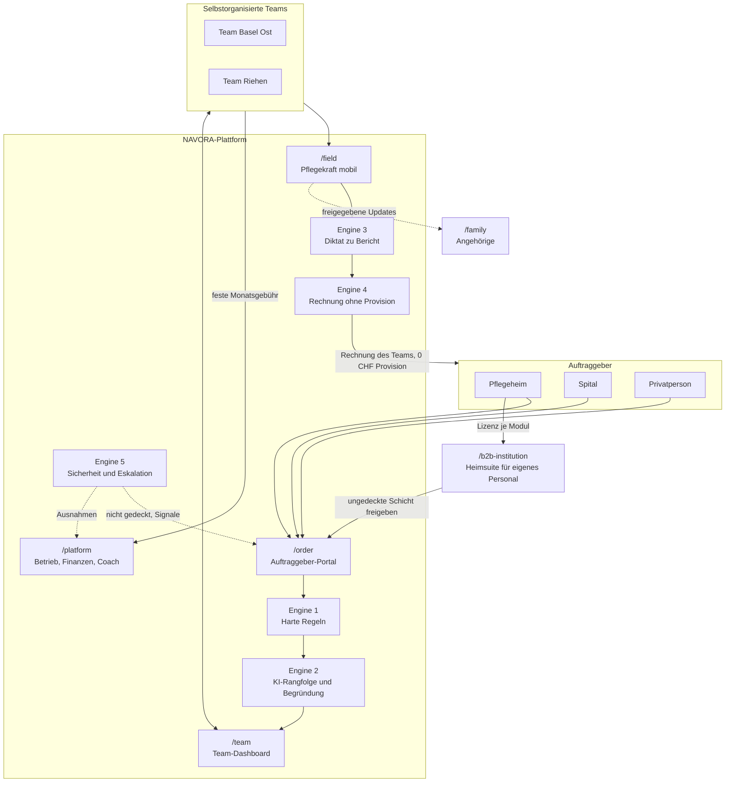

**In einem Satz:** Der Auftraggeber sagt, was er braucht; Regeln und KI finden das passende Team; das Team sagt mit einem Tipp zu; die Pflegekraft pflegt, diktiert und signiert; das Team stellt seine Rechnung ohne Provision; NAVORA lebt von der festen Monatsgebühr und von B2B-Lizenzen.

---

## 1. Das NAVORA-Zielbild

### 1.1 Vier Sätze, die NAVORA ausmachen (FE-076)

1. **Wir bauen ein System, das den Zwischenhandel in der Pflege eliminiert.** Zwischen Heim, Spital oder Privatperson und der Pflegekraft steht keine Vermittlungsagentur und keine Dispositionszentrale mehr, sondern Software.
2. **Die Pflegenden arbeiten als autonome Unternehmerinnen und Unternehmer im Team und behalten den vollen Erlös ihrer Arbeit.** Es gibt keine Marge auf ihre Stunden; der Auftraggeber bezahlt das Team.
3. **NAVORA finanziert sich sauber über eine feste Monatsgebühr** je Teammitglied oder Team und über B2B-Lizenzen, nie über eine Provision.
4. **Die KI ist das Herzstück, das die administrative Arbeit erledigt:** Erfassung, Matching, Koordination, Berichtsentwurf und Abrechnungsvorbereitung. Der Mensch prüft, entscheidet und unterschreibt.

### 1.2 Was abgelöst wird

| Heute | Was es kostet | NAVORA ersetzt es durch |
|---|---|---|
| **Temporärbüro** | Marge auf jeder Stunde; Telefonketten bei jedem Ausfall | direkten Auftrag an ein Team; Preis ohne Vermittlungsaufschlag |
| **Spitex-Verwaltung** | Disposition, Einsatzleitung, Hierarchie, Dokumentationslast | Teamentscheid, KI-Vorschläge, Diktat statt Schreibarbeit |
| **Dienstplanerin im Heim** | Stunden pro Woche für Plan und Ausfälle | KI-Planungsmodul (B2B), das Lücken früh zeigt und Aufträge vorbereitet |

**Spitex-Organisationen und Temporärbüros sind weder Rolle noch Kunde noch Organisationsart in NAVORA** (FE-066). Der Anbieter ist das Team.

### 1.3 Buurtzorg ist der Ausgangspunkt, nicht das Ziel

Buurtzorg hat gezeigt, dass selbstorganisierte Teams ohne Hierarchie funktionieren; laut eigenen Angaben mit 6,7 % Overhead gegenüber 16,9 % bei vergleichbaren Organisationen (`STRATEGY.md`, von Buurtzorg berichtet). NAVORA geht zwei Schritte weiter (`csa`, `STRATEGY.md`):

- **Die Koordinationsarbeit, die bei Buurtzorg noch Menschen leisten, macht bei NAVORA die KI.** NAVORA muss zeigen, dass es den Overhead von 6,7 % ohne Coach-Ebene erreicht oder unterbietet.
- **Die Teams gehören sich selbst.** Ziel sind teameigene Leistungserbringer, nicht Teams innerhalb einer grossen Organisation.

### 1.4 Werteordnung (verbindlich)

**Patientensicherheit ist Voraussetzung und wird nie verrechnet.** Danach gilt diese Reihenfolge:

1. mehr direkte Pflegezeit
2. bessere Kontinuität der Versorgung
3. höheres Nettoeinkommen der Pflegenden
4. Teamautonomie
5. weniger Administration
6. bessere Patientenergebnisse
7. operative Skalierbarkeit
8. Plattformvollständigkeit
9. Umsatz
10. Bequemlichkeit für Engineering

### 1.5 Nordstern

- **Nordstern:** Anteil direkter Pflegezeit je Team und Monat (Kennzahl M-13). Marken: mindestens 60 % (Buurtzorg-Massstab), 75 % als NAVORA-Hypothese.
- **Messbarkeit:** Der Nordstern ist heute nicht messbar (D-23); ein realer Wert entsteht erst mit realen Arbeitszeiten. AN1 zeigt heute den Pflegeanteil innerhalb eines Einsatzes und wird nicht mit den 60 % von Buurtzorg verglichen.

### 1.6 Was NAVORA nie baut

- **keine zentrale Disposition und kein «für das Team zuteilen»** (Produkt-Invariante, FE-039). Die KI schlägt vor, das Team entscheidet.
- **keine hierarchische Aufsicht.** Der Coach vermittelt bei Konflikten und Engpässen und hat keinen allgemeinen Zugriff auf Gesundheitsdaten.
- **keine Provision auf Pflegeumsätze**, weder als Prozentsatz noch je Stunde (FE-055 (3)).
- **keine erfundenen medizinischen, rechtlichen oder tariflichen Regeln.** Eine klinische Regel gibt nur der Clinical Owner frei (D-27, D-43).

---

## 2. Die Modellrechnung: eine Schicht, zwei Welten

Referenzfall des Founders (FE-073 (5)): Spätschicht 16:30–21:30 (5 Stunden) auf einer Demenzabteilung in 4052 Basel, Qualifikation AGS / SRK-Pflegehelfer:in.

### 2.1 Was das Heim zahlt und was das Team erhält

| Je Schicht (5 Std.) | Temporärbüro | NAVORA | Unterschied |
|---|---|---|---|
| Heim zahlt | 75 CHF/Std. × 5 = **375 CHF** | 52 CHF/Std. × 5 = **260 CHF** | **Heim spart 115 CHF** |
| Bei der Pflege kommt an | 28 CHF/Std. × 5 = **140 CHF** (Lohn der Pflegekraft) | **260 CHF** an das Team | **+120 CHF für die Pflege** |
| Zwischen Heim und Pflege | 235 CHF (Arbeitgeberkosten und Marge des Büros) | **0 CHF** NAVORA-Anteil | kein Zwischenanteil |

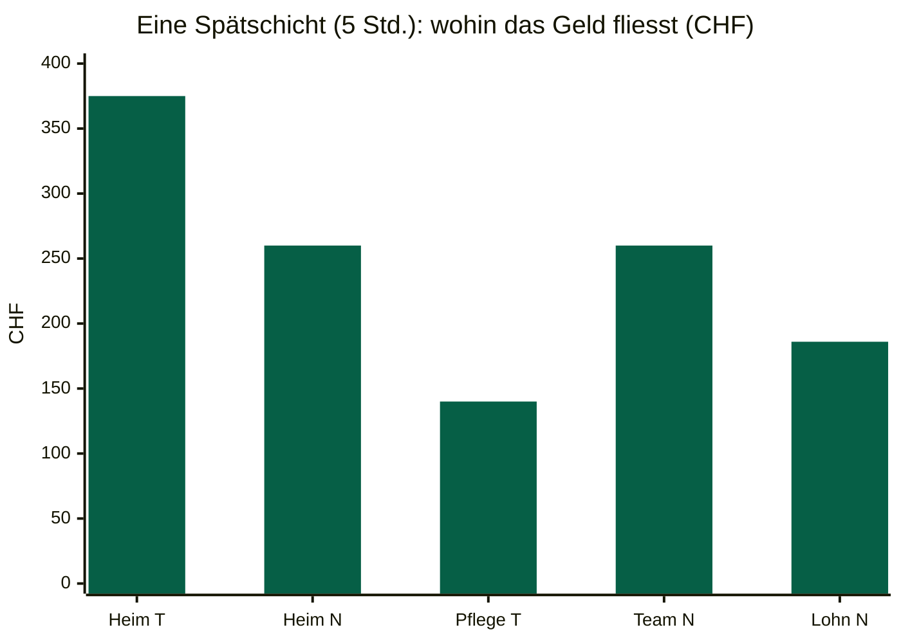

T = Temporärbüro, N = NAVORA. Heim T/N: was das Heim zahlt. Pflege T: Lohn der Pflegekraft beim Temporärbüro. Team N: was das Team erhält. Lohn N: Bruttolohn-Äquivalent nach allen Teamkosten (2.2).

### 2.2 Was davon als Lohn bleibt

Das Team ist Unternehmerin: Aus den 260 CHF bezahlt es die Arbeitgeberkosten (Sozialversicherungen, BVG, UVG), seine eigenen Kosten (Versicherung, Material, Buchhaltung) und das NAVORA-Abo. Mit den Modellannahmen aus `ECONOMICS_COMPARISON.md` (Arbeitgeberkosten 20 %, Teamkosten 10 %, Abo umgerechnet 4 %):

| | Rechnung | Ergebnis |
|---|---|---|
| Bruttolohn-Äquivalent je Stunde | 52 × (1 − 0,10 − 0,04) ÷ 1,20 | **37.27 CHF/Std.** |
| je Schicht | 37.27 × 5 | **186 CHF** |
| gegenüber Temporärlohn | 186 − 140 | **+46 CHF brutto je Schicht (+33 %)** |

**Lesart:** Im Modell spart das Heim 115 CHF je Schicht, und bei der Pflege kommen 120 CHF mehr an; als Bruttolohn bleiben nach allen Teamkosten rund 46 CHF mehr (+33 %). Das ist die Zielrechnung von NAVORA, bei voller Auslastung gerechnet. Ob sie in der Praxis aufgeht, hängt vor allem von der Auslastung ab: Bei 70 % Auslastung fällt der Vorteil im Modell unter einen festen Lohn (`ECONOMICS_COMPARISON.md` §2.3). Der Einkommensvorteil ist deshalb zu belegen, nicht zu versprechen (FE-070 (1)); der Pilot in Phase B liefert die realen Werte.

**Grundlage der Zahlen:** 75 und 28 CHF/Std. sind die Beispielwerte aus der Founder-Fallsimulation (FE-073, Brief BK in der Fassung vom 13.11. 11:25: «founder figures, illustrative»), 52 CHF/Std. ist der Beispielpreis des Referenzfalls; die 28 CHF/Std. sind als Bruttolohn gelesen, die Arbeitgeberkosten des Büros stecken in den 235 CHF; die Kostenannahmen sind die Modellannahmen A1 bis A3 aus `ECONOMICS_COMPARISON.md`. Die Rechnung ist ein Modell der Phase A; reale Werte liefert der Pilot in Phase B (D-42). Der grösste Hebel auf das Einkommen ist die Auslastung des Teams (`csa` BM-11). Die Modellrechnung vertieft `csa` (Kapitel 13).

### 2.3 Wie sich die Gebühr verhält

Die Gebühr ist fest je Monat und Teammitglied, gewichtet nach Pensum (FE-055 (3)). Sie steigt nicht mit dem Umsatz. Je mehr ein Team arbeitet, desto kleiner wird ihr Anteil (`csa` BM-12: entspricht die Gebühr bei voller Auslastung 4 % des Umsatzes, sind es bei 70 % Auslastung rund 5,7 %). Die Höhe ist **OPEN** (D-14).

---

## 3. Die KI als operatives Rückgrat

### 3.1 Grundsatz: zuerst deterministisch, dann KI, immer der Mensch

Jeder KI-gestützte Ablauf folgt derselben Reihenfolge (`AI_FIRST_ARCHITECTURE_UPDATE.md`):

**Unnötiges entfernen → Regeln anwenden → laufend überwachen → KI bereitet vor → Mensch prüft → Mensch entscheidet → Mensch signiert.**

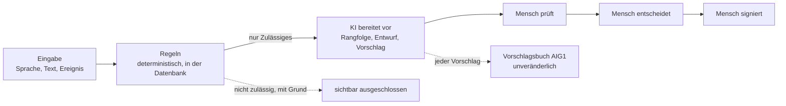

| Bereich | Regeln (deterministisch) | KI bereitet vor | Mensch entscheidet oder signiert |
|---|---|---|---|
| **Erfassung** | Pflichtfelder, PLZ-Liste, Schichtlogik (auch über Mitternacht) | Felder aus Sprache oder Freitext erkennen | der Auftraggeber bestätigt |
| **Matching** | PLZ-Distanz, Qualifikation nach Matrix, Verfügbarkeit, bestätigte Merkmale | Rangfolge **nur unter den Geeigneten**, Begründung in Worten | das Team übernimmt |
| **Koordination** (statt Disposition) | Kontinuitäts-Standard, Lücken, Ausfälle | Tagesvorschlag, Vertretungsvorschlag | das Team bestätigt jeden Wert (AIG1) |
| **Dokumentation** | Pflichtteile, Signaturstatus | Berichtsentwurf aus dem Diktat, jeder Satz mit Quelle | die Pflegekraft signiert |
| **Abrechnung** | Stunden × Preis, Doppelabrechnung, Zeitkonflikte | Erklärung der Abweichungen | das Team gibt die Rechnung frei |
| **Sicherheit** | Signale, Fristen, Eskalation | – | die zuständige Person handelt |

**Ein KI-Score überspielt nie eine fehlende Qualifikation, Lizenz oder Delegation.** Die KI kann eine Rangfolge ordnen, aber kein Team hinzufügen.

### 3.2 KI und Daten (verbindlich)

- **D-35 Regel A gilt:** Keine Klienten- oder Personaldaten gehen an einen KI-Dienst (FE-024).
- **Gewählte Muster** (FE-051):
  - Muster 1: Planung nur mit Kennungen.
  - Muster 2: nur Team-Kennzahlen.
  - Muster 3: strukturierte Erfassung, Bericht per Regel.
  - Muster 4: eigenes Sprachmodell im Schweizer NAVORA-Rechenzentrum. Wird mit synthetischen Daten vorbereitet und getestet; für echte Daten erst nach Rechtsgutachten und DSFA (D-41).
  - Muster 5 (Pseudonymisierung für externe KI) ist **nicht** gewählt.
- **Phase A:** Jede KI arbeitet ausschliesslich mit synthetischen Daten. Synthetische Eingaben enthalten absichtlich einen Namen und eine Diagnose, um zu beweisen, dass sie verworfen werden (`lca` 12:20).
- **Medizinprodukt-Abgrenzung:** Der Kern bleibt ausserhalb des Medizinprodukte-Bereichs; der KI-Dokumentationsentwurf wird als separat qualifiziertes Modul mit eigener Zweckbestimmung gebaut (D-34, entschieden A plus C).
- **Stand heute:** Es gibt im Code keinen Aufruf eines KI- oder Sprachdienstes. Beide registrierten «Agenten» sind regelbasiert. Die Governance (Vorschlagsbuch, Bestätigung je Wert, Stopp, Rückblick) ist **IMPLEMENTED** (AIG1).

---

## 4. Finanz- und Geschäftsmodell

### 4.1 Zwei Geschäftsmodelle (FE-040, FE-055)

| | **GM-1 Teamgeschäft** | **GM-2 B2B-Software** |
|---|---|---|
| Kunde | Heim, Spital oder Privatperson erteilt einem Team einen Auftrag | Heim oder Spital für die eigene Belegschaft |
| Leistung | das Team pflegt und rechnet über eine rechtlich geeignete Struktur ab | Module (4.2) |
| NAVORA-Erlös | **feste monatliche Plattformgebühr je Teammitglied oder Team**, gewichtet nach effektivem Pensum (VZE); **Höhe OPEN** (D-14) | Softwarelizenz je Modul; **Preis OPEN** |
| Verboten | Provision in Prozent, Betrag je Stunde, jeder Anteil an der Pflegevergütung | – |
| Rechtsform | **OPEN** (D-44; z. B. Genossenschaft; Entscheid des Founders) | – |

**Auftragskonstellationen** (`BUSINESS_MODELS_AND_CONSTELLATIONS.md`): KON-1 Heim beauftragt ein externes Team · KON-2 Heim führt den ganzen Pflegealltag auf NAVORA · KON-3a/b Spital (Einsatz, Übergang) · KON-4 Privatperson · KON-5 B2B-Modul. Ein Einsatz in einem Heim, das NAVORA als B2B-Software nutzt, ist immer ein eigener GM-1-Auftrag (FE-055 (4)).

### 4.2 Modulares B2B-Portfolio (GM-2)

| Modul | Inhalt | Status |
|---|---|---|
| **1 Kern: KI-Planung** | vorausschauende Schicht- und Einsatzplanung, Ausfallkoordination; ungedeckte Schicht als vorausgefüllter Auftrag an Teams | Planung und Ausfall ambulant **IMPLEMENTED** (PLAN3, ABS1, COVER1); Schichtmodell Heim **PLANNED** (NH-A1) |
| **2 Add-on: KI-Protokoll** | Diktat → konformer Berichtsentwurf → zwingende menschliche Signatur | Signatur und Rückgabe **IMPLEMENTED** (F6, F6R, F7); Diktat und KI-Entwurf **PLANNED** (B6) |
| **3 Add-on: Angehörigenportal** | berechtigte, strukturierte Updates und Fotos; getrennt von der klinischen Akte; schützt die Pflegenden vor Unterbrechungen; Erreichbarkeit ausserhalb der Arbeitszeit **OPEN** (FE-070 (4)) | **PLANNED** (D-40 minimale Option B; kein Brief) |

### 4.3 Strikte Trennung der drei Erlösströme

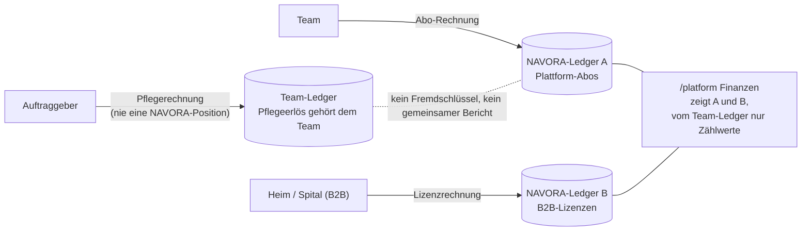

| Strom | Gehört | Beleg | Ledger | Dashboard |
|---|---|---|---|---|
| **Pflegeerlös** | dem Team | Rechnung des Teams an den Auftraggeber | Team-Ledger | Team-Dashboard |
| **NAVORA-Abo-Umsatz** | NAVORA | Abo-Rechnung an das Team | NAVORA-Ledger A | Betreiber-Cockpit |
| **NAVORA-B2B-Umsatz** | NAVORA | Lizenzrechnung an das Heim oder Spital | NAVORA-Ledger B | Betreiber-Cockpit |

- Die Trennung ist im Datenmodell erzwungen und getestet (FE-055 (2), Brief GMSEP).
- Eine Pflegerechnung enthält nie eine NAVORA-Position.
- Kein Betreiber-Dashboard zeigt Pflegeerlöse einzelner Teams, nur aggregierte Zählwerte.

**Stand:** Abrechenbare Fakten und eine Umsatzvorschau sind **IMPLEMENTED** (J5). Rechnungen, Abo-Ledger und B2B-Ledger sind **PLANNED**.

### 4.4 Rechtliche Leitplanken des Modells (`lca`, beratend)

- **Arbeitsvermittlung (AVG):** Laut SECO ist eine Internetplattform «immer auch Arbeitsvermittlung im Sinne des AVG» (`decisions/D-44.md`); das betrifft die Vermittlung von Anstellungen. Ob ein Dienstleistungsauftrag an ein Team darunter fällt, ist **UNKNOWN** (D-44 L-10). Nach `lca` ist eine Gebühr auf den gelesenen Quellen konform, wenn sie nicht an Aufträge gebunden ist, keine Zahlungsflüsse über NAVORA laufen und NAVORA nicht gegen Entgelt Einrichtungen und Teams zusammenführt. Weil NAVORA Aufträge und Teams zusammenbringt, ist die Gestaltung der Gebühr (L-10) dem Founder vorgelegt (wartet auf Freigabe). Ob die Schicht eines externen Teams in einem Heim (KON-1) Personalverleih oder Auftrag ist, ist **OPEN** und braucht ein Rechtsgutachten (Q-44a, FE-050).
- **Sprache:** NAVORA spricht von «Auftrag» und «Schichtauftrag», nie von «Vermittlung» oder «Personalverleih».
- **Rechnungsentwurf in Phase A:** Titel «Rechnungsentwurf (Simulation) – keine gültige Rechnung»; keine KVG/KLV-Position, keine ZSR/GLN, keine MWST-Zeile, keine Provision.
- **KVG-Abrechnung (Tiers payant, Tiers garant):** **OPEN** (D-18, D-22, D-44); in BK nicht gebaut.

---

## 5. Die sechs Portale: der Grundriss

| Portal | Route (Ziel) | Nutzende | Zweck | Heute im Code | Status |
|---|---|---|---|---|---|
| **Auftraggeber-Portal** | `/order` | Heim, Spital, Privatperson | Bedarf per Sprache oder Text, erkannte Felder bestätigen, Stand «gedeckt / nicht gedeckt», Rechnungen | `/intake` wird von Operations bedient; keine Auftraggeber-Rolle | **PLANNED** (BK) |
| **Team-Dashboard** | `/team` | selbstorganisiertes Team | Angebote mit Begründung, Teamentscheid, Planung, Kontinuität, Team-Finanzen | `/team`, `/team/tagesplan`, `/team/vorschlaege` | **IMPLEMENTED** (Angebotskarte BK **PLANNED**) |
| **Caregiver Mobile** | `/field` | Pflegekraft | nächster Einsatz, Zeit, Aufgaben, Diktat, Signatur; offline-first | `/field`, `/work` | **IMPLEMENTED** (Diktat **PLANNED**; offline-first **PLANNED**) |
| **B2B-Heimsuite** | `/b2b-institution` | Heim oder Spital für die eigene Belegschaft | Schichtplanung, Ausfall, Protokoll (GM-2-Module) | – | **PLANNED** (B9, GM-2) |
| **Angehörigen-Ansicht** | `/family` | berechtigte Angehörige | strukturierte Updates, keine klinische Akte | – | **PLANNED** |
| **Betreiber- und Coach-Cockpit** | `/platform` | NAVORA-Betrieb, Finanzen, Support, Coach | SaaS-Kennzahlen, Teamgesundheit (aggregiert), Systemausnahmen; der Coach vermittelt ohne Aufsicht und ohne Akteneinsicht | `/operations` (Ausnahmen), `/analytics`, `/admin` | **PLANNED** als Zusammenführung; Teile **IMPLEMENTED** |

Die folgenden Bildschirme sind **Konzept-Wireframes** im NAVORA-Designsystem (v77: Farben, Schrift, 390-px-Regeln). Texte folgen den Vorschlägen von `uxa` (`UX_REVIEW.md`, UXR-188) und den Leitplanken von `lca` (12:20). Sie sind **PROPOSED**; `uxa` bestätigt oder korrigiert sie (Kapitel 13).

### 5.1 P1 `/order`: Bedarf in eigenen Worten melden

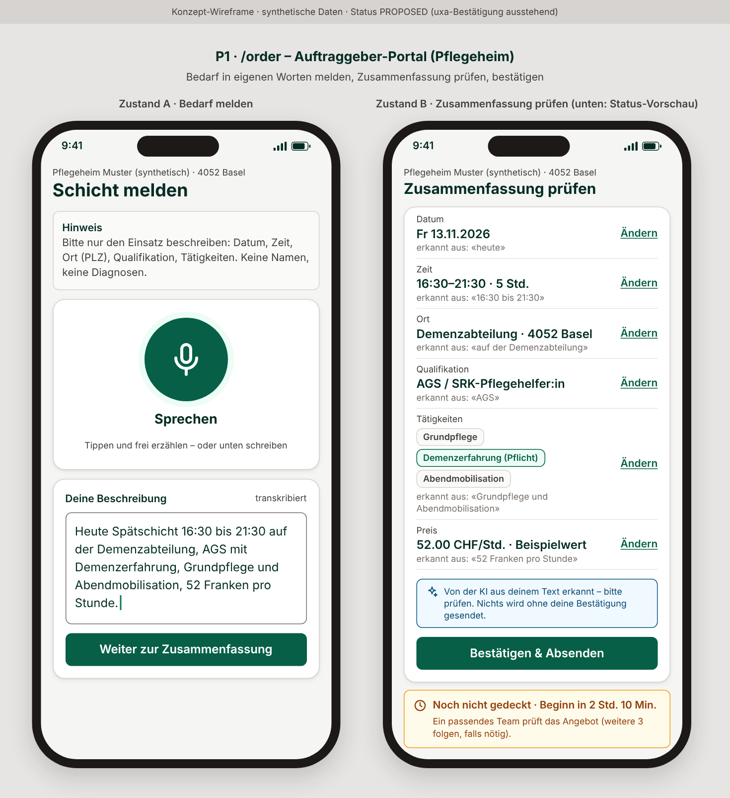

- **Erfassen:** sprechen oder schreiben. Der Hinweis verlangt nur Einsatzdaten, keine Namen und keine Diagnosen (`lca` M-a).
- **Zusammenfassung:** Jedes Feld zeigt, woraus es erkannt wurde («erkannt aus: «heute»») und lässt sich ändern. Relative Angaben werden als Datum gezeigt (FE-074).
- **Ein Klick:** «Bestätigen & Absenden». Ohne Bestätigung wird nichts gesendet.
- **Stand:** «Noch nicht gedeckt · Beginn in 2 Std. 10 Min.», dann «Gedeckt durch Team …», bei erschöpfter Kaskade «Kein passendes Team mehr frei» und ab Schichtbeginn «Nicht gedeckt» (UXR-188). Kein stilles Verfallen (BK-6). Ob eine Privatperson die Zahl der Teams sieht, prüft `lca`.

### 5.2 P2 `/team`: das begründete Angebot

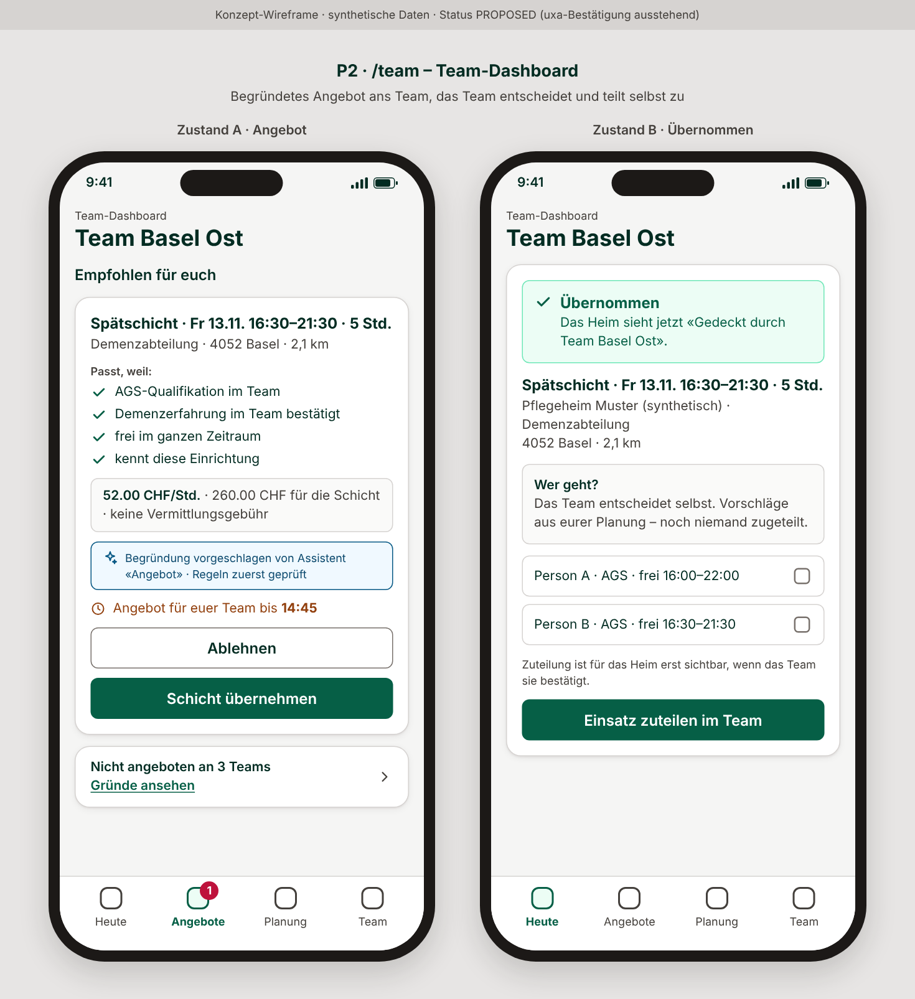

- **Empfohlen für euch:** Schicht, Ort, Distanz; darunter «Passt, weil:» mit den geprüften Fakten. **Kein Prozentwert, keine Sterne, kein Rang** (`uxa`).
- **Transparenz:** «Nicht angeboten an 3 Teams – Gründe ansehen»; jedes ausgeschlossene Team hat seinen Grund (BK-2).
- **Zeitfenster:** «Angebot für euer Team bis 14:45» (Kaskade, BK-5).
- **Teamautonomie:** Nach «Schicht übernehmen» entscheidet das Team selbst, wer geht. Vor der Übernahme sieht das Team keine Klientendaten und keine Strassenadresse (`lca` M-b); Merkmale erscheinen ohne Namen der Person (`uxa`, `UX_REVIEW.md`).
- **Offen für `uxa` und `lca`:** Die Zeilen «Empfohlen für euch» und «Nicht angeboten an 3 Teams – Gründe ansehen» sind Vorschläge des PO. Ob ein Team die Ausschlussgründe anderer Teams sehen darf, ist eine Sichtbarkeitsfrage, die noch keine Rolle geprüft hat.

### 5.3 P3 `/field`: ein Tipp, dreissig Sekunden, eine Unterschrift

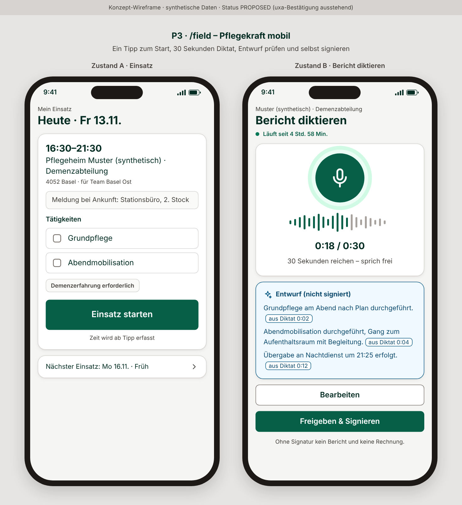

- **1-Tap-Check-in:** «Einsatz starten»; die Zeit läuft ab dem Tipp (F1 bis F4, IMPLEMENTED).
- **30-Sekunden-Diktat:** frei sprechen; die KI erstellt einen Entwurf, jeder Satz mit Quelle («aus Diktat 0:04»).
- **Signatur:** «Freigeben & Signieren». Ohne Signatur gibt es keinen Bericht und keine Rechnung (BK-8n).

### 5.4 P4 `/b2b-institution`: das Planungsmodul des Heims

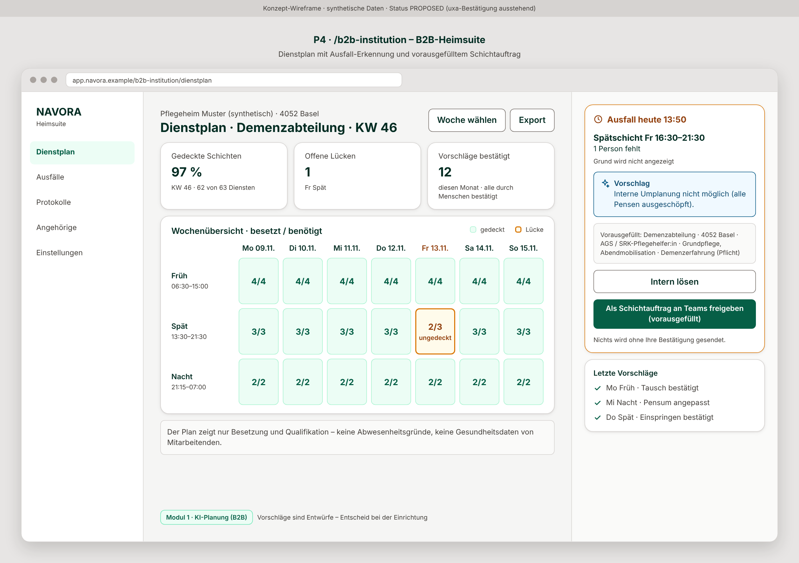

- **Dienstplan der Abteilung:** Woche × Schicht, Lücken sofort sichtbar.
- **Ausfall:** «1 Person fehlt» ohne Name und ohne Grund (Abwesenheitsgründe bleiben verborgen).
- **Brücke zum Teamgeschäft:** «Als Schichtauftrag an Teams freigeben (vorausgefüllt)»: aus der Lücke wird mit einem Klick ein bestätigter Auftrag (Demand-Pooling, FE-055 (4)).

### 5.5 P5 `/family`: Transparenz ohne Unterbrechung

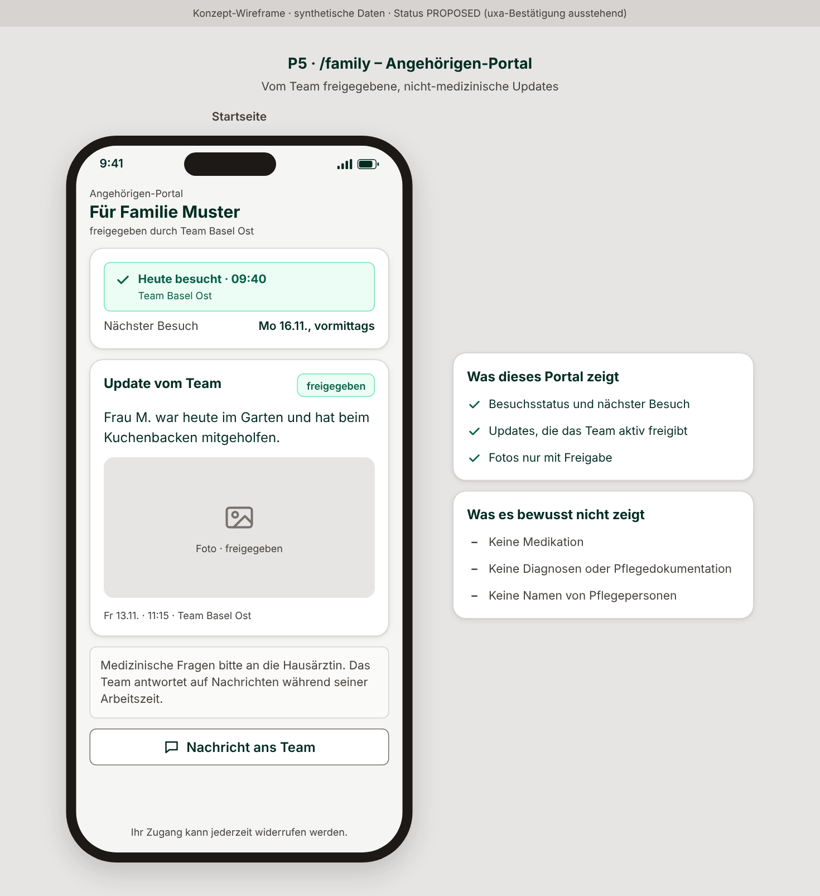

- **Statuskarte:** besucht wann, von welchem Team, nächster Besuch.
- **Update vom Team:** nur freigegebene, nicht-medizinische Inhalte und Fotos.
- **Schutz der Pflegenden:** Nachrichten gehen an das Team, beantwortet während der Arbeitszeit; medizinische Fragen an die Hausärztin. Zugang jederzeit widerrufbar.

### 5.6 P6 `/platform`: das Gründer-Cockpit

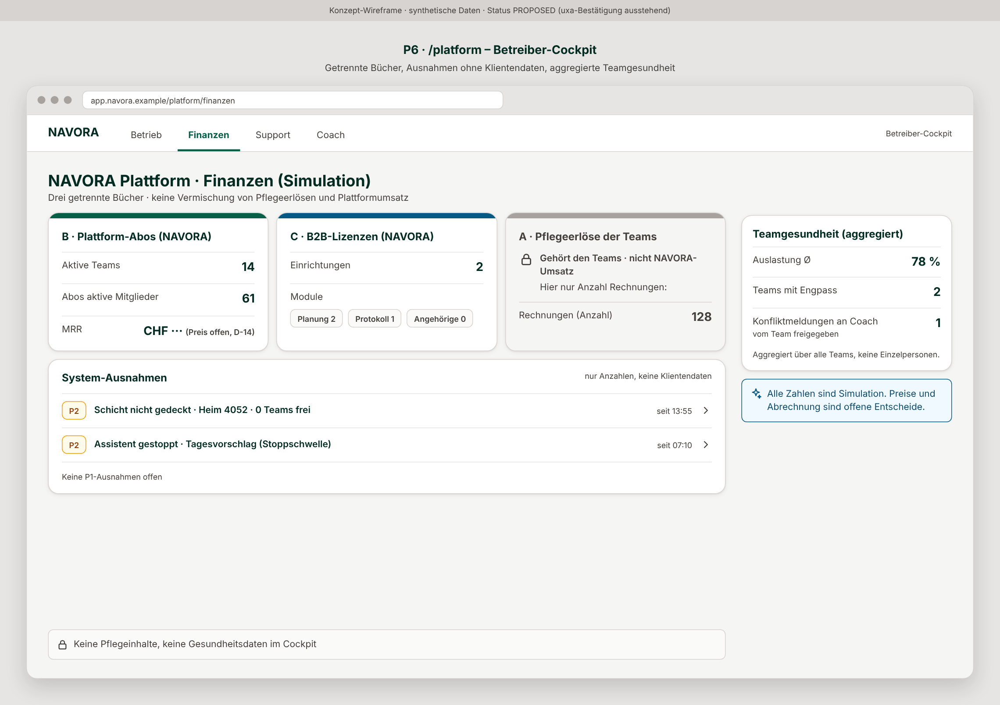

- **Getrennte Bücher:** Plattform-Abos und B2B-Lizenzen als NAVORA-Umsatz; Pflegeerlöse der Teams gesperrt, nur als Anzahl.
- **System-Ausnahmen:** nur Zählwerte und Typen, keine Klientendaten.
- **Teamgesundheit:** aggregiert, nie je Person; Konfliktmeldungen erreichen den Coach nur, wenn das Team sie freigibt.
- **Rollen im Cockpit:** Betrieb, Finanzen, Support und Coach sind getrennte Funktionen ohne unbeschränkten Adminzugang (FE-070 (2)).

---

## 6. Wie sich die Menschen durch das Gebäude bewegen: der Kernablauf

Der Kernablauf gilt für jeden Auftrag, nicht für einen Einzelfall (FE-074). Brief: [`briefs/BK.md`](../agents/briefs/BK.md).

### 6.1 Der Weg einer Schicht vom Anruf bis zur Rechnung

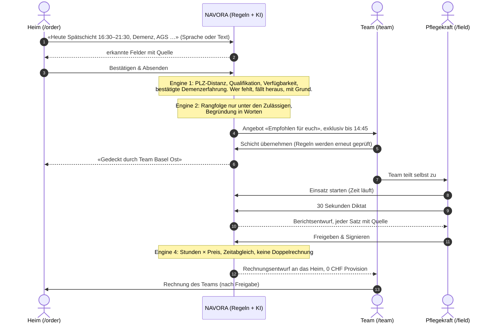

### 6.2 Die Angebotskaskade: nie stilles Warten

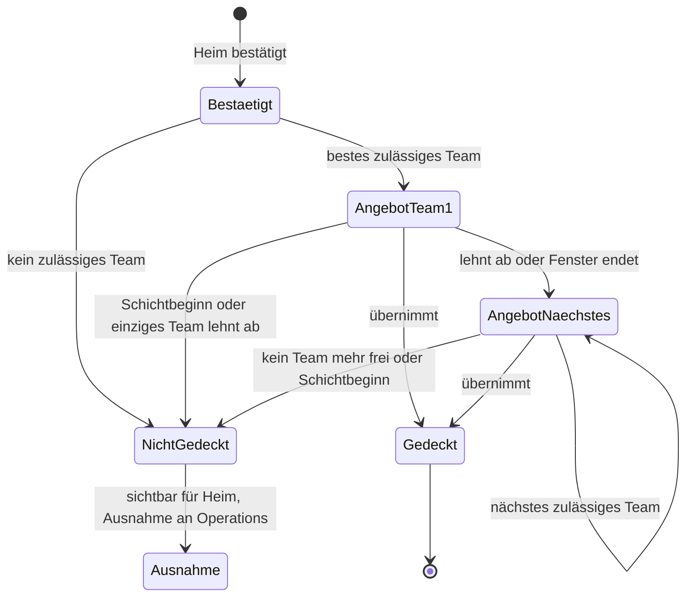

Das Zeitfenster ist ein Betriebsparameter, kein klinischer Wert; den Standard schlägt `eng` per ADR vor (BK-5). Was der Heim-Stand wörtlich sagt, steht in 5.1.

### 6.3 Schritte, Engines und Stand

| # | Schritt | Wer | Engine | Status |
|---|---|---|---|---|
| 1 | Bedarf erfassen (Sprache oder Text) → KI erkennt Felder → Auftraggeber bestätigt | Auftraggeber | E2 (Erfassung) | **PLANNED** (BK-1) |
| 2 | Harte Prüfung: PLZ-Distanz, Qualifikation nach Matrix, Verfügbarkeit, bestätigte Merkmale | System | E1 | Region und Pflichtqualifikation **IMPLEMENTED**; PLZ-Distanz, Matrix im Matching und Merkmale **PLANNED** |
| 3 | Rangfolge unter den Geeigneten, Begründung in Worten | System | E2 | **PLANNED** (BK-3, BK-4) |
| 4 | Angebot zuerst an das beste Team (Kaskade mit exklusivem Zeitfenster) | System → Team | E1, E5 | heute sehen alle geeigneten Teams das Angebot (**IMPLEMENTED**); Kaskade **PLANNED** (BK-5) |
| 5 | Teamentscheid mit einem Tipp; der Auftraggeber sieht «gedeckt» | Team | E1 | Teamentscheid **IMPLEMENTED** (J2); Anzeige für den Auftraggeber **PLANNED** |
| 6 | Einsatz: Zeit, Aufgaben | Pflegekraft | – | **IMPLEMENTED** (F1-F4) |
| 7 | Diktat → KI-Berichtsentwurf | Pflegekraft | E3 | **PLANNED** (B6, BK-8) |
| 8 | Prüfung und Signatur | Pflegekraft | – | **IMPLEMENTED** (F6, F7) |
| 9 | Rechnung des Teams an den Auftraggeber, ohne Provision | Team | E4 | Fakten **IMPLEMENTED** (J5); Rechnung **PLANNED** (BK-9) |
| ∞ | Nicht gedeckt, überfällig, Sicherheitssignal → Eskalation | System | E5 | Signale **IMPLEMENTED** (SIG1, SIG2, OPS1); «nicht gedeckt» je Auftrag **PLANNED** (BK-6) |

**Ziel für die Handgriffe je Auftrag (BK):** höchstens einer beim Auftraggeber, einer im Team, drei bei der Pflegekraft nach der Schicht.

### 6.4 Patientensicherheits-Garantien im Ablauf (`cra`-Gate)

| Garantie | Wo im Ablauf | Test |
|---|---|---|
| Ein Team, das eine harte Regel verletzt, erhält **nie** ein Angebot, egal was die Rangfolge sagt | Schritt 2–4 | BK-2n (pgTAP auf den Angebotszeilen) |
| Die Regeln werden beim Tipp «übernehmen» erneut geprüft | Schritt 5 | BK-5n |
| «Nicht gedeckt» bleibt sichtbar; kein stilles Verfallen | ∞ | BK-6 |
| Ein Entwurf wird nur von der Pflegekraft der Schicht signiert; ohne Signatur keine Rechnung | Schritt 7–9 | BK-8n |
| Ein wiedereröffneter Fall ohne Team geht nie verloren | ∞ | SAFE-D11 (abgenommen) |
| Qualifikationsregeln sind nur Simulationsregeln, bis der Clinical Owner sie freigibt | Schritt 2 | Matrix v0.2 PROPOSED (D-27, D-43) |

---

## 7. Wer sieht was: Datensichtbarkeit

| Daten | Auftraggeber | Team (vor Übernahme) | Team (nach Übernahme) | Pflegekraft | Angehörige | Betrieb / Finanzen | Coach |
|---|---|---|---|---|---|---|---|
| Eigener Auftrag und Stand | ja | – | – | – | – | Zählwert | – |
| Angebot (Schicht, Ort, PLZ, Qualifikation) | ja | ja | ja | ja | – | Zählwert | – |
| Strassenadresse | ja | **nein** | ja | ja | – | – | – |
| Name der betreuten Person | ja (eigene) | **nein** | nach Bedarf | ja | eigene Angehörige | – | – |
| Bestätigte Merkmale des Teams | «im Team bestätigt» | eigene | eigene | eigene | – | – | – |
| Bericht | nach Vereinbarung (OPEN) | – | ja | ja | **nur freigegebene Updates** | – | – |
| Pflegerechnung | eigene | – | ja | – | – | nur Anzahl | – |
| Abo- und B2B-Rechnungen | eigene Lizenz (B2B) | – | eigene Gebühr | – | – | ja | – |
| Konflikte und Engpässe | – | – | ja | – | – | aggregiert | nur vom Team freigegeben |

**Status: Vorschlag des PO (PLANNED).** Quelle: `lca` 12:20 (M-a bis M-d, A-a bis A-d), FE-070 (2). Die verbindliche Berechtigungsmatrix je Rolle ist **OPEN** (D-3, Freigabe durch den Clinical Owner); technische Umsetzung im Handbook §6.

---

## 8. Die verbindliche Block-Lieferkette

**Es ist genau ein Block aktiv** (README Regel 12). Vorbereitung, also Briefs, ADRs und rote Tests auf Branches, läuft parallel. Konkurrierende Feature-Merges sind verboten.

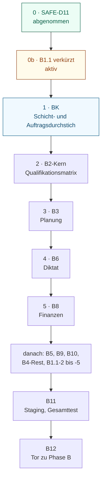

| Schritt | Block | Inhalt | Status am 2026-11-13 |
|---|---|---|---|
| 0 | **SAFE-D11** | ein wiedereröffneter Fall ohne Team geht nie verloren | **abgenommen** für Simulation, synthetische Daten (`29e54ec`, 20/20) |
| 0b | **B1.1 (verkürzt)** | Regionsliste, Altwert-Absicherung (#1181, #1184), Seed nur BS/BL mit PLZ | **aktiv**; #1181 gemergt; #1184 und B1.1-1c (#1196) offen; Abnahme auf dem Merge-Commit von B1.1-1c |
| 1 | **BK** | universeller Auftragsdurchstich: Erfassung → Prüfung → Empfehlung → Teamentscheid → `/field` → Bericht → Rechnung; Szenario-Matrix | **genehmigt**, startet nach B1.1 |
| 2 | **B2-Kern** | Qualifikationsmatrix auf jedem Zuteilungsweg, Nachweise, Delegation | QUAL1 Teil 1-2 **IMPLEMENTED** (nur Simulation); Matrix **PROPOSED** |
| 3 | **B3** | Team- und KI-Planung, Ausfallkoordination, Kontinuität | **IMPLEMENTED**, nicht als Block abgenommen |
| 4 | **B6** | Diktat, KI-Dokumentationsentwurf, menschliche Freigabe | Signatur **IMPLEMENTED**; Diktat und Entwurf **PLANNED** |
| 5 | **B8** | Finanzen: Rechnung, Validierung, Doppelabrechnung, drei getrennte Ledger | **PLANNED** (BILL1, GMSEP) |
| danach | B5 Sicherheitssignale · B9 Pflegeheim-Betrieb · B10 Kennzahlen · B4-Rest · B1.1-2 bis -5 | Vertiefung und Sonderfälle (FE-073 (4)) | gemäss `PRODUCT_BLOCKS.md` |
| Abschluss Phase A | **B11** | Staging, Wiederherstellung, Gesamttest beider Abläufe | **PLANNED** (D-2; Staging wartet auf ein Owner-Secret) |
| Tor zu Phase B | **B12** | Clinical Owner, Rechtsgutachten, Pilotvertrag, externer Sicherheitstest, KI-Pfad, Produktion | **OPEN**, Founder |

**Hinweis zur Kette (PO).** BK nimmt von B2, B3, B6 und B8 je einen dünnen, durchgehenden Schnitt vorweg. Diese Blöcke vertiefen danach, was BK erstmals verbindet. B5 bleibt bestehen, weil die Eskalation ungedeckter Schichten patientensicherheitskritisch ist. Ihr Kern liegt schon in BK (BK-6).

---

## 9. Harte Gate-Kriterien, Phase A und Phase B

### 9.1 Merge und Abnahme (FE-071, README Regel 12)

1. **Spezifikation vor Bau.** Jeder Brief nennt:
   - Problem und Nutzen;
   - Umfang und Nicht-Ziele;
   - Rollen und Ansichten;
   - Abhängigkeiten;
   - positive und negative Abnahmetests;
   - nötige Prüfungen (UX, klinisch, rechtlich, Sicherheit);
   - die acht Fragen der Vision.
2. **Merge** eines Engineering-PR nur:
   - für den aktiven Block oder eine benannte Sicherheitsausnahme;
   - mit automatisierten Tests für das geänderte Verhalten;
   - mit grüner CI auf dem aktuellen Kopf;
   - mit den Gate-Zeilen der Rollen.
   CI auf dem Merge-Commit muss grün sein, sonst folgt ein Revert-PR.
3. **Abnahme** nur auf einem **benannten integrierten Commit**: `ci` grün und **`ci-repeat` 10/10** (`db`, `e2e`). Belegt wird aus den Roh-Logs; übersprungene oder abgebrochene Läufe zählen nicht.
4. **Jede Abnahme nennt ihr Gate:** «Simulation, synthetische Daten» oder «freigegeben für reale Personen und Daten».

### 9.2 Phase A und Phase B (strikt getrennt)

| | Phase A (jetzt bis M9, 2027-03-12) | Phase B (später) |
|---|---|---|
| Partner | simuliert: Pflegeheim-Abteilung, ambulante Teams, Auftraggeber in Basel-Stadt und Basel-Landschaft | reale Pilotorganisation, nach heutiger Richtung ein Pflegeheim |
| Daten | **nur synthetisch** (FE-021, FE-066); Testumgebungen auf Produktionsniveau geschützt | reale Daten erst nach allen Toren |
| KI | nur synthetische Eingaben | erst nach D-41 (Muster 4, Rechtsgutachten, DSFA) |
| Regeln | Matrix und klinische Regeln PROPOSED | vom Clinical Owner freigegeben (D-43) |

**Tore vor realen Daten (B12):**

- Clinical Owner ernannt (G-1, D-43);
- Rechtsgutachten Q1 2027 (FE-050: D-18, D-22, D-42, D-44, D-41);
- Pilotvertrag;
- externer Sicherheitstest (FE-049);
- Repository privat (D-7);
- Staging und belegte Wiederherstellung (B11);
- DSFA.

---

## 10. Meilensteine und Kennzahlen

| Meilenstein | Ziel | Stand |
|---|---|---|
| Lieferung 2 / 3 / 4 | 13.11. / 16.11. / 17.11.2026 (FE-072 (6)) | Lieferung 2 ist dieses Dokumentpaar |
| M9 Phase A bestanden | **2027-03-12**: beide Abläufe (ambulant und Heim) und der BK-Auftragsablauf auf einem benannten Commit im Staging, alle Stoppfälle belegt | in Arbeit |
| M10 Produktionsbereitschaft | Tore aus §9.2 | **OPEN** |

| Kennzahl | Was | Wert |
|---|---|---|
| M-13 Nordstern | Anteil direkter Pflegezeit je Team und Monat | 1 |
| M-15 / M-16 | Administrationsminuten je Einsatz; Zeit bis zum finalen Bericht | 1, 5 |
| M-11 / M-17 | menschliche Handlungen je Planung und Ausfall | 4, 5 |
| M-12 / M-20 | Eingriffe von Operations; Entscheide im Team | 4 |
| M-19 | Kontinuität (Bezugspflege-Anteil) | 2 |
| M-18 | Abrechnungsfehler und manuelle Ausnahmen | 5, 9 |
| M-21 / M-10 | Sicherheitsindikatoren; offene blockierende Befunde | Sicherheit |
| M-02 / M-03 / M-14 | Merge-Warteschlange, Durchlaufzeit, CI-Gesundheit | 8 |
| **neu (BK)** | Minuten von der Erfassung bis «gedeckt»; Anteil gedeckter Aufträge; Handlungen je Auftrag (Auftraggeber, Team, Pflegekraft) | 1, 4, 5 |

Alle Werte gelten je Team und nie je Person. In Phase A sind es synthetische Werte. Die Prozentwerte je Meilenstein führt der PO wöchentlich in V2 §4 weiter, bis sie in V3 übernommen sind.

---

## 11. Founder-Entscheidungsboard (offen)

| # | Frage | Wirkt auf |
|---|---|---|
| D-14 | Höhe der Plattformgebühr (Variante F3/F6 nach VZE) | Kap. 2.3, 4, Abo-Ledger |
| D-44 | Rechtsform und Vertragsweg je Auftragskonstellation (Genossenschaft? Personalverleih oder Auftrag, AVG); Gebührengestaltung L-10 wartet auf Freigabe | GM-1, BK-Rechnung, Phase B |
| D-41 | KI-Pfad für reale Daten (Muster 4: Rechenzentrum, Gutachten, DSFA) | E2, E3 |
| D-2 | Hosting: App-Host Infomaniak und `navora-prod` entschieden (FE-063, FE-064); offen sind der Auftragsverarbeitungsvertrag und das Upgrade vor realen Daten | B11 |
| STG1 | Owner-Secret `STAGING_DB_URL` für das Staging | B11 |
| B0-6 | Repository-Schutz (Ruleset) | B12 |
| G-1 / D-43 | Ernennung des Clinical Owners | Matrix, klinische Regeln, D-3, Phase B |
| PLZ-Quelle | synthetische Tabelle (konform) oder swisstopo-Verzeichnis (schriftliche Bestätigung von swisstopo nötig, `lca`) | BK-b |
| GM-2 | Preis und Reihenfolge der B2B-Module; Angehörigenportal-Brief | Kap. 4.2 |

---

## 12. Rollen

| Rolle | Verantwortung |
|---|---|
| `po` | WAS, WARUM, WANN; einzige Merge-Instanz; Abnahme mit Belegen; dieses Dokument |
| `eng` | WIE; Code, Migrationen, Tests, ADRs; Architecture Handbook |
| `cra` | klinische Sicherheit und Dokumentation; Gate je PR |
| `lca` | Recht, Datenschutz, Tarife, Verträge; Gate je PR |
| `uxa` | UX, Texte, 390/1440 px; Gate je PR |
| `aia` | KI-Verträge (Eingabe, Ausgabe, Stopp-Regel) |
| `csa` | Strategie, Geschäftsmodell, Markt |
| Founder | Strategie, Preis, Recht, Verträge, Einstellungen, Freigabe dieses Dokuments |

---

## 13. Das gemeinsame Werk: Beiträge und Unterschriften der Rollen

**Arbeitsweise (FE-076).** Die Rollen arbeiten als eigene Agenten im Stundentakt und koordinieren über das Repository. Diese Fassung baut deshalb auf allem, was jede Rolle bereits geschrieben hat; jeder Beitrag ist mit seiner Quelle genannt. Gleichzeitig hat jede Rolle einen konkreten Auftrag erhalten (Issues unten). Ihre Ergänzungen und Unterschriften fliessen in V3.2 ein. **Bis eine Rolle unterschrieben hat, gilt ihr Teil als PO-Entwurf auf Grundlage ihrer Dokumente.**

| Rolle | Was in dieser Fassung von ihr stammt (Quelle) | Auftrag für V3.2 | Unterschrift |
|---|---|---|---|
| `csa` | Buurtzorg-Massstab und Schritt darüber hinaus (`STRATEGY.md`); Gebührenhypothesen BM-1, BM-2, BM-11, BM-12; Konstellationen | Marktdisruption und Modellrechnung (Kap. 1, 2) als marktführendes Modell ausarbeiten: Spanne der Temporärpreise, Auslastung, Gebührenhöhe, Wettbewerb | ausstehend |
| `uxa` | Designsystem v77 (Farben, Schrift, 390 px); Angebotskarte, Deckungsstand, Zusammenfassung «Bestätigen & Absenden» (`UX_REVIEW.md`, UXR-188) | die sechs Wireframes (Kap. 5) prüfen, korrigieren und in den Screenkatalog übernehmen; fehlende Screens `/order`, `/b2b-institution`, `/platform`, Diktat | ausstehend |
| `cra` | Qualifikationsmatrix v0.2 (PROPOSED); Befund CGR-200 (Schicht über Mitternacht); die Garantien BK-2n, BK-6, BK-8n stammen aus dem PO-Brief BK und sind `cra` zur Prüfung vorgelegt (BK-Gate) | Matrix und Sicherheitsgarantien in den BK-Ablauf einarbeiten (Kap. 6.4); Fristen für «nicht gedeckt» | ausstehend |
| `lca` | PLZ-Quelle und Regeln PLZ-a bis PLZ-c; Datenminimierung M-a bis M-d; Merkmale A-a bis A-d; Rechnungsentwurf I-a bis I-c; AVG-Einordnung und D-44 (12:20) | AVG-Abgrenzung je Konstellation und datenschutzkonforme PLZ-Zuordnung verbindlich ausformulieren; Fragen für das Rechtsgutachten | ausstehend |
| `eng` | Code-Inventar; ADR-186, ADR-187; offene Fragen T-1 bis T-9; Kaskade als Betriebsparameter | Machbarkeit der fünf Engines und des Datenmodells (Handbook) prüfen und unterzeichnen; ADRs zu T-1 bis T-4 | ausstehend |
| `aia` | – | KI-Verträge für Erfassung (BK-1a), Rangfolge (BK-3, BK-4), Berichtsentwurf (BK-8) | ausstehend |

Aufträge: `csa` #1195 · `uxa` #1199 · `cra` #1200 · `lca` #1201 · `aia` #1202 · `eng` #1194.

---

## 14. Pflege dieses Dokuments

- Der PO hält das Dokument lebendig:
  - Versionszeile je Änderung;
  - Grund und betroffene Kapitel;
  - Abgleich mit `FOUNDER_DECISIONS.md`, `PRODUCT_BLOCKS.md`, `NEXT_CAPABILITY.md`.
- **Kein Inhalt wird still geändert.** Eine Founder-Entscheidung wird nur durch eine neuere ersetzt.
- Freitags schreibt der PO aus Kapitel 10 den `FOUNDER_EXECUTIVE_REPORT.md`.
- Wireframes werden aus Quelldateien erzeugt; nach der Übernahme durch `uxa` gilt der Screenkatalog als Quelle.

### Versionen

| Datum | Version | Änderung | Grund |
|---|---|---|---|
| 2026-11-13 | 3.0 Entwurf | Neufassung von Grund auf: Vision, Geschäftsmodell, sechs Portale, Kernablauf, Lieferkette, Gates | Founder-Anweisung FE-075 |
| 2026-11-13 | 3.1 Entwurf | Zielbild in vier Sätzen; Modellrechnung der Referenzschicht (Heim −115 CHF, Pflege +120 CHF, Bruttolohn +46 CHF); Plattform auf einer Seite; sechs Wireframes; Ablauf als Sequenz- und Zustandsdiagramm; Sicherheitsgarantien; Sichtbarkeitsmatrix; Lieferkette als Diagramm; AVG-Leitplanken; Kapitel 13 mit Beiträgen und Unterschriften aller Rollen; «Founder-Beispiel 120 CHF/Monat» aus V3.0 entfernt (keine Quelle gefunden) | Founder-Feedback FE-076 |
